# EPFL《机器学习｜Machine Learning Course CS-433 fall 2020-2021》中英字幕（deepseek - P13：[13]EPFL Machine Learning Course 2021 - Week 5 part 1.zh_en - GPT中英字幕课程资源 - BV14SwyeNEvW

So today， we will talk about。Classification。ok。So really classification after regression is maybe。😊。

You know， the second most fundamental task of machine learning。So if we do a quick survey。

 please just， you know， can you raise your hand if you have ever heard about classification？Okay。

 call a lot of you。And now， can you keep your hands up if you have already solved a classification problem？

哦错了好。

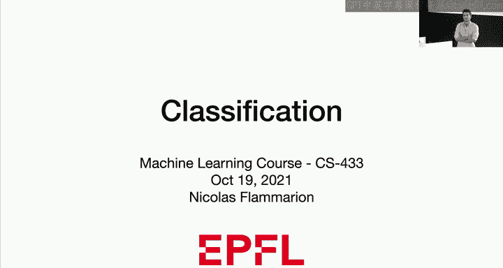

So first， let's you know try to see how we can define the classification problem。So。

As usual in supervised machine learning。We are observing a data set S。

Of some input X I and some output Yi。But now the main difference will be that your output。

Will belong to some set Y， which will be disc。Okay。Previously with regression。

 we were considering some subset of the real numbers。😊，Now， why will be a disc set。

And so what is the goal of classification as also a problem of supervised machine learning？😊。

I am giving you a new input X， and what you want to do is to predict is La Y。ok。

That's a game we are playing。You have some tiny that S。So Y I will belong to some this headset。F。

You will use some algorithm。And with this algorithm。

 you will learn a function which will help you to do some prediction。O。

So you see that it is exactly the same framework as for migration。😊。

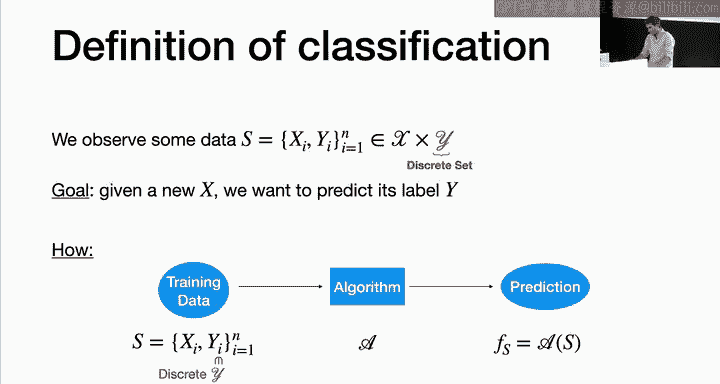

The main difference is that now。We are relating the input variable to output put why， which is。

categorical variable。 Okay， so the output y can only take some discrete values。

That's the principle difference。With before。And so we can consider some binary classification。😊。

In that case， the output y can only take two values。So okay， so y will belong to two classes。

 C1 of C2。And what we will often do today is that we will call this classes， you know。

0 and1 or for example， minus one and1。😊，And we can also consider as a miy。😊，Classification， I mean。

 the multi class classification sitting。Well the output why。Can take more than two values。 Okay。

 so then why。Can take the value of K different classes。So from C1 to C， K-1。And here also。

 we will often use the name to call these classes0 to k minus one。Okay。

 but what is important what is really important to understand and to have in mind。

Is that when we are calling， you know， this class is 0 and1 or minus-1 and1。It's just a name。Okay。

 so there is no ordering between the class is's not because you have like the class0 and the class one。

 then the class zero is smaller than the class one， for example。😊。

Like the outputs are really categorical。 So for example， you know。

 you will try to see do you have a disease or not。😊。

It's not like the fact that having a disease is smaller than not having the disease。

So you have to keep in mind。That this name is just for commodity， okay。

Its exactly equivalent to C1 and C2 of0 and 1 and -1 and1。And for some example， we will use a01 case。

 and for some other example， we will use a minus11， but it will be exactly the same。

Is it clear for the general setting。嗯。过。

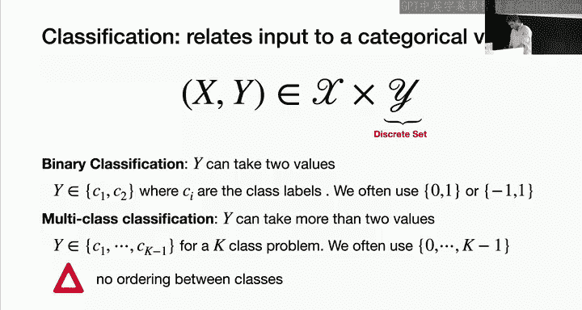

So let's just an example。 you know， that's that easy。So the first one is like the spa detection。

I'm sure you all have like a mail box， for example the one of V PF L。

 And you can see that the span detection is not very efficient。 So here it sum， you know。

 some mail I receive。And you can see that some of them are really expected， so for example。

 you will get a mail about a talkque I will give soon or you will get a mail of my admin about like the coffee we are missing in the lab。

 these are the mail I want to receive。And now we have also example， for example。😊。

Some is from some predatory。Scientific journal want us to provision there and we don't want some weird mail but Western Union。

 I don't know this aspanm。So what is a class we want to do in spa detection， We have a training set。

And with this training set， we have learned a classifier。

And now I want to use this classifier to classify my mail between。

The mail I want in my inbox and the mail。I don't want in my spa folder。

So you see that's really like a classification problem because your output will be。So class1。

 which is a good mail。And the class 0， which is a spa。

And you see that I can call that class0 and I can call this class1， or I can also call the good one。

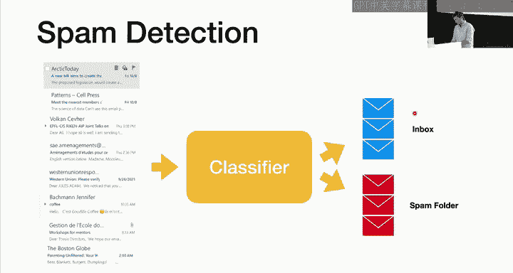

1 in the spam，0， it will not change anything。Another famous example is an example of image classification。

😊，So here we have some pictures。And you want to classify between being a cat。Be a duck。

So as exactly as before， you had previously a tan set。

 you have learned your classifier and no you are observing some new pictures and for each picture is what you want to do。

 you just want to say if that one it is a cat or it is a dog。So your input these pictures。

And the output is a label。 it will be。Cat label or the dog label。

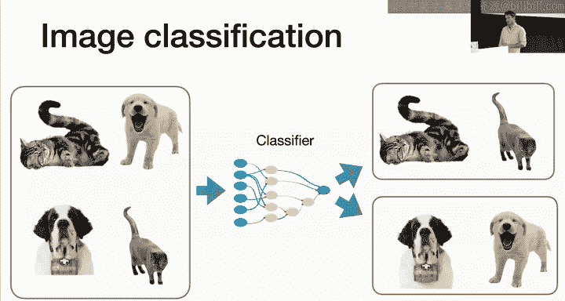

Okay， this is really clear。So let's look at another example。We will use a lot today。

So it is a credit card default example。So we have a credit card service。

And they want to determine if their clients will default on their next payment of their credit card or not。

And so they have this training set of previous customers。And for each customer， they will have。

The income of the customer。And the credit balance。 Okay。

 so the credit balance is the amount you have on your bank account。And what they want to detect。

 what they want to learn is if a customer will default or not on his credit card payment。O。

And so we see here that the customers， which。I mean， the customer who default previously。this over。

Cause。And the customerana who did not default has this blue circle。So this is your data。

And know what you want to do is that if you are observing the data of a newyma， for example。

 it could be。A point here。You want to detect。You want to predict if this customer will default or not。

 So for this one， what do you think。Can you repeat。Again， I don't。Cool， thanks。In a。

I do a point here。Whathy do you think。因 we live。So核 do you decide。So what you see is that。The income。

Features is not so informative。You know， it does not really help you to detect if you will default or not。

But you see that when you look at the balance。There is a clear hand。If you have a low balance。

Then you are very likely not to default。And if you have a high balance。

 you are very likely to default。ok。So this was some example of the classification task。

 And so how are we doing some classification。

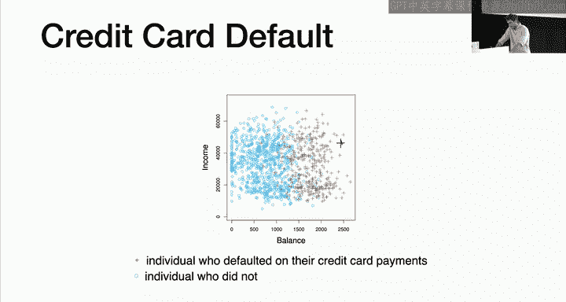

Just some other definition。It's really using a prediction function。

 which is in the case of the classification called a classifier。So what is a classifier。

 it is a function from your input space x to your output y。And what is' doing this classifier。😊。

It is dividing the input space into a collection of region。Belonging to each class。You see。

 you really have a function which will split the space into different region。

 This will be the region of the class 2。This will be the region of the class1。

 and this will be the region of the class three。And so you see that we have some frontier between these different regions。

And this frontier， we really call decision Bai。ok。😊。

So the decision boundaries are really the boundaries of this region。And so， when you go。

Across a decision boundary， you go from one class to0s。So this is what is called a classifier。

 So a classifier is the function you will want to learn in order to do your prediction。

And so you see that。It's possible to have some。Linear classifier。

 So what do we mean by your linear classifier， it is a classifier for which。

The decision boundary linear。But it is also possible to have some。Non linear decision boundaries。

 so this will give you some linear classifier。And so for Z these。

You see that the decision boundary are none narrow。But just， you know。want to remind you that。

As for regression， it was possible。To get someline。

Some non nonlineararity only by considering some augmented feature space。So maybe， in fact， you know。

 here I have the feeling that I have learned。A non linear classifier， but in fact。

 they have just learned a linear classifier。In augmented space。 So this would be exactly the same。

As for hydr， it would be possible to obtain nonlinear some non nonlinearity only by augmenting the feature space。

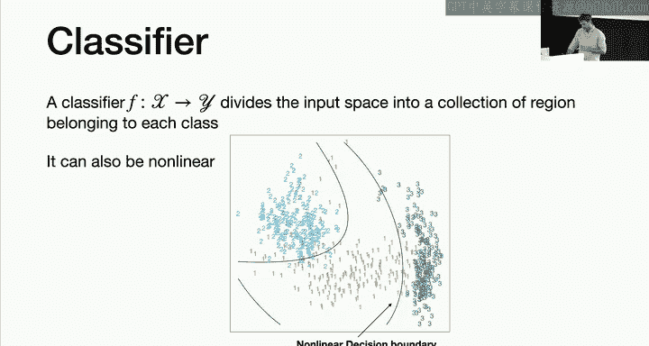

So now let's try to see how we can solve this classification problem。And。

The first thing I would like to we see together today is that。

Can we just see the classification problem as a particular example of the regressionreation problem？

Because when we look at the definition。We see that you know classification is just a regression problem。

😊，With。Just kid labels。So， in that sense。I'm just restricting。The set of my output。

So classification should really think as a just。A special case of regression。

And so if it's a special case of regulation， maybe I can just use a previous technique。😊。

We have seen in the previous lectures with Martin。So is it possible。

So you know how would you use some regulation technique in order to solve a classification problem？

What would you do， Do you have some ideas。嗯哼。😊，So that's a good idea。 Can you say， now in these days。

 how will you do。Oh you will do。 Okay， I give you like a training set。And you have a training set。

 for example， you will have your x and you will have your Y， some y will be belong to the class one。

 some other Y will be belong to the class2。What would you do then。提交。Okay。

 but if I want to compute the p weight with this square， I need some output y which are here。

Which are semi whole number。 So now only have class 1 and class 2。So what can I do。开有。

Then that maybe， but my problem is not that the range is not good。

 My problem is that I just have class 1 and class 2。

What does it mean to solve a least square for x belong to the class 1？It's not difficult。

So you can just say that the class one will be the value1 and the class two will be the value zero。

 for example，😊，So then you are serving your list square， so you will get a vector w。

 you can get some prediction W transpose x。To some values。 What will you do with this value。

What will you say if x belong to class 1 or if x belong to class 2。好的也确实退休。嗯。Yeah。

 so what we will do， because they our training sets。We will。Consider y to be equal to 0 if。

X belongs to the class 1， and y would be equal to one if x belonged to the class 2。

Then we will just run some Nequa solver。😊，As before。

And then the problem is how can you do a prediction with this， how can you predict a class？No。

 you don't want to predict the value。 You want to predict the class。

 So you want to go from some value。 The value will be w transpose x to some class。

 And so what you will do is that you will use a threshold。If the value is smaller than0 to5。

Then you will predict the class1， and if the value is larger than0 that 5。

 you will predict the class2。😊，ok。😊，That's a good way to solve it， I mean， it makes sense。

So what we want to see now is that， you know， is it a good idea。

 do you think it will give us some good results？😊，Will we see that， in fact， classification may be。

It's a little bit more complex， and we have to think a little bit more。

 and we have to derive some new techniques。

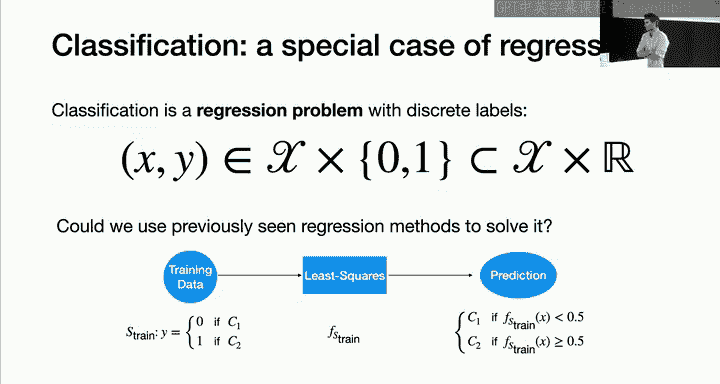

So来。So is it a good idea。 So what we are doing is that we are considering the previous data set。😊。

Okay， but the credit card default。And what I told you is that， in fact。

One of the features was not informative， so now I'm only considering the balance features。

That's the one which will help me to do some prediction。So I have my data set， I have my X， N。

 I have my Y， N。 We say that the X N is the current outstanding depth of my customer。

The company has collected a lot of data。 Okay， we have a lot of this X， N， Y， N。

And so y and y will be equal to1 if。The customer did default。

And y would be equal to zero if the customer？Did not。Defa。Again。

 what we want to predict is if I'm giving you now a new value。

So I give you a new customer with a new balance。 you want to predict if this customer will make some D。

 I mean， will default or not。And you can imagine that will be very useful for some bank or some credit card company。

 okay？😊，So what we did is that we say that all the previous customer who did。Not default。

 We put them to the value 0， all the one who did default we them to the value 1。 So this are my data。

 and now I will learn a least square feet。 Okay， we just learn this function。Okay。

 and then's a question。Hiss how we will use。This like。So the first thing is， how did I learn this。

 I just you know， minimize my list square how I just minimize the square distance between the line and all my point。

就 is thiscraft。And how should we use this slide？I'm just taking new point。For example here。

I look at the value on this point。It would be exactly equal to one。One is larger than the order 5。

 so I will predict that this customer will default。Now， if I look at the point here， for example。

I can look at the value of my prediction at that point。It will be around the0 4。

 The 4 is lower than the order 5。 so I can predict that this customer will not default。

And so you see here。In this dash line， it is the decision boundary。She is exactly。就方 between。

The crystal。Who will not default so that the one for which the balance is smaller than this value？

And if your balance is above this value。You will be predict to default。ok。This is clear。

And when we look at this line， we could think that it is working quite well。😊，No。

When we look at where。We find the decision boundai， it really makes sense。

You see that around here you have a lot of point around here you have a lot of point。

 so if I will have you know ask you where would you put this decision boundary？I think。

 maybe you will have。You know， you will have gave me an answer。

 which would not be too different from that one。Yes。And so， you can see that。

It's convenient also to predict， I mean， to interpret as probability。The value。Of the prediction。

Because if it's smaller than 0 do 5， we predict 0。 and if it's larger than 0 do 5， we predict one。

 So in some sense， maybe what we are trying to do is that we are trying to learn what is the probability。

Of making a default。 or what is the probability of not making a default。

So do you see a first problem with this interpretation。it's kind of weird to interpret this value。

S破白几。Exactly。

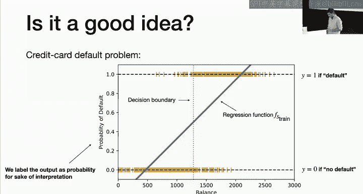

So first， it's little bit weird to say that these are probabilities because they are not restricted to be between 0 and 1。

So we see that it does not make a lot of sense。 So that's the first problem。But。

Can you imagine some other problem why in fact， this is not a great ID to try to solve the classification problem as a regulation problem？

What could have happened？哎。Okay， but do you think this point will be outlier。I mean， you're right。

 it's sensitive to extreme value。But the point you are talking about is not an outlier， in fact。

 and we will talk about it。So that's a very very market。Do you see another， you know。

 maybe another reason why it's not a good idea。是OK。But then if it's not now。

 then we will have to do something very more complex， you know。

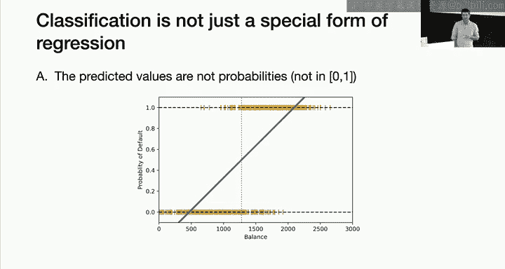

But the first example is， in fact。The data set I was showing to you was very well balanced。

And that means that I had the same number of customers in the class 1 and in the class 2。But I mean。

 I lie to you because in fact， when I'm looking at the original data set。

In the first in one of the first plot in the course we saw in the lecture。I only had 3%。

Of customer in the。In the default case。So my two classes were highly unbalanced。

And so here you look at what is happening if I'm considering。So the same data I said。

 but you know in an unbalanced case。So， I will have。15 times more customer。In this class。

 than in that class。O。And here， again， what you are doing is that you are。liing。Your square feet。

And you see now that your line。As shift a lot。And if you look at your decision boundary。

Whereas when you are looking at your I mean the data that you don't really see the difference。

And you will still be willing。To do your threshold on this value。If you are looking at the output。

Of your fit。You will be re at this value。So you see that it does not make any sense。If I give you。

Acus was， you know。Whose balance is more than 2500。

I think that no one in the room will say that this customer will not default。Whereas if you look。

As a prediction。Your all enough fit is giving to you that the least graph survey is giving to you。

 it is telling you that you will not default。So you see that the position of the least squares fit。

Really depend a lot on how many points you have in each classes。

And that's something which is not a good features of a classification method。Is it clear。哎。

What does it mean to learn a different threshold。So who would you learn the threshold。Yeah。

 so that could be an option。 That would be kind of also the same just to， you know。

Weed your point differently。 So you have to， I mean， sure you have some way。To solve this problem。

 But you see that。

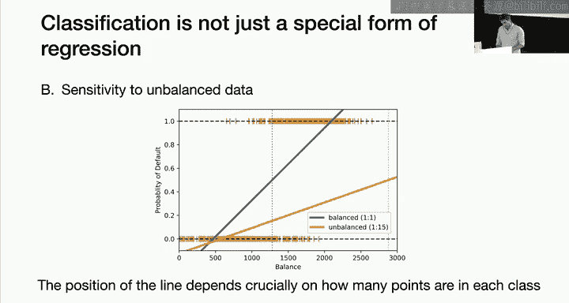

It's still a bad feature。And what will be even worse is that what you say previously。That， in fact。

 the position of the line really depends a lot on where the point lie。 So， for example。Here。

 Im taking this。I have the same that as set。As before。

And what I'm doing is that I will add some points。With very large。Des， okay。

And some other point with very negative balance。 Okay， so Im imagine。I'm faking some customers。

 some some of them。We have a very large debt。 Some other of them would be very rich。 Okay， I mean。

 it's not a question of wells。But their balance would be very negative。

And now I'm still learning my least square feet。Do you see。How much。The line。

A shift if you compare the blue one， which was without any extreme value in the orange one。

So here it's a little bit hard to see what is happening， so I'm just doing a zoom。

The second pictures。Okay， so this is just a zoom between the value0 and the value 3000。

So you see that。Now， if I want to look， where is my decision boundary？So in fact， this line。

Is almost。呃，呃徽总图。But in fact， for all this point， it will be below the ordered five and it starts to be above the ordered five after this threshold。

So you see that by adding these points。I'm totally faking my classifier。

Because now I will predict as not making default on point for which I'm almost sure。

The customer will default。O。And so previously one， I mean， one of you say that this was these points。

Where outliers。这对哎。歌申。嗯，这我。所以诶明 we为咧。It does。 but the difference is that for regression。

This point will be outliers。Because for regression， if you have some point with very extreme value。

 kind of thats mean that。They are not following your linear mode assumption。

But what I want you to see is that exactly my question is like for classification。

 do you think that these points are players？😊，What does this point， this point。Acusto Earth。

So you have a very large balance。😊，And they are making defaults。Do you see that this is not ats。

That just， you know， some personon would just spend a lot of money and they will make default。

But you should not think of them as outliers。 If I ask you to predict them， you will predict them。

都 that里。So this is really in layers with extreme value。And in fact， if you think of these points。

These are some punches are very easy to predict。So they should not be problematic for your methods。

So， you know。We see that the position of the line。Really depends on where the point lie。

What is the value of the balance？And so then the question is why， you know why？

It is not working to use this square regression in order to serve classificationification。And。I mean。

 the reason is that， in fact。The key area， we are in amazing， which is a square house。

It's really not the last you want to minimize。I mean， you don't。

You don't care about the least square， I mean， about the square distance between your prediction。

And the value of y is is not what you want to minimize。

What do you want to minimize in the classification problem？Yeah。

 exactly what you want to minimize is the number of error you are making。

And you are not caring about the distance between your predicted value F and the value y is equal to1。

You know， this is not related this distance to what you want to predict。

 What you really want to minimize is the number of error you are doing。

So you just want that all this point。Belong to one。And all these bound points belong to zero。O。

And so you see that also this is another problem with a least square when I'm considering the square loss。

Then。I will suffer the same error。If I am。Above。Or if I am below。Okay。

 because the quantity class is just y minus y prime square。So for the square less。

 it will be exactly the same to be above the line or below the line。But for a classification problem。

 if I am above the line。😊，I will not do a wrong prediction。 I will still do the correct prediction。

So I should not suffer any at all if。I am above the line。

 So you see that really that the quadratic class is not a good loss for the classification problem。

Okay。If we have a prediction function， it can have。AVery large means query Hall。But still。

 it can be a very good classifier。So in some sense， when for this classification problem。

 we are trying to minimize the squares。We are working too hard for the problem we want to do。So sure。

 for some in some case， if you find a classifier， which will have a very low means square。

It will give you a good classifier。But in some other case。By training。To push down the mean squarer。

 you are not minimizing the good objective。And if will not give you a good classifier。

So we see that informly classification。😊，意思。A particular case of regression。

It will not be enough to use the methods we have seen for regression。

 and we will have to work a little bit harder and to derivehive some new methods。

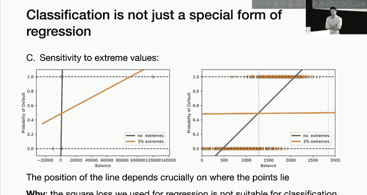

And this is what we will do today。So what we will try to see is that really。

How can you solve a classification problem？You are observing some points。For example。

 here you have two classes。 you will have the red stars。And the blue circles。

And you want to find an algorithm which will help you to predict the value。Of the new points。Okay。

 this is really a task we are doing in test。And what we will see today is that we have a lot of different approaches to do so。

And we will not review them exhaustively。We will just provide a quick introduction to all of them。

And then during the following lectures。We will go more into details and we will really analyze all these methods。

Okay， so today is really like a quick introduction。And just。

 if we want to summarize all these methods。😊，You know。

 what are we really trying to do when we are solving a classification problem？

We are really trying to super the space。Into values。Decision boundaries， I mean， decision regions。

 This is really what we are trying to do。We are trying to find。三。Decision。Bundary。

 which will help you to predict if you belong to。The class blue or to the class head。ok。

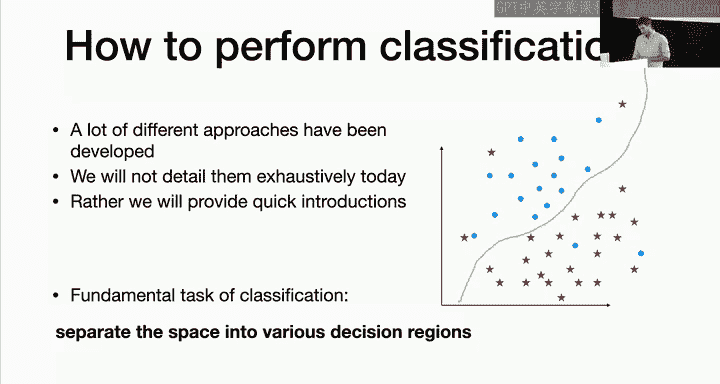

So what is the first。Algorim we' talk about。It is called the nearest neighbor。

And you will see it's kind of simple， but it's very nice。😊。

And so we will spend a whole lecture on it。Not Thursday， but next Tuesday。Okay。

 and we will really analyze how， how well it can work， we will deehive some precise to result on it。

😊，We will be able to be very precise。But， first。Let's try to define。

What is the nearest neighbor rule。So if I'm giving you this data asset。Okay。

 so you have a data set with very simple case， two classes。😊，I have。My blue circles。

 and I have my head stars。And now I give you a new point。That one， you seen green。

And I want to predict。What is the class of this point？What would you say。

So who thinks at this point would belong to the class？1。就是。Blue。Blue point。Can you raise your hand。

Okay， and to the head one。O。So， you all think。This point。Should be ahead。

So why do you think it should be a star？No how have you made your decision？怎么。冇知。

And why the nearest neighbor should be， you know。So a correct prediction。What are you assuming。第一个。

So what you are telling me is that it makes sense to predict this point as a star because。

We are talking about Neva's neighbor， so kind of we are assuming that this point should behave。

I is neighbor。But you can see that for a lot of problem， if I want to classify you。

 you won't be classified as your neighbor in the room。Okay。So what are you assuming。

We are really assuming that there be points。Are likely to have the same label。OK。So we will。

 we will come to it。So。Then your question is， what do we mean by nearbybi。

 So imagine that you have some distance。Can be the Eidean distance， can be any distance。

And that for this distance， you will have some special correlationation。😊，So that means that。

Your neighbor will have is very likely to have the same label as you。O。For example， in this room。

 your neighbor is very likely。To follow the machine learning course。You see that's easy one。

But then you could imagine a letterta for the。featureature， for example， gender。No。

 if you look at your neighbor is not sure it will。Alp you to predict your gender。

So how can we formally define what is the nearest name Bill， It's really that you are assigning。

The label of the closest point in your training set。So you have a training set。

 This is my training set。I take a point。And I will look。At what is my closest point in my data set？

And now I will look at the output， I mean， I will look at the label of this point and I will predict exactly this as my label。

Is it clear for the definition。Yes。😊，You have a distance。

You look at your closest label and you assign the same label。And， of course， it will only make sense。

If we are assuming some special correlation。

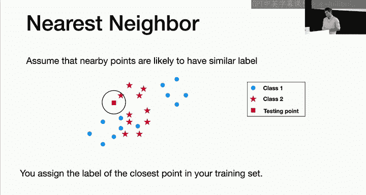

So what are the positive and the negative points of these methods？

So one of the positive points is that you see there is no optimization involved。

 or there is no training。 you don't have to train a classifier。😊，Okay。

 I just give you a data set and with this data set， you can directly do your prediction。

There is no pre computing。So that's something which is very nice。And also。

 it's kind of very easy to implement。 It's very easy to understand。

You just look for your closest point in your data set and you give。The same output。

So no optimization， easy to implement。And what we will see is that， in fact。

 this method will work very well for low dimension。😊，For space of flow dimension。Okay， so for 1 d。

 2 d， 3 d， that I will work quite well。And why it's because really。

 you see that doing the Ns neighborhood。You will be able。

To model some very complex decision boundary。So if you look at this problem。

You know and you were trying to use a different algorithm。

It will be kind of odd to get such non smooth decision boundary。Says， you know。

But with the nearest neighborhood， it will be really easy。You just look at the closest point。

And you predict， accordingly。So you see like by defining implicitly。The output， I mean， the output。

 it will really help you to have this。Weird decision boundary。

 and this will explain why this method works so well in low dimension。

But then what are the negative points？The first one is that。It will be very slow at query time。

If you compare this to， for example。What we saw previously with using linear regression previously。

 I just had to compute the value of double transpose x。And then to look at。

 is it larger or smaller than the other5？So you see that this is like kind of like a constant time。

If I give you W， you will pay o of1 in order to do your prediction。But now。

 when you want to do Nere Nego， what you will have to do is that you will have to look at all your point in your data set。

In order to find the closest one。So if you are just doing like easy implementation each time。

You will want to make a prediction。 You will have to pay a cost of。

Or there's a number of elements in your planning set。So that will be very slow。At query time。

And then。Second point is that what we would see that this method is not working for a largely mentioned space。

So if I have a large， I mean， have if I have some data which are highly in high dimension。

It will not work at all。 Do you have a 90 Y。Why in a high dimension space。

 in a high dimensional space， it will not work。Yeah。嗯。We felt it like。朋们。怎么。

What is happening in high dimension， which is not happening in low dimension？Yes。😊，Exactly。

 in a large dimension space。You will be very unlikely to have enough data point in order to cover value space。

So when you will look at your closest neighbor， in fact， it won't be close to you。

But it will be in the other city， if you want。That it will not be predictive at all about your label。

You谁。This hole is really working well。😊，In this， for example。

 2D example where I have a lot of points。And if I take a point。

I would be very likely to find a point which is very close to that one。But。If， for example， you know。

 I wanted to predict the value of this point。You directly see that in my training set。

I don't have an example， which is really。Close enough to be predictive。So in high dimension。

 you won't have enough point in order to cover value space and this method will not work。Okay。

 so let's do a quick break and we start again in 15 minutes。Thanks。Out of case。

 it was better to try to work a little bit harder into derivehive some new methods。

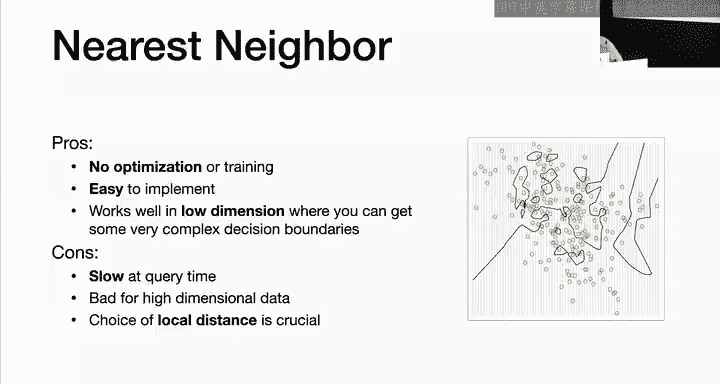

And the first method。We have introduced was the nearest Ne。喂。When we are assuming。

Some special correlation。 So when we are assuming that the point which are never be。

Are likely to have the same label。Then we saw that it makes sense。

To assign the label of the closest point in your timing set。O， so that was a simple definition。

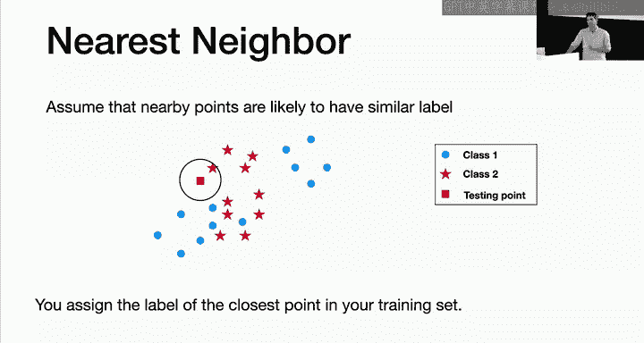

Of the nearest neighborhood。And then we saw that this simple method。Have a lot of positive points。

 It was very easy to implement。It did not require any。Optimization of timing procedure。

And it worked quite well in low dimension， and even in low dimension。

It will be possible to model some very nonlineiness， some very weird behavior。But then we saw that。

The simple rule was not always a good idea。First， because it was very slow when you want to do a prediction at query time。

 it will。In general， it costs you O of n where n is the size of your training set to do your prediction。

Then we saw that it was。Not good at all for high dimensional data。And why it is because。

In high dimensional space。So distance， the average distance between two points will be very large。

And so you will be very unlikely to have a name， I mean。

 that your closest neighbor will share some similarity with you。ok。

So this is why it is not working well。In large dimension。And then。

What we will see now is that also the problem of this method。

Is that the choice of the distance would be really crucial。

And so that's a another parameterme to be considered。O。So you are ready to， you know， you have to be。

Careful about which distance are you considering when you are implementing this role and it will have some importance in your pay。

Okay， are all these points clear。In particular。Is a point about。Why it is bad。 I mean。

 why this method is not working well in high dimension clear for all of you because maybe this is not so easy。

So if we want to do it again。In a low dimensional space， so for example， in this room。

It's very likely that。Your neighbor will share a lot of similarity with you。ok。

But then if you assume that your data set is different。😊，And that you are only assuming you know。

 you are only observing one inhabitants of Switzerland， one inhabitants of France。

 one inhabitants of the United States。So if you take the closest neighbour。

 it will be in another country。And so it would be less likely to share some similarity with you。

And that's exactly what will happen in a high dimensional space。The distance will be very large。

 and when you will look at your closest neighbor， it will be very far away。

 and so it will not share some similarity and it will not make sense to predict your label to be exactly the same label。

As your neighbor， okay。And so why it's because in a high dimension space。

 you won't have enough point to cover well all the space。But we will talk more about it next Tuesday。

Is it clear for this whole。Yes。Okay。

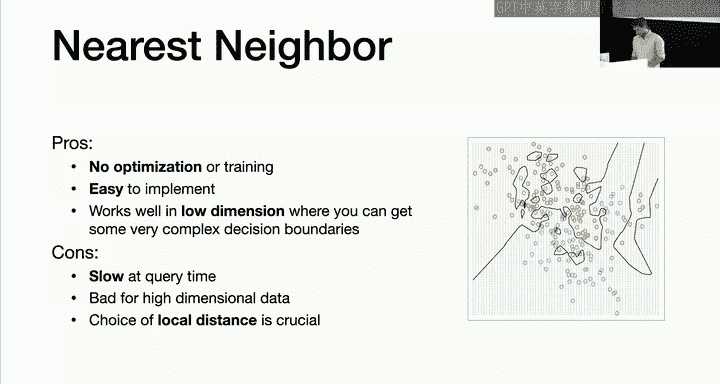

So of course， you could say that。You know， why are we only。Using our closest neighbor。No。

 we could easily extend this whole by considering。K of them。

And then we will just do a ver between them。And what we will output will be the majority that。

Among the K nearest na of your point X。So， instead of trusting。Your closest neighbor。

 you will ask a little bit around。And you will do that。

And this is this will be how you will do your decision， okay？

So here we see in the same that I set in another example。

 what I will implement is the three Nera neighbor rule， so I take a point。

I will look around to find the three points， which are the closest。Is are this three point？

And I will do a vert among them。You see that one say you should be。And the two others。

Say you should be blue。 So when you do a vote， when you take the majority。

 you will predict this point。As a blue。Okay。So this is a simple generalization。

And then the question will be。How do we set。The value of k。

That will be one of the main question of the K near as Na and we will talk about it next week。

 and we will see that this value of K will be related to the biased trade of variances we talk about last Thursday。

And then you see that， of course， maybe it's not， you know。A very good idea to do a majority vote。

Or maybe if you are looking at some。You know。For largest number of pound。

Maybe to the10 nearest neighbor， it does not make sense to give all of them the same weight。

And so that will be another organizationization， which is called smoothing camel。😊。

And so smoothing can will really be， you will do some weight to a combination of elements。😊。

So you will trust more the advice of a neighbor which will be closed。

And then you will decay the weight for a neighbor， which will be further away， okay。But。

Other than that it would be exactly the same method It does not change a lot。So this is like one of。

 I mean， a simple generalization of this method。😊，We can do it again。

 you can consider not only your closest label， but you can consider a K of them。

 and you just do a majority vote to decide the label。

And then an easygenization will be not to do a majority ver。

 but just to do a weighted linear combination of the output。You have some questions about this whole。

Okay， if you have some other question， we will talk lot I mean。

 we will talk a lot about them in one week。

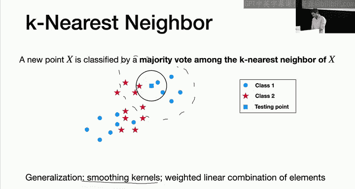

I know for the last part of the lecture， what we would like to talk about。

Is another classification for。 I mean， model family。Which is the one where you're assuming。

That's your decision mon。Okay， that could be another I。

You could consider there that your classifier will have some linear decision boundary。

So in dimension2， it would be a line。And in larger dimension， it will be a Naer plane。

And so how you will do your prediction。We can do this drawing。 I have。one。W， Okay。

 so this is my e vector double。And this vector。Will define an I plane that will be all the point which will be orthogonal to this W。

So this is my iPad plane in red and sorry in green。😊，And you see that this a plane。

Is derived by my autoagonal vector do。And so how I will do my prediction。

 I want to say that if I have on one side of my iPad plane。Here， I will be。Okay， we' be a star。

And if I am in the other side of the hyper plane， I will be blue。It would be a second。

And so what does it mean to say we are on one side of the IP plane or we are on the other side of the IP plane？

It's exactly the same as looking。At the scalar project between x and the W and to look at the sign of this value。

Okay， because if you think about it。The scalar project between x and W。It's exactly。

The sins of this angle。And the scalar product between W U and X2， it will be this scalar product。

 So you see that。If you are on this side， then this kind product will be positive。

Whereas when youre off the other side of the IP plane， your scalar project will be negative。ok。

So when we are talking about linear decision boundaries is。

 we are really talking about finding a vector w。So that you will do your prediction using the sign。

F x transpose w。I give you a w， you want to make a prediction。

 you will compute x transpose w if this is a positive number you say it belongs to the class 1。

 and if it is a negative number you say it belongs to the class 2。I it요。对。In that setting。

 I do not allow for any upset upset， but you can always add。The small shift and W 0。O。But， I mean。

 we will talk also about it Thursday， when we will talk about logistic hiation。

 often what you will do is that you will。😊，Add the constant features in your x。

 and you will put the up of set an x。But that's a very good comment， I mean。

It makes no sense to assume。That your eye plane is necessarily going through zero。

So you can add offset。To play with it。So maybe one comment you could do is that。

It's not a good idea to do linear prediction。

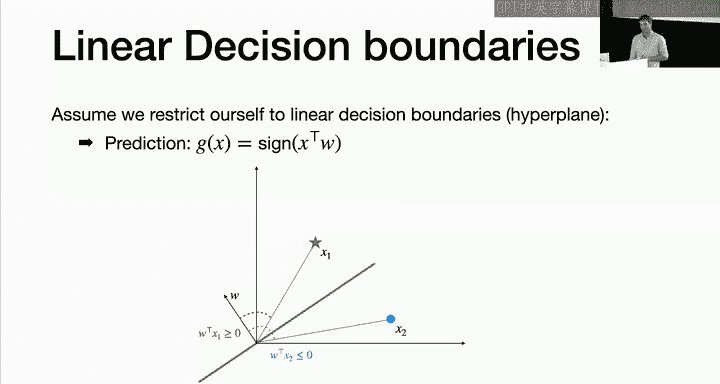

If we come back to the previous example。For example， for this kind of data set， of course。😊。

If I try to do。呃，里面啊。Decision bondai， it will not work well。

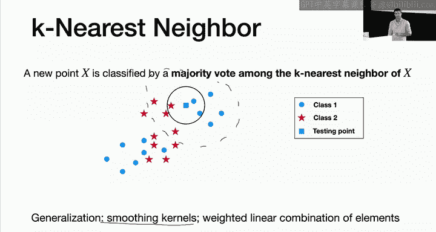

对。What we could you know kind of think of is that maybe in very large emotional space。

Then the geometry will be they' will be different。And linear decision boundary will work not too bad。

Okay， so this is what you have to have in mind。And then。

What we also see is that considering linear decision bonday will be really easy to do the training。

 So we will talk about it， but it will be very easy to learn。Your喂 W。And also。

 predictions are really easy。If I give you W， it's very easy to do a prediction。

 you just have to compute a scatter product and tag the sign。Okay。

 so you see that it is working quite well。

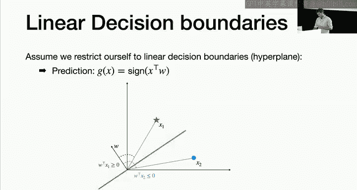

So， let's see then， you know。How we can find a good hyper plane。是发还。成 p设置。

We will first assume that your data set is。你ina失。ok。

So why does it mean that the data set is linearly？Does means that it exists say by hat a airplane。

And so what does it mean， it means that it takes this one I of plane。😊，快个铺。That团。Sa that。

All the blue points are on one side of the I plane and all the head points are on the other side of the I plane。

ok。😊，So you see that I mean， a se heading eye plane is really anip plane which will help you to get perfect prediction on your data set。

If you were predicting the label of your training set using。This type of plane。

You would get to zero classification therefore。😊，All the blue points are on this side and all the red points are on the other side。

Is it clear for the definition of a say hatching hyper plane？

And so when one separating a plane exists， we say that the data are linearly separable。So。You know。

 of course， it makes sense。If your data are analysis available。To output one se a of。You know。

It will not make sense。To use this I plane to make your prediction。Because even on your training set。

 you will suffer a lot。Of一好。Okay， all this point will be badly classified and all this point will also be badly classified。

So if your data said Aliina is a Bible。😊，You want to output one separate he hyper plate。

But then maybe you we directly see it。If it exists once a biting a plane。

It's really likely that it will exist a lot of them。 you know， for example。

These will also be a supporting hyper plane。That one， also。You know， you have a lot of them。

 And so the question will be。Which one to pick。What does it mean。To take the best one。Okay。

 so what we just say is that if it exists once a h a airplane。😊，It will exist a lot of them。And no。

 the question is， who should you choose？One of， I mean， once I I， What does it mean。

To choose the best one。Now， what would be the definition of best？Why do you want？

Call a plane because。All this hyperplane。We get最好 tiny一好。Okay， but if we go before this。

 what does it mean。To take a good A plane。 What do you， you know， what is a property。

We talked about it last week。So this is a geometric interpretation， but you know why。

 why would you like to be the fastestthest away？

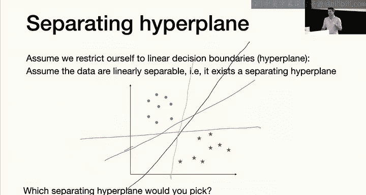

To older point。Exactly， so you want to find an hyper plane which will have a good linearization error。

😊，So then what does it mean？So。You know， for example。These are my heading sets。

But if I look at the point on here。It's very likely that this point will be blue。

And if I look at a pointer around here， it's very likely that this point will be red。

So these other the point。You know。Which are easy to classify。 And you want to find a an a plane。

 which will help you to do such。That's good classification， but if now I look at， you know。

 for example， this hyper plane。You see why。This type of plane。It's not a good idea。Why in practice。

 I will prefer that one。哎。Yeah but to go to far away。What， you know， okay， minimum distance。 But why。

 you know。Why this will not be a good idea。It's really because。My dad， I mean。

 my distribution is very concentrated around here。 So when I'm predicting this point around this point。

I know that they will be blue and here I know that they will be red。对。When I'm look。You know。

 a little bit in the center。It's not clear at all。 What will be the label。

So maybe sometimes I will observe some blue points here。

 sometimes I will observe some head points here。And so you want to find ani of plane。Which really。

 which is hoist to this kind of stuff。You really want to find a ni plane。

Which will help you to do a good prediction。And which is kind of consistent with what you are already observed。

And so the concept behind this and the concept behind how to choose this I plane is exactly。

What you all say is this concept of margin。

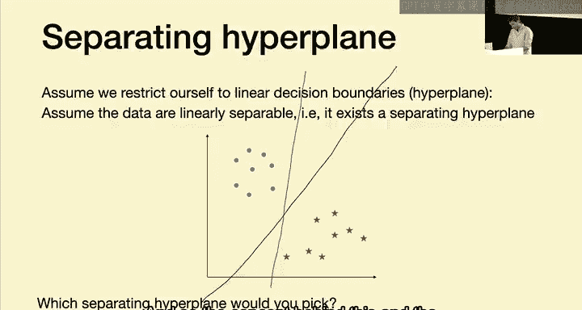

So that will be very important。So what is the definition of the margin？If I give you ani of plane。

He有。This type of plane in green。The margin will be。

So this stands between the IP plane and the closest point on my dataset sets。

So you look at your IP plane。You look at all the distance between your point。Any I plane。So I。

 you have that one， that one and that one。And the margin will be。

The minimum distance between all your point。Anzy per。So in that precise case。

 you see that the margin。Will be。😔，Exactly this distance。O。

Is it clear for the definition of the margin？The margin is a minimal distance between your hyper plane。

And your planning set。So it is well defined。And then what we will see is that it makes sense。To take。

The iPad plane。Which has the largest margin。So that means that to take the hyper plane。

Which is the furthest away of all your turning point。

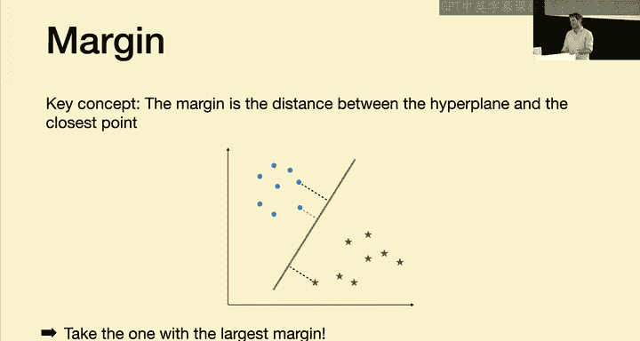

So this is what is called the max margin separating a ofplan。Okay， you will take the eye of plane。

Which will maximize the margin。So that will be the iPad plane。

 which will be the furthest away of all the point。So why do we want to take that one is such that？

We will be as robust as possible。Because we will be very far away。From the blue point。

So if I see some point， for example， here or here。And they are still likely to be blue。

I will classify them well。😊，And that exactly the same for some other point around here。

They are far away for your turning point。But。They are still likely to be ahead。

Because are in some sense， closer to the head point than to the blue point。ok。

So what we should think about it is in some sense， if I compare this。Ie of plane in red。Which is my。

Max margin hyper per plane。And I it compare it with this hyper plane here in blue。

So you see that the margin。Of this type of plane。Is really smaller。 Okay。

 if I look at the distance between。The I mean， the smoothest distance between this type of plane and the training set。

It will be cease dense。

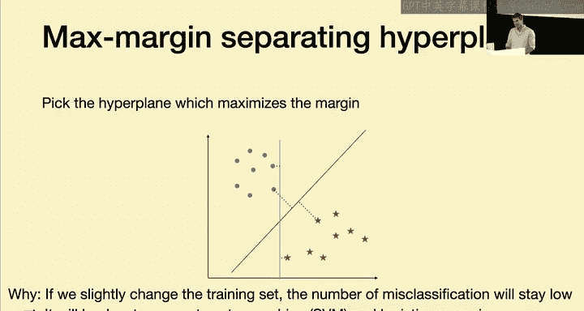

对。Can you repeat again， sorry。It's a good， you say that。

 you say whether the margin is not well defined or that the maximum。No it's not unique。ok。

But you have to pick。1 max margin。But I did not say that it was unique。But for each hyper plane。

The margin is well defined。Maybe we not to know。Maybe you will have two points which will be at the same distance of your iPad plane。

 but still this distance will be well defined。So for it， iPad plan， you can， you can。

Asuated to its margin。And then you can look at all the margin for all the I plane。

And this you can take the minimum value of this and so， but the argument is not necessarily unique。

 but you take one a of plane。With margin will be minimum， okay。

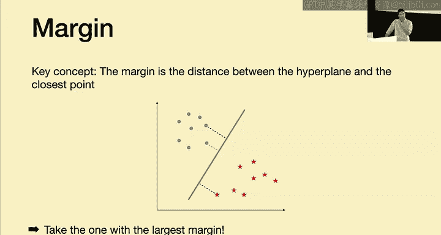

Very are good point。But so what we wanted to say is that。In that case， this will be。

1 max margin hyper plane。And I want to compare it to this。Iper plane in blue。

For which is clear that the margin is smaller。Okay。

 so margin is this distance for the blue hyper planee， it is smaller than this distance。

 which is the margin of the red hyper planee。And so why？These aplanes makes more sense。😰。

Is because you see that here。I'm very likely to observe some blue points。Here。And。

For all these points。If I'm using。So blue I plane。I will predict them。In the海。ok。

Why it make no sense to predict these points in red。

Whereas when we were thinking when we are considering this max margin hyper planee。😊，You see that。

 in fact， all this point。You will classify them as blue。And this make a lot of sense。Okay。

 so what is important to have in mind is really that。In compound。

To other all the other separating I plane。The max matching one will be the one which will be the less prone to a house。

Okay， if you are slightly changing your training set。If you are like wling the input a little bit。

Then when you will do your prediction using the max margin classifia。

Then the number of misclass will stay low。O。So is it clear about this a max margin sehe a per plane。

 do you see why kind of it makes sense if you have the choice to choose one seating a plane to take that one？

Yes。And so we will talk again about it in two weeks。And so what we will see is that there is。

One particular algorithmic way to find one a plane。Which when the data will be say。

 because in all generality， maybe your training set will not be linearly a。

But when your data will be linearly available， this hyper plane。Will be the max margin hyper plane。

And so this method is called the super vector machine。

 and it is one of the most famous classification algorithms。And we will devote one lecture about it。

And also， logistic regression in some sense， is related to the max margin hyper plane。

 and we will talk about it today。So do you have some questions。No。😔。

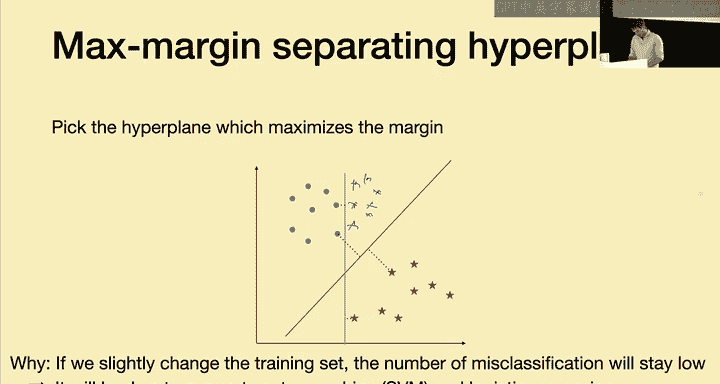

Okay。But if we consider a marginal setting。Of course， you know the data won't be necessarily linear。

And if I look， for example， at this example。It will not make sense。To look for a linear classifier。

If you take El linear classia。Any linear classifier will always suffer from a very high error。

So what is the next step？So the next step is to consider non nonlinear classifier。

 as we have done in regression。😊，You know， why do you limit yourself only to a airplane if you could predict such more complicated shape？

So in the regulation， we have already see。One easy way to introduce aity， someality， but still。

Learning a as if。Do you remember how you did that。Can you say it louder。Exactly。

 so the first way is to use some features of mutationation。Instead of only using the features。

 you will consider some。if up in that case。Penoial expansion。 So you will add x2， x 3。

 You will add some monoials。And then you will learn a linear classifier， but on this extended space。

ok。And what is very interesting is that。Even if you have。roundina。Clasifier。

For these augmented features。When you will look back at the projection。Only in your initial features。

Then it won't billionaire。And this was exactly what we did at the beginning of the lecture。

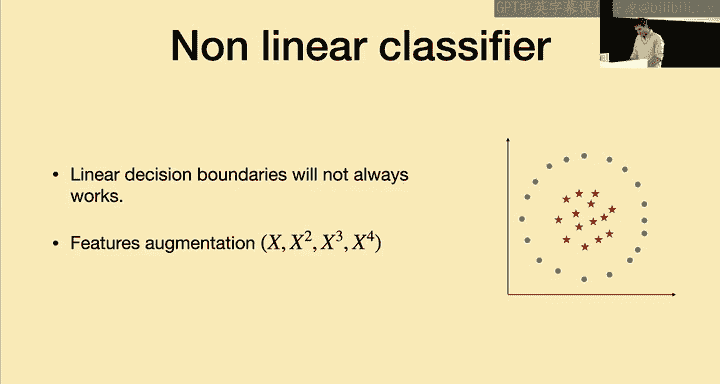

I can show you again。

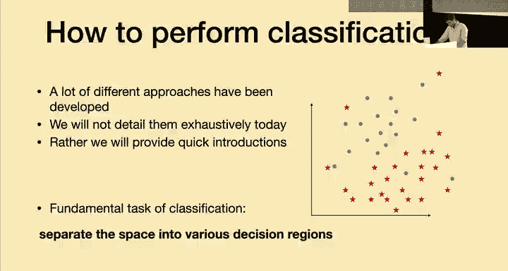

嗯。That one， when I。Told you that this was known now。 in fact， this。

Classifier is obtained by learning a linear classifier on some augmented features。

So if you look at the shape of the function in your augmented space， it will be linear。

But when you project it back in your first features， you will obtain some non nonlinearity。

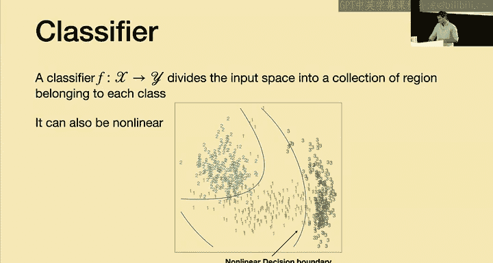

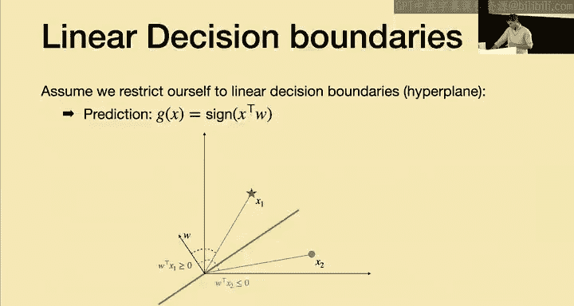

嗯。

咩啊。Okay， so that was the one way。So could say classifier。But then， you know， like the problem。

 and also， like some of you。K at before cost to talk to me about it， when you will add some features。

 then you will augment your space and then also the complexity will go up because you are adding more and more features so the complexity of the method will increase。

And it will be more costly to train your model。And so what we will。See in one of the next lecture。

Is that it's possible in some way。By concerning what is called the kernell method。

To augment the features。Addp to some infinite dimension。Without incurring the， I mean。

 the cost of adding these extra features。So by doing canal method， in some sense。

 we will benefit the joy of the high dimension， but we will not suffer the price。And the only。

Downside of this canal method will be it will not be possible to add all the features you want。

 but it will be。 it will only be possible to add the features。In one particular。Particular way。

So we will talk about also in a few weeks about this methods。

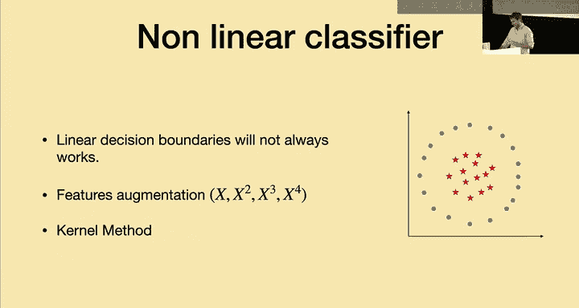

And so do you have some questions about？Non nonlinearity。No。And if you have some。

 we will talk a lot about it during the can course。And so in the last 10 minutes。

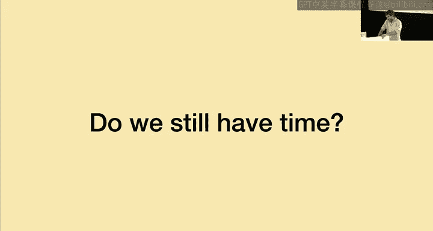

What I would like to talk to you a bit is a little bit about the CR of classification and you know what you know what can we prove and what。

What can we say about this problem。So。You know， as in regression and as in the last lecture。

 what we are assuming is that the x and the y。😊，Dributed according to some distribution D。

That you don't know。 D exists， but you don't。 You do not have access to D to your distribution。

And we say that x will belong to some space。 X and y will belong to some space y。

 and in that precise case， y would be equal to 0，1。 Okay， it could be minus-11。Could be anything。

 but let's talk about just binary classification， and we call the label 0 and1。

So what are you doing is that you are observing。Your training set， X 1， Y 1，2， X， and， Y， N。

And this training set will come from the same distribution D。 It will be II D Hization。

 And you want to use this training set。To learn a good classifier。

And so what does it mean in that sense to be a good classifier。

 what we saw in the generalization lectures？😊，The first thing you have to define is which last function you want to use。

And so for regulation problem， we say that we want to use the quaratics。

So I remind that the quatics was squared before y and y prime， so it was y minus y prime squared。

And so the lu is really like the loss you are sufferinging when you are predicting y prime。

 but your true value is y。And so when I'm considering classification， what is my last function？😊。

This is very important， this is what is called the classification loss。😊，And so， you see。

That's really intuitivereative， that the less。That's the indicator of y is different from y prime。

So if I'm doing a good prediction。If I say that the label is y prime and at the same label of y。

So I have assigned the correct label。My loss is zero， I have done a good prediction。

 so I should not suffer any loss。But if。My prediction is different from y。 So for example。

 this y was equal to0 and I' predicting one。Then I will pay the price to be one。

So you see that the loss function。Is really exactly what you would like to be。

If you are doing a mistake。You are losing one， you pay one。 And if you are not doing any mistake。

You are losing。So this is what is the last function， the classification mass。

Is it clear for the definition of this class。Yes。😊，This is really natural。

 It's really what you want to do。 You will pay something if you are doing a mistake and you will pay nothing if you are doing the good prediction。

And now what we can look at as last time is the true risk， okay， as a generalization error。

 you can call it as you want。😊，For the classification。So let me remind you what was the tourist。

 it was really the expectation。😊，Over all you observation， X and Y。Of your last function。

So the risk was really the two risk of aifier classifier G。😊。

It's really like the era will suffer in average age。So you look。

For an average x and the average output Y， you look at the value you are predicting with G。 Okay。

 so the value you are predicting that exactly G of x。And you look at。

If G of x is equal to y or is different to y。If g of x and y are equal。

 then the lu would be equal to 0。And if there are the， the loss would be equal to one。

And then what you are doing is that you are taking the expectation。😊，Over。

 the possibleization of x and Y。According to your distribution。

So you see this is really what is called the classification error。😊，Okay。

 that the two is because that the generalization error associated with your classification problem。😊。

And then we see one nice take。And that since this is the expectation of indicator function that is exactly equal to a probability。

😊，So you see that for the classification loss， the classification error is exactly。😊，The probability。

That y is different from Gx。ok。😊，So。Your classification error is equal to the probability。

Of making any好。And so what does it mean to find a classifier which will generalize well？

That means that you want to find a classifier for which the probability of making a ne is as small as possible。

Did it make a lot of sense now？给。没。She expectation of India indicator function is always the probability of the event of the indicator function。

Okay。So maybe some first question， know why？I mean， we will not talk a lot about it。

 but why in order to find。A good classifier。 why are we not directly minimizing？This。风ction。

Why are we not minimizing the expectation of this last function？Do have an8 why。

Why are you not doing your gradient decentcent algorithm and this class function？对。

So you see that this loss function is very nice， is's very intuitive。😊，But it is not dependable。

 It's even not continuous。So this is why we are using this list。Can of to evaluate the performance。

Of your classification， I mean， of your classifier， but we will not use this loss。

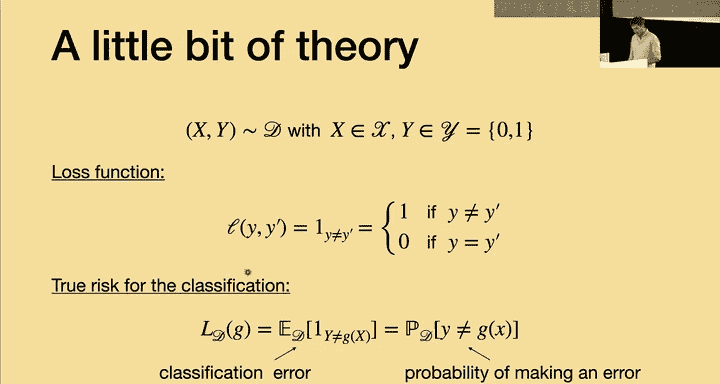

In order to find a classifier。And so then the question is， we have defined。

What is the classification they are of a classifier？😊。

So is it possible to dehive what is the best classifier possible。Okay， even， imagine that。

You have an infinite training set。 I imagine Evans that you know the distribution D。

What is the best you can do。Okay， if you know the distribution D。

 how will you predict what is the output y when you observe 1 x？

So this is what is called the bias classifier， this is really like the best classifier possible。😊。

Okay， so that's the classifier， which will minimize。You're too risk。Over all the possible classifier。

That means that you can have all the information you want。

 you can have all the training data you want。😊，It will never be possible。

To predict better than your bias classifier。And the last result， I mean。

 the first result and the last result we will see today。

Is that you have a close form for this best possible classifier for the bias classifier。

And this closed form is really saying that。😊，G star of x。Will be for any point x。You look at the破败比。

Of y equal to。So you might okay so。Small y can be equal to 01。 So for example。

 you will look at the probability that your true output y is equal to 0。Knowing that your input is X。

This will be equal to some value。 Then you will look at the probability。

That your output y is equal to one， knowing that your input is x。 This will be to another value。

And you will output the maximum of this two value。 Okay， you will output。The y。

 which give you the maximum of these two value。So the interpretation should be。

 should be clear is that given。A fixix x。You know， the probability that the current label。

Is why then this probability is exactly。B。Of y knowing x。ok。So， it's a prediction。Is G of X。

Then you would be correct， a fraction P GF x knowing y。

And so if you want to maximize the probability of being correct。

You really want to maximize this function。You want that your output。

Will be the value which will maximize the probability of being correct。

So this is your bias classifier。So we won't have time， but in the slide， you will find。

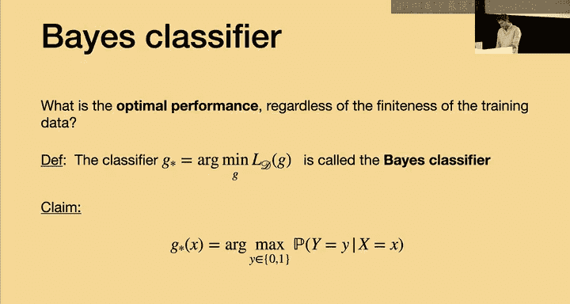

A formal proof of this definition， we can just do it quickly together the first claim will be that first we can fix x。

Thats the same when you are fixing x to look at this amin。

Then it will give you the best classifier and the second claim。

Will be exactly what we just saw is that these star effects will be the amin for all the y of the probabilities that y is defined and y。

So you can look at the proof。It's not difficult at all。 and if you have some question。

 we will be able to answer them next time。

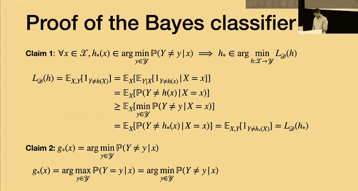

And just to tell you， you have some bonus in the slide it's not important at all。

Let me just tell you about this， this hazard， would just tell you。

That it is possible to theoretically show that if you have。Some function。

 which is good for the regulation problem。Then it will be good for the classification problem。

So let's really show what we have seen in the first part of the course is that if you have some regression function for which you will have a small。

heson你好。Then it will imply that the classification error will be small。

But what is important is that it's possible to have a small classification error。😊。

But the large开开始那好。Okay， so that does not contradict what we say that does not say that all the regression methods are good for classification is the only thing that if you have one class here which will have a very small mean square error。

 then it's possible to prove that the prediction error。😊。

For the classification poll will also be small。O。So saying that will be all for today。

Please do not forget to register to the lab， okay。

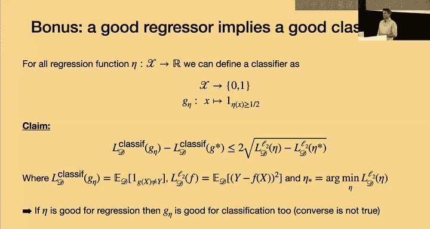

Before tonight。