# EPFL《机器学习｜Machine Learning Course CS-433 fall 2020-2021》中英字幕（deepseek - P14：[14]EPFL Machine Learning Course 2021 - Week 5 part 2.zh_en - GPT中英字幕课程资源 - BV14SwyeNEvW

Yeah。So hello everyone and welcome to this new lecture of the machine learning course。

 so today's the topic will be about logistic regression。😊，So I think you all know about this method。

 it's really like one of the most basic and famous method to do by ni classification。It's quite old。

 you know， his days bad from the4s。And even it would use a function called the logistic function。

 And if you look， you know。For all this the logistic function is really date back 1830。

 So it's something really old。But it is still widely used in practice。And， you know。

 and it's often used on top of neural networks。 So you will see later in the curve with neural networks。

 you will use your networks to learn some features。 And on top of it。

 you will often do classification step。 And for this classification step。

 you will often use the logistic class。😊，So it did really what I did use。

It's really relevant to modern machine learning。 So it's very important because。

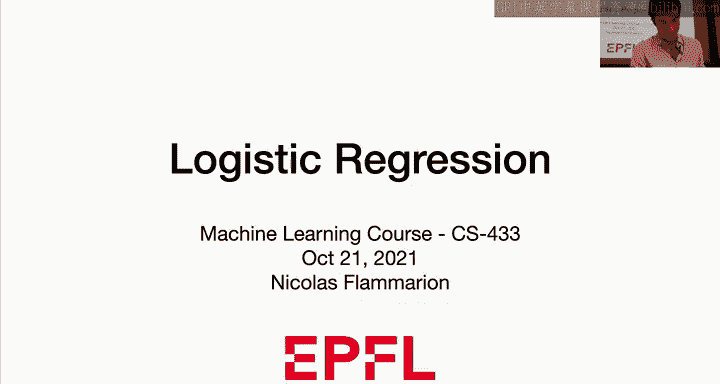

So， first。Let's recall what was a setting of a binary classification we talked about last time。

So as usual in supervised learning， you have a data set S。Which consists of some observation， X， I。

 Y， I or I from one to n。 Okay， you have N observations。And your input x will belong to some set x。

And your input y will belong to this headset and in the case of binary classification today we will say this set is 01。

 Okay， you could have say it is minus-11。 It will not change a lot， but today we say。

Why I belong to the。And as usual， what is the goal。

 the goal is that will give you a new observation X， and you would like to predict。😊。

What is its associated label， You know what to which class。Does your observation X belong？

And so here you will do that， you will use your training data， X， I， Y， I。

 you will use some learning algorithm。In order to learn a classifier and with this classifier。

 you will do your prediction。So that's a general setting of binary classification。😊。

Just a point about notation because I had some question last time。So， often。

When we will use lower case later like this X I，Y I。It means that we are talking about observation。

 okay， we are talking about vectors that are fixed。And when I will use capital later。

I would often talk about ho variable。ok。So I will try to be preciseized about it during the course。

 but maybe sometimes。I will do some mistake， but is's not too important。But just to have in mind。

I will always use some bold。Later， when I will talk about the matrix design， Okay。

 when I will talk about the matrix X with all the features X1 to XN。😊，This will be in bold。

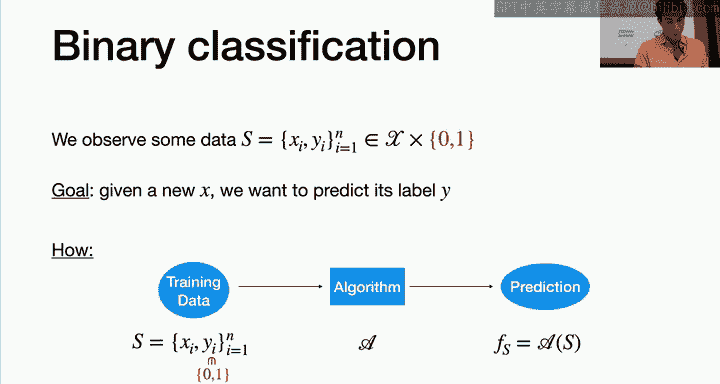

So what is the motivation for logistic regression？😊。

So last time what we saw in the class about classification。We saw that， in fact。

In order to do a classification， it was possible not to directly predict the output0 or1。😊。

But it was possible instead to model the probability。 Okay， so we were are modeling the probability。

That the observation X belonged to the class one and the probability that the observation X belonged to the class0。

So okay， so instead of doing we like a prediction。 So instead of predicting if the customer。😊。

Will default to in a credit test。 What we would say is that we will predict the probability that the customer will default。

ok。And then with this probability， it was possible to do a prediction。

 if the probability was larger than0。5， then you will predict that you will belong to the class1。

 And if the probability of belonging to the class1 is smaller than0。 5。

 you will predict that you belong to the class0 Okay so first you are learning the probability and then you do your prediction。

😊，And so the question is， how can you learn the probability？

What would you model the probability of belonging to one class？And I don't know if you remember。

 but so last time we did that。😊，By assuming El our modern。Okay。

 so we were assuming that the probability。That。The label of the observation x was1 was some linear function of W and x。

So this is what we were doing where we were using linear regression to solve the classification problem。

And so what was the two problem？With this modeling。

 the first one was that the predicteded value was not in01。Since this is a linear function。

 this is not restricteded to 01。 So if you。I mean， this number can be very low or very negative。

So that was the first problem。And the second problem， which was really more important。

Was a problem with the very extreme values of the prediction。So do you remember this the poll was。

That。When we were adding some very， very large value。Then。We are surfling a very large squalus。

Whereas what what we said was， in fact， these value were not atli， but were a very easy point。

 which was easy to predict。 You just want to be very confident in your prediction。Okay。

 so that was a problem with least square error where we are still paying a very large price。

Even when we should have been very convinced of our prediction。O。And so you see that in fact。

 what you would like to do is。If。You're observing some very， very， very。Narge value。

 you just want to be very sure that this one will belong to the class one。So in fact。

 what we would like to add is that。When you have some very， very large value。

 you want the probability to be very close to one。And if you have some very， very negative value。

 you want the power VT to be very close to0。😊，Not to minus infinity or to plus infinity。

And so how we will do that， how we will solve this problem。😊。

What we will try to do is that we will map minus infinity plus infinity。2，0，1。Okay。

 so you can see that exactly what you want to do， what you want to do is that if you have some very large value for the prediction。

You want your probability to be very close to one。And if you have some very negative value for your prediction。

 you want your probability to be very close to0。😊，So you see that in fact。

 what we want to do is still to use a linear model。

 but then map this linear prediction from minus infinity to plus infinity from this set to the set 01。

😊，And so then the question is， how can you do this？And so you can use a lot of different function。

 mean， it exists a lot of function， which will map minus infinity to plus mean minus infinity plus infinity201。

Enzo logistic regression。😊，We'll use one particular asset function。

 which is called a logistic function。Okay。Is it clear for the motivation？喂。Very nice。So。

For logistic regression， well use a function， which is called logistic function。😊。

So this is a function which dates back from 1830。And so what is the definition of this function for Eta or hill number？

😊，Logity function of Eta， which we will denote by sigma Eta。

Would just be equal to exponential of itta。Divided by one plus exponential of itta， okay。

Very simple definition。And so here you see a plot of this function。Which is very characteristic。

 S shape。😊，Of the curve， and you see that this function is exactly doing what you want。嗯嗯嗯。In0。

So that mean when you are not too sure about what you want to say。

 the value of the logistic function will exactly be1 alpha。Then you see that when。

Eta goes to infinity， so logistic function will go to1。 and when Eta goes to minus infinity。

 the logistic function will go to0。So we exactly recover what we want。If EA is very large。

 the probability would be close to one。If Eta is very， very negative。

 the probability would be close to zero。😊，But what is important is that you see it will be close to one。

 but it will never be above one。And it would be close to zero， but it will never be below  zero。

So the image of all the whole by the logistic function is really exactly 01。😊。

So this function is mapping all the hill to the entire value of one of the probabilities。ok。

And so you see that。Using the logistic function。He got less of the value of itta。

We will always obtain some sensible prediction， we will always obtain something which will be possible to interpret as a probability。

Is all good with a logistic function。And so。This function has also some nice properties which are only you know it's just some small computation。

 but we will do them now because we will use them a lot today。

So the first one is I can compute one minus the logistic function of itta。O。

So one I just write it is one plusilon exponential of epsilon divided by one plus exponential of epsilon minus sigmata minus exponential itta over1 plus exponential eta and so you directly see that what is happening the exponential of itta。

A concerning setting。And you directly actually obtain one over one plus exponential theta。Okay。

 so this is a small computation， one minus sigma is equal to inverse of1 plus exponential itta。

Then the second computation would be about the derivative as a logistic function。😊。

So in order to take the derivative of what you are doing。

 you are doing derivative of exponential of itta， it is exponential of Eta。

 so you get exponential of itta over1 plus exponential itta。😊，Minus。Exクモンシリタ。

Times the derivative of 1 over1 plus exponentialial litta。And this will give you this s term。

So when you put them on there's a。Same form， you will get exponential of itta divided by1 plus exponential of Eta squared。

And here you exactly recognize this is equal to。😊，Sigma times 1 minus sigma。O。

So you see that the derivative of the logistic function is equal to the logistic function times 1 minus sigma。

What can you directlyally improve？Using。This equality。What can you prove that you see on the product？

6。What is the positive。So， exactly。Sigma is between 0 and1。

So one minus sigma will also be between 0 and 1 so the product。

Will be positive because a product of two positive numberss is a positive numberss。

And so the derivative will be positive。 and so the function。😊，Would be increasing。Okay。

So this we will use it a lot。Today。

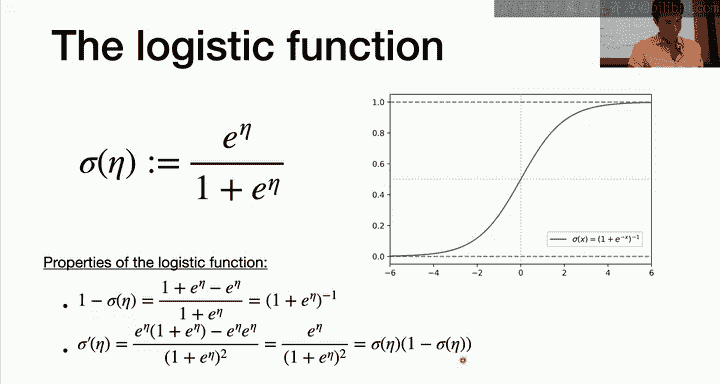

So then who are we using this logistic function？So we will use the logistic function in order to model the probability。

So this is exactly why it is like the logistic regression because the logistic regression will models the probability that y belongs to a particular class。

😊，Using the logistic function Sigma。So you see。I will model the probability。

That y is equal to 1 when x is equal to x。As。😊，So logistic function of milllineia prediction。

And this。Here you see that。 I'm using some。Capital later because this y is some honda variable that we like the probability that my ho the live of my hom variable is equal to one when I observe x。

 I will denote it by P。😊，Of one knowing x。 Okay， this is just like a number。 This is a function。

This is exactly the value。When y is equal to1 and x is equal to x。

This seizure is just like a notation。So the logistic regression will use the logistic function in to model mean in order to model the probability to belong to some class。

😊，So the probability of being in the class one will be equal to sigma of。My linearar prediction。

 x transpos the value plus my shift。And the probability to be in the class zero。

Will exactly be equal to one minus the probability of being the classroom。Okay。

 so it will be equal to1 minus the logistic function。Andvirated in millionre。Prediction。

And it's important to have in mind that the two classes have exactly the same importance。

 and you could have called like the class 1，0 and the class 0，1。 Okay， it will not change anything。

 You can flip anything。 You can flip as you want。Okay。

 so this is exactly what is the logistic regression。😊，And so why is it called logistic regression？😊。

It is called logistic because。You are using the logistic function to model your pro。

And then it is called a regression， because instead of directly predicting the output y。

 what you will do is that you will first predict the probability。😊，That x is in some class。

 that's the first step， that's the regression step， and in the second step。

 you will do your prediction and so how you will do the prediction。😊。

You will quantize the probability。If。P of1 doing x。 So it's a probability that x is in the class1。

Is larger than1 over two。 then you are predicting the class one。 Okay。

 if you are predicting that it is more likely that you belong to the class one。

You say that the class will be one。And on the Kha， if you are crediting that it is more likely that you belong to the class  zero。

 So if。So this is a dipo。 Okay， if p of0 is larger than one of the two， you would predict the class0。

😊，Okay， so there is a type of young questions。Okay， so first， you are learning the probability。

And then you use this quality in order to do your prediction。

And you can see this is exactly doing what you want。😊。

Because if you have some very large value of your linear prediction。Okay。

 then this will correspond to the probability of being the class1 to be either very close to zero or very close to one。

So if you have some very large value here， you will be able to predict with some very high confidence。

But if you have some very small value。Then that means that the probability would be very close to 0。

5， and you will predict， but with a very low confidence。😊。

And so you see that it is exactly solving the problem we had last time。😊，Because for the very large。

Value of x。This number will be very large。But no， we will not anymore suffer a very large square r between this number。

And one。Since we are mapping it back to the probability space。

 we will just have this that the probability will be very close to one。对。ok。

So is it clear for all just？So basically， when x transs things w is greater than0。

 we predict the level one。And otherwise we predict they don't right Yeah， exactly。So the question is。

When this number is positive。You will predict。The class one， and if this number is negative。

 you will predict the class  zero。

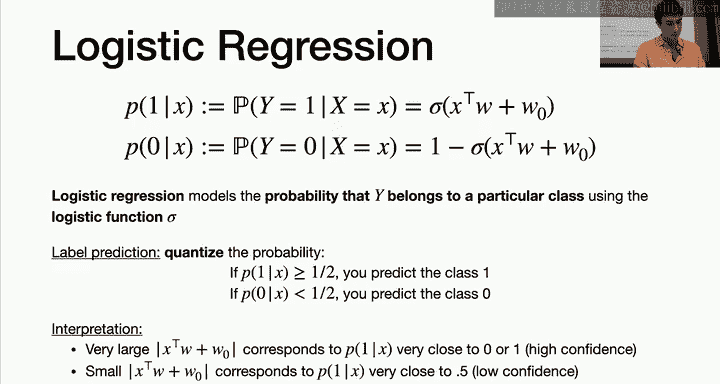

Because if you are looking at the value。It is exactly equal to1 alpha in 0。

And when the value is positive， it will be larger than1 e， and when the value is negative。

 it would be below1 alpha。

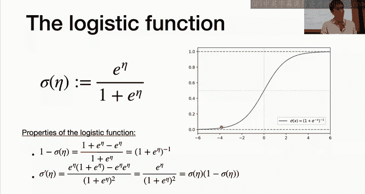

So that's a very good point and we will talk about about it later。

 that you could say that for the prediction。😊，If I give you a w and I give you a W0。

All these are not central a lot。Because when you want to do some prediction。

You need not really care if this number if the probability is very close to one by just above1 alpha。

ok。If you predict， you just need to know if it will be above or below1 hour。

But you can still use this prediction to do some uncertainty。 I mean， estimation。

 you know that you could take it into account in your prediction。

If this value is very large and you are really sure that it would belong to the class one and if it's just above the order  five。

人据员的测试。

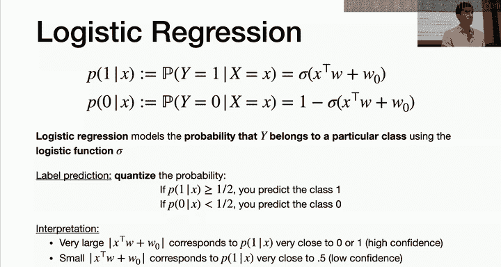

系精灵保。So let's see how using the logistic function is solving all the problem we saw last time with linear regression。

So we are still analyzing， you know this credit score problem。

So here we have the logistic regression example。😊，Here we have the linearna regression example。

And I don't know if you remember that was the example where the data set was well balanced。

 and for this example， linear regression was working。😊，Quite when。

So you see that the threshold you are obtaining with both method。Is very close， okay。

I don't know the exact value， I don't know if it's exactly the same。

 but the two threshold are very close。 so the two decision bond here are exactly the same。

So here what we are gaining is that we really have some probabilities with the logistic function。

 whereas previously we had this value， which were above one or below zero。

 and so it was not possible to use them。As hobilities， okay？So now with the logistic function。

 if I am very much on one side。I can be very sure that my prediction will be true and will be one。

 and that the same in the other side。O。Then this is maybe a more interesting case。 Now。

 we had this example where the two。I mean， we as a data set。Was not balanced。

 which means that I had a lot more points。In one of the class。

And what we saw last time with linear regression， so when you were fitting directly on enough fit to do your prediction。

We saw that the decision boundary was shift by a large amount。Okay，Previous， if it was balance。

 we were predicting that if you have below 1000， let's say，300。You will not make default。

 but if you are above。One0 sensor and you will default， but now is my data set。

Why have mark bones here？You see that my nu showed is home 3000。

So the linear regression meta is not working at all。Okay。And you see that。

When are you are using the logistic function， when you are using logistic regression。

 you still have a shift。In your decision， boundary。But it's a little bit better。 Okay。

 you are only going from 1300 to 90000， let's say。你听大啫。

So you see that by using this mapping from minus infinity to plus infinity。

 it also prevent us to be too sensible to unbalanced data。We are still sensible。

 we still have a shift。But this shift is a lot better than the one we add with the linearar。

You have some questions on this。

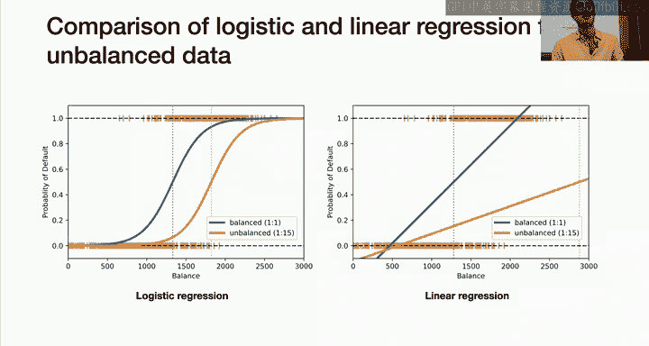

冇。I know it's really even more interesting for the case of X values。So youll remember。

For the linearar regression case。When we were adding some very， very， very large value。Okay。

 we really。Had the curve， I mean， the inclination of the curve。

 which was changing and a very large shift in the decision boundary。

And so that's why this method was not working at all， because point with a very large value of x。

 you are still sufferinging from a very large square loss。

Whereas you should have a method which is not affecting any less because for a large value。

 you should be sure of your prediction。And you see that now with the logistic regression。

We almost find exactly the same prediction with and without these XM values。Okay。

 so you see that the logistic regression has exactly solved。😊，So X value problem， okay。

And this is because the x value are really in the high direction。If。Your prediction， I mean。

 if your x value is very large。Then the value you would predict mean with your linear fit。

Will be also very large， and so then your probability will be very close to one。

So you see with this example that the logistic。Function is really helping you to do exactly what you want。

Okay。So with a logistic function， if you are very much in one side。

Then your probability is very close to one。Do you have some question on these comparisons？

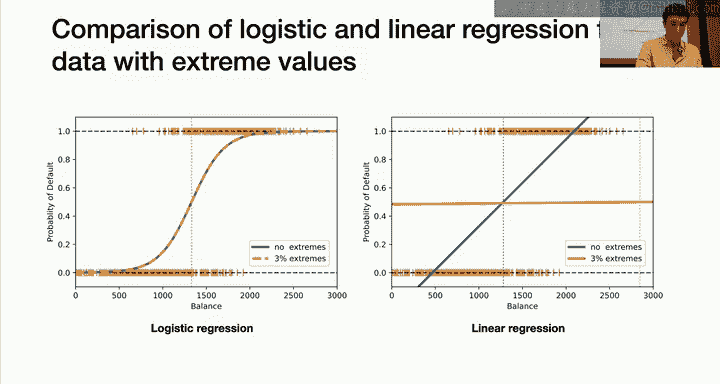

So let's look a little bit more about you know。Or does it look this function。

 I mean what is the shape？Of all。Thisis function。 So what we will do is that we are taking this。

No two dimensional example。Okay， I have something into this， I will have two features， x1。And x 2。

And so to weights， W1 and W2 and what I will look at， we look at the value。

Of my logistic function in W transpose x。And I want to see。You know。

 what is the whole of the vector W？So I we just consider have a lot of different vector w and I fixed the scale of w okay first I just want to see what is the whole of the direction of w。

😊。

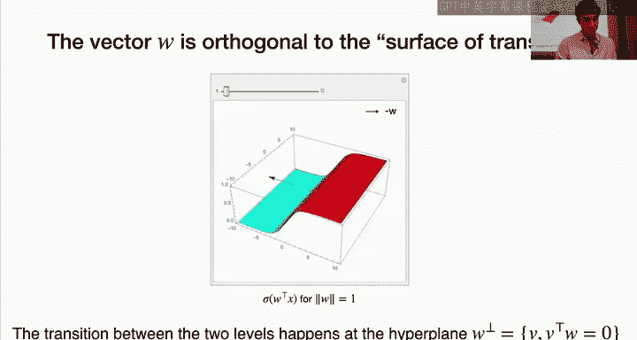

It's working。 Okay， so you see that if you are changing the direction of W。😊。

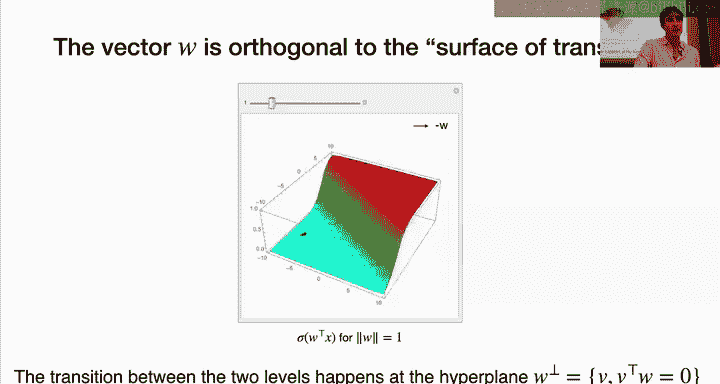

So what you can see is that really the vector W is ocagonal to the sphere of transition。😊。

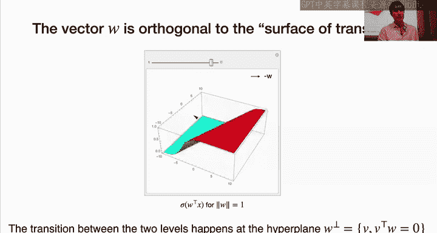

Okay， so you will go from0 to one。

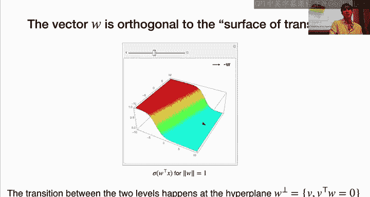

And you will have surface where the transitions your face and the vector W is telling， I mean。

 its giving you the direction of this transition。

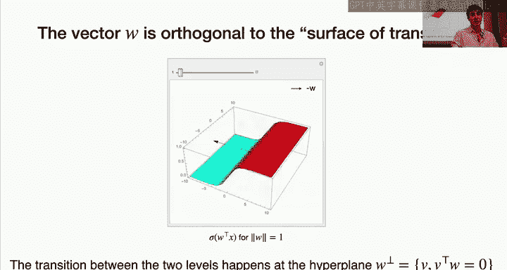

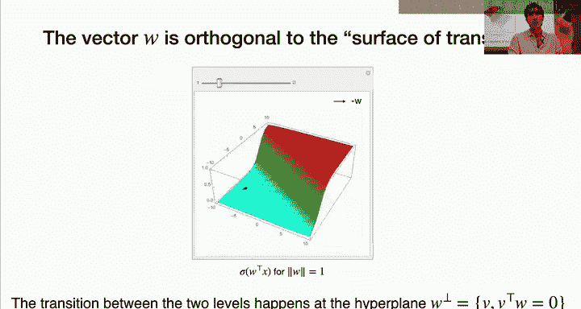

Okay， so the transition between the two levels。

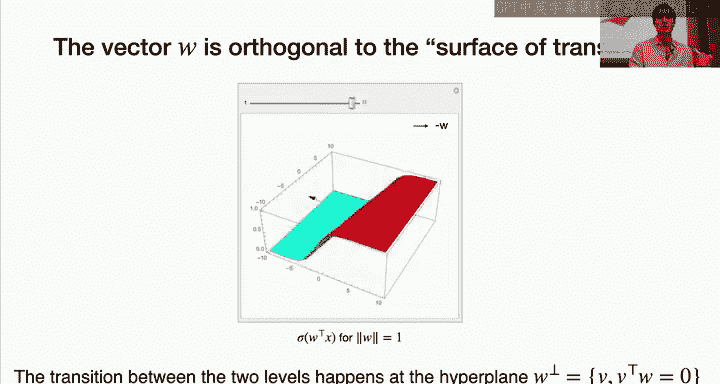

Really happened at the iPad plane。Which is the autoagonal of the W。 Okay。

 so it happened at the iPad plane of all the vector。

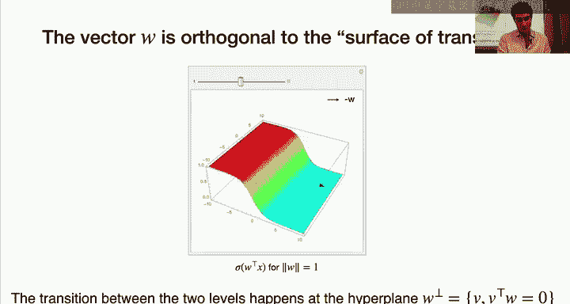

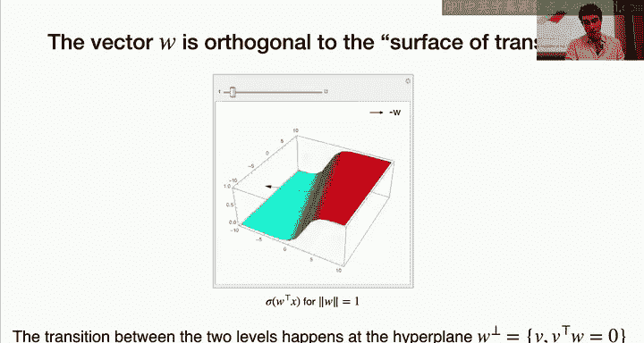

Which will be orthogonal to W。

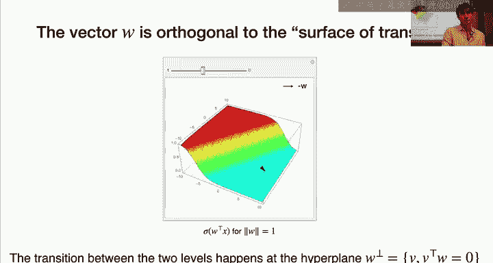

So if we see now on this example， I mean， if I stop it， this will correspond to W。Is equal to。嗯。1，0。

And so you see that the transition will happen exactly。Add a space。Which is exactly x1 is equal to 0。

 So you see that exactly。That space。I it clear for this。有表一。Yeah， exactly。

Also label is when this is equal to minus1 and this is equal to1 when this is below0 than5。So。

 when this is equal to0 and  one or when it is below to the other five or above the other five。ok。

So that's very important。The vector of W， if you just look at its direction。

 it will give you where the transition is happening。

And so the transition is exactly uping at the IP plane。😊，W aftergon。Okay。

 that's a airplane of all the vi， which are。Pre particulardicular to the value。

And so we see that in this particular example where okay， so this is minus w。😊。

So you see W would be here， so it would be exactly equal to the vector 1，0。You see that the deposit。

Okay， so the transition is for which。B to know。You will go from predicting the class zero to predicting the class one。

So where this， I mean， where this transition is happening is exactly。At this hyper plane。

 so where we are in2D so the hyper planee is a line。So， it's exactly。This line。

So when you look at your space of the x。If your x is on one side of this line。

 then you will predict the class zero and if you are on the other side of this line。

You will predict the class one。ok。So if you want it was live， I mean。

 like last time when we were talking about。Inner prediction and separation， I。 Okay， is really。😊。

The I plane， which will help you to do， I mean， which will help you to do the prediction between the class  zero and the class one。

And you see that this I plane。

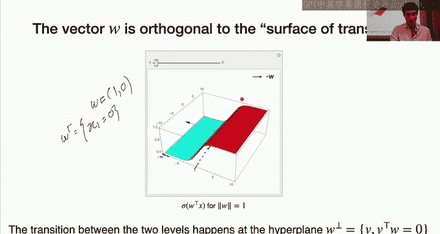

Is given by W and so this is what we are looking in this animation。

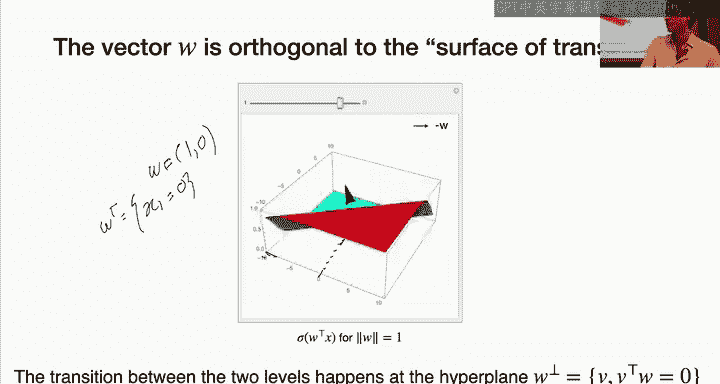

When you change the orientation of W。You change the position of the transition。

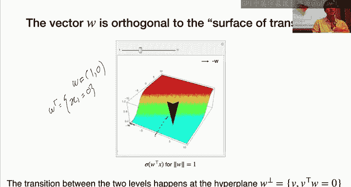

Yeah。

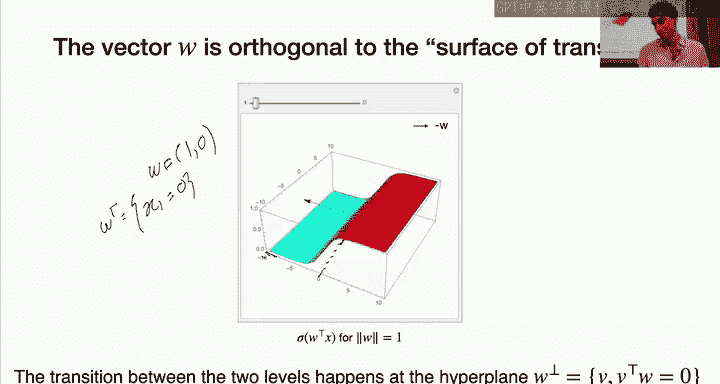

Yes。😊，This E W x is negative 10 point。

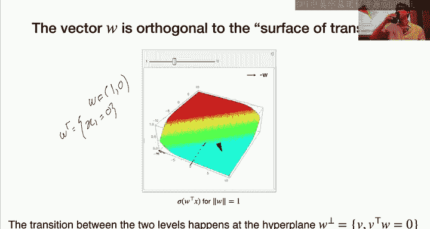

So the arrow is negative to。That's a very good point。

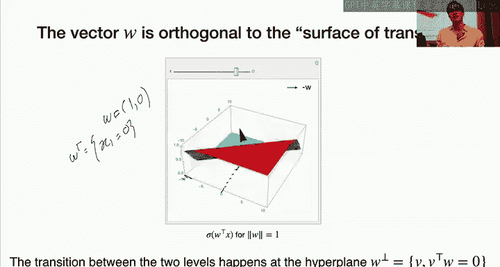

ok。The arrow is negative the value， otherwise it would be below the red and you won't see it。

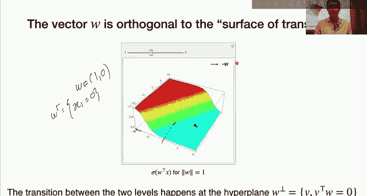

Just like visualization purpose。

But you really see that by changing the orientation of W。

 you are changing the position of your transition。

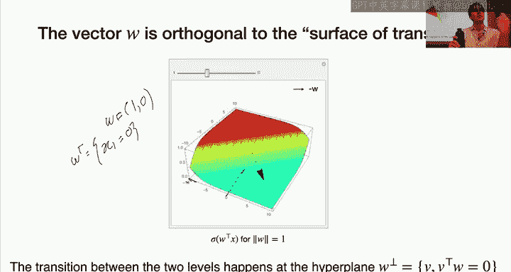

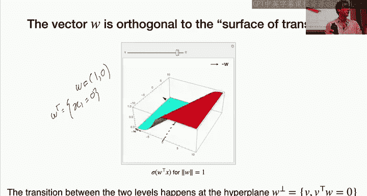

Okay。So that's not the direction of ww。

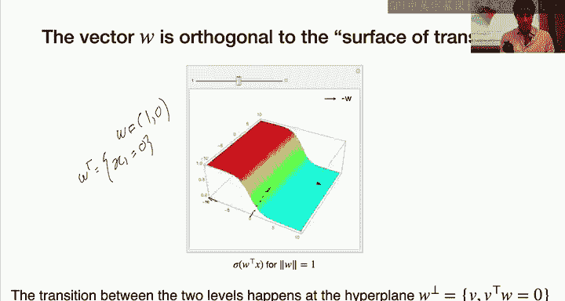

Then the next question is when you have fixed the direction。

What will be the impact of the scale of W because you can take W of very small scale。

 like you can take the norm of W to be very small and you can take the norm of W to be very large。😊。

Okay， so what we want to see is what will be the impact of the length of the vector do。

So what do you think？So it's written， but in some sense。What do we want to say is that we。

If the norm of w is very small， then the transition。Will be very slow。

And that's exactly what you see here。A the norm of w is almost0。

And so you see that the transition is very， very slow when I just look。

At my graph between minus 10 and 10， I just see something very flat。Okay。

 I will have to go to minus infinity to this the transition happening。

And so what is happening no when I'm。Playing with a scale of W。

 you see I go from something which is very， very flat。😊。

To something from a very stiff position。

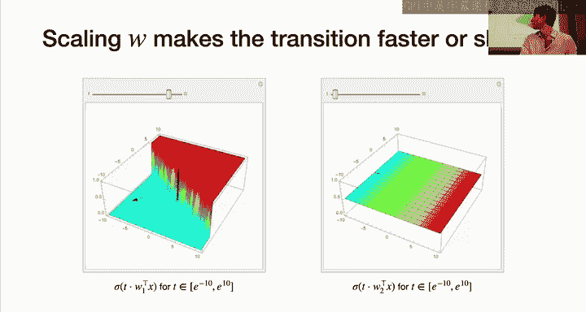

O。So you see when the scale of W change， you really make the transition faster or slower。

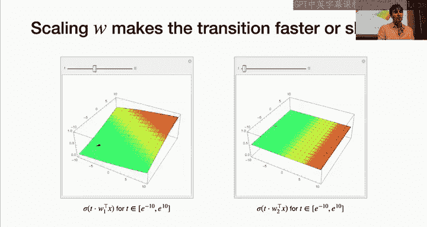

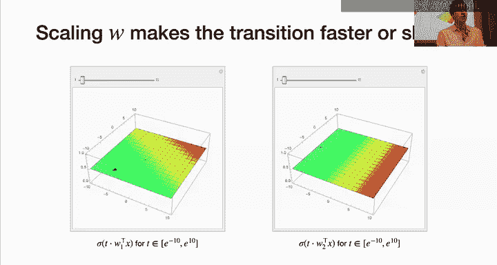

So if you use a W with a very small scale。

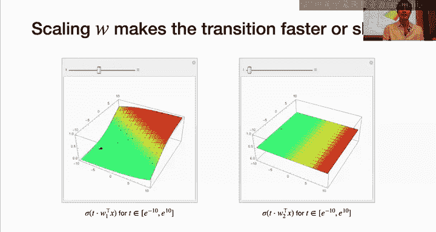

Then the probability you will predict。Will often be not too strong。

 you know it would be very difficult to predict the probability close to one or close to zero。

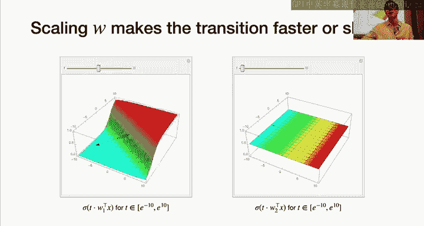

Because forces， you will have to have some value of x transspose w to be very， very， very large。😊。

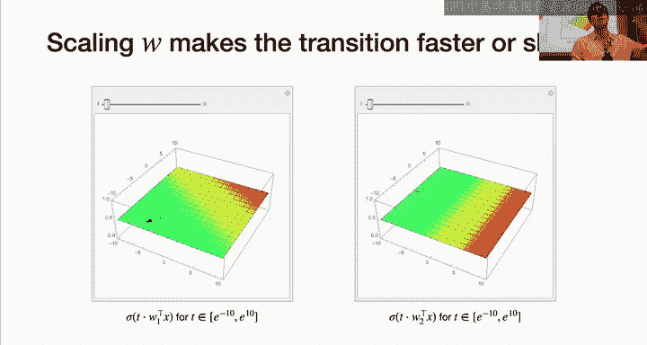

But since w is very small， so this means that you really need to have x aligned with W and the norm x be very。

 very large。

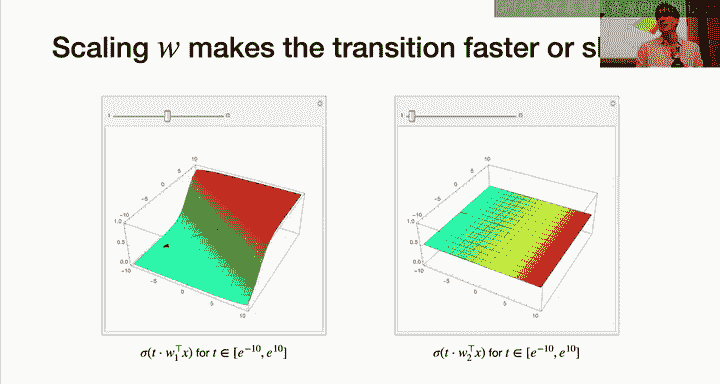

So the scale of w when it is small， make that you will do some probability very close。

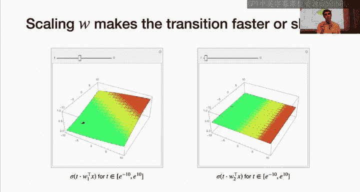

To a0。 5。Okay。But then when the scale of ww is very large。😊。

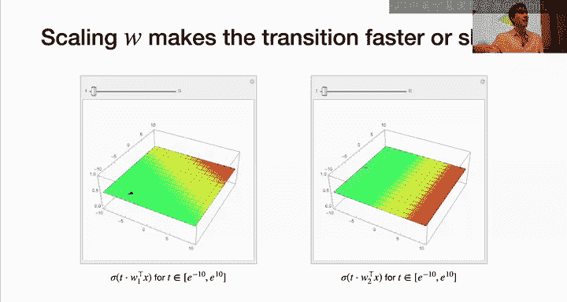

Then you see that your logistic function will go。

To the ABI function， to the step function。

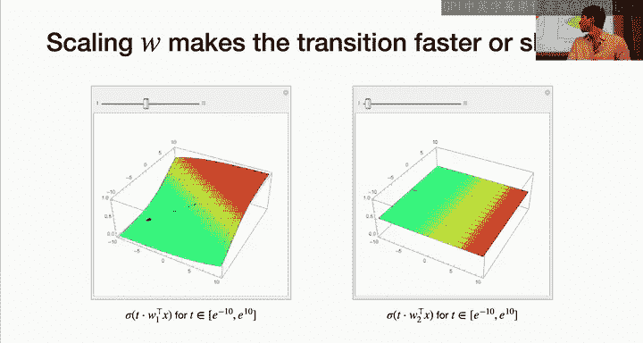

Is what you see at the end。If you really be， you will always predict the probability to be 0 or the probability to be one。

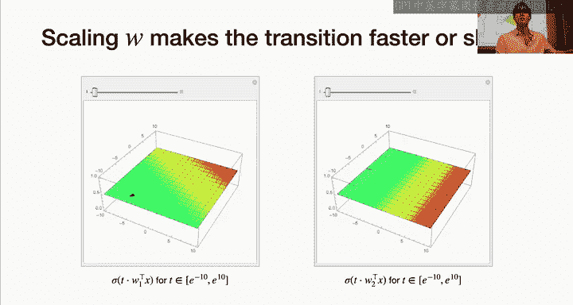

Okay， so this is what happened when you take a very large W。

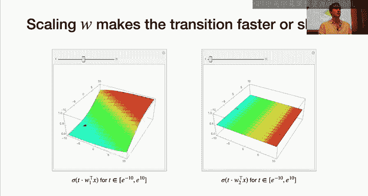

So take a very large W。

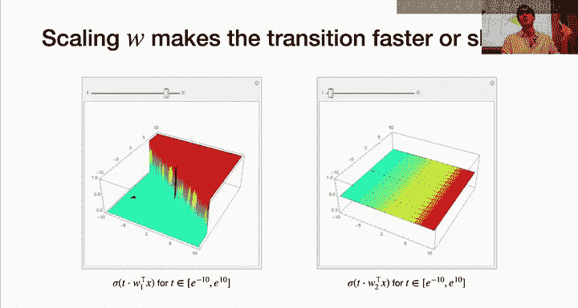

You are very certain， Okay， either or you belong to the class， one or you belong to the class zero。

But your probability will always be very， very close to one o。

Maybe in between。

And so this is what I。I wanted to say previously。That shows that in order to make predictions。

 this will not play an important role。

Because when you want to do prediction， you just。Care about is your probability above or below1 alpha。

But if you want to use this probability to compute other things。

 or if you want to be able to quantify the uncertainty of your prediction。

You see that the scale of the W will be very important。

If you have a small double use， that means that。

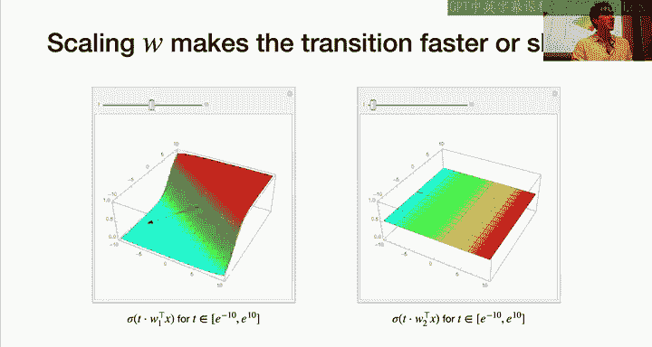

You will do your prediction， but you you will never be too certain about your prediction Okay。

 you would say maybe it's belonged to the class one， but let's say with probability the order sex6。

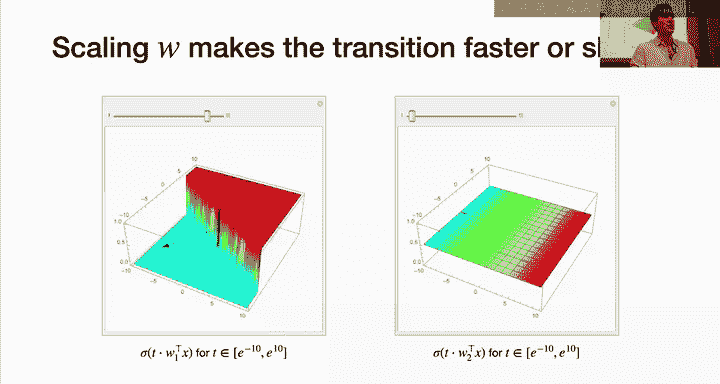

No。If the scale of w is very， very large， then that means that you are always very certain of your prediction。

😊。

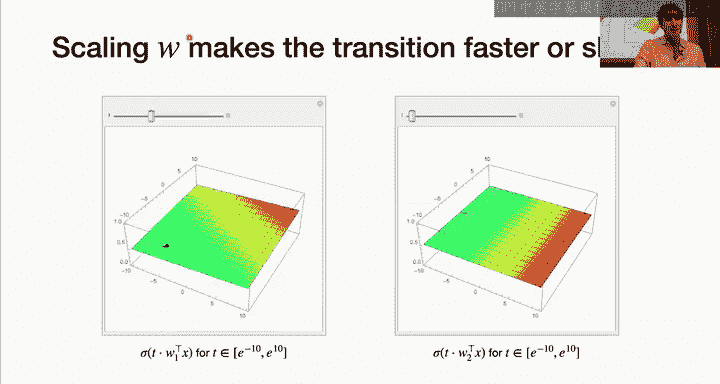

Will belong to the class 1 with a probability1。

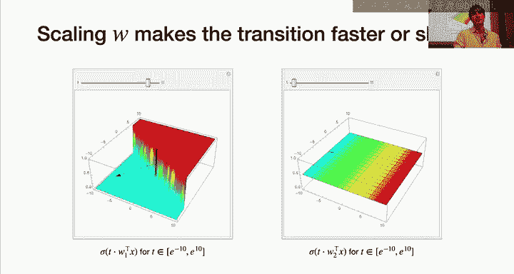

So， this is。The importance of the scale of W， we saw the importance。Of the the action of W。

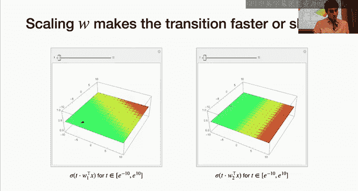

But in all the example， we saw。We are never talking about W 0。

And we talked about it last time during the I mean the last course。😊。

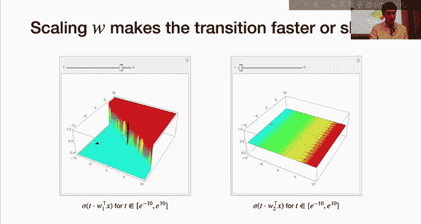

You know。There is no reason that you。I per plane that your separation a plane。Is stopping by。

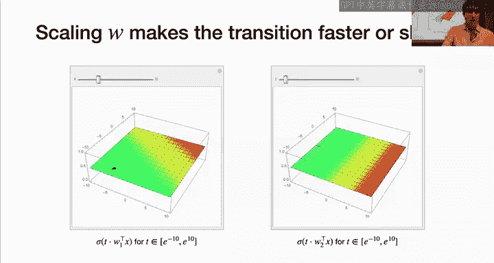

Is zero， okay。And so it's very important to also think about。

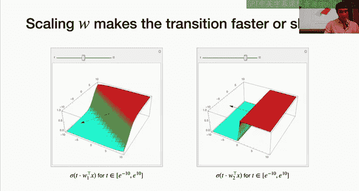

这 shift them。About the Dub Museum。And so what is the impact of w0。

 so w0 will really help you to shift the decision region along the vector w。O。So the W。

 the D will give you。The position of the Iplan position。And then with W0。

 you will be able to move along this direction。😊，So this is exactly what you see with animation。

I'm playing with W 0 between minus6 and 6。 And you see that the transition。

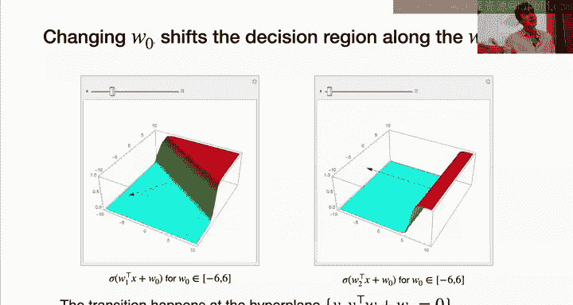

Is moving between-6 and 6。 exactly what you see。 We go from-6。P6。

That exactly the same with a second example。ok。

So it's a dection of w。😊。

Is giving you。The position of the supply at airplane plane， so scale of W。

Is giving you。The shape of the prediction。

And then the shift is exactly telling you。😊，You know where exactly the transition is happening。

呃 long。

Pctor about you。Is it clear for the importance of these three？诶。

It is a。And the value  zero。

Yes。Again， what we said last time is that。In practice it's really important to consider as this shift W。

 okay， because there is no reason that your data set will be centered on zero。

 so you will always have to learn this W0 in your model。Okay。

So what you really want are doing when you are modeling your probability。

 you really want to include this ship W0。But for simplicity。

 when we will do the analyze what we will often do。😊，Is that。Instead。Affecting this。Real W0。

 which is a little bit annoying。 We will just add a constant to the features。

So you will consider your feature and you will add this one。😊，And like this。

You will not learn W and W 0。In your space of dimension D。But。So。It will consider x。So this is A D。

 We will consider x in a d plus1。And so what you will learn is directly W。W0。

 which will also belong known to A D plus one。Okay， so these are exactly equivalent these twos。😊。

But exactly the same。 It's just for notation， for notation， we will prefer。To remove this stem。

And to just consider w trans x。But in the application。

 you should not forget to add the consent term in your features， so they are important。

Because other wise。If you are only learning W transpose x without the constant。

 you will only learn a Naer plane with step by zero。

And if your observation x are just far away and not center on zero， does not make any sense。

So in application。Do not forget to add the one。Okay， so what？

What have we done in the first part of the course？We have defined what is the logistic regression。😊。

And we see， we have seen how it was possible to make a prediction if I was giving you a vector w。😊。

And a shift value 0， okay？So now you know how to make a prediction if I give you your classifier。😊。

And so now what we will do in the last five minutes of the first part and in the second part of the course。

We will see， how is it possible to do the training， or when I will give you some data。

 you will be able to learn the vector W。Okay。So how do you think we can do？

What will be the technique to learn your credit card order value？嗯。

So what have you done when it was about least squared？Exactly。

So what you will do is that you will use what is called the maximum likelihood estimation M。😊。

So let's talk a little bit about it。So the question is， how is it possible to find the parameter W？

You know what to do with W if I give you a W， you will be able to do your prediction。

 but now you want to find W。And so。I don't know if you remember what you have seen with Martin butli Square。

But when you are doing a regression in least square， you define what was a least square aim。

And so when you talk about least square。You arrived to the Lco estimator using two different justifications。

 you remember what was the first one？For a geometric in。

Do you remember the geometrymetric fuion behind these squares？

You want to find the line which will minimize the fit between your why and your prediction。

Okay so you are really many amazings and means square。😊，It was a first。

Way to dehive the dis squareim， minimizing your quara。But then you also saw a second interpretation。

 which was a probabilistic interpretation。So what was the pbiistic interpretation of the dis square？

呼喜明白。上蚊。So it was that also in order to do the least square。

 what you can assume is that your observation Y。😊，Is equal to the2 feet w transpose x。Plus。三一号。

And when you were assuming that this error was Gaussian， okay。

 where0 mean condom variable for doing a normal law， So when this error was Gaussian。😊。

Then if you were doing the maximum likelihood。And this model will genetic give you。The risk estator。

Okay， so you saw that for a least where you could define the estimate。

 you could find the W using some。Gometric intuition or some using some coabbilistic intuition。

And so now we will do exactly the same， we will use a probabilistic intion in order to learn of parameter of w。

 and so this is what is called the maximum likelihood estimation so that's really like a way to estimate the parameter of a statistical model。

😊，You are assuming a statistical equal model on your data。H。

 it will be that you're assuming that the probability that x belong to the class y1 will be equal to sigma of x transspow。

 this is a statistical model and using the MLLE you will be able to find the parameter W。

 which will be the most likely for your observation。😊，So what is MLE？

I give you some ID samples to Z1 to ZN。Which are following。Some probability。Okay。

 you have a statistical mode。So you know that the probability of observing z1 Zn will be equal。

To this number。Which is a function of the value。And so the maximum likelihood of dis sum would really be。

😊，So estimation method， which will find the Pahamme W star。On their witch。

The observationvation you are seeing are the most likely。O。So just to be clear。

 you have a statistical model。😊，And what you don't know about the statistical model is the value of no value。

😊，Okay， you just know that your observation are following some low。

 but you do not know what is the parameter of this slope。 For example。

 you can know that you're observing some Gauchian vector。

 but you do not know the mean of this Gaussian vector and you don't know the variance。

So what you will look at， you will look at some observation。😊，And you will say that the Pahamit。

Of the observation observation you are looking at are exactly the ones such that。😊。

The probability of seeing exactly this value will be the higher。😊，ok。So really like the ML。

It will find the parameter W under which the data are the most likely。Ok。So we have this function。

L of the values， this is a likelihood function。😊，And what is the likelihood function。

 it is exactly it is a function of W and that exactly the probability。😊，Of observing Z1 to Z N。

When you are assuming the Z1 and the N are following your statistical model with Pahammeita W。😊，O。

And so。The maximum like to decimator will really be W star， which will maximize。This probability。

So before the break， we were talking about。emmily。And what we said is that。

As the name was suggesting Emily was exactly the method。For which you will find the parameter。

Under which your data are most likely， okay？So when you are looking at this probability。😊。

You see that this probability can be seen as a function only of your parameter or W。😊。

So this is called the likelihood function。😊，And so the maximum likelihood estimation and the maximum likelihood dis will exactly be。

😊，The maximizer of your liking。佢实就出啲先。And since your observation， Z1 to Z N are independent。

And I editor carry distributed。This probability of z1 to the n will be exactly equal to the project。

Of the probability of the one。Knowing the value， okay。

So let's sit for the maximum likelihood estimation。

But in practice。We don't really like。Products。And we don't really like to maximize function。

And we prefer to have some sum， and we prefer to minimize。

And so what we are doing and what we are considering is the negative log likelihood you。😊。

So is it just？You are taking the negative of the logar rate of the likelihood。And you will minimize。

This k。So this is what is called the negative likelihood likelihoodlude and you see since you are taking the log of the project。

 you will get a sum。😊，你在这今的还。Fmula you will use。 and this is what you will use in order to find W star。

 You will often minimize this function。Okay， and so the question is， you know why。Does it make sense？

To do this ML， what are the territory justifications。So， TP Kelly。The to justification is that if。😊。

Your datata Z1 to Z N。We really generated。By。Your statistical model。😊，And if you。

We're having a number of data going to infinity。Then by doing ra。😊。

You will take over the two parameterhammeter of your model。Okay。

So if you have a hondam Gosian vector of Mmu。And you're observing a lot of samples X1 to X n so that X I is a Gasian of mean mu。

 and you do the MLE if n is going to infinity， you will recover your twomin。没有。Okay。

So this is what we say that it is a consistent estimator。

 if your sample complexity is going to infinity， then you will recover your2 parameter。😊。

Now I'm just adding you that this is not always true。

 you have to assume some small technical conditions。Okay， but in practice。

 you can think of as being two。If your number of data is going through infinity by doing the MLE。

 you will recover your2 parameter。😊，But only if。Your data was really generated according to your model。

So in practice， this would not be true。Okay， in your real life。

 there is almost no hope that your data will follow the model you want to put on。😊，Okay。In real life。

 there is no hope that， you know the grade of a course would be Gosians where I just。

Murdering them by some questions。But still， the MLE is important because it says good safe girls。

 okay？😊，If your data are not too far from the distribution， you try to fit。Then。It can still work。

Okay。So this is for the formal definition of the MLE and of the negative log likelihood。

 so it's a general method to find the power of a statistical model。😊。

And what we will do now is that we will apply this general method to the logistic regression problem in order to find the parameter W。

😊，So what is the first step？The first step is to compute。The likelihood function。Of your model。

And to do so， what we will do is that we will do a first assumption， which is an assumption。

 but it is reallyna。😊，So， you see no。Capital a is bold。

 so that means that this x is a matrix with all my observation x1 to x N。😊。

And so what I am assuming is that my observation x1 to x1。😊。

And not depending on the parameter of W I'm trying to find， okay。

I'm assuming that my input is independent。😊，Of my Parael do。So using this assumption。

 I can compute my likelihood function， so the likelihood function is a probability。😊。

Of observing y and x。Here y is also in bold because this is a vector with all my y1 to Yn。

And I just say that this exactly equal to the probability of serving x knowing W。😊。

Time is the probability of observing y， knowing x and W。 okay， this is basic probabilitybil。😊。

And now what I will do is that I will use the fact that x and w are independent。

 I'm using the fact that my observation x are not depending on W。😊，And so how I will use this fact。

 I will use the fact that the probability。😊，Of observing x。

 knowing w will exactly be equal of the probability of observing x， okay， x is independent of W。😊。

So you see that this number will be sub number and this will be something which will not depend on double。

😊，And since what I want to do at the end will be to maximize this function or to minimize the I mean the negative logarism of this function。

 I will be able to throw this term away， okay， this time will not change my problem。😊。

Because this term is not depending on the。So the only term I will care about is that term will be the probability。

Of observing y， knowing X and W。So this is what I want to compute。So， using。The I。

 the fact that the occupation I。This is exactly equal to the project。😊。

For one for y between one and n。 so the product of all my observation of the probability of observing Y I knowing X I and W Okay。

 this is just the fact that。Probability of independent events is equal to the product of the probability。

And so know what we want to do。Is that we want to write this under a simplified form。

So the first thing I'm doing， I will split this project in two parts。In one part。

 I will put all to Yi whose value are 1。And the other part I will put all the Yi was value R0。

So the project over all the Yi will be equal to the project of the Yi。I mean。

 over the I such as the Yi I equal to1。Okay。Time the projects adapt， the Yi is equal to0。

This is simple， yes。And now what I want is that I want to rewr。This。So， this。

I know that this should be equal to sigma X transpose w。

But I want to rewrite it as a unique firm which will work for the both case。So what you can observe。

Is that this will exactly give you what you want， so let's look。😊，At this quantity。

When Yi is equal to one。This quantity is equal to。Sigma X I transpo value。

For Yi and Yi is equal to one。So this is exactly equal to this quantity。

And the second the I have won minusYI。So yi is equal to 1， so 1 minus yi is equal to 0。

So1 minus sigma per0 will be equal to1。So this term。

When Yi is equal to 1 is exactly equal to sigma X transposeable value。So when Yi is equal to1。

 this term is equal to this term。Then。When Yi is equal to 0。

This term progressive0 would be equal to1。And this term will be equal to 1 minus sigma X transpoable be。

And so this term。When Y I is equal to0 will be exactly equal to the probability of Y I equals0 knowing X I and W。

So if you think a bit more， you can actually see that。😊，This product。Is exactly equal。

To this project。ok。Yes。And then why the binomal distribution will be written under this form？反有。喂。

不要努力。Yes I mean， that that the definition of logistic will be equivalent to ban。

 but the question is why the binary distribution can be written under this form。😊，Which is non pre。

They are only distribution what it is， it's honor variable， which can value 0 or 1。😊。

And it's equal to one with some probability Eta and 0 with  y8 minus 1 minus itta。

It's not directly clear that you canwrite a manually distribution and theres this form。

This is what we just kind of put。So is it clear how we go from this quantity？😊，To this project。

We just consider as a product of the odd observation using the independence。We split between。The Yi。

 which are equal to 1 and the Yi， which I equal to0。

 and then we see that we can write them under the same form。And so we can match them again。ok。

So we have this。Equality for the stem。And so this is giving you that the likelihood will be proportional。

😊，To this function of W。It is proportional because I have this。😊。

But what I'm telling you is that I do not care about this。😊。

What I will do is that I will minimize the functions， okay I can throw this term away。😊。

And so what is a second step？😊，I told you that I don't like this function。

Because I don't like to maximize function， I don't know how to maximize function。

 What I know is how to minimize function because I like convexity。

 I prefer convexity over the concivity。😊，And also I don't like projects。

I don't like to do the project of a lot of numbers， okay。

 that's something I'm not very confident with。

So the second step will be to consider as a negative。

Like likelihood。So I will exactly take。This term I have computed before and I would take minus the log。

So what I like I take minus the log of this project。😊，Productject。

Log as the project is equal to the sum。Of the log。So I get exactly this。😊，嗯。Now。

 you see that here I have also a product of a lot of dams。So I will have the log of sigma。P Y i plus。

The log of1 minus sigma power 1 minus Yr。And then I will use the fact that log of f per alpha is equal to alpha log of F。

So you see that the log。Of this quantity。Is exactly equal to Yi log of this quantity。

And I can do exactly the same for the second part of the product。

So I did get minus the sum over all my observation。😊，Of。Y I times log of sigma X I transpoable value。

Plus。1 minus Yi， the log of 1 minus sigma Xi transpose the W。But still。

 I want to simplify this again。😊，So what day would do。So， first。I will factorize by Yi。

So I will get Yi times。This log。Mine is this look and you know that。

The difference between two log will be equal to log。 So log A minus log B is equal to log A over B。

So we'll get this。The log of y minus sigma over sigma。And now I still have this term。

And I my minus said so okay。So I had the minus they V give me。十十歳。And so I know I have the minus。

Mus minus plus No sorry， minus。Plus  one， so minus log1 minus sigma， so I get this。

And now I want to simplify this again。And in order to simplify this again， we will use。

What we have seen in the first slide about the logistic function。

So I will use the fact that one minus the logistic function is equal to one over1 plus exponential of k。

So that's the first thing I will use。So this is telling me that this1 minus sigma。

Will be equal exactly to1 plus exponential set of。呃， 있다。So you see that。This should give you this。嗯。

Yeah， okay， good hes giving you exactly this because you will have the log of one over one plus exponentialial itta。

 so this is equal to minus the log of one plus exponential itta and minus minus give you plus。😊，ok。😊。

So you go from this term。Do this term。Simple computation。And now but， we also want to simplify this。

And in order to simplify this， we need to compute one minus sigma over sigma。

And what you can see is that1 minus sigma over sigma is exactly equal to exponential minus eta。

So why we say that1 minus sigma eta is equal to1 over  one plus exponential。

I know that sigma Eta is exactly equal。Two exponential over one plus exponential。

So when I will divide this。I will have。I will multiply this by one plus exponential over exponential。

 so it would give me one over exponential of itta， so it would give me exponential of minus itta。

So I can plug。This here。And what I will get， I will get the lug。😊，Of the exponential of minus X W。

So the log of the exponential， it give me identity and so what I am opening is exactly。😊。

Y I times X I transposeable bridge。Okay， so you see that today I could go from this。😊，Two。

 minus YI Xite transferposeW。So at the end， you have simplified。Your negative like like you would。

As this function， and this is a cost function we would like to minimize in order to find optimal parameter。

And so you see that the function would just be the sum over your observation。

Of a linearar term minus X sorry minus Yixi transpose w plus all logarithmic term log of 1 plus exponential X。

Hospers the budget。So this is the cu function we will be interested in today。

And what I'm telling you is that minimizing this class function。😊。

Is exactly the same as maximizing my likelihood。😊，Because。I have just remove。This term。

 but this term is independent of double。So。Doble star will exactly be the maximum likelihoodestimator。

That's the first point and the second point， which is important to make。

Is that if you would have considered not01 for your labels， but minus11。

Then you will have obtained a different plus。Okay， you will have a def function。

And in practice sometimes， I mean， if you look at different implementation of projectgic regression。

😊，And we will also talk about it in the SVM course。

 You will see that you can have different functions。

 So you have to be careful about are you assuming that your label are in minus-11 or that your labeled are in 01。

😊，This will give you different function to minimize。

Is it clear for the minimum of the negative load likelihood？

So just what is important to have in mind is that by doing the MLE， you get some function。😊。

Which is in a nice firm。This is son。And what we will like to do now is to minimize this function。

It's not important to remember how we are dehing this function。But this for you。

That's this kind of simple computation you have to be able to do again， okay？

All this small tweak is not to complicate， but this is something you have to be able to do for the exam。

 for example。So now we want to minimize this function。 So what is your first？

Question we will ask about this function。We want to minimize the function so that the second question we will ask if the function is convex or not。

 what is the first function， Remember， about least squares。For least squares。

 if you had the less function， or class function， it was the sum of the quality class。

And you wanted to minimize it。 and so what you did。Exactly， you look at for the， I mean。

 you look for the station I point， you take the gradient and you look at the solution。

The gradient equal to 0。So， let's compute the gradientian of。Discuss function。

So this is just a function。I had thehi in the previous slide。

And I want to take the gradient of this function。Okay so this is simple computation。😊。

I have my graduate。Of a some。This is equal to the sum of the Guardian。

And now I want to take the gradient of log of1 plus exponential。

So this is exactly equal derivative of the log is one over the function。

 so I get my one plus exponential and then I have to take the derivative of this term。😊。

It give me this。Okay， so the gradient of the log。😊，Is equal to this term。

And then I want to take the gradient of my linear function， X transpose W。This is equal to X， I。对。

First。It that be also multiply by X sign because。I mean， we deliver we should we， yes。

 this is the typo。Thank you。inOkay。So the Xi come from when you are taking the derivative of this。

 it would be Xi times exponential of X transpo W。😊，Good catch。And so here。

What we are recovering is exactly the logistic function。😊，ok。

So you see that the gradientian is exactly equal to the sum。😊，Of。

The logistic function in X transpos w minus Yi。Times X。Okay。And so we can write it and there more。

Coact firm。When we are using。The design matrix x and the design vector Y。

You can convince yourself that this term is exactly equal。To this matrix computation。

 it will be equal to your design matrix transpose。Time sigma of xw and so x w is a matrix times a vector so this would be a vector and so sigma applied to a vector will just be sigma applied to each component of the vector。

😊，So this is a vector。Matrix times the vector will give you a will give you a vector and you see that this would exactly give you。

😊，So， some。I mean， it will give you system。So what can we say about this guard？First。

 you can observe that it's exactly the same gradient as for the list square。😊。

But we have in addition dysfunction sigma。If I remove the sigma。😊。

We are observing the same gradient as for the squared。😊。

But the fact that I have seen my would change a lot。😊。

It means that I don't have any close form solution。F client is equal to zero， it's not possible。😊。

To give me a close farm solution for the。So we will not have a close form solution。

 but still we will be able to minimize a function because a function will be convex。

And so this is the second thing we would show we would try。To show that this function is convex。

So how can we do？不。How can we show that these function？Is a COvex function of double。

So we can show that it Asian of the matrix of the second derivative is positive definite。

Then one way， in a second way， how can we do it， do you have an idea？

Is that looking at the next slide？So often a nice way to show that such function is convex is to start from some building blocks。

 okay you have some nice I mean， operation which will preserve the convexity and we will play with them。

😊。

So the claim is that my function L of W， my curse function is convex of W。😊。

And how I will prove it in a simple case。😊，I will show that my cu function L is obtained through some simple convexity preserving operations。

😊，ok。So it's like a Lego game， I give you some small break。😊，And with a small break。

 you will do something larger。So what are the simple operations？😊。

So first one is that if you have two convex function。

Any positive combination of this convex function will still be convex。 So F is convex， G is convex。

 Al beta of positive。😊，Alpha F plus beta G will be complexvex。F。Hereel who would use。

Then we will use some composition resumes。😊，If you have a convex function and you take the composition of this convex function with a linear function。

 it will be convex。So F convex means that F of w transpose x will be convex。Indo value。

That the second week。The third rate will be that a linear function that's one of the simplest function。

 it will be both convex and concaed。ok。That the only function which would be both convex and concave。

And the last break will be that this function。😊，Loarism of one plus exponential of ital。

Is a correctvex function。So this is a real function and we want to show that it is convex so often。😊。

The easiest to show that is to do what。Exactly， it will be the solution will be to compute the second derivative。

😊。

So let's add the。I want to show that my function H of Eta is convex。

 I will just compute the derivative and then take the second derivative。So my derivative， I mean。

 we already did it， it's one。😊，Cl exponential eta because the narrative of the log is1 over。😊。

X times the derivative of 1 plus exponential itta， which is exponential Eta。

So you see that H prime is exactly equal to sigma Eta。😊。

And now the derivative of H would be the derivative of sigma。

 and this is where we have already computed at the beginning of the course， we can compute it again。

😊，And you see it would be something positive。The second formula was this is equal to sigma times1 minus sigma。

 so this is a second proof that it is positive。So you see that the ser derivative of H is positive。

 so the function。LoG1 plus exponential Eta is conx。

So we have of building blocks。And we will play with them。So， first。

Using that a composition of a convex and a linear function is convex， this is telling me that。😊，呃。

んかね。Okay， yes。It would tell me that all this is convex， okay。

 because I will take the combination of this function。And。E linearar functions， in fact。

 I'm not using02。 I'm just this using 4 and2。 and this is directly giving me that the log of one plus exponential X I transpose w is convex。

 Okay， it is convex as a composition of a convex function and e linearar function。So this is convex。

嗯。No， I will use the facts。Okay， I'm still missing the X everywhere。No， no。

 sorry noise so this is convex。😊，No， I will use the fact that the linear function。Is convex。

 so this function is convex。And so now that it's telling me that the sum of these two convex function is also convex。

 and I'm doing the sum of a lot of them and so air is convex。😊，你给。Any type on the slide。

 I don't know。Well good。Okay， so like this， we see that the curse function is complexvex。😊。

And how we did that， we just play around with some simple。😊，诶。Conveity。

The second way to show that the function would be convex， as one of you said prefer was。

 is to compute。So matrix of the Su derivative， So okay this is called the Asian matrix， Nabula2 of L。

 and that's really like the matrix whose entriestre are the Su derivative okay every entriestre of Nablla 2 of L is equal to the derivative with respect to Wi and to Wj。

😊，This is giving you a matrix， you would compute this matrix。😊。

And if this matrix is positive to mean if， that means that your function is convex。

So in order to compute the as， we will take the NaBla of the transpose of the Guardians。

So this was a formula for the Guardians。I take topo and I put it in size of sum。And you see that X I。

Tpo you giving me exactly this。And now I will get the guard。😔，Of this quantity。

And in order to get the gradientian of this quantity。

What you will love is that it would be exactly equal to the derivative of this function。😊，Times。X I。

Yeah。ok。And the derivative of the function sigma we already seen previously。

 it was equal to sigma times 1 minus sigma。😊，So when I'm taking the different agent of this function。

😊，This is exactly equal to sigmaxi transpo W times 1 minus sigmaxi transpo W times X。

This is a simple computation。And you see that。This。Can be a right， can be a simple exercise。As。This。

Mattris。I have my design matrix transpose times sum positive matrix S， I mean some matrix x times x。

 and what is the definition of x of s？😊，ul be exactly the jugonal matrix。

 okay would be a juagongonal matrix， and each component of the jagonal will be exactly sigma X transpose w times1 minus sigma X transpose w。

😊，And you see that each of these term is positive。😊，Because sigma times 1 minus sigma is positive。

So this is a jagonon matrix。😊，W jagonite entries are positive。And so this is a positive matrix。

 and so these metrics will be PSD。😊，ok。你信你知。Exercise to do to show that a matrix like this is PSD。

How can you do this？而就。What is the definition of a PC matrix？然后。Exactly。

 so you will be able to show that。V times Nala2 L guitarta times V will be positive。For A。Okay。

 that's a way， and this is the act with this formula。

Anyway， so then how can we minimize the COvex function？

We have to be a little bit fast because we only have 10 minutes left。

So the first way you have seen in the course to minimize the convex function is to will be to use the gradient descent algorithm。

 Okay， so you are computing the gradient of your function。

 and at each step you are going in the negative gradientian direction。

 You have already seen that with Martin。😊，The problem with grad de is that often it can be slow。

And in particular， it will be slow。😊，If N， if the number of data you have is very large。

Do you see why， why if n is very large， your gradient computation will be very very slow。Yeses。😊。

Can you say it again？No。Why do you want to in a garden？

My gradient is equal。

they will have later。Yeah， I'm not in investing it。But when you are computing your gradient。

 you are computing a sum over all your data。So if n is very large。

 each time you want to compute a gradient， you will have to do a sum of n terms。😊，Okay。

 so if n is equal to 10 billion， this will take you too much time。

So that's why often in machine learning， we are not using gradient descent。

 but we prefer to use an algorithm calledtochastic gradient descent。

So instead of computing the full gradient。😊，It will only sample one。Indices between1 and n， okay。

 inly。And you will only look at the Guardians for this observation。😊，And so you look at if you take。

The expectation of this quantity。Over IT where IT is uniform form over1 and n over1N。

Then you will exactly recover the sum of I mean， of all the gradient in。

 and so you will recover your true gradient。😊，O。So， asD。Instead of following the tool gradientent。

 you will follow an estimate of your gradientent， but you see that no what is the complexity of computing this。

😊，To be Earth one is not depending on your number of observation。

You can have end as loud as you want。Each step of HD will only cost you all of one。So。

The algorithm will be faster to implement in step when you are computing a guard would be very fast。

😊，But the conversiongence hyp would be slower， you will need to do more step in order to convertverge to the solution。

That's the main difference between gradientn descent， GD and stoacastic gradientn decent， LGD。

Gianデcent。Take you a lot of time to compute your ga。But then your comaence is not too slow。HGD。

 you are computing a gradient very efficiently， but you will have to do mouse step。😊。

And when you look at the trade in machine learning。

Almost always SD at the end will converge faster when you will look at the number of computation you have done。

 look at the total complexity。😊。

And another way to solve this problem。Which is even faster， faster than Guardian descent。

Is to do what is called a new term algorithm。So Guard descent。

 you are only using your first order information about your function。

 you are only using your gradients。In Newton method。

 you will try to use the second other information about the function will use the Asian will use。

Some information about the cur of your function。So how are you doing you've done？

The ideass of the new algorithm is really to look at the quadratic approximation of a function。😊。

You know that you function L。😊，Will be not too far away。

Of its quadratic approximation when you are using the Taylororlor approximation。

 so what is a quaratic approximation that's my value at WT。😊。

Plus my gradients in WT transport W minus Wt plus my quaratic term。It depends depends off my issue。

So you see that Fiji of mobile use this is really。😊。

The quadratic approximation of my function around the point of。😊，If w is equal to WT。

 this is exactly equal to L of WT。😊，And when you can hope is that this quality approximation will not be too far away from the true function。

😊，In particular， if W is not too far away from WT。Because you know that。

This will be the distance between the two will be of other。W minus double T over3。 Okay。

 we have to go to dialoguelor at the others。嗯。And so what you are doing when you are doing in newton。

 you say， okay， if this quant function is a good approximation of my function。😊。

I want to minimize L of W， but I don't know how to minimize L of W。😊，Its to complicate。

What I will do instead is that I will minimize my quaratic approximation。😊，So you take a step。

 you want double1。You look at the quadratic approximation of your function around WT。

 This is a quadratic function。 And you have seen with Martin that a quatic function。

 you can minimize it in a close form。😊，So you can get。

A close form formula for the minimizer of this quatic function， So how you do so。

 you just compute the gradientians。And you set the Gr to0。This is a constant。

 so this would disappear。😊，This is a linear term so the gradient will only be equal to the gradientians。

😊，Okay。This will be not the Elka。And then you look at the gradient of the quadratic part and the gradient of the quaratic parts is exactly equal to the Asianian times this。

😊，ok。😊，And so you see that if you said this is equal to zero。😊。

What you will directly get is that you take this term here， you invest to remove this term。

 and you add WT。😊，So what you will get， what is the update of the newton algorithm， it would be WT。😊。

You should not have some step size first。😮，Minus in of the Asian times the gradient。

So you see that it is very close to the gradient algorithm， but you are not J following the gradient。

😊，We are following the gradient re scale by the second order geometry。😊，Of your system， okay。

 you are using the single order information of your problem in order to recate the space and you are not following negative gradient。

 but you are following inverse of the times the negative gradients。😊，And in practice。

 what you will have to do is that you will have to add the step size。😊。

Because if you are not adding some step size then you， it's not possible to prove the convergence。

Okay， so it would not be difficult to you will have some guarantee how to play with the step size Do you have a question？

Where did the W。对。Here。系唔 just。Plugging， what does it mean。This is my gradient of50 in WT plus one。

I want that WT plus 1 is the a min of 50， so I set my gradient to0。

So what it is possible to show is that the covergence of the newton met will be very fast， okay。

 to be really faster than gadian decent。😊，Will be what we are calling a super fast convergence。

 be more than exponentially fast。The problem of the Newton methods and why it is not。

Use a lot in practice。Is because gradient descent， I only have to compute my gradient。

You turn me third， I have。Is there to invest。So that could cost you a lot a better way to do it is just。

😊，To solve this linear system。But you see that when you will use a newtonmeter that each step you will have to solve a linear system。

 so the complexity often will be very large， it will be quatic in D or even larger。😊。

So new term methods， you are using more information about your function。

You are converging really faster， but each step will cost you a lot and if D is large。

 it would be too expensive。😊，So then there are some nice way to do newton。

Such as quasi newton method and if you are interested about this you should follow our course about optimization in the second semester Do you have questions。

😊，So solving this equation will guarantee you that in one step you would have a minimum of the function phi T。

 which is a quadratic approximation of L。😊，So each step of the newton method is minimizing the quaratic approximation。

😊，It is not minimizing your initial function。😊。

Okay。So we will just。If you agree me。Two x minutes。Look at one important problem。

 but what we saw today。It is in the case that when the data are linearly available。

 so we talked about it last time， the case when you have some I plane which will cut your data in。😊。

And what you can see is in that case， if you look at your cu function。😊，So the logistic regression。😊。

And you look at the value。In W bar， which correspond to one of the se hyper plane。😊。

And you take the scale of the W to be very， very large。😊，You can show that L of W will go to 0。😊，ok。

So the problem is that， in fact。The minimum will not be attained。

 it will not be possible to exactly minimize a function。

 what you will have is that the infinitefinome of the co function will be equal to zero in order to go there you will have to go in a direction。

😊，2 infinity。Okay， so the in value is not attained for a finite W。😊。

And so if you are using a optimization algorithm。😊，It will never con。

 you will just keep doing your optimization process and your weight。

Will just increase and increase and increase。So。😊，From an optimization point of view。

 it's not very good because you will never know when to stop。😊，And so often to solve this problem。

 what you will do is that you will add some L2 regularization。😊，As you have done in a regression。

 you are considering your cast function。😊，f。The logistic regressiongreg。And on top of it。

 you are adding some L2 regularization to penalize your weight so that now when you will minimize this function。

😊，You have some L organizationization， so you don't want to take W to be too large， okay？😊。

For a good parameterit thelumda。This minimum will be attain。

 so you will not have the problem of W going to infinity。And also from a statistical perspective。

 some senses will allow you to really go to this IP plane。

 which is maybe not the one where you want to go。😊。

So this is a new parameter you can play with and this is what is called the Ri Lo regression。😊，ok。

Her last comment to conclude today， which is kind of very interesting is in fact。😊。

If you are doing stochastic gradientd decent on this function。😊，You will diver to infinity。

 but you will go in a particular direction， okay？😊，So you will go through a se of your plane。😊。

But what it is possible to show and I。Let the link in the。Because not。

 it's possible to show that you will divert， but you will convert in the direction。

Of the max matching。So I plan， we talk about Tuesday。

So that is kind of funny about the algorithm is that the algorithm will diverge。

 but will converge in one particular direction， which is a direction could be interested to convererge to。

😊，Okay， so that will be all for today。 Thank you very much。

 And we see you each other Tuesday to talk about。😊，Zなizeの mode。Have a good weekend can， bye bye。

