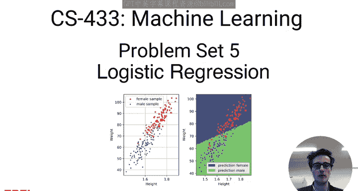
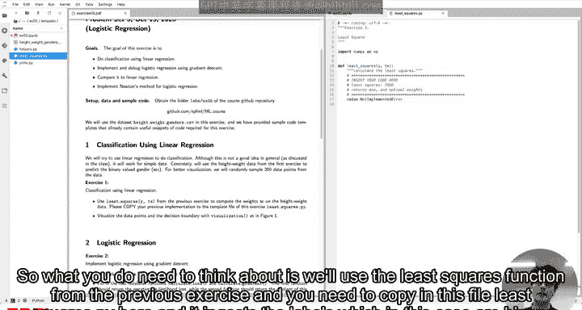
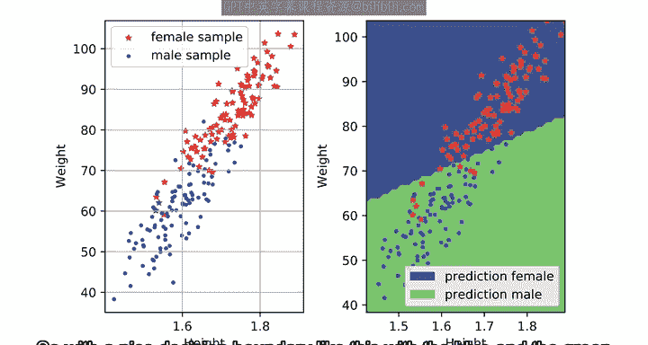
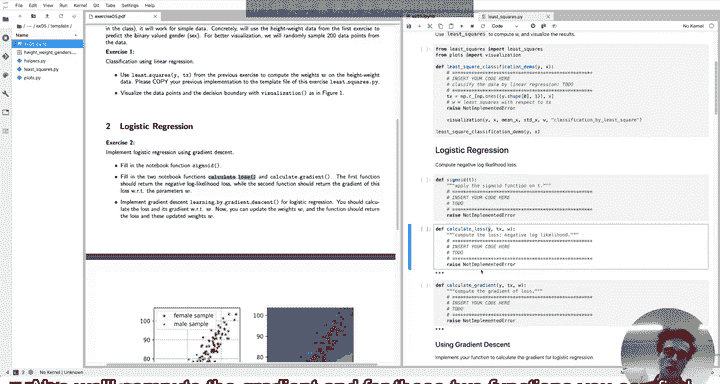

# EPFL《机器学习｜Machine Learning Course CS-433 fall 2020-2021》中英字幕（deepseek - P15：[15]Exercises 5 - getting started video.zh_en - GPT中英字幕课程资源 - BV14SwyeNEvW

Hi everyone in this week's getting started video we'll be dealing with problemble set 5。

 which deals with logistic regression and classification。

So in the first exercise we'll do classification using linear regression generally this is not a good ID but we'll do it because in this case it works for simple data and it's a nice connection to the things we've been doing in the previous exercises。

So we'll use the height weight data from the first exercise to predict this time a binary value。

 gender or sex variable。So for better visualization well also randomly sample 200 points from this data。

 but this is all done in the code for you so you don't need to worry about that。

So what you do need to think about is we'll use the least squares function。

From the previous exercise。And you need to copy it in this file these squares up pi here and it ingests the labels in which in this case are binary and the transformed features so which already have the one added in the from but this is all done in the code for you no need to worry about that so once you run these first two cells you need to run this cell。

Where you will obtain the weights through the least squares function。

 which we just defined in the other file。Then。You visualize these data points and the decision boundary with the visualization function。

 which you can see here， just need to run it and once you run it you should get a result which looks similar to this one。

So with a nice decision boundary like this， with the blue and the green areas depicting the different prediction areas for male and female gender。

So once this is complete， we can go on and look at the second exercise which deals with logistic regression。

 which is a more principle approach of dealing with binary classification。

We'll do it in steps and first we'll fill in the sigmoid function。The sigmoid function。

Is the logistic function？Which will transform。A number on the real line to a number within the interval 0 and 1 because our labels are also0 between 0。

 I mean， or either  zero or1。And so the sigmoid function looks like this and here you also have the formula with which you can implement。

So once this is done， we can now use this sigmoid function to compute the loss and also to compute the gradient。

So for this we'll fill out the functions calculate loss and calculate gradient where the first function returns the negative local likelihood of logistic regression on this data。

 so using the weight which is the model and the data here， the features and the labels。

Also we'll compute the gradient and for these two functions you can find these formulas in the lecture notess。

 or if you want you can redirective them yourself。

So once we have this loss computation and gradient computation。

We can go on with learning and learning in this case involves doing one step of gradient descent on the parameters W。

So。You compute。The the loss and the gradient the gradient of the loss with respect to the weights and then you can update the weights and this function learning by gradient should return one such update and the reason for this is that in the next cell Jupyter notebook cell we will do the actual training where we take many iterations using a learning rate to do iterative learning。

And then normally， if you visualize this， you should see something similar to the。

To the picture before， however， in this case， it's more principled using a sigmoid and logistical regression。

So plot the predictions， this is this cell and then go and figure out whether these results make sense to you or not。

So when this is done。This gives us some。Yeah， it gives us some implementations of the loss and the gradient and now we can easily implement Newton's method and Newton's method is the second order method which requires the use of the hesian。

 so first we need to compute the hessian with the calculate hessian function which ingests the standard arguments。

And we return the hessian off the loss with respect to the parameters W。And then finally。

 when we have this function calculated hesian， we can go on。

And complete the logistic regression function， which will make use of all these functions that we've built before。

Note that we should not update or return the parameters W should return the loss degree into the hesian because this is for the next function where we'll take one step of learning with this newton method on logistic regression。

So。Hu。😔，With the learning by Newton method， we'll take one step of Newton method and return the loss and the updated parameter is W。

So after this is done， we can actually do the iterative learning。

 and if you did everything correctly， normally you should see that the number of iterations required is a lot less than for。

The logistic regression with gradient iscent。 and you can。Think about。

 It's good to think why this is the case。So once we finished exercise three。

 we can go on to the last exercise。Where actually we'll add some penalization in the form of regularization。

Do are lost。And。So when you add the regularization as a sanity check， you can put the lambda。

 So the regularization factor very to a very small value。

 And this should is normally equals the loss to be equal to the unregorized loss。

 And this is a good sanity check。And once you filled out this penalized logistic regression function。

 which returns the penalized loss， the gradient of this penalized loss with respect to the parametersW and the hesian of this penalized loss with respect to parameters W。

Then we can do an actual step which will update the parameters W and return the loss in the W。

 and then finally we can go on and do the learning procedure which visualizes it again。

And this should again give a picture similar to the one here。So that's all for me。

 I hope it was useful and see you all on Thursday， bye bye。

