# EPFL《机器学习｜Machine Learning Course CS-433 fall 2020-2021》中英字幕（deepseek - P16：[16]EPFL Machine Learning Course 2021 - Week 6 part 1.zh_en - GPT中英字幕课程资源 - BV14SwyeNEvW

So hello everyone and welcome to his new lecture。Today， we will talk about two different teams， one。

Which will be the exponential family。And the second one。

 which will be at the end about the generalized in our model。ok。But maybe before。

Do you have some questions about last lecture on logistic regression？No questions。Okay。

 if you have some question， you can ask them on the forum。

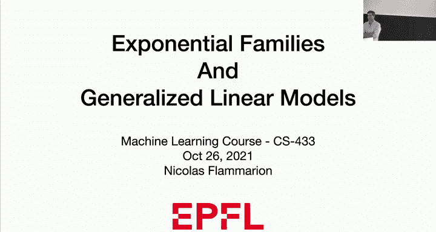

Okay， so let's start。

So what are the motivation behind the exponential family andgeneizing our model？

So if we go back to the prediction， I mean， to the regression problem。

You know where we had like these very simple。That does。We add， like。On the horizontal axis。

 the input x and on the vertical axis， the output y， and what we want， like what is the goal。

 we want to predict the output y as some linear function of the input x。ok。

And when you studied this with Martin， you introduced the list square estimator。

And I don't know if you remember， but。There were two ways。To find this least square estiator。

 the first one， which was a geometric way。Was to say that the least square sum was minimizing the sum of the squares of the residual。

 so it was really geometric。We are trying to fit the vector。W。Which we explaining the most data。

 which means that the vector of w such that you are minimizing your mean square。So this is geometric。

But then we also say it was the second way to introduce Du and W， which was a probabilistic way。

So what we did is that we first assume that the data。Were coming from some。确实。嗯。

So we were assuming that the data we coming from linearar model be atrbated by some noise。😊，Okay。

And we were assuming that the noise were Gasian。So what we say is that the output y。

Is equal to x transpose w。 This is your linear model。 And on top of this， you are adding some noise。

And then we' are assuming that this noise is gaucha。O。And with this model。😊，Which means that。

 in fact， the output will also be Gaussian。And the mean of the output。

 the conditional mean would be exactly the linear prediction x transpose to w。

Then in order to recover the optimal parameter or W， what you had to do was only to do the。

maximumaximum likelihood dis sumation。And this by B model in order to recover the W at， okay？

So what we saw for a regression was that in order to recover the least per estimator。

 you had two different ways。One， which was geometric。

 you want to minimize the mean square and the second one which was probabilistic。

 you were assuming some noisy I mean， noisy Goian model and then。You were doing the ML。

Is it clear for this first。Facts。Yes。😊，ok。But， of course， you know， this is very simple。

 This is like a linear。😊，Model and for a lot of application， this would be too simple。

 So then what did we see。

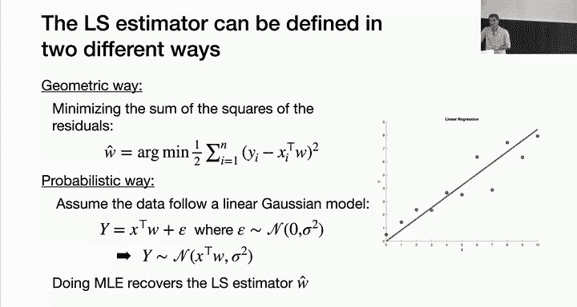

We see that it was possible to get some non nonlinear modes， okay？So if I imagine imagine。

Some data like this， which is far more complex。 you see now that a linear fit will not be a good predictor。

What can we do。So we saw that the one way was to consider features of mutationation instead of only considering x。

 you were adding some features， x， x square， x square 3。

 and then you were learning a linear fit put this augmented space。😊。

And then when you were projecting back in the first dimension。Then you could get some linear， I mean。

 some nonlinear behavior， even if you were fitting a linear mode。

So that was the features augmentation a way to do so。But。Another way could be to try。

To consider a different probabilistic model， Okay， to consider the rich class of probability。

So we saw one way with a list square。So what did we do with the list square？

We have that the linear prediction x transpose w。Will predict the mean of the distribution， okay？

You're assuming that your output， Y it's mean， its conditional mean given in x will be a linear prediction x transpo w。

And then on top of it， you will assume some noise model。 You will assume a distribution。

 You will assume that y is some Gosian ho variable of min， the predict， I mean， the。L of prediction。

Okay， so first， you're assuming that your only model will predict the mean。And then you say is that。

 in fact， why will be a Goian。Of mean。没有。But you see that instead of using the linear model to predict the mean。

You could use the linear model to predict something else。

And this is what we did when we consider the logistic regression。In the logistic regression。

 we say that the output y。Was Ben。Of conditional mean， which was not。Your linear prediction。

But which was some function of the linearar prediction。

And so you see in the second case of the logistic regression。😊。

Solin our model is not predicting the mean， but it is predicting a another quantity。😊。

And this quantity will be some function。Of the of the okay。

And what we will see today is that in fact， there are a lot of， I mean。

 there are a lot more of hoistic model beyond the Gaussian one and the Ben one。😊。

And so this will lead to what is called the generalized in our model。

And the name of the distribution for which we will be able to do such computation。

 they will be called the exponential family。Okay， and so what we will see is that the member of the exponential family will have some very nice form。

😊，And for some probability belonging to this exponential family， it would be possible to dehive。

Some analog results that we add for the logistic regression。And for the least square。

 but in a very general form。Okay， so instead of dehaving everything for a particular particular example such as Gousian noise or benoli noise。

 would be possible to dehive some general formula for the general framework of exponential feminine。

😊，And so we will be able to do。E facinging any one time， okay。

And so the exponential fe is really a fe of distribution。

 which is very important in statistics and information theory。😊。

And that's something you will see again， in other course。

So let's see what it is in the simple example of the logistic distribution。😊。

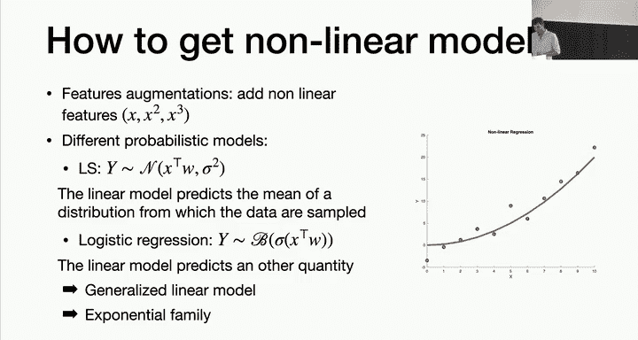

UGCK以开始。So what did we do for the logistic regression？

So when we were considering logistic regulation， we said that we。

Modeled the probability of the two class0 and1。By some function。

 So we were saying that the probability。Of1 was equal to sigma Eta and the probability of 0 was equal to 1 minus sigma Eta。

 where Eta is your linear prediction。Okay， this is what we did last time。

So you are doing a prediction， x transpose w and enough prediction。And then your computer function。

 sigma of x transpo w， sigma of itta。And this was the conditional expectation of your probability。

Okay， so this was。Exactly。The logistic regression model we saw last time。And so what we can see that。

 in fact， we can herewrite it the more compact way。In function of y。 Okay， so y can be equal to 0 N1。

And you see that you canrite it exactly like this。The probability of y given itta will be equal2。

Exponential of Eta Y over one plus exponential of itta。So， let's see this。If y is equal to one。

The probability of one given itta should be equal to sigmata。

And sigma Eta is exactly exponential Eta over one plus exponential itta。

So you get exactly this formula。For y is equal to one。When y is equal to0。

Probability of0 given itta should be equal to1 minus sigma itta。

And this will be exactly equal to1 over1 plus exponential itta。

So is it clear for this first part of the equation？Yes。Yeah。

 so you see this is exactly equivalent to what we wrote here。And then the second part。

Will be to write this expression in a different way。We will say that this is exactly equal。

To exponential。Of what。嗯。いた way。Minus logarism of1 plus。Exponential itta。You see。

 this is exactly equal。And for now， it should be a little bit weird。

 you know why we are writing this and there's this phone。

And this will become marked clear in the next slide。And so what？What can we see。

So what we see is that the linear model。Is predicting the value Eta。 Okay， Eta is equal to x。Tspo W。

And this linear prediction is not the mean of why。It was a mean of why for the case of the list square。

 but for the case of the logistic regressiongress。The mean of y is not equal to itta。

But it is equal to sigma Eta。Okay， so you see that itta is related to the mean mu。

So a no linear relation。Which is exactly that mu is equal to sigma of Eta。Okay。

 so conditional mean of y。Is equal to sigma of itta because this is， I mean。

 y will be a bely low of min。Sigmaた。And you see that you can inverse this relation and what you will get is itta is equal to logarism of mu over 1 minus mu。

😊，Okay， this is just you can obtain this by inverting the sigmaoid function。So what you see is that。

The mean theta is related to the mean who is non linear relation。

And this is exactly this non nonlinearlation between itta。😊。

Which is a pagameter predicted by z our model。And mu， which is a mean。Of your distribution。

Which make possible to use a linear model in this context。Okay， and this connection， this function。

This link between mu and Eta will be called the L function。

 and will we will talk a lot about it during the cross。So you see that in order to see this link。

 what we had to do is to rewrite。The logistic function under a very different and peculiar way。ok。

And so today， what we will do is that we will generalize this form for other distribution。😊。

And we will see that a lot of different distribution will be part of what is called the exponential family。

And then。Using this exponential family， we will see how we can use them in machine learning。

And this will lead to what is called the generalized linear modes。

So do you have some questions so far？It will become yeah。Can you repeat your question， please。The。

 the link function will be log of mu minus1 minus mu。

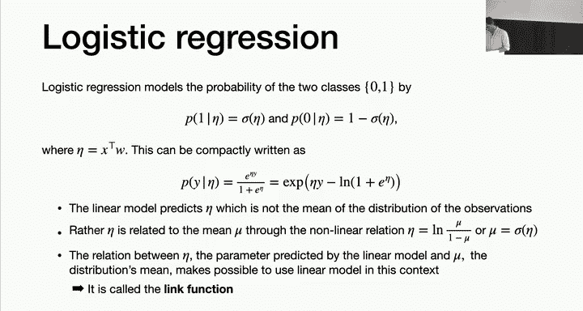

So we will see the definition very soon。So what is exponential family？So that will be a distribution。

So we are assuming that's why。Is a， either it's a scar， but it can be。

W can belong to a lot of different sets。Okay， it can be the hill in the case of the least square and can be 01 in the case of regression。

 it can be some it can be some a positive number， so why belong to a lot of different sets。

ItCan be continuous。 It can be disc。And so a probability will belong to the exponential family if it can be written under this form。

So if the conditional probability， so if the probability of y given the parameter eta。

Is equal to some function H of y。Which we are assuming positive always。

Times the exponential of what Time the exponential of。Itta transpose phi of y。

Mus sum function a of itta。Okay， so if you can write。Your distribution。B。Under this form。

 then your distribution P will belong to what is called the exponential family。

So let's analyze a different component。Of this formula。So first parameter。Which is a vi Itta。

 It's called the natural of the canonical parameter。ok。Then。The second parameter， phi of y。

It is called the sufficient statistics。And so we will see during the course why it is called the sufficient statistics。

 but just as a spoiler， if I give you some ID data coming from this model。😊。

And you know age and you know phi， but what you want is to recover。So good eat。

In order to estimate EA what you will have to do。Just to average all the phi of the YI on your dataset set。

So you see that if you know phi。It contains all the important information in order to estimate the parameter。

And so this is why it is called the sufficient statistic。 It is why it is sufficient。O。

So Phi3D contains all the relevant information and your model。So， we have Eta。The Kenonical Pahammea。

Fi of why to sufficient statistics。And then。Hge， which is positive。And so no， what do we want。

 We want that。B is equal to a probability distribution。

So you want that the integral of p is equal to one。

And so this is why you need this function a of itta。

 which is called the cumulant or the log partition。

And which will help you to get that P is normalized。O。

So we can have a close form formula for a because you see that the condition that the integral of p is equal to one。

Can D actually give you。That a of itta will be equal to the logarism。

Of the integral of H of y times exponential of itta transpose phi of y。

So to see that you really just take the exponential of this。Is equal to one。

And you can take the exponential of minus a of eta out of the expectation。

 and so that will give you exponential of a of Eta is equal to this integralteagon。嗯。

That's a nice exercise。 If you want to practice a bit。Okay。

 so the function a is really here in order to get a probability distribution。

 So function A is really needed in order that the integral of p is equal to one。

But what we will also see during the cross is that this cumulant or this log partition function。

It's not only here for normalization， but it will also be very informative。Okay。

 you will be able to get a lot of interesting information from the lot partition。

So what is the degree of freedoms for this exponential family？

You see that if I give you a parameter Eta， a sufficient statistics and a function age。

 then you have everything。In order to define your family because then。

A of itta will be automatically defined。 So the degree of freedom are really H phi and itta。

And so for every choice of age phi and Eta。You will get。A member of the exponential family。

Do you have some questions on the exponential femin and the general definition so far？Yeses。😊，Okay。

 so we we will explain it in more details at the end of the course。

 but briefly what you want to say is that imagine you have some observation y y1 to yn。Which are I及。

From your exponential family。And you know H and you know P。 And what you want is to recover。

What is the 바람에 되어 있다。Okay， in order to recover itta。

 what you will have to do is only to do the average edge of the phi of Yi。

So Phi of YI contain all the important information about your feamine。

This is why this is called the sufficient statistics， this is why it is sufficient。And so。

 you see that。If you fix one H，1 itta and1 phi， then it will determine the term a of itta。

And then you will be able to get that。诶。B is a distribution because it will be properly normalized。

However， you can also see directly that for some pagame of E。Then。

This integral will not be well defined， it will not be possible to normalize it。ok。For example。

 if you take h to be equal to one。Phi to be equal to y squared。And itta to people to。呃，完。So。

 let's write it。So if I take h is equal to1。

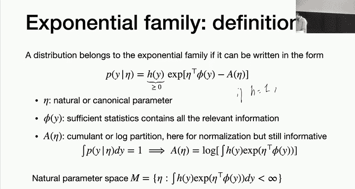

5hi f y is equal to y square。😔，And it is equal to one。What do I get， I will get the integral。

Of one times。Exponential of y square。 And you see that this will be equal to infinity。

So it will not be possible to normalize it。Okay， so what we will do is that we will define what is called the natural parameter space M。

 and this will be the set of parameter itta。Sa that this integral。Is finite。Okay。

 so it will be the set of parameter Eta so that。You will get。

A good distribution so that it will be possible to define a， which will normalize your distribution。

And so today during the course。We will only consider。S naturalgata， which belongs to the set M。Okay。

 so I will not always say it， but I will alwaysit implicitly assume that itta belongs to M。

So everything will be well defined。Yes。So， can you repeat question？Yes， the dimension， okay， sorry。

 so the question is about the dimension of Eta and phi of y。

 they would always be vector of the same dimension。Okay， because you are doing a duck product。

 so they should be of the same dimension。So that's very important why is a scalar okay。

 it would be a real on some numbers。And Eta and Fire of W are some vectors。

And that of the same dimension。Okay。Do have some other questions。No。Okay。

 so maybe you know the question will be why， I mean。

 why are we defining this exponential family and how we will use them？Okay。

So we can have two questions。So first question is， do we have some example？

Do you have some example of distribution？Which belonged to the exponential family。

That will be the first question we will see。And then the second question will be。As they are useful。

 you know， how can you use these members of the exponential family in order to do some nice computation in machine learning？

So that's the two question we will see today。And so what we will first see is that we will look at some example of distribution。

 you know。And we will write them under a different form， and you will see that， in fact。

 these distributions are belonging to the exponential family。

 even if you had no idea this previously。So do you have maybe let's What's the question。Yeah。

 exactly， if y is in a discrete set， then the integral will become a sum。That's a good point。

So maybe maybe do you have some ideas of some members of the exponential family。

Who can guess one members？Yeses。😊，Gon， very good。 A second one。Yes。Sigmd。So what is a sigmoid。Okay。

 so that's a good point。 What is。A member of the exponential family。No， let's。

 let's good go back to the definition。A member of the exponential family is a distribution。

Do you think that the sigmoid is a distribution？No。

 but the sigmaoid it will be the link function associated。

To a distribution which will belong to the exponential family。

 and do you know what is this distribution？It is a beud one。Okay。

 when you are doing logistic regression， what you are considering is a binary distribution。我。对。

Think so。I mean， not sure。 we should， we should check them。

Okay， so the first one is ban distribution。So we will see that the ban belong to the exponential family。

So what is a manually distribution？The Honda variable， which can take two values，0 or1。

And it's taking the value 1 with a probability mu and it's taking the value0 with a probability 1 minus mu。

😊，Okay， that's a very simplest distribution， you know。

And so what is the claim is that the claim we can。😊。

Shows that this distribution will belong to the exponential f。So， let's rewr。B fY。Even you。

So what I say is that I canwrite it exactly like this。😊。

So I canwrite it as mu power y times1 minus mu power 1 minus y。Do you see why is it clear for you。

I mean， I get sick。What is the probability of。PF one。It should be equal to。To you。

So if I take y is equal to 1，1 minus1 will be equal to 0， so this term disappears。

And mu one is equal to mut。So this is true for y is equal to one。No what is B of 0。Yeses。1 minus mu。

And when y is equal to 0， this term disappear。And1 minus y is equal to1。

 and so I get this term1 minus mu。So you see that this equality is legit。

And now what we want to do is to show that the binary distribution is belonging to the exponential family。

So I want to rewrite this。As。Something which will depend on the exponential。So I can show exactly。

That these two equality are exactly。The same。I would just。But all the term。

 which depends on why on one side and then all the other term on the other side。Okay。

 that's a small computation。Is it clear you want we do it。So then you see when we have this firm。

This directly tell you that the binary distribution belongs to the exponential family。

Because we can identify。With the them previously defined。So we have that。firef。

Will exactly be equal to y。We have that Itta， the canonical Pahamme。

Will be equal to the logarism of mu over y minus mu。We have the def function age。Is equal to one。

And I have that。My cumulant is equal to。Minus logarism of y minus mu。

And then I'm claiming that I can herewrite this exactly。😊。

As the logism of one plus exponential of itta。And this will come exactly because I have a link between。

イたエミュ。Okay， this is this one to one correspondence between mu and itta。So I have that eta。

 which is equal to some function of mu。And we say that this function is the link function。

And so here it is logarism of mu over y minus mu。And I can invert this relation in order to get mu is equal to the inversets of g。

 which is exactly the sigmoid function exponential of itta over 1 plus exponential of itta。

So you have this one to one relationship， I can go from Eta to mu and I can go from you to Eta。

And so you see here mu。Is exactly equal to exponentialfluential Eta。Over one plus x itta。

 So if I do1 minus mu。I will get。Exactly one over 1 plus dimension Eta。

And so I will get logarism of one plus exponential eta。

So you see that this is exactly the same distribution。😊，回 up先。

When we have done the logisticification。And so what is very important to have in mind is this connection between Mu and Eta。

So what is mu？没 you。It is an expectation。It is a conditional expectation of your probability distribution。

ok。So it is a moment of the distribution。And that what is called the moment parameterization。

 And that's the one you are used to。 often， if I will tell you what is the， I mean。

 what is the definition of a binary function。 I mean， of a binary distribution， you will say。

It is a distribution， which is equal to one。With probability mu and to0 with probability y minus mu。

So often when you are defining the binary distribution。

 you will use what is called the moment parameterization。

 so you will parametermetize your distribution。Using。The expectation of y， which is equal to mu。

And what we see here is that in fact， there is a second parameterization。😊。

Which is called the canonical parameterization。And that you can。You know。

 define your ban function using this canonical parameter Eta。So you have this two parameterization。

 and you can go。😊，From one to the other， using what is called the link function and the invert of the link function。

ok。Is it all good for the be distribution。The only difficulty is to show how you go from this equation to this equation。

 it is just a simple computation。Okay， and something else， which is important is that you see。

That the sufficient statistics。And the canonical Pahammeta。I have dimension one。Okay。

So we see that Firef is a scalai， and that means that the family depends only on a single element。

And you reveal that when you want to define the manually distribution， you only need zoomin。

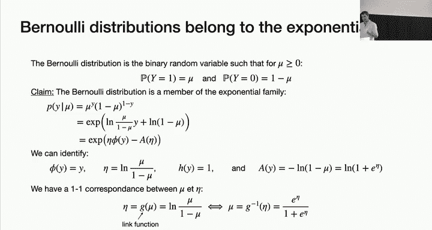

So let's look at another example， No we will look at the Gosian。

And you know that if you want to define。Agoian distribution。 What do you， What do you have。To fix。

You have to fix the mean。En the variance。So you see that the Gasian distribution will depend on two parameters。

And so you can always already see that for the Gaussian distribution。

Then the sufficient statistics and the canonical parameter will be of dimension 2 because you have two parameterham。

 you have to set the mean。En the violence。And do you see a noil difference with the previous case？

TheAnother defense between the Gosian case and the Benuli case。Can you say it louder， please。

It continues exactly for the Benli case， y was belonging to01 for the Goessian case。

 y is belonging to all the Hill。So let's use the computation。So， I'm considering。

A distribution with mean mu。And Va sigma squared。So I know that the probability。Of why。

Is exactly equal to one over square root of two pi sma squared。

 This is my normalization factor times the exponential of。Y minus my mean。

 y minus mu squared over two sismma squared。This is very classical。

And now I want to rewrite this and。So exponential P mini firm。

 And so I can see that this is exactly equal2。Exponential。So what I will get。

So I will expand my square。So I get exponential minus。Y squared。😔，Over two sigma squared。Plus。为妙。😔。

Sigma squared。minus。😔，没。Squad over2 sigma。ok。And then， I will have to take。minus。我那个都。对。这。

Loarism of2 pi sigma squared。冇企。So I get exactly this。And what I saying is that。This， you know。

 I will put on one side。All the term which are depending on why。

 so it would be this term and this term and on the other side。

 all the term which are not depending on why。So I see that this term and this term will exactly give me this。

This will be the path which is not depending on why。And then I have this。

 and I want to rewrite this as a scalar product between something which depends on why。And a pameter。

And so you see that it is exactly。Equal to。To this。I have。没有。Over sigma2 times y。

 this is equal to this。Minus this term and this term will be given by 1 divided by 2 sigma 2 times y squared。

So you see。That I can exactly rewrite this formula as。This huge exponential。

Is it clear for this first computation。It's only computation， yes。一 a啲。Thank you very much。是。对。够。

Okay， so now we have this。😊，And we want to identify。The you know。

 the sufficient statistics and everything。 So what。Will be equal to H H is equal to1。 Okay。

 you see again， I have nothing thing in front of my exponential， So why H is equal to1。

Then what will be my canonical parameter， my canonical parameter will be exactly this two dimensional vector mu over sigma squared and minus1 over two sigma squared。

Then what will be my sufficient statistics？Would be this vi。Why and why square。

And then what will be my cumulant or my log partition。 It will be minuses。 So it would be exactly。

Mu squared over two sigma squared。Plus， one over two logarismm of two pi sigma squared。Okay。

And then it would be possible to go again from the canonical parameterization。

To the moment parameterization。So， we know that。一台弯啊。Is equal to mu over sigma squared。

And eat that too。Is equal to minus1 over2 sigma squared。And now I want to invert this relation。

So how I will do this。I directly see that new。Is equal to minus Eta 1 over Eta 2。

 because if I do Eta 1 over Eta 2， I will get mu divided by sigma square。

 divided by 1 over sigma squared。There is a problem here somewhere。There is a two missing。

So that is a small typo， but that's okay。嗯。So you have a two。And Sigma squares then。

U the sigma squared would be equal to1 minus。To the。Okay， and so using this link function。

 you will be able towr。A of itta， not as a function of mu and Sigma 2。

 but as a function of itta 1 and itta 2。O。Yes。😊，也。I think so， too。That we have to check again。Okay。

 do you have some questions on the Goian distribution。

So you see it's exactly as before we canwrite it as a member of the Gusian family。

But now we have two parameterham， Eta 1 and Eta 2， and again we have some link function。

Which enabled you to go from the canonical parameterization to the classical moment parameterization。

So you can either parameterize your Gosian distribution by its mean and its variance。

 but you can also。Phamitize it by the canonical parameter， Eta1 and Eta 2。

And for any choice of Eta 1 and any choice of Vita 2， it will give you some grsian。O。😊。

So we saw that the Gasian distribution。Was a member of the exponentialial family。

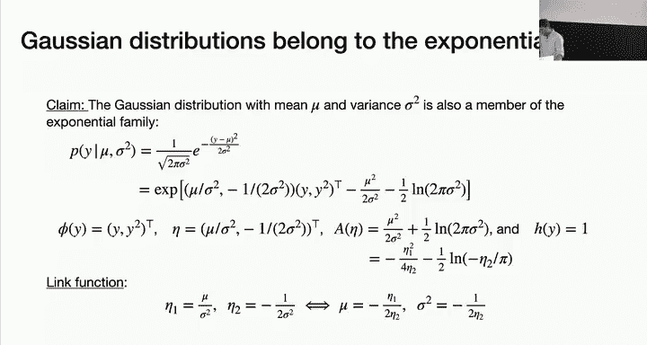

And we saw a last one， a last example today， which is at the personal distribution。

Belongs to the exponential family。So the claim is that the Que distribution with min muu belonged to the exponential family。

So， you know that。For person distribution。Y will be an integer and the probability of y will be equal to。

Mu power y exponential minus mu divided by factor L y。

And you can directly see that you canwrite it as this exponential of y logm of u minus mu。😊。

And you directlyly identify that no H is not anymore equal to one。

 but H will be equal to one over a factorial y。Phi of y is the sufficient statistic is equal to y。

And。Yourけ equal equal。And we also see that now the link function， which we link。

Mu to itta is equal to the logarism of mu， and so you can invert this relation and you will get to mu。

 which is equal to exponential of itta。So what we can see is that a lot of different distributions can be plugged into the exponential family framework。

But you have to keep in mind that not all the distribution are member of the exponential family。

And a Q example can be the kshy distribution， okay？So it exists from distribution。

 which are not member of the exponential family。Okay， so we have answers the first question。

 which was。You know， some members of the exponential family know what we will see that we will see some nice properties。

Of these distributions。And we will prove them。

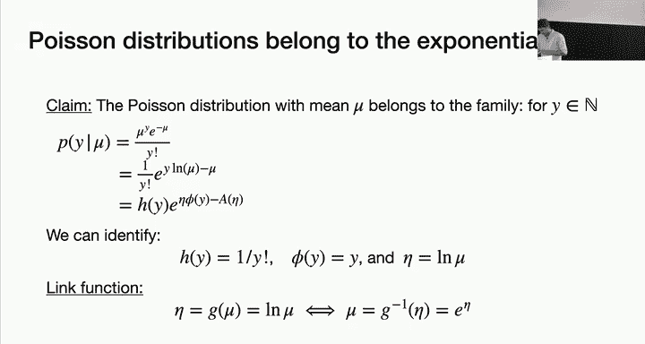

So what we will look at。At some poverty of the cuunant the log Baition， some poet properties。

Of a of Eta。 So you remember， I told you that a of Eta was here in order to normal。P。

 but also that this。Function a of Eta had some nice properties。

 And so what are these nice properties。 The first one is that the cumulant is a convex function of itta。

😊，Okay， that will be the first property we will prove today。And then the second property。

Is that if you are taking the guard。Of your cumulant， you will recover the exponential I sorry。

 the expectation of your sufficient statistics。So gradient of a will be equal to the expectation of phi of y。

And you will get the same result if you take the asN of a。 So you take the ser derivative。

It with the heco the covaris。Of phi of y。

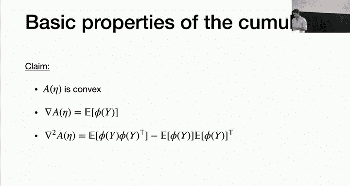

ok。So， the first one is that。The guardians。Of the cumulant is related to the mean of phi of y。

And the ASEN of the cumulant is related to the covariance of firef。

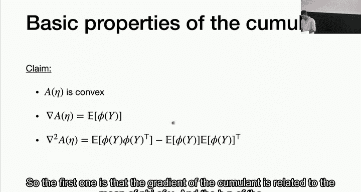

And so you see that why it is called a cumulant。It is by taking derivative of the cumulant。

 you will be able to obtain all the different moment of your sufficient statistics。Okay。

 so this is not emit to two you can take also more derivative and you will get higher order moments。

Is it clear for this， this basic popular yes。Oh。You mean， what does it mean this。

So what I say is that why。Will be a vector with distribution。

Would be this。And you take the expectation of phi of yhi。

So it will be the integral of the sum of phi of y。Times。辩。

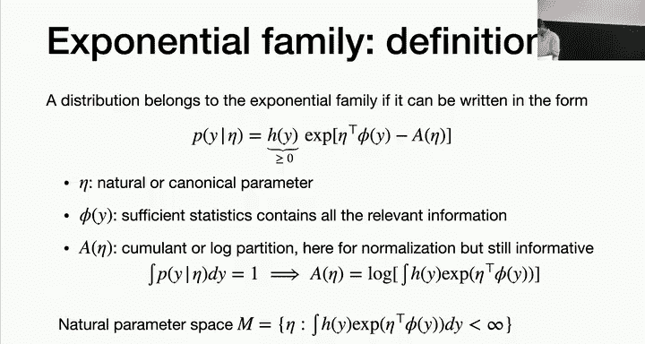

And you see that's why I'm using a capital Y。Because it's a home variable。 was low。Is the。

Member of the commercial family。So what we will do first is that we will prove。The first result。

 which is that the cumulant is convex。

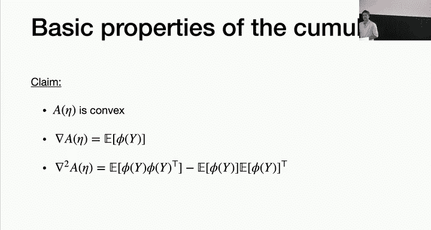

So that would be a bit of computation。So what we want to prove。Is the convexity of the commulant。

 So I don't know if you remember what is a convex function。It is a function such that。

If you take two parameters， itta 1 and Eta 2。And lambda between 0 and 1。

 what you want to prove is that a of lambda times itta 1 plus 1 minus lambda times itta 2。

So I do notice this itta a of itta is smaller than lambda times a of itta 1 plus 1 minus lambda times a of itta 2。

 This is a definition of convexity。And we saw during the course。

 a lot of different ways to prove that the function is convex。So for example， for the regulation。

We use the fact that some function was a composition of some smaller， simpler function。

 and we use some simple。Conve city preservingable。Then we also。

Use the fact that the Asian is positive。 I mean， if it positive that in the way， but here。

 what we will do is that we will directly prove。That our function A satisfieses inequality。ok。😊。

That's the most straightforward way to show that your function is convex。

 We will prove that it will satisfy the definition。So I will take the exponential of a of Eta。

And we saw。I mean， in the side of the definition that we have a close form for exponential of a of Eta。

Okay， it was given by the fact that the integral of p is equal to one。

So the exponential of a of eta is equal to the integral of H of y time this exponential。

So now what I will do is that I will replace the value of Eta。😊。

I told you that itta is equal to lambda 1 times sorry to lambda times itta 1 plus1 minus lambda times itta2 so I。

He write it here。And so now what I will do is that I will try to split。😊。

This function as a sum of I mean， as a project of two function。This is exactly what I'm doing here。

And you see that I want that one of the function kind of depend on neo lambda。

And the other function will depend more on one minus lambda。

So what I do is that instead of writing age power1， I will write H power1。So H were lambnda。

Times H per1 minus lambda。 The product of the two will be exactly H。

And so here I will only consider h power lambda and in the second path， I will h power1 minus lambda。

But you see， if you do the project of this and this， you will recover H of y。Okay。

 and now I will split my exponential into。I will live in one path， exponential of Lambda itta1。

Scalar product with phi of y。 And in the other part。

 I will have exponential of y minus lambda it has two transspose phi of y。 So I have split。

This function in two function， one function， which was。Depending on Eta 1 and the second function。

 which was depending on Eta 2。And you see the I is， really， because。I can。

 I want Ken of to recover a of Eta1 and a of Eta2。So I kind of try to have something which looked like。

A of Eta one here。 And this should look like。A of it that do here。And so， you see that。

What I will say is that this function I will call it。

 it is a function I will call F and that one I will call it G。

And so you see that this is exactly the integral of F times g。😊。

And this is what is called the one nu of the product of this two function。Okay。

 the one norm will exactly be。 the one norm of a function will be the integral of the of this function。

Okay， so you see that。Right exponential of a of Eta as the one norm of f times C。And no。

 I'm very happy because I will use some inequality which will help me to bound。

The one norm of a product of function as a product of some norms。Okay， so like the first step。

 I reallywrite exponential of a Eta as a one norm of the project of two function。And you see that。

One function is only depending on Eta 1， and the second function is only depending on Eta2。

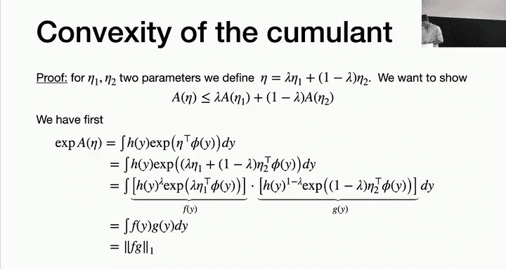

And so now we will use what is called the elder inequality。

So the elder inequality is really an inequality between the one nu of a product of a function and the product of the P and the Q norm。

So the LP nu of a function by definition， its exactly the integral of the absolute value of f power p。

😊，And then you take one over P。ok。You see that for p equal to2。

 this is something this is an object you know， but you can define it for every P。ok。

This is your LP number。And so what is telling you the elder inequality。

 it is telling you that if you take 2 h p and Q， but not any whole P and Q。

 some particular  one said that 1 over p plus1 over  Q is equal to 1。😊。

Then it is possible to bound the one norm of F times g。😡，By the p norm of F。D is the Q norm of G。

Okay， so this is what is called elder inequality。So maybe like this it seems a little bit complicated。

 but you know this elder inequality and a simpler form。Which is a。

W is called the elder inequality for p and Q is equal to 2。It's exactly。Okay。

 so earlier inequality of P andq is equal to2， you recover crsheish files。

So let's try to use this al inequality。 So what we say is that we want to bound the one nu of F times G。

And this will be bounded by the p norm of f times the p norm of G。

And what we will use is p is equal to 1 over a lambda and  Q is equal to 1 over 1 minus lambda。

So first， you can check。That one over P plus1 over Q will be equal to lambda plus 1 minus lambda It will be equal to1。

So I can use my inequality， which is two value。And so do you see why？I want to use this two value。历史。

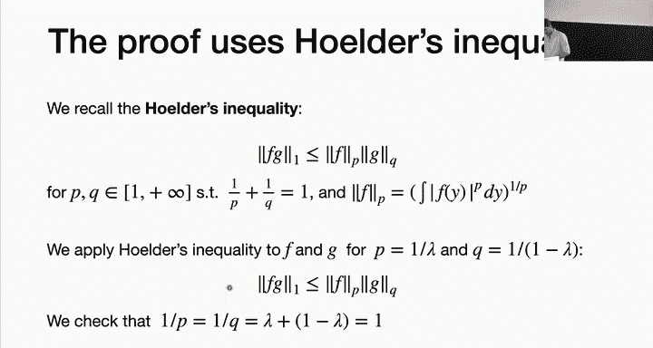

Why， it makes sense。So I will compute the p nu of F。So by definition， the p norm of f。

 it is the integral of f power p。And then I take the power outside of the integral。😊。

OverSo the power one over P。And the function f was equal to h per lambda。

Times exponential of lambda Eta 1 transpose5hi of y。And so， you see， no。I'm really happy， because。

I have this， which was in fact， some number at the power loda。😊。

And I will take the power one over ada。So some number a lambda。

1 over a lambda will be exactly equal to number。So you see that I directly get h of y exponential of Eta 1 transpose phi of y。

And this is exactly why we did that because you re that this。😊，Will be related to。A of it that2。

You see that this will exactly be exponential。Of a of it that2 of it that one， sorry。

And then we will do exactly the same4G。By definition， the Qome of G will be。Q square root。

 so it will be， I mean， integral of g per Q。And I take outside of the integral power1 over Q。

And when I will replace the value of G。I will get this number， which is in fact。

 a number power1 minus lambda。And then I take power 1 over 1 minus lambda and so you will see that the1 minus lambda will con with a 1 over 1 minus lambda。

And what I will get is exactly the integral of h times exponential of Eta2 transspo phi of y。😊。

And then outside of the integral， I would take power 1 minus lambda。

So if I do the project of these two numbers。What I will obtain。

Is that this power lambda times this power y and minus lambda。And you see that。This is exactly。

 by definition， exponential。That's the exponential of a of Eta 1。And then I take pull alone down。

So I can take the lambda inside the exponential。And this is exactly exponential of a of itta2 per 1 minus lambda and I can take the exponential the 1 minus lambda inside the exponential。

😊，And so this is directly giving you what we want。

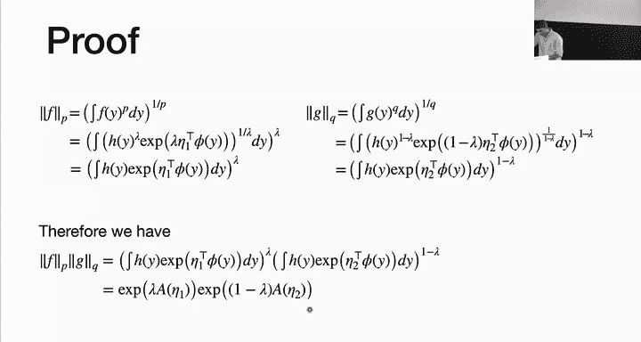

So let's do it again quickly。I want to show that。A of itta is smaller than lambda a of itta 1 plus 1 minus lambda a of itta2。

This is what I want to show。So to do that， I compute the exponential of a of Eta。By definition。

 this exponential is equal to this integral， it is equal to the integral of H。😊。

Times exponential of Eta transpers firef。And this， by definition of Eta。😊。

This is equal to lambda ta 1 plus 1 minus lambda Eta 2。

And so what I want is to split this function in two one。

 which will only depend on itta 1 and the other which will only depend on Eta2。

So this is what I'm doing here。This integral is equal to the integral of the product of this function。

Which is only depending on E one。And this function， which is only depending on itta2。

And we recover here that we have a one norm。And so what we will do is that we will use the elder inequality。

😊，To bound the integral of the product of to function。By the project of the integrals。

And so now what you have to do is to check for one for which P and Q。You want to take。And you see。

Here， what you have is that。一。You didn't have this lada here。

 You will be happy because you will exactly recover。Exponential of a2。

So you see that you want to take P。Which will be equal to one over a lambda。By taking p。

 which is equal to one over the a lambda， you will exactly。Take this。

Where like thelandda will have disappeared。 and here's at the same。

You have this power 1 minus lambda you don't want， and so you will take Q to be 1 over 1 minus lambda。

 and then when you will take the power1 over 1 minus lambda， this will disappear。So at the end。

 you exactly get。So product of the two exponential you want and by taking the lug。

You are proven the convex。We have some question on this proof。There is nothing too difficult。

 it's only very technical。😊，And you see a good idea was to use all inequality。But otherwise。

 what you really want to do。Is to prove the definition of the convexity。

 you are writing everything down and at some point you have the ID to make this split。

This was a nice trick of the proof I do this trick and I use Al for some nice P and some nice Q。

And this is giving me the results。

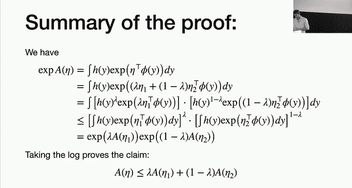

Okay， now what we want to prove is that the derivative of the cumulant。

Is related to the expectation of the sufficient statistics。And so what we will do。

Is that we will look at it in a particular case， just to check， you know that it makes sense。So。

If you remember。For the banner distribution。A of itta was equal to the logarismm of1 plus exponential of itta。

And so what I want to check is what is the derivative of this function related to Eta？

So I can take my derivative derivative of the log， it's one over one plus exponential itta。

 and then I have to take the derivative by exponential itta。

And you see that I directly get my sigmoid。This is equal to the sigmma E of itta。

And then you remember that I told you that in fact， sigmoid of Eta。😊，Whathy is it called to you。

So we directly get that a prime of Eta。Easy call to you。Which is the expectation of phi of y。

 because for the binary distribution， phi of y was equal to y。ok。😊。

And we can do the same computation for the second derivative。

So I want to take the derivative of sigma of Eta with respect to Eta。

And I don't know if you remember， but we saw in the course about the logistic regression that this was exactly equal to sigma of Eta times 1 minus sigma of Eta。

And so sigma of Eta is equal to mu。1 minus sigma of itta is equal to 1 minus mu。And so you he over。

The core variance of the binary distribution。Okay， what is the covariance of the binary distribution。

 It is the expectation of y is squared minus the expectation of the y。

Squared expectation of y squared is equal to mu。Okay。

 because one power2 is still one and0 power2 is still zero。So expectation of y squared。

 which is equal to mu。An expectation of y square， when the squared is outside of the expectation。

 it is equal to mu squared。So yoururecoverse is second computation。

And then we can do exactly the same。F goodian distribution。But we will not do it。 Okay。

 if you are interested， you can look on the slide or you can look on the lecture notes。

It's only computation。But you can still do it， because it will。

Make you to work on this derivative of logarismm of minus x for x negative。

And it's a nice stuff to do。

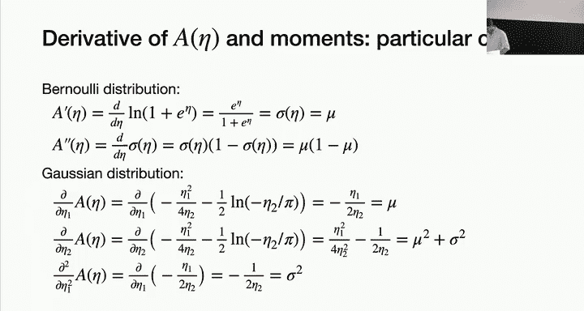

So let's try to prove the particular case。So it's a general case。

So what we want to prove is that we want to prove。That the gradient of a of Eta will be equal to the expectation of phi of y。

So what I am doing， I'm just writing what is equal。You know， A F一。

A of itta is equal to the logarith of the integral of H times the exponential of Eta transspose5hi of5。

 This is a definition。And now I want to take the gradient。Of this function。Okay。

 I want to take the gat of the logarithm。So I directlyly compute it。

This will be equal to one over my logarm。Okay， because the derivative of log is one over x。

So I get one over this term。Time's a guard。Of this， okay。He， I'm only using that。

Gent of logarism observed function is equal to the gradient of this function over the value of this function。

So now what I want to take is that I want to take the gradient of this。

 so I want to take the gradient with respect to itta of the integral of a function。Of it 있다。

And so what I have to do is that I have to exchange the gradient and the integral sign。😊，ok。

And this is legit because everything is finite and so we can do this exchange。😊，Okay。

 no so if well this will we will do it after first， what we'll do。

Is that we will re write this term as exponential of minus a of Eta。 This is by definition。Okay。

If I divide by this number iss the same as multiply by this number。And no， I will extend。

My gat and my integrals， I will put the gat inside the integral。

And so now I want to take the gradient of H of y times this exponential。

 and you see that the H of y is not depending on Eta， so I can take it outside of my gradient。

And now what I want to take is a gradient of exponential of itta times phi of y。

And this will exactly be equal to。Exponential of Eta transpose phi of y。Times phi of y。

 when you will take the gradientent with respect to itta， you will have a phi of y。

 which will go out。So this is exactly what we are obtaining when I take the gradientent。

 I will take exponential of itta transspose phi of I times phi of y。Okay。

So what will be the next step。The next step will be。

To put this exponential of minus a of itta back inside my integral。Because this is a number。

Independent of why。 so I can put it back in the inte and I can put it back。In my exponential。So。

 you see that。This is exactly equal to this。I have shown that the guardian of a of Ital。

Is equal to the integral of H of y。Times the exponential of itta transpose phi of y minus a of itta times phi of y d y。

So why are we done？Do you see why we get the result we want？Yes。😊，Exactly。

This is the probability of why given it， okay。哎， whats your question。点啊。😊，Here， you have no island。

Yeah， you're right。Thank you very much。There is a mistake。 No El here。Okay， so at the end。

 what you get is the integralhi of y times the probability。😊，Times the density。

 and so you see that it is exactly equal。😊，就。What you wanted， Okay。

 that's exactly equal to the integral of phi of y times P of y given itta。And this， by definition。

This is exactly the expectation of phi of y。Do you have some question on this proof。Yes。That one。So。

喂。Is a ho variable， and the law of y is exactly P Y given itta。 Okay， that's the density city。

So by definition。

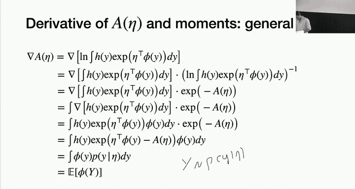

问。嗯，所谓。

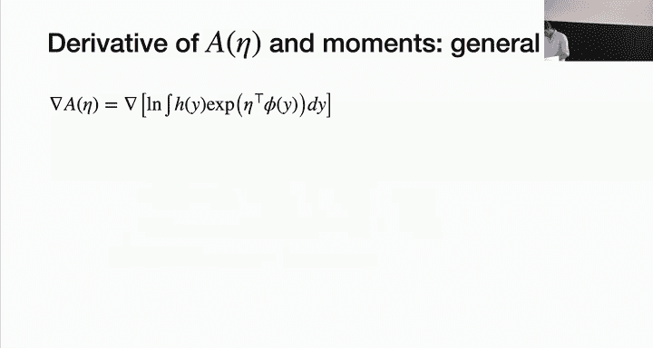

嗯嗯嗯。So by definition。那民。The expectation of Phi of y。This is equal to the integral of phi of y。

 P of y。D会 give that the definition of前提。So you see that exactly equal to this。Is it clear on that。

So expectation of any function of a honda variable that the integral of the function of x times。

The density of x is exactly what we are using here。Okay。

 expectation of phi of y that the integral of phi of small y。

Times the density of small y and you are integrating over all those lowercase y。

Do you have some other questions on this proof。Yes。😊，Yeah， so this logarism should not be here。

That's if， I mean， that's a computation we saw。A of itta is equal to logarism of this。So。

This is equal to exponential of a of Eta。Okay， and then I have a minus because I have it's one over the integral。

Do any other question？Yes。😊，Can you say。The first step where this one。This one。

I'm taking the gradient of the logarsm。ok so。F3风扇级。

And then I want to take the gradientent of logarism of G of y， or it's itsoory。

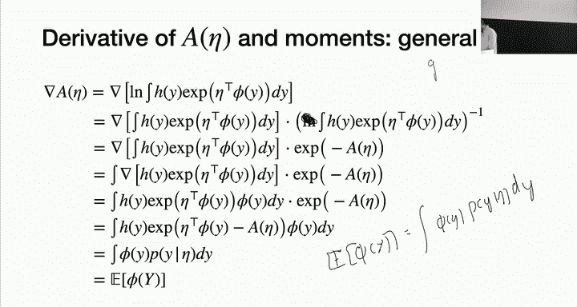

O。I'm taking the gradient of the logarithismm of G。

 and so this will be equal to the gradient of G over G of itta。ok。

Gent of the logarithm times the function will be the gradient of the function over the value of the function。

And this is just because the derivative of the logarithsm is  one over x， okay。

Divive of log of x is one of x。Any other question on this post， yes？喂。😔，还呀。No not what do you mean。

I no， first， I'm exchanging the Guardians and the integral。So you have the integral inside。

And I will compute the gradient of this function。This is a function of itta。

And I will compute the gradient of this function of Eta。The first term is H of y。

 it is independent of Eta， so I can take this term out okay。

 now we have the gradient of the exponential of Eta transpose phi of y。What is this。

 This will exactly be。Exponential of itta times phi of y。

Times phi of5hi because I would take the gradient of my linearar function。

And I will get a phi of y out， okay？yes。😊，Yes， you are computing the gradient at point。For it。

 exactly。So this is when capital Y is following exponential family with Pametata。

That's very important。嗰企。So we only have 10 minutes left， so we will。Go a little bit faster Su then。

Let just remind you， what is the definition of the link function。

 The link function will help you to go from。Mu， where mu is the exponential of the。

So is the expectation of the sufficient statistics？😊，Okay， so using this link function。

 you can go from mu to Eta。And so using the link function。

 you can go from the Naal Pahamimeta Eta and the mean Pahamimetau。And so for some model。

 you will know the link function that will really help you to move from this moment parameterization to the canonical parameterization。

If you want to see why， in fact， it's possible。That this function exists。 You know why this function。

You can compute the inverse。If you' are interested in this。

 it is because it will be related with the fact that。

The inverse of G will be equal to the gradient of a convex function and using the convexity and using some additional assumption。

 this will be strictly convex and this will be well defined。

 but this is a bit out of the scope of the cost。 but if you' are interested can look at it。

But just to conclude on this。You see that the distribution in the exponential family can be pid high。

잊ゼよば 있다。Which is a canonical parameterization， or it can be defined by mu。😊。

Which is the moment meization。ok。And classically， you are used to this distribution with the parameterization in function of the moment。

When you look at the benoli， you know the parameterization of function of the mean。

 when you look at the Gaussian， you know the parameterization in function of the mean of the variance。

😊，And what we told you today is that it is also possible to parameterize these distributions in function of the canonical parameter Eta。

And then you will have a mapping between the moment parameterization and the canonical parameterization。

 and this mapping is called a link function， and so it would be possible to be computed for a lot of distribution and this link function will help you to go from one parameterization to the others。

😊。

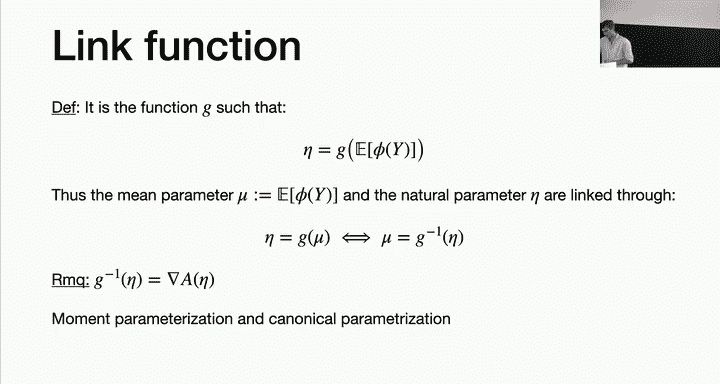

So， let's quickly。See how we can use this。范明琳。In my辽。

So， the first one。Will be that， imagine。That you are observing some data y and， sorry， y1 to y N。

And what you're assuming is that this data。Are coming from a member of the expial family。Okay。

 so you assume that your observation are coming from some。Probability with a fixed age and a fixed。

Sufficient statistics。Okay， so for example， you are observing some observation and you are assuming that they are Gusian。

😊，Okay， but then you want to recover the parameterham， so you want to recover， for example。

 the mean of the question， you want to recover the variance of the question。

So herey it is exactly the same， but in a marginal setting， you are assuming that the low of y。😊。

Is a member of the Expial family。And you know H and you know phi。

 but you don't know the parameter Eta。 And so what you want is to recover the parameter eta。

And how you will recover the parameter itta， you will do the maximum likelihood estimation。😊。

And so far this， you will have to compute。Your likelihood。

And what you see is that often in order to find the parametermeterter Eta， which will maximize this。

We will minimize。是呃。Negative of the logarism of the likelihood。And so we pray beautiful dided。

 we would just。Uses the fact that since the observation are independent， we will have a project。

So anyway we get to sum。And you see at the end， we are obtaining this function。 Okay。

 so this will be your negative likelihood。And what you can see is that this is totally independent of EA。

😊，This will be a linear function of Eta。And a of itta is a convex function because we have already proven that a of itta is convex。

So what you get is that L of Eta。E the co x function。ok。And in order to minimize it。

We will just compute the gradient。And when I'm computinging the gradient。

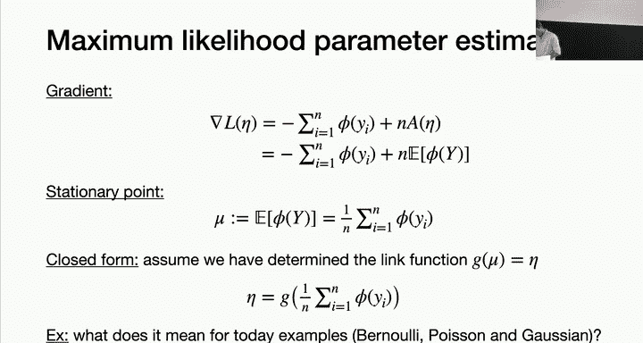

I have a gotten， too。

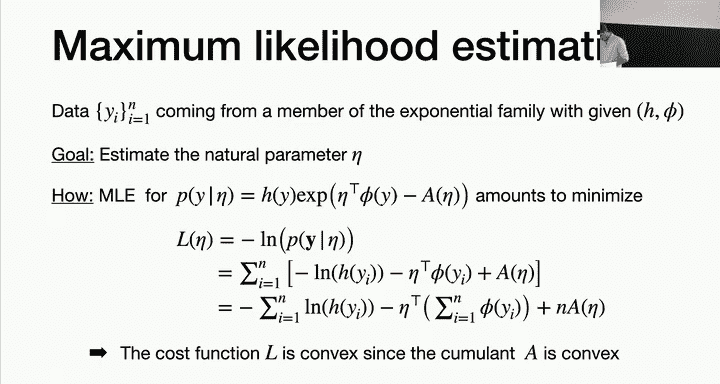

So I will get this mill linearar term plus the gradientt。Of A A， and I already。

So that the gradientent of a was equal to the expectation of phi of y。And so you directly get this。

And in order to find the station I found。You want to set the gradientian to 0。

And so what you will get is that mu， which is by definition。

 the expectation of the sufficient statistics。😊，Has to be equal to the average age of the phi of Yi。

So this is what I was telling you at the beginning of the course。

And you see that you can have a close form using the link function。Okay， using the link function。

 we have a close form for the parameter itta。Which will be G of the other age。Of the fire of Yi。

And so this is really telling you that， for example， for a ban distribution。😊。

The ML estimate of the mean will be the sample mean。

And the ML and the same for the Gosian and the ML estimate of the mean would be the simple mean。

And the ML estimate of the variance would be the simple variance。But often in machine learning。

 what we have is not only this。

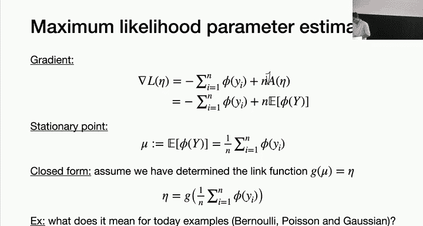

We will have some。ok。AMoel， where we want。We have an x， we have a y。

 and we want to predict y given x。So you know， this is what we did in Li square and in least square。

 what we assume is that y was equal to the some Gaussian。

Con the variable of mean x transpose the value， and then we did the same with the logistic regression。

And so you see that what is equivalent is this two formulation。Is at first。胡有冇得 link嘅。证命呢。

Of the expectation as some function。And then。You put some distributions and probability and why。

So just to be quick， this is what we will call the generalized linearar model， so GLM。再出B。

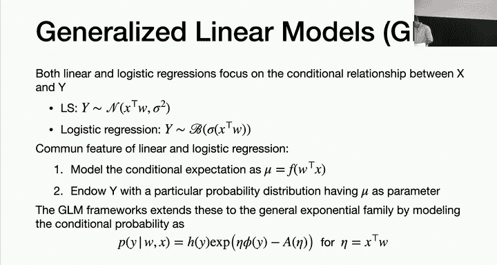

Some conditional probability of y given x。Will be the member of exponential family。

And itta will be my linear modeling， okay？So Eta will be equal to x trans per w。

And then the probability of y given x will be given by an exponential family。

So you see that this is exactly what we did for the list square and this is exactly what we did for the logistic regression。

😊，So let's look again。In a GLM。I am assuming that my conditional probability。意思。

An exponential family where my canonical parametermeter is myar prediction。Okay， so in fact。

 in a GLM， I'm making three assumptions。On the form of my conditional probability。

So first one is that the input I'm observing x。Enters into my model via my linear observation。

 x transpose w。Okay。😊，So I have X。I want to predict W， and in fact。

 I will only use x hopose W and this will give me Eta。And then。

The conditional expectation of my sufficient statistics。😊，Will be some function of G of itta。

So this is exactly what we did in logistic regression。😊，wifi。Of was equal to identity。

 and we say that the conditional expectation of why。Was exactly my smoid。And then。

The output I am observing will be characterized by some exponential family。

Was conditional mean will be you。Okay， but just to summarize GLM。Is a model where the conditional。

 I mean distribution of y given x is assumed to take this form。 It is an exponential family。

And X on the observation only enters who is linear observation。

That's what is very important to have in mind。

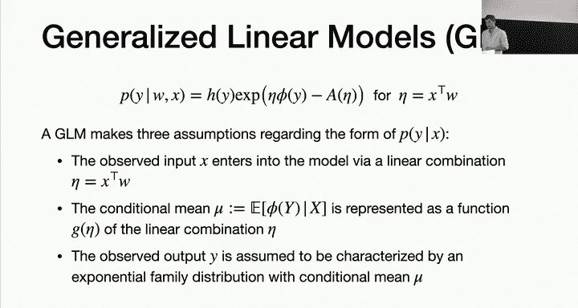

And what is very nice。😊，Is that。It's possible to dehive some general formula。

F the negative looked like it would estimation。So now imagine that you have some data X I， Y I。

 and you assume that they follow your model and what you want is to recover the parameter or W。

Or you will do so。 You will compute the ML。For this observation and you will directly have this and when you will replace by the formula of P。

😊，You will get。Exactly this equation and we also saw that this is convex because the first part is totally independent of W。

This is a linear function of W。And this is。The composition of a convex function and a linear function。

 So the composition of a convex function and a linear function would be convex。

So the function L is convex。And in order to find a stationi point， you can compute the Gahaant。

And when you are computing the Guard。The gradientant of this linearar part you only take。

So this vector， then you are computing the gradientdget of this。

 you will take a prime and you take your Xi which go out。

 then you are using that a prime is equal to the expectation of phi of Yi。And then， you can use。

The inverse of your link function。And so you see that your stationary point will be given by this formula。

Writen in a matrix firm。And you see that this exactly recover what we did for logistic regression。😊。

Okay， for logistic regression。Fhi is equal to identity and g inverse is equal to sigma。

So by doing so we directly recover to stationary point equation。Follow this regression。

 So you see that the GLM and the exponential feminine really help you。就。Dly， I mean。

 get Hazel for a lot。😊，For all the member of the family and not to do computation for every member independently。

Okay， and so since this function is coVx。Then you can minimize it using some。

Some optimization algorithm。

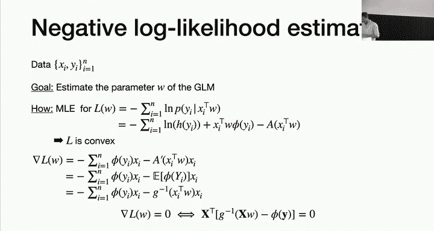

So just to summarize very quickly， sorry I'm a little bit late what we have done today。We start。

 you know by saying that you can have some linear model。

And by putting some probabilityma on this nano mode， this will give you a least square asim。😊。

Then we extend this to the logistic relation and we even to a larger family of model。

 which was an exponential family。😊，지。You have H and phi， which was a degree of freedom， Eta。

 which is called the natural parameter and a， which is equal the log partition。😊。

We do have two properties and the log partition。So the fact that it is convex and that when you take the gradient。

 you will rel the moment of the sufficient statistics。😊。

And then we used this exponential feminine in order to define so generalized linear model。😊。

Where is the conditional probability of y given x？Is Bahamits。By an exponential family。

Where the can paham is your linear prediction。And using the maximum likelihood disation on this model。

 you will directly find your optimal parameter to value。Okay。

 thank you very much and I see you sales day。

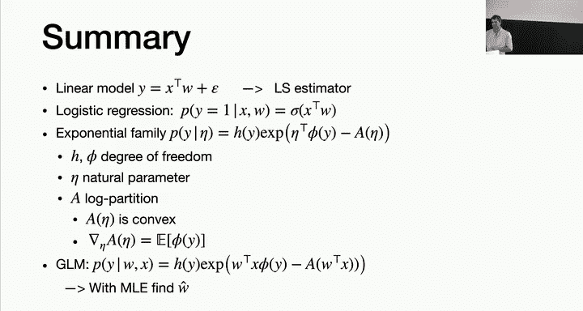

是。