# EPFL《机器学习｜Machine Learning Course CS-433 fall 2020-2021》中英字幕（deepseek - P17：[17]EPFL Machine Learning Course 2021 - Week 6 part 2.zh_en - GPT中英字幕课程资源 - BV14SwyeNEvW

So today we will talk about the nearest Ne classifier。😊。

And we will see what we call the curse of the dimensionality。Okay， so this。

Kind of methods in nearest neighbor can really be used both for classification and for regression。😊。

Today we will mostly talk about the classification setting， but just you know， for you to know。

 you can also use it for regression。😊，And so what we will do is that we will quickly。😊。

Define it properly。Then we will look at different version and we will try to see when it can work and when it is not working。

😊，And at the end of the lecture， we will analyze it formally in the case of k equal to1。😊。

And so what really will be the take homeme message of today's lecture is that in low dimension。

 so if your dimension of your input space is small。😊。

Then that's a method if you have enough data which will work very well Okay。

 so if you have a low dimensional space， it will work very well and you will be able to to model some very complex boundary。

😊，呃 transitionition。But。It will only work if you have。

 know some assumption and some if like the data points， which are closed。😊，Will behave。

In a seminar manner。But then we will see also that as soon as the dimension of the input space is increasing。

 then the method will not work Okay， so it's really like a method which would work well in low dimension。

😊，And it will enable you to model some very complex transition manner。

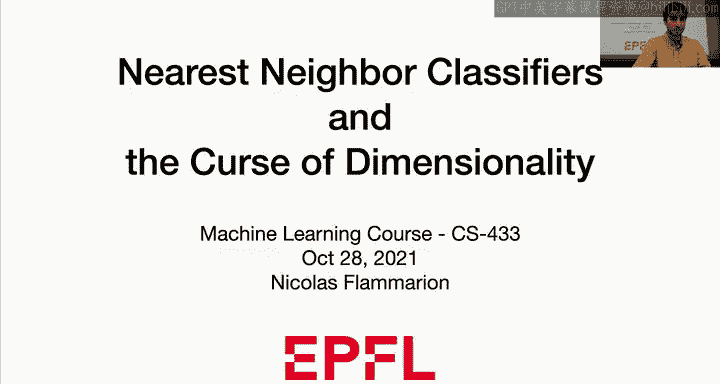

So first let's quickly you know recall like what is a sitting so today it will be about supervise machine learning so you have some observation as okay you have a training set。

😊，And you want to use this training set in order， if I give you a new input X in order to predict what will be the output Y。

 Okay， so you want to use your planning sets。And so what you will often do is that you will learn using your training set in algorithm A and with this algorithm。

 you will do your prediction。😊，And so today we will talk about。😊。

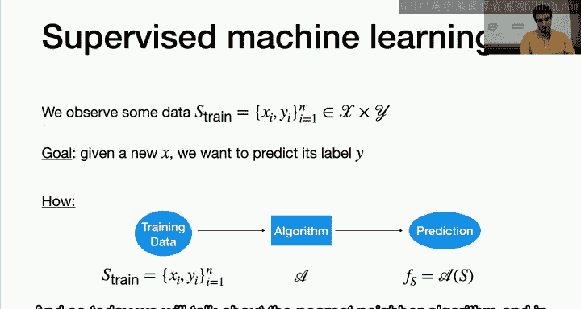

The nearest neighbor。Algorithm。And in order to define what is the nearest neighborhood。

 what we need first is that this function。Which is called the NAs Na function。

So what is the definition？😊，You have some input space X。I am giving you a training set as training。

And the parameter will be k， okay it will be the number of neighborO you are looking for and so the function ne of S strain f of k。

We'll just give an output。The key elements of your training set。

 which are the closest to your input point x。Okay， the definition is really clear。😊。

You have a training set， you have K， you are looking for the K closest element in your training set。

😊，这就和point X。Is it clear for the definition？yes。😊，So what do we mean by closest？What does it mean？

That's the smallest distance。So you see here I'm kind of assuming that I also give you a distance。😊。

So let's say that would be the elkgen distance。😊，From now， let's do a quick game。So okay。

 that will be my testing point and I'm looking for the three closest point from x。😊。

What will be the output？怎么。被告。3，4，7。I'm looking that's exactly true。 I'm looking in this bowl。

 I see that in that bowl， I have my three pounds， three，4， seven。😊。

And they are my three closest point from x。 Okay， now I'm big with。Let's do another one。

 it's also easy， what is the closest， I mean the nearest neighbor from this point。这是听说就个。

Now the closest one， you know it's S strain of one。X 20， cool， perfect。Okay。

 now I'm looking for this point。And I'm looking for the two nearest neighbor of this point。😊，好。What。

 five and nine？Is it like uniquely defined？Okay， so now if I'm looking， you see at this point。😊。

I see that I have three points which are exactly at the same distance。So what should we do？What。

So you see that in that case it's not well defined。😊。

So then it will really depend on your implementation。So classically。

 often what will happen is that your implementation would take。😊，20 point of the street Okay。

 and I check in Matlab is also I think the same I was taking like the two first one。

But in your algorithm， it will not change a net。But keep in mind that it will not be always uniquely defined。

But I mean， you know， in practice。We will never。Sa something like this。

 but it can still happen it's important to have it in mind。

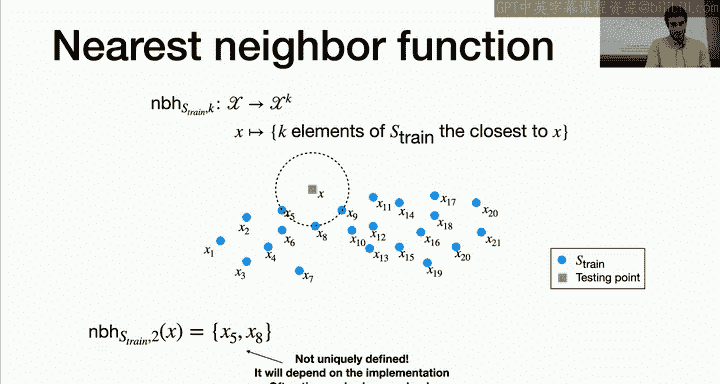

Okay， so what are the remark we want to do on this function， as I told you？😊。

You are implicitly assuming a distance and if you are changing the distance。

 it would change the function。Here， I have assumed it was a elian distance it could have been。😊。

Some other LP distance or any any other distance you want。

 so you can use different metric and you have to define which metric you would use。

And then the second point we have already talked about in the lecture about classification。😊，Is that。

You see， we are not talking about complexity。How much it will cost you in the of computation in order to give the output Okay。

 and today we will just say that it is free。 Okay， you have the function。

 you can compute it as much as you want。😊，But you have two things that， in fact。

 often the complexity。To query the nearest enable will be of orders the number of data you have in your training set。

 so it would be quite large。Because in order to know which one is your closest point。

 you will have to check all the point and to see which one is your closest。

So it's possible sometimes when we will have your data stuck in your memory in some specific。😊，诶。

With some specific data structure， you can have some sub linearar algorithm。😊。

But also maybe sometimes you don't want to have like an exact output， you know。

 maybe you don't really want to get like what is your closests。

 but that's O if you get an approximation。😊，So， that's possible to go。Below this O of N complexity。

And typically the crust of your nearests neighbor will be Earth and， and that's kind of expensive。

 okay？So this function。Kind of easy， well defined and now we want to use it in order to define what is。

The nearest neighborhood for both regulation and classification。😊。

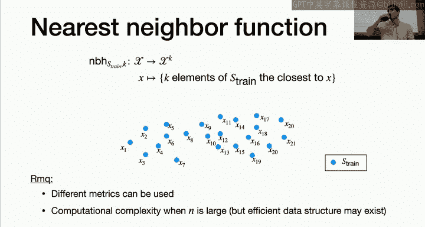

So let's start with regulation。So what you will do for regression。You we just？

Compute the average of your outputs。佢冇。The point which are the closest neighbor， okay？The， first。

You look for your nearest neighbor。You find user Xi， x1， x2， x3。

 and then you will do the other age of this output。😊，And this will be your prediction。ok。

You take a point。You look at the cake closest points。And then you predict the average。

Value of this K closests point。 Okay， of the output。Is it clear for the definition？哎。Okay，ス。四。

I haven't still this point。😮，And I want to know what will be the prediction。For this point。

 when I look at the street near his neighbor。Can someone tell me what would be the prediction？怎么。

So the labels would be y3， y1， Y2。What。我 be。Exactly。So you are looking， you have a point。😊，You look。

At your three closest neighbor。And you just average the output value。 Okay。

 you see that's really really easy。😊。

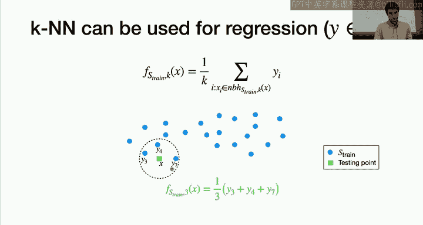

And you can do exactly the same for classification。😊，But now for classification。

 what you will do is that you will do a majority vote， okay？😊，You will do exactly the same。

 you select a point， you look for the K closest neighbor and you do a majority words among them。😊。

Okay， so you will predict the class which dominates among your neighbor。Okay。

 you will predict the class， which appears the most frequently。You see a problem here also。

 which can happen。Okay， we will see it together。So I'm looking at this point， x。And I want to know。

What will be the one nearest Ne？Outputs for classification。 Do you think it will be zero。

 it will be one。It will be。I'm looking at the closest neighbor it would be one。

 okay at that point and I see that point is blue， so I will output one。😊。

But now if I'm looking at the tree。😊，Nva's neighbor classification rule still for this point。😊。

What will be my output？It be zero。Because you see。I'm looking on that point。

 and I see that my three closest point will be x2 x 5 and x6。 And when I do a majority vote。

 I have one。😊，Point in the class1， and I have two points in the class 0。

 so the class0 is winning and I will output0。Okay， should be clear。And then you will see the problem。

 what is happening enough if I'm doing， what is F as strain of4。😊。

If I am looking at the for closest point of x， I will have two blue points and two red points。😊。

I know yeah， but I don't know how to predict。And so in order not to have this problem。

 what we will do is that often we will only consider this rule。😊，With K odd， okay。

 you are not choosing K A and you are just choosing K odd like this， you will never have a tie。

Always one of the class will win and it will be easier to do。

So that's kind of like a quick tip in order to do a good prediction。😊。

Choose K to be odd such that you will avoid ties。嗯哼。😊，我的。Rebut。

So right now we are defining it for just binary classification。不真确。😔，Then you can find the answer。

And then， of course， you know your DHC a lot of way to generalize this method。😊，So for example。

 you know if k is very large， then maybe you don't want to give the same amount of n buttons to all the point and you want to weight them。

 so you want to give more value to the point which will be close to x and so you will do some weighted in a combination the points close to x will be valued a lot。

 the points far away from x will be less valued and this will lead to what is called the smoothing camera。

But we will not talk about it today。 really today， we will consider as a simpler city okay。😊。

You are just looking for the Ken nearest neighbor and you do a majority that and you will see that often we will even take k equal to one when we will do the theoretical analysis。

😊，So for K equal to1， it's really like the simplest well possible。

 you look for the closest point in your timing set and you output exactly the same label。😊。

Is it clear for this rule。Yes。😊，Okay， it's really you follow the advice of your neighbor。

 you do exactly。As he's doing， now she's doing。

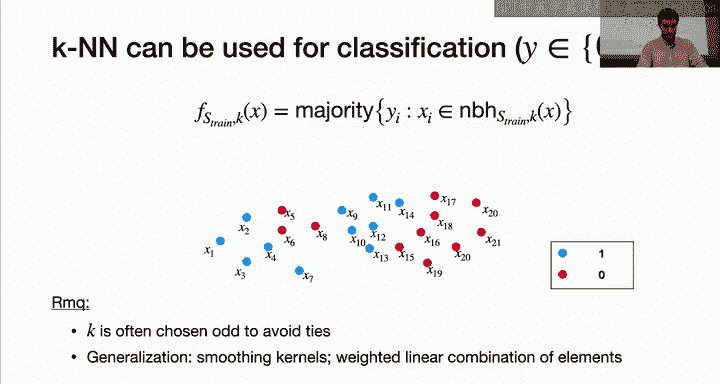

So why does it make sense？And when can it walk？You know。

 it can only make sense and we already talked about it last time。

If you think that you have some correlation， some special correlation between your labels， okay。

 if you think that point which will be close， we are likely to have the same label if this is true。

Then doing Nia's Ne classification makes sense， okay。

So if you have some reason to think that you will have some special correlation。

 it will make sense to do this whole。😊，So really what you want is that if x and x prime are closed。

 you want then that they're label to be highly correlated。😊，ok。Poin。Which are close。

 should have the same label。Otherwise， your j is that it will not fall。If for example。

 you say that the output y is just some honda function independent of x。You know。

 for every why you just like flippa kind。Then you directly see that it will not make any sense。

To use your prediction close to you， because I will not be correlated。ok。It will not always work。

 It will really work if you have some place cell correlation。And then。What we will see。

Is that it will really be meaningful when you are in low dimension。

 so we will try to explain why today。And。It can be very meaningful in some examples such like this。

 where you see that you have some very complex decision boundaries okay。

 you have something which would be really hard to approximate other ways。😊，So for example。

 for such data set like this。😊，You can directly see that， you know。

 if you are using logistic regulationation， for example。

 it will not work like a linear model will not work for such data set。😊。

But choosing the nearestas Ne Classia， you are able to implicitly learn some very。

 very complex decision boundary。😊，And that's really like the positive point of such method。

So it could be meaningful。In low dimension， when you have a lot of points。

And some very complicated data。ok。So then the question we want to see。😊。

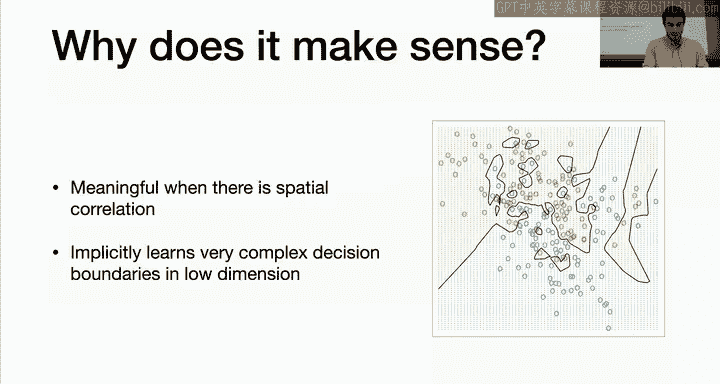

Is that what is the importance of this x parameterhammeter K。

 because that's something you can say that' something you can define。

 You can as take K to be very small。 You can be equal to one， and you can。

 you can take K to be very large。😊，And so what would be the lattice value for K you can take。😊。

The size of your training data， okay， otherwise it will not make any sense。

And so what we want to see is that what is the relation between this parameterham K and the bias variance trade off we talk about plaide。

😊，So I don't know if you remember but what we say it was in the second lecture is that。😊。

Sometimes for some model， you will have a pamatta which will help you to control the complexity of the model class。

😊，You can have some very simple model and you can have some very complex model。😊。

And what we saw is that often when the models were too simple。😊，For example。

 we were trying to fit a line to some very complicated regression problem。

 So if the model were too simple then。😊，We are not doing well of prediction。

Because we were suffering a high bias， you know， it was not possible to model well or complex data。

 but in the other end， we were suffering also very low variance。😊。

Like we were predicting in a very consistent manner。

 like the prediction we were outputting was not depending a lot on the training data。😊。

You had like one training data。 You were computing you basically enough fit。

 then you were considering another other training set。 You were computing a second base enough fit。

 It was not too much changing。 Okay， so we saw that for simple model， we often add。L bias， sorry。

 high bias and a low variance。And at the other end of the spectrum。

 what we saw is that for complex model， then it was possible to model。

 I mean to model very well complex data， you could have some very complicated shape。😊。

But then it was very pointne to overfitting， and it was very sensitive to your training set。

 If you are computing a new fit on a new training set， then the curve you were observing was really。

 really different。😊，So that was the biased by instead of and what no we want to see today。

Or it will dependen on function of the parameter K of the Nira neighborhood。😊，So what' we just so。

Is that if we are considering a small K。😊，For example， k is equal to1。😊。

That means that you will predict the same label as your closest neighbor。

 you directlyly see that it will be possible。😊，To have some very， very complex boundary。Okay。

 and so that's really mean that you will have a very small bias。😊，Okay。

 if you are only looking for one closest point， you are not aberhdging at all。

 so you will have a very small bias because you will be able to get some very complex decision boundary。

😊，But on the other end， you directly see that you will have a very large variance。😊，O if you啊。

Asking for a new training set。Its very likely that your closest neighbor will change and no will output a different prediction Okay。

 so you see that your prediction will not be stable at all and that you will suffer a large variance。

😊，In some sense， really， if K is small， you are really overfitting to the data。Okay。

You are not advertisingaging at all。 You are not， you know。

 You are not doing a very wise prediction because you are。Trusting too much your neighbor。O。

On the other end， if I consider that I have a very large K。😊，I can take the X time case。

 I can take K to be equal to n。 Okay， the size of the training set。 So that's a nice example。😊。

What is happening if I'm importing K to be equal to end the size of my training set？

Or will be my prediction？Yes。😊，Exactly， so the prediction will be the mean of all the label or in the。

 I mean， for classification， it will be just a label， which is a。😊，W whichch wins a that。 Okay。

 so that means that you will get some constant prediction。

 You will do exactly the same prediction for all the point in your training set。😊。

So what does it mean？You see that means that you will have a very small variance。😊，Okay。

If you take another training set， it's very likely if the training set is large enough。

 that the majority will be the same。😊，But then you see that you will have a very large bias， okay。

 it's not possible to model some complex behavior。😊，Okay， so you get a very simple model。😊。

Just like the constant prediction， but it is not meaningful。😊，Because it's not interesting at all。

 but you will have a very small variance。So here you see exactly。只 ex three。

The example of the one nearest has an Na classification rule。😊。

You see that you get something which is very complex， the decision boundary is very complex。😊。

But you can easily imagine that if no。😊，I am heading a new training set。

 I'm giving you a new training set。😊，This very peculiar。Bda will change a lot Okay。

 so you see that you have a very low bias， but a very large variance。And the opposite。

 if you are doing the average over all the turning point。😊，Then you will have a very large bias。

 you are not model， I mean it's not possible to model well your data。

 but you will have a very small variance。

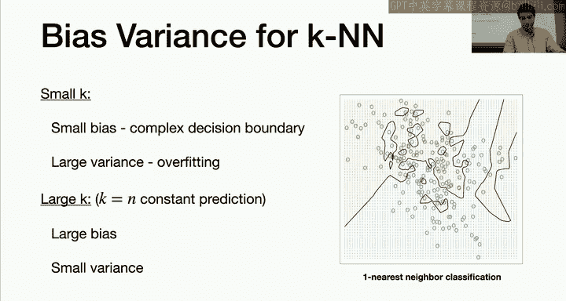

And so we can do it empirically。 you know， if of this， we really comparing。😊。

So a different value of k。What the test error。Of the method。

So you see that on the left part of the figure。I will have。呃The large。ok。

And this means the largek is a low complexity model， okay。

 that's the model for which my complexity will be very small。😊，And in the right part。

 I will have the small K that is the large complexity model。😊。

And so you see that we still have this U shaped curve。😊，Which really't mean that。When呢。

K is decreasing， my complexity is increasing。😊，Okay。And you see that first。You will have。

High bias and low variances and then here you will have a low bias and a high variance and what you have to do is you need to find the good point where both you know the model will be complex enough in order to model well your data but not too complex in order not to overfit to them too much。

So what we see also on this figure， you see it was for this type model， the performance of linearar。

😊，诶 justification method。嗯。So you see that the linear athlete will not work well。

It will obtain large tester， but if you are choosing the good K， so it'sken of k。

 let's say equal to 11， then you will have a small tester using。You系。给念ね部。

And you see also that if you look at the train test， which means that you look。😊，At the value。

You know， evaluated on your train， you see that it is going down to zero when k is decreasinging。😊。

Okay if k is very large， then you will do a constant prediction。

 so you will be room for a lot of point in your test， so in your train。But if K is very small。😊。

Then it will be possible to output Pu through for a lot of point。

Is it good for this biased violence tradeoff for Kenya's neighbor？If k is small。

Then you will have a very case small。Small bias， large variance， and if k is large。

 then you will have a very large bias and a very small bias。

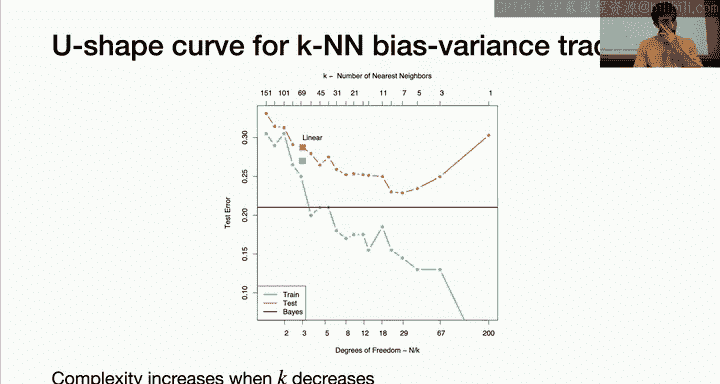

And so this is what we said that what you want is to find a good K so that you will have a good balance between the bias and the variances and so here we see that for example。

4 k is equal to 15，😊，We saw that we have a decision boundary， which is complex enough。You know the。

To fit well your data， you see。But it is not too complex， so you are not overfitting your data。

And you will have some small volumes。So if you find a good parameter K。

 you would be able to have a good test at because you will have。😊，嗯。At the same time。

 a low bias and a low variance。 And that's really what you have to achieve in practice。Okay。

 finding a good trade between these two quantities。So okay。

 so what we have seen so far is that for this example。😊，It kind of makes sense if you have some。

Coorrelation between I mean， if your output are special correlated and if you are in low dimension。

 it is working well。😊。

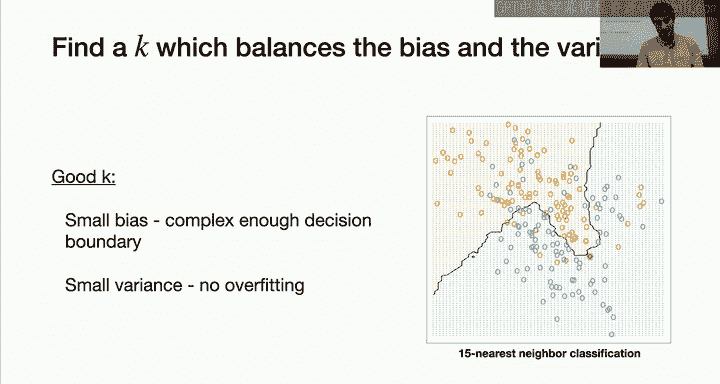

And so what we want to see now is that you know what can happen。So you know， in high dimension。

 why in high dimension， this method will not work。Well animal。

And so that's what is called the curse of the dimensionality。And just to briefly summarize it。

What is important to think of is that if you are in low dimension。😊。

Like the notion of the neighbor really makes sense。Like for example。

 in York city or in the classroom， like you know。😊。

Your neighbor will be closest than your average that one the mean one of the average inhabitants of the city。

😊，But in high dimension， it would not be any other case。And it will be that what we would try to see。

 to try to。You know to see that in a little bit more details。So what is the first claim？

That we want to prove or we want to investigate。Is that。

When you are improving when you are increasing the dimension。If you are fixing。

The size of your training set。Then the fraction of the space will decrease。ok。

So what we will do is that we are considering that our output space is the iPad cube 01 poverty。

 okay， so our x will all be between 01 poverty。😊，And what is the load that will be uniform from in this cube。

 Okay I have my cube， my iPad cube。😊，Youll see that the lens is 1 and all my input x will be in that cube。

😊，And now I'm considering x0。😊，Which is the center of my IP。

And I'm coing a very small box of Lang's eye。😊，Cented around X0。

And the question I want to answer is that。Now， if you are sampling a new point in the box。

What will be the probability that this new point？😮，Will belong to my small box in blue。Okay。

So if you take a new on themm sample。😊，It will be uniformly somewhere in my larger box。

And now you want to know what is a change。Wch is a sense at that point will be in my small books。

So this is what we want to prove。😊，And we want to say that this will be equal to F poverty。😊。

Do you see why do we have this， why is the probability that x belong to the small box？Is air。8次。

What the bottom of。好 you。Exactly， so the probability that x belong to the small box will be the volume of the small box divided by the volume of the large box。

😊，My small box， the length is r， so the volume will be r over d， my large box， so the length is1。

 so the volume would be1 over D is equal to1。😊，Gues the probability will be air fory， divided by one。

 so it will be alpha for。Okay。😊，And you have to think that I is smaller than one。

 so this is smaller than one。 And so let's call this number alpha。😊。

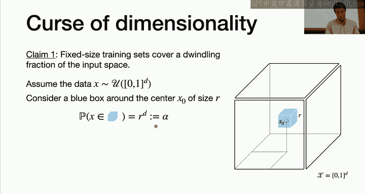

ok。So， you see that no。If I fix D to be equal to 10， it's not too large。 Okay，10。

 dimension 10 is it's still okay。And I say that I wanted this probability。😊，To be 10%。ok。😊。

Let's say what？Size should be R so that this probability is equal to 10% and so you see here directly。

😊，That in order that alpha is equal to 10%， r should be equal to 0 do63。So， already。

Your small box is not anymore so small。You see that if you only wanted the probability to be known on your box to be。

10%s。No sorry， one person。1% at%。Then R has toB。0 63。

And now you see that even if I want that the probability is equal to 10%。😊。

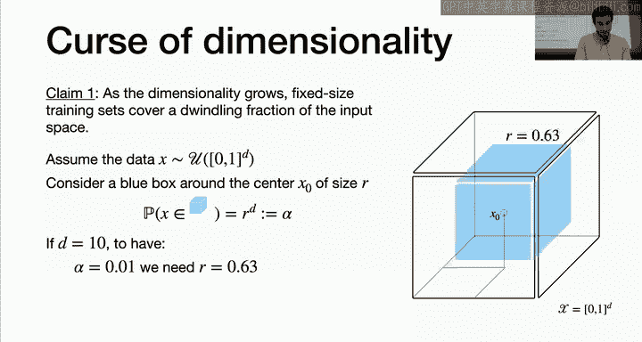

Then as should even be larger， I should be equal to 0。8。So you see really see that。

In large dimensions， then you will have to explore almost。The world box。

 in order to find a point which is closed， okay， if you want to capture one or 10 percent of your data。

In order to do a local average， imagine that you want to do this neighbor's neighborhood and you want to average over。

Some data， you don't want K to be too small because otherwise you know that you will have a very large variant。

 So you say， okay， let's try to do a vert amount。10% or maybe one% of you know the people in the room。

And then you see that if you want to do that in large dimension。😊，Then， in fact。

In order to ask to 10% of your friend， you will not have know to stay local in the room。

 you will have to explore almost。63 or 80% of the home。So in fact。

 you see that it is not local anymore， I mean， it's not local。😊，At all。

 because in order are just to gather the information of 10% of your data。You will have， in fact。

 deserve the average edge of。Almost all the space。嗯。Is it clear for this first claim？Yes。

So you see really， what is important is that if you want to see what is the probability that when I sample a new point。

 it belongs to my box。If I want this probability。Even I don't want it to be too large。

 I just want it to be 10%。Then， in fact， my box has to be very， very large。Okay， yes。我。一。😊，これまの？

放诶嗰是多面。I mean， forgu vi it would be even worse。I mean。

 they would be highly consume heightened on your boundary。ok。So we have no point inside and sorry。

 I mean， if you have， if you want to do a prediction inside， it would be。I mean。

 all points would be very， very far away。我这边会。What。No， no， no， no。

 that's something very important to have in mind in largely mentioned。

 if you look at the Gosian vector。Like the norm will highly concentrate and will be one square root of D。

So all the point would be on the boundary on this sphere。They won't be inside。Yeah。

 can you relate something？Tra what is is alpha。So in time of training， we will see the second claim。

😊，But here， really， like alpha is like， you know， like。Is really I mean formula the best？😊。

Intriition above that is like， imagine。You want to average your decision over alpha portion of your input。

 okay， so you want you know to say that you will to the average over the 1% closest point。

Then you see that in order to look for this one person closest point， you will have to explore。

Like the blue box and you see that this blue box is almost as large as the all input space。😊。

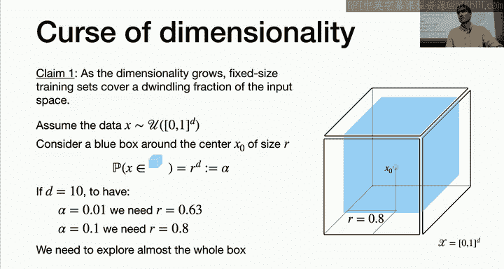

But let's see for the second claim， maybe it will be more clear。

So the second claim is really that in fact， in high dimension。Data points are really far away。 Okay。

 if you look at two honda points， they won't be closed at all。So that's kind of the same example。

 now we are considering n data points。😊，Which are still uniform in my iPad cube 01D。Okay。

And what we want to do is that I'm still giving you the center x0 of my iPad hub and I want to find you know。

 where is the nearest neighbor of the center。😊，Will it be close， will it be far away？

And so what will will then say like the question will be。😊，Holar。Should be my bes blue？

So that's the trend at at least one of the point of my training sets。Belong to the blue boxs。Okay。

 and so I want that the probability。😊，That it takes this to point in my data so that this point belongs to the blue box。

 I want this probability to be larger than one over。

So it should be clear that if my blue box is very small。😊。

And it is very unlikely that there is another point of my training set inside this blue box。😊，Yes。😊。

But then if my blue bookss。Is all my set X that is very likely that I will have a point。😊。

Of my training set， which will be in the box。Is it clear for what we are looking for？But like。

 you know what this means this statement？You have endpoint。Which are any firm。In your iPad cube。

And you are looking for the probability that it exists one of this point。😮，Inside these blue boxs。

And the claim is that。😊，If you wanted this probability。If you want it to be larger than one over two。

Then you will have to take the Hadius R to be larger than this number。

 which is1 minus1 over 2 per1 over n。And the two were one of。So let's try to prove the statement。

So we saw previously that the probability that point x。😊，Belonged to my box was Appleology。Okay。

 because it was the volume of my small box， over the total volume。😊。

So probability that x belong to my blue box is air4。

So what is the probability that a uniform point is not belonging to my blue box？😊。

It is one minus Air。Yes， okay， probability of the complement is one minus the probability。

And now I want to have the probability。That no point in my training set belong to the blue box。😡。

Okay， and all my points are independent。So what is the probability。

 So I say that the proba is at one point。One in point does not belong to my blue box is one minus air power R D。

 if I have two points， what is the probability that two points are not belonging to my box。

 it would be。上判。Where。It will be 1 minus air power D power2。Okay， this independence。

 I'm just doing the project of the two probabilities。😊。

And know if I want the probabilities at no points。When I have n burns， I'm just taking the power N。😊。

ok。😊，And so now what is the event we want to control。

 we want that it exists one point of my training set inside my blue box。😊。

So you see that exactly1 minus the previous probability。So you get that this probability。😊。

Is exactly equal to 1 minus1 minus air power D power N。

And so if you want this number to be larger than one over two。

 you can show that this means that are has to be larger than this number。ok。😊，It。

Cool for this simple computation。So because you that here， I have used that my data where。

II D they are independent。 If they are not independent， it's not possible to go from here to。Okay。嗯。

Yeah。So let's look at one example。😊。

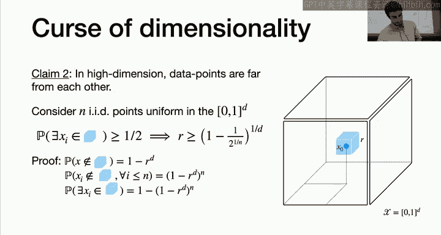

Now， if I consider that D is equal to 10。😊，And I have。500 points。

In order that the probability to be larger than one over two。

I will need to have r to be larger than0 do 52。So， in another。

To find a point which will be in my box。I have， I need to have my books to be。Almost， you know。

The alpha of the。More than the alpha the squared。Okay， so in some sense。

 you really have to go halfway way in order to find。😊，Someone which is close。Okay。

 so you really see that in high dimension， this notion of Nesnebo does not make any sense。

 okay all the point are at the same distance and they are very far away。😊，And in fact。

 they will all be very close。😊，To the。Its a bone。Okay。好。

So do you have some questions on this second claim？能。到候。wo。I think we'll be the same。Yeah。

We would have to make the computation， I mean it won be it won' work better， not sure。But then。

 we will need to think a little bit more about the Gusian case。Okay。

 so we will do a break now and the second part of the course， we will try to analyze。😊。

The generalization property of this whole。So see you in the 15 minutes。

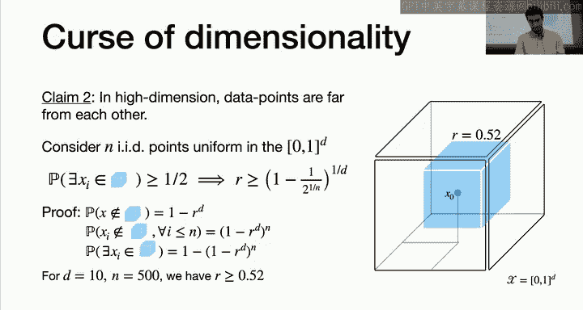

Iization burn for this method。So what is the aim is really like we want to analyze。😊。

The one nearest neighborhood。And so what do we mean by analyze。

 it means that we will compare its performance。😊，To the performance of the base classifier。

 I don't know if you remember the bias classifier was really the optimal way to do classification。

Okay， and so the results we will dehive will really help us to confirm our in about the curve of the dimensionality。

😊，So what is a setup？It's as we have before， we have some input X。

And y and the output are y and they follows some node D， and they over the set x times y。

 where the set x is the iPad cube01 power of D。😊，And the set y is 01。 Okay so just hit set 01。

So that's a set and what we want to do is that we want to dehive a bound for the classification error of。

😊，The你月内一部分。So let me remind you what is the classification ahu that's really。😊。

The probability of making a mistake。So you are looking at the probability when x and y follow D。

Of making a mistake， what does it mean that you are making a mistake。

 it means that your prediction G of x is different from the two output y。ok。

So when G of x is different from y， you are making a mistake and you want to minimize the probability of making a mistake。

And I don't know if you remember， but this was exactly。Equal。To the expectation when x and Y。弗录机。

Of your classification they， which was the indicator function that y is different。放知 f x。Okay。

So you recover that this is exactly the definition of the2 error for classification。😊。

What is your loss for the classification， it is the indicator function of the event Y is different from your prediction。

😊，And you are looking at the average age of yours。And so this is the classification level。😊。

And that's exactly the probability of making a mistake when you are predicting the value y to be G of x。

Okay。So what are the baseline to what do we want to compare ourselves？

So what we are assuming is that the data following some two distribution D。ok。So now。

 imagine that you knew the。Okay， that's a distribution that you， for example。

 you know x will be some distribution and then y will be。😊，Some manually distribution。I mean。

 for example， why we follow a logistic model？What could you do？So in the first case。

 maybe it's a simple case， y can be a detertaministic function of x that can happen okay。

In that case， then you will predict。😊，Just like the tool label。But in the general case。

 what is important to have in mind is that y is a hom variable。😊，Given x， okay， for one x。

 you will not。I have always the same output。Okay， y is the honda variable given the value of x。

So what is important to define is really this function eta of x。

Which is the conditional probability that y is equal to1 when x is equal to small x。

So now if I give you this function itta。Who can you do your prediction？If you know the probability。

제컨디을 법이 있지？Then。You can see that what will be your prediction and you will predict one if this probability is larger than one over two。

😊，Because thats means that。The label one is more likely to happen than the labeled zero。

 so you want to predict one。And if this probability is smaller than one over two， so is one over two。

 yes，0 and 5， then you want to predict the label0 because thats means that zero will be more likely than one。

 so you want to predict0。So it should be clear that if you knew。The description D。

Then you can compute this function eta of x。And given this function Eta of x。You can predict。

Using this prediction rule， if Eta is larger than the5。Then you predict one。

 and if itta is smaller than0 to 5， then you predict zero。

So this is what we call the base classifier that we like the baseline are the best you can do。😊。

Is it clear for this first statement？At least intuitively clear。If you know D， you can compute Eta。

 and if you can compute Eta， you want to predict using Eta。

And you see that's the best way you will be able to predict。And so what is the risk？😊。

For this bias classifier， this is called a bias risk。😊，And this is what we will show next。

 you can show that so the risk will be the probability of making a mistake。😊。

And we can write it under this form， it will be the expectation of the minimum of two term of Eta and1 minus Eta。

😊。

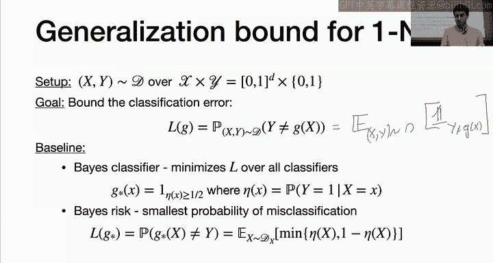

So let's let's put this to statement。 So the first statement。Let's prove this。Maybe it was clear。

 but we can still try to prove it。 So I don't know if you remember， but。

In the Q of the classification， we show exactly this。😊。

We show that the definition of G star of x was exactly。😊，I am predicting。

The arc max of my conditional probability。ok。That was exactly。What we were predicting。

 You are looking at。The probability that y is equal to 1 and the probability that y is equal to zero。

 and it will output the label， which is most likely。

So you will output your label will be the rrc max of the conditional probability。

So what we want to show is that if itta is larger than1 over two。So that means that with this rule。

 I will predict one。😊，Then I want to show that this is equivalent to say that。😊。

I will also credit one when I use this classification rule。

Which is a definition we gave last time about the bias classifier。So next season。

What does it mean that Eta is larger than1 over two？By definition。

 it means that the probability that y is equal to1， given x is larger than 1 over2。

G us the definition。And then if this probability is larger than one over two。

 it means that this probability。😊，Is larger than the quality that weighs equal to 0。😊。

Is it clear for you。Because this probability is equal to1 minus that one。😊，Okay。

So if x is larger than1 over 2， y minus x will be smaller than1 over2。X is not a good name let' say따。

Is it clear for this claim？Okay。😊，And so that claim to say that the probability that y is equal to 1 given x is larger than the probability that y is equal to0 given x。

😊，It's exactly equivalent to say that one is the r max of this function。😊。

To say that one is the r max of these functions， it means that this probability is larger for lower case y is equal to 1 than when lower case y is equal to0。

😊，Anyway， I mean， it's not clear， you can look at it together at home。😊。

But really what we have shown is that。This classification rule。When you are predicting。

If itta is larger than one over two， you are predicting one and if itta is smaller than1 over two。

 you are predicting zero， it is exactly the same as a bias classificationifier。

 which is the minimizer of your risk over all the classification。😊。

We have some questions on this first claim。没有。Okay， so let's try to prove this circle statement。

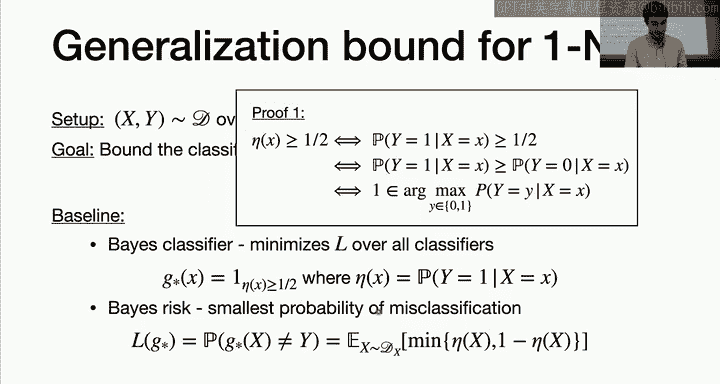

嗯。So to prove the second statement， I am just rewriting the definition。

 what is the loss of the bias classifier？It is the expectation over X and Y。

Of my classification loss。Okay， that's the definition。

And now I will first take the expectation over x。And then I would take the expectation of a y given x。

😊，Okay。Like the tour rule for her expectation。And now I will split inside between these two events。

Between the event that eatta。Is larger than one over two。 and the event at itta。Is smaller。

 because there is a table here。Okay。😊，Because either itta is larger than one number two。

 either itta is smaller。😊，Then one about two。So then you see if itta is larger than1 over2。

 then gta of x will be equal to。😊，one。Okay。😊，And if Eta is smaller than1 over2。

 this staru of x would be equal to 0。😊，So you exactly get。This results。

 so what you want is to look at the expectation。😊，Of the event that y is different than one。Given X。

And so this should be clear that this expectation。The expectation of the indicator that y is different than1 is exactly equal to the probability that y is equal to0。

Okay， these are exact equality and that' the same this probability that y is different from zero is exactly equal to the probability。

😊，That's y is equal to one。O。So what is？To what is equal the risk？😊，The risk， the risk is equal to。😊。

这。Probability at y is equal to zero。😊，If Eta is larger than one over two。😊。

And it is equal to the probability that y is equal to1 if itta is smaller than one over two。😊，O。

So this quantity。This is exactly。我美。Okay， and this quantity。Its exactly itta of x。So what do I have。

 I say that my risk。Is equal to 1 minus itta。When itta is larger than1 over two and it is equal to itta。

 when itta is smaller than1 over two。😊，And I already told you that if Eta is larger than 1 over two。

 that means that 1 minus itta will be larger than1 over two。😊，So。When。

1 minus itta is smaller than itta， it is equal to 1 minus ta。And when Eta is smaller than wine menus。

 itta it is equal to Eta。😊，So you directly see that the risk is always equal to the minimum value of itta and1 minus itta。

ok。So， this is。The value for the risk can now we will use this value。😊。

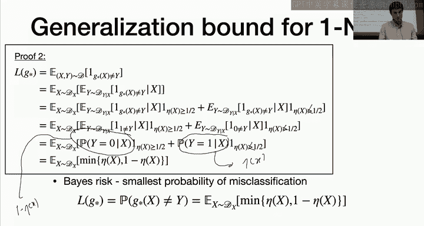

When we would try to dehive our bound for the generalization。

 a half of the wine nearest neighborhood。So first， as I already told you。😊。

It will not work if we don't have a nire between the label。

So how is it possible to assume this in some assumption？😊，We will do exactly this。 so if I take 2。

 x and x5。What they want。Is that。I want that my conditional probability to be close。Okay。

 so that will be some Le sheets assumption。Okay。😊，So what we are asking is that the conditional probability。

😊，Our lips sheets。With a constant C。That means that if you move a point slightly， okay。

 if x prime x prime。Is not too far away from x， then you want that the conditional probability to be close。

So two points which would be close， say conditional probability would be closed and so they will be likely to have the same label。

😊，If x prime is close to x。Then this term will be close to 0。

And so that's means that the probability that y prime would be equal to one。

Will be close to the probability that y is equal to one。So if two points are close。

 they will be likely to have the same label。Is it clear for the assumption？你去西林。

Guesses that's a lipschness assumption， really。😊，And it's only saying that if your point are close。

 then they are likely to have the same labels。So let's look at the result we will try to prove today。

So what we are saying is that I'm looking at my true error。My probability of making a mistake。Of my。

Nearar as Ne classification rule， I call it G of S strain。And I'm looking at。

The T when I'm taking the average of all the possible training sets。😊，ok。So that's my average age。

突位好。And I want to compare it and so what I will be able to show。😊。

Is that it will be bounded by two terms。It will be bounded by two times the best possible throw。

 okay？That will not be too far away from the best I can do。Plus， another thing。

And so then what we want to interpret is what is this se geometric terms。😊，So what does it mean？

I am taking the expectation over my training set。😊，And a fresh sample point x。

And now I'm looking at the distance between a point x。And is closest neighbor in my training set。😊。

And then I'm taking the Avoh。So you are really seeing that this is really like the average distance between。

😊，10 point。And its closest neighbor in your planning set。Okay。

 and so what we are saying is that if this term is small。😊，It means that。Theニ月内部。

Will behave as good as two times the best possible rule。

And so this is really what we have said so far is that。😊，If C is not too large。😡。

So if C is not too large， it means that we have a lot of special correlation that was the first point we say what which was important and the second point was that it was possible to find a neighbor not too far away and that exactly the meaning of this second point which is the average distance between。

😊，A random point。 and its closest neighbor。So that's the first statement we will prove。

And then the second statement will be that in fact， it is possible to bound this term。ok。😊。

And so it will be possible to show that。😊，If you are in dimension D。

And if you have an end bones in your training set。😊，The average distance between。

One Honda point and its closest neighbor。This would be a capital x。😊，Will be a father there。

Square root D times the number of some phone per word。😮，Mus1 over d plus 1。Okay。

 and so then we will try to analyze this term。

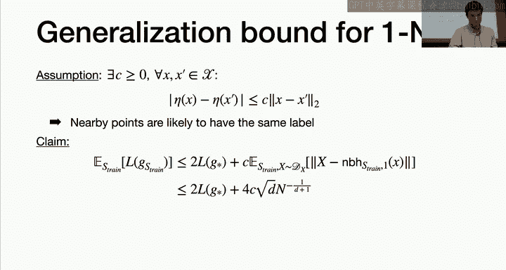

嗯。Okay， so this has to be clear， we like this geometric term。

 it really like the average distance between a random point。😊，And its closest Ne。

So let's try to see how this term。Is behaving。So in the first case。

 let's say that we fix the dimension。So we consider that D is not too large， we fix D。

And now you can take the number of samples and to go to infinity。😊，This term will go to。0。Okay。

 because it will be one over n to some power。The perwell is fixed because I fixed the dimension。😊。

And so you see that this term。Will go to you。Okay。1 over n to some power。

 when n is going to infinity would be go to0。So， if you fix。The dimension。

And you are considering that you have a number of training data， which is going to infinity。😊，Then。

The risk of your classification rule。😊，Will beed by two times the best risk possible。

 so it's not too bad。ok。😊，So if your dimension is fixed and you have a， a lot of data。

Then you see that the method is working quite well。😊，But you see that no。

If you have a number of data which is fixed， you fix n。😊。

And now you are that the dimension is going to infinity。😊，Then you see that this number is going up。

Okay， one over n to some。And you see that the power is 1 over d。 So if d is going to infinity。

1 over d will go to 0。😊，Okay， and some number。This will blow up and also with a quaroter。So。

 you see that。When the dimension D is going to infinity， the error will increase exponentially fast。

😊，ok。So in order to have a good b， what you will need is that you will need n your number of data to be exponential in your dimension of your problem。

And that's something which will not be I mean， will not be the case in practice。

So that this case will really。😊，I mean， explain again the Cu of the dimension。😊。

If the dimension is too big， compare of your number of somepl。Then。😊。

This result will be meaningless because a second term will be too large。Okay。

 so the result we will be able to show today。😊，Is really similar say so。

If the dimension is small and you have a lot of data。Then it will work quite well。

Because it will be possible to show that。You will find enable enable not to far away。

 and we have this assumption on the special correlation。But then if the dimension is too large。

And you don't have n， which is anelous。Then it will not be possible。又共同。The是は。

So do you see one problem。Something which I'm saying， which is not really true。

So what I'm saying seeing I'm saying that。If I fix n and this is going to infinity。

This second term is going to。If I fix N and D is going to infinity， this stem is going to。Infinity。

So that's means that these two termses， the sum of these two terms is going to。Infinity。

 so what does it mean？28。It's means that。It means nursing。It means that my bound is vacuum。😡，Okay。

But I haven't proved that this is not small。😊，I mean， this is just like an open bound。

So what I am telling you is that when D is going to infinity and n is fixed。

 my bound is not informative。😊，But it does not mean that， in fact。

Maybe my method will work very well。To say we have not proven it。But in practice。

 it's not to and it's possible to show that this bound is tight。So that these are there。

This quantities really have a good order of this quantity。So in fact， when D is going to infinity。😊。

It will be possible to show that your2 will go will also improve a lot。O。

And just to have something in mind is that。This is always bonded。

Because the E is always bounded by one。Okay， so let's try to prove。

This results in the last 20 minutes。Do you have first question about it？No。Okay。

 so let's try to do the proof maybe。

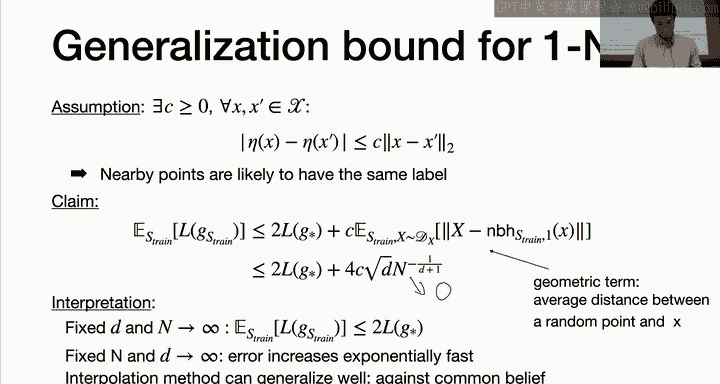

Interest。So what we will do to do the proof。So what we want is exactly to bound。This result。

 we want to bound the loss。Of our classifier， when we are taking the average over all my training sets。

😊，And so by definition， you see at the loss， it's exactly the probability of doing a mistake and a fresh samples。

😊，ImI'm sampling a new point x and y， and I will look at the probability。😊。

Of making a mistake and this new crash sample。 So this is what we want to bump。And so in fact。

 how we will do it。😊，And you can see that it is exactly equivalent。😊，We will first sample。

Our training said that we will only sample the x okay first。😊，We consider our hello Dx。

We are not considering the Y， and I'm sampling x1 to xn。Okay。😊。

And I will also consider a new unlabeled data x， so I'm first sampling the input X。😊。

And in the second step。Even。This input x and x1 to xn。I will sample the output。

Because the output is only depending on my input。Okay， so first， I'm sampling the input。😊。

And then I'm sampling the output。And what I will do is that I will denote by x prime。😊。

Which is a honda point between x1 and xn。Which is the closest for my context。ok。

And so now I'm just looking。At the output y， which is simple according to Eta of x， okay。

 Eta of x is a conditional probability。😊，And the point y prime， which is simple according to。It of X。

And so what you can show。😊，Is that what we want to bound， so the expected true error？In fact。

 I can exactly decompose。😊，This expectation and this expectation over the X and over the Y。

 I can first look over at the expectation over。😊，So inputs。And then over the output。

 when the output is following my conditional。😊，Distribution。And then what you can also see。😊，I that。

 in fact， it will only depend。Will not depend on all the output of the point x1 to xn。

 because I mean I do not care about them。 I will earn it will only depend on the output y prime。😊。

Where x prime will be the hom point， which will be the closest from x。So， you can see。That， in fact。

So this expectation so the S strain and x and Y。It will only be the expectation of a。X。

My endpoint x1 to xn。My output y and my output y prime where y prime will be the hom label associated with X prime。

 which is my closest label。And then I can justwrite what I want to bound。

 which is the indicator function of y of making okay the probability of making a mistake。

 so the honda function and the indicator of y different from G of x strain。😊，And so whats is G？Of x。

G F， how am I doing my prediction， I will predict the same label as my closest neighbor。😊。

So Gs train of x with exactly B Y prime。Okay， because by definition。

 x prime is equal to my closest neighbor。😊，So you see that I directly get this。

And then when I take the probability。I mean， I take the expectation over a y and y prime。

 Iically get that' in fact what I want to bound。Is just the expectation over my training set。

And my new input X。😮，Of the probability。That y is different than y pi。Okay。

So this is not too important just if you want it is kind of a formal proof that what you will need to bound。

Is this。I give you two points x and x prime， and now what you want to bound is that the probability that y will be different at y pi。

ok。😊。

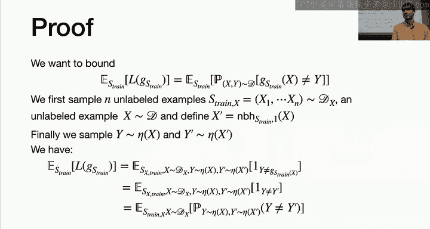

So let's do it again。I mean， again， this's is the next part。Sorry I just okay。

 so I'm giving you two point x and x prime these are in ourip cubes01 poverty。😊。

You will sample the enable， okay， y will follow the low eta of x， okay that's the probability。😊。

That y is equal to 1 is equal to e of x， and the probability that y is equal to 0 is equal to 1 minus e of x。

😊，And then you are also sampling the label while time。Which follows the law of Eta x prime。

And what we want to bound is a probability that y prime is different from y。ok。😊。

We want to bound this object。Is it clear for the object we want to bound， not for the result yet。

 but just like？You know't like the city。I give you two points x and x prime。

So label are given by these probabilities。😊，And now you want to bound the probability that the two labels are different。

Okay。😊，So let's do a first simple case。Imagine that x and x prime are the same。Okay。

 that was the same victim。So what does it mean？It means that eta of x and eta of x prime are the same and so that the conditional probability of y and y pi are the same。

😊，So it just that you are doing two different sampling from the same low。😊。

And you want to look at what is the probability that you are observing two different end cells。

So what are the two different possibility， what are the two case？Okay。

 I want to see the quality that y prime is different from y。

 so the first case would be that for example， y is equal to0。And that y pi is equal to1。

So y is equal to 0， it's happened with some probability， which is 1 minus eta of x。😊。

And y pi is equal to1， its happened with a probability eta of x。

So so even that both y is equal to0 and y prime is equal to1 will happen with a product of the true probability。

😊，So it will happen with a probability1 minus eta of x times eta of x。😊。

Then what is the second possibility is a second possibility sorry。😊。

It is that y is equal to1 and y prime is equal to 0。😊。

And so this will happen with a probability eta times 1 minus itta。😊，So you see that。

The probability that y prime is different from y it's exactly equal to the sum of this two events。😊。

So it would be equal to2 times the probability， sorry，2 times eta of x times 1 minus eta of x。

And then what should be clear？😊，Is that this number will be always smaller。😊。

Thenhan two times the minimum of it of x and1 minus it of x。嗯。Luccy why。

Why do you always have Eta times 1 minus itta， which is smaller than the minimum of itta and 1 minus itta？

我对对。The birth less。Oh equals N1。Okay， so this is a simple case。😊，What will be the difficult case？

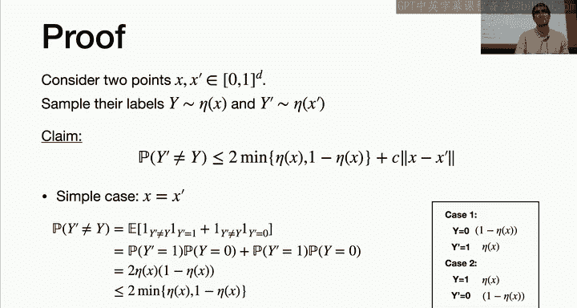

That will be when x will be different at x prime。So let's do the general case。所以子。

Really some computation， so it would be a little bit boring， well let's do it。

What we want is that the probability that y is different from y pi。

And this is exactly the same computation as before。😊，So， it will be。

The sum of the two different probabilitybabilities。

 the probability that y is equal to 1 and y prime is equal to0。😊。

Plus the probability that y prime is equal to 1 and that y is equal to0。Okay。

 you see that the same formula as before。😊，And know what I will like to do。Is that。You know。

 I want to recover this， I want to recover itta times 1 minus itta。You know why。

 because I know that this。I mean， if we go back。

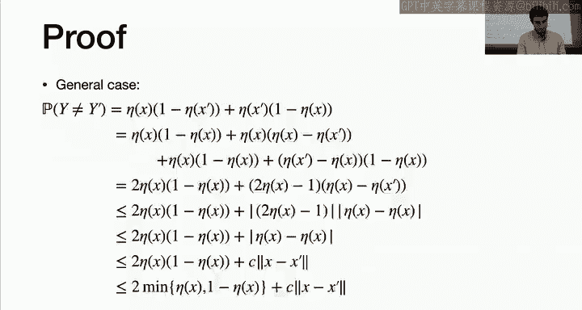

You know， I know this that this is exactly the risk of the bias classifier。😊。

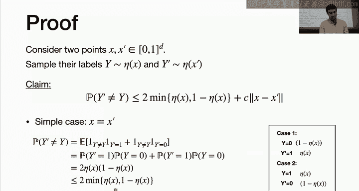

So this is what I want to recover。So in order to recover it。😊，I will try to make it happy here， okay？

This is my equality and what I will do is that I will add this and I will subtract it。😊。

So I would be happy here instead of having Eta of x prime， if I would have Eta of x。😊，So。

 I will just。Add it of x， and then I will subscribe it。Okay。😊，So you see that this。

Is exactly equal to this。😊，But I just make a P of what I want to see。

And then I have to control the residual。And that's exactly the same for the second term。😊。

I would be happy if this x prime was an x and so I am just writing here with the x and then I will have to control the residual。

😊，So now when I'm making the sum of these two。Component， I will have。

So term I was looking for two times eta of x minus1， sorry， times 1 minus itta of x。

And I will have to control。The sum of this term。And this them。And if you do the computation。

 you see that。😊，You can factorize by itta minus itta prime。And what you rely love is that。😊。

If we have 있다。Plus。Itta minus-1， so you will get2 itta minus-1。That's a simple computation。

And now what you want to do is you want to bound this term。

So how you will be able to bound this stem？This is a attempts it will be always。😊。

E are bounded by its absolute value。If you have a number。

 it will be always smaller than its absolute value。Is this number is positive？😊。

Then it's equal to its absolute value， and if this number is negative， then of course。

 it would be smaller than the absolute value。😊，And then what you will use is that the absolute value of a product is equal to the product of absolute values。

😊，So I get exact disease。And now I want to say that this。Will be smaller than this。

 So do you see why？😮，Why can you say that？This project。😮，Is smaller than this。当是摸了中过。

Absolute value of2 eta minus1 is smaller than1。喂。边系。Exactly it is between zero and 1。

 it is your conditional probability。😊，So since itta is between 0 and 1。

 when you do two times itta minus1， it will always be smaller than one。And so， since。

You are multilying this number by something smaller than one。😊。

This will be smaller than just this number。Then what we will do is that we will use our assumption。😊。

We have assumed that the function， okay， you have a mistake here。😊，준비逼。X prime。

You are assuming that this。😊，Is smaller than c times x minus x prime， okay。

 because we have assumed that the function Eta was lips sheets。😊，So I am this presentt。

And now I'm using again that itta times sorry itta times 1 minus itta is smaller than itta。

 sorry that it's smaller than the minimum of itta and 1 minus itta。😊，And I get。

Exactly the claim I wanted to put。

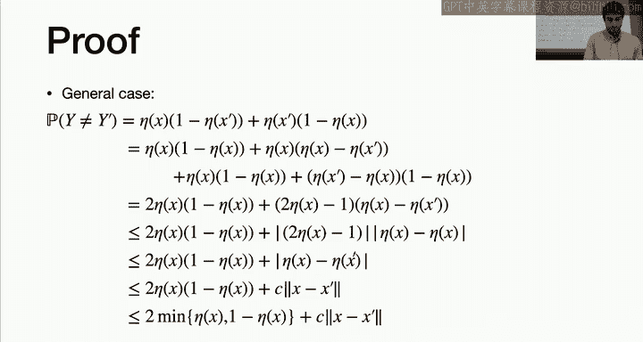

So what we have proven is that the probability that y is different from y prime is bounded by two times the minimum of itta and1 minus itta。

P C。

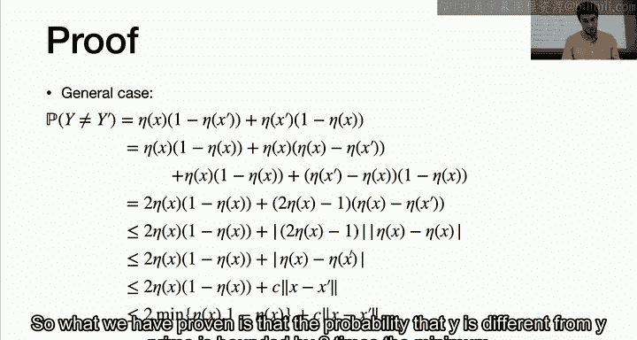

Time is the distance between x and x prime。And so this is exactly given what we want。😊。

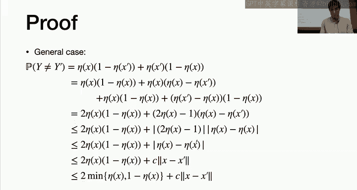

Okay， because youll remember。We bound。A two error， exactly。By this probability。

And now I can bound this probability。😊，By what I have proven so far。And so now when I will look。

At the expectation over x of this first stem。😊，I exactly recover my bias risk。😊。

Which is an optimal risk。The best risk I can obtain。

And then I will look at the expectation over x and x prime。😊，And this is exactly a geometric term。😊。

You see when you take the expectation。Over x and your training set of this term。

This is exactly the expectation。😊，The average distance between a point and its closest point in your hom training set。

😊，Okay。So you see that we have proven the first part of the claim。

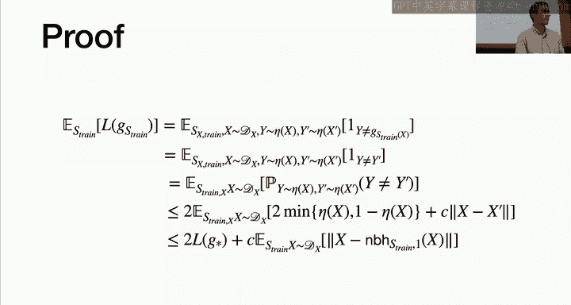

Okay。So let's try to quickly look at the certain term， and then it will be the end of the course。

So what we are doing is that we are looking at the large I cube 01 d。😊。

And we will cut it in some very small。😊，I pack cube of flangs epsilon。Okay。😊。

So I'm doing these small subscripts。And so now I want to predict the label of a fresh input x， okay。

 x is a hodom point inside my hypercu。😊，Okay。😊，So we could look at what is a probability。😊。

That x belong to some of the bugs， some of the small bugs。Can we compute this probability？

Can we compute Pk， which is a probability that my 10 point x belong to some of the bug？😊。

In my last box。Is it something we can compute？他说。So it will depend on what is probability。

It will depend on。啊。It will depend on D。And you don't knowy， so it's not possible to compute Pk。

Is it care for you。You are I mean you are just observing some data。

 you never well know what is the probability of the data。

 so it's not possible to compute PK but that's totally okay。😊，It is like a number。

 you don't know which number it will be， but it's just a number。Okay， so no。We look at the books。

That books。Which contain minus0 x and you see there will be two options。

The first option will be that。

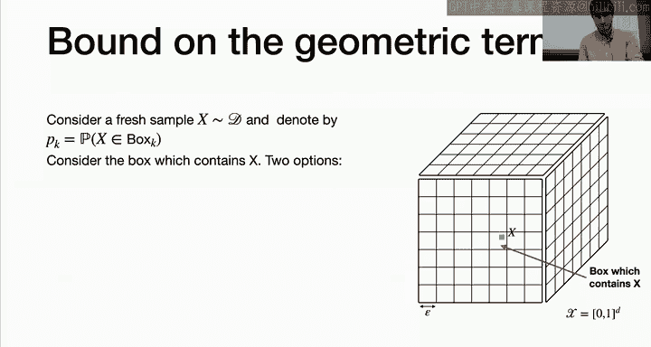

When I look at my training sets。😊，Then it exists another point of my training set。😊。

In the same books。That's one option。 Okay， have my training set。

I look at the closest neighbor of x in my training set。

It can be in the small box or maybe it's not in the small box。

So if my small books contain an element of my training sets。😊，It means that X。As a neighbor。

Which is at a distance， which will be at most square root d of Epsilon。😊。

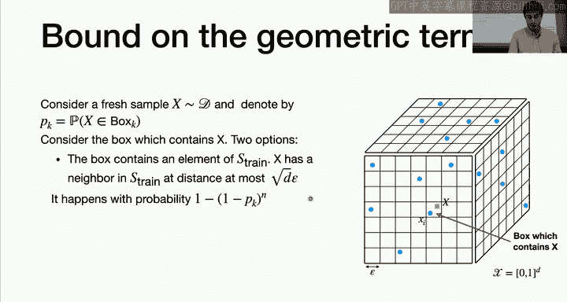

So to see that。You know that really like the worst case， I have my small box a flanx epsilon。😊。

And I have two points which are inside this box， and you can see that the worst case distance if you take the two point at the opposite corner。

😊，And so the worst case distance would really be。😊。

You know the distance between x and x1 and what you see is x is at0 0。

0 and Xi will always be at the 0 xon x7on so the distance would be square root of d x son。😊，Okay。

 if you take two points into your I per cube firm size Eps Pilon。

 the worst case distance will be square root d of Epsilon。😊，So that's the first case if I am lucky。

 I will have another point if my in small box。😊，And the distance between x and my closest neighbor Xi will be at most square root d of epsilon。

 so it will be not too large because epsilon is small。😊，And this will happen with some probability。😊。

Which will be？One， minus one， minus be capable and so we will。Look at why is this priority。In 왜슨。

So give me just two minutes to finish。So then the second possibility is that。😊。

Your closest neighbor is not in the same box， it will be somewhere else， it will be another box。

 okay。And then at worst， what can be the distance between your point x and your closest neighbor if you only know that your closest neighbor is in the large hyper cable。

😊，Then it can be at most square root of G。Okay， that's exactly the same。Argument we did so far。

 we have this large box。 Maybe your point x can be in one corner and your closest neighbor， in fact。

 will be at the other corner。And so， at most。The distance can be square root of d。

And so now we want to know which which probability it will happen。😊。

So we know that a point is in my box K with a probability Pk。😊。

Doess mean that a point will not belong to my box K with a probability1 minus Pk。😡。

And I want the probability that no points belong to my box K， so that means that I want have this。😊。

Projectducts。Okay， the probabilityba that no point of my training set belong to my specific box Pk will be 1 minus Pk power n。

😊，And so then it should be clear why。😊，The probability at one point of my training set belong to the box。

Is exactly1 minus。This number， okay？So two to conclude， just let's see what we have given。

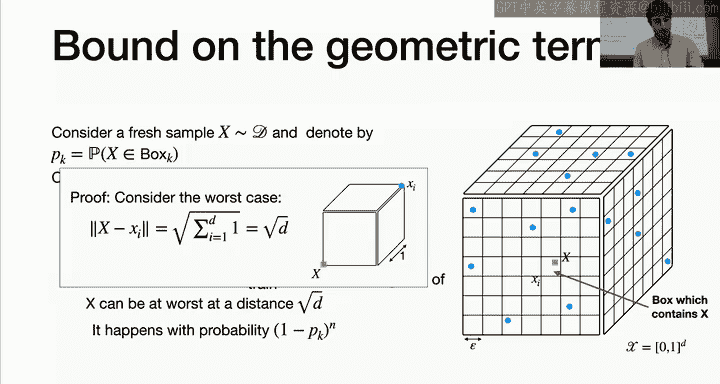

When we look。At the expectation。U it should be a distance here。Of the distance between x。

And your neighbor find。You can look at。You knowYou condition on the event of x belong to some bugs。😊。

So okay so x will belong to the box K with a probability Pk， and then you have two possibility。😊。

Eith with a probability1 minus P over n， there is no turning point inside this box。And at most。

 the distance。Between North point and the closest neighbor will be of square root D。

But then with probability 1 minus 1 minus P K over n。

 you will have a point in your box and so your closest neighbor will be close enough。😊。

So we have this number。And so the claim is that no， if you are minimizing。

 so if you are maximizing this bound。😊，For every Eyon N Pk。😊。

You will get exactly the bond we have in the results， okay。And so what is the intion？😊。

Is that if PK is large。If it's likely to find a point in one box。

Then it will be you will also be likely to have a neighbor in the box。Okay， so if Pk is large。😊。

Then this will also be large。But in the opposite， if Pk is very small。😊，That means that in fact。

 indeed， you will be very unlikely to have a turning point inside your box。😊。

So you will suffer a large distance， but you are also very unlikely to pick these boxs。Okay。

 so just by maximizing or by looking more in more detail， but this quantity will be able to prove。😊。

诶。The upper bound and this quantity， which was depending on the dimension。

And on the sample complexity。Okay， so that's all for today。

 thank you a lot and if you have any question do not hesitate to ask them on the forum and good luck for the project one。

 the deadline is the first November 1s。😊，See you Tuesday。

 we will talk about the super vector machine。Yeah。