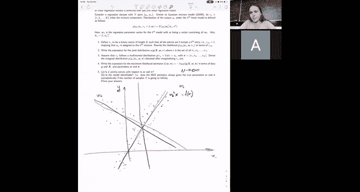

# EPFL《机器学习｜Machine Learning Course CS-433 fall 2020-2021》中英字幕（deepseek - P18：[18]Exercises 6 - getting started video.zh_en - GPT中英字幕课程资源 - BV14SwyeNEvW

Hello everyone， to be speak， you have a problem set six。😊。

And it consists only the of three questions because you have a project deadline next week and we want to give you more time for your questions about project owned by exercise sessions。

 so come to exercise sessions we're happy to answer you。Your questions？Okay， so in this exercise。

 you have three problems。😊，So first， you have some questions about convex functions and strictly convex functions。

And you are asked to prove some properties。For these convex functions。

 And these properties are useful for machine learning， like functions， usually to prove。

To prove awake execute， also first like you have some I function and you ask to prove what is convex and what with sum of convex functions is convex。

And when like what the composition of convicts an increasing function is convicts。And when呢。

Like what composition of convex function and a thin function is convex and the last question is you asked to prove what for strictly conx function。

You have only the unique mini like for example， this second property is like very useful for machine learning because this is how your loss function usually looks like is just a sum of individual losses over data points and this is also like obvious this form you have linear regression。

 logistic regression so it's useful to know these properties。😊。

When you have second question about multiclass classification。

 so you have so before in the class you saw multiclass classification only for two classes。

 so you called it binary classification。And here you have key categories and not your label could be either one of them。

And we want to like。F some linear model like similar to logistic regression to this model。

 so what we have。😊，So instead of just one set of parameters， as we head for binary classification。

 we have K set of parameters， WK and what we want and each WK corresponds to its own class。😊。

And for every data point， XN。😊，We take the color products with each double each of these parameters and we'll look for which class this one is bigger and this will be our assignment for a class。

😊，However， we want to make it sorry if we just take marks。

 this function is not so good because it's not differentiable and it's not giving you probability distribution over classes。

 so what usually people do is they use this soft MacX function。😊。

Which is given like so this soft no function in whenM gives you probability distribution。

 so you have a fixed data point X n。And the probability of this data point to come from a category K。

iss given by this expression so you like on the top you have exponent and in the denominator you have some scalic factor。

 which is so the scaling factor is the same for difference so for all the classes it's the same and so what changes with changing class is only the top part。

And because this exp is monotonic， so you have this correspondence。

 what we put have had bigger initial scholar product。The same class has bigger。

 like final probability。And it's also easy to verify what with probabilities or like for if you sum over classes。

 it sums up to one。Just because if you put here sum right。

 because this one is the same for all the classes and here you sum。

 you get exactly the same sum on the top and in the bottom， so it's like cancels out the one。And。

And when you also like as in logistic regression， you assume what samples can in independently and you can write your joint distribution as a product of individual distributions of probabilities of everyday data point。

And in this question， you asked to derive log likelihood。

 when the gradient with respect to WK and proof that with log likelihood is a convicx function。😊。

Okay， and in the last in the last question you asked to work with is a mixture of linear regression。

 linear regression， and so instead of having just so what you have， you have key mixture components。

😊，So， and every mixture component has its own。WK from which with data came from like where distribution so how is this data。

Like your data set if pairs， how is it like if you assume it comes from this normal distribution。

 how would it look like？It would look like on this picture。Okay， so。So this is， for example， with W1。

 this is W2。And your data would have like would be like normal around these lines， basically。

And now it's quite clear， like if you want to fit your linear model。

 one linear model is not good because for example， if you fit just one linear model here for this data it will look like this line in the middle and it's clearly not a good fit for this data so you want to like fit actually K linear models to this and when you hope to like kind of get a good predictor in the end。

😊，And when you have several questions for this model。So like finally to find this。

Maximum likelihood estimator from which you can find this parameter parameter double U and P。

 And when like you also need to prove some properties of this function， like you need to。

See if it's jointly conxed or not this likelihood estimator。

And when you need to see if this model identifiable。

 So does it give all this like if your data goes infinity。

 does it give all the same parameters W you and deep。Okay， this is all exercises for this week。😊。

And we're happy to answer all your questions on the exercise sessions。

