# EPFL《机器学习｜Machine Learning Course CS-433 fall 2020-2021》中英字幕（deepseek - P19：[19]EPFL Machine Learning Course 2021 - Week 7 part 1.zh_en - GPT中英字幕课程资源 - BV14SwyeNEvW

受。Let's start for the lecture of today。So today we will talk about the super vector machines。

 that's something really， very important。😊，And so super vector machine really takes its roots in the concept of max margin we already talk about in the classification lecture。

😊，I don't know if you remember， but if you have a data set which is separable by a linear hyper plane。

 then we saw that it will exist a lot of hyper plane which will separate your data and then the question was which one to choose。

😊，And then what we saw is that it could be a good idea to try to take the iPad plane。

 which will be the furthest away of all your turning point， okay。

 because sur that you will generalize well。And this is exactly the I of plane。

 which will maximize the margin。😊，And this is what we will talk about today and we will try to make it more precise。

And on the road， we will also introduce what is called a some concept of convex and which can be of independent interest outside of the。

😊。

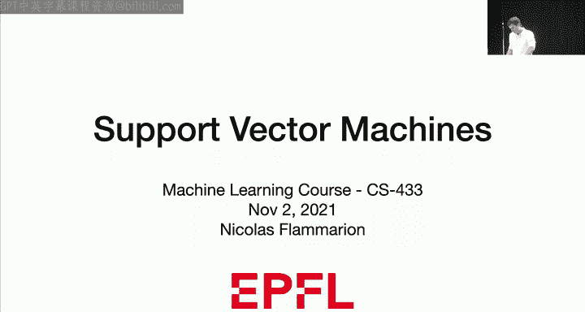

Super vector machine。So first， you know， super vector machine really is like been introduced by a Vladimir Vpnik。

 which is a Russian staisticianity， which is really one of the most important researcher in machine learning。

 And it's interesting because if you look at the two seminal paper where SVM has been introduced so you can see that they are from 82。

😊，And sorry in 92 and 95。 so you see that something kind of recent。

 it's not like logistic regressiongregation， which is the old method if you think about SVM it has been introduced in the 90s。

And in the 200， it was really the state of the a before like before we had computer I。

But carefulful enough in order to make computation with neural network， really like the Classifier。

 which was used in practice was the SVM， so that's something really important。So， let's first。

Start by reviewing like the linearar Class framework work。

Because this is what we will talk about today really about how to do classification with a linearar classifier。

 So you remember that we define an I plane。By all the points are that if I give you a vector w and now I assume that w。

 if I've no1， okay， this will be my vector w。 So I per plane。

G H by W will be all the point of togonal， all the point perponicular to W。 Okay。

 that will be all the point of that x transpose W is equal to 0。That's my I plane。

And I can use this hyper plane， this earth space， to do classification。And how I can do that。

 what I will predict， it is a sign of the inner product between x and W。😊。

You remember if I look at a point， for example， here， x1， the red point。

It can see that the inner product with W will be positive。So I will classify this point as a head。

 and if I look at another point， for example， x2 in blue。

 I can look at the inner product between W and x2 will be negative。😊。

So x1 is on one side of the hyper plane and x2 is on the other side of the I plane。

So you see that with my aircraft plane， I can do prediction。

 I can predict the label between one and minus1。And something very important to have in mind is that also。

I can compute the distance between a point and the hyper plane。

And what I claim and what we will prove is that this distance between a0 x0。An I per plane。

 this distance is exactly equal to the absolute value of the inner project between W and Xia。O。

So the distance between x0 and my A plane。Will be equal to the absolute value between。W and X O。

 And this is because I have assumed that W is of norm1。So let's try to prove it。

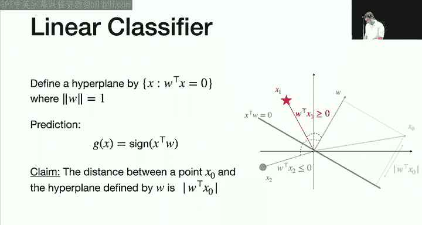

So what is how it is defined the distance between a point。And a space。

 It is defined at the minimum distance。So it is a minimum of x0 minus u。

For all the points you on my I plate。Is it clear for the definition。

Okays a distance between my point x0 and my iPad plane。

It's the minimum of the norm of x minus u for U in my I plane。

And what I want to show is that this minimum will be a。Then0 in that point。And to do that。

 what I will do is that I will just you define V。Which will be exactly that point。

 So that point is exactly my point x0 minus。The projection along the。Okay。

 so v is equal to x0 minus the projection along w。 And you know that the projection along w is exactly equal to w transpose xxi times double。

ok。So you see that this V is this point here。 and you see that V minus u will beocgonal。To double。

 okay， by definition。So now if I try to compute the distance between x0 and any point on my hyper plane。

 any point U。I can think。I mean， I can introduce V and then I can expand and since this is aagon with this I can use a p tagagonian theorgram and I would directly use that x0 minus squared is equal to this distance squared plus this distance squared。

 okay。What I am saying is that this distance square is equal to this square plus z squared。

And now I want to take the minimum。For all my U。 And so you see that this minimum will be obtained when this term is equal to 0。

 Okay， when u is equal to V。And so this is the aclytic giving you that the distance will be the absolute value of w transpose Xial。

Is it clear for this simple geometrical effect？Yeses。😊，So let's try to use it now。

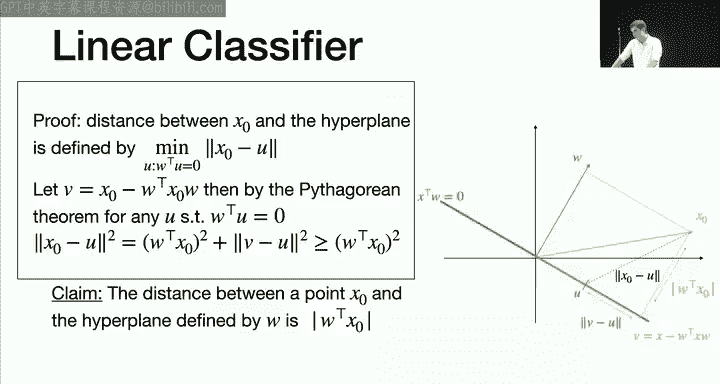

So what we will define first， it is a odd。SVM。So we will see how we can define mathematically the maximum margin hyper。

😊，So first， I will do the assumption at my point， my data set is linearly separable。

So you remember what does it mean， it means that it exists one hyper plane which separate my data in2 on one side of the hyper plane。

 I have all the red point and on the other side of the hyper plane， I have all the blue points。Okay。

 that's the definition of being linearly separable。😊。

So thats means that I will have a zero training at。

But what we saw is that when it exists one separating hyper plane。

 it's very likely that it will exist a lot， for example， that one that one。

 and so the question is which separating hyper plane to choose。😊。

And what we say is that it makes sense to take the one with the largest margin。

 that means that the one which is a further away from all the point of my training set。

And so why does it make sense to take this hyper plane， It is because really。

 that the point that even。That the iPad plane that even if you slightly perturbate a bit。

Your turning point。Then you see that this type of plane is still likely to generalize well。

 it would still separate your data， even if you modify your bit your training points。

So how can we define this separ max margin separ epi of plane？

The first thing is that using the previous claim， I can find a formula for my margin。

So I don't know if you remember， but the margin of the I plane。

 it will be the minimum distance of the point of my training set to this I plane。

So I can look at our point I， the distance of this point I to my。I be plane。呃。I mean。

 as of the orthogonal of w， it's exactly the absolute value of W transspers X。😊。

So if I want to take the margin， I want to take the minimum distance。

 I just have to look at the minimum for all the point in my training set。Of this quantity。ok。

For each eye， the distance of X to my hyper plane is equal to absolute value of w transpose X。

So the margin of this hyper plane will exactly be the minimum over all the point of my training set of this quantity。

Is it clear。So know if I want to look。At the max margin separating a per plane。

 what I have to look at。Is that I want to find an I plane which is seating my data。

So I have to impose some constraint and this constraint are exactly that。

The s of X transpose W is the same。As a sign of Yi， so I wanted this project to be positive。Okay。

 if Y I is plus1， I want that X I transpose W to be positive。 and if Y I is minus-1。

 I want X I transpose W to be negative。 Okay， so any hyper plane。W search that。For old bones。

I have this constraint verify。Will s my datata O。But no I say that I don't want any separating Ipen。

 I want one particular and that one which maximize the margin。😊。

And so in order to maximize the margin， I will look over all the hyper of plane。

 So I will look over all the direction W， and I will try to maximize the margin。

 So I will try to minimize this。I mean， to maximize the minimum of this quantity。

So you see that this is exactly the definition of the max margin hyper plane。😊。

That is the hyper plane。Such that the minimum distance of the training point to this a plane is the largest possible。

Is it clear for the definition？So maybe one question。

How can I assure that there will be one solution of this hyper plane？Of this optimization problem。

How can I show that a solution exists？Someone。Can you repeat your question， please is your answer。

 sorry？A maximizing a continuous function and the compact set。

But how do you know that the compact set is not the neural set？Exactly。

 so since we are assuming that our data set is inci par， you know that it will exist one solution。😊。

Another interesting comment is that if you look at this picture。

What do you observe and the position of the max margin a plane？Do you see something kind of specific？

Oh yes， thanks that's a good point Okay， if forget to tell you today。

 we will always assume that I have add a constant in my features X and I have no bias。😊，So yeah。

 very good point。 I don't have a B。And those interesting features。

Do you see that it is exactly in the middle。 You know， it's in in the center。

It has the same distance of the closest point in red as of the closest point in blue。Okay。

 maybe you can try to think why it is the case。Why it is at equal distance of the two classes。嗯哼。😊。

Exactly， very， very good。 So if you suppose that you are closer to the red。

 then maybe you can shift it a further away to maximize the margin and you will shift it until you get closer。

 in fact， to the blue。😊，So at the middle， you will be exactly in the center。Okay。

 so we have this formulation。😊，And in fact， what we will see that this formulation maybe is not so convenient。

 So we will try to reformte it a bit。 And what you can show first is that this problem。

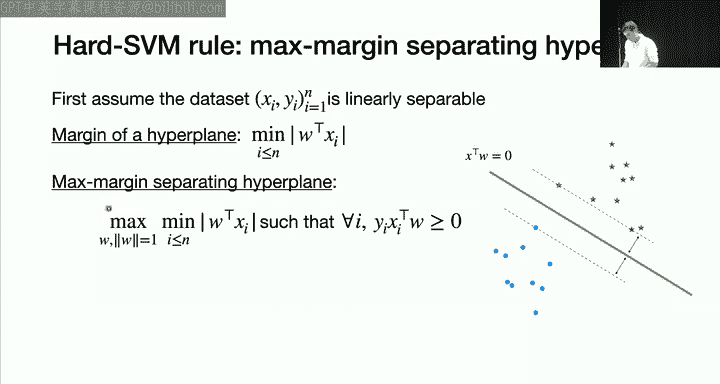

Is exactly equivalent to a second problem， which is this one。

So now I'm still maximizing over all the vector w of number1。But also over all the M。

 and I will maximize the value M subject that。All my quantity， Y I X I transpose W is larger than M。

ok。So kind of you see that this quantity M is really giving you the position of the margin。

You fix 1 M。And so what you want is that all these quantity are larger than M and M is positive。

 so what does it mean？😊，That first means that since。

All these quantities are positive that all your data point are well classified。😊。

But previously we are just imposing that the data points where we well classified。

 now we are imposing that the distance of the data point from the hyper planee is larger than M。ok。

So my new constraint is that I try to find one se I plane so that all my turning point are at a distance M away from this I plane。

And then I will maximize this。Double， I mean， I will maximize over M。Okay。

 so that's the first reformation and so what you see is that exactly all the point are at the quantity m of the I mean of the hyper plane and so you see that this length of the margin is exactly two times m。

😊，And so all this space in between。These two limits， it was also called the margin， okay？

That really likes the space between where you don't have any turning points。

And then we can also show that this problem。😊，It's equivalent to this new formulation。

 which is really what we call the RSVM hole。😊，So no I don't have any parameter M。

 I am just minimizing over all the vector w。You see that I don't have any more constraint on the norm of w。

 so I'm minimizing the norm of my vector W。So that。For all my training point， I have Y I。

 X I transport W， which is larger than one。ok。So what is the in behind this problem is really that you are looking for the w of minimum norm。

Sa that。诶。I mean， and you are looking for this W among all the vector that separate。

Your data and search that the distance of the training set to the a is larger than one。

So in some sense， your enfing emerging to be one。But in a unit which would scale with a norm of W。

Okay， and so you see that finding the largest margin really boils down to finding the W such that the norm is minimal。

Okay so this is a convex problem you see and in fact what you will do is that you will minimize the quadtic function within the constraint。

😊，So that would possible it would be possible to solve this problem。So in the slide。

 maybe we will not do it。Now， we can do it later if you have some question but you can show some proof。

That this problem。Is equivalent to this problem？Okay， another approval to that this two problem。

equivalentquient。So but we will do it at the end if we have the time。It's not too difficult。

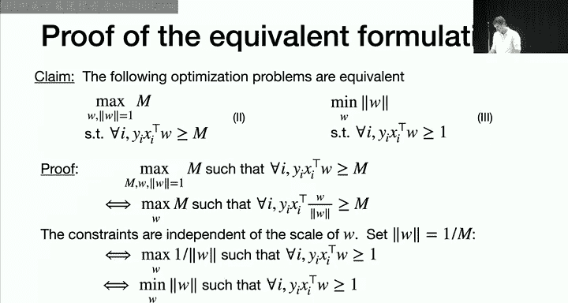

And I also give you like a set proof。没什么。😔，But no， I mean。

 these assumption that the data that the training data in is Bible is little bit， you know。

Too strong。So what can we do is we are not anymore assuming that the data linear。s valuableable。

So what we will try to do is that， in fact， we will still maximize the margin。

But now we will allow we will allow for some points to be on the wrong side of the margin， okay。

 we will allow for some error in the classification。So we will still maximize the margin。

 but we will allow some of the constraintstrain to be violated。So how can we do that？

So we will introduce some new variable， which I called some slidela variable， C， I mean C1 to Cn。

 which are positive。And we will replace the previous constraint。

 so the previous constraint where Y X transpose w larger than one。No。

 we will replace it by larger than one minus C。Okay。So in some sense。

 you see that the C mus by howm much the constraint。Are being violated。If C is equal to 0。

Then the constraint is not violated。Then you still have that this quantity is larger than one。

 You still have that your point x is of the good side of the margin。 Okay。

 it's of the good side of the hyper plane and outside of the margin。But， know you。

Allowing that some of this point is on the wrong side of the margin。

 so you can have CI to be positive。And so what we will do in the soft super vector machine optimization problem。

Is that we will minimize jointly。So sum of。Lumb that times the square norm of w。Plus。

 the sum of alloxuxi。Okay， so you see that we are minimizing jointly the norm of W。

Which correspond to maxim the margin， you saw that when you were minimizing the norm of W。

 we were maximizing the margin。But now we are also minimizing the sum of the OciI。

 which correspond to kind of violation of our constraint。

So we want to find a trade off between having a large margin。

But not having too many contrain to be violated。Okay。

 and this exact headoff between these two quantity。Will be controlled by the parameter lambda。 Okay。

 that will be the parameter of your problem。 That will be a parameter。To specify。So you see that。

 for example， if lambda is equal to0。So this means that you don't want any more。猪。😔。

To have a large margin， and you will just try to find the hyper plane。Which we。Because I mean。

 we should try to supply as much as possible your data。On the other end。

 you see that if Loda is very， very large。😊，Then you will not care too much of making some mistake。

But what you really want。Is to have a very large margin。

So you see that this is a penalized optimization problem and so this is what is called a soft super vector machine optimization problem。

😊，And really the in is that this bounding， I mean， minimizing the sum of the C is really。

Trying to get a bound on the proportion by which the prediction is on the wrong side of the margin。

Because。misclassification occurs if C is。喂喂。classification occurs F CI is larger than one。😊，Okay。

 so if you bound the sum of thexiI， in some sense， you are bounding the total number of error。

That's really what you have to have in mind。 So we can see it。 And this。导颖。Well。

 now you see that of training set。Is not an in s。And so what I will find is that a Niper plane。😊。

So that I still have some large margin， so I still have a lot of point。Which will be。

On the other side of my margin。But I will have some point。Which will violate my cont。

 so I willll have some point which will be on the other side of the margin。

And you see that they are the distance。C I of my margin。 Okay。

 so we really like the C I give you the distance of your point。To imagine。

Whens are in the wrong side。Is it clear for this formulation？Yes。😊，Yeah， my distance， okay。

 so the question is， what is the distance？Of my margin to the I plane is still one of our double users square。

 I mean， one of the number of double。So I mean， the lengths of your margins will be too over the normal tu。

And so this problem can be also her formulate。😊，In a more convenient way。Using this function。

 So you can show that the soft。Super vector machine problem can be shown to be exactly equivalent to this penalized Ya he problem。

 where I want to minimize。The square norm of W。Plus， the sum of all my datata of this term。

Which depend of my data N W。 And you see that this is just。

The max of0 and1 minus Y I X I transpose the value。

 so this is what is called the inchus and we will talk again。About it today。

So you see that this formulation really give you a regular high loss minimization problem。😊。

And with this formulation， which would become more clear soon。

Some sense what you see that all the point。Which are very far away from your margin。Will not。

 you know will not play an important role in this formulation。ok。So just to conclude for this。

 you see that this sub super vector machine formulation is really a relaxation of the a super vector hole。

😊，And the relaxation because it can be also applied if your training set is not nily sur viable。

And so the solution of this problem。😊，Is the SVM hyper， okay。So you see in some essentially。

 when you are looking for the SVM method， you are looking for the hyper plane。😊。

Which will try to maximize margin。But since it's not possible to separate your data。

 it will also try to minimize the numberR。Still trying to maximize the margin。ok。😊，So。

 let's see another。In mean no way。哦也 maybe fail that自己是 the部分 this。So let's fix W。

 so I have this problem。And I consider that I fixed the value and I will look at the problem when I minimize overoxxy。

😊，So you have two possibilities。If Y I X I transpose W is larger than one。I want to minimize over。

 I want to minimize the sum of， I want to takey as well as possible。

And you see that if Y I X I transpose w larger than1， then I can take c to be 0。ok。😊。

If I take C to be 0， my constraint is satisfy， and I'm happy because this is very small。

So if I have this condition， then c is equal to0。But then if this is not larger than one。

 but this is smaller than one。😡，You see that what you will take in order to minimize the value of C。

 you will take exactly one minus Y I X I transpose W。Okay， because if you take this value of C。

 that will be the smallest possible C such that your constraint is satisfied。

And then what you can see is that this C is exactly equal to the max of 0 n1 minus Yi Xi transpose w。

ok。If服。One， minus Y I XI transpo the W is positive。Then C is equal to this value。

And if this is negative， then this condition is satisfied andci is equal to 0。

So you see that I can really。Forget about the X I。 And exactly he writes this problem。As。

This problem。Without anixI。Because I will replace the sum of the CI。I there value。And by definition。

 the constraint will always be satisfied。So in some sense， this way to define the SVI my。

Was a way of Vnic used to define them， but we can also introduce them in a second。In a second manner。

And the second one was really。More in the idea for risk minimization in machine learning and in classification。

So let me remind you， you know the classical setting， you have some observation x and y。

 and you set y， which is beyond minus1 and1 okay， the class are minus1 of1。😊。

And what we want to do is you want to find a classifier。

 so it is a function from the x to minus1 and1 so that you are doing a good prediction。

And so what does it mean to do a good prediction， it means that your classification is errorR is low。

 so the classification errorR is a probability of making a mistake。😊，You want to find a whole G。

 suggest you will not do a lot of mistake。 So suggests that the probability of making a mistake is very small。

But you remember， the problem is that you don't know D。 you don't know the distribution。

So it's not possible to compute。This object is not possible to compute the probability of making a mistake。

And so instead， what you will do is that you will approximate this quantity by the NP color risk。

 which is the average of your data。😊，So you will approximate your true probability by the other edge of the indicator function。

And that is what is called the empirical risk minimization EM。

 this is where in order to find a good regression or classification hole。

 you will minimize your empirical risk。😊，And for classification， the risk is a 0，1 plus。

That's the last where you will pay zero if you are doing a good prediction。

And you pay one if you are doing a mistake。But you see that the problem is that when you want to minimize this function。

This is not a convex function。 And you know that we are only。

Happy we want to when we can minimize a convex function， so why it is not convex。

It is not complexvex because first。The set of classifier。It's not a conex。Okay。

 because there are some discontinuous functions， function， which value-1 or1。

 So you see that they are not continuous。And then also the indicator function。😊，Okay。

 which value is0 and then one， you see that it is not a continuous function。

So you see that even the function you want to minimize is not convex because it's even not continuous。

So you see that this problem in non convex and so what we will see first。

 we will see that we want to approximate this problem。

 we will relax this problem by a convex problem。

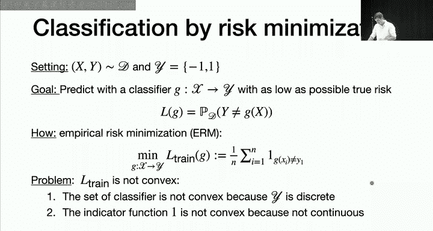

And then we would be able to minimize this convex program。So the first way。

To get this problem to be covex。Is that。Okay， and so when I will present it。

 I will only do it for a linear predictor， but you can do it for any user function。

And so instead of considering a function G。😊，From x in minus-11。

I will consider a sign of a function with a real value。Okay。

 so instead of considering of looking for all my class share。Over a set of all my classifier。

 I will look over a set of all my vector， and then I will do a prediction using the sign of the inner product between W and x。

😊，That my first relaxation。Okay， I will not look over all the classifier。

 I will only look over the set of vector， and then I will use a sign of the inner product to do my classification。

😊，And since you can see that the 01 loss。Between G and Y is lower and upper bounded。Bye。

The sign the fact that is indicator of minus y x transpo w is positive。You see that in fact。

 you can directly minimize these objects， which will be upper bound on your tiny loss。

So you are not anymore minimizing over all the classifier G。

 you are minimizing over all the vector W。Of the average age of your indicator function of。

The event that minus Y I X， I transport W is positive。Okay。

 and you see that this is exactly a relaxation of your 0，1ness。😊。

But you see that this problem is still not convex。Okay， now you are looking over a convex set。

 you are minimizing over all your vector W in Air D， So this is a convex set。

 but the function you are minimizing is not convex because it is an indicator function。

 it is not continuous so it can't be convex。😊，And so the second step will be to replace the01 nu to replace this in the function。

By another convex function file。Okay， are you know illness。

And so instead of minimizing this function， what you will minimize it what is called the phi risk。

 and that will be really the average of phi。😊，In minus Y I X I transpo double。

And so what you see that。You will replace your01 nu， which was not convex by your convex function。

And now you won't minimize your train risk for the01 nu。

 but you will minimize your train risk for your convex zero gate。

And what it is possible to show is that under some assumption on your convex function file。

It's possible to show that the function， the vector W you will obtain by minimizing this function。

We'll still have a good risk。😮，When you look at the zero one now。So by minimizing a convex function。

You are still obtaining a good solution of your classification problem。

Do you have some question on this。Okay， so if you want to do it again。😊，We want to minimize。

The train risk for the 0，1 loss。 the problem， it is。

Is that it is not convex and so we will replace it。喂思。

Convex relaxation where now I'm still minimizing the average over my turning point。😊。

But I'm co some function5。And so this function 5， which is what is called a less function。

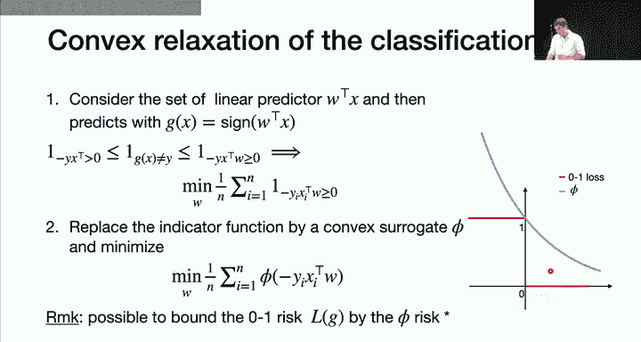

And then we have already seen some examples for which file to use。

And so what we saw is that we can use the mean square。

 this will correspond to do linear regression to do classification。😊。

We can also use the logistic error。And we can also use the inchla。

Which is exactly the formula we got when we were dehaving the soft SVM hole。

And so you see that these formula are a bit different from the ones we saw previously。

 and this is because today we are considering that the label are between minus1 and 1。😊。

But in the previous lecture， we had considered that the label was zero or1。But in the lecture or nu。

 you can see how it's possible to go from the 01 formulation to the minus11 formulation。ok。

But you can see that it is exactly equivalent。😊，When you are trained to do classification using linear regression or logistic models。

It amounts to minimize your fire risk。With thisless。And so then maybe the first question is， what is。

 you know the common features of all these loss？And I mean， you see them。In that plot。

And so you can see that they are all convex。😊，But the first thing， all this function are covex。

And also is our old。Apple bonding。You have zero one。Okay， so logistic， you have a problem。

 but as as supposed to all bounds as you have one less。But no， let's look at， you know。

They behave your difference。So you see that if you are looking at the Min squarehe。

The problem is that you are punishing any deviation from one。

 I don't know if you remember that was really like the problem is that when you have a deviation from the label you want to predict when x transpose w is different from minus1 or1。

 then you will pay your price。Even if you are doing a correct prediction。ok。

So even if you are doing a good prediction， so if you are at the right of one。

Then you have finisheded。And that's what's really like the problem of the mean square here。Okay。

 it is tsymmetric and you don't want your last to be symmetric。Okay。

 we will do a break now and after the break， we will comment the logistic class and in class。

We do a 15 minute break。

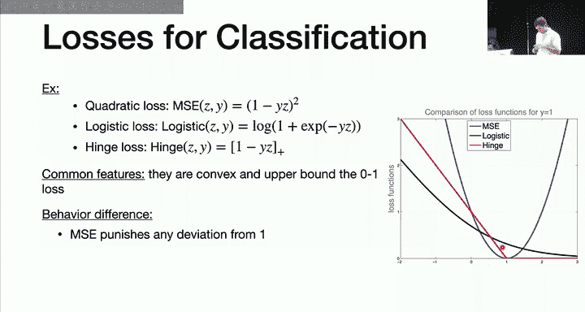

And we try to comment it。So the first thing is you see now that this loss is assymmetric。

 So it's kind of doing what you want。It becomes smaller。

When you go to plus infinity and become larger when you are going to minus infinity， okay。

So it's become smaller the further you are on the wrong side。

And it's larger when you are on the wrong side。 Okay。

 so smaller when you are on the right side and larger when you are on the wrong side。

So it's kind of doing what you want。 But the problem is that you see。

 you are still suffering some punishment。Even if you are doing a correct prediction。ok。

Even if you are doing the correct prediction， you will still pay a cost。But then if you are wrong。

 the cost is larger and if you are really wrong， we'll pay an important cost。Okay。

 so you see that this loss will go smoothly to 0 when your prediction is going to press infinity。

 but you are always incurring a cu。Even if you are doing a correct prediction。And the last one。

 it is the inchla。So it is。The max between 0 and 1 minus y z。

And that's exactly what we see in the head。And now you we will see that the in glass is doing what we want。

It's kind of if you are large enough。Then。You are not being against guest。Okay。

So the inular really acts differently。You have no punishment， no cus when you are larger than one。

And you will pay a cost when you are smaller than one。O。

And so you see that once you are sufficiently far on the right side。

Then you are not long paying a cu。But if you are not fine enough。

 you will pay a cost and this cost will increase linearly。

And you see that the inflection point is not in zero。😊，But it is in one。And so it's not that if。

You are doing if you are correct， you are not being accusedccus。 and if you are wrong。

 you are being accusedccus。This is really shift towards the one value。 Okay， and so in some sense。

 the inus is really pushing you to give a confident prediction。Okay。

 it's trying to maximize the margin。It really push away your point from the separating a plane in order that you are not being ac。

So let's try to analyze it。So what is a super vector machine algorithm？That's really the problem。

 which is max， I mean， which is minimizing over all U of vector w of the sum of two terms。

You have you。NP Calhiky。Where you are using the in。

And you are heizing the norm of the prediction double。Okay。

 the tradeoff is with this parameter lambda， so you see that really like SVM is doing the O ca risk minimization for the in loss with some region regularization。

And so what we see。Is that when I have a training set。

Exactly this region such that x hospose w is smaller than1。This is what is called a margin。

And what we will try is that to have no point。In thisation。Okay。

And so what is important to have in mind is that on what is depending the margin and what we want to see is that the margin will depend both on the direction of w。

 okay， the direction of w。Is giving you the direction of the hyper plane。And then the scale of W。

giving you the length of the margin。Okay， if W。诶你 his。人。The length of this region will increase。ok。

So let's try to analyze it。In the case of we have s Hybal data， so as in these two pictures。And。

What I'm doing is I'm taking a small double。So since I'm causing a small， the value。

 what I really want to minimize first is the sum of the inchsulas。

And so now question is which vector W I will select。And so you see that first。

 you will select a direction of W so that you will separate your training set okay。

So you will take a W subject that。The I plane W ortho togonal。Really， split your data set。

In2 co cluster of a well predicted point。That's the first point。But this is not enough。

In order to have this equal to 0。So then you will try to scale the W。😊。

So that you have no point in the margin。Okay， you will take a W such that there is no point in this region。

And you see that。When there is no point in this region。

 then this part of the objective would be equal to0。

Because if you don't have any point in the margin region， then the insula will be equal to0。

But then we also want。To minimize this， so we want to find the smallest。Value the value。

And so that means that in some point。We will try to maximize。So I mean， the margin， okay。

 we will try to find the W such that the margin is the largest。

So that's really what is doing the SVM problem。You are finding the sepatating a airplane plane。

Which will maximize your margin。So that's a another way to see it。 We have。

 I rigorously prove it at the beginning of the lecture。Do you have some questions？

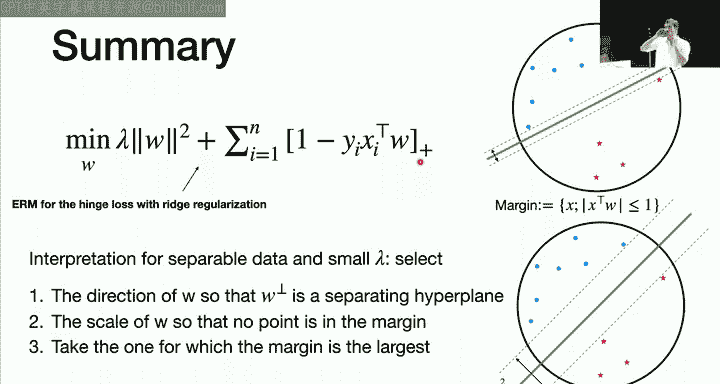

helello。Okay， so then the question now we want to get is， how can I get my vector double， Okay。

 I'm telling you that it will be the minim of this optimization problem。 And so the question is。

 how can I get double。So you see that this optimization problem is a convex problem。

 this is a convex function。It is even a strongly convex problem。 Okay。

 this is a strongly convex function， but it is not differentiable。 It won't be smooth。Okay。

 because your ins， it is a not differentiable function。

So what you can use in order to minimize this function。

 it what is called the subguardian method or the stochastic subguarddian method。Okay。

 you will not compute the gradient， but you will compute what is called a subgraian。

But the convergence rate will be slower than if this was a smooth objective。When we were considering。

 for example， the logistic regression。😊，Then the logistic class was smooth and so the objective was smooth and then gradientian decent directly will convert at a fast rate。

But for SVM， you will have a slower rate of coence。

And so what we will see is there is another way to minimize this problem。

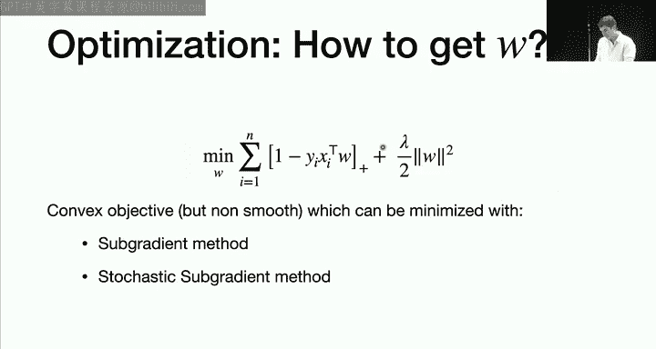

And this other way is to use convex duality。So what do we mean by convexuality？is that。

We are assuming that， in fact， it exists such function G of alphaine W。So that。The function L of W。

Is it in fact equal to the maximum of the function G over all the alpha？ok。

So imagine that your function L is such that。L of W is equal to the maximum of G of w over the alpha。

So now when you are looking at the minimum of L of w。In fact。

 you are looking at this mean Max problem。You are looking at the minimum of all the w of the maximum of all the alpha of G of W alpha。

So you see that you can define two different problem， one， which is called the pre problem。

Which is a minimum over a W of the maximum of alpha of G of W alpha。

And you can define what is called the dual problem。

 which is a maximum of a alpha of the minimum of R w of g of W alpha。

So you have two defined problems， the pi mind 1 and the dualL1。And in fact， sometimes。

The dualL problem can be easier to solve。Okay， so sometimes you could prefer to consider as a dual problem。

 hazard than the primary problem。So what other question we will try to see。 So first one is。

How can we find such function G？ok。😊，That would be the first question。The second question will be。

 is it possible to say that the solution of this problem would be the same as the solution of this problem？

In other sense， is it possible to switch the min and the max？

Is a mean max problem the same as a max mean problem？That would be the second question we would see。

And the last question we would try to investigate is when this dualL problem is simpler or is more interesting or is providing more information than the PM problem。

ok。

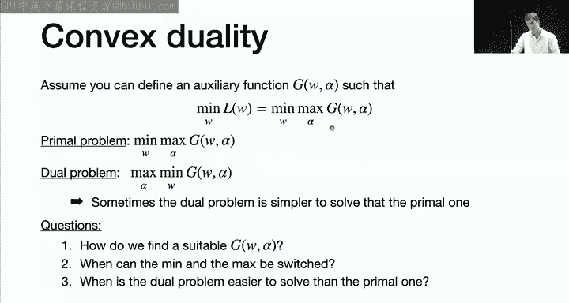

So the first question is， how can I find search functionality？So in convex optimization。

 in convex analysis， we have a whole theory which will directly give you a suitable G。

 it will be used F congates， but today we will solve it in a very specific manner。😊。

And so what we will see is that， in fact。When I'm looking at the max between0 and z。

I can herewrite this function exactly as a maximum over all the alpha between 0 and 1 of alpha z。😊。

Okay。Let's try to look again at this。 What I'm claiming is that the max between 0 and z is equal to the max。

For all the alpha between 0 and1 of alpha Z。If I take Z to be positive。The max of 0 and z is z。ok。😊。

And if z is positive， what is the max of alpha z for alpha in 0 and1？😊。

It will be exactly z and it will be for alpha is equal to1 since z is positive。

 we want to take alpha as large as possible and I have my con that alpha is to be smaller than one。

 so I'm taking alpha to be equal to1。No， if this is negative。So max of0 and z will be 0， okay。

 because z is negative。And you see that the max of alpha z will also be equal to0 because z is negative。

 So in order to get the max of alpha Z， you will take alpha equal to0。😊，So you see that。

My function is exactly equal to the maximum for alpha in 01 of alpha z。😊，So I can hitwrite。My in。As。

The max for alpha。Between 0 and1 of alpha I times 1 minus Y I X I transpose w， okay。

And you see that I have a alpha I for every observation， I。So in fact。

 the SVM problem would be exactly equivalent2。😊，Mim for W， my vi。For alpha no there vector no。

 which would be 01 power n because I have one alpha I for each observation of the sum of the alpha I times1 minus y I X I transpo w plus。

L that times mass square regularization。So you see that this is exactly my function G。

Of W and Al was talking about。So now I have written my problem。

My function L of w as a maximum for alpha in some set of another function G of w and alpha。

Do you have some question on this。Some sense it's just like algebraic trick。

Is it clear for everyone that this problem minimum of L is equal to the minimum of the maximum of my function G？

Yes。😊，And what you see is that this function G。It has a very nice structure， the first one。

 it is convex in W， and it is concaved in alpha。Why is it convex in W。

Can someone answer to this question？Why if you fix alpha。GFW is convex。Exactly。

 it's a linear function。Plus the square no which is convex， so it is convex in w。

And why is it concave in alpha？It is linear in alphas， it is concave in alpha。ok。

So your function G is convex in W concave in alpha。So now， we have found。

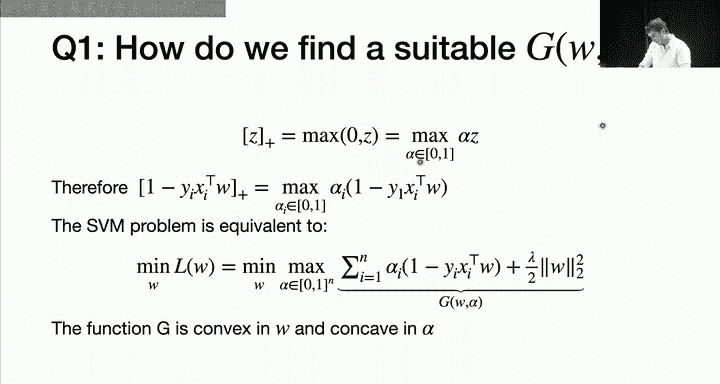

A good function G。The question is， how can we exchange？The mean and themics。

When can we say that the dual problem will give me the same solution as a pial problem？

So what is always true， but you can always say without any assumption。Is that the max of the mean。

Will be smaller than the making of the max。ok。And we will put it in the next slide。

So you can always say that the max of the mean is smaller than the mean of the max。😊，And in addition。

 if you have some extra assumptions， so for example。

 if you're assuming that the function G is convex in w concave in alpha。And that's a set。

That the domain set of W and alpha are convex and compact， okay， bounded。

Then you can show that the two problem are the same。

 You can show that the max of the mean is equal to the mean of the max。

So it really correspond to such settled problem， you see are。

Comvex in one direction and you have concave in the other direction。

So that's one of the very important result of the convexuality。

 if your function is convex in one direction， concave in the other direction and the set where you are minimizing is convex and compact。

😊，Then you will have dualities strong dualities， so the max mean would be equal to the mean max。So。

 let's try to prove。This黑色。

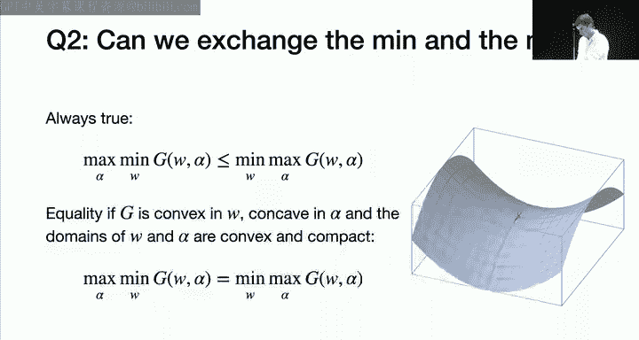

So what do I you。By definition of the minimum。For every time。

I will always add that the minimum value of g of alpha P w。Is smaller than G of alpha W prime。

Because that' the definition of the minimum。Minimum over our W of g is smaller than the same function evaluated in an other point。

This is clear。So now I have one function。Of alpha。Which is smaller than another function of alpha。So。

 if。F of alpha is smaller than G of alpha。That's means that the minimum of f over a alpha will be smaller than the minimum of G over alpha。

 Okay， this is exactly what I will take。 I will take the maximum sorry of the maximum。So no。

The maximum。Of this function。With a alpha。Will be always smaller than the maximum of this function over alpha。

Okay， I'm just taking the maximum on the both side of the equality。

Maximum of this over alpha is smaller than the maximum of this over alpha because。

This function is always smaller than that one。Okay， so since this is smaller， I can take the max。😊。

And the max will be smaller。I know what you see is that this。This is a number。 This is constant。

But no here I have a function of W pi。So I can。Always say that I can take the min。

Of this function over value pi。And since this is a constant。

This would be this constant will be smaller than the mean。Of this function of L value pi。

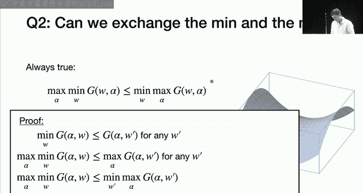

So what I obtain， I obtained that the max over alpha of the mean over of w of g of alpha of w。

Is smaller than the mean。Over W prime of the max over alpha of G of alpha and W prime。

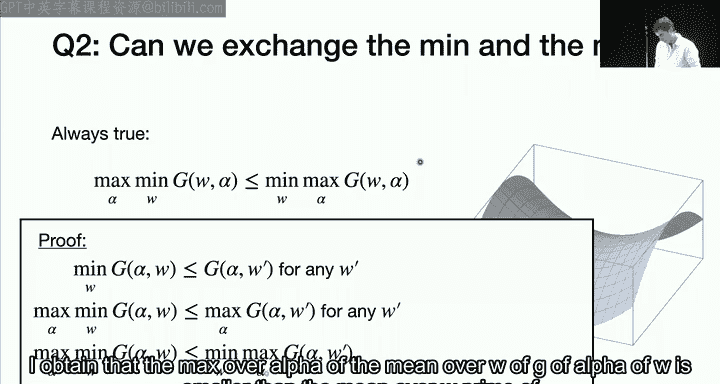

Yeah。Did it care the proof。Yes。Gm just。Have one function which is smaller than the other one。

So the max over alpha。Will be also smaller than the max。Of alpha法。That's the first step。

And then the second step。It is to say that the mean。In some sense， is the largest of the impfinment。

So this function is always bounded。By some constant。

So the mean of this function will also be bounded by the same constant。

So this is telling you that the max of the mean is always smaller than the mean of the max。

Get at the proof for this results。But if the function G is convex in W and concave in alpha。

 any other man of definition is compared and convex， you can invert。

And the two polymer equivalent you can invert the mean enzyme max。

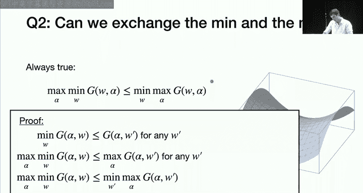

And this is exactly what is happening for the SBM。Okay。Because SVM。W belonged to FO RD。

 which is a convex set。But。Is it not compact。But anyway， we are regularizing so we can constrain。

An alpha belonged to 01 power n， which is also convex and compact。

 so we can reverseverse and the function we say was。Covex in W and conve in alpha。

 so we can extend the mean of the max。 So that means that the mean of L of W。

 which was exactly equal to the mean。Of the max will be equal to the max of the mean。ok。😊。

And no it is very nice。😊，Is that I can consider what is the solution of this problem。I fix alpha。

And I'm looking at the solution of the minimizer of this function of alpha forvalue。ok。

Since when I fix alpha， this is a convex function in order to find the minimizer。

 I just have to set the Guardian to0。So let's try to compute this gradient。With respect to W。

The first term is a linear function。 So when I'm computing the gradient。

I just get minus the sum of alpha I， Y， I， X I。This is a first step。

And then I'm computing the Guardian of the quaratic theme with respect to W。

 and so I obtain Lambda W。😊，So if I'm setting the Guardian to 0。

You see that what I will get is a w of alpha because I have fixed my alpha。

Will exactly be equal to1 over alpha。Times the sum of the alpha I， Y， I， X I。And this。

 I canrite it under a matrix form。😊，So it is exactly equal to one over lambda。

Times the matrix x transpose， the matrix Y times alpha。

Where the matrix Y is the jagonal matrix whose entries and the jagonal are exactly the Yi。Okay。

So you can see that this quantity。Is exactly equal to this sum。Okay。

 x transpose would be this matrix， x1 x 10。Then you have white eye。喂恩。And then you have alpha 1。F烦。

So， if you are doing。The project。It will directly the sum over all the Xi。X1 times。

Y y1 times alpha1 plus x 2 times y 2 times alpha 2 and so on so。

So this term is exactly the same as this matrix firm。😊。

And so now what we can do is that we can plug it back。In our initial problem。

So what was my initial problem it was。证命呢。Of this function。Of the W。

And so I have compute mean so I can exactly replace this w by w alpha and I obtain exactly this okay。

 if I replace w by w alpha。😊，This is what I get here。

And then I have the square number of w and the square number of w is exactly equal to this。

Victor squared。Okay， simple computation。So no， what do I？I have the sum of the alpha I。

 So the sum of the alpha I is exactly equal to the vector with only one。Tspose one transpose alpha。

This is a sum of the alpha I。And now I have exactly this second term。

 which is the sum of the alpha I， Y I X I transpose。Timemes。This quantity。Okay， time is Victor。

And this you canrite it exactly as this product of metrics。😊，Okay。

 so I can write this sum it's exactly the same click that I have used here as this。

Quratic firm as alpha transspose times this matrix times alpha。Okay， that's a small computation。

And then what is very nice is that you see that this term。😊，Is exactly the same as this term。 Okay。

 the square norm of a vector is equal to V transpose V。

So the square norm of x transpose y alpha is exactly equal to alpha transpose y transpose。

 but y is a juagonal matrix， so it's still y x transpose transpose， so it will be x， okay。

 so alpha transpose y x times x transpose y alpha。So you see that these quantity and these quantity are exactly the same。

So I can simplify them and what I obtain is that the minimum of my function L。😊。

Is the same as looking at the maximum for all the alpha in 01。Of one linear there。

 one transpose alpha minus a qualitativetic function。In alpha。And since this。Is a positive。

 definite matrix。 I am maximizing。😊，Negative metrics of this problem will be concave。

So what we see is that。The SVM problem， which was to minimize over the vector W。

Of my the sum of my inulars plus my quadraric regularization over a W。

Is exactly the same as maximizing over alpha， where alpha is in 01 over n。

Of a quadratic function plus a linear。These two problems are exactly the same。

So we went from a minimization problem。To a maximization problem。 And so the question is。

Why is it nice， you know。What did we gain， Why are we doing all this？So that's really like the big y。

So now I have this problem。And you see that no， this problem is differentiable。Okay， you can compute。

I mean， this is a quadtic function， so it's easy to compute a derivative。😊。

And so this problem has a nice firm， and you will be able to solve this problem very efficiently。

So this is what is called quatic programming because you want to minimize a quatic function。

On some linearar constraint。So， you could use some。Quality programming software。

 which are very efficient。And what you can also use is to coordinate as algorithm。 Okay。

 you want to maximize this function。And so what you will be able to use is that。

To use coordinate ascent， where at each step in a coordinate ascent。

 you are selecting one coordinate。And then you are maximizing the function in this direction。ok。

So you will see that in the lab session。So， coordinate ascent。

You choose one direction and you maximize the function in that direction。

Then you take another direction and you will maximize again the function in that direction and so on so。

Okay， so you see that by looking at the dual problem， by looking at the maximization problem。

 you can now use different algorithm。Okay， here you see what we had to use was a subgduent method or the stoy subgraduent method on W。

And we say that it was slow because the function was。No什 smooth。

And now what you can do is that you can use。Some other methods such as coordinate ascent on this smooth problem and you can get some better rate of conversion。

Okay， so in some sense， by considering the dual problem。

 we have obtained a second optimization problem， which is equivalent to the first one。

 but which can be simpler。就是。Okay， so that's one of the interests of using the convex reality。

Then something else and we will talk a lot about itself day。That you see that in this formulation。

So data are only entering in the methods through the matrix xx principles。And these metrics。

 it's called the Canmen matrix。And you see that this matrix is in f over n times n。😊，So。

 in some sense。It's possible to consider a D to be very， very large。So when we think about D very。

 very large， imagine that you are using some features augmentation and you are using a lot of features augmentation。

😊，So your output dimension will， I mean， your input dimension will be very large。

But when you are solving the SVM problem。You will not really see that the dimension is very large。

If you are assuming that it is possible to compute this matrix， K independently on D。Okay。

 imagine that I am giving UK。Then even if W is in very large im space。

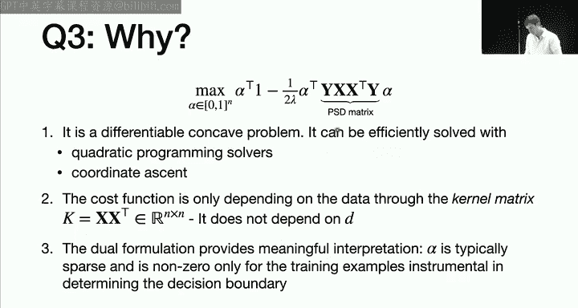

Then it will still possible to solve this problem without kind of paying the price of the large dimension。

What you need is a need to end。The canon matrix is in air n power n， and alpha is also in01 power n。

So the dual formulation。Ip you to have the problem。

Which depend on the data only through the canon metrics。That's a second the of this approach。

And the last one， and this is what we will。Finish on today is that the dual formulation really provides a meaningful interpretation for the SVM method。

And so what we will see in the next slide is that alphas parameter Al is typically very sparse。 Okay。

 we have very few non zero coefficient。😊，And that， in fact。

It will be non zero only and the training example， which will be important for your classification problem。

😊，It will be non0 only for the turning point， which will help you to determine your iPad plane。

So let's try to see this more precisely。So if you are considering one observation， X I， Y I。

For this observation。You have a corresponding alpha I。Okay， for every observation， we have one alpha。

And this alpha I is exactly given by this problem。You are looking for the maximum of your0 and one。😊。

Okay， the maximum of alpha in 0 and1 of alpha times1 minus Y I X I transpose double。

So let's try to see what are the different options。The first one。Is that X I。

Is on the correct side of the Upi a。Okay， so it's not surprising。

 It's on the correct side of your eye plane。 So your eye plane is predicting the correct sign for X I。

That's a first。X I lies on the coex side。And also， we are assuming that X I lie outside the margin。

 Okay， we are not in the band。 I mean we are not in the margin where we outside。What does it mean？

That means that when you are looking at1 minus X X transpose w。This quantity。Is negative。ok。

Because one is smaller than X， I， Y， I， X I transpose the value。ok。This is positive。

Because you are doing a correct prediction。And this is also you know the distance to the margin and we say that this is on the good side of the margin。

 so this is larger than one。😊，So this is negative。And so if this is negative。

 it means that alpha I will be equal to0。 Okay， when this is negative， alpha I is equal to 0。

 So you see that for such point， Al I is equal to0。

And so this point I've called non support point that's the point for which。

The component in alpha will be equal to0。ok。So for the X I， which are on the co side of the margin。

 well classified。And on the qua side of the margin， alpha I is equal to 0。Then。

Let's say that Xi is well classified。But inside the margin。ok。So first。

 I say that it is not inside the margin， but it is exactly on the margin。

 exactly on the line of the separation line。😊，So this means exactly that1 is equal to Y I X I transpose w。

 and so that1 minus Y I X I transpose w is equal to 0。So， if。This is equal to 0。

Then you see that the value of alpha is not fixed。 It can be anything between0 and1。ok。

When this is equal to 0。The maximum is attained for every value of alpha。

And so these point are called the essential super vector。And then there is a last。😊。

Category of point， which is。Point X I。Which is。Strictly in the margin。in the wrong side。

 which is badly classified， okay？We will see a picture next and so for this point。One。

 minus Yi X transpose W is positive。And so if this is positive。😊。

Does means that alpha I is equal to one。And these are called a bound super vector。

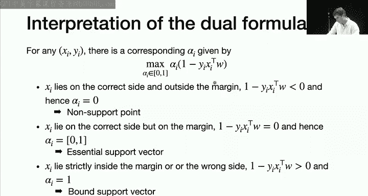

So， let's try to conclude。And this and to see exactly what we saw on these figures。

So I have my training set。And you see that this training set。Is not near Bible。

And so what we are doing by looking for the super vector hyper plane。

 we are finding this hyper plane。So this hyperplan will be defined by a vector W。

And when I have my vector w， it defined my margin， which is this bound。ok。

So this is defined by double u transpose x is equal to 0。Then， this line。

Will be all the points that that double uspo x i equal to 1。That the first line of my margin。

Then this second line。Would be equal to all the points so that double u transpose x is equal to -1。

Okay， so that's mean that。All the point here has a point such that。X hossp W is larger than one。

And also point here are a points are that x transpose w is smaller than minus1。Okay。😊。

And so now we say that you have different options。The first option。This point。

Which are the point which are correctly classified。

So that's this blue point and so you see that when I am outside the margin。

N correctly classify So y i is equal to1， then alpha I will be equal to 0。

And that's the same for all this red point。If。Y i is equal to minus1s are correctly classified。

 Al I will be equal to 0。And so you see that when alpha I is equal to0。😊。

Since by definition of your vector W， W is。The sum of the alpha I， Y， I， X I。

W is on the span of the observation X I， and the coefficient is given by alpha I。

When alpha I is equal to 0。Your observation， X I。Is not used in the computation of the value。

So what you see really is that the hyper planee W is really supported by all the observation for which alpha i is non0。

So in some sense， all these points。Which are correctly classified and outside your margin。

They are not important in order to compute the A plane。You can remove them。😊。

And you will still get the same hyper that's really important。Okay。

 so point which will be important in the computation of your A per plane。

 the point which will support。You I per are the one for which alpha I is nonze。And so。

 this point are。Some point which are well classified。But exactly， on the margin。

So here it would be this point and this point or this point and this point。And for this point。

 alphahi will be between 0 and1。ok。And also， it will be all the point which are。Goect classified。

But in the margin。Oh。Not correctly classified。Okay。

 so that's also the point which are not correctly classified。

 they will get alpha I equal to1 or here。I also have inly classified point。

 I will get alpha is equal to one。And so these are the point。Which will support you hyper。O。

So in some sense， really to conclude like the super vector machine algorithm is an algorithm which help you to do linear classification。

But tweez iso。I mean， on which I plan you are looking for。

That means that I mean the pi is that you are prefer hyper plane with a large margin。Okay， so really。

 what you have to remember is that SVM is kind of the I plane which we will try to maximize the margin。

And this is exactly correct in the。In a separable case。

 and if you have non nonlinear reciparable data， then you will try to minimize a tradeoff between having a large margin and not viating too much your constraint。

Do you have some questions in the picture today？Now， cool， because it a bit long。 So， yeah。

 see you next Thursday， where we will talk about the canal trick and canal heat regression。😊。

And please， let's try to register for the lab if you are going there Thursday。Thank you very much。

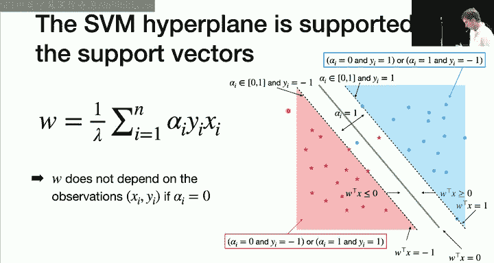

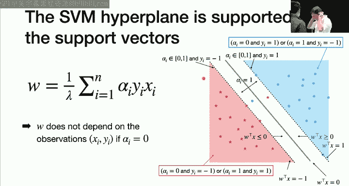