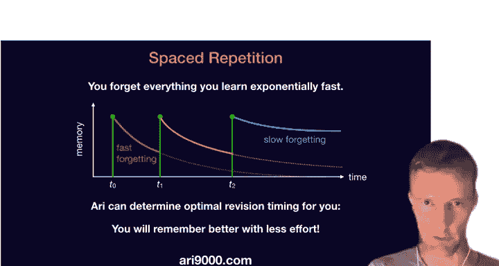
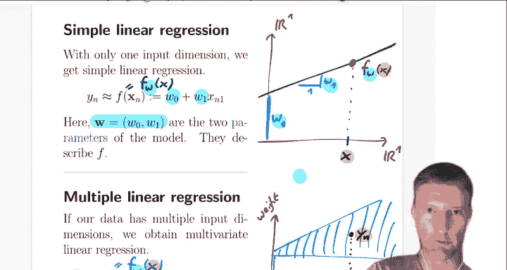

# EPFL《机器学习｜Machine Learning Course CS-433 fall 2020-2021》中英字幕（deepseek - P1：[01]EPFL Machine Learning Course 2020 and 2021 - Week 1 part 1.zh_en - GPT中英字幕课程资源 - BV14SwyeNEvW

Hello， welcome everyone to this year's EBF Ma learning course。

 please press subscribe and give a like。So my name is Martin and together with Nikicola Flamon。

 I'm going to guide you through the lectures of the course this year。

And this year many things are a bit different， but also not necessarily worse。

 we also think that some things we can improve and we try our best to make all the materials very accessible to you。

So there are a lot of you this year。 Again， we have about。500 we would expect。

 I don't know the precise numbers yet similar as last year so just we cannot probably serve all the topic needs perfectly The machine learning has many。

 many use cases and many of you come all over campus so here just for completeness I also want a least。

Many other machine learning related courses which are available on campus if you have some more specialized needs and just for your information。

If you want to click on these links， then just download the slides。

 we will always provide all our slides on the Github and also on the courseware page。All right。

 by the way， the two seminars we have here， they are also。Open to master students。Iss instead。Okay。

 about this course today。 So this is the first video。

 We will just post two videos a week usually and then we will have。

Also in person sessions I will get to that in a minute so first question you might have is what's the grading in the course so that's important to get these seven credits if you want to get the credits you now of course you will be graded 40% by two projects。

And then also there will be just regular on paper final exam， you will find examples on the webage。

 so projects you get are 40% and then the exam is 60%。Okay， the format。As I said。

 will be a little bit different this time and。So the， the videos of。

Of the courses will always be on YouTube， then we will have a Q&A session on Tuesday each time at 5 pm。

And then we will have the exercises， which I will explain later。

And here you see if you also go on the web page you see that there is schedule already。

 what topics were going to cover in each week and then you see that I will cover mostly the first three or so weeks and then Niola Fmon will take over and then in the end I will also cover some parts on unsuperized learning。

All right， as you said， the lectures will be recorded this time。 hopefully we can still。

Have a bit of classroom feeling。 It's not quite the same， but we will try our best。

 So also the annotate election also will be available。And yes， that's about the courses。

 So this will be posted every Tuesday。Then exercises are very important because yeah。

 it is hard during COVID times to be at home the whole time and watch videos。

So it's important that you kind of break these boring routine from time to time and hopefully also join us for the live sessions。

So we will just follow the regular EP schedule if it's your week。

 you're more than welcome to join us on campus， so every third week。

Because we we will have our amazing team of assistants。Being there in person。

 the one third of them roughly and then also the other majority two thirds will be available on Zoom where we have the exercise sessions sessions every Thursday don't forget to mark this in your calendar it's very important to get interaction to have asked questions and discuss with your colleagues and on。

The labs will mostly be in Python， you will learn how to get some of the machine learning examples running really hands down to see how it works and to experience really。

The theoreticalical concepts you also learn in in the class。

 so that's important that you spend all the time for these labs。All right。

 here's the team of our teaching assistants。So you can also reach them by email and。We will also。

Put you in touch and bere really looking forward to the first session we have this Thursday。

Also for any questions you might have please always use the Moodle forum。

 this is the easiest because if it also benefit all the other students because if you put your question in the Moodle forum many I'm sure many others have a similar question then we can all benefit from seeing the discussion there and discuss with each other so please make use of that for anything you want there is a subtopic and so on and don't hesitate to use it for all kinds of things。

All right， so that is about the exercises and again I mentioned the Q&A session。

 which will be about more lectures， which is on Tuesday 5 pm。Okay， final thing， the project。

 so this is quite special in this course。The first project is a bit of a warm up to also get you started in how to do data processing and machine learning on on a kind of a toy example。

 but still a real data set。Which is actually coming from particle physics from serum。

 and then the second project， which is a bit in the second half of the course。

It's the more exciting one where you can really freely choose your topic。

As long as you work in a group of three students that holds for both projects。

And in the second project we will offer you to work on any real world project you want。

 you can get in touch with any lab on the EPF campus in any other sciences or topics。

 it doesn't need to do anything with computer sciences so on， it can be really any school you like。

 also other universities in like for example， Unil or other academic institutions。

To help them with the real data science project and the real data case to maybe jointly with that lab。

 identify some new applications for machine learning and do some exciting interdisciplinary project。

 that is the machine learning for science option， which is about half the students normally choose that。

I'm going to talk a bit more about this later today。We also have other options you can choose。

 you can also choose one of the three predefined challenges we have。

 which is a bit like a Ka challenge， if you know that which is online kind of competition to let teams participate on the same data set to see who gets the best accuracy from a machine learning system。

 which is also very cool because you can see your progress and you can see how well your system is doing and how all the things come together or end to end。

 when you work with your real dataset。Last but not least。

 we will offer you for those who are more interested in， for example。

 research aspects in machine learning itself， we will offer the machine learning reproducibility challenge。

 which is a very important project。Wwhich is offered around the globe。

 which allows anybody to reproduce scientific results from recent papers to see if their experiments actually make sense and can be reproduce that's very important and it's also good learning experience to actually see what are the new developments and to start playing with some very new methods coming from the machine learning field that is。

The three options you have for Project two and to learn more about this。

Yeah stay tuned and also have please have a look at the project descriptions and also the course info sheet。

 which is a PDFf available on our Github and also on the web page so please be careful to read through the modalities then I don't need to。

Spend too much time on this now in the video。So。We to give you an overview in this course。

 it's not going to cover everything。But we want to give you a basic understanding and also to to teach a bit about the fundamentals of machine learning。

 that it's not just。It's not just pressing a few buttons in a commercial software or so on。

But to try to understand really what is happening， what can go wrong in machine learning and when what can go right to tell you a bit about the。

The mathematical foundations of it， well we cannot go so deep as for example in learning theory course。

 but we will make sure to cover the basics here。On the other hand。

 we also want to make sure we stay connected to the real world to actually make you experience the pros and cons of all these methods and aspects on a real date set in a practical application and this we will also see several times so I hope we kind of can strike a balance between teaching you practical experience but also the theoretical foundation。

Okay， you will of course not get everything from this course alone。

 also see again there is these other courses if you need to have something more specialized in addition to this。

So this is just。One foundation。And also there are， of course， many practical hacks going on。

 which is interesting too。To， to see。 and also hopefully after our course。

 you will at least be able to， to understand better what what is happening。

 what the US trends and to， to be able to quickly dive into the new into。Recent developments。

 if you want then to then get get more specialized in something。And， yes。Okay。

 so we talked about who are we from the teacher side， but also who are you？

This is the course from last year， actually， I just want to put this here that thiss something I really like about this course that is so diverse that this course brings together so many students from the campus。

 but in terms of numbers but also in terms of background。This is really cool。

That you come from all the schools， like we have a lot of students from biology， from math。

 from physics， from life science， mathematical engineering， financial。

Math and everything and a lot of PhD students。 So this is really cool。

 This makes the course very interdisciplinary， and that's actually a key asset as well if you then work in the teams so。

For your projects， I think。It's a very。Good and strong suggestion to work in an interdisciplinary team that if you just don't team up with the same people as usual which have the same background as you。

 but team up with someone from a different background。

 so you will be more successful on the project too。

 because these projects especially the machine learning for science are really about combining different skills for example。

 if you can bring together， someone is good at programming if you can bring that together with someone is good at math and someone who is good at the domain application。

 for example， biology so this can really give some really stronger teams and also。

We think machine learning is an interdisciplinary topic if you apply it。

 so this is a good opportunity for projects and in the forum on Mo it's very easy to find your teammates and even now with the COVID situation it's even easier to actually。

Work together remotely anyway。 So this is a good opportunity。So welcome everyone。And yeah。

 the performance of all these students from all these different schools is very impressive in the last years and also。

Not what you would usually expect from from naively thinking about the topic。

 so it's not necessarily a CS course， but everyone here is super welcome and。

Successful。Okay this is a small tool we have as an additional learning experience。

 so this is not a replacement for the exercises and lecture materials。

 this is an addition to remind you about the keywords we have in the course this is a nice phone app but you can also use it in the browser。

Which， which reminds you on the Wikipedia concepts which relate to this course。

 It's actually quite a nice learning app， which also has a。

A small machine learning component to actually remind you of those errors you make to remind you again after certain time to adapt。

To how fast you're forgetting and learning。 So very nice。

A relationlation here between human learning and machine learning。

 So if you wantan to give that a try， you， you're welcome。 this is this gamified learning app。

Okay， let's get to the content。What is machine learning？For me， it's basically。

 I would just describe it as algorithms which are defined also from data， which learn from data。So。

Instead of just hard coding and algorithm line by line in code。

 you would also have the that algorithms determined by some data set。That means it's。

 it's parameterized。By some America values and these values are。

 you can think of them as little knobs， the weights。

Of this of this system and these knobs are alert and that just means that they're optimized so that to best fit the data set。

And what these k Knobs are that really depends on what kind of machine learning model we are using。

 so it's one case， for for example， linear regression models， it's a same idea for neural networks。

 for example， or any other machine learning model。The idea is that data adapts to the data and then can be used as an algorithm。

 for example。Okay， let's give you concrete example， classification of images。

Has been used a lot in the last 10 years has become a classic application。For machine learning。

 I just want to give you。A nice mathematical algorithm， which can do that。And here is。

 the here's the picture how this works。 So you need to。To represent your data points。

 which you have on the bottom here。 So this is your training data。 You have six images。

 So look at one training data point。 you need to represent that as a point in in the feature space。

 So you need to represent that image as a point。Which then allows us to do a machine learning model to separate these points。

From the other points， for example， from the dog images to separate them from the cat images。

What do I mean by separate？For example， here we take a simple model that means we just take a plane or a line here。

So if you're if in two dimensions， you would just say every point here。

It's a point in the plane you would look for the best line to separate these two groups of points。

 if you can separate them like here then you would say I found a good classifier。So now if you。

 if you have found this classifier， which is the line。Then you can take a new image。

So this image here is an image for， which I don't know the label。I don't know if it's kdog。

 and then I can just use my machine learning system to ask to answer this question and they would just say。

 oh， it's lying on which of the two sides。 it's actually lying on the blue side。

 Therefore the answer the of the system will be。That this is an image of a dog。

That's how a classifier works。Now， how is the image actually two dimensional point， not really。

 So data points in machine learning are。Are呃。Usually more than two dimensional。 They have many。

 many features here。 The features are。Not only two of them， but there's， for example。

 hundreds of features which are the pixels， the values of each pixel。

 you can just write them all in a very big。Long vector。So if the pixel is black， you write 0。

 and if it's white， you write one or the other way around。 So you have this， this image here。

 which is maybe， I don't know。100 pixel or 1 thousand00。What that means is that the point。

 which represents the。The photo is 1000 dimensional data point。呃。Of zeros and ones。

 or you can also gray for each pixel。 then you have。

Each value goes between between 0 and1 can be any any number or percentage。And。

So this is just a naive way to represent data in a numerical format or the actual term for this is to find features for the original item you have。

 which here is a digital image。So once you have transformed into features。

 that means that we have a point in dimensions， that means we have found D numerical features to represent our point。

 and then we can do machine learning with that。So that's how this works and how was the learning done so how do you actually find this plane separating them。

 So I mean indeed I mention it's not going to be a line that's going to be a plane so also a so calledled hyperplane which。

Which you're trying to use and trying to find it such has the red points on one side and the blue side points on the other side。

How do you do this？How does this training work。Here is a very nice algorithm is actually still super fundamental and is' actually still the same algorithm is even used now to to change neural networks。

 Basically， there has been no。New algorithm， which was better than this。 Basically， I mean。

 this is just a very simple example of the algorithm， but the algorithm。

It comes actually from 1957 already where it was applied to this case of linear and actually then also more powerful nonlinear classifiers。

So how does it work， So our model is this， this plane here， which is the。The black hyperplane。

 So how do we describe planes。We described them by a normal vector， for example。

 and let's say we all insulin planes which goes through the origin。

So this is a bad plane and it's described by is way to vector w。

 that's just a normal vector being autogonal to the plane。 W has the entries。

 it's a D dimensional vector。So this is a bad one。 How do I find a better one。

 I want to improve my plane。So what I do is I find a point which is misclassified。

 which is on the wrong side， so this guy here。Is a red data point that means it's the image of a CA。

 for example。So that's so first so good。 But the problem is it's on the。

 it's lying on the bottom side of the plane。 So it's lying on the blue side， which you should not。

 So we want that all the red points are lying on the。On the upper side。So what we do is we。

 it's funny。 There's not so many things you can do if you're in extremely high dimension space。

So remember， the point x is a super high dimension vector， for example， a thousand dimensions。

 thousand entries。Because it's from this photo， same for W。 W has 1 thousand0 entries。

 So I don't want to talk about。Crazy operations in in such a space。

 But what I can definitely do is to the simplest thing I can do is add a little bit of these lectureors to each other。

 So I take the wrongly classified data point I added。A little bit to the end point of my W。

So by a little bit， I just mean I take the vector and may be multiplied by 0。1。

 So then I get this vector here。 And that is my new。normalormal vector to W。

 that's what I'm going to use is my new plane。So nothing magic has happened here。

 except the old plane。 we had it。 We modified it by adding a little bit of one。

Wrongly classified data point。 Now， we have a new plane。

 That's one of the iterations of this algorithm。 And you can see the plane has already become better。

 So now we separate almost all the points。Of the two kinds or classes。

There's still two which are wrong， but all the red ones we got correct already。

 so that's how you would perform an iteration of this argument。

This algorithm is actually called stochastic gradient descent nowadays。

So this is just a very simple example of it for one particular model and loss function。

 so we will get to what this actually means。But the algorithm here is what this is what we did。

 and this is also known as the support vector machine nowadays。

 so we will actually talk more about this type of method。In theIn the middle of the course。

And the nice thing about this argument is that it's super fast， right？To perform this one iteration。

 of course， I have to do several iterations in the end。 but per iteration。

 I only need to add two vector to each other， which is extremely cheap。 It just costs me。

1000 floating point operations。To add these two vectors and maybe multiply by a scalar。

So this is the type of operations you should think of when we do machine learning。

So we have innerno product which was happening to see on which side is our point lie and then we have the addition of two vectors。

 This is what we used for the argument and this is scalar 0。

1 it's also used as a step size well explain later what this means。

So this is another example of very typically iterations or operations that are used in machine learning algorithms and this algorithm here is basically the only machine learning algorithm there is in the world。

 except that we will explain a bit more and make it a bit more general。

Later on and see how this can actually be used for many。

 many use cases like supervised and unsupervised learning。

Okay but this is the type of method why am I showing you this slide。

 This is about this is what what's happening if if a machine learning system is trained on hardware。

 then you can imagine that the CPU or the graphics card。

 that's the type of operation that they' are doing。

 So they have to compute inner products which will actually lead to a gradient we will get to this later。

 and then they have to do updates on very， very large vectors。 So model machine learning models。

 they're not only10 dimensional， but they can have really millions of billions of parameters。

 often much more parameters than you have data points。

 that's also something we're gonna discuss a bit more later。Okay。

 this was one concrete example to motivate you a little bit。And to take this a bit。More general。

 so what has happened here is that we had training data that was。The images of cats and dogs。

 for example。And they had a label already。 The label is。Is which class is it， Is it a cat。

 Is it a dog， So you have many。Examples of your task that you want to do。

 the task is to classify between the two， and you have human annotations of this data already。

So that's the assumption we have in standard supervised learning。And this is not always easy。

 This is actually。Very often this is the main problem here。

 The problem is not to write this one line of Pyth and to train the neural network on this data。

 the problem very often is to actually even identify this data or find the data or then convince many。

 many people to actually do this manual work of labeling to produce the training data for a machine learning algorithm。

Then the algorithm we had so for example， in the slide before I showed you the support vector machine as an example。

And we saw that it can be trained by gradient descent。 We will make this much more precise later。

 but there， of course， other other machine learning methods。In any case。

 they will output a trained model， which you usually call W。So in our case。

 this was the vector which described the plane right。

 if it that's going to describe your entire machine learning system。

 This plane is the entire model is the classifier。 If you have that。

 you can deliver it to your customer and they are going to use this plane。

Hyperplane to decide yes or no。Or it's going to be deciding if the cell driving car is going to stop or accelerate。

 that's also a classification problem。When you have the model， you feed test data。

 And so that was the green point I described。And the point there is that you don't know the label right。

 so but you can feed it into your model， then you you ask on which side of the hyperplane it lying。

You will get an answer。Either eitherither it's a dog or it's a cat。

And then you will also want to have a very solid evaluation， that's an important topic。So。

 we will not。Be comfortable with deploying such a machine learning system if you do not have thoroughly evaluated it。

 so and this is also something we're going to discuss。 So if someone else gives you a trained model。

 how do you decide that this is a well trained model。

 how are you sure that this is a accurate enough？But that's the scheme of like supervised learning later in the course。

 we will also talk a bit more about unsupervised learning， which is a different。

And actually even arguably more interesting use case where you try to do learning if you do not have manually labeled training data and sometimes you can also use some auxiliary tasks or train something on itself to。

Also learn something about your data， so we will get to that in the second part of the course。Okay。

 so let's take a step back。 So what does this whole thing have to do。With intelligence。

 so so far it didn't seem very intelligent。 We just fit to the linear plane and thats that's true。

 so actually。You can say the machine learning is just a regression。

 and that's actually quite accurate。Description， but nevertheless， it is。

A big step forward in this context compared to traditional models where we only had hardcoded rules which were。

 for example by human， which was programming for example， hardcoded chatbot。

 so if the user says these and the chatbot answers that and that is far away from the type of accuracy and kind of quality you can get these model machine animals。

 which are of course not intelligence yet， but it's trying to make a step towards being better at like generalizing and really understanding some aspects of these task but at the core these models are really just regression models as we described。

So。Another view on this is if you compare this to neuroscience， for example。What is the difference？

So。I mean， neuroscience is trying to understand biological。Neural networks。

 how do they work and why does a biological brain work？This is a super interesting field， of course。

 on itself and。Basically independent of of machine learning， machinech learning on the other hand。

 is also independent of this。It's just trying to see it's kind of an engineering approach。

 can we just build a machine that flies， it doesn't need to resemble a bird。

 we just want to build some whatever machine in the case I showed you we built，A plane。

 not a flying plane， but a linear hyperplane。呃。doesnn't have anything to do with whatever。

smart brain or so， but but it works if it's trained on enough data for some applications。

 so that's the other approach then machine learning would not care if the models that come up have any similarity to a biological brain。

But you just care that you get a good test accuracy on this class so that you can have a good test accuracy to drive your driving car。

So this so far they seem completely separate， but what is actually also interesting is that。

Many of the of the models which we get in machine learning， which perform best which are also。

Related to our artificial neural networks turns out。

 but they just came out because from an engineering perspective， they turned out to work the best。

Many of these models also have similarity with with biological networks。 So this is a intriguing。

Pll also happening there， theres still huge discrepancies， for example， in machine learning we have。

Every。Neneric we use here， the artificial ones they are trained with back propagation we will explain what it is that is something we do not really have in a biological brain that the signal goes sequentially all the way forward from input to output and then backward again sequentially from the output to the input to adjust the weights you don't。

Would not think that in a biological brain， you have such a nice and sequential。

Top coordinated and organized process to do this。 So the question is a bit。

Are there actually similar algorithms or not， So this is a huge open question， so we are not。

going to get close to answering this， but if you're interested in these type of analogies or what are kind of interesting relationships between these two fields。

Then there also some other interesting courses and some are in the neurocience department。Okay。

 and another。Small slide。 You've probably seen this already。

 I will not spend too much time that just on how does machine learning actually fit with other fields。

 Everyone has。Has known that the statistics has been around for hundreds of years and the same computer science。

A bit less than hundreds of years。 But so how do we position this。

 So we would think that machine learning is actually。

Always within the intersection of all these three things。

 which is computer science to really have the engineering aspect to make it work。

To actually implement it on large dataset sets。And then the application domain that is a clear task。

That we want to address， for example， we want to classify。

A disease or so based on the genome and so on。Where the data comes from and where the answer and training data come from。

So if you， if you manage to， to take this， combine it with such a。A modeling decision， we said， okay。

 we can do a linear model， for example， with a plane。

And then use a training algorithm from computer science to actually find the best plane efficiently。

 Then you're in the intersection of all these three things。And then you are in。

 in the machine learning it mean。Similarly in the job market， maybe。

 so you see that these type of skills are。Becoming more。

 more demanded and also actually more frequent。 So， I mean。Many。

 many industry applications nowadays also try to benefit from data and if you do that the machine learning is often an important tool and then you can also see that this is something which of course is working closely together with data science。

Specialists。Alright， there's been a bit of a of a hype in， in machine learning or also， of。

 of course， increased。Interest in here。I just want to show that this has been change into。

 This is like the last five years。 You can see that there's a good increase in interest。

 So this some Google trends。Then also it has flattened a bit， but still there is a high interest。

In machine learning and for example， if you compare these traditional fields like linear algebra。

 I mean， why do I put these two， it's a bit strange。

 but the funny thing here is that both these techniques are kind of a bit similar in the way they are used right because also linear algebra is also used everywhere in in any application domain could be in biology and psychology and geography。

呃。Many， many sciences and also industry applications need these type of data techniques which have been around for a long long time and then to some degree machine learning is also kind of the same as linear algebra but it's also just the rebranding of many terms we already had。

 but one big difference is that now we actually。Able to apply it more broadly。

 we have found more applications and there is more opportunity to do these data variant techniques and also the techniques have improved as well to a certain degree。

 we'll get to that。The hype can be pro and con。Youll see， if like maybe two years ago。

 machinech learning was really。If you， if you ask people in the industry on the top of this hype curve。

 now it's it's a。Moving a bit to the more reasonable territory again。

 if you think that the in the very long term， things should conge to a reasonable level。

 then that's the kind of。Consolidation we， we are seeing now that it's not the the coolest fanciest thing anymore。

 but it's also getting people。Get a bit more substantial and solid about it。

 And it's not just enough to just throw the buzzword of， of machine learning around。

 And that will give you the job there。 But it's really becoming a standard tool that that many people。

Know about so that then it becomes also a bit more important to know a bit more details about you can go a bit deeper so what exactly machine learning in which sense for what and how exactly so which you can also see that many of the specialized applications like on device AI and explainable AI。

 natural language processing， automatic machine learning there's so many aspects to it。

 some of them we will touch in our course， some we will not deep learning of course， graph。

Analytics has many， many aspects of it， and it's nice actually to see that people get more serious about it and do not just use it as a buzzword。

O。So why do we use machine learning， I hope I have motivated you already a little bit。But。

Ill just have， I will go quickly to these slides， so just one thing I really want to point out that this is not just about the digital usual companies left internet data。

 so this is really having lots of opportunities in domains which are not traditionally digital。

So for example， you see many， many startups in also in this area here， the west of Switzerland using。

It。For example， for agriculture to make smart robots or to have satellite data and make predictions based on satellite data。

 how to do better agriculture or NGOs or for example， bike sharing。

Not the best example here nowadays， but maybe they could use machine learning。

 So I'm just saying this is lots of lots of applications。

Wwhichhich you would not immediately think of。 So people always just think of the Internet。But。

I also want to mention sciences， so this is something we're going to touch when we talk about the project two。

 which you can choose。If you want to do machine learning for science， then you can really choose。

One of these real projects and to identify some new opportunities to actually find a real data set and apply the machine learning tools you learn in this course。

 apply them to。To really make an improvement in， in， in such an application domain mine。

 which is something really exciting because scientific data is extremely。

Rich and has has been traditionally very well collected， and it's exploding in amount。

And opportunities at the moment。 So this is an exciting。Application and。

I believe this also motivates several of you from the other sections on campus to come to this course and I would just say you're really welcome here and you by being interdisciplinary by being willing to bridge both computer science and your application domain。

 you're in a very good position， this makes GiC a unique opportunity， I think so this is very nice。

Okay， but then let's not over， let's not overrate things。

 So machine learning is actually just a tiny， tiny element in in a big system， for example。

 if you would deploy something like this on the real world because there's。If if you， for example。

 build a product like a for example， have a recommendo system and if you're like TikTok videos or something is it's hard right it's not just training a hyperplane right because let's say you get some data from。

From from the world， you have to process it， you clean it and so on。

 and then you look at it and try to decide what what do you want to do with it。

 you train a machine learning model。And then you deploy it in your phone app， and then you actually。

Change the whole app by doing this。 So now the data collection will be completely different。

 So you have this kind of feedback loop going on。That if this is， if this is the case。

 this makes it quite difficult to。To actually then still be sure a measure if you have improved your system or just an other feedback loop where coincidences happened。

I'm just saying the real usekis are very instinct and not trivial and of course it's not everything here which well be able to cover in this course so you will need to。

Look more in depth。If you're interested in some of these aspects。Alright， of course。

 machinechina is not new。 So this is 150 years ago。 maybe some of you have seen this plot。So。This is。

I should have hide the。The term here， so people just collected a lot of data points here。

Only the red points were available。And these were actually cases of this。

A disease outbreak in London。And nobody had an idea what this disease was and how it's transmitted。

 so has a。Uncomfortable。Vbe now with the COVID， but even then people try to use data to make sense of what is happening。

 so we observe all these disease cases。And we don't know what's happening and why people got it and what。

 what's， what's going on。 So what happened here is that。When when they look at this map。

 which is which is the data science approach， to just plot everything and look at a clusters do some extra extra。

Expllororatory data analysis for example they observed that there are some clusters happening。

 there's a lot of cases around this broad street here or some other streets here。So by this。

 they figured out that。The points are clustered around water fountains。 and by。

 by this data approach you were able to then。Come to the。

 to the insight that this disease is spread from from water fountains， which was， which was true。

 which was very hard If you have no idea about， about how， how this is happening。

 And this was a very interesting and。Actually， very successful application of data science more than 150 years ago and maybe now repeating very。

 very similarly with this COVID app， for example， which I hope many of you are using。

 it's not machine learning， but it's an amazing app， which also tries to collect data while。

Minimizing privacy， which is another topic， which is super important for machine learning。

 So I'm gonna get back later again。Yeah， getting bit off topic。 So just wantanna say that that。

There's been a lot of the fundamentals actually come from the 50s and 60s， so about 50 years ago。

 including neural networks。And also， you might have heard of the interesting。

U can is the touring test， which just。To ask if a chatbo has some real intelligence， the way it does。

 this is just by having a black box communicating with a human and then seeing if you can。

Make the user belief that this is actual human。 So this is something which is， again， active。

 very active now， because a lot of progress in in machinechino nowadays is happening in natural language processing。

Just to， to produce text and continue conversations。So you have a few words already。

 you need to provide the next new word to just continue the text all the time how。The。

 the best conversation and text but systems nowadays work。 And it's a very interesting time nowadays。

 because they。Being trained on all the text in the world without the need of any manual labels。

 just try train yourself on continuing all the existing text。

This is how we get some really impressive results in text nowadays。

 and we will also touch a little bit more later in the course on this。So then if you all had。

 if he had all of this already 50 years ago So then what's actually new。 So what's definitely new is。

The scale of compute we have available， so computers have become so much faster。

It's not only like 10 x or something， but it's really， you can see here。

 it's like 15 orders of magnitudes。Which has， has been。Improved in speed。

 How many operations per second can be done。 Even if many of the models themselves。

 like neural networks， you have seen that the perceptron I showed you at the very beginning with cats and dogs。

That that was the first neural networks from actually 58。Where。

That very similar networks is still used nowadays， but just。

On a larger scale with much more interesting data sets。A little bit improved architectures as well。

 and with a lot more compute。So the funny thing is that the， the networks themselves。

 the people in 1958， were very much equally excited as today about their abilities。

 So this is the New York Times。ALong time ago about this actually the perceptron， which is discussed。

And then the same newspaper just like three years ago had this article about this was maybe Google which trained a very large neural network on images from YouTube actually。

 and the funny thing is that that was a stand on neural network kind of， but he used 16。

000 computers and one interesting thing was also that he was trained unsupervised without human labels。

 but otherwise very much similar architectures but much， much more compute。And then， impressive。

Gaiing quality of these systems， which， which is valuable。Okay， that's the good side。

 the bad side is that there is a bit of a hype， but as we discussed， this is already improving so。呃。

What is。Far less clear is how to， to deal with。E ethictics in。In these systems。

Also just even take simpler things like the data ownership， for example。

To if all this data is collected from us， could we please also have the opportunity to actually control or keep our data and decide ourselves which machine learning systems do we want to participate and what do we get in return for providing data。

 that's a very active research topic I'm also very interested in。Fairionness is a bit similar。

 And then just data ethics is a is a very。A big topic， which you see has many， many open questions。

What， what do I mean by that， for example。It， it's quite subtle， right。 So usually you think， okay。

 recommended systems are fine。 It's， it's cool。 makes me。😊。

Have more convenient shopping so you can also get these relevant items， whatever I buy on Amazon。

 so doing these sports items here so what what other items could I be interested in and then suddenly you can get a a bit funny results here。

So customers who bought this were also interested in the stuff。

 which is like paper sprays and face masks。So you can see that there is privacy。Or what shall we see。

 Do we see it。Very strong society implications of these systems。

 And here you can see some of the interesting。Conflicts happening， for example。

 also who should get access to what data and。And。It's very subtle sometimes how easily you think it's not so sensitive what a browse on the internet。

 sometimes what you browse can be extremely sensitive。

 revealing various interesting things about yourself。Another issue is the lack of interpretability。

 So we have amazing accuracy in many of these machine learning systems， in particular。

Neural networks。We do not have perfect interpretability， like the network said this is a cat。

 but it was actually a dog。 So， so why did you do the mistake so。Actually。

 it's a bit similar with humans， humans also if a human doesn a mistake。

 you also don't have perfect interpretability。Why did this happen and how did a human make the decision no matter right or wrong？

So， but this is something which is an issue also in terms of accountability right if your self driving car crashes into the wall as has happened right and who is responsible and so is it the softwareends fault or the。

The drivers， so calledled drivers。Fult or who is at a responsibility there。

 And also in the medical domain， it's very important。 If we trust these systems。

 we also would like to understand better how confident they are。

 how sure they are on each decision and。What kind of mistakes they make and why。

 So this is a very open topic， which is far from。Resolved。Finally， just on a broader scale。

 there is a lot of interesting questions with society。Itself and also for example。

 what actually is intelligence， that's a very interesting question on itself。So we are far from that。

Stage， as you will see later in the course， you can prepare for some。

Under underwhelm your expectations。 but it's actually。

 I think the question of what is intelligence is， of course， super pricing and machine learning is。

 is helping maybe to get one small， small alternative perspective on this。 but of course。

 it's not gonna directly provide。Superhu level of intelligence。

 but we don't even exactly know what intelligence is。

 so you also have to be careful what we mean by that。

 So there is a very different notion of very narrow intelligence。 So for example。

 how many phone numbers in a phone book can you memorize So there's some task which are very narrow which a computer is better than a human。

But， there is。A huge improvement that humans have over these machinery months。When it comes to。

Journalizing ability， so。Where the artificial systems are very narrow。

 they can only do exactly one precise thing。 Human are extremely broad and general in their in skills。

 So if I have been trained to catch a volleyball or something，Then later， if I've never seen that。

 but if somebody throws a basketball at me and I have no idea what to do。still。React roughly correct。

 Not perfect， but。People will do something O on task， which they have never seen before。

 So they are have the ability。To transfer knowledge very broadly between different tasks and this is called generalization ability or transfer learning。

 which is a very interesting topic which we do not see very much yet in the artificial systems。

 but people are trying to get more of this， for example， in the NLP domain and many other domains。

So that's an interesting area to watch。Okay， and also super important is that we keep these methods。

Reproducible and scientifically documented and also open source， which is， which is nice。

 So daddy also has contributed a lot to the。Speed of advancement of the field that actually people were actually able to measure and compare these different systems on the same task。

 for example the dataset sets themselves are hugely important， for example， the imagenet data。

Has contributed so much to the progress of machine learning。

Not so much because people have found new neurals， but because people actually now had a。

Amazingly rich data set， which was。Standardized enough so that people can compare different systems in a fair way。

And， and then measure progress and make it reproducible and。So that is important。

 but then also has the opposite effect that people do then use these few data way too much。

 And then that also contributes on the negative side to。

The machine learning are not very channelizable to different tasks。

 you can only do this imagenet classification， there are 200 different kinds of dos。

But these models cannot do anything else。That's also a bit of a side effect that we。

 we are driven by very few。Extremely highly used data sets。

 so we should try to broaden these to more open data sets and more broader tasks。O呃。

Before we finish this into， I have。A few examples which your colleagues did last year。This is。

Very cool， for example， this machine learning for science projects。😊。

I just want to show you that it's very surprising how rich。How diverse the。

The applications can be of， of these basics machine learning systems， if you just find。

If you take the time to identify the right opportunity and the right data set。

And the right application， that's actually the exciting part， the exciting part is not。

To write a one line of Python to train the regression model。

 the exciting part is to identify the opportunity。 Here is a data set which I could maybe learn something and then this way I can do it。

 I could label it this way and then train the model on it to achieve something practically relevant。

 You can see people have worked on invisibility cloaks people have your colleagues have done a prediction on from satellite images where in in Switzerland or anywhere can you put a solar array most efficiently。

Working on bacteria and human stress and toxicological data and material science， gene expressions。嗯。

Product life cycles as Twitter。Discussions， such just huge amounts of different applications。

 which are very nice and very cool that that these tools are applicable so， so broadly。25。

Massive online courses analyzed the progress of students and stuff。Okay， that's cool。

 Hopefully we'll get many of these again this year and you will find more info on the webage。Okay。

 just a very brief overview of you。That what can be done in terms of data domains we have。 I mean。

 this is not much new for you。 We know that images can be represented in digital。Domain very easily。

 just saying that this has very nice applications in astronomy and biology。

 both 2D and 3D images and things like robots， which have guided by vision systems。

This is an interesting application domain。For example， telling how old people are from just there。

Theyre photographed that there is lots of。Fun and not so fun applications。Text is very important。

The main question in Texas is again。How do you translate it into features。

 so we'll get a little bit to that。 A lot of progress has happened。In text domain。

 it's very fascinating because so much text is actually available already in digital form so we can try to build betteral machine only based on this data。

Has lots of applications， for example， medical text is quite interesting and machine translation has made amazing progress in recent years。

 which is also a really cool thing and。Also， one of the。Nice applications。

 What you see in the image here is tweets and they are classified by a system according to their sentiment。

 positive or negative。There was a game show， but it's already few years old。

 and systems have improved a lot since since then。Okay。

 genetic data and medical data in general is super interesting in the genetics case it's also a bit like a text。

 you just have only four different letters。So this， again， is we call this sequence data。

 right when you have a sequence of letters like， like text。The thing is。

The variable length aspect is interesting and also。In in this case， also。

 it's extremely high dimension。 So one。Biological sample has like a millions or。Many。

 many millions of these genetic letters。Usually they just identify a particular set of like 1 million positions。

 and then so you have a1 million features and you have I don't know，100 people of data points。

So this is another interesting use because when you have much more features than you have data points。

 So what you can do is a PC A， for example， and then it's quite interesting again。

 relating a bit the medical。Application in London with a geographic outbreak。

Well this is only completely different。 This， again。

 is an example of completely unsupervised data analysis。 You just do。Priinciipple component analysis。

Of your5 million dimensional data points， you look at the first two principal components。

And strangely， they do reflect a bit of geography。 This is。What is the showing？Not much。

 but it's showing that there is interesting patterns in data， and especially。

That high dimensional data can have very interesting properties。

 so there is potential to use machine learning on very high dimensional data。And yeah。

 the availability of genetic data is maybe the most interesting thing that it has become available much more quick than Moore's law of compute power has has improved。

 so here you see the cost going down exponentially this is on a log scale。It super exponentially。

Another funny domain is audio， so of course it's easy to represent audio data in digital form。

Can be interesting for speech recognition as a classic use case。Their order。

Also cool applications are when you're trying to bridge two modalities， for example， video and audio。

And one thing you ex。Just as a funny example， is lip reading。There is， that's another clever。

Use case that people have found an opportunity where there's a lot of data sets available。呃。

On any video in the world has somebody speaking， somebody moving their lips。And also。

 there is audio next to it。 So now you can， let's say。

 can we actually predict the audio just from the from the picture alone。Well， from the lips alone。

 can you。Predict the sound。And that's what what。People can do in sometimes。

 but it's extremely difficult， but because you have so much data。

 it was actually possible to train a machine learning system。To， to do that， which is then。

Based on a covolution neural network， but again， the smart thing is to identify the training opportunity。

That there is the output already there。 and from it， I can learn a mapping from image to sound。

 for example。等于 also。Sound style transfer， which is kind of interesting， so it is possible。

Using neural networks to。To separate kind of the style and the content of an image。

 but also of a sound。And then you say， okay， I want to keep the content。

 but change the style so then it's possible， to take someone's voice and。

Translate it to the style of someone else， which。Can have some risky implications as well。

 which is also a big discussion on fake， generated audio and fake generated images。

 which is also interesting。 And we will touch maybe a little bit later in the course for me。

Talk about generative models， which are。Modelles switch can， for example。

Generate fake data in many data modalities such as audio。And video， for example。

Nummerically lady superinine， for example in。And also personal devices like your heartbeat is recorded in all these fitness trackers。

 So that's an interesting very long term dataset in weather or forecast。

 you have very high risk time resolution dataset。 So it's very interesting to look at dataset sets which have both a time component and maybe another component like a。

Image component or or audio component，That also gives a lot of interesting applications for machine learning。

So we can see I'm。Quite motivated by the data itself because that is a source of opportunities。

Another one， speaking of this is。Simulations which are very interesting because data can actually be used to generate training data。

 so。For example， if you have a physics simulator。Then you， you can。

Use this simulator to tell a virtual agent。To， to make it experienced。Good and bad actions， right？

And this， if the simulator is fast， can lead to huge amounts of training data。

 which then can be used to if the agent has its own small machine learning system。

 you can use that to learn and to learn very quickly with lots， lots of feedback。

So this is happening in games and not only for purpose of games， but for the purpose。Of finding。

More and more rich training data for such agents，So this is a very interesting domain where we see a lot of progress as well。

In recent years。And internet data， that's a classic boring use case， but well。

 it's not so boring because it's actually very rich as well， also public Internet data。Okay。

 and to find more opportunities， that would be your turn。But first。

 we will make it a bit more concrete and move to。The extra contents here。So， I'm also trying to。

To fix this problem with the bar above and now。Let's move to the。To the actual materials。

We don need the intro。Luckily。Okay。In by the way， all the materials you can always find on the webpage and also on the Gitthub on the Gitthub。

 you will find both these version of the slides。But also， the， the annotated version。

 So I'm trying to make some notes， sometimes。So， we can see。Right， you ready to dive into the me。

There is a little bit of mathematics， sorry for that。Not so much in this slide。

 but then maybe in the next one。So machine learning is actually just regression。

 If you want a very simplified view of it。 So we definitely need to understand where regression is。

And many of you do already， so because many of you have already taken an introductory course to machine learning。

And， of course， you have taken a basic。linearar algebra or very basic first year math courses where you know what the regression model is。

 but here stay with me because we we will take a bit of different perspective。Alright， so regression。

 I just want to do this to actually fix the terminology as well。 So。

 so what do you want to do is we have input variables and output variables and not just one too。

Make sure were on the same page here， so we have some input。 we want to predict some output so。So。

 this is a。Probably a bit boring， but it will not take long so。If I。

 if I visualize the maybe the output on my Y axis here， then I have a。I have some output variables。

 so the output variable is usually called y， and that is a number。So it's a real number， for example。

And then I have my input。Variables， which I visualize on the x axis。So x。And。This input axis。

 it can be one number， but it's much more interesting if it's many numbers。

 So it's a D dimensional vector。 That's what you want to do。

And this is what what we are going to do in all the machine learning applications。

 So here is your one data point x。He has an observed value， why。And。You don't own。

 So we also index all data points。 we only we don't only have one data point。 We have n data points。

So that's， that's what。We have our scenario here。The data。Yesいす。Is collected。

 We need the right notation here。So sorry， trying to get familiar again with this iPad thing。So。

We have many data points， right， Maybe they look like this。 So for each of these x data points。

 you have the corresponding y value。 So we， we need to be careful too， really。

Describe this data correctly， and we will describe it as a data matrix。It's a set of points。

 and namely the X N points or the input or input variables。For each n， and then。

Each point comes with the output value， just one number。Real number can also be a categorical number。

 if you have the cats and dogs， maybe you have minus- one for cats and one for dogs。

Very important that the X n is de dimensional。So that's our points。

 and the n ranges from one to capital n， for example。Okay， so now we good。 Now we。

Described our dataset。So， here is my Y N point。Heres my X end point。Okay， why is this important。

 Because this will always be like this when we we， we feed it to。Our real application， for example。

 if you want to give these two。To python then you need to agree how you represent your data matrix。

And notation we're going to use is going to be this one。 So for example， in every row here。

Of these matrix。I will collect one of my data points。Let's look at the middle one here。

 Here is my data point， small n。The data point has a bunch of features。So they are called Xn。

 but that's actually。Elector。X n 1 is the first entry， x and2。Up to x， n。D。

 so I have capital D entries。I have the features in each of my vectors。

 so that's what run row here is。And then， you have the same。So you have n data points of rows。

You have D columns of features。And then here you have one more column， which is the the label。

Or the target variable。So this goes up to capital N， sorry for my terrible riding。

Does that make sense？You hope so。Okay， so why do we do regression。It has several purposes。It's a。

In any case， it's going to be to understand the relationship between input and output。And also。

 to just predict the output。 So these are kind of the。The two。

 the two most common use cases you can have。 So either， either you should say， okay。

 I just want to be accurate。I just wantan to get good prediction for any why when I don't know my label。

So that's the task of predicting。So you just use this training data to predict。

The other use cases you want to understand。So you also use the same navigationation model。To。

To better understand if there is a relationship between x and y and what this relationship is。

Let's look at a few example。 for example， this is a super baby dataset set here。 for example。

 we have。The weight of a person and the height。On the X axis is so。

And we have lots and lots of data points。So what we do is we fit a regression model。

 this is very boring。So， here is。Anyway。Here's my model， I'm not sure it's the best or not。

 so we will talk much more about what it means to fit。

A model right make it optimize it to be as good as possible video data。

 that means to actually minimize the loss function。 that means to train。The machine learning model。

 so we will get to this next week， actually。But for now。

 we're just trying to understand what the model actually is and what is happening。

So that's one example of the data set。 The other example here is different voting patterns。

 So here on the X axis， you have the， the income level of， of。Of like American border， for example。

So here that's a one dimensional regression。Dmention now。 And so that means the D is one。

 one feature。And what you have on the Y axis is what you're predicting。The Y label。In our cases。

 yeah， how many percentage of people。We'll vote for each party。

 that's another regression model you can do。You see here a linear regression will probably not do the job best possible。

 but it's， of course， still。I possibility do。Okay， that's what the regression is， you probably not。呃。

Very new for you， but we want to agree on the notation。And also。

 we want to to make sure we understand。What is happening here， right， the model is the regression。

Which I draw here in purple， so we will talk later about how to find a good model from a certain。

Class or a candidate set。Okay， so for， for now， this was one dimensional in both cases。

 I only had one feature in predicting my label。Of course。

 it's much more interesting to have a multi dimensional regression。And that is what's happening here。

So this is a data set from advertising。Use case。 And here they have this also representing people。

 basically。So。Here you have。Actually， the TV。Radio and newspaper。You search of of a TV ad， so。

Not exactly people， sorry， but for example， here you have the one data point here。

Has actually three features。How do I maybe somewhere here。So what is the data point here。呃。

There is only one data point， X n。So n is the name of our data point。But it has three features。

 So X N1， X N 2， and X N 3。So this is our data point， so x and E。What is it， maybe。200。30 and 40。

So it's a three dimension vector。And that that's our data point。

What we are going to do is we want to predict its value。It only has one value。 So y n is。15。

 which is like how successful was this ad， which was whatever in 200 TV impressions and so many radio impressions。

 so many newspaper impressions。That's one data point。 Now。

 what you want to do is to find a linear regression function， for example。Or can be anything。

Which predicts this Y N based on the three features。 So given a new data point X N。

How do I predict its value Y？So that's what the regression model would do in the multivariate case when there are three features。

 for example。Okay。So far， not much new， but again， I want to。Gift is to to you。

That you should distinguish between prediction and the interpretation。

Sometimes why are we doing a regression can be to to just get an accurate prediction to be。

As high in the accuracy as possible。For new data points and sometimes you just care about understanding the effect if something is actually correlated。

 but we do not care about the accuracy， so here you see these two examples and that is actually an important distinction which is very well known also in statistics for example。

 this is not particular to machine learning。In both use cases， what we have to do is to to find。

This regression function。 So this is the model we're trying to find that to。

So this is the machine on is our F function。 So we're trying to find or construct a good F。

And this will be parameterized by something， so。So we will get to this so this depends what kind of regression you want to do。

 For example， in a linear regression， we saw that we can have fs which are parameterized as planes in neural networks。

 you can have Fs which are。Prameized by。The weights of this neural network。

 So this is always what we going to call a W。So W is going to describe this F and finding a good F to fit our input well。

 that's the task of training， so that's what we're going to discuss later next week when we talk about optimization and loss functions。

All right。 I think we are O with multivari。Regression。Nothing much new here。

So just some additional notes that， yeah， if two things correlate。

 it doesn't mean that they are necessarily。Causing each other is super important。

 but also maybe not specific to the machine learning course。

 So here you see this nice correlation between the number of pirates。

In in the sea and the average global temperature。 So that also motivates that we should be careful be interpreting machine learning models or any statistical model。

And again， very you should be very clear why are you doing this， are you doing this to just predict。

 and it's maybe fine， or are you doing this to understand， to interpret。

 are you claiming that there is now a causal relationship because you found that this too linearly correlated。

Yeah， the， the terminology， maybe you've heard of different names for。

 for input and output variables。 So here is a few。Alternatives， which are well known。

 We will mostly in the machine learning domain we use features。 This is our input values。

And we use the target or the label as our。The quantity we want to predict so。So do I variable。

So that's an important distinction。And that finishes。This， this part。

 So there's a little homework for you if you're interested， then have a look at what's。

The difference between prediction and interpretation， few examples here which make you think a bit。

 it's not always a hard distinction， but it's important to。To。

 to understand that there is a difference between the two。All right。

 that's all for regression fundamental。 So let's get to something a bit more useful。And concrete。

 which is linear regression。And let me just take a one second break。So。

 linear regression is assuming。The deceline relationship between your input and output。

So that's what what's happening here。 And's let's visualize this a bit。More details。

 so here we have again， a boring one dimensional case。T is one， and。And we have a lot of data points。

 so。So that's what all these black dots here are。And。What we want to do is to fit a line。

This is a bad one。And this may be a good one， but they are lines， so that's what linear models are。

 so that's what a linear regression model。Would aim to do again here。

 it's between height and weight of a person。So。Why is this interesting to do？And actually， next。

 next week， we will talk about why this is。The good model and the other one is the bad one。Of course。

 this should not be。This imprese concept like good and bad。

 but we will aim to find a way to quantify how well the model， your linear one fits the data。

All right， But why do we care anyway about linear regression。

 It is surprisingly important and also especially for machine learning because。So first of all， is。

One thing is it's surprisingly。Works super well， especially when the data is very high dimensional。

 It works extremely well。 So in many， many machine learning applications， you will actually get。

Almost straight of TR performance， if you are using linear models the right way。

 there is a bit more to it than a simple linear model， but it does work well。

 it's very scalable to large data。And that's one reason because it works， it's also interpretable。

Which is not advantage， by the way？And then the third kind of advantage is that it's really important for us to also understand the concepts of machine learning such as underfitting and overfitting and so on。

 and this is something we can already observe quite precisely in linear models and also use to formalize these concepts。

So it is an important thing and yeah， it's surprisingly deep what can be said about it。But the。

Before we do anything deep， let's stay simple。So。This I probably can do quickly because it's super easy and you might have seen this in。

Introductory courses already。But again， so about the terminology， that's， it's crucial that。

So our model is F here。So， and this is。I want my F to be parameterized by W。my weights。

So the weights describe what kind of F I have， and then the F is a function。

 which takes input it takes x here。Then it maps that to F of x。 What is this？It turns out。

F of x is this thing here。Yes。W of x。And it's described by two things。 and is two。

Values are super simple。The offset term W 0， and then。TheThe normal vector， as we saw previously。

 for example， in the Hy measure case。 So this thing is W1。

How many units does it go up when you go one unit to the right？

So these are the two parameters which describe the regression model here in this naive。

 one dimensional case， why I'm insisting on this it's important to see the parameters are different from the data。

 so the data is the x and the parameters are the W， so it' is very crucial。

You always distinguish this， because this will。Appear over and over again。 Also， if you， for example。

 then。Go to the case of neural networks， and further applications。Alright， nothing。Especially here。

So。Let's move to the interesting case of。 So this is just one dimension。

 That's why it's a bit boring。In the n dimensional case， sorry， D dimensional case。

This will be more interesting。And that's what we call multiple linear regression or multivariate linear regression。

 it's the same thing。So。Same thing as before， again。Our f is described by。By prom does w。

In which way。So we just need to find a way to describe all the linear models。

That could possibly exist。And W is is used to express these guys。 So that's why A W is here。

 And if you have just D variables， then you can just have basically D Ws， actually D plus1。

 if you wna。Be precise here。Because well， also here， we had kind of two。

Two terms in the one dimension case。And we can， also。Do this same thing in the n dimensional case。

 Let me visualize this again。For example， if I have to。Whatever the weight of my person。That is my。

 my y value。I wanna predict this placed on some， some features。

So the height is what we had in the previous example。And order features。So。

 and what I'm going to have is again， I will have a linear model。

 which10 meanss I have a a hyperplane so。Well， in this case。

 the two features is just a plane in in 3D space。 but the more。

 the actually interesting thing is that if you have。More than two variables。 Then this still works。

 right you have。You have found a way to describe any linear function。By Ws， namely used Ws。

From one to D to describe the orientation of this。 And then you used the。The w 0 is just your。

 your offset term。 If you w to have that。 It turns out it's not even so important to have a offset term。

 which is kind of interesting。 So in， in very high dimension examples， you kind of ignore。

This W is0 here。 it， it doesn't really matter in， in practice。 you don't need it。

 So we actually have an example for this a bit。A bit later on。So。呃。Again。

 just to make sure that youre on the same page。So here is my data point X N。

 So I have D equal two variables in my case。And from， from the two features I have each data point。

 I will predict the the target variable。Weaiin。Based on these two features。 So I don't know。

 we can put any features you like， so。A very stupid example would be to use gender， I du't know。So。

Over height。It's just， the point is that it's already。

Very crucial how you actually represent your data as features。 Features can be numerical。

 but it's really。Your job to， to find features which describe your your data well in a in a meaningful way can be categorical or continuous features。

 That's your X data。 So here we， we don't care so much how the features come to play。

 which just say that X。Teachers of the data point from1 to D are available。

And we want to model the class of models which you're trying to。Fit our data。

And we do this here with the class of linear functions。 And here you have all of them。

 So any x data point gets map to f of x in this way。 So what has happened in the。

 in the very last bit。So the， the most crucial thing here is that what is this in your product here。

And you notice this。Product。You know what that means， right， the x vector。Is transposedse。

 so it is a row vector。 It gets multiplied with a W with a weight vector。

Which is a column vector because vectors for us are always column vectors。So。

 that's what's happening。And that's the most important operation operation we basically have。

In machinech learning， it's also that's all the operations which are spent on your GPU when models are trained and also when models are used。

W's called inference。 when you just have a model。 and you use it that that's here。

 We have the blue plane。 We use it。 So how do we get the value for input input X。

 How do I get the value， Y， I just。Has two。Have to inference on my model。 I have to compute F of x。

 depending on my trained weights。 So we will get to it later how we find good ws。

 That's not the point here。 The point here is how to describe any linear model by some W。

 So and then next week， we will tell you what， what are good ws。Okay。

 just we need to agree on some good notations here and one very nice thing and convenient thing to do is to write any linear plane as's just one in a product of a big vector as a very simple trick to do that。

 even if you want to have the offset term。And， the trick is。Is simply to justify define a。

So this accent till the vector。Is you， you would just define it to be。The all data point X。

 N has the entry side。 But then you just add this one artificial feature to each data point。

 and that feature is just one for everybody。Su。So you just put one additional feature。

 and why would you do that。So， okay， let me actually write the full expression。

So this is a very long column vector the data point x1。Goes from x N1 up to X N。D。And that guy is。

And vectoring in the D plus one dimension space。So。嗯。

That's the same space as where our our weight vector D lives。 So that's kind of convenient。

The space where Dlifts。Sorry， the weight it's lift。

So why is this convenient because now we can just say， okay。

 we have one in a product we need to compute and we are done。Okay。

 compute your augmented data and then do not worry about。The offset term。

 that's what's happening here。And that's one side of the story。 And of course。

 is actually it sounds to be like a technicality it is because as I told you。

It doesn't really matter so much in reality if you use an officer term or not。

But still mathematically， it's important。And it's also important to then train the models。

 It's not clear which models are easier to train or if you can find the best Ws with an offset or without an offset。

 they might not be so trivial。But that's here。s just for convenience。 here。

 It seems that we can describe any plane in this simple way。 We do not need offset terms， because。

Any linear model we an offset is equivalent to a linear model on data without the offset term。

 where it just add one fake feature to each data point。

So that's the augmented data and that's a very useful trick and gives you a bit of a feeling of what is happening in such large high dimension。

Models and also what's happening If you implement this in Python， you can already implement this。

So if somebody gives you a weights W， then you can easily implement this to get the answer for any input X。

 you can spit out the answer FW of x。The notation is important here because always the model will be parameterized by some w。

 no matter if it's a real neural network or if it's just a linear regression as here。

That's something to remember。And with that。I think we have a good point to start to stop for a second and see you on the second video where we're going to finish this regression part and then move over to defining loss functions to find the best fit。

Of of machine learning to find the best fit to the data and which is the training process， actually。

Okay， see you in the next video， thanks for staying on。

