# EPFL《机器学习｜Machine Learning Course CS-433 fall 2020-2021》中英字幕（deepseek - P20：[20]EPFL Machine Learning Course 2021 - Week 7 part 2.zh_en - GPT中英字幕课程资源 - BV14SwyeNEvW

啊。Okay， so today we will talk about the Kml heat regression and the Kl trick。😊。

And so what did we do last time， last time we talked about the super vector machine。

 and I don't know if you remember， but when we introduce the dual formulation for the SVM，😊。

We saw that the data were entering into the model and they are very specific form。

It was only depending on the KMl matrix。So in order to run your SVM software， you only need to。

 I mean， you only need to know the Kl matrix， which was Xx transpose。

Okay and this is what we will come back today on， and what we will see is that in fact this is not specific of the support vector machine algorithm。

 but that a lot of other problem can be reformized in order to have the same features and we will see that its also the case for the h regression problem for the least square and so we will introduce what will be the Kl heat regression。

😊，ok。And on this canal heat regression， we will be able to define what is called a canl trick。

 so what will be the canl trick？😊，It will be in fact。

 a way to add a lot of extra dimension to your program。

 to add a lot of the features without paying the cost。Okay。So previously what we did。

Is that you were adding some extra dimension， I mean some extra features。

 but then your problem was in a larger dimension。😊，And when you were serving it。

So complexity was increased。And with a can trait， we will see that it is possible to go to a very large dimension from map your data to very。

 very to space a very， very large dimension。😊，But to still do all your computation if you're low dimensional space。

So you will enjoy all the benefit of the large dimension。Only paying the cost of the。Small dimension。

Okay， so we will see that when we do it in a height way。

 would be possible we to enjoy the large mentioned fixture。

But with a nice sample complexity with a nice computational complexity。So let's start with that。

So the startinging point will really be。The fact that when I am considering。You know。

 the hi education problem。 So you remember the hi education is that。😊。

You are trying to serve the regression problem。 You are trying to。

Minimize the square norm of your residual and you are imposing some regularization， okay。

 you don't want your parameter w to be of two large norms， so you have regularizings and norm of W。

You saw is marketing that it was possible to solve this problem in close form， okay。

 you take the gradient， you set the gradient to0 and you directly get a close form solution。

 which was that w star is equal to the inverse ofsymmetricsymmetric times x transpose y。

And what is this matrix， it's exactly the sum of x transpose x plus lambda times the identity。😊。

And you see that the identity ofve dimension， you see that these metrics。😊，Belong。

To the space of metrics of size D times is D。Okay。Because x is a matrix with the first line is your first observation。

 X I， X2， x3 until X D。 So you see that x con x。You can write it， but X transpose X。

 It will be the sum of the X I， X I transpose for I equal 1 to n。

 So you see that it is a matrix of dimension D times D。Okay。So what is a complexity？

Of computing Z the。So the complexity of computing this W tab， we will do it again later。

 but we will see it will be d over  three because my matrix is of size d and I will have to compute inverse it will be deep over 3。

 and then I will have to compute this matrix。😊，And to compute this matrix。

 we will have to do n times this square operation。😊，Okay， so this is。The first。

And what we can see is that it's also possible。😊，To rewrite this matrix ofus star， no different form。

Is still your W star。But now I say that it is equal to。X trans。Times the inverse of a matrix。

 times y。And the change is that no this is of size n times n。So let's first try to see that both。

These are exactly the same and how we can go from one to the other。

So is it obvious for you that these two formulation are equivalent。

 Is it obvious for you that these metrics。Is equal to this matrix。Yes。For me。

 it's not obvious at all。 So we will do the proof。So the proof will be in all generality。

 I take a matrix P。😊，And these matrix will be of size m times n， okay？And I take another matrix Q。

 which would be of size n times n。And what I will do， in fact， I will compute。P you papers。

In a two different way。So I can see that if I do p times Q P plus identity。I get P， Q P plus B。

But I can also factorize。With B。嗯嗯。I can factorize USP in the other direction， so I will get。

비큐 플러 아이원티치。戴比。You see that if you expand， you directly get P Q P plus P。Okay。

So you see that these metrics。😊，Is exactly equal to that one。

And you see that the difference that no Q P is a matrix of size n times n。

 but P Q is a matrix of size M。😊，And now let's assume that both this matrices Q people's identity。😊。

엔픽큐 아이 don't 시지。I vegetable。Since I am assuming that in the table， I can multiply here。😊。

A tried by the inverse of QP plus identity。And I can multiply here at my left by the inverse of Pq plus density。

😊，Okay， so if I do that， what I will get， I will get。 So let's do it。So I multi playing by P。

Q plus identity in this。And here I Q P was identity inverse。Q。没有。Thank you。Yes。嗯。Inex。

 so you see that here， this。Willll consult with that one。

So I will just get pq plus Iity in the S time P。And here that one will come with that one。

 and I just get P QP。QB不一't知。In this。So you see that I can very easily get this。😊。

And this exactly gives me the I mean， the solution if I'm using that p is equal to x transspose。😊。

And Q is equal to1 of a lambda x。哦。All good for the equivalentval between these two formulation。

So very simple computation。Okay， so what we have seen。

 we have seen that when you are solving the least square problem with the original regression。😊。

You can write your solution。And there are two equivalent forms。

And so what we would try to answer now is you know what is a utility， what is a usefulness。😊。

Of these two defense from。So。When I'm writing it and therere a different form。😊。

It is a project of a matrix of size d times n。Times the inverse of the matrix of size n times n。

And so the first utility could be of， you know， when you are talking about computational complexity。

Because what you have to think of in your problem is that N and D are some constant of the problem。

 and you could have some problem with a lot of data when N is very large and D is small。

But you can also have some other problem where you don't have a lot of data and is not too large。

But in compound， D is very， very large。Okay， so you have different trade between the size of your problem。

 the dimension of your input and the number of data。And playing with a different head。

 you will not be willing to use the same methods。So this is what I told you previously。

 you see that if you want to compute。Dole star with original。Tmination， what would be the complexity。

So complexity will be the same as the complexity of computing the inverse of this matrix。O。

Because computing x transpose y will be of out the n。D， so it will be negligible。

And so in order to compute these metrics， you have to compute x transpose x。😊，And as I told you。

 x transpose X was the sum of the X I， X I transpose。So in order to compute X X transpose。

 it will cost you d square。And you have to do the sum over nthem， so it would cu you。

N times D squared。And then you have to solve the inverse of the matrix or if you want you have to。

Sve a linear system。 And so it will typically cost you。Deeper。Okay。

 so the cost of computing the value star with this formulation is D over 3 plus N time D squared。So。

 you see that。If D is not too large， but n is very large。

 is not too bad because you will only pay a price which will be linear in n。ok。And if N。

 if the number of data is what is the most important in your problem。

 you will be happy if the price is linear in the number of data。But on the other way。

 if you consider the other formulation， which is exactly equivalent。😊。

You see that now what you have to compute。Is the in of X， x transpo plus identity。

And this will be exactly the same in order to compute xx transpose。

 it will cost you d times n squared。Okay， you can do the same reasoning。

 And you can see that you will have to do the sum of。And square operation。

And then this matrix is of size n times n， so in order to compute the inverse。

 it will cost you n powerverseory。😊，So you see that in order to compute the same vector。You can。

Use different computation， which will have different complexity。

And so depending on the value of the dimension and of your sample complexity N。

 you could prefer one or the other formulation。😊，For example。

 if D is very large with respect to your number of data。

 you will prefer to use the second formulation。Because it will only be linear in。

Wellas in the first nomination， you would have to pay deeper。So that's the first interest。You know。

 the first youthfulness of this alternative form。If D is very large with respect to the number of data。

 then it will have a better I mean a better computational complexity。😊。

And then there will be a serm structural difference， which would be also of interest。Is that you see。

That this vector now have a very special structure。It's equal to。X trans。Times a vector。

 I call alpha star。 So what would be alpha star。 It will exactly be this matrix times a vector y。

So why it is important， why it is interesting to write W style like this。

Its because you can directlyly see that W star will be a linear combination of your observation X。😊。

Okay， the value star will be a sum。So we can wait it。 This will exactly be the same to say that。

This will be equal to alpha star I， X I， okay。That's exactly the same。

Because x transpose is a matrix with x1， x2， x 3 to xn。 So you see when I'm writing W star like that。

 you see that W star belong to the span of the observation x1 to x N。

And so this will be the second point， which will be very important on the lecture today about what will be defined as a camera tweak。

 Okay， so there will be two important points。The first point will be。

That we can do computation more efficiently in large dimension。

And the second point will be the fact that。When you have compute your alpha。Which is a vi。

In dimension N。Then you can get your initial prediction W star just by doing a combination with your observation。

O。You have some question about。First is two equivalent farm and why。They could be interesting to use。

Yes。😊，the secondYeah。Interesting maybe。When挂 because the date is first example。但是报别人。大。

So you say that is it interesting and in the case when the dimension is large， the second point。

 and then you say that when the dimension is small。It is obvious that W star is in the span of the X。

W sure。Okay， but if you take it larger。Okay， what we what you will see what is interesting with this second point is that。

 in fact， that's something which would be very general and can be generalized beyond the square。

 okay。😊，So this is what we will see now that， in fact， this property。😊。

Is not specific to the least square problem。 Okay， to the retro regression problem and can be generalized to a lot of defined problem。

And so this is what is called the present himm。😊，Which is one of the most most famous Cm of the Canal literatureium。

Okay， so this diagram will really tell you。😊，That the fact that the solution belong to the span of your observation can be generalized to other problems than the square。

So what it is telling you is that you can consider any less function L。😊。

But can you take the less you want。And then if you are looking at the problem。

While you try to minimize your empirical risk， Okay， you are trying to minimize the sum。

Of the loss between your prediction， X I transpose the value。And your through output， Y I。

And if you are regularizing the norm of W， Okay， so you are minimizing the sum of your loss plus your L2 regularization。

So you see that's very like one of the most general form of supervised learning。

Then you can always show that it will exist a vector alphapha star。😊，In Air N。

 search as the solution that value you start of this problem。Is exactly equal to x transpose alphata。

So you see that really like the meaning of this CR is really telling you that。😊。

It will always exist an optim solution。Which will lies in the span of your observation。O。And in fact。

 since I am recognizing my problem with my square norm， this problem is also strictly convex。😊。

And so if there is a solution， it will be unique。So in fact。

 the soilM is really telling you that the unique solution of this problem will be in the span of my observation。

So in some sense。You know， imagine that D is really large and that D is really larger than n。😊，ok。

The size of the span of x1 to x N is the aminomin of a dimension at most n。So in some sense。

 what this serum is telling you is that if the dimension is too large。

 you don't really care of what will happen outside of the space generated by your observation。

That treat a subspace， which is important for your problem。And so why it is the case。

 it is the case because in fact， you see。😊，Sa theus。

Only depends on the value when you look at W transpose X。So in fact， you do not really， I mean。

 you don't care。About what will happen。Outside the space。Okay。

 so you see that the fact that the solution of your empirical risk minimization problem can be written as。

Linar combination of your observation is something which is really more general than the least square problem。

 and that's can H。😊，And so that will help us to use。The canl trick。 Okay。

 we will define soon and to use all these canl methods。For a lot of different methods。For example。

 so for K L S VM， as we saw last time， for K N L is square as we see， we will see today， but also。

 for example， for K L PCA。😊，But， I mean， we did that in the exam last year。And a lot of thoses。

So really， a few more like this horizontal of CRM is really like the。😊，C enough enough。 I mean。

 re the is， which will help you to use a channell。Technique to a lot of different machine learning problem。

I your to be correct。Should the laws be conve， Yes， yes， yes， yes， I think so。😔。

But we would say we will do proof。We would see when we do the proof I don't remember Okay。

 and so this rep Yo was first introduced by Waba or sp。

 but then like this formulation come from a short curve and a smaller。

But you see it's going to affirm that to August 2001。And even in fact I mean。

 we will see that during the poll。But the general， I mean， the result is even。猫诶。Geneneral。

 I can ret it by。S function。Of W star。m sorry， I have the norm of W。

I just need that the function air to be。Increasing。And I can also take any function。No of here。

 I have a specific form。But I can take any function of。X I transpose W。This will would be important。

Any question on this CR， or maybe let's do the quickly proof first。

So you would say it would be really easy。So I'm taking W star， okay。

 so W star will be the solution of this problem。I assume that it exists。

That's a vector and that's a vector which belong in everywheres。

And I can always write the value star。😊，As a linear combination of my observation plus sum vector。

Yes。😊，对对对对。Why do I need you？No， this is what I want to prove。That's my result。 Okay。

 the result of the representative Ser is telling you that the solution。😊。

Of this problem belong to the spot。And this is what we want to prove。 So in order to prove it。

I'm taking my solution and I write it as a sum of a vector in the span of my observation plus a vector U。

😊，And you see what is important is that you will be ocagonal to all my observation。😊。

So is it clear for you that such decomposition exists？😊，Yes。😊。

You can always take alpha I to be the value star transpose X。I mean。

 time something and then you will get this。So， with with。This decomposition， no， I can。Define W。

And so w will be w star minus u。 okay， it will be my vector w star。And I remove。

The component in the octagonal of my observation， yes。他是一个。So that's a good question。

 so first of all now I was assuming that Alices convex is a convex loss function。😊。

So this is a convex problem， only convex so a solution would exist。ok。And then。We can see。

 I think maybe the survey will also go through if I just assume that the solution exists。

And know it's an assumption of my。Okay， but I mean， in the curve and you know for what we will need。

 we will really apply it to convex us。But maybe it will be possible to extend it。Okay。

 so I'm assuming that my solution exists and I'm writing my solution。

 I decompose it in the span of my observation。😊，And the autogonal of the observation。

 I define W to be W star minus u， and now I want to compute the norm of W star。

And so what you see is that。If I take the norm of the value star。It will be equal， I mean。

 I can do the computation W star is equal to w plus U。So if I take the square now。

It will be equal to。W square plus u。Square plus two times W trans square u。

And what is nice is that you see that W transs you it's exactly。Equal to 0。ok。

And why is it equal to zero because u isocgonal to all your observation？

And the value is in the span of your observation。So what you see is that the norm squared of w star is equal to the sum of the norm squared of w plus。

The squared of the norm of few。Okay， so you see that it is clear that the norm square of w。😊。

Will always be smaller than the nu square of the value stars。With equality， if U is equal to0。Okay。

So you see that if u is not equal to zero。😊，Then the norm of W star。

Will be larger than the norm of debe。That the first point。Another certain point。

Is that I will look at the value of my loss。So Google U transpose X。By definition。

 it is equal to w star minus u transpo x that the definition。

And now I'm using the fact that U is opticalgon down to my observation。

So this is exactly W transpose Xi equal to W star transpose X。😊，By definition of the value。

And you see that it is very important because my optimization problem。😊，Deeppen on W。And miss who is。

Scalar project， X I transpose the value。So you see that。

The lu will be equal for my two vector W and W stars。

So now when I come back to my initial optimization problem。I have the sum of my loss。😡。

And you see that this part。Would be exactly equal to this part。 Okay。

 so sum of my loss would be the same photo W and photo W star because the sum of my loss is only depending。

And this X transpoor value。And these are the same for the value and the value star。

But on the other end， I have my square norm of W， and I have seen that the square norm of W is smaller than the square norm of W star。

😊，So， you see that。If u is not equal to 0。Then you are finding another point W。

Whose objective function will be smaller than the one of the star。And so this is not possible。

 if you are assuming。嗯嗯。This is not possible if you're assuming that U is different from0。

So the conclusion of these。Is that U is equal to 0。

And so you see that W star belong to the span of the observation。O。

And so you see that I have never used the convexity of the loss。😊，So it will be2。

Given the fact that the solution exists。You have some question and the proof。Yeah。的。没。

that's a good point。So if you are not assuming convexity， what you will get。Is that。

So sum of Al X will be a solution of your problem。O。Because it would be smaller。

And the minimum value。But you won't get any this。し。ok。But anyway， I mean。

 that's not very important in the course。For today in a lot of application of candidates。

 the function will become convex。We can do it for now with complexityvexity。Okay。

 if your function is non convex， you only have to assume the existence of a minimizer and you will。

 it will give you the existence of another minimizer in the span of the data。

 and that will be enough。Okay， so let's try to see， I mean。

 to use what we have seen with theonta CRM to the H regulation。Okay， so in fact。

 what is telling you the hoent theorm is that instead of looking for a vector w。

 you can look for a vector alpha。😊，Okay， and you can do the minimization， not with respect to W。

 but with respect to alpha。Okay， so this is what we will look for regression。What we say is that。

You know that you have the classical formulation of the h regression。😊。

You are many amazing your means square。Plus。三。T enough regularization。 Okay。

 you are regularizing the square of the nu。 And then you are looking for double star。

 which is the solution of this problem。And this is a classical formulation。

 the one you are used to and the one you saw is matching at the beginning of the course。😊。

And so now what I'm telling you today is that in fact， you have an N energy foundation。😊。

Where you are not an minimizing in W， but you are minimizing in other space。

 not you will be minimized in the space f over n and you are minim in alpha。

And what is the problem you are looking for。You are looking for the small less alphas， I mean。

 for the alphas subject this function。Is as small as possible。

And you see that this function is a quatic function in alpha。

 I'm looking at alpha transpose times xx transpose plus nonda identity times alpha minus the sum of the coordinate of alpha okay。

 minus alpha sorry minus alpha transpose y And so what is my claim what I'm telling you is that formulation are exactly the same minimize in w。

Or you can minimize in alpha and then get a good double view when deploy alpha star by x Let's try to see why this is true。

 this is a quatic function。 So in order to find alpha star。

 I just have to compute my gradient and to set the gradient to 0。😊。

This is a quadratic function so the gradient would just be。😊，X， X transpose plus numberda identity。

Times alpha， minus y。Okay。So you see that if you set your gradient to0。

 you will directly get that alpha star is equal to x x transpose personda identity inverse times y。

Okay。And then。You see that I can just multiply this alpha star by x transpose。

And I recover my do stuff。At the two formulation we saw at the beginning of the course。Okay。

 so it should be clear that you can， when you are considering considering。😊。

So here regressionation problem， you can equivalently。😊，Minimizing for W star in FD。

Oh meanim for alphapha star in F N。😊，And then obtaining your prediction by multiplying value your observation。

And the two formulations are exactly equivalentval。

So what is very important with the ser formulation？The first point。Is that as I told you。

 the complexity will be different depending on the value of D and N。😊。

And if this is very large with respect to N， you will prefer often to walk in airport or N instead of walking in airports。

But also what is very important and this should be reminiscent of the SVM。

You see that when I want to compute alpha star。The data will only enter into my models through the KN matrix xx transse。

ok。So if I give you this can matrix， if I give you K。Then you can genetically compute alphapha star。

Without having to go in the space of dimension D。对。你这个媒体。联期。Okay， so that's a very good point。

 What you are saying is that。😊，Why do you care， because if I want to compute Xx transpose。

 I will have to do。三。EO， which would depend on the dimension。So this is what we will see now。

So you know what is a can matrix is exactly this matrix x x transpo， so it is a matrix。😊。

With each and。Is the inner product between the observation I and your observation G。😊，Okay。

 so it's X， I transpose X J。 And you see that T T is a matrix。Of size n times n。

And that's really like the metrics you will need in order to compute the alpha in rate regression or to compute the alpha also in support vector machine。

😊，And you see that。So matrix， if I'm giving you all this value。It will not depend on the dimension。

So then just through that to compute this， it will depend on the dimension。

But then if Im giving you this value， the matrix K will not depend on the dimension。

 it will only depend on using the number of observation。And that's what will be very， very important。

Okay D， the dimension will only appear in the computation of X transpose action。

But if I'm giving you this value， then the dimension is not anymore entering into this matrix K。Okay。

 that would be very important。And so why is it very？😊，Nice。Is that often， you know， in practice。

We will not only consider this。Fatures Xi。 But what we did and what you have already did is that you will embed your observation some larger。

😊，D mentional space。Okay。Because。When we talk about linear regression， about logistic regression。

 about SVM， we are only talking about linear classification。

 but you know that the linear classification framework will be very limited and for a lot of observation in practice they won't be linearly comparable okay。

😊，even does not make sense to look for linear caia。So what you have seen is that for a lot of case。

 what you would like to do is to take your observation X and to map it to a larger dimension space。😊。

Okay。So this is what you have already seen that it can be nice to add some pictures to your observation。

And you are doing this with a feature map file， so we can see this very simple example where I have some one dimensional observation。

😊，Between minus10 and 10。And so what will be my output？

If the absolute value of x is as strictly larger than 2。It equal to plus1。Well let's say -1。

 and if it is smaller than two it is equal。😊，To one， okay。

And you see that this very simple observation。😊，Won't be analysis variable if you try。

To find a threshold， you will never have zero tiny error。I it요。That this data set is not entirely a。

Should be clear for everyone。Yes。😊，O。😔，Then what you see that if you are expanding your space and you go to the not to the real line。

 but to the， I mean， to the plane to air co of 2 and you are using the fitos map to be X x squared。

 So you are adding x over 2。Then what do you get？You get no Z observation。Okay。

 the X I are still the same， but now I'm adding a second dimension。

And now what you see is that my observation， there are linear survival。😊。

So by mapping my observation in a larger space， no I can find a separating aplan。😊。

So in my initial space， I didn't have any supply at plane。And know in my large emotional space。

 I will love。Partisipating a。And know I will be able to do my prediction using。

The position of my observation with respect。Do this a airplane plane。ok。But also。

 I don't know if you remember what is very important。Is that even if in your extended space。

You are using a linear method when you will project back in your initial space。

So class here your opening is not an em。O。So you see that by going to a larger dimension space。

 you are obtaining。I mean， it is helping you。 you can still use linear， but no。

You will be able I to be more powerful in some sense。

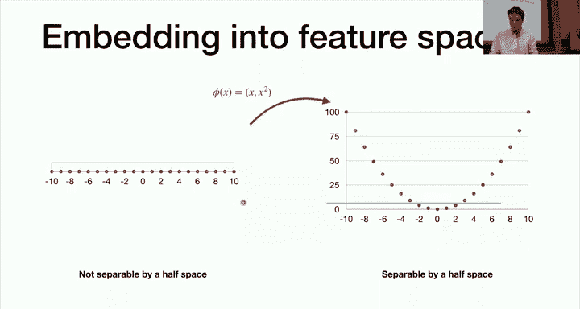

So before the break， we saw that it could be useful to use a feature space。

We went from a onelinar nons example， extended in a 2D space where it was becoming linearina sur。

 let's now look at another example in a 2D space。

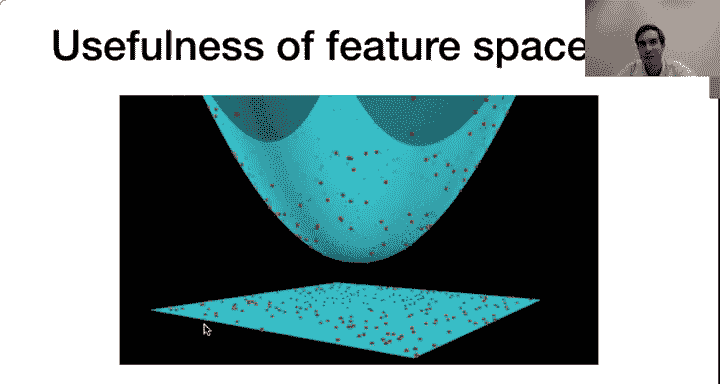

In this video。

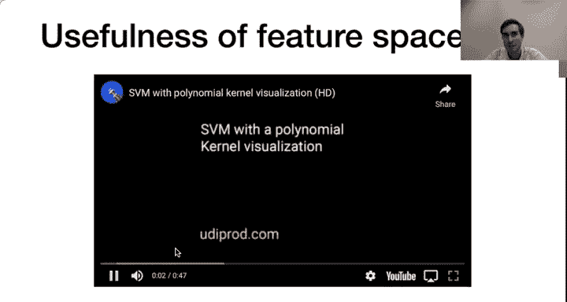

So what do we see， we first see that the blue and the red point are not in variable when we look at them on the plane。

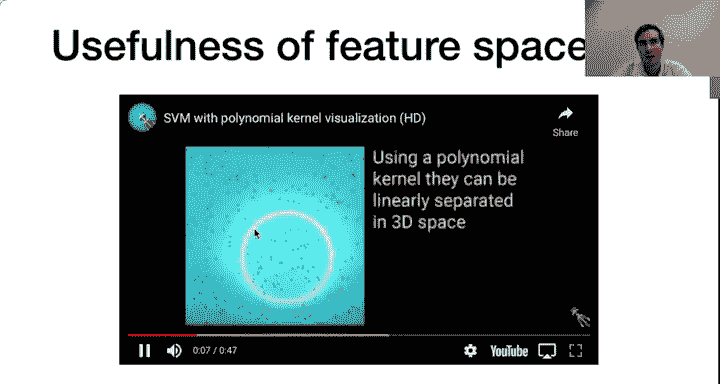

But if we are mapping them in the 3D space using a nice feature on map。

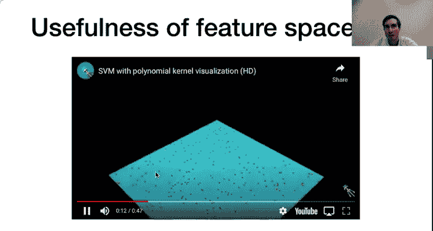

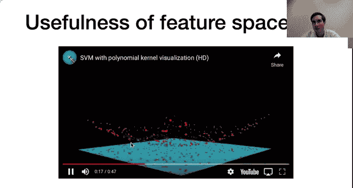

Then you see that these points become in eliciiible。

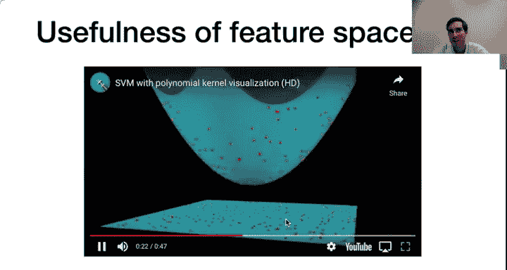

It is possible to find a niper plane。

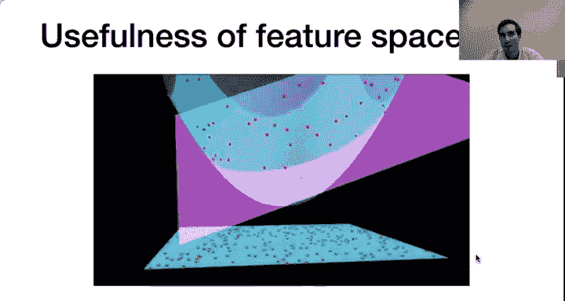

S that all the red point are on one side and all the blue point are on the other side。

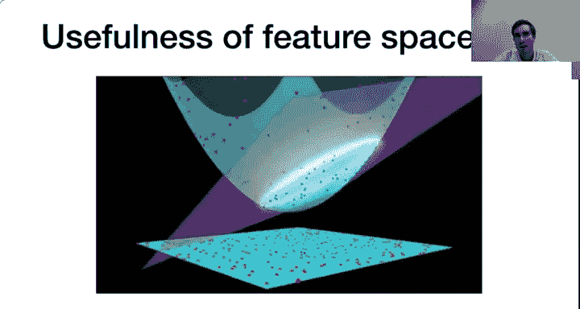

And then when you project back on the plane。

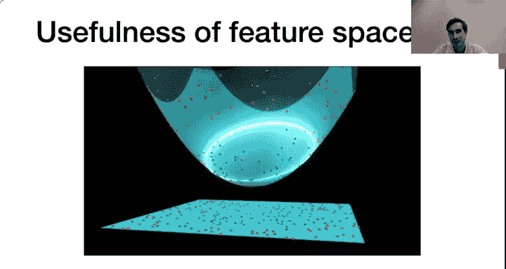

You see that you obtain a nonlinear nonlinear classifier subject。

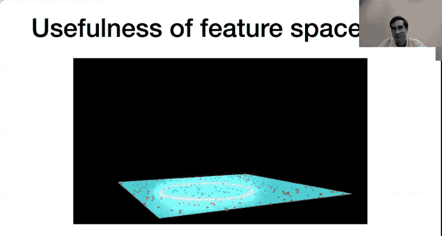

女儿的以后特你你好。

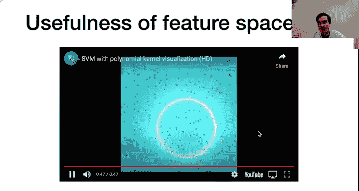

So of course， the success of this method will really depend on the choice of the Phio map file。Okay。

 but in that example， you see that this nice feature on mat。

Is making the input linearly viable in the feature space。So we have a linearar prediction。

 we have some data which arear is available in the feature space。Weil in the classification all。

And when we project back this hole in our input space， then it becomes nonlinear nonlinear now。

So what is the problem with this approach？Of course， you will offer news。

Fature space are very very large dimension。And so when you will do the computation in this feature space。

 you will have to pay the price of the dimension。So let's look at it more precisely。

So assume that you are not happy with your initial observation and that you want to use a fit map to map your data from Air to Air。

And we are assuming that detail is really larger than D， so what could you do now？

So instead of using your initial canal matrix， you can stop everything from the beginning and compute the associated canal matrix with your phio map phi。

 so that's the matrix K so as the IJM3 will be phi of X I transpose phi of X shape。

Okay for this new problem where you have extended your observation， you have a new camera matrix。

And you can use this new can matrix in order to compute your model with SVM with canalized feature regression。

And using that， you will go to a space， the fit your space of a dimension really larger than your initial space。

Okay but since these spaces have a larger dimension， it would be of course。

 more costly to compute all this scalar product。So you will have to pay the dimension。

When you will compute your nu N matrix。And so this is really like a problem because you would not be possible to go to very large motion space because。

Otherwise， we will have to pay this cost of all of detail and so the question we want to serve is to see that it is possible。

To use these features is a very large emotional space without having to compute all this phi of X transpose phi of X。

You know， is it possible to go in this larger dimension space？

That to do all the computation in a lower dimensional space。You know。

 what can we do to solve this dimensional problem？And that's really what will be the object of the canon trick。

Instead of computing the mapping P and the inner product in the high dimensional space。

We will see that sometimes it's possible to directly compute。This mapping。

 I mean the inner product as a function of x and x prime。In the lower dimensional space。

So this will be possible if it exists a function which we define as a KNl function。

 Kappa of x and xt such that。Kappa of x x team is equal to phi of x tospo phi of x pi。Okay。

 and if this function。Has a low complexity。With respect to the dimension。Of fight。

Because this function will always exist。But this scan function will only be interesting if it's possible to compute the value of Kappa x and Xt without having to compute。

This scalar product， that will be all the interest of the camel tree。So what is a channel function。

 theken function is a function from Rd times Rd with value in the row。

Which potentially realize an inner product computed in a very larger dimension space。Okay。

 and this can function will be interesting only if。It's complexity。To compute it will be smaller。

 will be proportional to D， the dimension of the input space。And not proportion to detailed。

The dimension of the feature space。Okay， so in some sense。

 you could see the kernell function as as a function。

 which would specify the similarity between Xi and Xj。ok。In a such a way that in fact。

 it will exist a mapping function file so that the similarity。

Can be realized as an inner product in a feature space。Okay。

 so the similarity between x and x prime will be realized as a inner product between phi of x and phi of x prime。

And so why is it really useful， it is because instead of first computing phi of x。

In a very large dimension space and then computing the scalar project phi of x transpose phi of x pi。

And then computing the canon metrics。And then computing our linear classifier。

We will do exactly the same， but by DC computing Kappa of x X pi。And by computing Kappa of xx prime。

 I will be able to compute directly my canon metrics and to use my canine metrics to learn my linear classifier。

😊，Without having to go in my large emotional space and without having to pay a price depending on the dimension of my feature space。

 I will be able to compute my can matrix and to do a linear prediction in my excellent space。

But only dealing with vector in my initial space， which is of lower dimension。

So you see it really helps you this canon metrics to enjoy the advantage of the features。

An imagin of space。But only doing computation in low dimension space。Okay， so let's do it again。

Instead of computing the phi， the large dimensional space and then computing the inner product in this large dimension space。

 we will stay in our low dimensional space and compute the kappa between x and X prime in this load dimensional space。

 and so this will be computationally chip。ここ？So if we want to give an example， imagine that X。

Will be。😔，In Air 2。And then you map this x is phi of x， which belong to air power 1。Thousand。Okay。

 what could you do？You can compute。All the phi of X， so phi of x1。Phi of x10。

 and then you can compute the matrix K， which will be equal to phi of X transspo phi of x。

This will be very expensive。Or you can prefer to just compute Kappa of X I， X J。

And this will cost you O of2。Whereas if you want to compute this， it will be o of 1000。

So you see that the complexity of only computing the canl。

Matrics using the canl function will be really lower。Okay， so that's why it is so interesting。

You won't have to go to the large dimension space and to compute inner product in that space。

You will be able to stay in your low dimensional space， F2 in that case。

 and compute easy computation in this space。So if you are lucky。

 you can stay at home in your low dimensional space， but still compute your canon matrix。

 which will help you to do classification linear classification in your large dimensional space。

And so why it is really nice。😊，Because as I told you for a lot of algorithmism。

 such as your canal hit regression， canal SVM。😊，In order to do linear classification。

In your feature space， which is a high dimension space。You only have to compute the canon metrics。

And to compute the can matrix， you only have to compute the can function。

And you can do that by sting。Okay， in your low dimensional space。

 so you will be able to do a linear classification in a high dimensional space without having to do computation in that space。

Okay， so it would be possible to implement linear separta in a very high dimension space。

Without having to go in the emotional space。Without having to compute the fitos5hi of x。

 but only doing some small computation with your channell function Kappa。

So that is what is called the Cannon Creek。Which is really important in machinece learningomic。

Using your kernel， you will be able to do linear classification。In your feature space。

But in term of computation， the cu will depend on your ambient space， which will be a flow dimension。

So let's give some example of this scalel， maybe it would become more clear to see why that so useful。

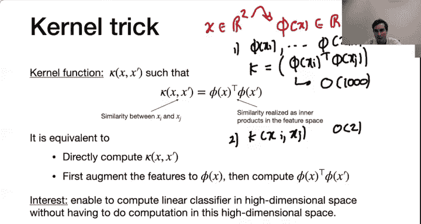

So the first example is the linear k， it's a very simple one。

 it is just x transspose x prime kappa of x x prime is equal to x transpose x pi。

And so when we give a camera， what we want to see is what is the corresponding feature map file。

 so what is the map such that Kappa。Of x x prime is equal to phi of x transpo phi of x prime。

 that is a question we are asking。And in that case。

 you directly see that the associated phio map is the identity x because Kappa of xx prime is equal to x transspose。

X pi， so it is equal to phi of x conspo phi of x pi。 So if you are doing the identification。

 you directly see that phi of x is equal to x。So that's the first example。

 it is naturally really interesting because we are staying the same dimension so we don't see how we can really use this can。

That's a simple one。A second one a little bit more interesting will be the quaraic camemen。

Kappa of x X prime would be equal to x X prime squared， where x and X prime mass subs。

Here you are there seeing that a corresponding phio map phi of x will be equal to x squared。

You can look at the computation if I look at Kappa of x x prime。

 this will be equal to x x prime squared and so it will be equal to x squared times x prime squared。

 so it will be equal to phi of x。Times phi of x squared。 If I define phi of x to be x squared。

So that's a second came， which is called the quaraic came。

It is still not so interesting because the dimension of the input space R is the same as the dimension。

Of the Xal space， so let's try to look at the more interesting example。

 and this will be the example of the polynoal camera。

So now I'm assuming that my input space is a dimension 3。

And what will be my example of my canal Kappa， it will be the squared。

Of the sum of the component device product， so it will be x1， x1 prime plus x2 x2 pi plus x3。

 x3 prime。Squared。So that is my canl and that's an example part of what is called polynomial camel because you see that you have a polynomial here。

And I want to find the corresponding phio map， so I want to find the phi so that Kappa of x x prime is equal to phi of x transpose phi of x prime。

And what is my claim， my claim is my feature map is this vector in my space of dimension 6。

So what is this vector， that's the vector x1 squared， x2 squared， x3 squared， square root 2， x1， x2。

 square root 2 x1 x3 and square root 2， x2， x3。And how can I prove that？

And just look at the value of Kappa x and x prime。I expand my squared。

 so I first obtained my3 squared term， x1， x1 prime squared x2 x2 prime squared， x3 x3 prime squared。

 and then I would get my cost what my cost I would get two times x1 x1 prime x2 x2 pi。Two times n1。

 x1 prime， x3， x3 prime。And two times x2， x2 prime， x3， x3 prime， that them。

And so you see that this sum。off。60。Can be realized as the inner product between this two vector of dimension 6。

If I'm doing xenopo between this vector and this vector。

I will get x1 squared times x prime squared system plus x2 squared times x prime2 squared system plus x3 squared times x prime3 square that term。

I think。😊，Square root of two。X1 x2 times square root of2 x prime 1， x prime 2。This term。

 square root of 2 x1 x3 times square root of 2 x1 prime x3 prime this term and square root of 2 x2 x3 times square root of 2 x prime 2 x prime 3。

 this term。So you see by doing the identification that this fit your map。

Is well a feature map associated with this canl function。ok。

And now it's kind of nice because we see that our initial space is at dimension 3。

And my fit of space is a dimension 6， so I have gone from a space of dimension3 to a space on dimension 6。

And I can do linear classification。In this space of image6。

Without having to do computation in that space， but only by computing my canl function。

Which require a to see。Victor of the space， Apple Austria。

So this is an example of what is called a polynomial kmen。And to summarize for this features map。

You don't have to go in the space of6 dimension in order to do linear classification。

You can just compute your Canon metrics。By staying in your space of emergency。And so of course。

 going from three to six， it is not so surprising， but if you are using some polynomial cannon of larger degree。

Then you can really go from any E D。To a space which would be a very， very large dimension。

And you see one of the interests of the camel。And let's see a new example now。

Which is the ideal basis function Canl， AirBF Canmen are also called Gosian Canmen。

So what is the definition of thiss can L for 2 vector x and x prime in dimension D。

 I will look at Kappa of x x prime， which will be the exponential of the square norm of x minus x prime。

But it will be easier to see what is a corresponding feature map for this can if I look at the simpler case where x and X prime belong to the realm。

So for x and x prime belonging to the real， it is only Kappa of x x prime is equal to exponential minus x minus x prime squared。

And now what I am claiming is that the associated shade fit your map。😊。

Will not be a finite dimensional vector， but it will be an infinitefin dimensional vector。

 and it would be this vector exponential minus。X square。And then a vector。

 an infinite vector was k coordinate will be 2 power k over 2 times x power k divided by square root of factor on k。

So you see that with my AirBf canon。I can map。Myice space of dimension one。

To a space of infinite dimension why we have。A features of dimension infinite finite。

And I will be able to do some linear classification or linear regression with these features。fiい。

But they will never have to compute。In our product between in finite dimension element。

 I will only have to compute simple computation between rows。Namely。

 the exponential of minus x minus x prime squared。So let's prove this result。

What I see is that Kappa of x x prime by definition， I'm just exp the squared。

 it is equal to minus x squared minus x prime square plus 2 times x x prime。I can facto highs。

Mins this， so I will get exponential minus x square exponential minus x prime squared。

And then I still have。So can see。This and then I will have exponential plus two times x x prime。

And now what I will use is that I will use a tailor expansion of the exponential function。

And I know that。Exponential of x is equal to the infinite sum。off。X。高日机。后悔啊。Factory O。

 So I will use this。For exponential of two times x X pi。And I get。

That it is equal to the infinitefinite sum of 2 x x prime per k。

 which is equal to 2k x per k x prime per O k divided by factor yield。

So you see that my kernel function Kappa is exactly equal to this infinite sum。

And then I directly click it by defining phi of x to be this vector。

That phi of x transspose phi of x prime will be the sum of the product of the coordinateate。

And so if I'm doing the project of the coordinate， I will get。

Exponential minus x squared times exponential minus x times squared。And we get this。😮。

And then I will get2 k over 2 xk times 2 k over 2 x prime k。

And one gets this divided by square root of k factorial。Times square root of k factor n。

 and I would get this。So you will see you see that phi of x transpose phi of x prime directly get you kappa of x x pi。

And so。Our airB S kernelel。Can be realized。As the inner project between are features fire effects。

And so why is it particularly interesting in that case is that it is possible to show。That。

This inner product。This can then function。Cannot be represented as a N product in a finite dimension space。

It will not be possible to find。A space as dimension D。Said that。

Kappa of x x prime will be equal to phi of x phi of transspose shi of x prime。N D is not infinite。

Okay。So let's look again with this example why the kl and canl trick is so important。Is that。

I have a problem。In dimension 1。I'm able to map my observation from 1 d to phi of x。

 which is a vector of infinite dimension。Then I will be able to do regression。

 in a regression or inner a classification in this infinite finite dimensional space。

 which will be very large。And to do that， I will not have to do any computation in this infinite dimension space。

And we just have to do computation in the real。I will just have to compute for all my observation X I and Xj。

 K of X I Xj and then this would give me my Kine matrix and with this canine matrix。

 I will be able to do linear regression or linear classification。Okay。

 so we can do it again for the last time using the Canl trick。

 I will be able to do linear classification or linear regression in a space of very large dimension in finite in that case。

But by doing computation only in my initial space。Thats really like the interest of the Ken。

So we have seen some examples of different cannels， polynomial canals， airBF kernelal。

 what we will see now is that it is possible to use this canal in order to build new canal Okay。

 so it is possible to build。

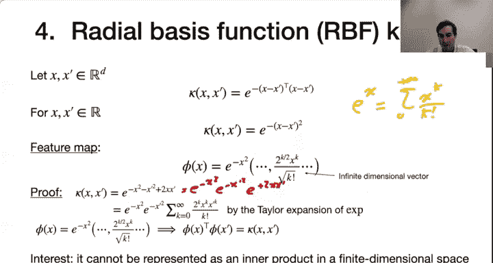

New canl using old kernelnels， so what will be the two holes we will see？

It will be the sum and the multipplication。So let's consider Kappa1 and Ka 22 channelal functions。

So what do we mean by can function， we mean a function suggests that it exists。Rephiio math phi I。

 phi 1， sorry insertject Kappa 1 x prime x sorry。So that Kappa1 of x x prime is equal to phi 1 x tospo phi1 x prime that's the definition of the can then。

 the function so that it exists fit your map。Such as thekenal value is equal to the inner product of the feature map。

And so what is our claim， our claim is that？😊，If I'm considering positive in a combination between two channelss。

It will still be a camels。And the second claim is that if I'm considering the product between two camels。

 it will still be per camels。So what do we mean by being a can？

We mean that it will exist with phiomahi such that。

Kappa x of x prime will be equal to phi of x tospo phi。Of X prime。And that's the same here。

 what do we mean by a project of Canll？伊ずね。We mean that it really exist a feature map phi such that phi of x。

Tspose phi of x prime is equal to K of x X prime。So in order to prove these two claims。

 what we would have to do is to find。The good feature map associated with the sum。

Of toca and to find a good feature map associated with a product of Tcal。

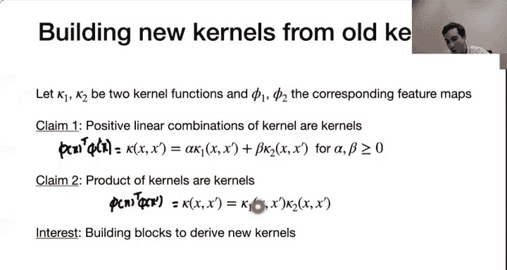

So let's start with a sum。This is a very simple proof。😊。

The definition of Kappa x x prime is equal to alpha Kappa 1 x x prime plus beta Kappa 2 x X prime。

 that's the definition。And since Kappa 1 and Ka 2 R can function whose corresponding mapping feature map is Phi 1 and Phi 2。

 I know that Kappa xx prime is equal to phi 1 x transspose phi1 x prime。

And since the corresponding ph map of Ka 2 is Phhi2 transpose。Phi2 x transsversese Phi2 x prime。

I know that Kappa of x x prime is equal to alpha phi 1 x transpose phi 1 x prime plus beta phi2 x transpose phi2 x prime。

And then you drc see that if you define phi of x to be the vector of dimension d1 plus d2。

Wse first component are phi 1 and then phi 2 okay so the first d1 component of phi is a vector phi 1 and the last D2 component of phi。

Other components of the vector of Phi 2， and you multi multi by square root of alpha and square root of beta。

 you directly see that phi of x in a product with phi of x pi。Will be equal to what to alpha。

To square root of phi1 of x。Tspo square root of alpha phi 1 of x prime and so this would give you alpha phi 1 tospo phi 1 of x prime。

Plus。Square foot haveビta。Phi 2 of x topo square root of beta phi 2 of x prime。

So this will give you beta phi 2 of x transspose phi 2 of x pi。

So this is really a simple proof that you can do it again at home if you want。

 and then you will see that the linear combination between two kernels is a kernell。

Woos associated Fi map。Will be square root of alpha phi 1 of x， square root of beta phi 2 of x。

 and you see that the features now is in the space of dimension d1 plus d2。

So that was the first proof to show that。Positively in our combination of camels are canls。

And then we will see the proof for the project of two cabinets。So by definition。

 kappa of xx prime is equal to Kappa 1 xx prime times Kappa 2 x x prime。嗯。

Kappa 1 is equal to phi 1 x cos plus phi1 x prime。And Kappa 2 x x pi is equal to phi 2 x transverse phi 2 x pi。

So now I want to find a vector filehi。Of x， suggest that k of x x prime is equal to phi x transspo phi x prime。

And what I am claiming is that this vector of dimension d1 times d2。Will be。The great featureji。

So what is this vector that's3 like the vector so that？The D2 first component will be Phi 1，1， phi 2。

1， p，1，1， phi，2，2， p，1，1， phi，2，3， and so and so until P，1，1， phi，2， D2。And then you get。F one。

2 times the first component of Phi 2 until Phi 12， the last component of P2 and so and so until the last component of phi1。

Times the vector2。ok。It really to be clear， as it would be。Phi1 of x。废度。1 of x。玩弯。Phi one of x1 phi2。

Of x2。Phi1 of x2 Phi2 of x 1。Phi1 of x2， Phi2 of x 2。

In the simple example that we have two components。And so what I am claiming is that if I defining phi to be this vector and I look at phi of x con phi of x prime。

What I will get， if I look at the sum of all these coordinate。

I will get the sum for all the I and the J of phi。1 x。The i component times phi 2 x the J component。

Tines phi 1 x prime， the I component times phi 2 x prime the J component。

Okay that's a simple computation， if my vector phi is defined by this vector。

 then the scalar product between phi of x and phi of x prime will be the sum over all the I and the J of this product。

And so what is very nice in this sum is that you can separate all the term。

 which depend on y on I on one side and all the other term which depend on J on the other side。

And so the sum of our I and J will be equal to the sum of I。Times the sum of energygagy。

And then when you look at the sum of your eye， what you are observing is that you are directly recovering。

😊，Phi 1 of x transspose phi 1 of x pi， because this scalar product is exactly equal to the sum for I between1 and d1 of phi 1 x。

H component times5hi，1 x prime I component。 Okay， this sum。Is exactly this in project。

And it's exactly the same for the second term， this sum over j for j is equal to1 to d2 is exactly the inner product between phi of x and phi of x pi。

So you see that phi of x transpose phi of x prime， if I define my vector phi to be that vector will exactly be kappa of x x pi。

So it means that it exists phio map such that Kappa xx prime is equal to the inner product between phi of x and phi of x prime。

So by definition。Kappa， the product of my2kml is a channell function。

 it is a function such that it exists to fit your map。

For which the inner project between this video map is equal to the value of my function。Okay。

 so we have seen that the product of two kernell is a kernell。And previously。

 we had seen that the linear positive linear combination of2 canl。

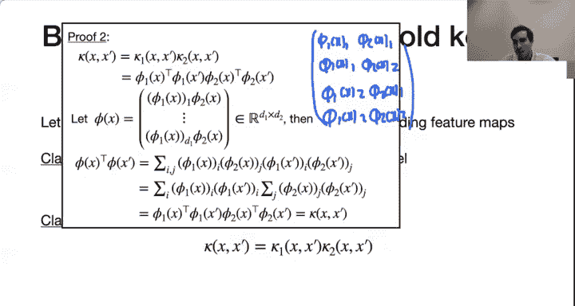

Was also a camera。And so maybe no very natural question you could have is that for which function Kappa？

It will exist a it of phi。So that my function Kappa is a canl function。ok。If you have a Ka。

 if you have a function Kappa from FD times FD， how can you know that this function Kappa？

Es a can function， how can you know that it will exist if fit of mat phi such that Kappa of x x prime is equal to phi of x transspose phi of x pi？

That's a question you want to answer。And if you had some condition that would be very nice because then you will know that if I give you a Kappa。

It would be possible to say this Kappa is a canl function or this Kappa is not a canl function。

And so what does this condition？These are the me acquisition。

And so the answer is really a if and an if。If the mass recognition are satisfied。

Then it will exist to phi， so that Kappa of x x prime is equal to phi of x transpose phi of x prime。

And if the Mer condition are not satisfied， then it won't exist searchify。Okay。

 so it's really a eve and an early ifve。So what does this mass condition so first one is that your kary function is symmetric。

 that kappa of x x prime is equal to ka of x prime x。

That's very natural because you know that your inner product will be symmetric。Okay。

 so if it exists at phi such that Kappa x x prime is equal to phi of x transspose phi of x prime。

You directly know that this by symmetrymetry of the inner project would be equal to phi of x prime transspose phi of x。

And this would be cool to Kappa of x prime x。So the first condition is kind of clear。

The second cognition is a little bit different， let's try to pass it。It is saying that。

For all possible input sets。The associated canal matrix will be positive to indefinite。

 so what does it mean it means that for any end positive。

So any X where I go from one goes from one to n， so for any input set x1 to Xn。

So associated canine matrix， which is a matrix mo the Ij on 3 is Kappa of X I X。

 so this associated canine matrix has to be semidefinite positive。Okay。

 so if you have these two conditions， if the channel function is symmetric and if the channel matrix associated to every input sets。

Is PSD。Then it will exist。An associated feature your map phi said that。The function cap is。

 the can function。We associated feature。So do you see why this condition is also needed？

Why is this condition it's kind of not too complicate to get。So first is n is equal to1。😊。

Kappa of xx， why is it obvious that this quantity will be positive？

It would be by definition if it is a can function， phi of x transspose phi of x。

So this is equal to the square norm of phi of x。And so this is positive。

Then the question is more to see why this should also be true for n larger than one。

So let's see why if I have a channel function。Then the kernell matrix will be definitely positive。

So what is the definition？Iff。Because the geometric系 that V transpose。ケVイスポジitiveィ。And this is what。

You have to try to see why。Is it。Scase。So we will maybe sit at the last of the lecture if we sit up some time。

So we have seen the mass condition， which are giving us a condition under which。

A metric sorry a function Kappa will be a canon function。

But then we want to conclude the course on something which is very important。

 which is how can I use my channell to do some prediction？Because what have we seen so far。

 we have seen that。Using Canal， it was possible to compute。My prediction， I mean。

 Im to compute myM my direction alpha， and then my solution W。

 only making computation in my load dimension space。But what you want is not to compute the value。

 what you want is to be able to make some prediction as for classification or for regression。

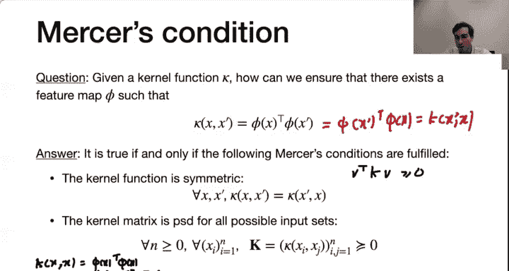

And how are you doing your prediction， you are computing phi of x transspo about your style。

I'm giving you a new part。😮，You compute the associated feature。

But for this point so you compute phi of x and then you do the scalar project between W star and Phi of x and this would be your prediction and therefore a regression of a classification where you will take the sign of this inner project。

And you see that you have a problem because you don't want to compute this in a product because phi of x can be really expensive to compute and also this in a product can be very expensive to compute。

If you fit your space is a very large dimension。So we have having a very large problem。

 what we have seen was it was possible to compute our alpha star efficiently。

But how can I then do a prediction using this alpha style？Okay。

 so that's a question we want to solve。Is it possible to do a prediction？

Only using the canal function。We that having to compute phi of x or to do some computation in my feature space。

Do you think it's possible？So fortunately， it is possiblebo because what we will see is that in order to compute phi of x transpose W star。

What I have to do。Is just。Because by the horizontal theorm。

 the value star is equal to my matrix phi of x transpose times alpha star that's the represent se when I'm using some features。

Okay you have to think that this matrix phi of x transspose。Will only be the metrics。i x one。😔。

fi f x and。I suppose suppose。So this is what you want to compute。And then you see that， in fact。

 this inner product is exactly equal to what？It would be equal to the sum。I is equal1 to n。

Of phi of x cospose phi of X I times alphapha star I。

And then you are really IP because you know thathi phi of x transpose phi of Xi。Is equal。

To cap off x X pi。So you see that in order to make your prediction。

 in order to compute the inner product between phi of x and W star。

You don't have to compute Phi of x。 You only have to compute your MLl function。Between x and X pi。

So we see that it is possible to do a prediction only using the channelal function Kappa and without computing phi Fx。

So that very important， we can compute the prediction for a new vector x。

Without having to go to the augmentmon space， but only by computing the can function between our new point x and the observation X。

And let's conclude with another very important remark。Is that even if in our augmented space。

 we are doing some linear prediction。We are doing our prediction by learning a type of plane， okay。

 and then by computing an inner product。When we project back。This function in our initial space。

 if I look at what does mean this function in term of my observation x。What I will observe， okay。

 this will be exactly。This function。I say that f of the W star of x is exactly equal to this function。

And you see that this function in x is no nonlinear。ok。So， also。The classifier is linearna。

In the future space。So testifiers denied the augmented space。It will lead to a known ni prediction。

In our initial original space X。And that's really why Kenel are so powerful。

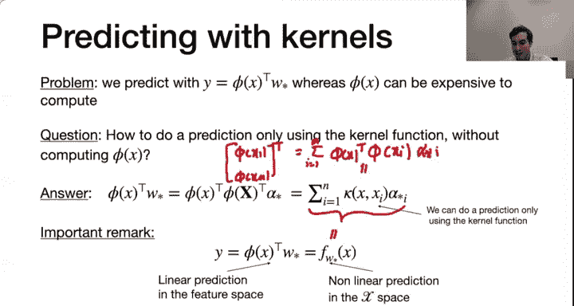

So that's the conclusion of the second part of the course。So what have we seen？

We have seen that in a lot of situation， it was very useful to map。

Our observation from our given domain to some higher dimensional space。Wina prediction was powerful。

Because since the space is of a larger dimension， your observation there will be more likely to be linear reciparfiable。

 or linear method will be more likely to walk with。Okay。😔。

So by mapping an observation to a large dimension space， we will have you know。

 a rich and a very expressive function class。The problem was that since this feature space is a a larger dimension。

All the computation would be more complex to do would be more expensive。

 would be more expensive to compute your SVM airplane or to compute your。黑呃黑 case色。ok。

But then what we have seen it was possible to use a so called kernell trick and to do that and to have all this for free。

So what was the I behind the canalric？Is that you do not need to know and to compute the whole representation of the feature。

 you do not need to compute phi of x and you do not need to compute in product between the Phi of your observation。

ok。😔，Good。You can only know what you only need to know is the inner product between your map data。

And so often。To compute this N project between the map data。You can do it with a channel function。

 which will have a low complexity。Okay， so really what is important to have in mind is that in order to do your linear classification or linear regression。

In the augmented space。You do not need to compute phi of x。

You will only need to compute phi of x transspose phi of X。

 and you will need to compute phi of X cospose phi of Xj for your observation。And then。

For some example of features， these will be possible to be compute using your channel function Kappa of Xxii。

And Kappa of X， I X G。And the cost of computing this number。

Will only depend on the dimension where of the space where belong x and will not depend it will be totally independent on the dimension where a few augmented space where。

Belong the vector phi。ok。But what is important to have in mind？Is that。you know。😔。

It will really depend on the application。And that maybe if for some application。

 it will exist to care then。And it's associated featuresos phi。

 which would be good features for this problem。And then you will be happy because you will be able to use this canl without being the price of the dimension。

 but it will really depend on the application。ok。So it's not saying that for all application。

 can will work。But it is saying that if for some application。It exists to carel。

So that the features given by this kernel are nice for this application。

 then you will be able to use a lot of augmented features and to do this still efficiently and still in a computational。

In the competition and efficient manner。Okay， so that's all for today and next week we will。😊。

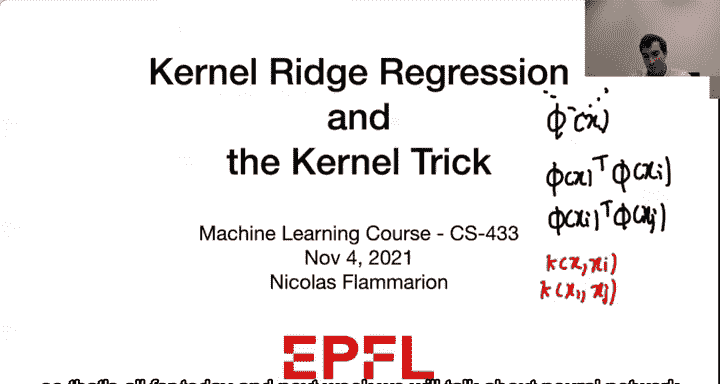

Talk about neural network。And if you are still interested， you can look at the small bonus。

 which will give you the proof of the maxM。So let's look at it very briefly， but that's bonus。

 so you don't have to look at it if you're not interested。So first。

What we say is that we are assuming that Kappa is implementing an inner project。

 so we' are assuming that it exists a Phi so that。Kappa of x x prime is equal to phi of x。

Tspo firehi of X prime。Then， of course。It will imply that Kappa is symmetric。😊。

Because as we already say， this will be equal to phi x prime transspo phi of x。

 and so this will be equal to Kappa x prime x。So Kappa would be symmetric。

And then what we want to show is that。The kine matrix would be definitely positive and to see that you just see that v Phi vector v v transpose Kv would be equal to the sum of the audio entries I and J of V I。

 Vj。And what is the Ij entry of k， it would be exactly phi of Xi transpose phi of Xj。

And this is exactly what we did when we look at the product of two cans， we see that this sum。

Can be split into the product of two sum， it would be exactly equal to the sum of the I of V phi of Xi。

Tospo。S of Vj Phi of V of Xj。And so you can see that this sum will exactly be the scalar product between two vector between。

The vector of sub the I of V I phi of X I okay。你接顺别。Square no。Because this is a vector。

 and so this is a square， this will be positive。So， this show you that。

For every vector V V transpose Kv would be positive， so the associated kine matrix is pD。

Now we want to quickly look at the other direction， so I have a function Kappa。

 which satisfies my tumormer conditions， and I want to see that it will exist a5 of map P。

So let's define phi of x， it will be a function。And it would be the function。Youfin by Kappa。X， okay。

 so phi of x is a function。So that phi of x apply to some vector x prime will be equal to Kappa x prime x。

And now I can define vector spacer function by looking at all the linear combination of the form sum of alpha I Kappa X okay。

 take different Xi and I looking at all this linear combination。

And you can see that it is possible to define an inner product in that space。

In that manner in this way。I'm considering two N combination， sum of alpha I Kappa。

Of Xi and sum of beta j Kappa of x prime J。Okay， I' two different in accumulation。😊。

Ands so which value？Do I give to this inner product。

 I will say that it is equal to the sum of the I and J of alpha I beta J kappa of X x prime J。Okay。

 this is a definition， I define my inner product。Such that ineququa between two linear combination is equal to C value。

And so what you want to check is that this。In our product is value in product。

 so you want to check it is symmetric， it is billionaire， and it is positive defeat。Okay。

 you want to check this， you can do it as an exercise。

And then what you directly observe is that what is the inner product between phi of x and phi of x prime。

It would be by definition。Exactly。The inner product between the function Kappa x and the function Kappa of x prime。

And this will be equal to Kappa x X pi。So this is telling you that if。Your function Kappa。

Issymmetric and your kmetric is positive。It's possible to ensure that these define a valid inner product。

En Z。You can define your feature Phi to be the fuion Kappa。X。Okay。

 so that's the proof of the mass CRM that's really bonus。

 so if it was not clear it's not a problem at all and I see you next week to talk about neural network。

See you and have a good weekend。