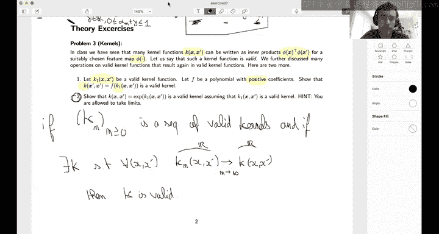

# EPFL《机器学习｜Machine Learning Course CS-433 fall 2020-2021》中英字幕（deepseek - P21：[21]Exercises 7 - getting started video.zh_en - GPT中英字幕课程资源 - BV14SwyeNEvW

Hello everybody， I hope you're doing well， so this week we're going to focus on problem set number seven。

We deal with SVM。So until now in for classification， you see linear regression。

 which is a clumsy way of doing classification， and then you saw a more appropriate method which is logistic regression。

Here we're going to focus on a new method， the new method which you've seen。

 which is support vacuum machine or SVM， which is for classification。So you've seen in class that。

The problem we want to minimize is given in one here。

And you can recognize that it's the same as for logistic regression。

 except the loss we consider isn't the logistic loss。But it is the hingelo。Then the question is。

 what's the best way to optimize this problem？So in the lab。

 you have access to a training set and a test set with features X and labels Y。

So with this formulation and this hinge loss， you need to be careful that the ys need to be in plus minus1 and not01。

So natural approach to solve problem one is to use SDD。

You could also use a sub gradientdient descent but when a big N is big or large。

 then SDD is often more efficient than a pain GD。So you have several functions to implement when it's calculate accuracy。

 which is just for a parameter to W。To calculate the accuracy on the train。Excuse me。

 and the test data sets。As well as the calculated prim objective， which is the loss。

The last function on the， on the。On the test and train set。

 and you need to take parameteri Lambda into account here。诶。

I'd like to point out that for the accuracy that Lambda has a。

Lambda does not appear for the accuracy accuracy loss， accuracy accuracy function。And then。

For question2， you need to implement the two SDD functions。 One is just for a given。

Detail example small N， it gives back a storcchastic grid。And then there's the SDD for SVM demo。

 which performs the SDD and the objective one。Okay。

 but you see cast that doing STD on the prim problem isn't always the best way of doing。

And you've seen that another approach is to consider the dualL problem。

 which is given in equation two。And this is a maximization problem。Over alpha， it's a C。

 it's a quadraed function over alpha。Which is concave and so which is nice to maximize。

It's constrained because you need the coordinates of alpha to be in the box ti1。

And a way of solving this problem is to use coordinate descent or coordinate ascent in our case。

And the first question is theoretical and it's to show that you can have a close firm solution when you just focus on one coordinate。

So you pick a coordinate N and you want to show that there's a closed room solution to the maximization problem。

And so what does this mean， this means that。So， our think and。Gandomly。And then I focus。

 So imagine I call my function of alpha。itSo this is a function of alpha。And I call it F alpha。

Then I pick coordinates N。And I wna find the。Maximum。

 well arc max of F so this is a vector E is the vector which is full of zeros except one at coordinate n。

And you need to show that this so this problem， which is a 1D problem because gamma is an R and don't forget it's contraining。

This problem has a closed form solution。So you can create the solution of this problem and then you need to update alpha。

Which is just the old alpha plus gamma storage， which is the problem of this1D optimize instrument problem plus EN yen。

 which is the the。诶。And the vector of the canononic base。Okay。

 so once you've you've answered this theoretical question。

 the the implementation is quite straightforward and you need to calculateate the coordinate update。

 which is just to implement the。诶。This update。Then you need to calculate the dual objective。

 which is。诶。Which is same as for the prim objective， but for the geoso for equation two， so you just。

嗯。Put in implement this formula。And then you show the performance of a coordinate ascent。

And with the function SD for SVM Tmo， and then the question is to to see which one is the is SDD faster or has coordinated this SN faster and comparing the objective values of one。

And the two cases。Okay， and then the third part is a pretty theoretical part。So。Okay。

 so you've seen in cast that there are some kernels which you can create in a nice inner product form。

B。So here in their exercise， we call this a valid kernel。

But in practice it's often hard when you have a kernel key X experiment。

 it can be quite hard to express it as an nano product。Actually， the feature map can be infinite。

However， we're going to show here in these two questions that there are some operations which preserve the validity of kernels。

So in class I think you've seen that the sum of two valid kernels is a valid kernel and if you multiply a valid kernel by a positive sc。

 then it's still a valid kernel。And here we're going to show that if you have a valid kernel K1。

And F is a polynomial with positive coefficients so the fact that。

Its positive coefficients is very important， so if you compose the key1 which you know is a value kernel by a function F which is polynomial with positive coefficients。

 you need to show that this is still K， this is still a valid kernel。

So this is nice because in practice， if you have a kernel K1， which which you know is valid。

 then you know that K1 squared is going to be valid which without even having to compute the。

The future map P associated。And then two is to show that the exponential of a kernel is still a valid kernel and so the hint they give you is that you're allowed to take limits and I'm just going to explicit what this means。

So what does this mean this means that。If you have a sequence of。Of th kernels。Which is a。

Which is infinite。If gain is a sequence。Of。Slid kernels。And if。Do you exist a limiting kernel？

Which means that it's a point where limits。For all x x prime。So for all points x and x prime。

 we want your sequence to converge to some limiting kernel， which we call x。When n goes to infinity。

 So this is just a sequence of real numbers。And this is a real number。

 so this is a sequence which can converge。So the hint is that there's a result。That says then。

ケエ valid。ok。😊，So this is the throughM which is given to you and which you can use to show。

Question number two。Okay， so that's it for this week。Good luck and Ha fun。

