# EPFL《机器学习｜Machine Learning Course CS-433 fall 2020-2021》中英字幕（deepseek - P22：[22]EPFL Machine Learning Course 2021 - Week 8 part 1.zh_en - GPT中英字幕课程资源 - BV14SwyeNEvW

Okay， and welcome to this new lecture of the machine learning class。 So today days。

 maybe the day you are all waiting for， we will start talking about neural networks okay。😊，不不不不。

It may be a little bit longer so if we are not done。With the container of today。

 we will extend it Thursday。So we will talk about the basic structure so we will define what is a neural network that will be the first point and then we will mainly talk about the representation power of neural network。

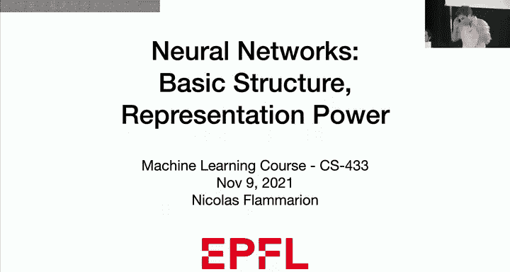

Okay， so let's start now as you may be heard out a lot of I about neural network。I mean。

They work very well and currently they are really like the most efficient in practice method。

And they are not too complicated to work with。But on the other side。

 the authority category very misunderstood， so they work well。

 but we don't know at all why they're working so well。😊。

And so it's really like a huge domain of research to try to understand why they are working so well。

And so today and in the lecture， we will really only cover the basicsik and maybe， you know。

 in the following year。😊，Students who will take again this course will have a little bit more theoretical content to understand why is our working server。

So let's start with the motivation。So since the beginning of the course。

 we are considering the supervised learning setting you observe。Being some observation as trend。

 this will be your training set， you will have your input X I and your output Y I okay X I belong to capital x and Y I belong to Y。

And it can be some regression problem or can be some classification problem it will not change anything。

 so if you have a classification problem why I will be I mean y will be a discard set。

 for example minus11 or 01 as you want for binary classification and for a regression problem y will be on0。

Okay， so what do you want to do in supervised learning you want if I give you a new X。

You want to be able to predict it as a shaded label Y， okay， that's the whole question。

You have some data。 You want to use this data in order to find the relation between X and y。

I give you a new X， and you tell me this will be the correct one。

That's the goal of supervised learning。And what we have seen so far， we have only talked about。

 I mean， not only， but many talk about linear prediction methods， okay。

 you were consulting some vector W and you were using this W in order to do a prediction。

 your prediction was linear， it was w transpose x。For regression。

 your output was y is equal to w transpose x。 And if you want to do some classification。

 then you use a sign of w transpose x。 Okay， and what we have seen is that linear prediction is only working well when you have a good representation of the data。

 Okay， when you have some good features。And I don't know if you remember。

 we talk a lot about this in the last lecture。We saw， for example， that。For some example。

 it was not in， but then when you were mapping it in a larger dimension space with some good features。

😊，Then linearar classification was working well。So what we have really seen。

Is that linear prediction is only working well if you have a good representation of the data。

 if you have some good features。ok。And so before how this was done。

 it was really like for each application。You add some domain experts who you know。

 they knew their field and they were able to derive some good features。 So for example。

 for computer vision。😊，It was possible to know how to you know transform a picture which is just like a matrix of numbers into a good presentation and you can use some filters or for example。

 them Fourier filters or a lot of differencean and that was really specific to the application domain。

So for each application， you know， you had to have an expert who will give you some good features。

And then the data scientist can use7 linearmeter on top of it， okay。

But you see that this is really problematicmatic because it is really dumb and specific。😊。

For each domain， you have to dehive using your knowledge about the domain some features。And then。

 you will use。Lina prediction on top of it。And so you can you know thatMl we talked about last time is a solution。

 but in fact it's not because what we saw with Scml was only that Canl was a computational trick。

 you know KMl was helping you to consider a lot of features but for each application you still have not a solution and so what you know what is what we will dream of and what we would like to do。

It's really that to learn automatically the features from the data。 Okay， you want。

 if you want kind of to include this problem of finding a good representation for your data。

Inside your learning problem。And that's exactly what is doing a neural network。 Okay。

 a neural network。Really will directly learn the good features from the data。

That's the most important point about neural network。

So the first part of the neural network will learn the features and the second part。We learned the。

We then do on top of it a linear classification step or a linearification step。Okay。

 so all what we are doing with neural network is really to find a good representation of the data and to do it automatically。

😊，Okay， do you have some question on the motivation？那。Okay， so let's see。

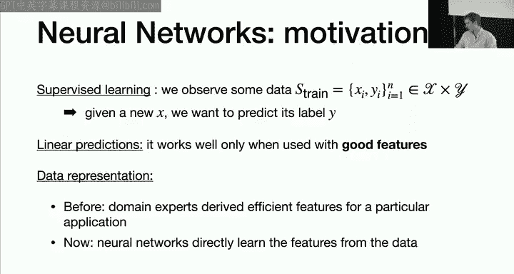

What is a basic structure？So what is the structure of a neural network？We start with the input layer。

 okay。So as the input layer， you will have D。Where this a dimension of your input。Defin note。ok。

So this is your input layer。And then you will have L defnt layers， which will be called e layer。

 and the size of each of these layer will be K。And we always say that they will be of the same size。

That's an assumption if you want to could take different size， but for today。

 we consider that all the hidden layers are of the same size， okay。

And then you have one output layer。 And today， it will be of size 1。

So that's really like the basic structure of your network。1， input layer。L1 layers。

 and one output layer。And so we say it is called a feed for one network。Okay。

 because you see that the information。And the computation will start with the input will goes through the network。

 okay， from the left to the right。And then well go up to the output。 There is no feedback loop。 Okay。

 so information and theres。The input。Go out at the output。And it goes strictly。

 slightly from the input to the output。 So there is no feedback loop。

 This is called a feed forward network。Okay， and also something which would be very important is that you would see it would be almost the same network。

If you want to do some classification problem， or if you want to do some regression problem。

 the only difference will be the last layer， okay。So last layer will change if you want to do some classification。

 if you want to do some regression。So you have your notess。

And you see now that the parameter of the network。Will be the number of hidden layers L and the size of each layer K。

 And that's a parameter you will have to choose。ok。So that's really like the basic structure。😊。

And then you see that the question is how you go from one node to the other。ok。

But what you have really to have in mind is that this network。Will compute them value。

And so at each nud。We didote by X， I J。This will be else， sorry。And so this will be the value。

Taken by a nud。i。As the呢诶。O。And so another question you want to see is how you will update this value。

 okay， how you will be able to compute this value in function of the input。

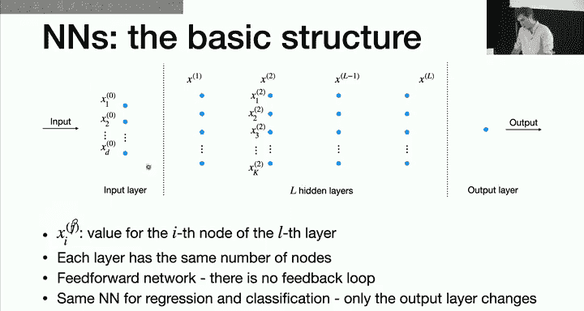

So what we are considering today， it will be what is called a fully connected neural network。😊。

So what is a fully connected neural network， It's a network of that。It' not。

It's connected to all the node at the previous layers。Okay， this is fully connected。

So between two node。We have an niche。Okay， so you can consider any  noded of failure。For example。

 any node of the second the year。And it will be connected to all the nud。thePrevious。

O guess this is why we say that it is fully connected。And so for each edge。We will associate。

Oh waitai， okay。And we will denote the weight W I J of L。

So Wij of L will be the weight as a shaded to the edge between the noded i of the layer L minus1 to the noded J in the layer L。

Okay。And then we will also have another parameter， which would be the bias stem。

So we are associating to each noded a bias stem and we willll denode this bias stem BGL。

 so BGL will be the bias associated with the noded I of the layer L。Okay。

 so these are the paham of your network。😊，And this is the parameter you want to learn。ok。

In the problem， you will define your network。And you will try to learn this parameterameter in order to make a good prediction。

Do have some questions in the basic structure。No。So what it remained to define。W is not clear now。

We have。A network。Okay， network is really a set of nodeds and all these nodeds are connected with some edge。

We have some parameter of this network。The weight associated with the edge。

 the bias associated with a node。We have some value X I associated to each node。

So what is treatment to be defined？喂。how you。So yeah maybe that it。

So you know like the toppology of the network is given if you want。

But there is something you don't know how to compute。Which is。Can you repeat， please。Okay。

 the output。And even beef as the output。The value。 Okay。

 you don't know how to compute each value X I， okay。You know that for each noded。

 you will have a value。But you don't know how to compute this value。

And so what we will see is that the value at the layer L will be computed recursively along all your network。

😊，So what will be the computation？If you look。At the value of the noded， J。啊做呢嘢 l。It will depend。

Of the value of all the noded at the previous layer。Okay， that's the first point。

And in how it does depend on these values。First， you will multiply the value at each noded。

By the weight， associated to the edge， okay？So you are multiplying X I L minus1 to the Y W I JL。

And then you are adding the bias， which is associated to this nu。ok。But then on top of that。

You will apply some function phi， which is called activation function。O。手机信子后。

You compute the value of your neural network at it node。Okay， we like the value。

Is the value of the previous layer multiply by the weight plus the bias。

 and on top of it you are applying the activation function。

So why is it called an activation function come from the brain inspiration of neural network。

 which is not so important？What is really important with the activation function。

Is that it is a non nonlinear function。Okay。That would be very important because you want to add some non nonlineararity to your prediction。

And so you have different choice for activation function we will talk a lot about them sales day。

 but the most famous would be the sigmoid， okay1 over1 plus exponential minus x thats the function we already saw when we talk about logistic regression。

Okay。So you see what。Is this sigma that we like the function will go from zero to  one。😊。

It's very flat。For the value very negative or for the value very positive。And otherwise。

 the transition is smooth。Okay， it will take the value。5 in0。And then there is also the hlu。

 which is a maximum between 0 and x。 we will talk again about it today。

 That's another very famous activation function。So do you see why。

It is so important that Phi is not nonlinear enough。So it is written on the slide。

 but can you explain？To me， why， why do I say that if。Phi was linear。

Then I will only be able to represent a linear function。U see why， yes。

So can you explain it a bit more。Exactly， that's very good。 So this is what you have to see。😊。

If P easily now。All the value at each noded will be a linear function of the value at the previous noded。

So at the end， the value of the output will be a linear function of your input okay。

 because you will go from input to the first layer doing some linear function。

 then to the first layer to the second layer by a nozzle linear function。

 So then you will get a composition of linear function。 And so at the end。

 you will only get a linear function。So you see that if the activation is linear at the end you are only obtaining the same expressivity。

 the same power。😊，As linear prediction。So it can still be interesting from an optimization perspective and you have a lot of research。

😊，On this topic trying to understand。诶你 network。邀听单 XVT。And in terms of a performance。

 you are losing a lot。O。So really， if we do it again。

The value associated to each noded will be defined recursively as a linear combination of the value at the previous noded times the weight。

 pull the bias， and on top of it you are taking your activation。That's我。

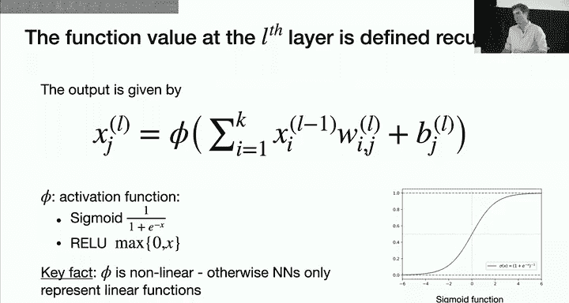

ok。And so。In fact， this is what I told you at the beginning， what you can see。😊。

Is that all your neural network， you can really decompose it in two different parts。😊。

The first part will be composed of the input layer。And the L hidden layers。

And so what will do this first part？It will really learn a nice representation of your observation。

It will really transform。Your input。Okay， your vector X I。It will confirm this input into k features。

And what you hope is that this cave features will be a nice representation of your function such that if you add a regression。

 a linear regression or a linear classification step。😊，Using these features。

You will be successful in your task。That's really what you have to to have in mind is that the first part of the network。

O， is transforming the original input。Into a master table of presentation。

And so you see to和 presenting a function。From app where D， where D is the size of your input。

Into air， okay。Where K will be the number of node that each。Layer， and this will be。

The size of your feature space。And so what you are doing when you are planning a neural network。

You are learning all the weight and all the bias associated to your network。And so， in fact。

 you are automatically learning。Your features。This is what is really important to have in mind。

And so this function， okay， F。We should go from the input space。To the I mean， to the feature space。

It's defined by the bias associated to each noded。And by the weight。

So that theham may tell you will learn on using your training data。And it will also。

Be defined by the activation function file you will pick。Again， so what do you see。

You see that you will have order K square L parameter。Okay， because for Italy， yeah。You are呃。I mean。

 you see that you have case square。Edges， okay。Because each nodeds is connected to all the previous nodeds。

 So for each noded you will have。K。Edgeges， so for the K nodes， you will have K square edges。

 so you see that you have other K square L parameter。So you see that this will be very， very large。

And that's something important to have in mind is that， you know。

What is the order in practice you will use for L and K。Will you use a very large K。

 will you use a very deep network， will you use a very large L。And so previously， maybe 10 years ago。

 people were using you know very， maybe L would have been equal to2，3 or4。But nowaday。

 what we are using is some very， very deep network with a lot of parameter。😊，So L and K are very。

 very large。So this is what is called over parameterid horizon in。We have a lot of parameter。

 we really have to think about this number k square l to be very， very， very large。😊。

And really larger。value you in地。O。So the first part of the neural network is learning the representation。

And then the second part。Okay， so you will have learned your presentation。

 And so the second part is just doing。A linear classification of a linear regression step。Okay。

 with the first part。You are learning your features， F1 to F K。And on top of it， with the last layer。

 you will do ser enough prediction。So you will do really your features time Elina vector， I mean。

 time a vector plus your bias。 And then if you want to do a regression task， you will just predict。

Dly。F transpose the value plus your bias。 So F transpose。Yeah， exactly。

And if you want to do a classification， you will use a sign。

Of your prediction in order to make your prediction。O。Is it clear for the。

General structure of the neural network or the general definition of the neural network。Yes。😊。

So you say it's a way to do some translation。So the first part is really a way to learn a representation of your data。

Okay， in the previous lecture， what we say is that。

Let's take our input data and use some feature mutation P， and we were mapping our data。To phi of x。

 And then we were doing some linear classification method with these features。With a neural network。

 the first part of the network is learning this representation of your data。

And the top layer is just doing a linear classification or a linear regression on top of it。ok。

Is there any other question。没有。Yes。😊，Can you repeat to the question to depth？And overfitting。

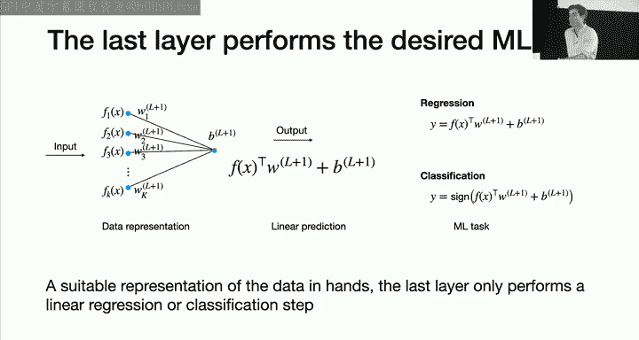

Okay， that's a very， very good point。You see that the depth will be connected to the number of parameter。

So then it could be the depth， so it could be also， you know。

 the size of each layer kind of the same。I mean， it's not the same。

And then that will be the main question why all this method will not overfi。

 whereas you have so many parameters。We will talk again about it in a few minutes。

Any other questions？Okay， really， it has to be clear what is the definition and what is the goal of this neural network because。

 but we will start to do know， it will be a little bit more difficult。Yeses。😊，Okay。

 so maybe this you have， let's wait。 Let we talk about it。O。

So what does the three main challenge of deep learning and we won't talk a lot about them。

 but really like in order to have this in mind。The first question is what is the expressive powerware of neural network。

 so what do we mean by that？It means like this first part of the network。

Which can learn a lot of defined function， okay？What kind of function can be if you play with a parameter。

 if you play with a bias， you will be able to implement a lot of different function。

Then the question is， if not， I give you a function。

And I give you some observation related to this function。And you train neural network。

To implement this function， will it be possible？Okay， will it exist to neural network？

Which will be close to this function。So that's the problem of approximation theory。

If I give you a function， is it possible to approximate it with a neural network？

And thats the first mystery is that for the problem we are interested in in practice， for example。

 for image recognition， it is working very well。 Your neural network will be able。

You know to implement the function， which will give you the correct prediction。

 That's the first question。 and that's what we will talk about today。The second question。

And we will talk a bit about it Thursday。I how is it possible to train。This problem。

Because what you will see is that we will have a cast。😊。

Which will be associated to all your parameter。But maybe you can directly see that this cost this function you want to minimize will not be convex。

 okay。It will not be convex， but still it will be possible。 and in practice。

 it will work very well to minimize this non convex function with gaian descent and with stochastic gaian descent。

So we will have a non convex function with a lot of parameter。😊，And so in practice。

 it should be NPR to minimize this function。But what we will see。

Is that if you minimize it with HGD or with GD。Kind of magically。

 you will find a solution of your trainless。So thats a second mistake， you know。

Or is it possible that our na optimization algorithm are so successful to minimize this non convex function？

😊，And then there is the last mystery， which is related to the question you both ask。

 it is a question of the generalization。😊，Okay， I telling you that you will find something with a zero training error。

And this is kind of intuitive。 You know that。So mini of the tiny will be because you have so many pa。

That it will really be possible to fit exactly all your observation。 Okay， you are really。

 you are over parameters。 You have more parameters。Thenhan the number of observation。

 So it will be possible to find。Some parameter of the network so that your prediction will be exactly。

You系。Observation。But then what is very mis their use。Is that， in fact， you have no refugeitity。ok。

The solution given by your neural network will generalize very well。

It will generalize very well to data you haven't seen so far。And even I putgens very well。😊。

With not a lot of regularization。And so thats really like one of the other you know mystery。

 A lot of people are working right now， trying to understand this。

 How is it possible that you generalize using。Search of farm has our network。

Without are choosing a lot of realizationization。You will have a lot of solution of your training loss。

 Okay， you will have a lot of different network so that your training loss is equal to 0。

But the one which will be picked by the algorithm you are using will generalize one。😊，Okay， does it。

 is it replying to your question or you still have。这个。O，那可以了。So today。

 really what we will do is that we will talk about the excsivity of neural network。ok。

And we will not really derive formal result， but we will try to give you the intuition of why the neural network can approximate a lot of different functions。

You have some question before we start talking about。Apprxiation of results。对。Can you move on sorry。

也。Can you会 be较 question。对。😡，So that's a very， that's a very good question。 I mean， we can talk a。

Again， about it Thursday。 So the question is you have a non convex problem。So the you know。

 if you are using some gradientian decent algorithm， the， I mean。

 the solution you will find will depend a lot on your initialitization。And so also here。

 typically kind of magically with some honda initiization， okay。You will find defense solution。

 but all this defense solution will work quite well。But that's a very good point。Yes。😊，I mean。

A neural network， as I told you， that's a very good point。

 So is there a problem where linear regression will be better as a neural network。😊。

The neural network will implement。You know， well give automatically to you the good features。

So if you have some extra knowledge of your problem and you directly know the good features。😊。

Then linear regulation would work exactly as good as an neural。😊，Okay。

Which is very nice with neural network。 You just have， you have this huge。😊，Black box。

 you would be able to train on any different， I mean， application。

And you will automatically learn the good features。But sure。

 you will always find some program where you will work as well。

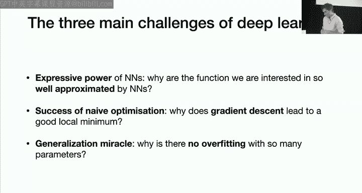

ok。So let's start， you know， with a result we will talk about we will not formally prove it。

 but we will try to give you the intuition。And that's a result which come from baahon。

And that it is what is called an approximation result， so what is it？I take a function F， O。

And this function will be from F over D。都啊。你呢。And so what we will see is that we will try to see if it exists a neural network。

 which will approximate well this function。😊，That's what we are asking。

And so you can imagine that you have to do some assumption。 Okay， if your function， for example。

 will be。Not smooth at all。 It will be difficult to approximate。

And so how we are doing this assumption。😊，We are using the four year transform of this function。

So if you not O。But I can always define F at， which will be the fourier coefficient of this function。

Okay， the definition is to the integral of F times exponential minus IW transport x。😊，Okay。

 so that's the coefficient of your fouryier transform and what you're assuming。😊，Is that。

It's the integral of the。Mouluus of omega times f at of omega in absolute value。Is bounded。

AndSo what I'm telling you is that this assumption is kind of saying that my function F。Is smooth。

 Let's say it's continuously defiable。Okay， because what does it mean。

It means that when W will have a large absolute value， we have a large mods。

Then you see that this would be very small。So the coefficient associated to the very high frequency will be very small。

So your function will not be2 w V and it will be a well behaving function。O。

So that's the assumption we are doing。 We are assuming that our function is smooth enough。

And how are we imposing this smoothness condition？Using the four year transform。

But what you have to remember is just the function is smooth enough。 and the smoothness。

Will be characterized by this constant C。 Okay， so C small。

 the function will be very smooth and C large。 The function will be not very smooth。

And so now what is the claim？😊，The claim is that。For any in end。It will exist a function， F N。

Of this particular farm。We will comment it later so that。So difference between your function and FN。

Will be small。O。So let's analyze everything。What is the form of the function F N。

You see that this function F N。一日。Lina combination of。Some sigmoid。Okay。

 so it would exist some vector W J， some by B J BJ， sorry。

 so that the function would be the sum of C J phi of x transform the W J plus BJ plus the initial bias C0。

So we will talk again about it， but you see that this is one hidden layer on the our network。Okay。

 and phi is some sigmoid like activation function。So what I am telling you。

If I give you a function F， which is smooth enough。It will exist。One you run let talk。

Search that the distance between F and FN is smooth。What does it mean to be small。

It means that it is smaller than。Two times C times a squared over n。Where n is a number of net。

So you see that if you take a very， very large network。😊，Then you will have a very small ever。

And then the question is， how are we？Computing the distance between F， N and F。

We are taking the L to distance。 Okay， We are taking the integral of the squared of F n minus F。

That's a first point。And the second point is that we are not doing this average over the world space。

😊，We will only guarantee a result on a bound space。 Okay。

 we are taking the average between F and F N。On the ball bounded by air。 Okay。

 and the ball of haddges R。Is it clear with a statement？

If I give you a function which is smooth enough。That it really exist。why you know our network。

Se that the distance between。Your initial function and the neural network is small。 And what the。

 what do we mean by small， It would be of order one over。Okay。

And it will be small as long I'm looking for some point。Which。Ofnm在。Yeses。A fight。

So Phi will be any sigmoid like activation function。We can take， for example， if you want to sigmoid。

 we have defined before。

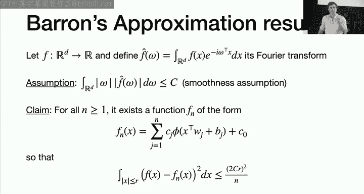

So let's interpret this result and then we will see if you have some question about it。

So what really， you know， is seeing the ratio here is saying that all sufficiently smooth enough function will be well approximated by a one hidden layer neural network with a sigmoid activation。

😊，And that the error height will decrease at one over n， where n is the size of your network。

 So if you think about it， it is a very good approximation result。😊，I mean。

 the error as one overvari it is a very， very good result。😊，And so who？It第 I mean。

How is is regulate interface their pages， you see that。The more no the more no youre adding。

The smaller the error will be， okay， the error will be as one over n where n is a number of nodes。

That's the first point。 So if you are adding some nodeds， then your approximation a will be smaller。

First point。The second point is you see the smoother the function will be。Then the smaller will be C。

And then the better will be your approximation。If C is going down， your error is going down。O。😊。

Then you see that the larger。So domain where you want to be able to certify that your function is well approximated by your neural network。

The larger the domain is。The worse your bond will be。 Okay。

 if you want to be able to certify that you have a good approximation a very on a very large domain。

Then the error will not be very good。O。But if you only want to satisfy it on a small domain around zero。

Then your A will be better。And then the second point is that the approximation is in L to norm。

 so that we like the integral of the squared between your function and your approximation。

And this result will be true of any sigmma in like activation。😊。

What you really need is that to have an activation function。With left limit with be。

With right limit will be1。And which is sufficiently smooth。Okay。

 so you just need to have an activation which look like a sigmoid。

Do you have some questions on this approximation results？Yes。O， ok ok。

You say that you have to standardize。Yes， that's a good point。 I mean。

 what you say is that your function， you will evaluate it in your input。

 So if you take your input with small no， it will work。But you know。

 you can really think of this problem more generallyarily without thinking about your input。

 it's really like an approximation result。I give you a function。

 and I want to see if it takes this to neural network， which would be close to this function。

Maybe you， for some application， you want this approximation to be good in some large space with airlars and on。

O。😔，Also sorry sorry， also what is not clear is that if you standardize your problems。

 then maybe it will change your constant C。So you know，那需要会图的吗？都车了。And。No。

 the dimension of the input is the。

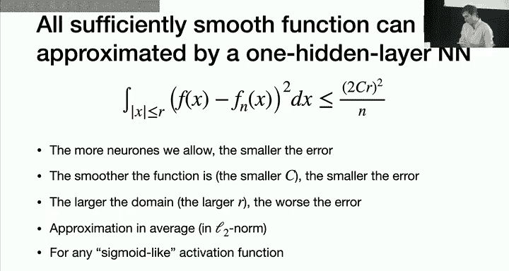

Okay， so you see。The dimension of the input is D。N is a number of notess。

ItsThe number of neurons in your network。And if you want to approximate well， a function。

 you will have to take a lot。Of Nes。你。Exactly， if you want。

 we have to impose some smoothness assumption and in this diagram of barahron。

 the way we define the smoothness is using the fourier transform of the function。ok耶。诶。

It will exist some approximation result for the value， it won't be exactly that one。😊。

And we will talk about it at end as lecture。

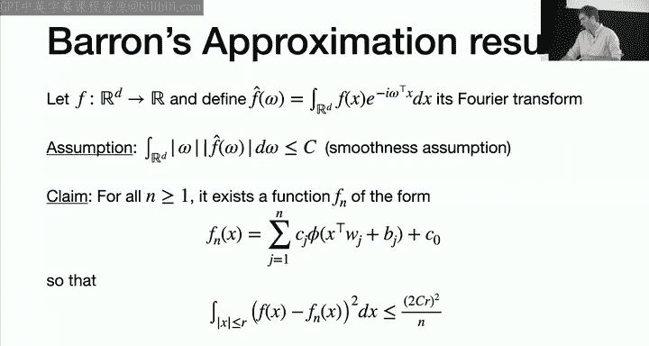

So let's just talk about this before the break So you see this is that this is a function。😊。

Given by the CRM， And you see that this function is exactly。

Can be exactly implemented by a one hidden neural network with endns。Okay， you have the input。

X1 to X D， that's the D component of your input。Then you will have the first。

So that will be your input。 then you will have your end nodes。And then you will have your output。

And you see that this function。Is exactly the same as this network。I have Wi。

 which will be the weight associated to my noded I。Okay， so I'm multiplying my input by W。

I'm adding the bias。Ends activation function。And then I'm multiplying by sea。The output。

And then I'm doing the sum of all these value。And on top of it， I'm adding C。O。

So is it clear for you that this function。Is the same as seasonal and network。

It has to be clear otherwise， I mean， what we will do after we'll make nu， yes。

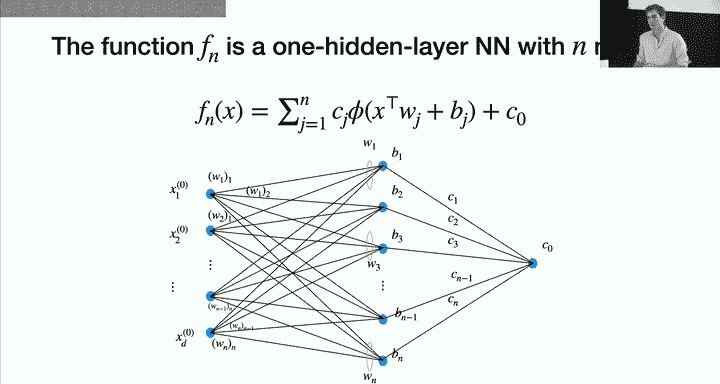

也。So let's say further the function will still be smooth， but highly non smooth。

 so C will be very large。It will exist in our network。

But you will have to take a lot of not in order to get a good approximation in order to get this constant to be small。

And will have to be very， very large。If C is also large。

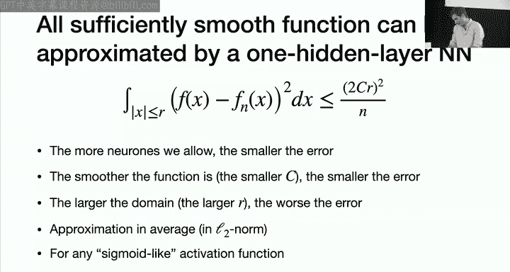

Okay， so we saw this result and now we will try to prove it in the last hour。

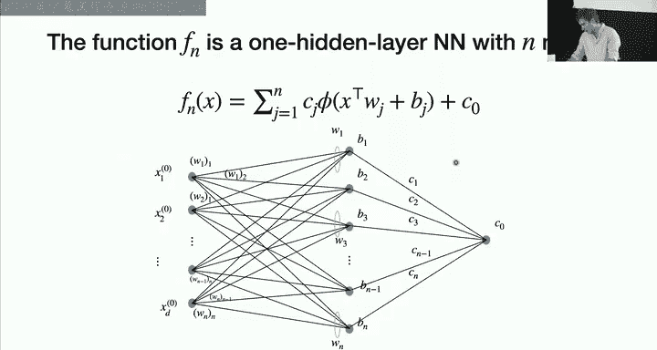

Just a quick question you can think of。You know， I give you this result and you see that this result is true for any function from F over D to R。

And you could imagine that， you know， approximating a function with the input space in very large dimension should be maybe harder than approximating a function。

From Apple to， you know。But when you look。At the rate， you get the dimension。Is not appear anywhere。

ok。So that could be like a good exercise or， you know， a good。😊。

Think to try to think of where is hidden the dimension in this result。Okay。

 that's something you can think of。

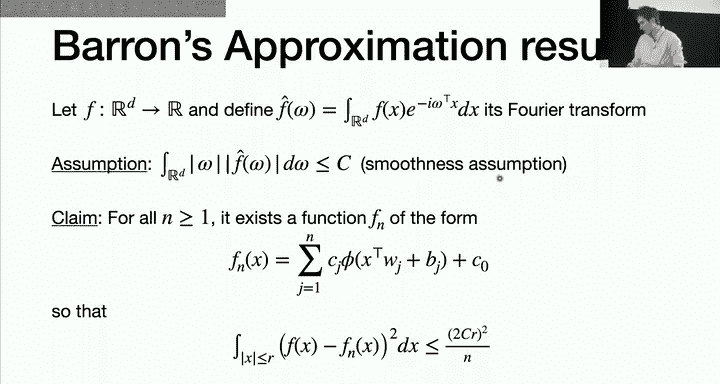

Another point， which is important。Is that。Okay， someone ask me some question about the training。

Of this here we are not training。 We are not learning the parameter C， W B， okay。

We are just asking the question。Does it exist such parameterhammeter？

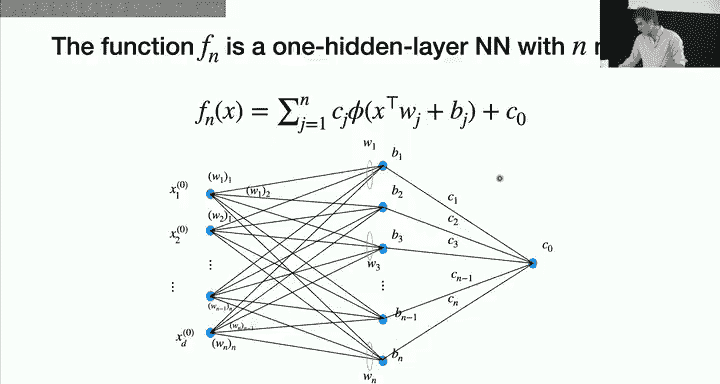

Does it exist search function？Which will approximate  well the given function F。 Okay。

 we are not learning this function。We are just asking the question， does it exist？

And the the answer is， yes， it exists。But there is no training involved。

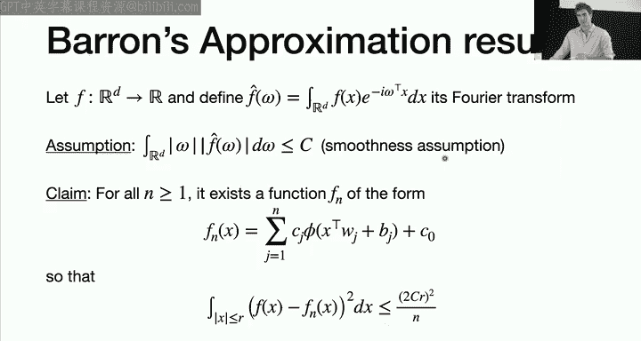

So， let's try。To get a proof。 Okay， it will not be a rigorous proof。 It will not be quantitative。

But I hope that at the end of the lecture， we have the intuition why neural network are approximating well these functions。

And so what we will prove is something a bit different。😊。

We will prove that the neural network with sigmoid activation。😊，And at most two hidden layers。 Okay。

 In fact， I would need two hidden layers， not only one。Can approximate well a smooth function。

In average H under the L1 norm， so what I mean is that the integral of the absolute value between fn and f will be small。

It will not be the integral of absolute value squared would be integral of the absolute value of n minus fM Fn minus f。

Okay， you will see why it would be complicated。So let's start from a simple example。

 I just take a real function， okay f is from a to air， I mean r to R with a bound domain。

And it is smooth。 For example， let's say that this is this function。ok。😊，好嘅你。

Get that it will be possible to approximate this function as a sum of sigmoid。

You see maybe what we can do without looking at the site。No。So what we will use。

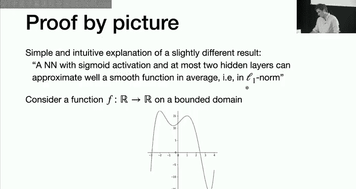

Is a human in gave with the function。Is remain intecrable， which mean that it will be possible。

To approximate this。You know， arbitrarily closely by some lower or op sum effectangle。

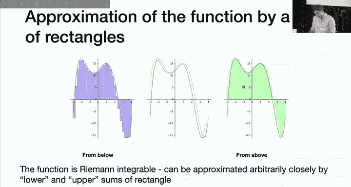

O， to any precision。

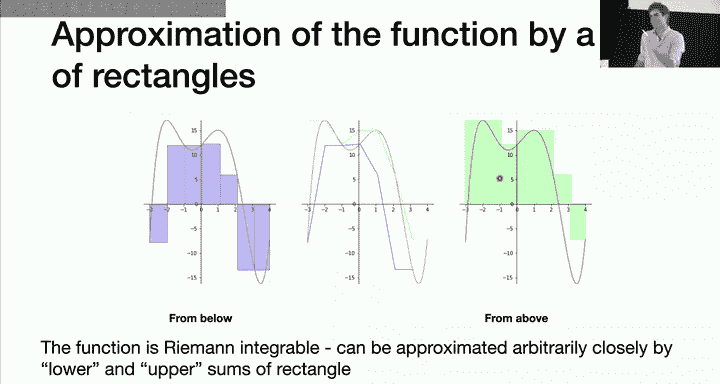

It will exist a sum of heecttangleal。Which will approximate your function by above or by below。

Okay， here you see the approximation from below， and here you see the approximation from above。

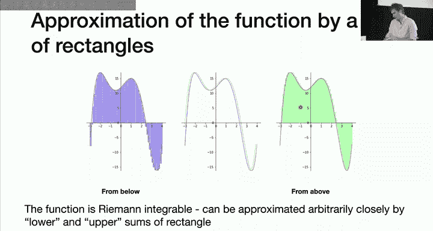

哎有谁在托你啊？Taking the number of rectangleal to be very louder when you are taking the size of the rececttangle to be very small。

 then the approximation become really， really good。😊。

O。

So the fact that the function is remain integrable is really telling you that the function will be well approximated by your sum of rececttal。

😊。

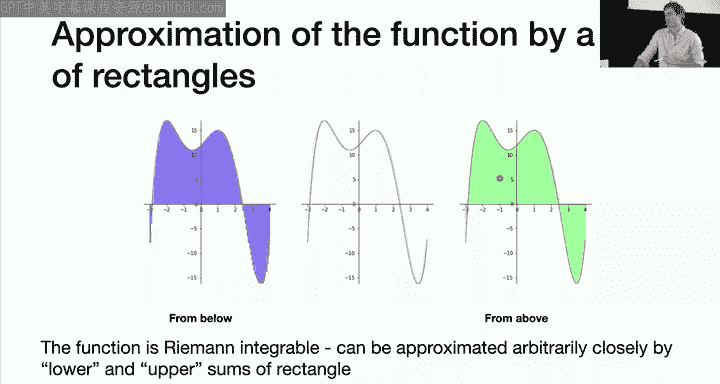

Up to any other。 Okay， you can get as close as you want of the function by considering a number。

呃。Lge enough of I don't go。

So this is not quantitative。 this is not telling me。You know how many he don girl I need。

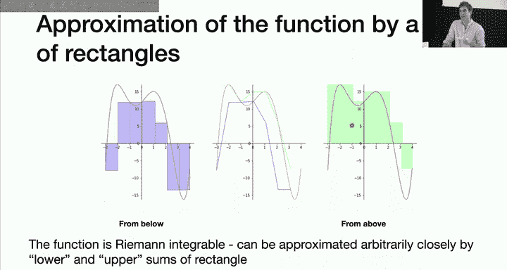

But this is giving you the interest。And of course， maybe you will need a lot of rectangleal。

 but we don't really care about the number in it， we just tell you any function will be well approximated by a sum rectangleal。

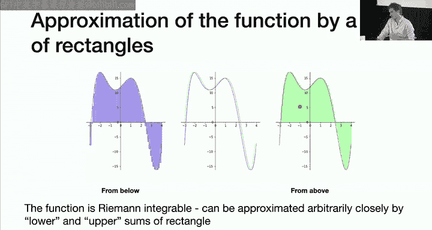

Is it clear for this first point。

do you have some questions。

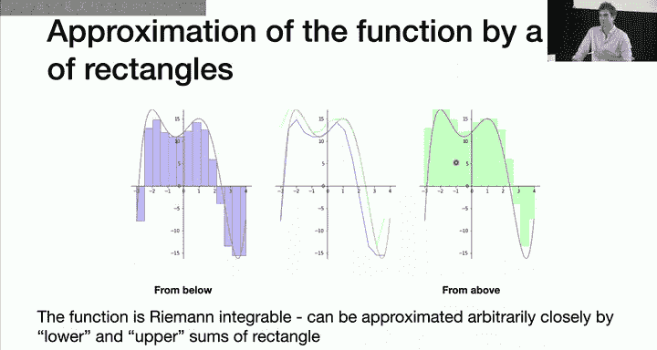

Yes。Can you回。No， no， you see， okay， that's a good point。Classically。

 the remainsmanor will tell you that the area under the other curve will be well approximated by the area of the hetonal。

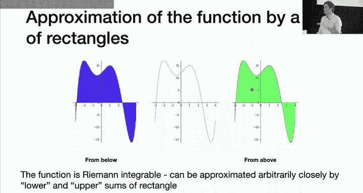

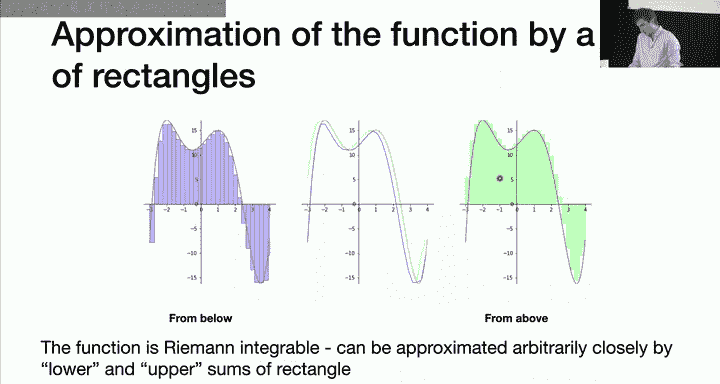

Okay， but then you see that the function。This high by the top of the heagonal is also well approximating the function。

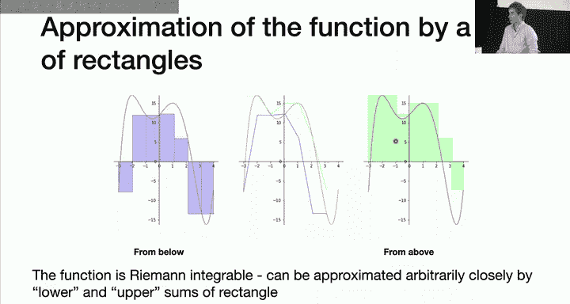

And that's exactly this。 if you look。At the area between the function。

And the top and the function I mean， this by the top of the recanglegle。

This will be exactly what you want to bound。 And this will be exactly the integral。

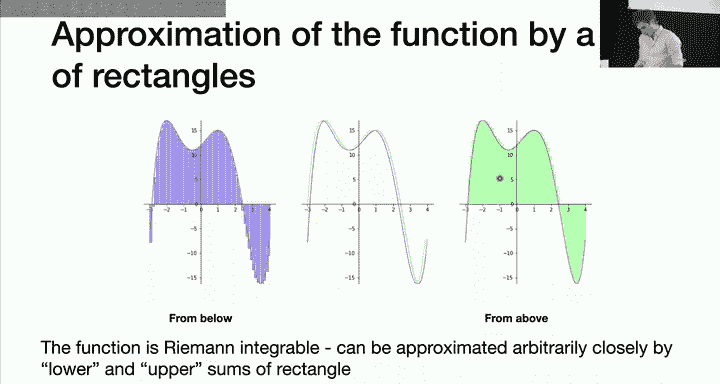

Of F minus F n。

E x。And so this is what we will bond。

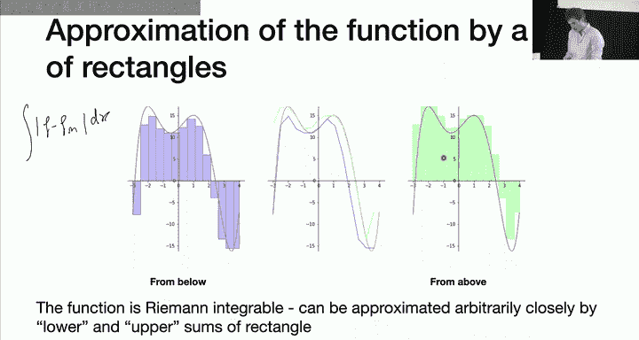

Okay， and in fact， it's possible to remove the。

Absolute value， you know， because your function， if it's the。

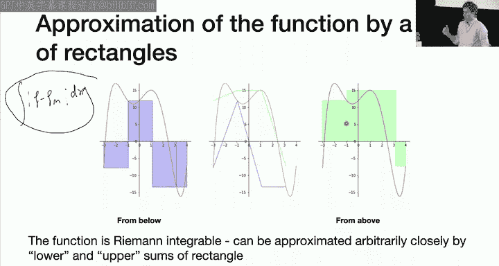

Approxiation from below， it will always be below， or if could say approximation from above。

 it will always be above。

So you see that this is exactly。I mean are here between。

The function， I mean， between the function and the rececttangle。 And this would be。

This will be what will be small using the remainder。

真。ok。😊，So， first point。

The function will be well approximated by a sum effect angle。Maybe you will need a lot of MccDonals。

 but we don't care。 just if you are assuming。

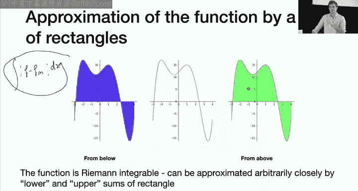

Large， I mean， a number large enough are factortangleal。

 you will get a good approximation of your function。

So what should we do now？What is a second point。

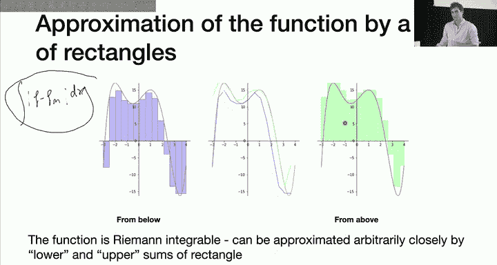

I remind you I want to find a neural network which will approximate well by function。First step。

 my function is equal， or it's close to the semi effect to。What will be the second step。

Let's do it again。 I want to show。That it will exist the neural network。

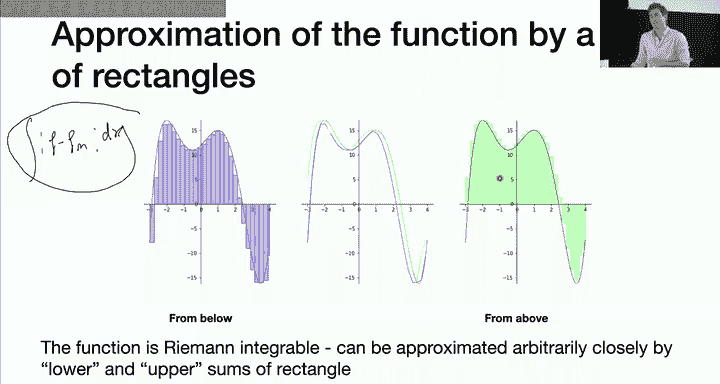

Which approximate well my function。A neural network is a sum of some sigoid。

Okay。

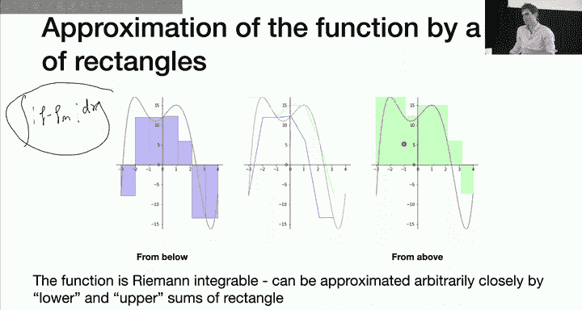

The first step， I'm showing that my function will be well approximated by the sum of sum electronectangleal。

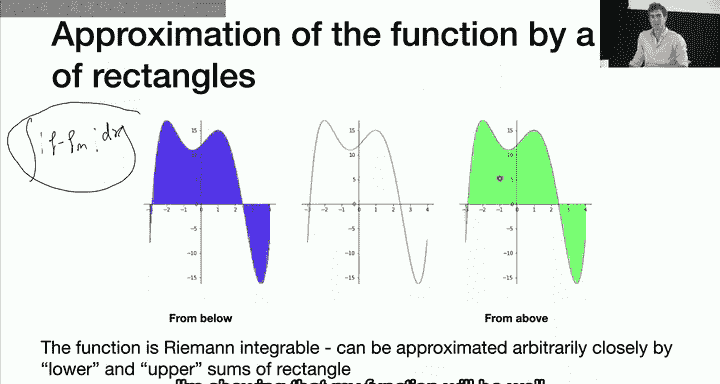

So what do I want to show now。Yes。

Okay， so I want to show that it will exist in neural network。

 which will approximate well a rececttangleal。😊。

ok。If I can show that， then I will hove my results。

My function will be approximate by a sum of rectangle。

 each rectangle will be approximate by a neural network。 So if Im doing the sum of all the known。

 I will get a neural network， which will approximate well my function。

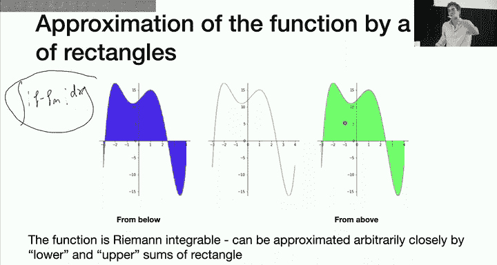

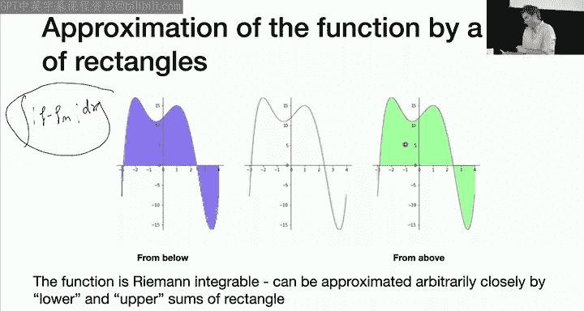

Okay。So what we will see。

Is that。It's possible to approximate a rectangleal by a neural network with two nodes。

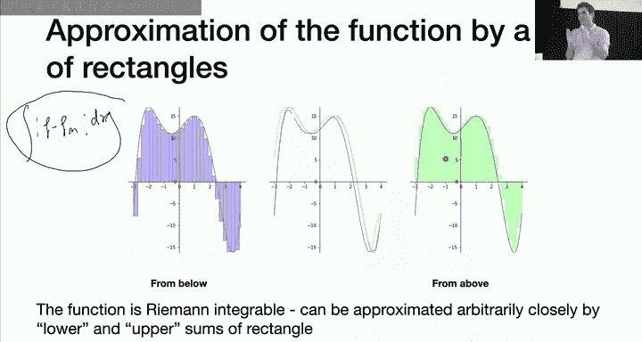

If I don't restrict the size of the white。

So， the first step。Will be to see that， in fact， a he tongue go。You see。It's， in fact。

 the sum of two steps function。Because this should be。This is my high goal。

 That's really like the indicator of。X belong to A and B。If x is between A and B， this is equal to1。

 and I want a heagon goal of size h， so I'm multiply by h。And if a， I mean， if x is smaller than a。

 this is equal to 0 and if x is larger than B， this is equal to 0。Okay。

 and what you see is that this rectangleal is exactly the sum of this two step function。😊。

It's exactly the sum of the function， which is equal to0。If x is smaller than a and equal to H。

If x is larger than a。Plus， the second step function， which is equal to 0。If x is smaller than B。

And then is equal to minus H if x is larger than b。So that I want to kill。

 you know I want my function to be equal to0 when x is larger than b， so I want to kill this part。

 so I have to remove minus H。So you see that if you are doing the sum of these two steps function。

You get exactly your he dont go。O， is it clearifies that point。It should be。So now the question is。

 is it possible to approximate this step function？With the neural network。

How can I approximate this step function？Yes。😊。

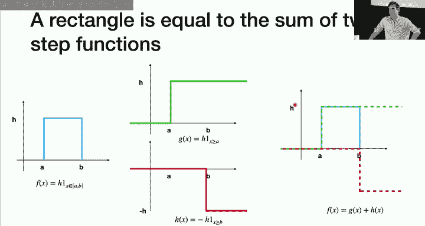

Exactly。So， you see that。If I go see there。Phi tilde of x， which will be phi of w times x minus b。

Then what you see is that by setting B。I will be able to set where the transition will happen。 Okay。

 where my function will start to go from 0 to one。This will be given by B。

And W will tell me how sharp is my transition。So this is exactly as what we did if for linear regression。

 I mean for logistic regression， you see that if you are taking a very large double。

 your sigmma will approximate really well， your step function。😊，ok。So， you see that。

By taking W to be large enough， it would be possible to approximate a step function。With。A sig。

You just have to set the B it where the transition will happen and W to be large enough。

And then you can add some bias。And you can multiply by some value if you want it to go from H to0。O。

So we want to approximate a rectangleal。 a rectangleal is equal to two steps function。

 One step function is equal to one sigmoid。 How can I approximate one rececttangleal using。十安。

How can I approximate a heal I will need to use。We need to use two s。

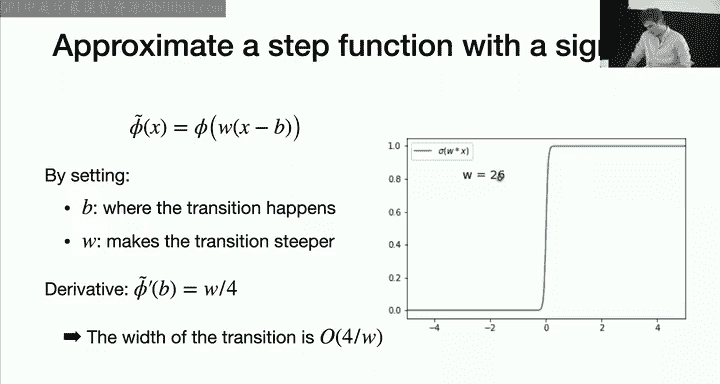

So you see that would be exactly given by this。衣服。I want to create a rececttangle。

 which will start from0 to H at a and then we' go down to0， I mean， to0 at B。 I just need to add。

2 sigmoid。This will be exactly given by the product。I mean， by the pictures。You see here in blue。

 it would be my first single。And in yellow， it will be 1 minus my other sigmoid。And when I will do。

The sum of the two。I mean， when I will do the first thing minus the second thing it would exactly give me。

就 I don't go。And you see that if you take W to be large enough。

 you see that the approximation is very good。ok。So this is really telling you that in order to approximate the hetongo。

 you can do it well。By doing the def between two sigoid。Is it clear for this first point？

Can you repeat your question。H。Exactly， I want to approximate a heecttonal of height H。

And my sigmoid is going from 0 to one。So in order to scale it to a size age。

 I have to multiply by age。ok。So that if you take a small h。

 well have a small recectangle and if you take a very large h， we will have a very large rectangle。

So is it clear for this first point that age time thisingwe minus thisingwe？Is approximating well。

You like donng go for a large value of way W。And then the second point is to see that this function can be implemented by this neural network。

My input is x。Then I will have two nodes。Here， I will first multiply x by W。And I will remove。😊。

My buy啊。Remo W A。Okay。So the value here will exactly be。5hi of W times x-8。

Then the value here will exactly be。X， W minus。No will be。Okay。Yes。😊，Because okay。

 that's a good point you can do the computation， but first。In order to risk scale。You have to put。

 you know， the a inside the W。 I mean， inside the bracket。 Otherwise， it won't work well。Ok。😔。

That's a very good point。First， you translate late。By changingjing， you know， your ex。At a scale A。

 And then you want to multiply by W in order have a sharp transition。So the bias is WB is not onlyB。

Okay， and then what you want is to do phi minus phi。

So you just here you have H and here you have minus H。

 and when you will do the sum of these two value。The output will be exactly this function。你在对啊。

If it's not clear to， I mean， you should ask now， because。That read like the key of the lecture。

How some function like this can be associated to some neural network crisis。也。Yes。

We are only talking for about2 dimensionmental solution。yes。😊，那。

InThe network I will have here a sigmoid in， here， a sigmoid， and here it will be id field。

Those that questions？Okay， so how can we finally conclude。What do up sorry。So， first。

We approximate a function by your sum effect angle。Okay， by sum of Kangle。 that was the first part。

Then each of these like donal。We can approximate them using2 sigmoid。ok。

So it will be equivalent to using two nodes in a neural network。

And then we will do the sum of all the sigmoid with S of plus or minus。你本金。Of the number of the nud。

And when we will do the sum， this will give us the sum of all the rec toal。

So you see that the resulting function。Will be this neural network with two times k nodes。ok。

If you want。If I look only at this。This was the neural network I described in the slide before。

I have my input。I will multiply it by minus W A。 I mean， I will multiply it by W。

I will subtract minus W A1。Thanks a Sweed。Then I will do the same， but when I subscribe。Mus W B1。

And then I will do the difference between the two。And then I do the sum。 So this is giving me。

The first rectangle。Then I will do exactly the same with the second likeangle。ok。

And I will do the same with a third to go until。咪拉动感。So you see that when you add everything。

 it's only giving you a neural network。无意思。😔，An input。捉记。It nuts。And one output。

 and the output is just。You know， the some。I the配 using。Is it clear or not at all。Yes。

So that's a very good point you don't understand how is it possible to subtract a sigmmaoid。

So what is， you know the value？When I compute the value here， what it will be， it will be。My weight。

Times the value in the previous node。Plus， my other weight times the value in this node。Okay。

 by definition。So my value at this node is equal to weight times the value at this node plus my other weight times the value at this node。

So you see that if you wait。啊那个。Then you will it be possible to substitutetract。Okay。

 here my weight is age。And for this edge， my weight is minus age。So my output will exactly be。

8 times sigma of。X1，1。Minus h times sigma of x 1，2。O。So you have to wait。

You have one weight associated。To the edge between the input and the id layer。This is my weight， W。

Which is inside maing weed。And then I have a weight associated to the edge between my hidden layer and my output。

And this is the age。So what I need is that。What they mean is that you have some age。

So you have some weight inside your signaligma in， these are the W。

And then you have some weight outside the sigmoid。 and by playing with a sign of this。

Wt outside the sigmoid， you can do multiplication or you can do addition subtraction。O。

The weight here is minus H。If you would have like to do a sum of the two sigma。

 you would have to put plus H。 If you put minus H， you will have subtraction of the second sigm。

Here's our question， yes。So I'm not sure to understand your question because final is nothing in practice。

 know I's really like a technical results I just telling you that this function。

Is implemented by this neural network。There is no training。 There is nothing。

 I'm just giving you this function。 This is a function。Okay。

 which is defined for some parameter AW and H。And what I'm telling you is that this function is exactly the same as this neural network。

Okay， so there is no training involved。

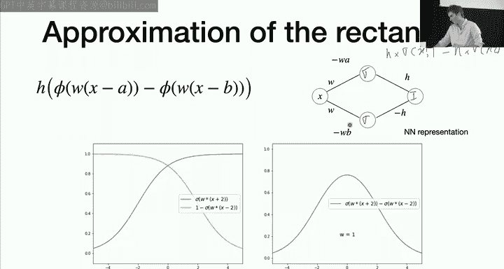

ok。So all good for this result in the one dimensional case。有。

So let's try what we can do if we want to go to a larger dimension。Okay。

 because so far we have only done for one dimension。

And so what we will see that how is it possible to go to the。Do the case。

And then you can see that using the same I will be possible to go to any dimension。

 but today we will only talk about the 2Ds。So as you can imagine， it will be exactly as before。

Your 2D function will be approximate by a sum of 2D rececttangle。Okay。

And so know what you want to do。Is to see that it is possible to approximate these2 dangles by sub neuralural network。

Okay。I it clear for everyone that if you have a way to approximate my 2D recangle by your neural network。

 then by assuminging all this neural network， I will be able to approximate my 2D function。Yeses。

And even I can choose a rectangle which is。Pahael to the two axiss。 Okay。

 so I just need to find a rectangle which go from0 to1 when x1 goes from a1。To be to be one。

And when x2 goes to a2 to B2， okay。So you have知食当。Okay， and I want to find a neural network。

Which will approximate 1。

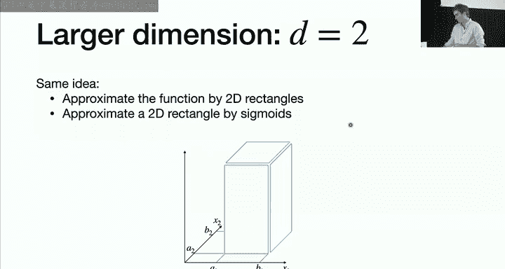

So using the same result as before， I can see that with two sigmoid。😊。

I will be able to approximate well， this kind of infinite rectangle。ok。

It will be exactly the same result I be。No， my input is in 2D， x 1， x 2。

But I will not consider x2 in my function。 It will only be。The same function as before。

 the function we will start to go from0 to 1 around the value 1。

And then I remove the other sigma to go from one to0 at the value B1。 Okay， so you see that。

When you fix x 2。You exactly get So hetonal we add before。

So this function is really implementing a heecttangleal。

 which is going from a1 to B1 in the x1 direction。And which is unbounded in the x2 direction。

Is it clear for the first point。Yes。😊，And so you see that this function can be exactly implemented by a neural network。

😊，As before， but now my input。Is in 2D， X1 and X2。But I'm telling you that the X2 input。

Is not presenting the function。 So I just put0 in my weight， okay。I could have also he moved。这H。

阿算黄得都食。You can either up zero， you can remove the edge。

 but you see that this will implement the neural network associated to this function。

You start from x1， you multiply x1 by W and you remove minus W A A1 this gives you this。

 you applied the sigmma it。You do the same for the second node， you start from x1， you multiply by W。

 you remove minus W B1， you apply the sigmoid。And then you subscribetract the two。So this at the end。

 will exactly be。This value。Okay。😊，So， no。What can we add to this infinite rececttangleal in order just to get one rectangleal。

 you know what we want。Yeses。😊，Exactly very nice。 So what we want is to add this other in finite rececttangleal。

So you see that exactly the same， but now this is my heal which go from a2 to B2 in the x2 direction。

😊，And which is infinite in the x1 direction。And so this is exactly the same formula。😊。

And is now implemented by this other network where I put0 as y for x1 and w as y for x2。O。

It should really be clear for you and it's a good exercise to see that this neural network。😊。

Is implementing this function。对。So what is happening if I'm doing the sum of these two in finite rececttangleal？

Do I have what they want。SoSome of you say yes什么时 say no。If I'm sending this two in finite。

 what do I get？Try to think about it。Okay， so you see it will not work。Because you will get。

Something which is kind of what you want。Here， it will be equal to2。But then， you will still get。

These infinite arms。Which I put to one。Is it clear for you that if I'm summing these two infinite finite arms。

 I'm getting this？Shape。Kind of like a cost。With。Between。A1 and B1。And between B， A2 and B 2。

 it would be equal to2。 So this is what I want。 But I still have this。Part of the arms I don't want。

Yeses。😊，And you see that this is exactly。😊，Implemented by this neural network。

 which is the sum of the two neural network as before。 I still have my input。

An x1 will be associated to these two nodes。Which will be sub here。 It will give me this。

And x2 will be associated to these two nodes。Which will be subtracted at the output。

 And this will give me here。 So you see that the output is a sum。Of these four values。

I could have exactly put if I want。All this nod。Okay。But I will have to put 0。

 So that's exactly the same。Okay， you can always put double to people to0 or remove the edge It's the same。

So what can I do？In order to solve my problem。What can I do in order to remove。This box。

So what is happening if I just like Cri scale my function by one over two？Will it solve my problem。

Here。My initial function is equal to two。 so if I divide it by two。

 it will be equal to one and I'm happy。😊，Buts still。The arm will be at a value1 over2。

 so it does not solve my problem at all。So what would you like to do to remove this path？

But then if you are doing this only here or you are doing this globally in the function。

So if you are doing it globally， you see that you will be equal to minus-1 here。

So you are just subtracting this part， subtracting this part。

 subtracting this part and subtracting this part。Okay， so this is what you want to do。

 But how can you do this。Yes。Okay。So that's very good what you would like to do is to threshold the output。

Okay， what you would like to do is just if the value is larger or that something larger than one。

 you keep it。So that you will keep all this packed。The chip of value is smaller。Then， for example。

3 over two， you remove it。 so that will remove all。日是 value。So this is exactly what you want to do。

 you want to threshold your output， so you won't。To compose it with this indicator， okay。

If the output is smaller than C。No sorry to be。老着。If the input is larger than see， you keep it。😊。

And if the input。So if the output is smaller than see you remove it。 Okay。

 that will be your threshold。And what you can see is that， in fact， using a sigmoid。

 it will be possible。To approximate this， because this is exactly a step function。

And so this is what we see in the animation。This is what I get when I apply， I mean。

When I will add a sigma in the top of my output。And if I play with a double you the。

So I can approximate this sigmma， I mean， this thresholdholding function。

By applying a sigmoid with a very large weight。😊，And a good bias。 So for example。

 I can take the bias to be3 over。O。So you see when I will， I mean。

 when I will apply my sigmma to my output。It will。Should really discard the two infinite arms I don't want to have。

Is it clear for this part。Yeses。😊，Why 3 or02？We wants something to be strictly larger than one and smaller than two。

You can take what you want。Is that questions？So you see， this is what I get。

And when I will apply my sigmoid， it will remove。The part of the arms I don't want。

And this is when I take a sigmoid with a larger and larger weight， to see remove。😊。

Exactly everything。All good。So this shows you that it's possible to extend this result in larger dimension。

ok。You can approximate any sufficiently smooth2 D function on the bounded space。Bye。呃，徐德文农北。

Of2Dectagonal。 and then you can approximate this2 Dectagonal。By this kind of neural network。

So what is the difference。With a one D。Someone。What is the difference with a one dimensional case。对。

So that's the first point， okay。Have have an activation function。But at the end。

 what will be my solution。What will be the neural network I will get when I will add。

All this network。What to be。You have next High， okay。So this you have to。Convince yourself about it。

 You you have to think more about it previously。When here it was identity， it was possible to add。

All my network on top of Oza and I was only obtaining one hidden Le network。But now， when I will add。

One network like this plus another network。Since I have the smoid here。

I will have then to do the sum of all the value。After the sigmoid。

So the resulting neural network will be a two hidden layers neural network。Okay， yes。N图 not图。I mean。

 it's not clear the地图。Because you could have some， you know。When you will have a lot of some， I mean。

 it's not。So really easier your way。Is to apply the sigmoid to your two nodes。And then。

You do the sum of all the sigoid。What。那么 you are already paying something weight here。Okay。

 so you should come to see me again and not try to。Im asking your question， okay。Okay。

 so let's conclude with the next result and that will be the last one。

So far we have talked about approximating result in average okay。

 so the barron CRM was for the L to average， and I gave you a proof by picture for resulting L1 average。

And so now what we can think about is is it possible to get some pointwise average results？Okay。

 you really want to bound for each point the distance between f of x and your approximation。

And so maybe you know that if you take some continuous function on a bound domain。

 then you will have different add infinity results。😊。

Maybe the most famous one will be the stone wiretra algorithm。

Which is telling you that it is possible to approximate a continuous function。バ youプの milk。O。So。

 for any eil。For any precision， it will exist some polynomial such at the distance in the L infinity norm。

 okay the sub between f of x and the value of the polynom P of x。😊，Is smaller than Eilon。

So that's an approximation in terms of polynomial。The problem is that a polynomial will not directly be implementable by your neural network。

😊，So we are looking for something simpler。And in fact， it's possible to show。

And that's result by Sheckmann in this paper of1982。That it is possible to get a similar results。

 okay， to get a pointwise approximation result。By p wiseer function。

 So what is a piecewiseer function。Is really a function， which is linearar。Okay， it is Aine。

But be waste。So you see that you can always write it like this。You will have the indicator。

 which tells you that you look at the function between A minus1 and A and in this interval between A minus-1 and A。

 the function will be linear。And then between AI and A plus one， the function will still be linear。

 but it will be a different enough function。ok。😊，So you see that any piecewise function can be written exist。

And what is important is that since we are assuming that the function is continuous。😊。

We are considering continuous spacewise in our function， so we have this bondai condition。Okay。

 I need that the value on one side is the same value of the other side。

So this is telling me that AI AI plus B， this is the value of my inner function in AI should be equal to the value of my inner function on the other side。

 which is equal to AI plus 1 AI plus B plus 1。ok。😊，And so then。

This is an animation which will show you exactly the same result as before。

 you see that your continuous function will be approximate 12 by search piecewise in our approximation。

So now the question is， how is it possible to approximate such piecewise in a function？By your。

And so to do so， we will not use。The sigmoid， because the sigmoid will not be really helpful。

 but we will use another activation function。😊，Which is called the rectified in our unit。

Which is exactly the function given here。Okay， that's a function which is equal to 0 for the negative x。

😊，And then which is equal to x for the positive x。ok。And you see that， if you look。啊。X minus B。

Please。You will be able to move。Where the kingink will be。Okay， so by playing with a B。

 when you look at x plus b plus。You are moving the kink。 Okay。

 you can translate where the transition is happening。That's exactly the same。

thinghing that we did with the signaling。And then。By playing with Alpha， I will be able。To move。

 you know。The slope。Of the linear。If I take alpha to be positive。

 I will have some increasing function。 and if I take alpha to be negative。

 I will have some decreasing function。ok。😊，So know what I want you to be convinced。

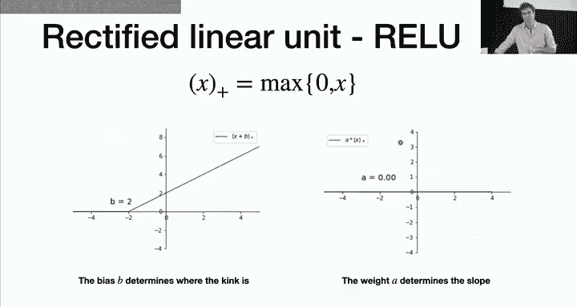

Is that if I am doing some sum of Relu like this。I will get a piecewise in our function。Okay。

 this is exactly the same kind of function I was looking before。

BI Tilda will tell me where the kingink start， where my transition happened。And。

il I mean Tiilda AI will tell me what is the slope。If it is positive， it will be increasing。

 If it is negative， it will be decreasing。And so what you have to see is that if you are doing the sum of search monomial。

You will obtain this piecewise in function in blue。Okay， this will be my first。

My first hello will be that one。Okay， at02， I will start。Having my first skink。

But then after this value， I'm adding a s helllu。😊，You see that I' that one。

 so my slope is changing because I'm adding I have the previous value minus the new value。😊。

So you see that my slope is changing。And no， at this value， I'm。Adding a new re。

 And so my new slo will be the sum of this two pre s。Okay， and so and so。

So you can see that in the animation。 I'm adding the first。😊，意思。

Each time you are adding a new relu at that point， you will change the slope of your car。I mean。

 if your this way is in enough function。It' very important to understand this。Youre adding。

 and each time we add a new hello， your linear function。 I mean， your piecewise linear function。

The slope will change。

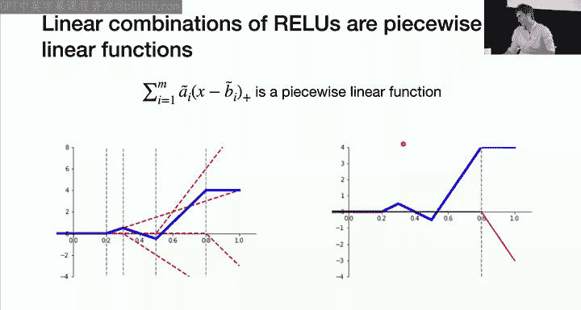

ok。😊，So let's just finish on this。The first claim。Is that my piecewise in our function can always be rewritten as。

some of like this。ok。Any piece wise is in our function。Can bewritten like this。

 and the value of the parameter will be given by the initial value of the parameter。And does I mean。

 pages formulation。So that's the first claim。And then the second claim。Is that this function。

Is implementable by a neural network with one hidden layer。With a re activation。

Because you see each of these term。Will be exactly。温馨。Okay， first。Multiply x。Bye。It did I。

And then he move。啊，no no no， sorryor。This is not good。 My first way， it will be one。 Okay。

 so I first multily x by one。Then， I he move。Be the eye。I apply my he。And then， I multiply。喂 a战得 i。

And I sum all this。Okay， so you see that all this term will be given。By is this part of the network？

But they still as the first town to take care of。For the first term， the plus bett1。

 I can always add it as a bias。Of my output， okay。By adding this bias。

 it will add to my output this value， so this is what I want。And now I have the problem of this term。

So what you have to be convinced is that this a tilde 1 x。

Can be implemented by a relu and y is because x is in 01。I'm assuming that my function was in 01。

I mean， I can change it with a other Bai， but if I am assuming that my function is in01。

Then you see that。Eilda 1 x is exactly equal to8ilda。Xpress。Because for x negative。

 I don't care and for exos， this is equal。😊，So you see that the first part I just have to put to0 by us and then multiply by 18 that1。

Okay。So this will be done for today next time I will just end I will start the next class by proving that you can get。

This is equivalent formulation， and then we will talk about how to optimize the neural network with a gradient descent。

And we will also talk a bit more about activation function。

Please do not forget to register to the lab。And we really encourage you to go to the lab because that's。

 you know。Well you can practice the theoretical exercise and that's what will be about the exam。

