# EPFL《机器学习｜Machine Learning Course CS-433 fall 2020-2021》中英字幕（deepseek - P23：[23]EPFL Machine Learning Course 2021 - Week 8 part 2.zh_en - GPT中英字幕课程资源 - BV14SwyeNEvW

So today we will use a second lecture on neural， okay？

So we will talk about how to train in neural neural network and I will present you the back propagation algorithm。

In the last lecture， we start talking about Neval network。😊。

I introduced a basic structure of the Ne network and then we talk about this question about excsivity。

 you know？😊，We were like asking the question， what kind of function you can fix on using network。😊。

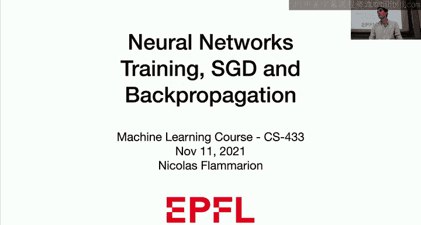

So to start， let's do a quick hicap about what is in our network can be always useful。😊，So you know。

 maybe your first question， maybe it was not clear for you last time。What is the neural network。

 really？And someone ends them in you know。What actually is a nohar。怎安。

Most basic answer I can give me。For what you were using in another，I was gonna say。

So that's good to say that's a graph， but really like you know， at the basis what it is。😊。

It will be a function， Okay， just to be clear like a neural network will be a function you will use to do a prediction。

 You will have an input which is the observation X and the neural network will implement a function。

And then you would be able to do a prediction using this neural network。😊。

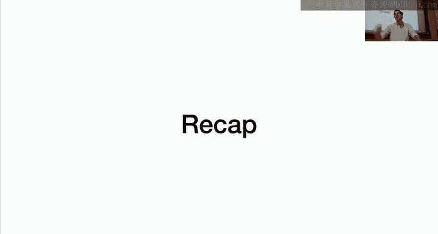

Okay， so like what does I read like the key facts。😊。

In the course we are using neural network in order to do supervised learning。

 you can use it for other of course， but in the course we are really doing supervised learning so you are。

😊，Observing。Some data， your training data， okay。Some observation x and some output y。

And you want to use this observation in order to be able when I will give you a new X to find what is its associated label。

 Okay， that's the goal of supervis learning。😊，You don't know the true relation between x and Y。

 and you want to use your planning data to find this relation。That's a goal。

 that's a whole as a game。And what we saw first is that we can use linear prediction。

And linear prediction is really like your prediction。 Okay， the way you will predict your label。

 your function F effects x。Was given by some linear function。So you could use some augmentation。

 you can augment your space， you can use some features phi。

 and then your prediction will be phi of x transpose w。

And linear prediction will only work well if you have some good features， if you have some good phi。

 but the Phi are given to you。 Okay are given by the domain expert， if you want。😊。

For one application， you know that some features will work well and then you will try to find the best parameter value to do your best enough prediction。

When you are using a mean a neural network and you want to do the prediction with a neural network。

ok。Your prediction will really be F of x， where F is a function implemented by the neural network。

Okay， so this is a function with spahammeter will be the weight and the bias。Okay。

 so that's a function from the input from x to the output in capital Y。

And so what you try is to learn the best function in order to find the best relation between x and y。

And so the neural network will really be a way to ba high cells function。At the end。

 it will only be a function。Is it clear for this first time？Okay， like the neural network。

 we only implement the function。And you will be able to use this function to do a prediction。

Well good。And the second thing we saw which was very important is that in fact。

So you notice these huge black bugs can be cut in two and you have the first path。

The input layers and all the hidden layers。And this first part， in fact。

 will transform your input x into some nice representation。

 so in fact the first part of the neural network will find a good representation of the observation。

😊，And then with the last path with the last layer， you will do on top of this good representation。

 a linear prediction style。😊，ok。So really all what you are doing with the neural network in some sense is to learn a good representation。

 a good feature for your data。😊，Previously， this was done manually。 for each application。

 a practitioner will give you a good features。 No by training a neural network with a lot of parameter。

 The neural network will automatically find some good features。😊，Okay。对。

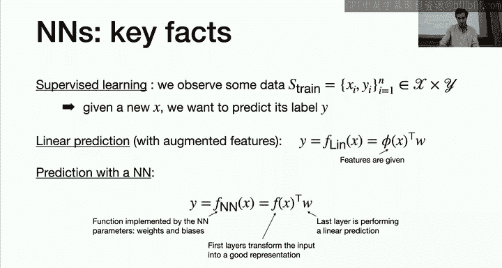

So let's start again also with a basic switcher， it can be nice to look at it again。

So you have your input layer。You know。And you have one node。For each component of your input， Okay。

 if your input is at dimension D， then for each of these component， you will have one node。

And this will be your input layer。 Okay， so your feed in your network， your observation。

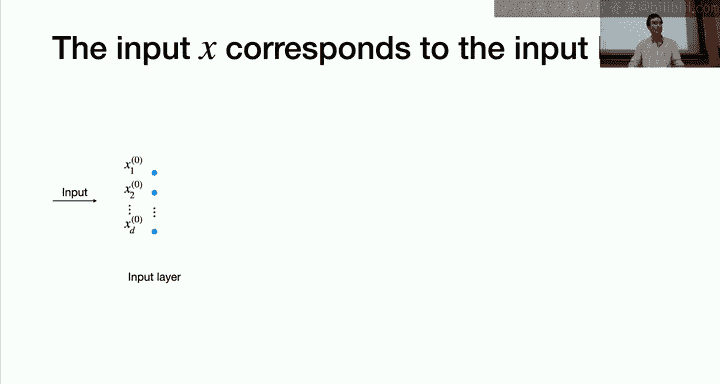

And then from this input， the senior will propagate in many other layers。 Okay， so you will。

L E layers。This is a parameterameter you have to decide， okay， you can take L。😊，I mean先闭。

As loud as you want。And then you will have one output layer。And in each hidden layer。

 you will have k different nodes， okay， and we are assuming that we have the same number of nodes in each hidden layer。

So that's like all your nodeds and your sin really is propagating along all these nodeds。

And so to each of these nodeds， you are associating some value and you denote this value x。L I G。

 which is a value for thenerd sorry， X I G， which is a value of the nu I as a layer L。Okay。

And then the output will really be the value of your prediction。

 okay it will be the value output by the network。😊。

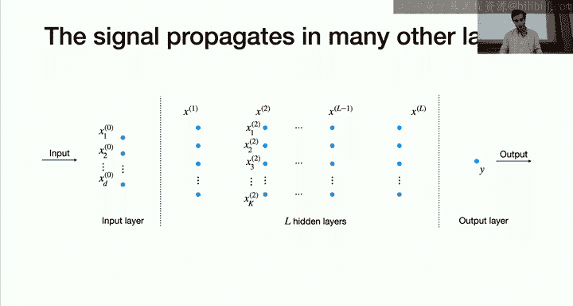

And then the question is how？Is the signal propagating along the network？

So what we saw is that we are considering network， which are called fully connected。😊。

So why fully connected between？Each node will be connected to all all the nodes of the previous layer。

O。Byy some edge。And then the information will be able to flow along this edge。Okay。

 so that's really like a fully connected neural network。😊，If you take two。

Nots in two different layers。They would be connected by image。我觉得。

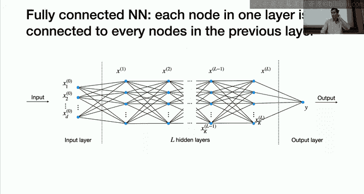

And so then what does the parameter of this network？This is what I've called the weight and the bias。

So， to each。Hdge between， for example， the noded I of the layer L minus1 and the noded J of the layer L。

You have this edge and to this edge。You will associated one parameter。

 which is called a weight and this will be。So white you did not buy W IjL。Okay。

So these other the weight。And to each nud。Of your network。You are also associating a bias， Okay。

 BJ of F。So all these will be the parameter of your network and that will be the parameter you will have to learn okay that's the equivalent of the W when you are doing a linear regression。

 example。

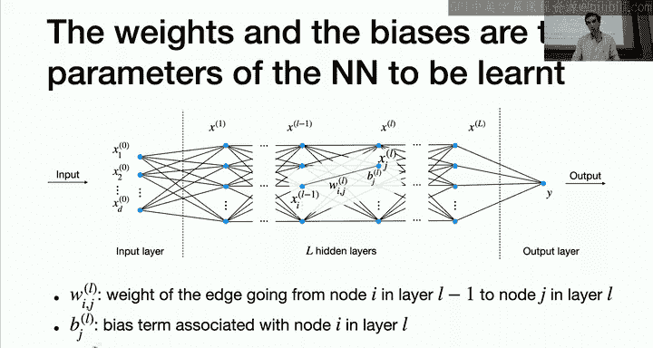

Okay， that's a parameter you want to learn。 and if I give you this parameter。

 then you can implement the function。Of the neural network， Okay。

 so each set of Bamaker you will have a function and you can use this function to do a prediction。

So then the question is， how do you update the value at the different nodes？

And so what we saw is that the value at the node was defined recursively in function of the value at the previous nodes。

Okay， so how is it close to。We saw that。 the value。As the nu J of the layer L。Was equal to。

The project of all the value at the previous layer。Times。The weight。Between I and G， okay。

 you look at the value。At。One of the produced noded and you multiply it。

By the value of the associated weight。And then you do the sum for all。真 nuts。

And then you add the biasteem。ok。And on top of it。You are taking an activation function。

Of this value。And what we saw what was very important is that the activation function is nonlinear。😊。

Okay， do you remember why it is very important that this function is not enough？Otherwise。

 what will happen？Good。Very nice if your activation function is linear。

 the function implemented by the neural network will only be a linear function。ok。

So there is no use to have all these parameters。But when this function is known nonlinear now。

Then the class function express。By this architecture would be very。

 very rich and you will be able to learn and to express a lot of different functions。😊。

You you have some questions and just you know。First the definition of an army。No。

And so then what we saw。Is that the whole neural network can in fact be decomposed and be split in two。

😊，You have the first path。Which is the input layer and all the hidden layer。

And this first part is really implementing and function from the inputs from error over D to AirK okay。

 and the goal of this first part。Is to learn， is to find a good representation of the observation。

And then the last part。Is only doing a linear prediction。So it can be a linear regression。

 it can be logistic regression if you want to add a different。😊。

Acttiation function here can be anything you want。Okay， so re the network， you have a first path。😊。

Which is presenting in a suitable way， the observation and the last part which is doing a linear prediction。

ok。😊，And so then what we saw is that we asked the question。😊。

What kind of function can be approximated by such architecture， Okay。

 what kind of function can I approximate by a neural network？That's what we saw last time also。

 we talk about the whole presentation forward。So why did we。See， we see that if the function。

 if I give you a function F， which is smooth。And by smooth， I gave you some conditions on the four。

 yes。

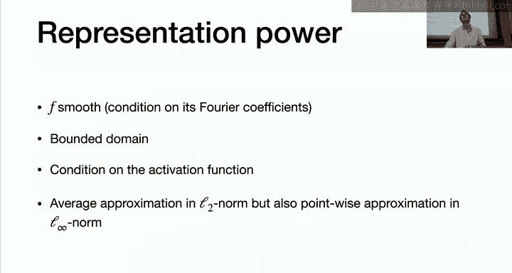

好。表哥是否支付。比少。The activation function of all the id layer will they influence the final output， sure。

You see by definition all the value at each of these output。

Will be influenced by the activation function。If you change activation function。

 you will change a value of x。And so then this would pop gate。😊。

And so if I change activation function here， I would change these values。

And so it would change my output。

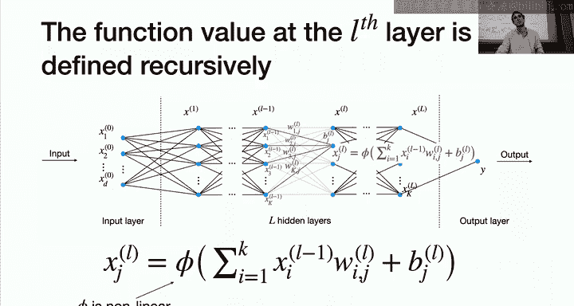

我追。Okay， so in terms of for the representation per。

 what we saw that if a function was smooth and by smooth， it， I mean。

 I gave you some condition on the four coefficient to think that the function was not too wavy。😊。

And you are considering your bundle domain， okay， you are looking at the function of a bound domain of size R。

😊，And I also give you some condition of the activation function。

So it was that the activation function has to be like a sigmoid and also there was a question on the forum asking why。

We need the function to be like a sigma， it is really like causal proof。 Okay。

 you so that in the proof， we were approximating the function by some heectangleal and then we were approximating a heectangleal by some step function。

😊，And so you need like the activation to be sigmoid like in order to approximate the step function。😊。

But it would be possible to get other approximation results for other activation。😊。

And so how was a result， we gave two kind of， I mean， we gave two kind of results。

The first one was a result in apoxma， I mean， in average age， Okay， so we saw that the L2 distance。

Between your function F and the function implemented by the neural network was small in L2 distance。

 which mean in average age， when you are computing the integral of the square norm between f of x minus F and of x。

And we give we also gave some pointwise approximation result， okay。

 so some result in L infinity now when I'm looking at the max。😊。

Between for x between0 and1 of the absolute value of f of x and the value of the neural network。

And for a result in the alien fitting in。I need to use some relu activationation。ok。

And if we have some time at the end of the course， we will do the。Who we still have to do for this？

So that was for the representation for。😊，You have some questions？On this spot。

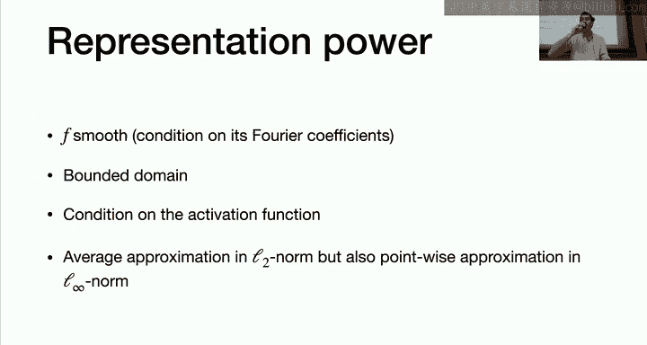

Not， okay， so let's stop。ho is today。So today we like the question we will ask is how do you train an neural network？

So what does it mean to train in Iran？嗯。Exactly okay。

 how do we find the parameter we need such that the function will help me to do some good prediction This is what we want to do。

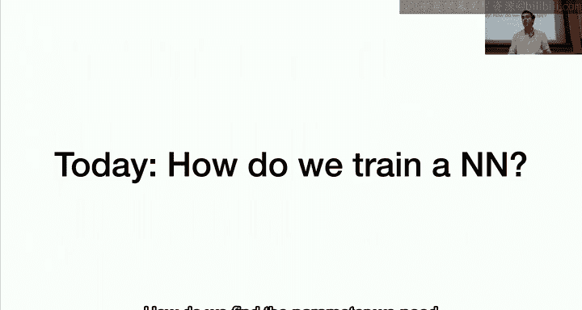

So， you know， I give you a training set， X and Y N。

And let's say that we want to solve a regression problem， okay。

 it would be exactly the same technique if you wanted to solve a classification problem。😊。

But for now， let's say we want to serve a regulation problem。

So you know that what is the cu function for this regulation problem will be the mean square error。

You will compute the average age of value observation。Of the quadratic class。Between。

Your observation YN and your prediction F of XN。And what is F of Xl？

That's really like the output of your neural network。

 okay F will be the function which is represented by some neural network with some weight WIJ and BI。

ok。So that's your function。If I give you an neural network。

That means that I give you some weight and I give you some bio stem。

Then you can compute the function F and you can compute。It's associated less， I mean。

 it associated cu。The elephant。And so what is the goal， what you want is to find a good parameter。

So that this will be small。Because really like the problem of minimizing the trainings。

So you have some observation， x and， n for n equal 1 to capital n。

And you want to minimize it' associated。Cinningless for all the Bahamime possible of Yohar。

But what we say when we want to train our neural network， we want to neural network。

Which explain well our observations。So we can do some one mark the first one that often in practice you would like to add some regularization。

 okay， maybe some regularization on the way， maybe some other kind of regularization。For some reason。

 for example to avoid aware5 or to do as step。But this will not change to algorithm。 Okay。

 when I will add some realization， it will not be more difficult to train。 So for today。

 let's say that we don't have any realizationization。 I just want to minimize。My training gu。

Over my Pahammea， my weight and my bias。That's the first。Important point， the second one。Is that。

Unlike all the previous problem we saw， not all， but unlike a lot of previous problem。

 unlike linear regression， logistic regression， and SVM。😊，The problem of training the。Caust， okay。

 of minimizing the time cost is not an enough convex。If you look at this function。

In terms of the parameter W and B。This is not a convex function。ok。

And so since this is not a convex function。You are not guaranteed to conversege to a global minimum if you are using an optimization algorithm。

O。Under some condition， you can show that you can escape saddlefield。

 so you can show that you will convert to a local minimum。

But you are not guaranteed to conversege to a global minimum。O。

So it is really like an other problem to solve in practice。So what we will do。

We will see that the algorithm used practice will work very well。😊。

But we won't have any theoretical guarantee on them。Another problem to have in mind。

Is that our neural network？😊，Is having a lot of parameter okay， I told you L is very large。

 K is very large， so you have a lot of different W。

 a lot of different weights and a lot of different biots。😊。

So that means that you can imagine that a lot of different network F will be able to exactly fit all your observation。

So you see that we have a lot of point， a lot of vector F， and sorry a lot of functions F。

Se that the1 nu is equal to0。And some of this function will generalize well。

And some of the other functions which really overfied to your data。

So you will have the problem of overfitting。And so if you are only considering。

Your last function like this。And I give， I mean， I'm giving you like a no code and okay。

 I give you like a super hub and you are able to solve a convex function， a non convex function。

 which is impossible， but imagine imagine that you can solve it。😊。

It will not be guaranteed to find a solution which would generalize well。Okay。

 that's another problem to have in mind。ok。So how do you think that we will minimize this function？

What we will use。怎么。Which algorithm we would use， okay， do you think we would use gradient descent？

Dactly， you will use a modification I've got this。It was ato as question。

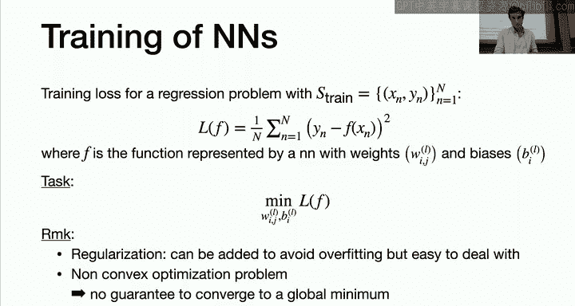

对。So the algorithm you will use to train neural network。It's a s acid gradientent descent algorithm。

 so why you are not using gradientn descent because in practice capital n will be very large so in order to compute the gradientant of this function。

 if n is large will be very costly。

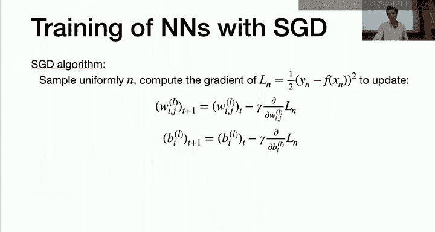

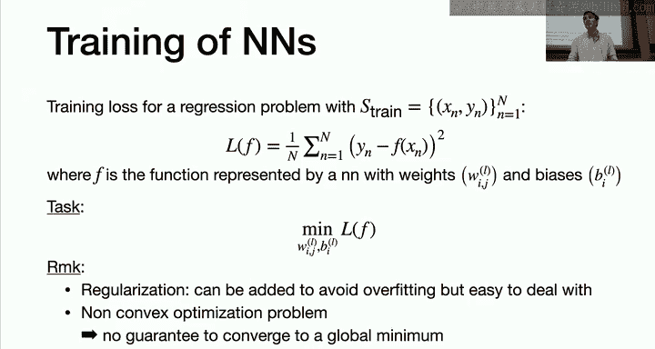

So you prefer to use stock asaggen decent so at each step you sample uniformly one observation n other mini batch you can do as you want。

 okay， could not change。And then you will compute the gradient of the individual loss。

Okay that the loss force this observation。So is that the square difference between yn and your value of of prediction in the observation XN？

It's y n minus f of x n squared。This is your individual loss in the observation XNYN。

And you want to compute。The gradient of this loss， you want to compute the derivative of this loss with respect to all the parameters of the network。

And then you want to update your parameter。Canor， how you will update your parameter？So each。

We and for each bias。You will just go in the negative direction of the gradientian of the loss。

 of the individual loss。With respect to this parameter。Okay。

So you see the only thing you need in order to implement this algorithm。

Is a way to compute this derivative。And that will be the object of the course today。

 How can you compute。知て大。Okay。And an important point。

Which is very nice with a stochastic gar algorithm。That in practice， it would generalize very well。

 Okay， so this algorithm in practice。😊，Even if the initial problem is non convex。We live in fifth。

Fine， the minimizer。Of your hand loss okay we'll find a function F suggest for audio observation yn will be very close to f of xn thats the first point and the second point in addition we also find a function which will generalize well。

So it will not only be good on your observation， it will also be really good on a new observation X。

 okay。So that's why SGD is working so well for minimizing neural networks。So for you。

 what is you know。This function we will， in fact would be a composition of a lot of function。

So computing the derivative should not be too out。Why are we doing a whole lecture on this？

What is the problem。不能。对。There's a chain of products。 So the product of layer yellow。2。Okay。

 so the function will be a composition， a different function along the layers and you say this is a problem。

 but why。😊，It's like a shahole though。Yeah， but。This is basic cculus not channel。So why。

 you know what is challenging？赔康。We took the parameters。靠诉你的亲间。

So a little bit is the problem also is that we have a lot of parameters。O。

You have K square L parameter。 I don't know if you remember。You have L layer。

 you have K node that each layer， and so you have K square。We for each layer。 So in total。

 you have K square L parameter。And so to compute the derivative vaccine for all parameterham。

And this derivative we would have to do some chain for all the layer。😊。

You see that if you are just doing it。Naiveively will be very， very cost。I think that each iteration。

 you will have to compute K square L。家 jam。And the cost of computing say K square L Gr will also depend on K square l maybe。

😊，So we will see that in fact， it's possible。😊，To do it in a very nice way。

 and this is what is called the back propagation algorithm。😊，In fact。

 it will be possible only in a complexity K square L， so the number of parameter you want to compute。

To directly have P all the derivative。😊，So it's kind of surprising。

You will be able to compute K square L derivative。With a complexity case quite。ok。

So that all the beauty and the challenge behind the back propagation and it。You have some question？嗯。

Yes。😊，哎。他。So how many weight do you have？啊。How many way do you have in your network case Square James M？

Okay， because you have k nodeds， k nodes and between two nodeds， you have one weight。

 so the total number of weight would be k square， then you have L layer。

 so the total number of weight on all your network would be of other K square l。

So you have K square L parameter。And for each parameter， you want to compute the derivative。

So in some sense， the minimal complexity you can hope for globally will be k square n。

 okay because you have to compute the derivative for each parameter。😊，嗯。But now imagine that。

If to compute a one derivative， you will have to do a lot of different computation。 Okay。

 you will have to expand all your network and to do the channelhole for the L layer。

And maybe a even more computation because each layer will be of size k。

 so maybe to compute only one derivative derivative， you will need to do KL computation。

 maybe K square。😊，Then the total complexity of computing all this derivative in order to update your parameter。

😊，Will be K square L。Times the complexity of computing only one data。Okay， so this can be very large。

 if you imagine。And what I'm telling you is that we will see that it exists one simple algorithm。😊。

So that the complexity， in fact of computing one， derivative will be Earth1。在。

By only doing K square L computation， you will be able to have all your derivative for the K square L parameter。

Did it not clear。Do you have some other questions？诶我。Can you repeat your questions say？

So what is your question exactly Hawaii1 Health？Just because when I would take the derivative。

 I will have a two。And like this， one earth is simpler。

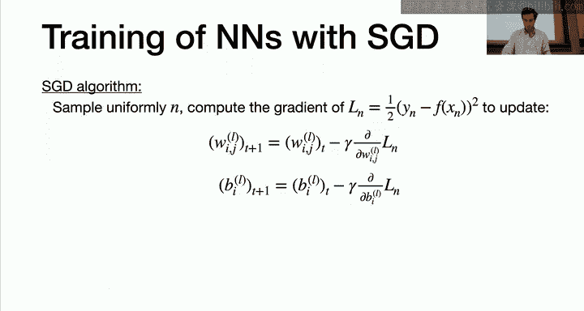

It's not the average。Oh， sorry。O。Let's like this。那站着了，再见。That's a good point。So， the last。

I will define my error， I mean I will define my quar class to be 1 over two y minus f of x squared。

Sorry， I forget。

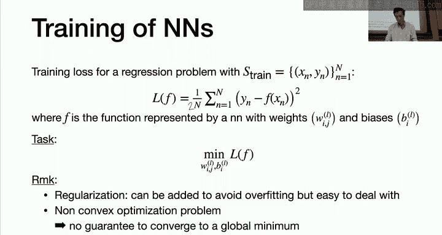

这。But at the end unit， it would not change in it， but that's a good point。You have other questions。

No， we can start。Co。

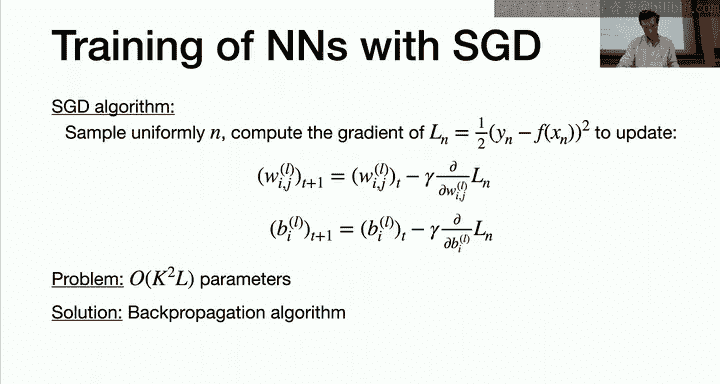

So first， what we will do。Is that we will write all the parameter in a more compact form。

 okay because I can have too much parameter。So I will st them all in some metrics。

So I will have the weight matrix for the layer L， and that will be the matrix， WL， C drag。😊。

Each component of this matrix， WLIj will be my way， IJ of the layer L， okay。

 so big matrix and each entry of this matrix will be the associated weight。Okay。

 so just a way to write my weight in a mock compact platform。So you see。So， the first layer。

I have W1， which would be the weight between my input layer and my first hidden layer。

And since my input layer， I have dimension D and my first layer I sub dimension K。

The value 1 will be of dimension d times k。O。So that's my first wave matrix。And then for every。

L in the hidden layer for L larger than two and smaller than capital L。

Since I have K nodes in my layer L。My use one and K node is my layer L。

My weight matrix will be of size F for k times K。And my last weight matrix will be of size。

 alpha for work will be a vector because I have only one weight。By notes。So this is not difficult。

 this is just a way to write my weight in a compact form， I stuck them together in some metrics。

And I will do exactly the same for the bias term， I will rise them and in a vector from okay we have one vector from each layer and this vector will be my biasers for all to node。

And so why I will use this because this will help me。😊。

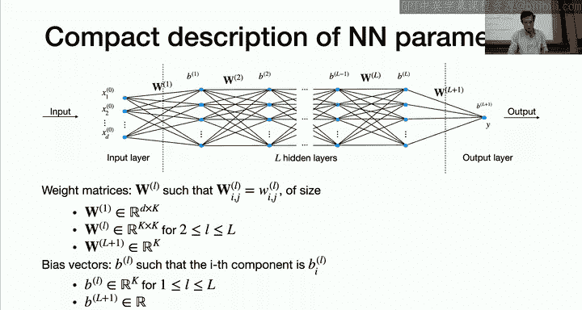

In order to write。The function described by the neural network is also in a more compact form。ok。

So with this。Mattrix W and B。It would be possible to describe the function implemented by each layer of the neural network。

And theyre a nice film。Again， we will see that the function of the neural network would in fact be the composition of many function。

😊，So let's start with the first layer。So the first layer， I have my input x0。😊。

And in order to compute the value。At my first， I mean， the value of my first layer。

 I am multiplying my input by all the weight of the first layer， I am adding the bias。And then。

I apply my activation function and I will apply this activation function to a vector。

 it will be component twice okay。Phi to a vector would be phi of x for each component of the vector。

So you see that I can denote by F1。To be this function。That the function we take。

My input and will transform it。Into the value of my first layer。

 intoto the K value of my first layer。And I can do exactly the same。

For the function between my first layer， my second form， my second layer， this will be F2。Okay。

 so F2 will be the function so that I take the value of my first layer。

I multiply them by the weight of my between my first and my second layer， I am adding the bias term。

Of my second layer， I am taking the activation function。

And this give me the value at the second layer， okay。So you see that I can define to be FL。

The function will take as input the value of the network as a layer L minus1。

And will'll transform them into the value at the layer L。That's the definition of FL。

And at each time， what would be F L of x。It will be， I take the value of my produce。嚟嘢。

I multiply by all the weights， I am adding the bias， and on top of it I'm taking the activation。Okay。

 you see that the same。For older lady。And for my last layer。Okay for my good。

I am considering the value。Of my last layer。I am multiplying， by the way。

I'm adding the bias and I can have for the last layer， I can have a def hunt。Acttiation function。

So if you want to do some regression， P tilt can be， for example， identity。

Or if you want to do some logistic regression， it would be， for example， a sigmoid， okay。

 so for the last layer， the activation function will be different。Yeah。

 layer can you we must have the same IP function。So。You can do， you know as you want。

 you can take different activation function for each node in practice you will often take the same。

Okay， but we will talk about it at the end of the lecture。

If you want kind of the choice of the activation function for the first， I mean。

 for the hidden layer will characterize。The kind of function you can learn。

And the choice of the activation function for the last layer will now， I mean， will be。

Psscribe by the application you want to do。And so then you see that the overall function implemented by your neural network。

 okay， the function which will transform your input into your output。

 your function F will just be the composition。Of all this function。O。You have a big neural network。

 you have one input， so you give x， then x will be consume in x1。😊，Then x1 would be transform in x2。

 x3。Until x L， and then until x L plus 1， which is equal to y。Okay。

 so y is equal to F of x of your entry。 This is a function implemented by the neural network。

And you can see that in fact is a composition。😊，Of。L plus one function。 You have one function for。

It's para。Is it clear for these factors？Yeses。😊，So you see that the function implemented by a neural network is just a composition of L+  one function。

So when you want to compute the derivative。With respect to the parameter。

What you will only have to do is to apply the channel。

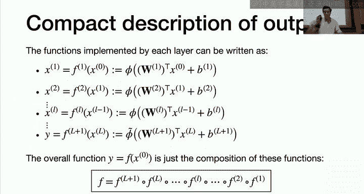

So。We say that the course function， okay L。嗯。And you see that， hey， I did not forget the two。

It is the average of my individual。😊，Last it's yn minus f of xn。

 and I say that f of xn is a composition of function， so you see that I can herewrite my cu function。

In function of this composition。And it's like this， you see that this curse function。😊。

It is a function of all the parameter of the myth。Okay。

 if you are changing the parameter of your network， it will send。Discus function。

So it will be possible to compute the derivative of this function with respect to the parameter of the network。

And something else which is important is that in fact。You know。

 the fact that here I have the square loss is not very important。You can use any of。 Okay。

 you could use like inch less。 You could use like。The cost of copillas。

 it will not really change the algorithm I will present to you。

 it will only change one of the initiization。So really。

 the loss you are using is not important for the algorithm。O。So this is a curse function。

And when we are considering stochastic garden this time Im only considering one of the individual loss for one of my observation。

And so no， this is really what I want to do， I want to compute the derivative。😊，Of this function。

With respect to my parameters。I want to compute for every IJ and L。

 I want to compute the derivative of my loss with respect to my weight WIJ and with respect to my biast BI。

Okay， I have all the parameter of my network and I want to know how my loss。

 for my train loss will change if I change the parameter of my network。我 good。Yeah，Okay。

 so what you want to do is to see how the loss will change。

When you are changing the parameter network。Okay， that's the meaning of a derivative if you move it a little bit。

 how the loss will change。Yeah。We can just say again why the specific form of the mean we will see it in the post。

O。You would see it will not generate it。If you want， this is a composite， okay。This is， in fact。

 on me。Sun function G。Of。f。Help us one。F。诶。All the F。

 so the last function is only one additional function on top of all your function。

So when you will compute the derivativehi。We just， you know。

 for one of the chain holding will change。嗯。This is Will。哦。Okay。Oh yeah， you will see。这个。一次。😔，嗯嗯。O。こ。

So what I was saying is just like this nurse。Is equal to sum function。Of。Your function， F L。This one。

If。诶。F one。ok。So the choice of your last function will only change this function G。

And when you will do your channel， it would only change one step of the channel。

It will not be too important。

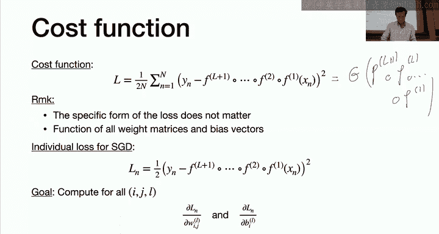

So let's see you know what we can do。So this is our last function。

That exactly yn minus the composition。Of all my previous。

But now I'm interested to see this class function。As a function in some parameter， WIJ， for example。

ok。So you see that。When I'm only interested in my Pahammeta WIJ。

I can stop the composition at the layer L plus 1。And then it will be equal to F L plus one composed with phi apply。

To this， which is the value I have at the layer L。Before applying the activation。ok。

So you see that this is very important if you want to compute the derivative of your loss。

With respect to the Pahamit。At some I mean at some parameter the layer of L。

You do not care about what is before， what is in the previous layer。

So you can really stop the composition at the layer N。You see this will be the function。

Like the way to write the function such as this function is a function of my parameter W IjL or BIL。

你几啊。And for commodity， I willwrite this value， which is the value I get at the layer L just before applying the activation。

 I will denote it the L。😊，Okay。So I have my L my last。

 it should be the composition of L plus1 function。But since I'm uninterested to see how it changed when I'm playing with a parameter at the layer L。

 I stop the composition at the layer L plus 1。And I look at the function we axis。Okay。

 and so this value z is really like the value I get the input at a layer L before paying the activation。

😊，And so now we can see exactly what we want to do with our neural network。

I have this parameterhamme， okay， I have my weight between the node I of the layer L minus1 and the noded J of the layer L。

This is a parameter and now I want to see what will happen on my last function， Okay。

 well have my output。😊，And with my output， I will compute my last function。And I want to see how。

You know， playing moving a bit this parameterme or WIj will change my loss sos really like the question I am asking。

And you see that the value。Of my function b for the layer L minus1。Won't be really important。

 so I can really stop my composition as a layer L person one。Okay。

So how will we compute the derivative？What can we do。Which calculus trick we will use？

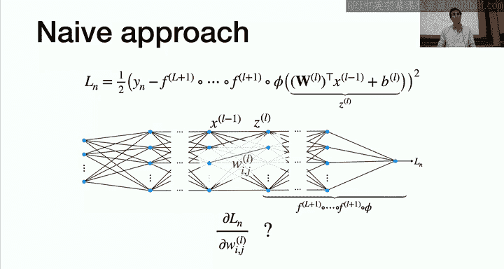

Al already talk a lot about。Nextture， we will use a channel。

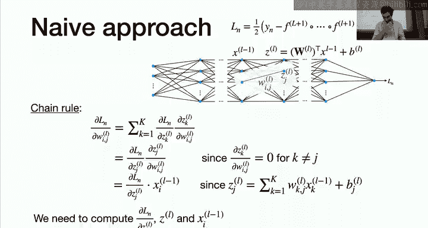

Okay， so before the break， we saw that。What we wanted to do is to compute the derivative of our last function。

With respect to the Parata WI J。And that we will use the trainable。

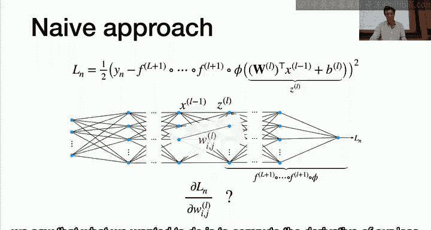

So let's do it。You here like the function of the loss。

And you see it as a function of your parameter Z， Okay， Z is a value。😊。

Of your output at a layer L before taking vaccination。😊，Okay。

 so this is a value here and you want to see how the loss will be changed if you are changing your parameter。

So you see that you can apply the chain hole。First， looking at how。

Z will be changed if you are playing with W。And then her the last will be change if you are playing with you。

ok。😊，So you see that the loss， the derivative of the loss with respect to WIjL will be equal to the sum。

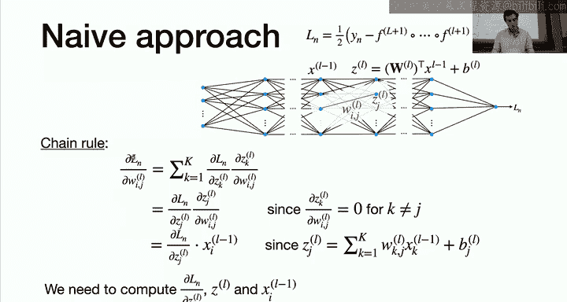

For all。有事。Okay， I layer your L between 4 j is equal 4 k is equal to 12 k。

Of the derivative of the loss with respect to your parameter。

Z LK times the derivative of this parameter Z LK。With aspect to your weight， the W IGL。

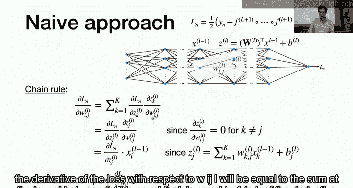

Okay， this will be clear， this is just。Vni yet。You want to see how。要 less。

Will be modify if you are modifying W。And you look at how Z would be modified if you are modifying the W and then how the loss would be modified if you are modifying the W。

 if you are modifying Z。其实 that's the first step。And since we have。게デ한 바람めて。TheZ L。

 we are doing the sum over all this parameter。Is it good for the first step of the channel， yes？Okay。

 now we have to think a little bit more。So first what I'm claiming is that in this sum。

 it will be only one term which would not be equal to0。Okay， all zero them will be equal to0。

So do you see why？You see that。So weight， W IJ。Will only be important when you are computing Z G。

Okay， you see that this weight。Will only influence this value。ok。

So you see that when you are modifying this way。You will not modify all the OR value of Z。

So the derivative。Of D Z K when I， I mean， with respect to W I J will be equal to0 if K。

It's not equal to drink。你对啊。You can see this。 I mean， if you look at the computation， I mean at the。

You know。😔，二。And you see that ZJ will be the only。Z， where you will have the value W J， okay W J。

 that will be the only one。 So all the other when you will take the very， which will be equal to0。

So that's the first step。Overall， this K derivative， only one will not be equal to0。😊。

And that's exactly。The derivative of ZJ with respect to WIG。Okay， faster。Second step。

 you want to compute this derivative。So to compute this derivative。

 you'll just write down what is a value。So Zj is equal to the sum。For k equal1 to K of W K， J， X。

 K plus the bias。So what is the derivative of this function？With respect to WIJ。

You see that the bias is constantly expected by UJ， so it disappears。And then in all this sum。

It will only be the sum of K is equal to y to I。And when I will take the derivative of WIj Xk with respect to WIJ。

 I will get。😊，X， I， okay。Because I will only have the term for k equal to I。我 good。

So you see that the derivative of the loss。😊，With respect to my parameter of WIJ。

Is just equal to the derivative of the loss。With respect to my Pamed ZJ。Times。😊，So value X I。O。

And this would be exactly the same computation if you do the derivative with respect to the bias。

So you see that in order to compute this derivative。You have to compute。This is derivative。

 the derivative of the loss with respect to my parameter Z。😊，You will have also to compute。

This value。Do you see why do you have to compute this value？Why do I have to compute this valueszl？

Yes。😊，ぱ the director。When you will compute the derivative you will need， I mean。

 to evaluate this derivative in this way。So you want need alter this value。And then you will need。

X I， okay， so that's the value you need to compute。So in order to compute this derivative。

 I will need to compute this value。So in order have to compute all these derivative for all the I。

 all the J and all the L， we have to compute all these value。😊，Okay。

 so this is what we will do jointly with the bike propagation android。

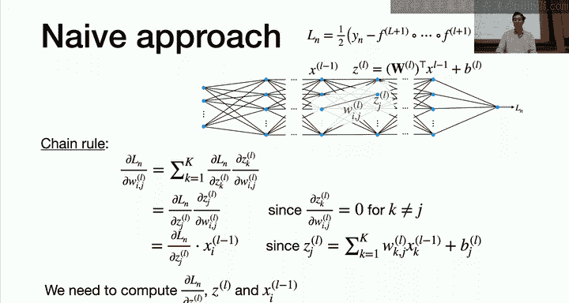

So the first step will be the forward pass。Okay， so I remind you that Z。

Is the value of the input before taking the activation？

And so what we will do is that we start from the input a。😊，Okay， that's your observation X N。

And using this x0， you will be able to compute z1。 Okay， you will take your first white matrix。

 you will multiply it。😊，With x0 and you will add your first bias， so then you will have compute Z1。

Then you will apply your activation function entry wise。And this would give you X1。

When you will have compute x1， you will be able to compute Z2。

 you will multiply by your new weight matrix， you will add your new bias stem， you will get z2。

You will apply your activation function on three wise and you will get x2。

 and you will do this for each layer。So you see that by doing one flower pass。

We will be able to compute。All the X。L and O is Z L。And so what is the complexity of this first step？

😊，You just have to do one pass as a network。So you see that the complexity of this first step will be of the order of the number of parameters it will be k square L。

キャビト？Is it clear for the forward path？You are just doing one piece of your network and you radio compute。

Z and X。Some sense it's just evaluating all the value at all the nodes。ok。

So you see that after the first， I mean， after doing one four pass。

You will have compute all the Z and all the X。So that was the quantity we needed to compute in order to have our guidance。

 you remember？So why do we want to compute no？I told you to compute the derivative of the loss with respect to my parameter。

 I needed to have Z X and what was the last quantity I needed to have。嗯。28。

I need to compute the derivative of the loss with respect to the parameter the node Z。

So this is what we will do， and this is the object of the。😊，Backward pass。 So forward pass。

You are doing your first pass over your network。You start with your input and you recurively compute。

First Z L and then XL applying to activation and in one pass you have compute all these value。

And no we will do。The backward pass， okay a pass， I mean starting from the end to the beginning to compute all the other derivative。

 so that would be the backward pass。

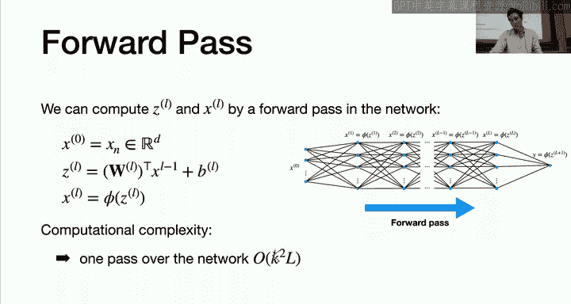

Okay， so we saw that we need also to compute so derivative of the loss。

With respect to the parameter Z。Okay， for each layer and for each J。

And I call I denote this derivative delta J。So that' that end。ok。

So now I want to compute the derivative of my loss。

With function of the value at the noded J at the layer L。

So I want to see if I'm modifying a bit this value。How the loss will be modified？

So you see that you will again do a chain hole。But no you will do a chainhole。

Depending on the value of the。Z as the next layer。So you want first to see。

How the value of z at the layer L plus 1 will be modified。If I am changing this value。

And then you will see hows the value of the loss。Is modified when I'm changing the value as a layer L plus one。

And you can directly see that you will have some re。😊。

Because how the value of the loss is modified when I'm playing with the L plus 1 will exactly be delta L plus 1。

So you directly see that you will have some con between deelta L and delta L plus 1 using the chain。

😊，ok。So we can do the computation。Delta L J， which is equal to the derivative of my last。

With respect， my parameter ZJL。Is equal as before。As a sum of my key。Phammeter Z L plus1 k。

So I'm looking at how my loss is modified when I'm playing with a parameter or ZKL plus  one， okay。

 I'm looking it first as it's derivative multiply by the derivative of Z KL plus 1。When I I mean。

 with respect to Z。诶 z l。Okay， that's a basic shahole。And what I see is that。This。

Is exactly by definition deelta K L plus 1。ok。😊，This is exactly so derivative of the loss with respect your parameter ZK L plus one。

😊，So you see that you have some re between deelta。J L and the deelta L plus 1。我。

But then we have to compute what is the derivative of ZKL plus1 when I'm changing ZjL。

So I have to compute this。Yeah， what's the question？

It's in the relation between that the andL and that El one also a function of the activation function。

Can you repeat your question an that is。And then we use that highly use that help us one。

So isn't the very。当一层。So this derivative。I haven't computed yet。

And it will be a function of the activation。 but this is what you're asking is。Zk L plus1。

 when you take the derivative with respect to Zj will be function of the activation function on it。

 and it will be。O。But when I'm looking here， it will not， I mean。

 and it could depend on the activation， but just this is by definition that Elers function。😊。

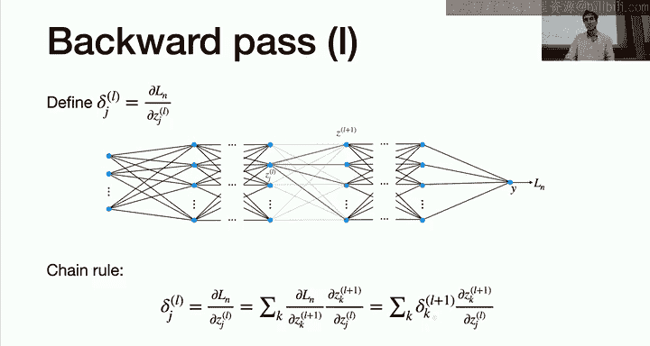

So。We know what is。Z L plus 1 K。By definition， this is a sum。For I， okay。

 this is not the I of the previous slide。 Okay， this is like a new I。

 so that the sum for I between1 and K。This is a capital， okay。Of W IK。Lus 1 X I L plus my bias， okay？

And now I want to take the derivative of this with respect to the Z。😊。

So I want to replace what is x in function of z。 So I have to replace X I by。Phi of Z IL， okay。

 because we know that x is a value before sorry x is the value after the activation。

So x is equal to phi z。And now I want to compute the derivative。Of this function。With respect。To Z。

 J L。Okay。We want to compute the derivative of this with respect to this。So you see that the bias。

Is not a function of ZJ。So the bioデ在。And now at the sum of k different them。ok。And on all this them。

I will only be interested in ZJ， so I will be un interesteded in the term for。

I is equal to j all the other of them when I will take the derivative， they would be equal to zero。

 okay？If I'm looking at。W。It a day that team of WI。缺。Add this one。快。即系。L with respect to the。And J。

 this is equal to0 to0。If I is different from J。你这样。😊，So you see that in this term。

When I'm taking the derivative with respect to ZJ， I will only keep one term。😊。

And now you have to take a derivative。Of this term with respect to CJ， and I will get。

5hi GK times the derivative of activation function。O。When I'm taking the dairy Vati。With respect。

就是 z。Of W， I。诶所 w这系。拜。热志。Okay， this will exactly be equal。

This is a constant so I can take it out of the derivative， so W。GK， and then I take the derivative。

 so I take phi prime of ZJ。 Okay， so this is exactly what I have。

Is it clear for the simple computation？Yes。故。And so then I can plug this value back in my。

Previous computation for Delta J of L。So you remember delta J of L was a sum over k of the deelta k L plus 1。

Times this derivative。So I can replace this derivative by its value。

 and so I will get sum of deelta k times the derivative of the activation function。😊。

In ZJ times my way， W GK。So you see no。And you have compute during your first four pass。

 all the value of ZD。 So now you can compute。If I give you。So value of delta add a layer L plus 1。

 you will be able to compute the value of delta as a layer L。And you canwrite this。😊。

In a vector form that would be exactly the same， so vector delta L。

 okay so that's the vector whose component will be deelta L J。You canwrite it exactly like this。

 so what is this？😊，This is the vector of the value at a layer L plus 1 multiply by your white matrix at the layer L plus  one。

😊，So， this。Is a vector or multiply biometric so you get a vector。

And then you will do the addA project。 So you know addA product is a product of two vector component wise。

 you have one vector， a second vector， and you are doing entry wise of product。😊。

So you are doing the product entry wise of this vector。And that victim。Okay。So like this。

 you can compute when you know the value of delta to layer l plus 1。

 you can compute the value of delta to L。So what do you still have to do in order to compute all the value of delta for all the layer？

😊，What did， what should we do now？So we have an injuction。What should we do to start the injection？

Why do we have to compute fast？But I want to start。Should I compute Dlta 0？Now。

 if I compute with Dlta0， it will not help me。So I have to compute Dlta L plus 1。

If I have Delta capital L plus1。

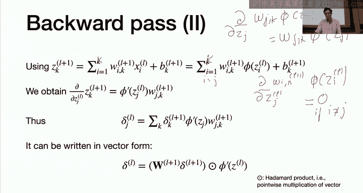

Then I will be able to compute all the delta on my network。So we have to initialize our equation。

And I can look at Delta L plus 1。It will be the derivative。Of my loss。With respect to Z L plus one。

And what is it equal called， what is the value of my loss？In function of Z L plus y。Is exactly。

 you know， y n minus my output square。And what is my output， my output is。😊，Phi tilde。

 my less activation。Times the value of Z L plus one。ok。The value here it's exactly。😊。

Phi tilde the of ZL plus 1， this will be the output of my network。And then I compute my square as。

 So why and minus value square。And now I want to take the derivatives of this。😊。

Function with respect to ZL+ one。So you see this is really easy to take the derivative。

 this is a derivative of a mytic plus so it will be equal2 fiilda z L plus 1 minus yn that is a derivative of yn minus。

😊，X squared。And then you have to compute。The derivative。Of。

Your activation function evaluated in Z L+  one。ok。And you see that you can compute this。😊。

Because you have already done your far pass， so you have already computed all the values Z N。😊。

So you have compute z L plus 1。And using the L plus1， which is given by the forward pass。

 you are able to start your backward pass。😊，Okay。And so you see now that。

If we were coating another loss function。If I was not considering the quality class。

 if I was considering， for example， the cost on toppis or the logistic class。

 or maybe the inch class， it will only send。This吧。So it will only change the way you are initializing the backward pass。

 otherwise all algorithm would be exactly the same。Well good。So we have initialized。

Or Delta L plus 1。And now you will be able by doing a backward pass by going from the end of the network to the beginning of the network to compute all the value deelta L okay。

 you have compute the value as the layer L plus one。😊。

You multiply by your weight matrix at the layer L plus 1， you get a vector。

 you multiply component wise is vector。By your value of the derivative of the activation function at evaluated at ZL。

And you get Delta as a layer L。And you do it for all the layer。So you see that again。

 the complexity of this back pass will be。Capital K square and the Nobel parametermeter。

You have some question on this back pass。能。

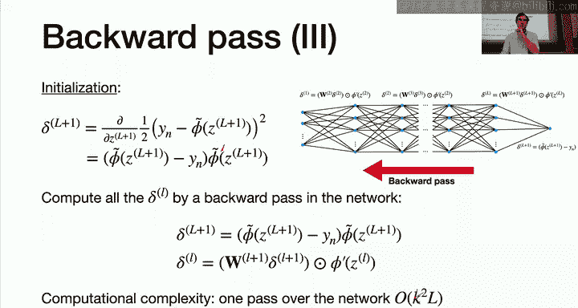

So let's do a quick summary and then an， sorry before。Before doing a summary， no we have computes。

Everything we want and so we will see how we can use these quantities in order to compute the derivative we want so what was the derivative we want we want to compute the derivative of the loss。

😊，With respect to my bias and with respect to my weight。And so to do that。

I will use that ZML will be equal to the sum for k between 1 and capital K。Of W K， M X， K plus BM。

So I can again do a chain hole。And so the derivative of my loss with respect to the biastem。

J would be equal to the sum of the derivative of my loss。

With respect to Zk times the derivative of Zk with respect to Bj。And then you see that the army。

Times this。Div of Z K with respect to derivative of BJ will not be equal to0。Will be for。Zj。Okay。

 because that's the only time why I will have Bj or001 could to be equal to0。

So you see that this sum。Is non0 all the time of this sum would be non0 only when k is equal to j。

And then I have the product of the derivative of my loss with respect to the parameter ZJ。

 this is by definition Delta J， we have compute doing。有个 best。

Time is the derivative of Zj with respect to beta， sorry to B J。And this is one， okay？To be clear。

 clear for you。When you take the derivative of BJ with respect to BJ， give you one。

So you get this value。So the derivative of the loss with respect to the biast at the noded J is exactly equal to the derivative of the loss。

With respect to the value ZJ。That you are computing your previous space。

And now you can do exactly the same。When you are computing the derivative of the loss with respect to the weight WIj。

You still see that in all this term。The only1 of the sum where I way WIJ will appear。

Will be when K is equal。呃。No， sorry， So only。日己。Where WIJ will appear。Will必。衣服。呃K is equal to G to G。

ok。Otherwise。All this did he achieve。😊，Derivative of Zk with respect to WIj will be equal to0。😊。

Except。four。K is equal to J。O。When you're up changinging the weight。

WIj is only changing the value of Z L。呃ZLJ。Okay， it's not changing your value。

So all are derivative来 equal to zerohu。😊，And you get only that one。

And now you have to compute the daily achieve。Of ZJ with respect to WIJ。

And you see that you have to compute the derivative of this sum。

And we will only get the value of X I。Here， because for all the odds there value of k。

This will not depend on WIJ。It will depend on WKG。Is it clear for this two equation？Yes。

 can you repeat the in why we should like。K being is like b k being is the number of neurons multiply at like W x plus Bm sorry what did you say Bk is a number of nok or capital okay okay yeah for one layer like W times x plus B is like the output。

Like a kind of like a prediction。And why should we sum the earth like what the intuition between like sum or earth because it seems like？

I mean， that the definition of how you are like computing the。Value of funeral network。

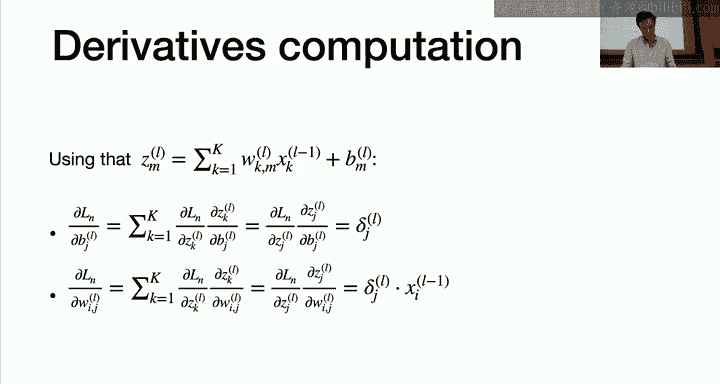

If we take neural networks， the value here。Okay， will be equal to the sum of all the value as the previous nud。

Miply by the value of the weight。Okay， so this is exactly this。

The value at the next node will be equal to the sum。

Of the value as a previous noded multiply by the weight。Okay。

 and since your network is fully connected。Your node will be connected to all the previous noded as the previous layer。

 so you are doing this sum and all the previous nodes。We have some other questions？能。

That is the last slide。 I have a question about the first one for last time。

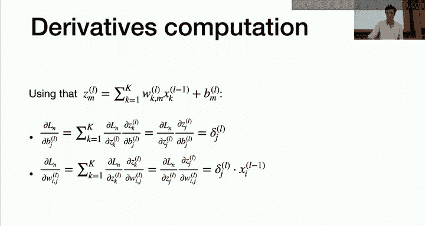

The previous one， you mean？What。It a question， the question。所以你去开。Very of the last。

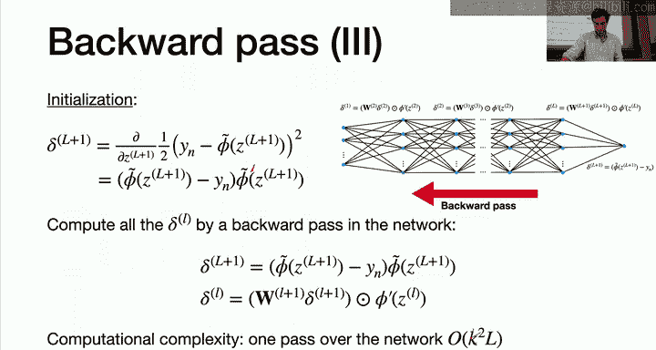

Oh， I forget you。 on the slide， I forget。 this is the table。Okay， so let's do a conclusion。

 what is a back propagation algorithm？There's an algorithm which will give you all the derivative of your last function with respect to all the parameter of the network。

😊，You start by a firework pass okay in blue， so you start by computing your input x0。

And using this input， will update ZL and XL。😊，So at the end of the forwardwork pass。

 you will have compute all the ZL and Xl for L between 0 and l plus 1， L plus 1。😊，Okay。

 that would be the object of the forward path。Then in the backward pass。

 you will first initialize the value of delta L plus 1 at the last layer。

 this will depend on the activation function you have on your last layer。

And on'm the last function you I mean amazing for your and mean for your learning problem。

Here we are course the。A regulation problem， so this is a derivative of the quality class。😊。

But if you were considering another alert， you will have another derivative。

 but it will not change anything。So you have initialized a value of deelta L plus 1。

And using this value， you will recurively compute all the value of delta l。😊。

For L between L plus1 and n。So at the end of the backlog pass。Using the value。

 you have compute during the fourwork pass， you will have compute all the value delta L for L between L plus 1 and 1。

Okay。😊，And now with all these value， we on the far walk pass and the back pass。

 you have compute all the z， all the x and all the delta。😊，Using all these value。

 you will be able to compute all the derivative。will'll be able to compute the derivative of the loss with respect to all the weight of the network and with respect to all the buyers of the network。

😊，So by only doing two paths on your net 12。And then doing some computation。

We have computed all the derivative of your list with respect to all your parameter。

And so the total complexity would be of order， the number of parameter。So when you implement this。

 you would store all the immediate results in some kind of matrix like。So以 don have必。

Because everything been build on previous results， Yeah， yeah。

 we have to store them all because at the end you need them all to compute all the day that is dynamic。

嗯，那吃。那 sure。sure not okay， and so then with this value of the derivative of the loss。😊。

You will be able to compute your guidance step okay to update your parameter。

And then you will do another about propagation in order to compute your new data。😊，And so， and so。O。

好。So is is clear how you can compute， I mean， this will help you to train the neural network by using the stoastic gradientian descent。

At each iteration of your SGD algorithm， you need to compute the derivative of your loss function with respect to all the parameter and you will use。

😊。

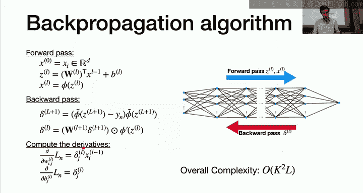

The back propagation to compute this derivative。So let's finish the curve by just talking briefly。

But some popular activation function you may want to use， okay？

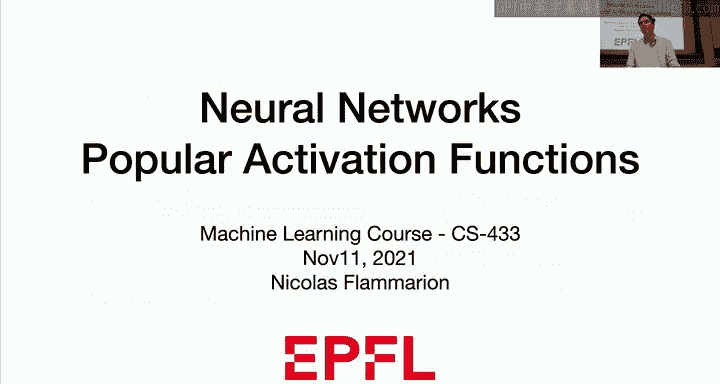

So we start by the sigmoid。Sigma is equal to1 over1 plus exponential minus x that's the one we already talk about when we talk about logistic regression。

So you see that the function which go from zero to one。Very smoothly。No。

So that's the function that's one of the activation you can use in your neural network。So what is。

 you know one of the good aspects， one of the good features of the sigmmaoid？

You see that the function is smooth。You will be able to compute the derivative everywhere。

So when you will use it in your back propagation algorithmism， it will work quite well。

But then the main problem， and this is a very serious limitation。

Is that you see that the derivative of the sigmoid。😊，Is going to zero plus a large value。Also。

 I mean， large negative value。 Okay， when the absolute value of。X is going。I mean。

 it's becoming large， then the derivative of the sigmoid。Will go to zero。

Do you see why it can be a problem？W it can be a problem to have some small derivative of the activationation function。

 but not zero。So it will be very difficult to train。But why exactly？multily it。

The step create a step for。Yes， that's a good point， so the gra would be very small。😊。

But do you see something which will be even worse？So in some sense， it can give you like ins。

Sigmoid are we not working with very deep network。 It could not work at all。

Because you see that with a back propagation algorithm。

 you will do the product of a lot of this derivative。😊，So it's not only that it will be small。

 but it will be a large number， I mean， a large product， a very， very small number。

 but it will become even smaller。So you'll see that when you will try to do the training of a deep neural network with a sigmoid function。

Your graduate will become。A trust is small， and so your training will step。

So this is what we are calling the problem of vanishing regimen。😊。

And that's why also way one of the poll， you know， maybe before the 2000 or before 2010 people were using the L mode。

And it was very， I mean， it was really preventing them to train large neural network。

Because that's a problem which is not difficult to solve。

Since the derivative of the activation is going to zero and you are doing the composition。

 so you are doing a product of a lot of this derivative。

 the value of your derivative of the gradient will be almost zero。😊。

YouNot 10 per minus10 or something next， so your timing will stop to not be equal to zero。

 but it will stop。

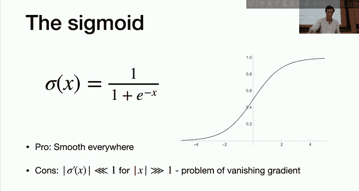

So then you have another。Activation function， which is hyperic tang which is very。

 very close and very related to the previous1， but now I'm taking some value between minus1 and1 okay so just like a balanced version of my sigmoid。

😊，And it is still bounded， it is still smooth。So you see I we have exactly the same problem as we thought。

So derivative for very negative value of very positive value will become very small and when I will compute the derivative of my last function with respect to my parameter。

😊，This would go to zero and the training would stop。ok。So these are two different。

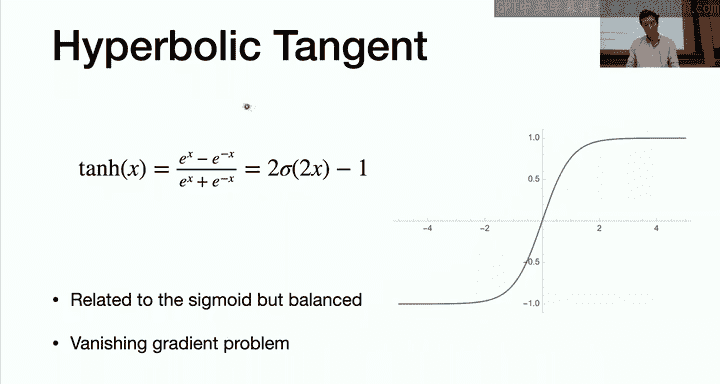

Actation function。And the soft one we will talk about and we already talk about it。

 it is a rec file in our unit is a relu， and that's really maybe the most famous one。😊，And that。

 you know， one of the reason。Of the why deep neural network start to work so well like after 2000。17。

It's because really when we start。Traing neural network with a rail activation。

 it starts to become possible to train some very， very deep network and to get some good results。😊。

So what is the relu by definition， it just a maximum of 0 and x thats a function which is equal to0 for x negative and which is equal to x for x positive。

 so you see that's exactly this function。😊，And now you see that I kind of solve my problem of the vanishing re。

 which is that for exos。😊，My function is unbounded。And so the derivative will always be one。

So now my derivative for exosive is not anymore small， and for exosive。

 I will not have the problem of the vanishing margin。😊，ok。

But then I still have two version of problems。The first one is that I have a kingink in zero。

 so my function is non smooth。My function is not differentiable in0。So that will be a problem。

For the， analysis。And the other problem。Is that the derivative or the negative value is exactly equal to0？

😊，That's something which is called the problem of the dying hlu and you can look about it if you're interested sometimes。

Also， your tanning will get stuck and some neuron will start being activated。

But then other of time it's very nice because that means that the output of the relu will be very sparse because for a lot of nodes。

 they will be equal to0。😊，So that's direct rec file in our unit。😊。

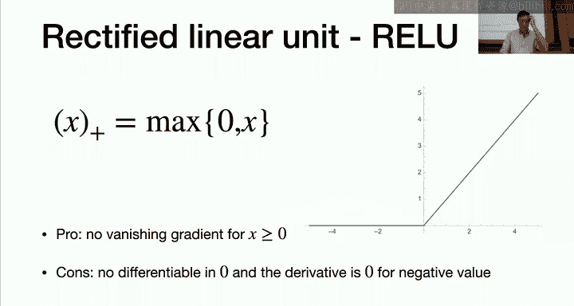

And to solve this problem of zero gradients for the negative x。

People have introduced what is called the leakkyrelu。And it's exactly the same as the re。

 but now for the negative value， I will consider a small slopelo alpha。😊，Okay。

So now you see that my gradient for the negative value will not anymore be zero， it will be alpha。😊。

So we not have this problem。But Im still。Nos。That's a way。To solve one in this problem。

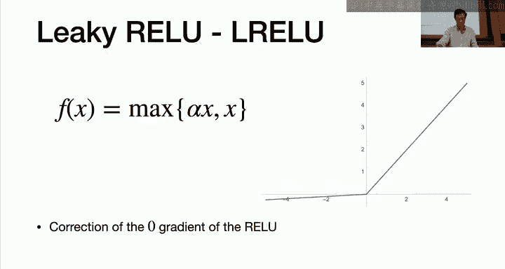

And then you have this last one， which is not really used。

 but it's interesting to see these are max out。It's kind of a generalization on the Relu and the leakyrelu。

Now you are looking at the maximum of sum linear function， okay。

 so you are taking different linear functional and then you take the maximum of this。ok。

So you can compute this and this will give you an active x function and the parameter of W1。

 B1 to WK， B K have some parameter of the。Actation function you will have to set and to use。

But in practice that one you will not use an I minute alert and you will essentially use relu activation。

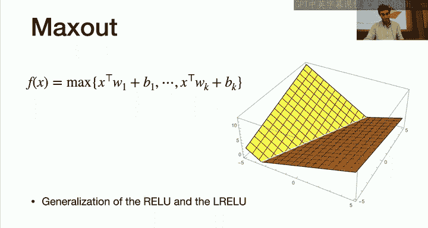

Do have some question？And this should we use the last five minutes to prove what we did not prove last time。

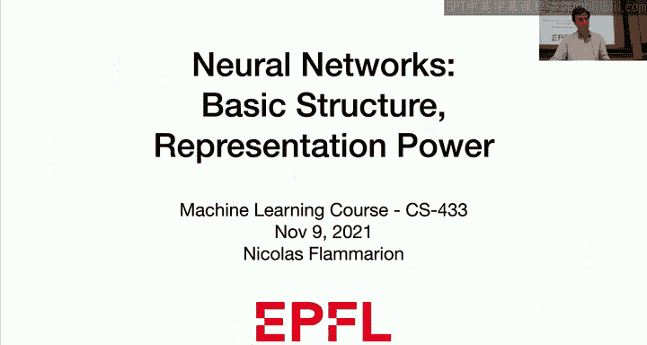

Some question on back propagation。能。So that's try to do a co。And if we don't have them， that's okay。

So I remind you。We have a continuous function F。And we want to find。

We want to show that this function F can be well approximated by a neural network。

And who I will show that。I will show that it is possible to show that my function f。

 which is continuous in01。Will be well approximated。Byina function。有一面标演的意思。Animation， okay。

 if you have a continuous function， then this continuous function will be well approximated by a piecewise linear function。

And how I can write my piecewise in function。It's exactly。Eina function， okay。

 AI X plus B times the indicator of my interval A minus1 A。倾。😊，And I just have a boundai condition。

 I want that the value at the end of my interval is equal to the value at the start of my new interval。

So that means that I need to have AI， AI plus B is equal to AI。

 I mean to AI plus one AI plus B plus one。So then we see that we want to use the Relu。

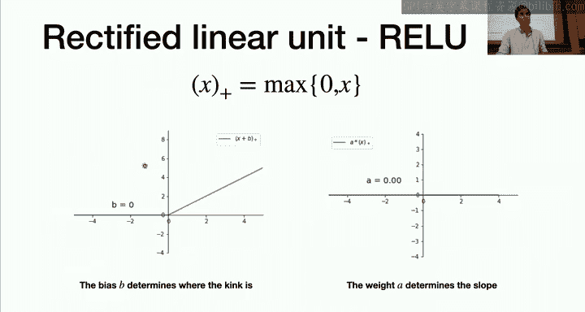

In order to approximate， I mean， we want to say it。

We want to write this sum of function as a sum of hidden。And so you remember， so this is on the。

That we saw that in fact， if you are considering linear combination of Hlu。

And some of such coordation。Was giving you a piecewise in enough function。Okay。女孩子神你没。

You see like you are looking at one relu then the ser Relu at the new king。

 it would change the s and at the new king it would change against the slo so immediately directly by doing some of such。

R do， you will get the piecewise in function。

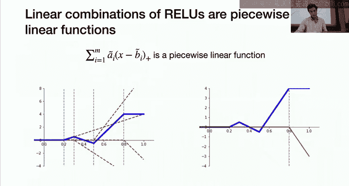

And so in another areas we wanted to prove。Is that。RQ。

 which was given by AI X plus B for x between AI minus1 and AI。I can write it。As a sum of him。

And since I can write my， I mean my function Q as a sum of helllu。

So that means that my function queue is implementable by your neural network。😊，With rail activation。

and using the fact that a function is pointwise well approximated by a piecewise function。

 that in fact， my piecewise function is implementable by a neural network。😊。

With one hidden layer and the rail activation， I will show that。

One in the neoon neural network with rail activation can approximate 12 any function。

And so what we want to prove。Is that。This。So in two minutes。Why do we want to prove。

 let's look at this。We want to prove that。Q of x。Which is equal to this piecewise in enough function。

 okay？An air of x， which is equal to this sum of hell。😊。

Are the same and they are the same when a ted and a are given by z parameter。So let's see first。

So x between 0 and l1。I know that a tilde 1 and B， tilde 1。equalal to A1， B1。

And so that's means that Q of x。Which is equal to a1 and x plus V1， okay by definition。

Is also equal to A till the1 x plus b t1。And this is exactly the value of error of x。😊，Okay， because。

B2 Tde， I mean， B Tilde2 is exactly equal to L1。So for x， smaller than n1。

This hell will always be equal to0。So I don't have any of these。

So you see that for x between 0 and a1，q of x is equal to a of x。the first one。

 so we will start our induction。Let's see if then it starts to be true for x between air1 and F2。

We will finish with this。So for x between Air1 and F2。A of x。

Will still be equal to a tilda 1 x plus B tilde1。But now you see that for x larger than L1。

X minus b tda1， which is equal。To everyone1 will start to be active， okay。

 this hello will start to be active。So now I get exactly。Ail2。Times x minus f1 plus。And in fact。

 a till2 is exactly equal by definition to a2 minus a1。😊，So when I rewrite a of x。

I would get exactly a1 x plus b1 plus a2 minus a1 times x minus L1。So what is important to see？

Is that the slope of this linear function will be equal to a1 plus a2 minus a1。

 so the slope of this linear function so derivative will be equal to a2。

So you have a linear function， error of x。Between R1 and R2 is equal to the finite function。

And the slopelob of this a function is equal to a2。O。So now let's see we have two fine function。

 Q and R。And they both are the same slope， okay， so the slope of Q between f1 and F2 is equal to a2。

And the slopelo of R between f1 and F2 is also equal to F2， so they have the same slopelo。

And they stuff was the same value。So this is what is important to have in mind if you have a enough shine function。

 we start from the same point with the same slope。😊，人这样一哭。For all the value of x。

So this implies that L of x is equal toq of x for all the x between L1 and F2。

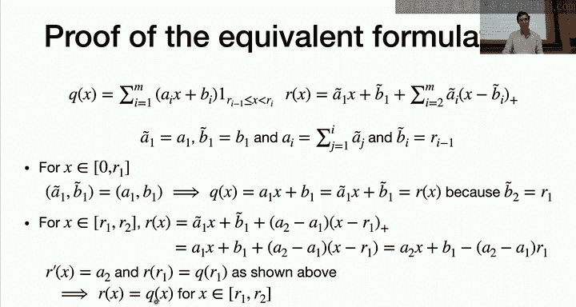

Okay。We will start with this， but then you can do this exactly the same for all。😊，The other endeavor。

By induction， you will have shown that it would be exactly the same value as the beginning of the interval。

And then you will do the computation and you will see that error of x will be a fine function with exactly the same slope。

😊，And so this will show you that error of x is exactly equal to q of x。😊，So if you are interested。

 we can look。😊，At the proof in the slide and you have also a different proof。

 which is exactly the same， but with。

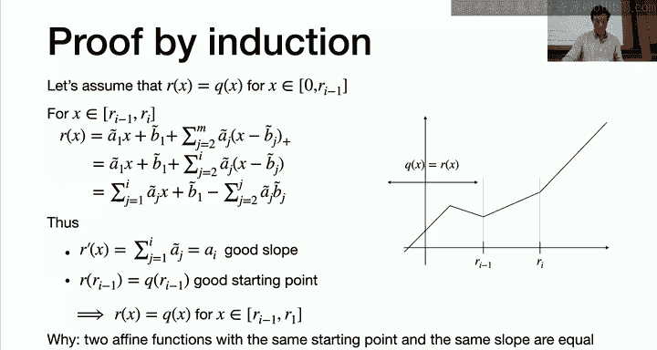

Some slight change。Okay， good。So see you next Tuesday。Have a good weekend。

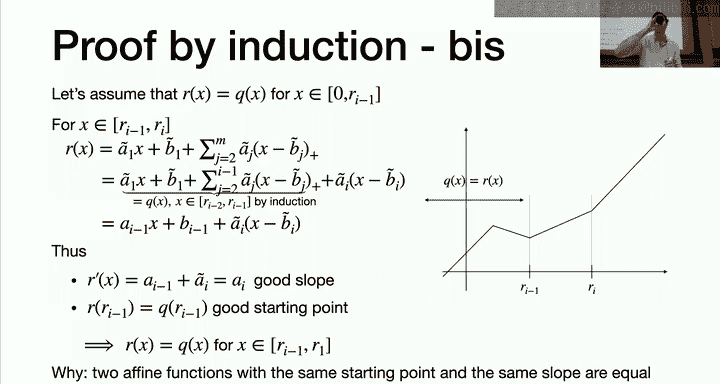

Okay。