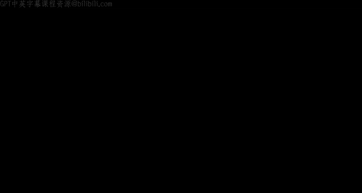
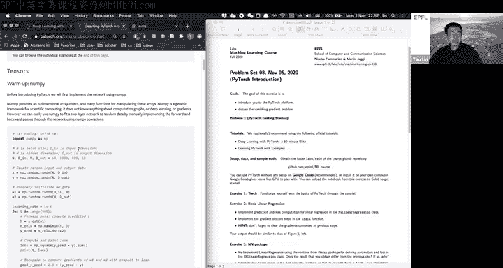

# EPFL《机器学习｜Machine Learning Course CS-433 fall 2020-2021》中英字幕（deepseek - P24：[24]Exercises 8 - getting started video.zh_en - GPT中英字幕课程资源 - BV14SwyeNEvW

Hello， everyone， welcomecom to the introduction video of the exercise for V。So for this week。

 we will introduce you to the platform。So you can start your project  too with different deep learning algorithm。

We will also briefly discuss the vanishing gradientding problem in neural networks as a problem too。

🎼So for the first practical problem， please familiarize yourself with risk high of version。

You can use these two official pipe to toiletries。The first one。

The first one is a 16 minutes quick review to better understand。The title can library。

 as well as high level entry for the new level。Now the second the one。

It introduce the fundamental concept of papers to some self contained examples。It starts from M。

 which you should have seen and used in your previous project and access。Please。

And you will also know that you， in your previous experiments。

 you need to manually implement the back the parts that will be and you to upgrade model。

But this skin is not feasible for much and the country to being networks。

Then and that is why we need to use the pipes as our as one of the standardized tools to。诶。

Develop a big lemon。Rese， yeah， develop to develop the development。

So， the tutorial the。Induce the fundamental concept。I mean。

 the most fundamental concept of the paperss， which is the cancer。

And the tensor can keep track of a computational of graph and gradient with logistic support for exploration。

The tutorial also contains the introduction to the automatic differentiation。

 which allows us to automate the computation of backward passes in large company trade networks。

And it will also be。Describe a a ra power for the。Module， which is end of module。

 which it it is it is very powerful， and it can help us to define complex operators and。

And we can automatically take derivatives over in different sequences。So。

If you are not familiar with skytos。I would highly recommend you to first check this。き tell news。

Before starting the access。So let's go back to the access itself。So for the problem one。

 we will first ask you to implement the basic linear regression。Here。

 we try to build a self contained pass。So please do not use the the N dot model。

And you need to modify these three functions。嗯对。And in the end， you will get a differentable model。

 and it can make a random prediction based on this random。

And you will also need to implement this a function。So it can be used for the swimming。

Once we have this model and we have the final function。

 we need to define the training pipeline in papers。And you need to modify these three steps here。

And the expected outcome is something like。哎。So。嗯。😊，For。The exercise 2 in problem 1。

 we would like to set up as a very simple example and help you better understand the title。Operators。

 I mean， the， the most basic type of operators。And for the X3。

 we would like to introduce the own package in title。And you。

And you will be asked to reim your previous linear regression class by using this standard model。

And you， you will understand why it is so helpful when we have a large neural network。And in the end。

 you will be asked to implement a more complicated neural network， which is a two layer MLlP。And the。

It will output a nonlinear feature line， as in individual1 B。So up to now。

 I just briefly interviewed。😊，🎼Yeah。The practical problem one。 and we hope。You can get started。

It be the highs， and it will help your project， too。And for problem two， it is asymmetric problem。

And you need to do simple derivatives on the sigoid function and consider the number of the。No live。

By using these two hint， I think you can reach the final conclusion and。You can。

 you understand why a deeper network have the issue of vanishing buildings。

