# EPFL《机器学习｜Machine Learning Course CS-433 fall 2020-2021》中英字幕（deepseek - P25：[25]EPFL Machine Learning Course 2021 - Week 9 part 1.zh_en - GPT中英字幕课程资源 - BV14SwyeNEvW

Today， we will talk about。A lot of different topics in deep learning。

 we will talk about convolution nets， regularization， datanotation， dropout and batch normalization。

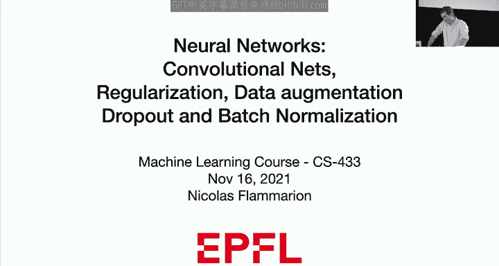

Okay， so we will see a lot of different topic。And the first one will be convolution nets。

And so Covenet is really， you know， the architecture。😊，Which， which has a load like。

The most recent adity learning and all like the recent success in computer vision。

 so that's something really， really important。

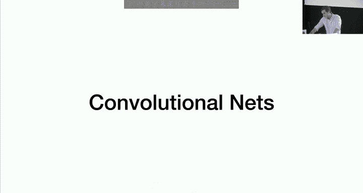

So， let's。In the previous lecture， we talk about fully connected novel network。

So I don't know if you remember a fully connected neural network was between two nodes。

 you have a niche。😊，And so then you see that in a fully connected neural network。

 you will have a lot of parameter。😊，If you have a neural network of depths L with K nodes at each layer。

 then you will have of other K square L parameters。And that's really a lot。

And so it will be very compate to train， so it will be very rich。

 but it will be very complicatedate to train and so you will need a lot of data in order to learn all this parameter。

And you see that when you are considering some computer vision tasks， so for example。

 if you want to do pictures recognition。😊，What is the dimension of the input space？

The pictures will be。3D channels for each color。 Okay， and then you will have a matrix of numbers。

 So if you look at， for example， the image net data set。

The total dimension of your training set will be。2，56 times 2，56 times 3。 So it would be of other。

105。So you see that the dimension of your input space is so large。

So that if you are losing a fully connected network in order really to understand this kind of very complex data set。

 you will need so many parameters that you will not have enough training data to train and to learn all this parameters。

O。So you see that， in some sense， fully connected neural network。

I have a very rich class of neural network which are too rich and they have too many parameter to be really efficient。

😊，The second point。Is that when you are considering a fully connected neural network？😊，In fact。

 what is really doing the neural network。It is taking the pictures。😮，And it is flattened as a vector。

So you will totally forget all the pixel dependency。You know， like a picture。

 you have a lot of structure， like two pixel which are close。

 is's very important that they are close。So if you transform your metrics。Into a vector。

 you are losing all this information。 Okay， two nearby pixel cells in the vector now will be very far apart。

So you see that。By using so。By using。Only fully connected network。

You totally forget all the initial special dependencies。And so you are losing a lot of information。

ok。And so the in should be that in fact。You know， it's not important。To have edge between all。I mean。

 between all thenerds， but only local information should be enough。You know。

 you could extract a lot of information if you're only looking local processing of your data。So。

 for example， you know， if you take the image of sound processing。

 I don't know if you have a little bit of signalial processing。 but if you have a sound stream。

What you are often using in sinel processinging is that you will apply some covolution， okay？

So you will apply a filter and this filter will only match on a very local structure of the signal and you have a lot of different signal and a lot of different filters and really all sial processing is based on this idea of convolution。

So the I today is that will be that we will see that it's possible to do the same from pictures。

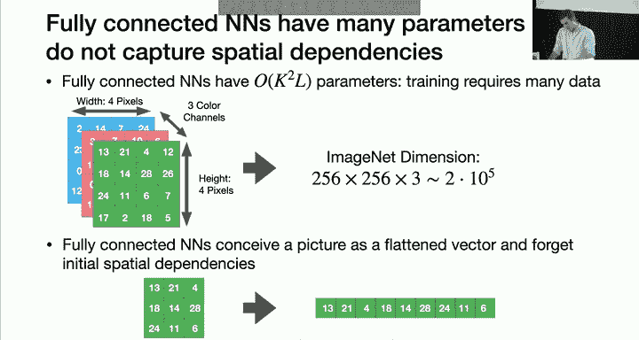

Okay， to apply convolution， which will only act locally on your pictures and which will help us to extract a lot of interesting information。

Okay， do you have some question on this。能。So let's see what is the definition of a convolutional layer。

So first， what is the definition？Other convolution。So we have an input， okay？So your input is still。

 for example， here， it will be a matrix， it will be x0 KL。

So that's the input and your output of your convolution will still be a matrix。😊，X and M1。

And so what is the output， it will really be a local average。

 and it will be a weighted local average。So you will do the sum。Of the value of the input。

Time some weight。 Okay， so weight are denoted by F， T K L。

And what we are assuming is that the filter， So the filter of this function F。😊。

Which depends of two parametermeta。That the filter is local， so what do we mean by local？

We say that FTKL will be equal to0。If K of L are large。Okay。

 so FKL will be non0 and if of small value of K K and L。Okay， so you are looking X and M。

Will depends on the value of x0。Only around N and M。Okay。

 so that's the definition of the convolution， so let's look at this example。I have my image。 Okay。

 that this。Green metrics。And here's only number between1 and 0。And now I have my filter。

 This is a smaller matrix。 So this is F。So you see this would be F1，1， F1，2， F1，3， F21。

 and so on and so。And now we want to do the covolution between this image。And。This filter。

So you see that。The first value of the con。Will be， exactly。The AdamR product of my filter。

Times this part of my metrics。So you can do it it will be1 times 0 plus 0 times1 plus1 times 0 plus 1 times1 plus one times1。

 so I get two plus0 plus 0 plus0 plus1， I get3。Okay， and so you will do this。

For every part of your metrics。You see， and then it will give you。The value in your convolt feature。

So here you see that。Filter will be shifting nine times。

And at every time it will compute the amer matrix， Okay。

 the compromise wise product between the filter and the portion of the image。😊。

Which the camel is overing， okay。And then you are moving to the right。

 and when you arrive at the end， then you go down and you move against the right and you do it so nine times。

Okay， is it clear for the definition of the convolution。Yes。😊，So then what are the important points。

 the important point？Is that we are considering only local filter。Okay。

 so you see that the dimension of my filter is smaller。So I only have FKL， non0。

For small value of K and L。And so that will mean that the output will only dependen a few previous pixel。

So if I look at the number of edges I will have in this network。😊。

This noded will only be connected to very few nodes of the input。 Okay。

 so the one noded of the output。Will be connected to very few nodeds in the input。

So you see that its really different from previously when we have something fully connected。

 where all the nodeds were connected to all the noded。😊。

No one node will be connected to very few nodes in the input。So that's mean， really。

 that the structure of my metrics， okay of my weight matrix will be sparse。

I will have very few non zero coefficients because I have very few edge between my input and my output。

That's the first important point。The second important point。Is that you see。

 I am applying the same filter。To my old pictures。When the filter is moving。

The value is not changing。And so this means that。A lot of your edges in your network will share the same weight。

Okay， you are sharing the weight between the different ages。So first， you will have very few edges。

 so you have a very sparse。Weight metrics。 And in addition。

 a lot of these ages will have the same weight。 So you see that at the end。

The structure of the weight matrix between two layers will be very sparse。And in fact。

 it will have even less parameter because a lot of this parameter will be shared between them。 Okay。

 so it will be a sparse matrix with very few parameters。

Is it clear for the definition of the convolution？Okay。So do you have some questions this。能。

So do you see one problem in the definition， something we have not talked about？没。Okay。

 that's a very， very good comment， so the problem is what is happening at the boundary。😊，Okay。

 imagine that in fact， my Google feature was larger。And I wanted to compute the value， x1，1。

So the value of x11 will depend on some value。Outside the metrics， which are not defined。

So what can we do， You have some ideas。What。ExSo， okay， so we have two different way to do it。

To deal with the boundary， the first one is called zero padding。So what is zero padding。

 you are considering your input。And you are adding0 at the boundary。 Okay。

 you are adding enough zero in order to compute。All your filter。Okay。😊。

So you are adding zeros search that you can compute。All the filter for all the value。A few inputs。

Okay， so that zero be。So you see it's working that。Then you will set up your filter。

 which will go away。O you。Mattris， but no， you have added。

Some zero outside your picture so you can compute the value of your filter of your convolution for every entries of your initial input。

我开始他只有个8庭。And you see that the output， the Convolt feature， is of the same size as your input。Okay。

 because you have added in zero so that you can compute the convolution for every entry of your input。

So that's zero pad。And then you have a different way， which is valid padding。Which is what we。

 what we have done in the previous slide。And that you will perform the convolution。

Only for the position。Where it's possible to do it。 Okay。

 so you will compute the value of the convolution only for the entry of your initial input。

So that it is possible to compute the convolution。So that's a valid paddding。You see。

 that's exactly the same。You are moving your filter along your initial。Picture。

And you will get output。Which is a smaller dimension。Than your input。Because you have a lot of point。

 all that one。Where it is not possible to compute the value of the convolution。Okay。So that would be。

Something you will have to decide。 and this is like some。Network will use zero padding。

 Some other network will use valid padding。App， you know， up to you。 I mean， not up to you。

 but up to the。When you build a new network， you have these two options。Is it clear。

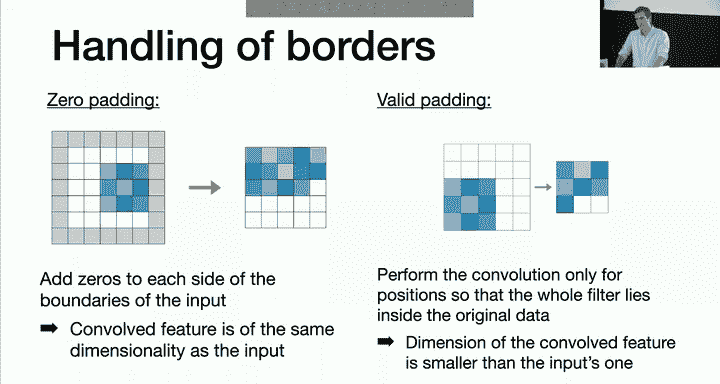

你。And so in fact， it is common not only to compute one filter by input。

 but you will compute a lot of different filters。And then it will give you different output and this is what is called channels。

So you will have multiple channels。So， for example。This is my initial input。I have one picture。

And to this picture， I will compute far convolution。So for each filter。I will compute。You know。

 all the value。Of。ItSo convolution。 So for example， for that one。I first， have my blue1。

So I will get my first channel。So this first channel will be the value of all my convolution between my picture。

And my first filter。So I will move along my filter along my picture。

And this will give me all the output for this first channel， and I will do the same with my purple。

Filter and then for my red filter and then for my screen filter， Okay。

 so for each filter you are computing the convolution and so you see that your output will be multiple channel。

So your output is not to2D。Object， it will be a 3D object。Okay， you will have one matrix。

 one matrix by channel。And so this different output is really what is called a channel。

So in that case， I have four filter， so I would get four channel。If you are applying markvol。

If you add more filter， you will get more。Okay。So then you see that since your output。

You will get multiple channel。When you will apply a new convolution。

 it's important to see how you can apply convolution to multiple channel， what does it mean？Okay。

 because producing the definition， we saw how to apply convolution to only one。在的。

So how can we compute convolution and an input with multiple channel？

So then what you will have is that in fact， your kernelel。We have the same depth。As your input。

If your input。As three channels， then you will apply a canl， which will be。

The succession of three defend candidates。Okay， and to each。Channel， you will applied its own filter。

And then you will add。The value。You will add your bias。

And then this will give you the value of the output。O。SoI mean， you are doing metrics multiplication。

In parallel， for all channel。And then you are assuming the results。Anyone I the bias。

So the output of the convolution between a multiple channel pictures and a multiple channel kernel。

Will be one depth。呃，公包睡觉。Okay。So you have multiple Cha。You have multiple kernell。

And you will do exactly the same definition as we see as a conversion between one pictures。

And one kernell， but then you will add the value for each。

Channel and then you will add the bias and this will be your output。嗯哼。😊，Okay。

 that's a very good question。Each filter is different of each channel。Okay， I mean。

 it can be as you want， I mean， but this filter one。

 you see it's not the same as my filter2 is not the same as my filter3。也。Yeah。

 if you want to compute a new one convolution into this three image。

 you initial three different camera， you can take the same if you want。ok。What was your question。

Can you get to your question， you want to multiply the channel。

So you want to add a channel or you want to multip them。So sorry。

 what do you mean by multiplies the weight so channels is your input。O。The field。

So how do you want to multiply the filter， you want to multiply the matrix。

 or do you want to multiply them component twice， I do not get it。What。

But why would you like to do this？Yeah。Nature。I don't nature。I don't think it would be the same。

 maybe， but I don't think so。 Do you have some other question。嗯哼。Yeah。Yes。😊，没有。

So the number of channels of your output。Will be dictated by the number of filters you will apply first。

So it is way home。So here， if the input。Had， let's say， three channels。 then each of this filter。

Will be of depth 3。Okay。Then you will apply four filters to your input and you will still get out of it。

F channel。Okay。Do you have some other questions？没。Yeses。😊，Yes。

The number of channels is a number of filters， because you will。For each filter， you will apply。

 you will do the convolution between your input and your filter on your kernel。 that's the same。

And that will give you one output。Okay。And so if you have multiple filters。

 then you will do multiple convol and it will give you multiple output。So the number of channels。

Will be the number of filters you will apply。就用input。

What is important and that which say just here is that if your input。

Has multiple channel and the size of your kernel or filter。😊，Will be the same as a number of。

Channel do you have in your input？Okay， if you apply a kernelnel to pictures with four channel。

 then your kernelel will have a depth far。O。😊，我歌。

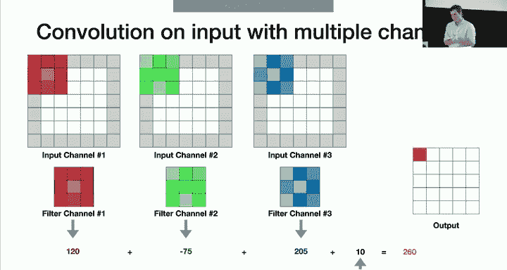

So on top of it， what we are often applying。It's another layer which is called pooling。Okay。

And so the pulling layer will be responsible for reducing again the special size of the convvolt feature okay that will be a way to get from one input of some size or another input of of other output of a smaller size okay so in some sense really like pulling will help you to decrease a computational power require in order to process the data it's a way to do some dimension reduction if you want。

Okay。And so there are two different way for doing pulling， you have the max pulling。

So the max pulling will really return the maximum value。Of the portion of the convertt feature。

Coveed by the camera。 So you see here。The max pulling。Of these would be the maximum value of3，5。

7 and 10， so it will be 10。That's a max pulling。But then you have also another of pooling。

 which is the average pooling。And the average pullingdding is only roting the average。

Of the value covered by the camemen。So it would be the average age of three，5，7 and 10。

 and it is equal to6。That 25。And what is also important to have in mind is that contrary。

 unlike convolution pulling。Is applying in a non overlapping way。

 so you will not move your kernel one by one， but when you will be done with this first pulling。

 you will compute the pulling over that one and then the pulling over that one Okay。

 your kernel will not overlap。Youre moving them。Sufficiently enough。

 in order or not to cover the portion you have already covered。Okay。

 so let's look look at the animation。So you see you are just moving it away。

 but you are moving it more and in a convolution so that it is done in a non overlapping way。

So each time you are taking the maximum of the value you see。Very simple definition。O。

And then you have the average pulling， it's exactly the same， but instead of taking the max。

 it will take the average。😊，You are looking at the font value， because here I。Canl is a two times 2。

 So I'm looking at the false values， and I'm doing the average height of this false value。

But it' very important also to note。Is that pulling is applied by channel， okay。

 for each channel you are applying your pulling your。So if your input as for channel。

 then after you're pulling layer， you will still get4 channel。Okay。And in practice。

So max pool is considered to have better performance。Okay， so people in practice prefer。

Max pullinging than average pullinging。So in conclusion， really putting layer is away。

To done sampling your input， okay， it will reduce the special size of the convolt feature。

You start from some co picture of some size， and then you will get as an output。Some thing， which is。

B of smaller size。Okay， so you see that you have read you the special size of your features。

So that's not the case for convolution of genome， that's a very good。😊，Quion。So first， for evolution。

It will depend。Of how you are ending about。If you are doing convolution with zero padding。

 then you can keep the same size and you can even go to larger size。Okay。

If you are considering valid padding， yes， it's a way， but you can see it as another way to do it。

 okay。

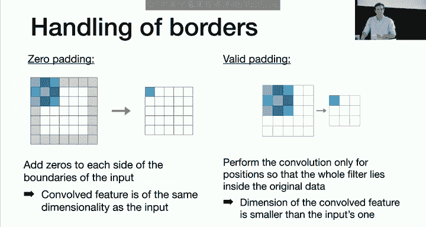

And in practice， it's working quite well。So often， network will be。

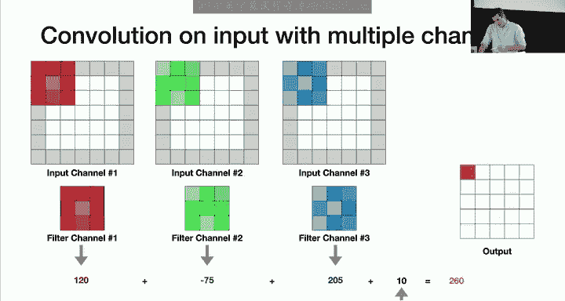

So this is what we would see now that you see like a convolutional neural network。

 we really be composed of a succession of convolutional layer and pulling layers。Yes。

 what is your question？It just like another way， you know， I mean。

 it's not clear if zero paging will work better or less less less well than a valid padding that。

Then it's really like all field to design some architecture。 sometimes we will prefer， you know。

 to go from one layer to a no layer， which will be smaller。

 maybe sometimes you want to go from one layer to another layer， which will be larger。

There is no clear answer。 Okay， you can do with births and it depends on the applications。Yes。😊。

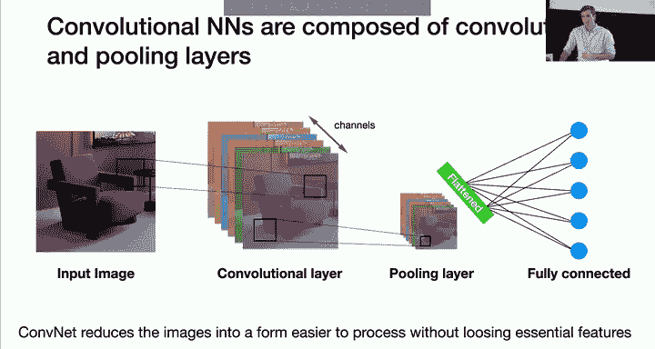

Can you repeat your questions， today。So you mean zero padding or valid padding。0 패dding。对。No， no no。

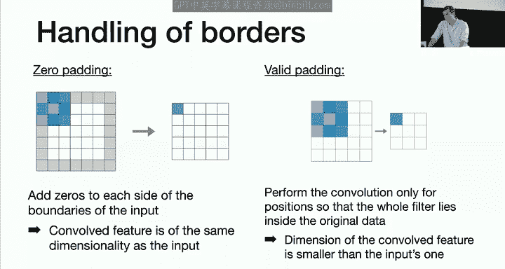

呃，I don't清楚。

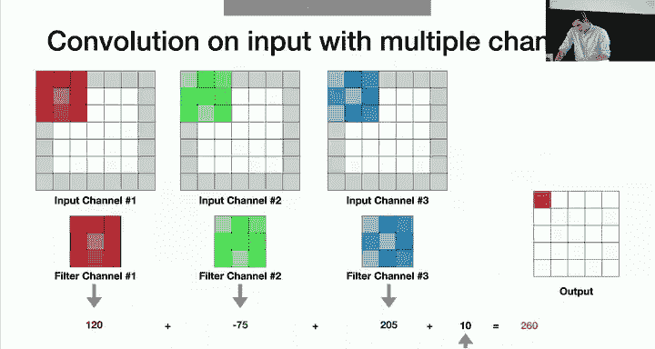

So that's a good question， I think in practice what you will try is like to design your architectureure so that the size of your pulling will work with the size of your input。

 okay。Okay， so a conventional neural network is really composed of both conventionalvolution layer。😊。

And pulling layer。So you see you start， for example， here， I have only one one layer of each。

 I start from my input。Youage。I will compute mycovolution。Okay， and I will have several layers。

 so I will compute my convolution for several layer for several filters。

 so it will give me several channels。And then for each of this channel。

 I will compute my pulling layer。 So you see that I have the same number。

Of channels in my pulling layers and in my channels layer。And the idea that we hope that after this。

Okay， we have。We have got the image in some form， which is no easier to process。

But without having losing initial features， and so now with these features。

 I can now flatten all this information in only one big vector。😊。

And then do classification of regressionggress on top of it。Okay， and so in order now to do。呃。

有黑I mean。Your prediction step。What you are doing is that you are adding another fully connected neural network。

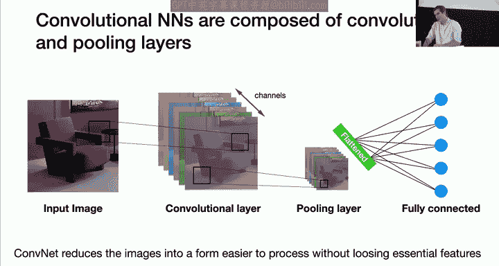

Okay， this is， in fact， a convolutional neural network。

Will not be composed of only one conventional layer and then one pulling layer。

 but of the succession of a lot of them， okay。And then what is also true？😊。

Is that what you observe and what people are doing in practice is that the first layer。

Often well extract what this call some low level features， so for example， the edges or the colors。

 and when you will go down into the network， the next layer will extract some high level features。

 some objects。ok。Yes。😊，So then I mean that's really like the question of。You know。

 like how to build your architecture and can you do some optimization on it？And sure。

 maybe it's possible， but。I think it's not easy to do。ok。😔，I mean， first。

 what people are doing is that they are building。 I mean， that's really like， you know。

The whole field and it wall out how to build a neural network for some application。

And there is no easier role to do so。 And it's really like outside of the scope of the cross。

What is important to understand today is that。The convolutional network that you will use in practice。

 which will be given to you how as they are built， they are built as a success of convolutional and pu layer。

Then if you want to know how to build such network。This is outside the scope course， unfortunately。

And I won't be able to help you to do so Okay， so what I just wanted to say is that' in practice what you will have is not only one convolutional layer and one pulling layer。

 but a succession of multiple convolution layer and pulling layer， okay。

And this first part will really be the path where you are learning some features。

And then using these features， you will use a fully connected neural network in order to do either classification or regression。

😊，Okay， and then the parameter will be the weight and the bias of all。These edges。

 and you will learn them doing back propagation。So to summarize， really， you see that my input。

Will it be an image。So often， it would be an L G B image。 I will have three layers。

So you see that first， I will apply a first conventional layer。So。To each。I mean。

 I will apply a can to this picture and my can would be of depth3 because my initial picture if I have depth3。

And then， the output。Of。The convolution between my three channels input and my three and my depth3 channel will be。

One adapts one input。Okay。But I will not have only one。Carel， I will have a lot of them。

And so then my output of my first conversion will be output at some depths。

 whereas these depths will be the number of kernell I am applying to my input。

K at the first convolution。And then on top of the convolution， you will do some pullinging。

And pulling is down。For each channel。So then the size will be the same。

This between this and this it would be the same size。Okay， you see。

 you are applying the convolution to all the channel of the input。But when you are computing pulling。

 you are computing， pulling only on one channel。Get that the main difference bottom。嗯。Okay。

 so then the question is， how can you do back propagation？On this。

 And so maybe that was a question of your。诶佢离。So we search that covolutional neural network specials for two different features。

The first features is the fact that the weight matrix is very spa， okay。

So since only few ages are present， the weight it matrix you will add will be very sparse。

So the fact that the weight matrix is past is not a problem for the back propagation algorithm。

You just have a lot of parameter， which would be set to zero and you will not have to trainend。So。

 the first fact。The fact that the weight matrix is paste is not a problem。

Then you have a second problem。We saw that in your weight metrics， you have a lot of weight。

Which are shell。 So they are fixed to be the same。 Okay， we say that the weight in the noded。

A is the same as the weight in the node B。And when you do training。

 you want to impose the fact that they are the same weight。

But we still want to do this to train this neural network with。Wei Shaing， using back propagation。

So first， you see that there is a problem， it's not obvious how you should do that。

If you just use back propagation， you are not enforscing the fact that you want to get the same weight in your weight metrics。

Okay， your gradient will be different， the update of each weight will be different。

 and at the next step， even if you were starting with the same weight。

 you will get two different weight。Is it care for you。

So you see that you have to do something smarter。 you have to do something different。

So what you will do。Is that first？You will event back propagation。

Inoring the fact that the weight are shippedd。O。You consider that all your weight are independent and you are running back propagation。

That's the first step。And the second step， when you have computer guard。

You will serve the gradient of all the age。Which have the same weight。O。😊。

So first step you are doing back propagation on your network。Without thinking of white sharing， okay？

And then you sum the guard of all。I mean， corresponding to all the weight which has to be shared。

And then you update this weight。Is it clear for the method。Do you have a question？Yeah。

 enjoying effect said。O。Good point。Knowing the fact as a way action。And so why this is working， Okay。

 this is really like。😊，Coming from the chain hole， if I have a function F from three variables to one variable。

 okay， F of X， Y， and z。And in fact， what I want to update is my function G of x and y。

Which is F of x， Y and x。You see， I am imposing the fact that the first variable and the third variable are the same。

That's exactly what we are doing when we are doing wage sharing。I have a function of all my notes。

But in fact I say that for some of the component， I want that this weight are the same。

 so I'm imposing a next high constraint that all the weight of the first component。

 the tenth component and the 20s component， for example， are the same。

So I'm looking no and the noer function。Only of the weight of the weight value， if you want。

So now if you want to compute the derivative of this function G with respect to x and y。

It's only a playing at Shahole。G of X， Y is equal to F of X， Y。X。

 so the derivative of G with respect to x。Is only the derivative of F。

With respect to the first component。Evaluated in x。So you get D F， X， Y， Z。Evaluated in x。Plus。

 and then you will evaluate this。In the value， X， Y， x。

And then you will take the derivative of F with respect to the third component。

And you will evaluate it later in X， Y， x， okay。So this should not be is this， it should be x。

 and this should be x。And then when you want to compute the derivative of x。

 so you have G with respect to y， you're only taking the derivative of x of f with respect to y。O。

So if you want this is the value of the derivative and then you will evaluate the derivative in X Y x。

So you see that the back propagation would be。Not exactly the same， but will be very close。

Two points， first point， your weight matrix is pass。This is changing nursing。

 You will have some parameter set to0。 You are just not updating them。Second point。

You want to share the weight between several ages。And first this。

 you are doing this simple modification。First， you run back propagation。

 ignoring the fact that the weight are shared， and then you are just multiplying the gradients。ok。

All good。So that was all for our conversion neural network and after the break。😊。

We will talk about a lot of def deep learning recipe。

So let's do a 15 minute breaks and we start again after thanks。

So to answer one question we had during the break， which was kind of important。Which was。

Why is the weight matrix between in one commission layers or between the input。And the output。

 why this weight matrix is both sparse。And shares em pa， okay。So。

You have to think that this is your input， you know。

 and previously when we were doing neural network， it was really like。😊。

The first fixation of nu at the layer of L。And this will be your output。

 This will be your next layer。So then this was the other suggestion of noded at layer L plus 1。

And so then the weight matrix will be all the I mean。

 the value of the weight for all the edge between sum， the noded I and the noded J。You remember this。

So now let's look at this in that case。For example， I take。This note。

And I want to see to which node of the previous layer is connected this node。

So you see that it will only be connected to that noded， that noded， that one， that one， that one。

 and what， but it won't be connected to all the nodeds in green。

So you see that in your weight metrics。There will be no edge between that node and all this node。

 so all this weight will be equal to0。Okay， so it will be set to0。 He will not time them。

And that's the same， for example， if I take that one。That one will only be connected to these nodes。

So you see that all the weight， for example， between that nud and that nud， the weight would be0。

Okay， is it clear for the first point， So you see that the weight metrics。Is spa。O。😊，Good。

And then why do we say that we share the weight？You see what will be the value of the weight between that nud and that nud？

It will be given by the first value of my filter。 Okay， filter is the same as a kernell。

 I use sometimes filter， sometimes kernell。 So the value of the weight between。My nud。

11 and my not11 will be given by this value。ok。Then what is the value？Of the weight between that nod。

And that nu， what would be the value of the weight？Between that one and that one。Someone。

 what would be the value of the weight？Will be 0， okay。Will be 0， because。

This no will not be connected。 I will have moved。My gar。

And I will not connect this entry to this entry。But then what would be the value of the weight between still this node。

 but no this node。It will be， it will be  zero because it will be this value。 Okay。

 it will be the first value of my candidate。So you see that I am sharing the value of this。

Weight with the value of this weight。And thats the same， I will share the value of。This weight， too。

Okay。So you see that in your weight matrix， you are showing a lot of value for a lot of I mean。

 for a lot of different edge。Lot of age will be associated to zero weight。And for the reminder。

 which are not zero， they will share the value。Of the camera。Okay。😊。

Is it clearifies this or do you have some additional question？Okay， so let's move to regularization。

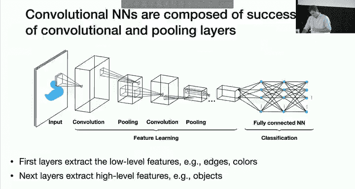

So when we were doing linear regression and linear classification。

 we saw that it was common in machine learning to add regularization to fight against overfiing。😊。

Okay， so you could ask a question， should we do the same for neural network？And so the question is。

 yes， it's a good idea to regularize， but in practice it's better to only regularize the weight。😊。

And to not regular the bias。

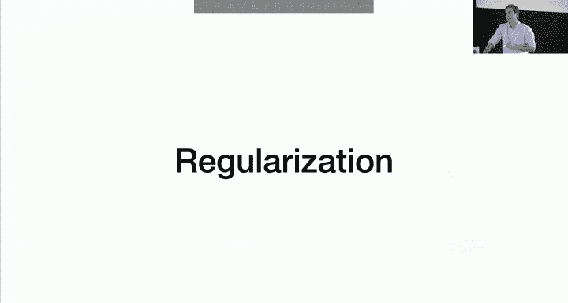

Okay。So， let's see that。So even if you know， and I don't know if you remember。

 I told you in the bias violence lecture that quite surprisingly。

When you were training your neural network， even if you had a lot of， I mean。

 a lot of pahamitas and it was possible to get a train loss to zero and to really fit all the possible train data。

😊，Seasonal network is still generalizing quite well。😊，So in practice。

 this neural network are not too pro to overfitting。So， this is true。But still。

 it's still a good I to add some hereization。 Okay。

 adding your regularization will still help you to improve a little bit your generalization ability。

😊，It's not that without regularization is not working。 without regularization it is working。

 but still you can add a bit of regularization。 It will work a little bit better， okay。😊。

So what kind of regularization are we often considering， we are considering L2 regularization。

 say will a regular high。😊，The phobian is normal of my white matrix， okay？

And I will add my small I parameter on you。So what I'm minimizing is my loss function plus。

The son of the Hobin Islam。off。My weight matrix that's exactly the same as when we were doing Toff regularization for this square。

Of our regression。 And we will mean。Penalizing the two norm of my weight， okay。

But what you have to have in mind is that I'm only regularizing the weight。

I'm not regularizing the bias now。So do you have a 90 why？

It could be not a good idea to regularize the biast， do you see why？So let me remind you， you know。

 we have in a network network two kind of parameter。The weight。Andze bias。And when we were computing。

The evolution of the function。 it was a activation of。Sm of X I W I plus the bias。

So why should we not regular the bias？So the bias in Samsson is telling you where the activation will be active。

 okay， where the shift will open up the activation function。😊，And in some sense。

 you don't want to regular this too much because you want the shape to be active anywhere you want。

 you know it will really depend off your function。So that's really why in practice you prefer only to regularize the weight and not the bites。

So if I am adding L to regularization， then you know it will favor our small weight if my weight become too large then this term will become too large and I will not find a minimizer so by minimizing the sum of my loss。

Plus the square norm of my weight。I will find a method with small weight。

And this can both help for generalization， okay， you can find the solution which will get better generalization error than withoutizard regularization。

And also， it can help a bit for optimization。 You can get to0 rock faster， because you are adding。什么。

교했죠。Okay。😊，And so when I say that it's better to regularize the weight than the weight plus a bias that's something really empirical。

 like in practice， we observe that's better to regularize the weight， okay no proof for this。

So now if I look at the optimization side。I'm using Ran descent， otoacastic hydrogen descent。

I am still， you know， updating my weight。By minus my gradient， but no what does it change。

 I'm still computing my gradient with back propagation。

 but I have to add the gradient of my regularization。😊。

And so the gradient of the Fbinist norm would just be the value of my weight， Okay。

 the forbinism norm， it will be the sum of the WIj squared。

So when I will take the derivative of WIj squared， I will just get WIj。

 okay because I have one over two here。😊，So you see that when you write the update。Of your。You have。

 in fact，1 minus gamma u times your previous parameter minus your gradient。

So you see that the AGD update or the GD update is exactly。The classical mine is a garden step in。

I mean， in addition， you are decaying the weight。Okay。

 you are decaying the weight by the value of the regularization。😊。

So this is what we call weight decay。And why DK is really using practice in neural network， okay。

 it's really useful。😊，All good for decay。So way D and gradient Decent is exactly equivalent。

Two regular highs， the fourus nu of the weight。 thats the same。

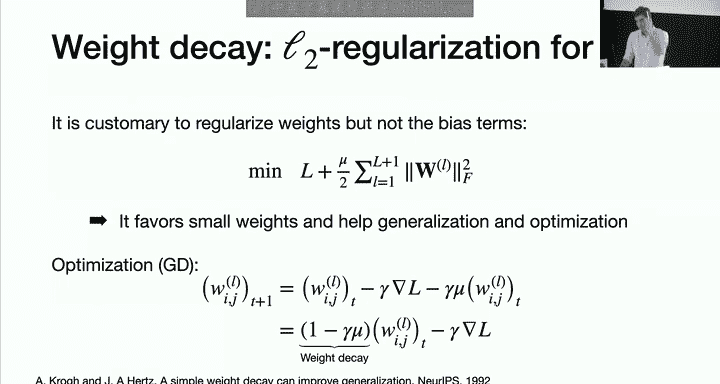

All good。And so sometimes in practice， you will prefer not。😊，To penalize。

 but you will prefer to instead constrain the value of the weight。 Okay。

 you will not want to add a square norm to your minimum to your training loss。

 But you would just say to， to add add constraint。 You want to minimize your hanging loss under the constraint that the weight are smaller than some value。

Okay， that's a another way to do so。And then you can do it。By using no projected Guardian descent。

 it will be exactly as Guardian descent at each step you will compute your next itade by doing my weight。

 minus gradient， but then you check the norm of this weight。

If it is smaller than your constraint then you are all fine and you accept it and if it is larger than your constraint。

 you will just recate it so that it will be。诶。It would satisfy your history。

So what you have to see is that， in fact this two formulation。

Adding some regularization or adding some art constraints that are very close。😊，Okay。

 and even if we are minimizing some convex function， you can show that they are equivalent。

So the effect will be very similar between Y DK or art constraint。If you want， in some sense。

Regularization optimizationization is simpler to implement because you would just have to do way decayK。

 you don't have to care about this projection。😊，But on the other side。

 when you are doing project I mean， projection or when you are doing constrained optimization。

The result is simplelir。To analyze， to interpret， because you have an art constraint。

 he knows that you are imposing to scale up your way to be smaller than R。

Whereas when you are doing pennaization， you are just adding some pennaization。

 you'll just know that you want to have weight which will not be too large。

 but you don't know exactly how large it will be， you know。ok。So just to summarize。

It's a good idea to use regularization from neural net。😊，But only do it far away。 That's better。

You have some question on this。没。

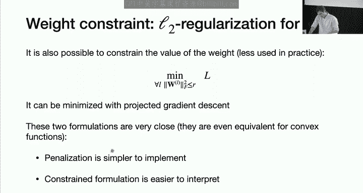

ok。Now let's talk about better augment， which is also something really， really important in practice。

😊，So you know that collecting data is very expensive。ok。And in addition。

 collecting data and annotating the data， so to get a label for your data。

 it would be even more expensive。😊，But in order to get good performance for your task。

 you need as much data as possible， okay。So then you see the question， you know。

 it would be kind of like the dream if it was possible to get extra data for free。

If you have a way to take your training sets。And just to en it and to get more data from this training set and then to train on this NN data set。

So that's also the goal of data mutation。So， let's。So let's， for example， consider this Mni data set。

😊，So you know that's the underwritingwriting recognition data set， you have 60 k digits。

And then what you want is to recognize， you know， to classify this between like all the figures between zero and nine。

😊，깨在 처지有。And then maybe you can see that in fact， it will be possible to artificially add some data in your training set just by p a bit with your training set。

😊，So what you have to understand is， for example， if you take this five。😊，You know。

 it does not change a lot if you are moving this fiber a bit in the picture。

 So for example like this， you know I just I have shifted my file。Or if you rotate to beat your file。

 you see you still get different pictures。But with the same label。ok。

So you see that you have a way to get different input。And you know the label of this input。

 So you get for free extra data。Okay， so you see that by playing with your data set。You get for free。

 some data for which you will know the label。And you see that with this example。I can shift my one。

 I can rotatete them， it still give me a picture for which I know the label。

 if I want to classify this， I still know that it is a three。😊，Yes。So方里。How can we define this。

 we say that we will have some transformation， though。From app word D to app word D。

 which will preserve the label， so what we are assuming is that the label associated with tau of x should be the same as the label with my initial pictures。

You is that exactly the same here。The label associated with this picture。

 which is one is the same as the label associated with a shift version of these pictures。

And so know what I am considering。😊，I'm considering a new train set S， I will train my method on S。

 which is my initial training set。😊，Plus all the two X for all the I mean for my all the X I。

 YI of my initial training set， I'm adding all the two of XI。

And what will be the label of this2 of Xi which would be the same Yi。Okay。

 so you see that in some sense you are getting for three additional pictures。

 and so you will be able to get better generalization property。Okay。So you话 training人。

And mode that time， this is why this is so useful and in practice is that really really important。😊。

And you have something even more， so first you are training and more data。And also， in some sense。

You know， you are steal your method。To be invariant to this transformation， because you will。

You know， you will learn on all the rotation， for example， of your five。😊，So in some sense。

 you really are guaranteed that your predictions then will be invariant to rotation because you will have train on all the rotation of your file。

😊，So you see that's very， very， very important。By using data mutation， using sound transformation。

 you are imposing the fact that you will invariant， you will be invariant to this transformation。ok。

So for example， if I'm adding some rotation， my algorithm will learn to organize a digit from any angle so you see how important it can be。

😊，So in some sense。Doing this data mutationation can be seen as a regularization。

 you know you are adding some higher knowledge。😊，You are adding the pone alert that you want to be invariant to rotation。

 for example， if you want to be invariant to translation。Okay。

But something else to have in mind is that the way to add tao will be very data set and task specific okay。

 for example， you want to do image classification， you will have some nice way to do data notnotation for image classification。

 which it will not necessarily be the same for another task。

For some you could imagine that rotating the data would change a lot。ok企。对以就是。Task and data specific。

But when you are looking and one。Specific application。

 so it's a good idea to look for some transformation to so that the phenomenon you try to model will be invari to toe and then to add all this data to your training set。

So you see， for example， it is not limited at all to rotation and。To a translation。

 you can have a lot of them， for example， you can cur your picture。And he says it。

You see that I start from a picture of a dog， if I hop and recite it。

 I still I still able to recognize a dog。😊，So this gives me some extra data set。

I can still copy his size and for example， flip it。I will get a new picture。

 and this is still like dark。I can also add some effect， for example。

 cord distort and some other filter， this is still a do。😊，I can do some rotationtation。

 I can do cut out， so cut out will cut some part of the pictures。

 you are taking your pictures and you are removing some part。

That's another are very popular data augmentation， you can add some noise also。

 and you can add the filter。So you see adding all this effect。

You will get instead of one picture in your training set， you add one picture。 and for example。

 I think all this effect， I get all this additional。😊，Data。

 so I will be able to train my method on really a larger data set and so I will be able to get better generalization performance and we will see that in practice doing data augmentation is really helping a lot。

😊，ok。So that rotation is really not limited to rotation。Our translation。

 you can have a lot of different as like a flip cop。 I mean， a lot of different things。 Yeah。

 what was the question。So that's a good point and that exactly does seem like。Let's say that for Ms。

 you want to be in to small rotation。ok。But you see exactly the fact that the transformation you will consider will be task。

And that has said specific。ok。If you want to recognize like some bowl， for example。

 some so ball or a tennis ball then you know。😊，What datingating will not help you find example。

That's a very good point。You have some other question on the tag。就 sees going。

It's intuitive that not only using this picture of a train。

 but trying to extract more information and kind of duplicate this picture as many pictures in order to have more information to train them。

ok。And we can also， you know add or for example， some other effects。

 so this is a called generated Cor。😊，So you can have a lot of noise， you can have different filters。

 so you can have some filter to mimic the fact that you have some snow， some fog or some frost。

And then you see what is important with all this kind of augmentation。

Is that you will learn to be invariant to this。Consformration。

And here you see something more with that augmentnot。😊，I that in some sense。

 it will serve some caveat of your method。Okay， because for example， if you're training set。😊。

You know， you want to have a self driving car and like your training set。

Is only like a tiny in California， where like the weather is always sunny。

 We will never have some pictures with the snow。But then when you want to use your cell driving car。

 you want this car to be efficient in Switzerland white it will snow。

And by using that a and by still learning on some pictures where you have had some filters so you have artificially add the snow。

 then your algorithm will be able to still detect a bird under the snow or to still detect the burden of the f。

😊，O。So you see that data augmentation can help you to be robust to some common corruption。

So it's really practically very important it help you to enhance generalization and it's also help you。

To learn to be invari to some transformation。You have some questions on thisす。

So in practice is that's something really like you will always。Use that augmentation。Okay。

 why decayK data augmentation are very， very important and are implementing in a lot of。아して죠。Okay。

 so now let's talk about dropout。So if that mutation and regularization was not specific to neural network。

 dropout is very specific to neural network。😊，It's a method which was really popular maybe five years ago。

 no， it's a little bit less popular still。Vi is still important， but。

Maybe less needed to get statuss yeah。Result as before。So what will be dropout？

It will be a technique which has two different purpose。The first one is that experimentally。

 it will help you to avoid overfitting。Okay， if we kind of act as a regularization。

And the second way， you would see that dropout would be kind of a way to do ensemble advertising。

Okay， so we will talk about it now。

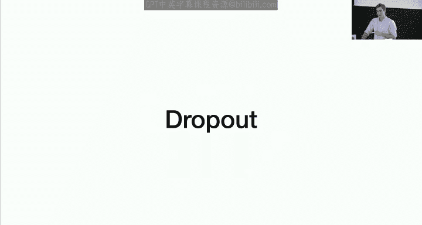

So whats is D？So you have a mini version really， but the basic version will be the following。

At each step of your training step。ok。So you are learning you have a neural network。

 No it will be a fully connected neural network。And you are at one step of your training。 Okay。

 so at this step， you want to compute the gradient associated to all this weight in order to update this。

In order to update all this weight， so you will not do it directly。First。You have two。

 okay you which will be P I L。So P IL is really like a probability。That will be some extra parameter。

 and PL will be the probability to retain the nud I as a layer。So in fact， what you will do。

Is that for each of the nud？will flip a coin。And with some probability。

 you will keep the noded and with1 minus this probability。

 you will remove the noded from your network。Okay， so that's the first step。

So you see like you have your network and in fact in parallel， you will flip a connect each time。😊。

And you will see if you keep it on it。And if you get zero。

 you just remove the noded and you remove all the associated edges。😊。

And you do this for all your network。ok。So after this step。

 you see that what you will get is a hodom sub network。Okay， you have your initial network。

And for all the nud。You check if you keep it or remove it。And so after this。

 you will get on the sub network。That the first step of the dropout。

And what you also see is that often in practice， you will not use the same probability for the input than for the earlier year。

In practice， what you will do is that you will use。ゼ dot8。For the input， Okay。

 so we will kind of keep 80% of your input。 and then for the other early years。

 you will only keep 50% of your notes。Okay。So you take your network。

And you holy remove some of the nuts。And you get the semi。

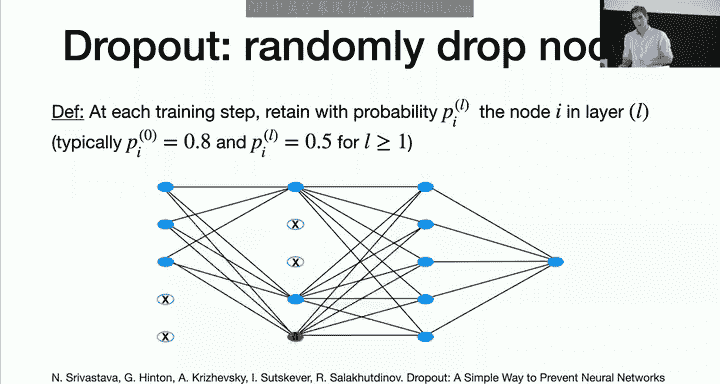

Okay， this is my original network。😊，And after I drop at tape。I will get a Ho up some network。

And now you will update your Pahamme。Not computing your Mac propagation algorithm using your original network。

😊，But using this Hondason network。So you will apply back propagation on this Houndm subnet。

So some weight will be updated。They correspond to the weight which are still。In your sub network。

In some other weight。I mean， it will not move， they correspond to the weight。That you will removed。O。

😊，And then you keep doing it。This will be one step of HGD or one step of mini batchsh HD。No。

 you will do again your robot， you will get another Hoson network。And you will compute。

So update of HGD and this new Hom sub network。And so on and so and so on。Yes， what is your question。

验收。Imagine your ait G of HD。You first draw a1m7 network。So now you get this architecture。

And now you will apply the whole back propagation algorithm to this subba structure。

 so both for the forward and backward pass。O。你是亮了吗？Does it care for the definition of the robotout。

Yes。😊，Okay， very good point， yes。At the next iteration， you go back to your initial network。

And you will draw random them sub network from your initial network。It's not iter。

 if you are not drawing a new network from that one。 Okay。

 you really come back from this other one and you do it again and you will get a new honda sub network。

Okay， otherwise， you know。Very soon， your network will be almost empty and you will stop learning at all。

So that's a very nice point， very good point。Wass that question yet。예， be done every죠。

That's not dedicated to a。Vil layer to fully connect and。For any network， you will have some nu。Okay。

 it can be convolution， it can be put， can be anything， you will have some nod。Then you will just。

 you know， holy remove some nodes and apply the back propagation algorithm to this subnet。Okay。

 and another command and I take your question is that now I'm presenting the dropout on the noded。

 but you see that you can do exactly the same with the dropout on the edge。Can also keep the nud。

 but just remove on near some of the edges。 you can do both， yes。

So let's say that in practice what you will have is really like you will have a different probability between the input。

😊，N 지这 you。And this is what was done previously。I think just like a next I parameter， you know。

What you can say was that what you want is really like to keep。You don't this破ability机。

To be too low because you want still to， you know， to retain a lot of the input。

Because otherwise they're resulting some network。Will not， you know， kind of will be。

 will have less information。But still， you want to have really like smaller some networks。

 and you want like this probability to be smaller， the probability to retain some of the nodeds。

 not at the first layer。 you want it to be smaller than this that the first probability。Okay。

 but I mean， in practice， you will often use the same probability for all these social layers。

But that's the next high format that you can， you know， you can do， as you prefer。Okay。

 all good for the training。Yeses。😊，Okay， so at each type of stock atage descent。

 you are drawing a Houndndam subnet。And you do one step of HD on this condom network， yes。Yeah。

 so now once we have the own this new sub network。You want to update all your weight of your initial network。

 okay？And you see that for all the noded you have canceled。

 then you will have also canceled the edge associated to this noded。

 and so you see that all this edge won't be updated， so they will stay to the same value。

You will only update the value associated to。This edge， okay。

But then when I will do a next a new iteration， I will have another on you and I will have a new subnet。

😊，With， I mean， with different edges。 and no I will update different edges。

So in the average age at the end， you are kind of updating all the edges。😊，Ok。

So this is what the train phase。But then exactly what you see is that。At some step of L GD。

 you are not exactly。Updating all the edge。Oh the wait， sorry。And this will have an impact。

So we would have to do something during the test。So at training time。

 what I'm doing is that I have a node and this node will be present with some probability P。O。

But at test time， what I'm doing in order to test。I will test。Okay。

 when I want to do some prediction。I will use my full network。Okay， I'm doing testing。

 I'm predicting with all my nodes。 I'm not removing any nodeds when I want to do a prediction。

So at test time， all my nodeds are present。But then what you have to see。

 what is important is that it will be important to scale。The weight associated。

To the weight associated to this edge。And this is very important。😊，And so to see that， for example。

 you know。When you were training， maybe you have kept like 50% of yournerds alive。

And what you have to think is that all know all these nodes that you have removed。

 they add a little bit of information。😊，And that a little bit of bias them。And so by removing them。😊。

You kind of changing where the activation will be activated。Okay。So in some sense。

You will have to take this into account when you will do testing。Okay。

 so it's very important when you are doing testing to rescale all the weight。By the fact of P。

That you have used。In order to remove the weight and so why are we multiplying this by this P because what you want is that the expected output。

And theres a distribution。That the nodes are adopt at training time。 You want that at the test time。

 the expected output to be the same。Okay， so you want the distribution of the output to be the same during the test and the train time and to get this。

 you have to multiply by P all the weight when you are doing。😊，Theest。Okay， so first。

 you're train your network by removing。Some add and some node。 And then when you are testing。

You are testing using your full network but you are multily， I mean。

 you are multiplying all the weight by this Bahammeurpy。😊，ok。And you have another way to do this。

Which is not exactly equivalent， but， which is very。Very close。

Is that you can do the rescaling during the training time。

And that is the way it is implemented in practice。So in practice。

What you will do is that after each step of stochastic gradientian descent or after each step of mini batchge。

You will multiply other weight by one over。ok。So that that is actually the same intuition。

 so that in average on those expectation you get kind of the same scale。Okay。

 so just to conclude for the hope out， it's important to take into account during the prediction that you have removed some of the weight。

You can do it in I mean two different way is order testing by multiplying the weight by P。

 ordering training by dividing the weight by P。And in practice at that one， we prefer。

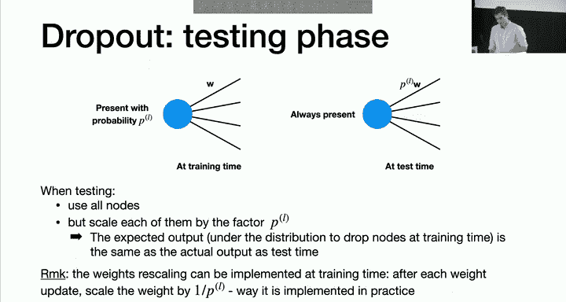

So let's see why do we want to do the about， what has the effect？

So the first effect is that experimentality。😊，It kind of help to avoid overfitting。

And how it is doing this， it is doing this by preventing what we call co adaptation。😊，So intuitively。

 what we are seeing is that by doing the rope out。😊。

Like different nodes of the network cannot rely on each other。Okay。

 if you think of in a stone down neural network。😊，When you will update your weight。

 the derivative you will receive by each parameter。😊，They're already telling you how the parameter。

 if I'm moving this parameter， how it will change。😊，My final loss。

Given that all the other parameter stay constant， that's the definition of your derivative。

And so in some sense。You can send。You I mean， your Bahammeta in some way。Which will be fixed up。

By the other by the way， that other or nodes are moving。

And so you see that you can have some dependency between the parameter of different weight。

And so this will not generalize well。 And so this is what we are calling co adaptation。😊。

And so by doing subnet。You see that you are removing this effect。😊，So in some sense。

 you are learning in a more obvious way。Okay， so that's why doing。Tper can help you to。

To fight against。And the second way， which is the second fact， which is very important with hopeout。

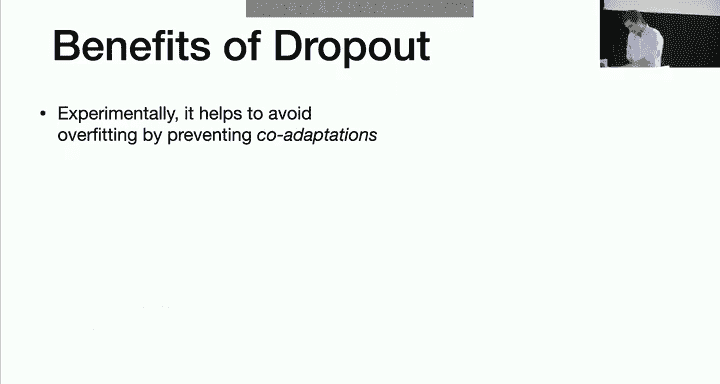

Is that it can be seen as a way to do what is called ensemble a。

So what is ensemble abo that often in statistics or in machine learning？😊。

What you would like to do is not train any one neural network。

But you would like to train a lot of different neural our network。

And then you would like to average the prediction。Okay。

 that's really what will give you kind of like the best prediction possible。

You would like to train on all the possible Nhan network。😊，And then do the other。Of the solution。

So this is what is called baggging。Okay， so what you would like to do is to train many different neural network and then do the prediction doing the averaging of all your prediction。

But you see the problem that with' bagging is that we have to train a lot of different neural network。

It will be very expensive in terms of computation。And so in fact。Dropout is doing this。

 but implicitly。By doing the hopeout。You are not in fact painting any。You。😔，G neural network， I mean。

 your fully connected neural network， you are training in parallel， a lot of different sub network。

 which are all the sub network you are seeing during the training。😊，And so here you see， for example。

 I brought you all the different sub network of this fully。😊。

To layer have fully connected Nohan network。And so in some sense。

 when I'm using dropout on this algorithm。will be kind of equivalent to have trained。

All this semi network at once， but you will do it at the same time。

 it will be very efficient computationally。Yes。别。So I think that using reliableo will be compatible。

那就现在证明你。By doing robot on a very large network， you have trained。

 you will have seen a lot of Hndam network。Like in fact， we will have see like two power of KL。

Or two likes the number of Pahamime。我啥。I mean， when you say that。

 can we do it for like only a few of them， it will be very interesting。

And if you would like to ever had a lot of models， it would be very， very expensive。Ok。

But it can be better。It's just like。A cool way to approximate it。In a cheap， I mean。

 completely cheap way。ok。So really， the robot is a way to train many neural network in parallel。

And then you are testing using the average height of all this Hom sub network。

And what is important to have in mind and what you already ask for is that the robot part is not limited to one particular arch picture and you can use it for every network okay。

 you just need to have some notes。So I really like it by doing the rope out。You are like。

We are forming an average of a lot different sub network。

 which are all the sub network we have seen during the training， yes。😊。

So am nice that you will just consider that if you remove。

I think you could imagine that you can try to implement both。But intuitively。

 the1 I will do first is that if I remove one weight。

 I just don't consider that they are shared anymore。And might diverge and you want。 Yeah。

 So that's a good point。 So we do in fact the other way。I will remove all of them。Okay。

So this usual check and I'm not sure how dropout is exactly implemented with weight sharing and commissioner。

Well good。

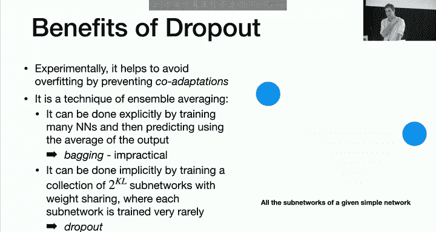

Okay， and so the last one I want to talk about， which is really， really important and really popular。

And which really like mainly explain like the recent progress of。

Finding neural network is batch normalization。 Okay。

 and so batch normalization is really a technique which help you to stabilize the training。

And so with batchization， we'll be able to use larger step size。ok。

So it's kind of a mis I use technique and it's not clear why it is walking。

And like the interpretation in the produce， I mean， in the paper。

Where rational organization was introduced is not， I mean。

 we are not sure if it's the true interpret。 I mean， the true explanation or not。

ButT is very efficient。So what is bash normalmalization？It's not difficult。 You will see。

You are training your method with a mini batch as， so at each step， you are computing a mini batch。

Okay， so first， what you will do。Is that you will compute。The onP改 mean。

Of your input with respect to your batch and you will compute the empirical variance。

Of your input with respect to your mini batch。O。With this value， you will finalnize。😊。

The value of your input。Okay， so for each noded and you can do batch normalization before or after having applied place activation does not change。

😊，So for each nud。You are computing the average of this I mean the value of this noded over your mini batch。

 so first you compute mu and when you have compute mu you will compute the empirical variance over your mini batch。

 so you have compute sigma。And now you will just scale the value of your noded by removing the mean and by dividing by the standard deviation。

 Okay you are adding a little bit of upside on in order to get more stability in the training。😊。

So first step is kind of。I mean， I mean， it's easy to see what you are doing。

 You are just standardizing。The value of your input。

But then what you will do is that what you will output。Is that you will add。

You will add a parameter of the scale gamma， and you will add a parameter of the bias Pta。So first。

 you are normalizing。And then。You kind of let one extra degree of freedom of the scale of your output and the bias one。

And so you are adding two extra perime。Okay， so for each noded， you are adding two x parameter。

 gamma and beta。And this parameter will also be learned。Using。Some garden distant alism。ok。

So far it's not。You are fixing， you are first on the output。

 and then you learn the scale and you learn。最面几啊。And so by doing this。😊，Oh， and when you test， okay？

诶。You test using the same trick， but with some value of new L and Sigma L you will have learned during the training。

 okay。So when you test， you will use some value of mu and sigma。

 which are given by all the value of mu and sigma you have seen during the training。

And so doing this really help you to get faster。Pa。

And also help you to use larger learning height and to get really better。Jnalization那方。Okay。

 so let's just give me two minutes just to show you in conclusion some results to see what we have seen today。

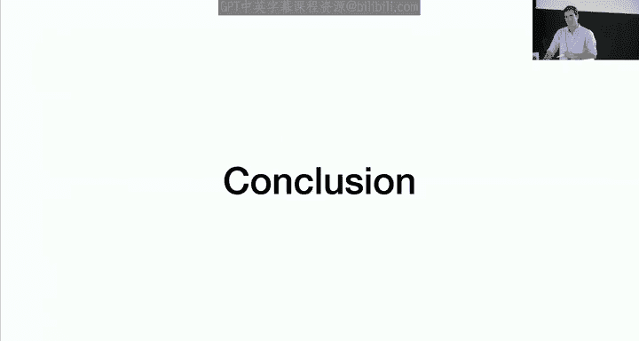

It's kind of interesting， it will help you to put everything into perspective。

So this is coming from this paper by Ben Joita。So Cycipher 10 is a one classical example of a data set to do image recognition。

 and I want to compare a different neural network。😊，Using def methodss。

So I'm comparing inception and LXNe， which has some complicated neural network with convolution。

 and I'm comparinging them to MLP multilayer perceptionceptron is just like some fully connected neural network。

😊，And I'm comparing one neural network with only one layer。

 and I'm comparing it with one neural fully connected neural network with three layer。😊，Okay。

 and then two other。Now a network with conversion。And you see that they are kind have the same order of parameter。

But the fact that。Here I have some convolution， I will have some very sparse white metrics。

 so in fact， the depth of this network will really be larger and they will really be more powerful。😊。

So first， you see that the best result I can get with inception on my test will be of other 89。

Whereas with a fully connected， I'm only getting 52。We're 53。Okay。

 so first you see the interface of using convolutional neural network。

By using a commercial neural network， I go from 52 to 89。😊，it's kind of like a huge improvement。O。

Then you can see。The use of using condom cops， the data augment。N DK。And vet。

So let's take batchome so that's one we talk about。

 I can compare the state of theR result with inceptionion without batchm。😊，I get。83。

And if I'm adding on top of it bam， I go from 83 to 89。

So you see that Bam helps you to go from 83 to 89， that's kind of for that。Then I can also use。

 I can see the effect of。That fragmentation。Okay， I can go from。85。Withoutizard the tagation。

To 8931 with that augment。ok。Then I can see also the effect， for example。

 of adding Y DK withoutizard datanotation。I will go from。85，65 75 to 86， so you see it's help a lot。

 I mean， not a lot， it help a little。😊，And for example。

 also and I will conclude by this to see that it's not possible to dehive geneul。😊。

You see that if I'm using way D K here。In addition， a found cut。

Then they would get a worse performance。So kind of all the different you know methods we have seen are en。

 and it's not clear。Which one will always help on that？

But you really see as a conclusion that convolution is really helping a lot。

 Batnam is really helping a lot。😊，And that mutation is also in lot。Okay， thank you very much。

 And see you Thursday。 where we'll talk about。

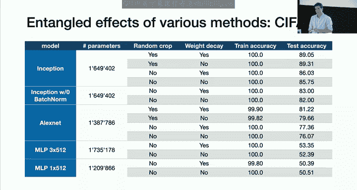

Adversial learning。