# EPFL《机器学习｜Machine Learning Course CS-433 fall 2020-2021》中英字幕（deepseek - P26：[26]EPFL Machine Learning Course 2021 - Week 9 part 2.zh_en - GPT中英字幕课程资源 - BV14SwyeNEvW

So today we will talk about a machine learning。So its really like a new and a very exciting topic。😊。

And that's something which has been very， very active in the past few years。

But it still remains a lot of stuff to do and it's also very important。

Practical with a lot of very important practical applications， okay。

And so what are we exactly talking about when we are talking about address machine learning？😊。

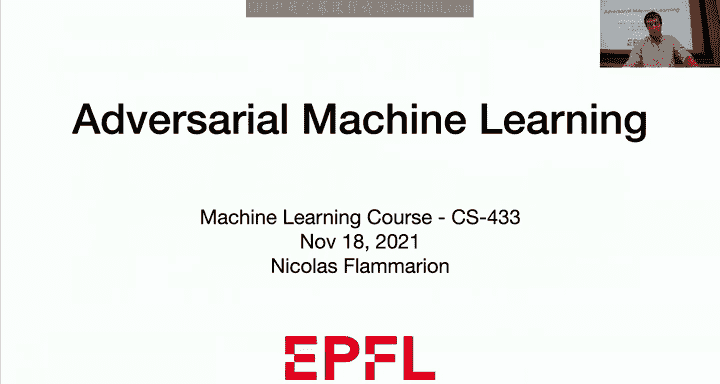

Is that。If you look at human vision， you will have some examples， some task。

 which would be difficult for human。If you look at these pictures， for example。😊。

And you want to distinguish between a dog and a mop。For human， it will not always be easy。Okay。

 so for example， when you look。You know， I don't know between that one or that one is not clear which one is a dug or which one is in。

So you have some task。Which are difficult for a human。And so then what you could have felt， you know。

 is that also a neural network。😊，Will also be tricked。In some task like this。

But no if you are asking， if you are training， you know a network or some。You know。

 computer vision data set。 And then you try。To distinguish between a dog and a mop using your neural network。

 you could think that your neural network will have the same problem as a human。😊，And in fact。

 that is not the case。Such task for the neural network will be really easy。Okay。

So it would be an easy task and that's the same for a lot of other pattern recognition for speak processing of other task cases。

😊，So， in fact， for such task， noday neural network I even more performance at a human。

 if you look at like。😊，So I mean， the classification how at the end。Now。

 our network will achieve better performance than a human。Okay but still， in fact。

 neural network will have a lot of problem in the way they are doing prediction and the ways they are doing decision in the fact that they are nonhoist okay so this is what we will see and this will be really important and even more important when we come to the time where we want to use neural network in order to make some decision you know so today we will use a larger example of Sa Ravinka。

 if you want to use a neural network in order to understand the word and then to take some decision。

You really want to have a na detector which would be hoist， okay， and that you can't trust。

So we will see today that it teacher。Major issue that， in fact。

 neural neural network can easily be tricked。So what do we mean by that？

That's what we call a saleL examples。Okay， so what is an adversar examples？

That's really some small perturbation。That you will be able to add to a picture。

And then youll neural network。Will be totally lost。 So， for example， if you look at this example。

I have this picture of a pig。You all。Recognize a pig on these pictures。

And what I'm telling you is that it is possible。😊，To manually c some small noise。

So this is not a ho notice， this is very important to have this in mind。😊。

This will be particularly cuffed perturbation。The choose a distuation。Is very small。

 I'm multiplying this perturbation by a very small numbers。

So when I look at the resulting image at the resulting pictures。

 which is exactly equal to my pig plus this small perturbation。😊，For all of you in the classroom。

 you still see a peak。😊，And you are very confident that this is a peak。Okay。

But now if you ask your neural network。😊，To classify this picture。

It will tell you that it is an airline。O。But if you have asked on neural network to classify this picture。

😊，It is telling you， it is telling you that it is a pig。😊，食 you思。

So for human is exactly the same picture。😊，But for the neural network。

 you say one is a peak and the other is the airliner。😊。

And there is nothing specific to this picture general。

 what we will see today is that for any picture。😊，It would be possible to find such perturbation。

So that the neural network， your neural network will be tricky。So that's what is called anL example。

Okay， so you see that。Comply to your manual network really have some difficulties with such example。

😊，And it's not hard to imagine that this will be a huge problem。In terms of security。

Because if it's so easy。To take you on network， how can you rely on your data in order to make really important decision。

你 know。that's not only for self driving camera， mean you can imagine like if you want to use AI to do some drill or I mean。

To in a lot of application。Ifs the decision。A so less for can you rely on them。

So that's the first problem and even the second problem， even if you go beyond security issue。

We see that， in fact， we are not understanding at all how this architecture are generalizing。

You know。Or is it possible that in fact， when I'm only changing slightly my input picture？😊，It's up。

Predicting when it's subject generalizing。Okay， all good for the problem we will see today。Yes。

So let's try to formalize it a little bit more。So we will consider a classification problem。😊。

And we will consider a binary classification problem。 Okay， so as usual， X。

 Y will follow some distribution D， you don't know， and Y will belong to two classes。

 It will be minus-1 and1。That's you know what we are used to。

And typically today we will talk about neural networks so my function F。😊。

Will be the predictions the classifier learn with the neural network。

But the problem of ho businessiness really go beyond neural network。

 And if you consider linearar caia， you will have the same issue。 Okay。

 so that's really something very general， which go beyond neural network。

So we have some samples from D， and we are learning a classifier F。

And so what we have did during all the first part of the course with Martin and with me is that we saw that in order to see if your classifier was a good classifier。

 you want a dis classifier get a small。To意好。You remember， we are looking at our classification loss。

Which is the indicator function of F of x def at y。 So if you are doing a good classification。

You are not doinging any less。But if you are doing a wrong classification。

 then you will pay a price of one， and you are taking the average age of your loss over your distribution over all your example possible x and y。

And you remember that this expectation is exactly the same as the probability of making a mistake。😊。

So what you want in supervised classical supervised learning is to minimize the probability of making a mistake。

And you see that this is really like in an average age。😊，ok。So what we want is that。

When we are taking the average edge of all possible X。😊。

We want to find a method which achieve a low risk。That what we have seen and we have seen last time that neural network we work very well for this kind of task。

😊，But do you see what is the problem with this definition of the risk？

NowIn fact why it is not satisfying to minimize such risk if you want to make hoies prediction。

Someone。😔，Yeses。That could be one option， but click this something else， someone else。

So you see that it is an expectation。 So that's really like in average age risk。

 you want that in average age。😊，You're not too bad。But it is not taking into account the wasS case。

So this is why what we will introduce today is what is so called aIS。😊。

So what will be the aella risk？It will be still the average。A few01 plus。But not over your data X。

But some small was case perturbation of X。So you can look at the definition air epsilon of f your Alar riskk a level epsilon will be still the expectation。

😊，Over x and y following D， But you are not anymore aboaging your indicator function of F of x different from Y。

 You are aboaging the worst case。Indicator， are you are taking the maximum of the indicator over all the x at。

😊，Which are in your bowl home X。ok。So what are we doing here。

 What we are doing is that we are considering that we have some a eye。

And that your adversary is allowed to manipulate your input slightly。😊。

So the I is a lot not to tell you no， you don't want to evaluate it in x。

 but you will evaluate it in x at。And you still want to be good。Again， this adversar。

So you want to be good not only on x， but to be good on all the ball around x。And so you see that。

 of course， you have to impose some constraint because it will not be possible to be always good if you don't have any constraint。

 If the address I can be very powerful and can。You know， take X at to be very far away from x。

 would be a very difficult problem。So that's why that we are imposing some constraint and we are imposing the fact that x at is not too far away from x。

So of course， you see that we will have to define what would be this distance and what would be this epsilon。

So involves really what we are doing that for every x， you have an adversary。😊。

Which can find the worst petturbation。And con no。Okay， and you won't。做 b。C used to this。

 so we can see this in these pictures。That was really like the classical risk。😊，We have。

Some point in again， there will be， for example， minus one and in both there will be the plus one。

 and we want to find a classifier which will classify well outing data。We just want to have all。

The green point on one side and all the blue point on the other side。

 that was a classical the standard risk。Know what we are doing when we are considering。That I a risk。

😊，We are looking so here it will be for the infinity now。😊，For every point x。

We are looking at some bold on x。And you want that。You are predicting the same label in this bowl。

And so now if I'm looking。At this linear predictor。Which previously was obtain in very small。

Star risk， it was zero， you see now that the avers risk of this predictor will be less good because you see that。

 for example， for that point。Which is well classified if I'm looking at the standard risk。

I will find a worse case instance here。Which is not well classified。Okay。

 and that's the same for that point。我 good。So you don't want the risk to be small for all。

Your input X。But you also want to predict obviously。In all your bow around X。

So that's really what is definition of the aia risk。

And what is very important to have in mind is that your DNCC that it would be possible to have for some predictor a very low standard risk。

😊，But a large adversial risk。So it's not because you are imposing。

To have a goods on the is that will be a robustist。Is it good for this definition？😊，Yes。

So you see thats really why， I mean， what is in concern when you are considering yourself is that you don't want。

😊，You know， to be good in other age， you really want to be good。In Wal's case。

So you really want that it will not exist some adaile example， which will trick you。

So if you are able to minimize。This a daellahik。Then you will get a classifier， which will be robust。

ok。Are we good for the definition of the adverse hearings。

 because that's really the most important object of today's lecture。Yes。就什。嗯。

That's a very good point and we will talk about it at the end of the。What' there a question？Yes。No。

 no， no， so you see well no， I haven't specified a norm we will talk about immigration。

No more questions。

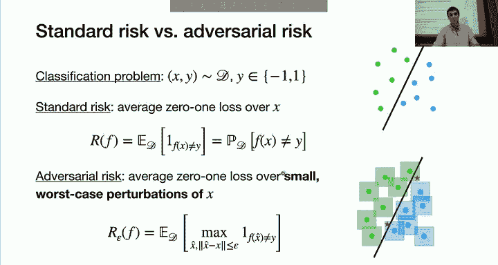

Okay， so you likely see that a vulnerability will raise a lot of different questions。😊。

And so the first one is how do you define your street mode？Now。

 how do you define what as the role of the game for the advertising side？

So you see that that's really what you have to do， how do you define the Lci over and so maybe the first question will be which nu you want to say do you want to consider the L infinity nu。

 the L2 norm， the L1 nu， the L0 norm， which is not a norm。😊，You know。

 how do you want to characterize your geometry？Or do you want to define a set of perturbation here we are only consider some bolds。

 but it could be any set you can describe So that's really like the first question。

How should I define my set model？ So this set model that you like the definition。

Of the Adv I program。ok。Thats the first point we will try to see today。

The second point we have already talked a bit about was。If you have a predictor。

 if you have a neural network F。Which has a small standardis。

Ho bad can be the situation when you are looking at the ho risk。Okay。How labs can be the robust risk。

That's a second question we will try to solve today， we' will try to see。

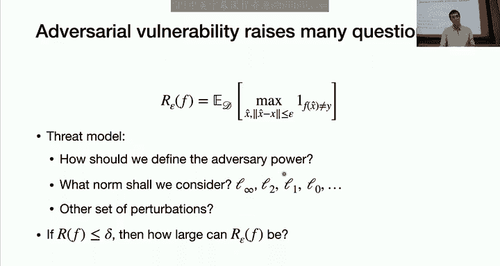

So then we have a lot of other questions， so for example。

 you know in the film I mean there's a circle slide I show you like an aal example for the tree。😊。

How is it possible to compute such example， Do we have an algorithm？

Such that for every picture as input， it would give you an， an averal example。

And for such algorithmism。😊，You know， you could have another question which would be which access to the neural network this algorithm will meet。

😊，Okay， that's also something we will talk about today。And so then。Another question could be。

 for example， is it possible to design is it possible to solve this issue。

 is it possible to design a classifier app using a neural network？😊，Which will be robust。 Okay。

 How can we do so。Or maybe another question that we will not talk during the lecture because we won't have time。

 but its explained on the lecture or not。😊，Now， if I give you a classifier F， which is not a hoist。

 hot， is it possible。Do。A per theory he transforms this non robust classifier in a robust one。

That's also possible。 and you can look at it in the electron node。 And then at the end。

 if we have time， we will try to see a little bit why in fact neural network are so。No hoist okay。

 so you see really like all these adversarial machine learning questions are very important and we will try to answer some of them。

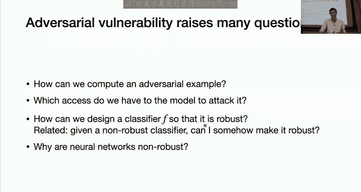

Okay， but we won't have time to do everything。So let's first。Stop you know with the first one。

 how can we generate aver example？Okay， how can we get this perturbation of my pig to trick my neural network？

So what do we want to do？I'm giving you an input， okay X and y。

 so I'm giving you a picture and a label， I'm giving you a pig。

 I mean a picture and I'm telling you it is a p。😊，And I'm also giving you a neural network F。O。

 so youll know how network is really a function。From your space of pictures。Into minus-1，1-1。

 it's not a big one， it's a big okay in the previous example it was Mo P because it was a multi class classification problem and we have like different classes like big alignr and so on。

Here we are only considering binary classification minus1 and1， but that's exactly the same problem。

Guess I'm giving you an input， I'm giving you a model。😊，And what is your task。

 you know what you have to do， you want to find an input X at。So that first。X at O。

Sorry for the typepo。X art。Is close to x， okay， you want that your a example is not too far away from your initial pictures。

And there's some distance which is specified， so you want this to be smaller as than epsilon。

And then you want that your model F makes a mistake on ex act。😊，Okay。

 so you want to find a picture which is close to the pig， but when you ask your neural network。

 is it a pig or not the neural networks， I know it's not a pig。😊，And you see that's really important。

To impose this constraint， because otherwise， it will be really easier。 if is giving another picture。

 of course， it won't be a peak。So， you want to find。The X at， which is close to x。

So does the neural network make a mistake on this exactat。Oh。All good for the task。

So you see that you have two different possible cases。So first one， which is the easy one。

 is that in fact， x is already misclassified by the network。😊，Ynova one network is already wrong。

So then you see you have nothing to do because you have already find a point。

Which is very close to x。Because it is x。And your neural network is making a mistake predicting these pictures。

So in the first case， we have nothing to do。So now what we will assume。

 we will assume that x is correctlyly classifiedified by your neural network。

 So we are assuming that f of x is equal to y is a correct label。😊，So what do we want？

We want to find a point x at。So that。So I make a mistake。

So that means that F of x at is different from y。And such that X I minus x is smaller than upsideil。

So if we look at the picture， you see that， what do we want？😊，We want to find a point x at。

Which is in the bowl of Raius Epsilon X。And which is on the other side of your decision。

 boundary't worry？😊，三 x。So here you see that x is on the side f of I mean of the plus1。

 so you want to find a point in head so that f of x at would be equal to minus。

So you see that the problem is exactly equivalent to find a point in this set。In the intersection。

Offf your bowl of center x and ofve had Epsilon。And。Of。All the bone。

For which the neural network would predict that the label is minus why？

So what can you do in order to find such X ads， imagine I'm giving you。You know。

 infinity computational program。Yeah， we just， you know， look around this set and try to find a upon。

But this will not be Py at though。So what else can we try to do？You know。😔。

How can we find our X at yes？嗯，哼。可以个是。So what you are telling me is that you can in some sense。

 restrict your search space。Yes， that can be an option， but can we do something even simpler？

You what have we done enlarging all the cross each time we want to do something yet？

We will do a gaian distance， so we will try to find。

An optimization objective so that if you are solving this objective。

 you will find an adversar example。Okay this objective will not be convex， but。No。

 you have seen that we know our network， we are not afraid anymore of nonconity。Okay。

So how do we do this？

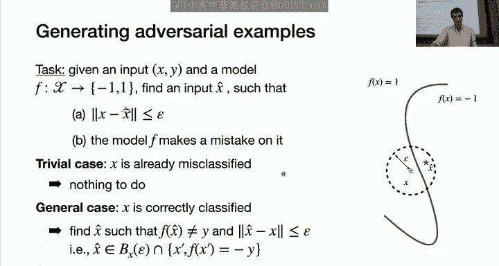

So in fact， you will see that。Trying to find an averar example will be exactly equivalent。😊。

To maximizing this function。What is this function， this is an indicator function。Of F of x at。

If you in from way。Why is it equivalent because by definition？

An adversial example would be a point x at。😊，Which satisfies the constraint。

Such that f of x at is not equal to y。So， if。If you have an adversar example。

 this value will be equal to1。And since this function is as equal to 1 or0。😊，Maximizing it。

Amount to find a bound x add to as this function is equal to one。 So amounts to。

Find and aile example。Okay， so you see that if I'm able to solve this maximization problem。I'm done。

 I have found my ex at and Im happy and I come back home。

So what is the main difference with this problem？I mean。

 from between this program and the one we saw previously in the course。

You see that previously when we are considering the classification loss。😊。

We wanted to do optimization over our function F。We wanted to find a predictor。Which was achieving。

 achieving a low classification now。Now， my optimization problem is not anymore on my function F。

 My optimization problem is over my input。 Okay， I'm looking。😊，For input X at。

Se that I will have a large classification now。 So you see the second difference is that no。

 we are doing maximization and not anymore minimization。ok。And then you see。

I don't know if you remember， but when we talk about superb vector machine。

We had exactly the same issue， why this optimization problem is difficult。

In addition of being non Covex。non concave， it's first because the indicator function is a non continuous function。

 Okay， it's going from one to0 in a discontinuous manner。So you see that this function。

Will not be differentiable in。So it will be difficult to minimize or to maximize。Okay。

 non continuous optimizationim is other than continuous optimizationim。I mean都有份。Okay。

 so that's the first column， our I indicator function。Is not continuous。

And the second problem is that we are considering every of our network。😊，You know。

 we are considering that the neural network directly outputs the classes。

 So also the neural network it is a classifier and so is in value between minus-1 and one。😊。

So you see that directly is a function。Which go from x to minus-11。The output space will be disc。

So it would be hard to differentiate too， so we have these two problems and we already have these two problems where we are considering classificationless。

So do you remember？How can we solve these two problems。What can we do for the first one？yes。

So we can relax。So discontinuness by another smoothness。ok。

And then what can we do for the Ser problem， for the point that our on our network output something between minus1 and 1。

 and so it will not be defuniable。Yes。😊，Exactly， so you know。

 remember that what we did is that on our network。😊，It kind of like a huge black box。And at the end。

 we will take a decision between minus-1 and  one。

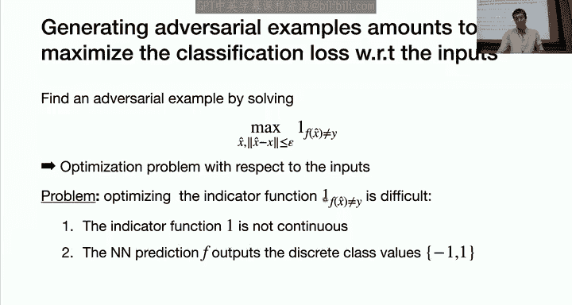

But in fact， it was exactly as when were doing logisticification。😊。

So let's see how we can solve this two problem。So for the first problem。

 instead of minimizing the indicator loss， okay， the01 loss。We will consider。

Some other classification。😊，So we will take a smooth one like this， we won't have any problem。

In order to take the gradient， so for example， we can take the logistic class we already talk about。

😊，Again， cause on copy your correct about is like your generalization of the logistic class to multi class case。

😊，So let's take the logistic loss， it is a classification loss， so it is a decreasing。😊，Fengction。

And so we will see it is important that the derivative as is disclassification loss will be。😊。

And negativeative。So that's a assessment。And then the second point is that and that exactly the same as we did with the logistic regression。

😊，We will not consider the output F of the neural network。😊，But we will consider the output G。

 which is just before， and let's assume that in fact our network is predicting a number is trying to estimate and of like the probability that is equal to I mean that y is equal to 1 given x。

😊，And with this probability， then the neuralhan network is making a prediction if G of x is larger than1 over 2。

 I'm predicting that the label is1 and otherwise Im predicting that the label is zero okay。😊，I mean。

 I can change it to get one or minus one that's exactly the same。

We could also have assumed that the prediction would have been made by the sign of GFx， okay。

 if GFx is positive。😊，I'm crediting press one if Gfx is negative I'm crediting minus1。

 that will be the same。In the next slide， we will use the fact that the neural network can be interpreted as learning the probability。

 so it can be useful。So okay， so to solve the second problem。

 we are considering the output of the neural network before the quantciization， okay。

 before resing the value。😊，So we are considering the output of the neural network to be continuous。

Can be an R and can be 01， it can be not too important。

 So you see that no it would be possible to differentiate this function。

It would be at value in a continuous space。So what is the main ID behind this。

 we are replacing this difficult problem。😊，Which was a maximum of a discontinuous function。

Or this problem， which is simpler。😮，Which is a maximum of a smoothless so now I want to maximize a smooth function。

Over some constraints set。Okay。But you still see that at this point will not necessarily be easy。

 I mean this is still。😊，Non convex because your neural network G is a non convex function。

So you still have a non conx problem。we are maximizing this non complexvex function over some set。

 which is still a problem for which it will need it will not be possible to get。You know。

 some convergence his。But still， we will see that in practice it's working very， very well。

So another main question is how we will solve this smooth and constrained problem and as you already say。

We will try to use gaon base optimization。But what are the main difference before？F。

I'm not anymore optimizing my function over my weight， over my parameter of my network。

I'm maximizing my function over input which is a third def。 second one， I'm maximizing my function。

 I'm not minimizing my function。😊，And the third one， I'm having some constraints。On my set， okay。

Do you have some questions on this？我也。The solution of the fundamental right the solution of。

That's a very good question。So， in fact。But we will see that this is kind of like an overkill。😊。

Because if you think about it， you don't want really to maximize your loss。

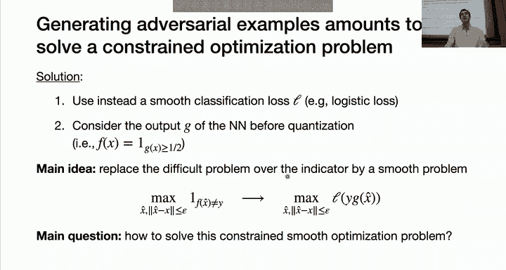

I don't know if you remember， you know， for example， when we had like。That was my 01 nurse。

And then my class， my logistic class was something more like this。😊，So I don't really want。

To maximize my loss。But of course， if I'm maximizing my loss， I will get an a example。

 I just want to find a point where my loss will be larger than some value。

So that I will be sure that G of x at will be of the opposite the negative sign of y。

That's really what you want。You want to find an x at such that G of x at。

Is of the opposite sign of what。ok。And that's really。

Let's forget about this because I'm talking about the Gf x in value in minus spa in one。

It's easier for the interpretation。We're good for this。Yes。😊，Okay， so your question is。

 can I transform my constraint optimization problem？Into an unconstrained optimization problem。

So you could add an indicator function that would be exactly the same。

 but then your function would be non smoothm。You could add a regularization term。

Then your function would be smooth。But it won't be， you know， it won't be art constraint。

You won't be， I mean， the minimization of your penalized problem。Will not satisfy your constraint。

So there's different formulation and you can do both。

 but classically in the literature were concerning this problem。

 we really are imposing art constraint on the scale of our adversary。😊，And。

 you will see the fact that you have this constraint。 I mean， it's not difficult algorithmally。

So could can of。ok。So you see that， in fact。Yeah， we would just want to find。

The point x at that this loss is large enough。And when this loss will be large enough。

 then it would tell you that y and G of x。Will be not the same label。Okay。So first， let's see。

How we can maximize this problem。In what we call the white box case， so what is a white box case。

 that's the case where you know everything about your model， GFx。ok。You have access to GFx。

 you can differentiate GFx， you can take gradients， you know everything。

That's what is called white box。So if you know everything and you know that you want to maximize this function。

Let's say first that we forget about the constraint， what should we do？Okay， we have relaxLx。

 the pres non differentabled program into a differentabled program。

 so we want to compute the gradientian of this function。So this is not difficult。

 so a guard with respect to my input。Of this function is exactly equal to what？

So derivative of my loss。Evaluated in Y G of X。Times y times your gradient of your neural network with respect to x。

Okay。That's a simple computation， is it clear for everyone who get this？Yeses。😊。

And now we will use that of classification list。Is decreasinging。So I'm using that al prime。

Is negative， okay。So in fact， if I want to go in the direction which will maximize this function。

I want to follow the positive gradient direction。 Okay， I'm not anymore doing minimization。

 so I'm not following the negative gradient direction I'm following the positive ga direction。

 and so I want to go in the direction minus y。😊，Nabla X of G。ok。And you see the interpretation here。

😊，You know， if I'm telling you that G of x is a probability。That's y is equal to1。

You see that if y is equal to one， you want to decreasease this probability。

Because you want to make a mistake。So you want to decrease G and so you will follow the negative gradient。

And this is exactly given basis。If y is equal to minus1， then in order to make a mistake。

 you want to increase the probability that y is equal to one， so you want to follow。The gat of GX。

So you see that in both case， you want to go in the direction minus y gradient。Of Gfx。Okay。

 it makes sense。So is it over， do we still just have to do。Gt ascent and photos his garent。

Crime multiplly by some step。Maybe I would do multiple step。Will it give me the solution？

What is the problem。Yeah。嗯。People actually become the other label。No， but first。

 I mean even before this。So what you say is that maybe the solution would not have a problem the problem would not have a solution。

Before this， we have to take into account the constraint。😊。

If I'm just following and doing some positive garden step， I would just diver to infinity。😊，Okay。

 so we have to consider the fact that I want x at to be close to x。So this is what we will see now。

 how can we take into accounts a constraint？

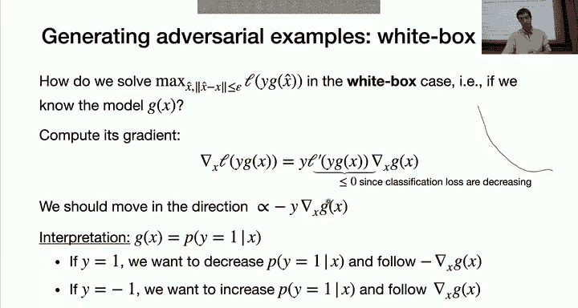

So since Epsyon is considered to be small， okay， we want some example with a small noise， otherwise。

 it's not so interesting。What I can do is that I can still consider a linear， I mean。

 the linearization， the first order approximation of my function。😊，So were just doote by al Tilda。

Which is my function of x， which is exactly L of y G of x，s just like to shorten's notation。

So what I want exactly is to maximize L tilde。For x at close to x。

 for x at minus x in norm smaller than epsilon。And so to do so seems upside and small。

 what I say is that。😊，The maximization of this function is very close to the maximization of the linear approximation of this function。

😊，So what is a linear approximation， it is exactly equal to l t da of x plus。

The first other approximation， gradientian of El Tilda。Tspo x tilde minus x。

And I want to take the maximum of this over x at， you see that the first part is totally independent of x at。

 so I can take the maximum inside and I will get L tilde of a plus maximum of this term。😊。

And then you see that I can just do a change a variable x at minus x， I can denode this delta。😊。

And so what I want to do is to maximize the scalaf project between my gradient and Dlta for delta of non smallers than epsilon。

ok。So this is what we would try to search。We need to maximize the inner project and there's a norm constraint。

And this is really what is called the optimal local update。Locally。

 if you are close to X and you want to maximize the moisture function。

 it would be given by the solution of this problem。And what is nice is that for a lot of no。😊。

It would be possible to get。Distillion in close form。Okay。Do have some questions on this？Okay。

 so you want to take the delta， which will make your enough terms the larger possible。😊。

So that you will make your function， your last function the large as possible。Okay。

 so that's 3D what is called steepest as， you want to find the direction which will maximize the most your function。

ok。You want to take a step。Which would extend the fastest in the direction of the gadget。我 good。

So what we will see now is that it is possible。😊。

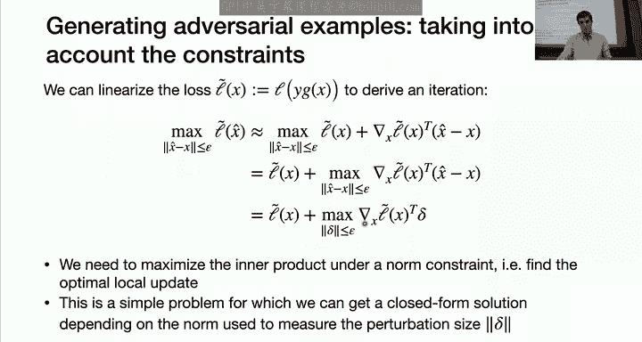

To solve it in close form fossil numberss。And so that is what is called a one step attack， Okay。

 we would just take one step of gradient ascent。So we want to maximize。This linear function。

 which is non constrained。And let's consider a further case of the L to norm。So in the L to norm。

My ball。Is given by this circle， okay by this ball。I have my grudent。This is you see this vector。

 and I want to find the D delta。So a vector on my sphere。

Which will maximize the scalia product between my greenarrowhoe and my blackarrow。

It should make sense。To take Delta to be exactly。This vector， okay， Delta will be the vector。Along。

Your guard injection。Bth is scaled so that the norm of delta will be equal to epsilon。

So you see that delta will be exactly equal to。Epsilent times。Yourag of Lda normalizedized。ok。

So Delta which will maximize。This inner product is exactly the delta which is aligned with your guardians。

And then you have to fix the scale of delta and you know that the scale of delta is epsilon。

So this is exactly the vector。😊，Which is aligned with my gradient and whose scale is eilon。

 Im first phizing my gradient， and then I multiply by epsilon。

So that's the norm of deelta is exactly aspsilon。我 good。

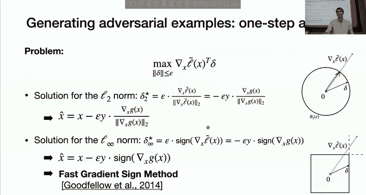

Okay， so let's do a quick 15 minute break， Okay， so let's start again。诶。So it was not too important。

 but you know like before the break， we had like small issue because here。

I'm telling you that F of x is equal to this indicator， whereas I was telling you that。😊。

So label was minus1 and1。So， you know， just let's consider that， in fact。

F of x would be equal to the sign。Of G F x。So if G of x is positive。

 then you are predicting plus one， if G of x is negative， you are predicting minus1。And then for now。

 let's forget about this interpretation， which is not too important Okay。

 so we are really following this direction。O。

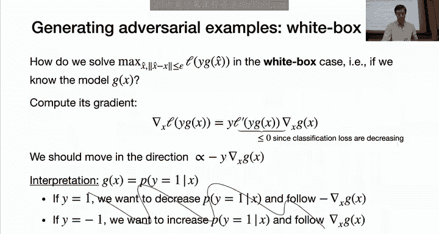

嗯。And so we start again with this。So we say that it was equivalent。To find an adversial example。

It was equivalent to maximize this linear form。😊，Under my geometric constraint。And before the break。

 we saw that for the L to norm。The solution of this problem was given by Gta of2。

 which is exactly my gradientian scale。Times epsilon because I want to make a step of size epsilon。

 so I'm rescaling my gradient， Okay， I want to go in the direction of the gradient。

I'm alwaysscal my guardian to have a norm one， and then I multiply by epsilon。ok。😊，And then。

We add compute what is exactly the gradient of L tilde， what was the gradient of L Tilde。

 was exactly minus y gradient of G of x times the derivative of the loss。Remember。

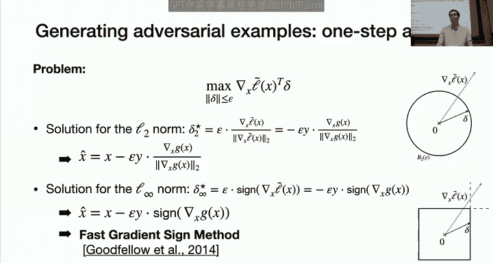

Well。This is computation。

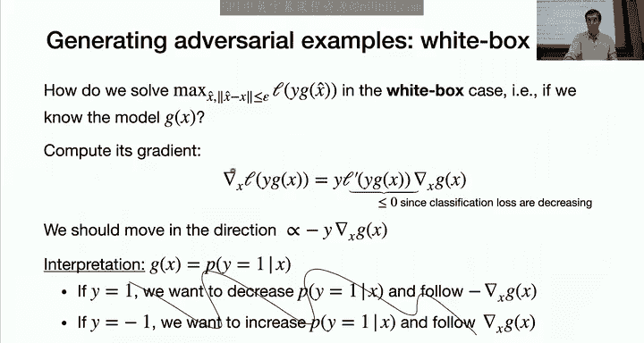

But then what you see is that， in fact， since I am hisscaling。😊，I just want like the direction。

So the D action。Wwhich is given by the gradient of L tilda divide by the norm is a sum as the direction given by the gradient of G divide by the norm。

Times minus why。Well good。So this is the output。So Delta， which is maximizing。Locally， you us。

Is given by。This direction。So then in order to compute X at。You want as an example。

 you just update your Q point x。And you add to this x， your delta。

So this is the algorithm we are doing。You have a point x and you are substiting to this point x。

 this gradient。And so you see that your x at will be exactly。On the boundary of your set。 Okay。

 if you look at your constraint， it is exactly satisfied。X at minus x。It's numb。

 it's exactly equal to ey。Okay。So one question， what do you know， I mean。

 what do you do know that you have compute X at？Yes。そ的。What do you mean do you no no。

 What do you do now， sorry。What do you want to do with Xat？So that was your goal。

 you wanted to find an X add that your model was wrong。You have computer Xat。

 which is locally maximizing your loss。So now what you want to do is to check。

If this is an address example or not， so you will want to compute G of x at and to see if G of x at is of the opposite sign of y。

Okay， if。It is the opposite sign， then you have found an aver example。😊，You have found a X at。

 which is close to x。 It has the distance E N of x and the label。Has been flipped。O。

So then you see that we can do exactly the same， not for the L2 geometry。

 but for the L infinity geometry。😊，So you remember what is L infinitefinum that just like the max over all the components。

So if you look at the L infinity bow， that's exactly z square。And so no， what do we want to do？

We want to find。So， Delta。Which is on my bone。And so that my scalar project。is呃 maximum。

So what you can see。That this would be exactly given。But this Delta。 So in fact， the Delta。

 you will take。E。😔，That one。Okay。So that delta will be the delta， which will maximize。

U all in our product， nosscalear product between your gradient and Dlta。

 and theres a constraint that the infinity norm is more than epsilon。

And so this is what is called the first Can signine method。

 and that was the first attack introduced by Y Good Fi in 2014。😊，So you see what you are doing now。

You are not exactly going in the gradient direction， but you are computing the sign of your gradient。

And then you multiply by X and y。So you see that what is the infinome of a vector with some plus and minus1。

What is the l inffity norm of a vector with plus and minus1 component。It is one。

So the L infinity norm of Epsilon y。Sine vector。 It is exactly equal to Epsilon。 Okay。

 Y is equal to plus or -1。So this is a plus or minus-1 vector multiplly by epsilon。

 so L infinity norm is equal to1 Yes do you have a question。But it's in the talking room。嗯。O， thanks。

So you see that your update Delta infinity is of。L in 5 norm 1。 so when I am updating my X。

Going in this opposite direction。I get an x at， which is also at a distance one in the lfinityome of x。

 so that's exactly the same。As what we add for the L2 case， okay？

But now we are considering a different geometry。 We are considering the N vintage geometry instead of the L2 geometry。

😊，And similarly， here， what you will do when you will have compute your X at。

 you will check G of x at to see if you have changed the label。Oh not。

ButSo you see that this is an approximation approximation， so you are not you know。

You are not guaranteed that this x at or that one will work。ok。

And what you can imagine is that maybe for some large epsyon。

Only minimizing the linear approximation will not be enough。Okay。

 it would not really be a maximizer of your last function。

So what could you do in that case instead of doing only one step you will do？

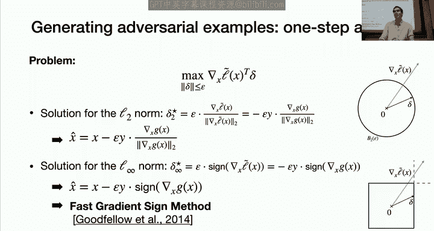

Minncipple step。So this is what we call multiple step attack。

That would be very close to the projector Gaian decentism。ok。So sometimes one step is not enough。

And so what you want to do is to do multiple step。And it will be exactly the same as before。But now。

You are not doing large step of size exactly epsilon， you are doing some smaller step。

 okay and alpha will be a step size that you will set。You are consideringiv。The rescale gradient。

 but in fact， this would not change so much， you could also only consider the gradient if you want。

But you want still to input that you are maximizing your function。On your con set。

 so after it iteration you are projecting back， you iterate。On your contrain set， Okay。

 so pi is your projection。And you see that for the case of the L2 geometry。

 the projection is given by this formula。It's really simple。If you have a vector delta。

 which is outside of your sphere。The projection of the sphere would just be the high scale， okay。

 so you are just considering delta divided by the norm of delta。

So you multiply by Epsilon because this is a ball of size epsilon。

And if your point Dlta is inside the sphere。Then the projection of this point is identity， okay。

 your stia delta。So that's the definition of the Occgen projection for the L。

And you see that this is exactly。Gian ascent at each step， you follows a positive gaian direction。

 but you want to stay inside your constrain set， you want to stay inside your goal。

 so if your next is going out of your constrain set， you will project it back to the sphere。

And how do you project back your data to this sphere， You are applying the projection。O。

So this is very close to projected gradientian descent。

All good for a projector can descend in the L2 case。So you can do exactly the same。With the Lfin now。

We are still following the direction given by the sign of the gradientent。

 if you want to actually following the direction of the gaent。

 but you are following the direction of the update， which will maximize locally。

You all enough under your geoal con。You are doing a small step。

And you check at each step if you are staying inside your constraint or not。

 and if you are going out of your constraint， then you will project back。

But now what is the projection for the N infinome？It's maybe a little bit more complicated。

You see that if you have such delta。I will project it would be exactly this would be my projection。

Okay， but you see that if I have such deelta prime， which is in my corner。

Then the projection of this delta prime。Will be the corner of my app。ok。

So this is exactly given by this formula。If the component of Delta is larger than epsilon。

So that means that you are in this corner。I mean， you are below this line beyond that line。

 then it is equal to a sine。And if you are smaller， then it is equal to identity。O。

And so this it was is' called a white box attack， remember， because in order to do such attack。

It can be multi step， I can be one step。 You need to be able to compute the derivative。Of。有。

Nural network。Okay。So you need to have a perfect access to the network in order to attack it。

And so in practice， in order to find another example。

 multi step attack will really work better than one step attack and what you will often do is like something like 50 or 100 step。

😊，Of gagent essencecent， okay。And this will work very， very well， and by doing this。

 you will find an a example。

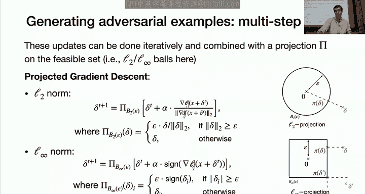

So this is just like a small step to remind you like the different LP norms。

 okay you have different geometries， this is the N infinome。

 this is the L2 norm and this is the L1 norm。And what is important to have in mind is that for this different geometry。

 it will induce different perturbation set。😊。

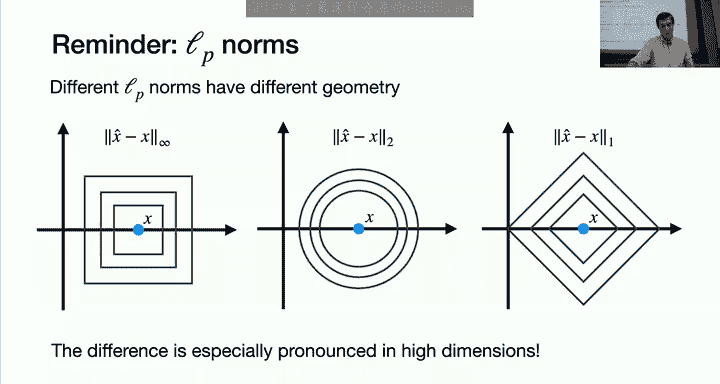

And so you will see it will also induce different aile example。O。And so here we are comparing。😊。

Oh hate to know the image。And some adversar examples found for different geometry。

 found for the l infinity geometry， the L2 geometry or the LG geometry。So how can we compare？

This is averar example。So maybe first。You see that。When you are imposing an n in constraints。😊。

You can really pet your ba all the coordinate， okay？But because the L infininome。

 you can just put everything to epsilon or minus epsilon。

 it will still be the L infininome will still be epsilon。

So you can really patchrbate all the coordinate。Of。Your input x。So you see that。

Here you should see that you have a lot of pixel。Whose value。As we change。If you compare to the L0。

Kit there yeah， so you'll know that L0 is a number of non zero elements。😊，So if I say that。

 I want that。The L0 norm between x and X at is small。

 That means that I only allowed to change a very few pixelel。

 And so you see here that I am changing very， very few。ピixセル。But。In the opposite。Here。

 I can change with the L infinity now， I can change a lot of pixelel。

 but I can not change the value of this pixel by a lot。 Okay。

 can only change them by the value Epsilon， which is small。원낙 엠콜 슬링  지호 캐릭터 하야。

I'm allowed only to change a few number of pixelel。But the value。

 you the scale of the change would not be important。

So I can take a pixel which is black and I can transform it into a white pixel。So you see。

 that's why you see all these。White point。Such change will not be possible with the Lfin number。

Because the difference between a white and a black pixel cell would be one and it will be larger than epsilon。

And then you see that the L2 norm is in between。You are allowed to change。Fewer pixel。

Then the L infinity norm。So that's why for example， maybe I don't know if you see in the Elfinum。

 I have all these gray space。Whereas for the L2 case， I'm not changing all this pixel。

But what is important to have in mind is we do that。The geometry you are choosing。

 the geometry you are imposing is changing。The guy of particular example you。Okay。And so in practice。

 it's really very important to define what is the set of petturbation you want to be obus to。

It's not clearto。You know， for your application to which。Contamination， you want to be hoist。

And that's very like important。I mean， directional research to be able to define what is the right atrb。

ok。For your application， what do you want to be hoed？Maybe you don't want， you know。

 you don't care about anything cheap observation。

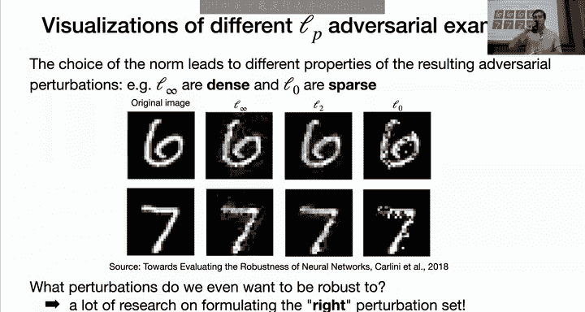

So in practice， how do you do your white box at that？So for your neural network。

It would be very simple to compute the gaant of G during by propagation， and in fact。

 it's already implemented。In a lot of a library。 And that will be the object of the next lab。 Okay。

 so this is not too difficult。But then you can ask the question。

 is it like a legit assumption to assume that you know G， is it you know？😊，You have access to G。

 Can you compute the gradient of G。So does that really depend on the application？

For some practical application， you could imagine that yes， you know you can have access。

I don't know， for example， for a car， you can buy the car and then you can you know do a lot of experiment for the car and you will have access to the neural network and so you will be then able to attack it。

😊，But。In other application， you could say that you will not have access to G， okay。

 you will not know the function G， you will only have access to the prediction of the neural network。

And you can still， as the question， is it still possible to find some ultral example in that case？😊。

That's what will be called the black box attack。Okay， so white box。

 it's when you know the function G of the neural network。

Okay you have a description of this function and you can do some back propagation of this function and you can compute the gradient of your neural network prediction。

 and then you will be possible to implement some PGD attack。

Black bugs will be you don't have access2 G。Okay， you have only access to some information and what does this information。

 you have the score base case。So the scale base case is that you have access to the mode scale。

So you don't know the function G。But you have a no high， if you give x， I will give you G of x， okay。

So I mean， you can't differentiate the AG because you don't know the structure of G。

 but you have access to the values that G will take。So this is a scale based case。

And then you have another case， which is even harder， which is you don't have access to the scar。😊。

You only know the prediction。You only know if。X is a。Pig or is not a peak。

 You only have access to plus or minus-1。And that's the case， for example， sometimes with a some API。

 you know you have like something in the cloud and you can give him an X and he would tell you the prediction。

So you will only have access to plus one and to minus one。And with this information。

 you will still want to be able to find an address example。

Is it clear for the city or the difference between white box and blackpos？嗯。White box。

 you know the function G and you will be able to differentiate it and you compute the gradient。

Black bugs， you have only access to the function taken by G。Ivan was。

So the prediction made by the network。Do you see that the poem is outer in that case？Is it clear。

If you have any access。To the prediction of to the scar。You will not。

 It will be not possible to compute the gradient。 Okay， so what we have defined previously。

 you cannot do it directly。Yes what is your question。我审。有几。

Why sometimes you know G or sometimes you don't know G。That's a good question。 So in practice。

 for example， you can think that you want to attack something you have access to okay。

 so you have an experiment and you want to attack this neural network。 Okay。

 so then you can do back propagation along this neural network。 and so you will know the function。

But sometimes what you want to do is this will be more relevant in practice， you want to attack。G。

 you don't know， okay you want to attack an algorithm of some company， let's say。

So here's a company will not give you。It's network。

But you will be able to query the AI of the company and to ask him， okay。

 can you tell me what do you have on this picture？So you see that for this kind of application。

 it will only have access to the score or to the predicteded class of the neural network。

 but you will not have access to the structure of the neural network。O。

So what can we do still to attack I mean， on network？The first。Solution。It's kind of easiest to say。

 okay， I don't have access to my function G， so I cannot compute my gradient。But in fact。

 that's something which is well known in optimization。

 that is what is called zero order optimization， or can I minimize a function if I only have access to the function value？

And so what you can do is that you can just approximate your gradient using the finite defense。Okay。

 you know that the gradient will be the variation of your function。

And so in order to approximate the gradientian。You can just compute in all the direction how your function value is changing in that direction。

So you know that g of x plus alpha Ei minus G of x divided by alpha for alpha small。

That will approximate very well the directional derivative of your function。😊。

And so then if you do this。In all the direction。You will get。A good estimate。Of your agentant。

Is it clear for you that by doing finite def， I can get an approximation of my gradient？

Okay the gradient is really telling you how your function is vary in the space。

 so if you are looking at some small difference between g of x and g of x plus alpha vector。

 this will approximate the derivative mean。对。Dictional derivative ofG。

 and you just have to do this in all the direction and then you will get an approximate of yourage。

Okay。But you see that in order to do this。It will be easier if you have access to the S G of x。

If you have only access of F。It will not be as easy。

So it's still possible to do so and if you are interested you can read about it。But。

This will really work well。In the case when you have a scar base access to your neural network。So。

 what。Can I do。You know， in that case， well how can I still attack my network？

We that trying to approximate my gadget。So what we can use is also what is called a transfer attack。

That's something which is kind of nice。So what is the transfer attack？It will be， okay， I don't know。

My network F， I only have access to F， but I don't know this picture of F。

But then imagine that I have access to some data。Where my network has been trained on， okay？

And then imagine also that I have access to a model F at。😊，Which is kind of close to F。

Then maybe I will be able to train this network F。S that F at will be close to F。

But notice network F at， that's a network I have train， that's a network I have access to。😊。

And so I can do a white box attack on this effect。So you start from F。You built a surrogate of F。

 which is called F at。 That's a function that a network you know。

 and now you can attack this network F at。And then what you can hope is that the attack that the aversial example we have found for F at。

😊，Will transfer to F。 So this is what is called a transfer attack。Okay。

And so you see that one case where it is possible to do this。😊，Is a case where it's possible for you。

To do a lot of query to F。If you can do a lot of query to F。Then you can use unlabeled input。XI。

 okay， you just take any pictures you want。You ask F， what is the label of these pictures？

Then what you will get is you will get a new set， X and F of X。😊。

This is a new trend set that you have built using your network F。And now you will learn your F at。

Based on this new mindset。So you see that it is called model stealing because in some sense you will steal the model F。

😊，By learning a new model。So that this new model will make the same prediction as the model you are trying to steal。

Okay， and now with this new model F at， that's a model you have trained。

 So you have perfect knowledge of it and you can applied。😊，White bugs attack on this F。

And so of course， you see that。The success of this trans attack。

The fact to see if an that of F at will transfer to F will depend a lot on。

How similar the data you have used？Where to the initial data you are， I mean。

 on which we are trying F and also how similar， where are the architecture of F at and F。

So of course， in practice for a lot of application， you will only have access。😊。

To the prediction of F and you would not know you know what kind of neural network F is。

So it will be not I mean， it won't be obvious to find which architecture to train。

And also you can see that in practice。😊，If you are asking， you to the company or to the API。A lot。

 a lot of label in order to build your new data set， it will easily detect you and easily block you。

😊，But in fact， these still work well if you are not you know for moderate size of a new climate set。

Okay， so this is what is called the transfer attack and you see that we can use this transfer attack to do some black box attack。

😊，To a no network。So to conclude about blackbus at that。In practice， I really have practical concern。

 but still。In fact， query based methods。which use a gradient approximation。

 they require a lot of query in order to find an adverar example。

So I don't know if you remember but previously I told you that when you were doing white box attack and you were doing PGD。

 if you were doing 50 or 100 iteration， it was enough in order to find an a example。

 If no I want to use a black box attack I would have to do of other 10k。😊。

100 key in order to find an another example。So you see that we have to do a lot of queries。😊。

To the model in order to find an averal example， and so it would be really easy to restrict the access to the attackers。

😊，Now， if you are asking to an API， this amount of query will and it will easily detect you and block you。

And that's the same with a transfer attack in order to find the srogate F at。

 it will often be very costly， you will have to do a lot of query。The success will not be guaranteed。

And also， it would be kind of hard to find a good architecture to train。So you see that in all these。

 we are still kind of far away to really。Physically reasonable attacks。

 Some really attacks that you can deploy it on the wide。

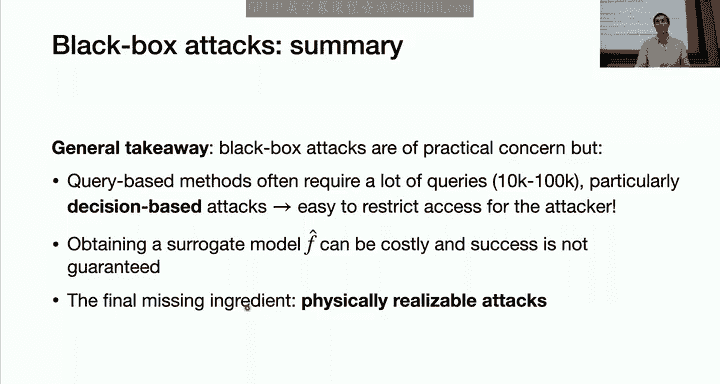

This is what we will briefly talk about now。You know。

 like you want to find an attack that you will be able to realize in the hillva。And in fact。

 in now there， you know to。Oly in practice， you as as example。

You will have to satisfy some further requirement。So in some sense。

 you should release your life to some processing operation that will differ。

Following the different application。So， for example。Often when you will build NL。😊，Example。

 then you will compress the pictures， okay using like your GP compression。

And then when you will compress a picture， it will change a picture and the G compression of your adversar example often will not anymore be an adversar example。

😊，So you have to try to take this into account。Another example。

Is that this example of the stuck sign？Okay， so what you want？

Is to be able to attack a self driving car。So what you could do is that you can directly attack the carbon。

 and it can be difficult， you know。😊，To change the software of the car。

 so what you can decide to do is to in fact attack the hill wall and try to modify directly the stop sign。

So what you are trying to find is a way。To put some patch on your stop sign， to modify the whole。

 you know。A realityality of the physical scenario so that now the camera in your car when it will be looked at the sign。

 it will not anymore see a sign， I mean a stop sign， but maybe we'll see another sign。

So your car will not stop。But you see that now this problem is really more difficult。

Because previously I had like some fixed problem， I gave you a x and a y。

 and I wanted to find an Agaar example。But now you can imagine that this top sign in the realityality will correspond a lot of a lot of different pictures possible。

 okay， because your car can be in a lot of different position。😊。

So you have to be able to find some Alaa example which will work under I mean。

 the invariance over all the camera angles， the distance， the waves so on。

Now that's something which is really， very， very trendy。 If you are interested。

 you have a lot of paper budgets， but in practice， it is working quite well。 Okay， so for example。😊。

With these patches untop sign。This will work。So on the other end。

 you could say that this is not an email really like an agaa example because。😊，This sign。

Not disabled by the human Okay so in some sense kind of easily detect table。But still for you。

 it's easy to detect this top sign as a stop sign。But your automatic car will still think that it is another thing。

 and it will not stop。好的。So we have talked a lot about different attack， white box， black box。

 and then other one， but we will talk about for the last 15 minutes。I how is it possible？

To train some robust model。 You know， what is the solution。

To this whole business issue in machineina in neural network。

So this is what will be called endra cell timing。Okay。

 so we want to fix the robustness issue and we want to find a way to train some model which would be robust。

So what do we mean by robust， we mean that it will not be possible to attack this model。

Will not be possible to find Al an example， which will trick your new robustt model。

So this is what is called aial training。😊，So let me remind you that what we have did previously。😊。

When you had like a training set， you know， you wanted to find。Some model with a low training error。

 and so that was a standard training。So the goal of the standard hunting was to minimize the standard risk。

You wanted to find an architecture。FTta， okay， where have Tta is the parameter of your neural network。

 the bias and the weight search that the standard risk， which is the expectation of your 01 nu。

 is smooth。😊，And what we saw is that minimizing the standard risk is not enough in order to get some robust model。

If you have a predictor on neural network with a good standard risk。

It will still be possible to attack it by doing some white boxs attacking it。

 and it will not be robusted。So instead， if you want to find a model which will be robust to attack。

 what we will have to do is to minimize the adversarial risk。

That we have defined as the beginning of the lecture。So the Ali allies。

Epmihimanu is the same as the standard risk。But I'm not anymore looking at the01。Plus。

 evaluated in x。Because there is no action。But I'm looking at the01ness evaluated。

In the for the worst point in my small epsilon bomb， okay， so I won。To minimize。This was case risk。

If I'm minimizing this first case risk。Then it will be not possible to find an agaile example。Okay。

 because it will not exist。Some point x at。So that I will have a different hunt label in my book。

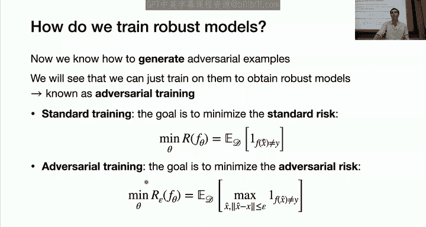

Okay， so we want to do this。So hope we will do that。😊，As per you see， we have two main problem。

 the first problem is that we don't know the distribution D。That's the point we had。

See the beginning of the curve。So how we will solve this。

 we will approximate our true expectation by the sample level age， okay？we will less data。

And the second problem we already talk about it today is that。Ins is non continuous。

And so what we will do as in the SBM curve， we will use some surgate for this indicator。

 and I will consider another， the smoothters， for example， the logistic class。

And so you see that this will amount to minimize the following problem。I want to minimize。

Over the parameter of my network。😊，My training at好。And so my average age was caseless。For all。

My data set all my point Xi。I want to find。The walls exted。I， in my bowl。And I want that my lus。

Is small for this Xt I， Y I。ok。It should be clear that if。

You find a tita which will minimize this objective， then you will get。Some architecture。

 which will obtain。I mean， it would be a robust。So you see that this is called a mean Max problem。

 Okay， you have a problem， you want to compute the mean for Gita over the max for all the X XI。ok。

So how will we maximize， I mean， how will we minimize this function over our theta？What do you think。

Yes， so do you think it would be convex。 Okay， it won't be convex because I have a neural network。P定。

So we will do gradientian descent， but I have to deal with the fact that I have this max。

So you could switch the max and the mean。So in fact。

 it will be difficult to switch the max and the mean because you see that this mean is independent of theta whereas the max is over X。

So you can think about it is not the。Obvious， and anyway， this will not。

Many you are guarantees that the mean Max would be equal to the maximum。So instead。

 what you will do is that you will approximate this max using your ADL example。😊。

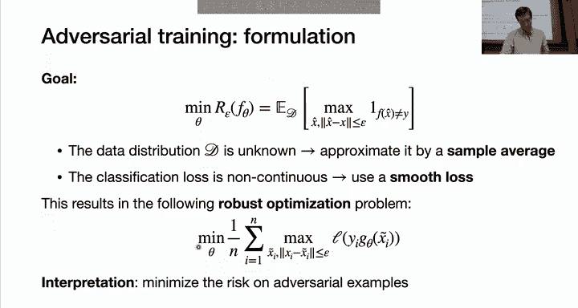

ok。So in order to minimize。Your average loss。Your average age was guestless。

What you will do in alversal training。Is that at each step first？You will compute some asial example。

 so you will compute some x til I。Which approximates。呃。Which approximate this problem。 Okay。

 so using the PGD attack。You will find aversar example for your model as a step。字 ok。S。知得。

So as a step deta T， I mean as a step T， you have your model with your weight and your biotem deta。

 okay you have a model and what you will try to do is to find for all your observation。

Some aial example for this model。Using your PGD attack。O。And then using this Xt I。

You will approximate the sum of this maximum of the loss。But is a sum。

Of the loss evaluated in your adversar example。O。And then you want to take the gradient so you will get exactly this your gradient step will be the average age of the gradient of the loss。

So this is exactly what you will have done if you will have used Benya。

 Gargendesscent to train your neural network。But you see the difference that now you are not evaluating。

Your loss in your observation X， but you are evaluating your loss。In your aar example， x T I。

Okay that you have computed each step。So you have this algorithm at each step。😊，And start with Steta。

With this datata T， I have my model G of theta T。 I will attack for all my observation。

 so I will compute。😊，At the sayial example， x tilde I。

And then I will use these adversar examples in order to update my parameter theateti。😊。

So theta t plus 1 would be equal to theta t minus some step size times the gradientians。

Where a gradient is evaluated in。My adary example。Yes you have a question。

Trying to minimize the repair。呃，单独的。So maybe我 can。Inpl so we can recognize the of time。啊你仔。検討？

So yeah that's a good point and we will talk it about it next time。Okay。

So is it clear for the algorithm？😊，This is a 3D。Close to standard training。

But instead of computing your gradient in your observation， X， you are computing your gradient。边。

You add an example， x tda I that you have computed using the PGG attack。

So you have kind of like a two step algorithm。With step at T， you will compute all your X till the I。

And you will use all this XdiI， or you aver example in order to update your parameter。

It good for the definition of the meta。嗯。

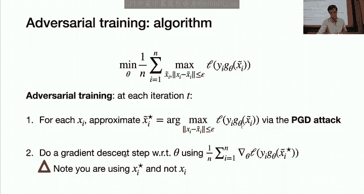

Okay， so in practice。😊，The good news is that it is working very well。😊。

And if you want to find a robust method for classification。

 really aver training is giving you state of the art results。😊，So that's a method。

 which in practice works the best。에너 positive side。It has in fact also in practice。

 it will give you a more interpretable gauge， so this is what we can look at this。😊，If。I'm comparing。

 for example， some standard model， so model which I've been trained。

Using standard training methods and some methods， which I've been trying using some house method。

And I'm looking now at the gradient of my lu。With respect to the input。

You see that the output will be more interprettable。😊，For whole but smoothed。Okay。

 you see that's a gradient of the loss。It's closer here， I mean， it's only activate。

Where the picture are active， whereas when you are looking at the gradient of the loss with respect to the input first on model。

The senior is meaningless。And also what is very nice with this algorithmism of asal training is that it is fully compatible with HGD and mini batch SGD。

 and so it will be possible。😊，To implement it easily and this will be also the object of the lab 1。

So then what are the bad news？And that what was your question about？Is at first at each step。

Of aversle training algorithm， you will have to compute all this aversle example。😊，ok。

So for each step for all I， you will have to do some step of PGD。

And if I told you that in order to find an another example in practice。

 you are doing 50 to 100 step of PGG when you want to train。The network you can do less。 Okay。

 you can only do maybe 10 step of PG G， but still you see that you will have another head。

 It will take you 10 times， I mean。10 times more time to compute and to train your network with al training。

 so that's the first bandwidth news。And the second one is that you have this trade between robustlessness and accuracy。

This means that by trading， I mean， by learning。By training your model with robust training。

 you will get a na detector， which will be more robust。

But it will be also less accurate if you are just consider even if you are just interested in an average case performance。

Okay， there is no win win if you want to become more robust， then you will have to be less efficient。

In the A case。 and so this is what you can see。😊，In these experiments。Okay， you see that。

The stone accuracy。When I'm considering some robust model for this value of itsxyilon。Is going down。

 okay。So if you are comparing of a robot， I mean， of。Clean of a vignette train model in black。

A model in blue for a small value of Epsilon， and then you increase the value of Epsilon。

Then you see that your standard accuracy is going down。So by improving your hobby businessness。

 you will decrease your standard accuracy。And so this is what is called really like the Robbness accuracy title。

So。You have to pay the price。 and this is a tight up。 And you have to decide， you know。

How much you are willing to lose in terms of standardak in order to win a better for business。

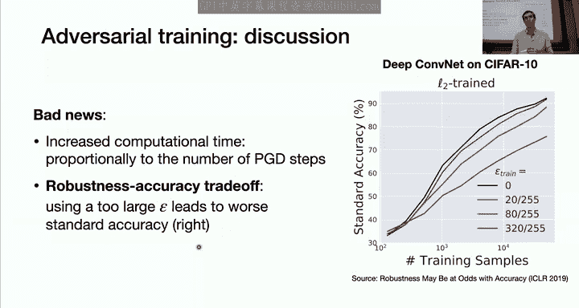

So that will be all for today in the lecture nuts。😊，You have this。Very nice example。

 which kind of explain， you know why atas I example exist and why is it possible to get some very。

Large Hote， but still very low clean air so you can have a look at it。Okay， thanks。

 and have a good evening， mye。