# EPFL《机器学习｜Machine Learning Course CS-433 fall 2020-2021》中英字幕（deepseek - P28：[28]EPFL Machine Learning Course 2021 - Week 10 part 1.zh_en - GPT中英字幕课程资源 - BV14SwyeNEvW

Hello and welcome， everyone。So today we will talk about ethics and fairness in machine learning learning。

And so really， what all the lecture will be about is discrimination in decision making setting。

 please be quiet。O。Okay， so let's start for today's lecture， Es and fairness in Ma learning。

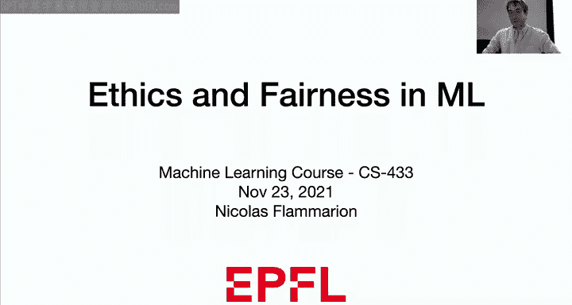

So， you know， machineing。Is used no day to make decision about human beings in a lot of different domains。

In education， in employment， in healthcare。Okay， and it's really important for you to understand that machine learning is not fair by default。

Okay， it's not because a decision are made by an algorithm or by a computer。You know。

 without human intervention that at the end。The application， the decision taken by the algorithm。

 will be fair。Okay， it's really important for you to understand this。

And so we are in the world where there more and more better。😊。

And it's easier and easier to implement。Some ML model， okay， with simple software。

will all do this during your projects。And maybe some of you will become software engineer later。

 or maybe also you will become data scientists。ok。So。

It's really important that you have in mind that you have to be cautious。

With the implications and can have your model in the real life。Okay。

 that's something you really have to think about it。Okay， so this is what I put this slide。😊。

Is that noday like machine learning and artificial intelligence is giving you a great power。 Okay。

 but it's also come with some responsibility。😊。

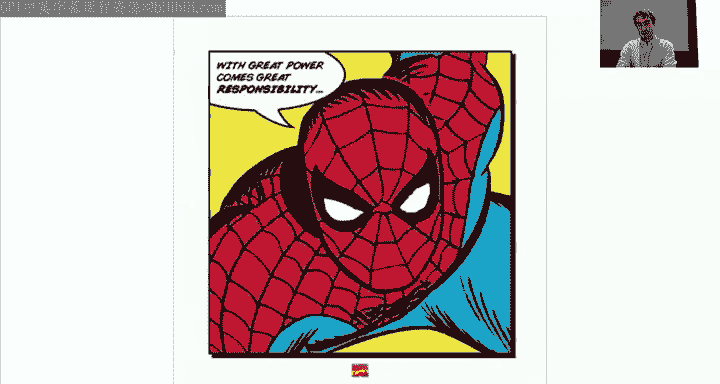

And that's why we create this new lecture today。So let's read like a new lecture I have done this weekend。

😊，That's something I'm not you it's not my feeling I'm not like a big expert。

 so I really want to thank Mu's art。It's like one of the best research in the field is a professor at Beckley and you will move soon。

😊，At the maximum Institute。And so the lecture today will be essentiallyly based on。

Some tutorial movies。1 at the machine learning Se School and the other one at Naris in 2017。

 you can find them on his website。And also， it's based on his amazing book。

 which is called fairness and machine learning。😊，We quote Bahokas and Na none that you find on this website。

 And also， I will use some slide of antan Kaus with a professor at Carmel and some slide of a deli。

 Okay， so I really want to thank them and to acknowledge knowledge that a lot of the content of today lecture is based on their work。

O。So what we will do is that we will start by a simple example of。

Lecture of the Lipauo to set the stage。So imagine that you want to build a dating app。 Okay。

 let's say Tinder。So what do you want to do， You want to recommend and profile to your user， okay。

That's a very classical problem in machine learning。You want to recommend some content to your user。

 It's the same as Netflix。 Okay， you want to find some movies that your user will like。

So you will talk about it with Martin in a few weeks。 So it is called collaborative filtering。

And that's a nice problem because you will have a lot of data。 Okay， you will have all， you know。

 the historical dating data。 and you will also have the profile of the users。😊。

So it's a kind of well post。So in some sense， it is a simple machine learning problem， you know。

 what is the goal of the company。这不刚本你。It wants to increase the percent of whitewis and the percent of much。

So use utility for the company is well defined。And then also。

 you see that you have a well defined objective。 You have a lot of data。

 You have a lot of features because people are creating their own profile。

 So they put a lot of information about them。 So in some sense， in terms of machine learning。

 you could think that it is a simple problem。 And that's， you know， that's over。😊，Yes。

But what I want you to think today is that such applications that Snda， for example。

 which is about machine learning for people， really will raise some deep， ethical questions。

That's something you have to think about。So for example， you know。

 if we only want to improve the percent of much。Then we can say that maybe we could improve the matrix。

By including as a feature of the skin code， okay。Maybe if you show profile of the same skin color。

 people will。Strive right more often， you know， So maybe it can help your ranking algorithm。

But do you think it's really good idea， you know。No， I mean， I think we all think it's not， you know。

 that's something we have to be careful about。And why is because as a society。

 we decide it's not a good idea because it's not of the interest of the minorities and of some green old places。

 Okay， taking into account such features。Good promote discrimination。Okay。

 so I hope it's clear for you that even some simple applications that that is collaborative filtering。

 when you start to apply the in real life to some people， start to raise very important。

 ethical question。 you will have to think about。Okay。

 which data you will use or you will use your data。Okay。

 and so maybe here you think it's kind of a simple problem because。Okay， you know， problem solve。

 I just， I'm not using these features。 I'm not extracting such color or using some computer vision algorithm。

And then my algorithm will be fair。 I will have no problem。 I will not， you know。

Perpetrate any discrimination， or any bias。But what we really see today is that。

 like the problem is really more deep and more complicated。Okay。

And this is what we call read like the failure of fairness through un awarenessness。

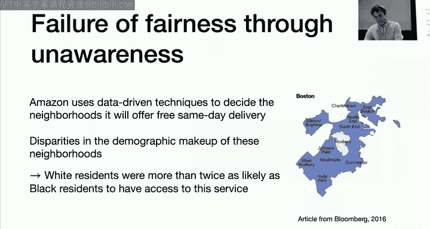

Let's talk about this。 It's my second example to start to set the stage。

So it was an article from Bloomberg in 2016。And so what did is happening。Amazon， you know。

 was using like some techniques。 We don't know which technique。

 but was using some data driven technique。In order to learn。

 in order to decide in which neighborhood in the of the city in the United States。

 he wanted to offer。You know， free day delivery， you want to buy something。

 and maybe if you are living in some place in northern then it would be possible to get deliver。

 I mean， the next day， but maybe if you are living far away， I don't know。 maybe in another city。

 you won't get this service， okay。This is what they wanted to do。 And this is what they did。

 And so then what people， you know， discover。Is that when you are looking at the result。For example。

 this is for Boston。 And you see like the blue place。I as here啊。Which are covered by the service。

 And the great place is the area， which is not covered by the service。

 Then you see some disparity in the demographic makeup of this neighborhood。 Okay。

 and what you can observe is， in fact， the only neighborhood in Boston， which was not， you know。😊。

Coval by service was Hoggsbury， which is which is a neighborhood。

 which is at major African American neighborhood， okay。So you know。

 as a resultz at this simple data driven technique， you see that。😊。

White residents of the city were more than twice as likely as black resident to have access to the service。

Okay， so it's kind of shocking and it's very alarming。So let's see why。I mean，你能。

What was trying to do Amazon。So it's very likely。 I mean， we don't know。

 But we are almost certain that。Amazon did not looked at the customer rights， you know。

It was not in their feature。 It was not important for that problem。 It's even like， I mean。

 forbidden to look at this。But what did they do。So Amazon， you know。

 just try to predict the number of purchases by neighborhood。Okay。

 if you have a place of the city where people are buying a lot of stuff。

 then it makes sense to offer them the service to be to have a free delivery in the next day。

In other place of the city， people are not being alert。 So it't make less sense to a service。So。

 you know， this is what Amazon was doing。But what is happening is that， you know， the number。

Of purchases is very correlated with the wealths。And then in the US。

 the world is very related with the race。😊，So， you see that。Even if。For this problem。

 if you are not looking at some sensitive attribute at the beginning， at the end， as a result。

 your model will output something which will discriinate， discriminate some。

Some some people were belonging to Sam TV。ok。So you see that's very important is that what we call that there is no fairness through an awareness is not because that at the beginning。

 we are not considering some sensitive attributes that it will solve the problem。Okay。

 so that showed you that it is not enough of just using machine learning without consent for the fairness issue。

Then can really lead to a lot of ethical problem。Okay。

 so what is fairness and awareness is really this idea that。

Remov or not including sensitive attributes。And hoping it will get rid of the concern。

 it's really not working。If you just remove all these things that look like sensitive attributes。

Which means that all the anchorcoding of a particular in class。

 if you just remove this from your data。And you just all for the best。

 It can lead to some terrible outcome， okay。So do you have some question in this two example。Yes。😊。

So your question is， why should we keep this on the geographic attribute？

So we will talk about it later。But what is important to have in mind is that here refer you sensitive attribute。

 which is not directly encode， okay。So it's not that we have including our mode as a sensitive attributes。

But then we will reply to your question why in some example。

 just removing the s battery between network。Okay， so what will be， you know。

 the topic of today latest will really be discrimination in machine learning。😊。

And so what I want you to understand is that we are living in a war with a lot of inequality。

 oppression and discriminationrimunization。And using machine learning technique。

 you really risk to perpetrate existing injustice， okay？So it will only be one lecture robot。

 but if you are interested on this content， I mean， you have a lot of resource online。

And it's important to think that maybe it's possible to change。

 you know how we are doing machine learning。And that's something you can take into account in your future practice。

Okay， and， of course， are a lot of other former interests are unfairness than disc discrimination。

 But today， it would really be about discrimination。

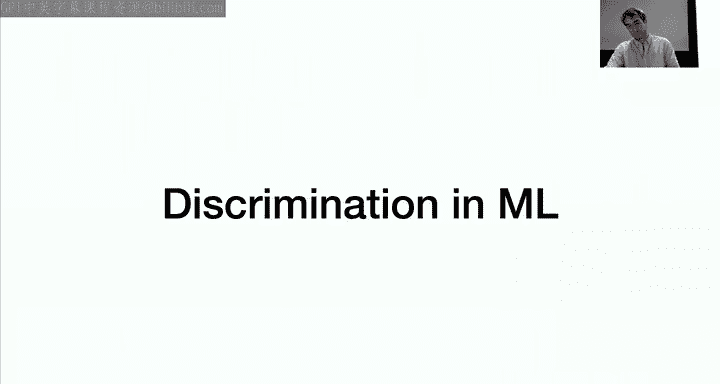

So then you know what you can first think about。Is but wait a minute。

 you know what we've learned in the classification course。

What have we learned in all the lecture since the beginning of the year。

 In't it just machine learning。In machine learning of point， it isn't need to discriminate。You know。

 what are we doing in machine learning when we think about it， we try if we are in classification。

 we try to find a decision boundary and we say on one side it will be the plus and on the other side it will be the minus。

So in some sense， this is just， you know。Doing some disccommunization。

You will assign to some point the label accept， and to some other point you will assign the label reject。

You will include some people and you will reject some people。

So what are we referring to when we talk about discrimination？

So what we will be interested today will really be。Injustice basis。For differentiation， Okay。

 it will not be any question of differentiation。 It will be what， you know。

 we don't want to have injustified basis for differentiation。So what， you know。

 what form could take this on justify basis。 It could be， for example， practical irrevance。

If you think of the six year orientation。It should not have an impact。In the employment decision。

Okay。Since this is like should be clear for you。 It's totally practically irrelevant to know what is your6 orientation。

If just， I mean， if I want to decide if I will give you a job on that。O。

It's not particularly particularly relevant for the job。

 So it should not be practically relevant for the hiringing。So that's practical。

And the second one is the mobile events。And more highly1， lets take， for example。

 about disability status in hiring decision。你能。Accommodating someone。who is disabled。

Maybe it will incur a cost for the company， for the employer。But as a society。

 we have all decided that it is， it was morally relevant to cover that cost。Okay。So that's。

 for example， to disability statue of6 orientation， which we don't want to use。

In order to take a machine learning decision。Okay， so this is what we。

 what we will be concerned about today。 This unjustified basis for the discriminization。

 for the differentiation。

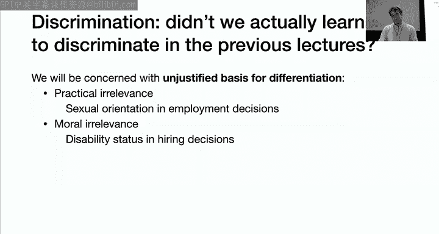

And so， of course， discriminationriminization will not be a general concept。First。

 it will be domain specific。O。And so what we will call it will be really concerned with important opportunities。

That affect people's life。Okay。It does not apply to any use of algorithm， You know。

 to any use of your machine learning algorithm。But it will very， really， I mean。

 we will be very interested in some consequential domain。Hiring， college acceptance， loan， justice。

 elsewhere care， you know， some domains where you will take very important decision for the people。

 okay。So it would really be domain specific。And it's also。Gup specific。Okay， so what do we mean by。

Wed really be concerned with social categories。That have serve as a basis for unjustified and systematically adverse treatment in the past。

Okay， so for example。EBas on race， gender or disability status， sexual orientation。Okay， so really。

 we would be concerned about some hope， which has been discriminated in the past and continue to be the focus of discriminationriminization。

We are not concerned with just any membership。Okay， so that will be the focus。Of today's lecture。

 really trying to see。Discrimination in machine。So。As an introduction， what we will try to see。

Is try to understand how， you know， the demographic disparities can propagate through the machine learning pipeline。

And so to do that， we would just consider our classical。

EThe classical stage of typical machine learning system。

So we have some interaction between the individuals， the state of the world， the data and the model。

And so the first stage is really like the measurement。 Okay， so what is the measurement。😊。

Is how the state of the world？Will be red use。To your data asset， to some numberss， to some vis。

And you could first think that since we are calling this measurement that this process is very straightforward。

 you know， it's very scientific， there is no problem here。But in fact。

 we will see that's not the case at all。You know， the world is really messy。

How you will make your measurement will be messy will not be scientific at all。

 and it will require a lot of human decision。So this first step of measurement would be really important。

Then there will be the second step， which is a learning step。

So the learning step is how you turn your data into your model。Okay。

 this is what we have done so far in the lecture。 I'm giving you some data。

 You will use some algorithm。SVM， logistic variation， neural network in order to get a model。ok。

And then what you try and what you hope is that your model will learn some patterns in your data that your model will generalize to new observation。

 Okay， so this is what we have been concerns of find in the lecture。

And then there is a state of the action。Okay， you will use your model。

In order to make some prediction。You will apply your model to some new observation。Okay。

 and then this action can take a lot of different form。O， the significance of your action。

Can Baha a lot。That's important to have in mind。 for example。

 if the action is to put a mail in the spam box， the significance will be very different than if the action is giving you a loan or accepting you in PhD or in。

 you know， in your college。But even if you this action。Defer ins significanceificance。

 what is important to have in mind is that at the end they will still all have an impact on the state of the world。

 okay。😊，And also sometimes。Your model can receive some feedback from the individuals。 you know。

 for example， if you are doing some advertisement on the website。

 the model will receive if you are clicking or not on the app。 Okay。

 so sometimes you have also some feedback from the individuals to the model。

So this is a machine learning loop， and what we will try to see now is really how the demographic disparities can propagate through this pipeline。

😊。

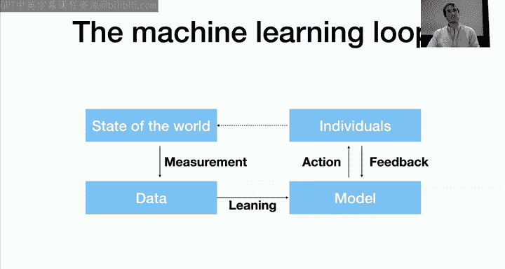

我 good。So the first thing to。Toky about is that， in fact。

A lot of the application of machine learning at the end will be about people。Okay， so for example。

 so in the book， they were explaining that they looked。😊，You know， at some Kaiggel competitions。

 they went on Kagal and they looked for the top 30 competition on Kaiggo。And on this step 30。

 what they saw is that 14 out of this 30 application。😊，At the end。Cone send and task。

Where some decisions are made about individuals。ok。So really。

 like in a lot of important machine learning problem at the end。

 the decision taken will be about individuals。😊，So that's the first important point。

And then the second important point。Is that the training data you will use in order to learn your model for this application。

really often incurred existing demographic disparities。So if you look at this example。😊。

Whi was would just shows a percentage of women in the sample of occupation in USA。

You really see an agenda breakdown。Okay， you see that a lot of occupation of gender imbalance。

For example， if you look at Ns。哦。I don't know。 Well I saying， you would see really a different。

Gender imbalance and that's something you have to， you know。

 you have to be aware if later you will use this data in order to learn some information in order to make some decision。

ok。And so the， you know， why this this is exist， We can have a lot of contributing factor。 It can be。

 you know， some historical explanation。 I mean， is Va alert is not too important。

 What is important is that at the end， the data you will use will really be a photograph of the Qhan you know status of the world。

And， you know， it really reflects。 It really encode the disparities。

 And so if you are using this tiny data， you have to be careful and you have to be worried about this。

Okay， because otherwise， what will happen is that social stereotype may be perpeturated by the application of your machine learning algorithm to this task。

So in Kael， for example， they talk about。No one competition， which is automated， is this going。

So what you want is to be able to grade automatically some essays。😊，Okay。

 you want to learn like some algorithm to do that。But here， you know， you have to think about that。

You're tighten that done。I mean come from some human ideas。 And these human ideas， I may， you know。

 they may have a lot of possible stereotype。So the data you will use in other。

To learn how to grade automatically a copy will really reflect the stereotype of your training data。

所以需要 doing nursing。If you are not taking this into account at the end。

 it will be very likely that your model may perpeturate。Some stereotype。

 and maybe I some discriminationcommunization。O。So as a conclusion， really， what you have to。

 to be aware of is that human society is really full of demographic disparities。And training that。

Will likely reflect this。And if you are applying blindly， your algorithm to this。

Then you will perpeturate these species。And you could， you know。

 you could also say that what about like some applications， which are not about people。

And so that's a nice example， which is also in the book and also in the lecture of D Po。

 which was about a service in Boston called Stipb。So what was Street bump。

It just a project to cut source data on a pothole。 Okay。

 so you want to be able to detect where the pothole。In your city， in order to be able。To serve them。

And so what the app was doing。The application was automatically detecting support all。

Using some data from your smartphone。 Okay， you are using your smartphone when you are like。

 I don't know in nearby。 For example， when you are working， I don't know。

 And then if you hide for a personhole。You know， it will your G。 I mean， it will。

 your smartphone will send something and then we send a signaluel to the city to say there is。

St banking。So that's really like a data driven decision making application。

 and you could think that there is no ethical concept。

 you know there is no necessarily machine learning， just like I want to detect where potholes。😊。

Why are we talking about fairness or ethics in this application？It's not about people， you know， why。

Is it television。And so in fact， what you see when you look at the results。😊，Is that the complaints。

We're coming from well to do neighborhoods okay， so you really have a disparity between rich and poor neighborhood in the number of scenario you were receiving。

So you could have a lot of explanation， you know， maybe which people are complaining about everything。

 maybe you know， you don't know。But as a result， when you were card softing。

 card softing the information。And when you were using this information。

 most of the limited city resources were diverted to the rich neighborhood。So， you know。

 like the city of Boston Alex some limited resources in order to solve this tripband problem。

 they could have tried to holy solve， you know， some of this trip。Some of the potholes they find。

 but they ended by unservlving。These of the rich neighborhood。Okay。

 so you see at the end that a lot of machine learning application。Will， in fact， concerned people。

And will be about people。And that's because the data collected by people。 So the data， as we say。

 will reflect the demographic disparities。 And also， at the end， like the decision made will。

Affect peoples life， too。O。So AGN is very rare for a machine learning application。

 not to be about people。So then， let's talk a bit about measurements。So you know what。

 what we are talking about when we talk about measurement。 So it's really involve first。

Defining the variable of interest。Then defining how you will interact。With your hill world。

And then what you want is like to turn this observation into a number。 Okay。

 you want to collect some data。And what you have to。

 to think about is the even defining is a variable of intice is very challenging。

And also that you will have a lot of measurement bias。O。I mean。You good thing， for example， you know。

That measurement。Will be。Like the path of the previous jaham。With a less possible bias， you know。

 because when you' are measuring something， you are just。Reflecting the real world。

But what we will see is that， in fact， is not the case at all。So there is a very， also in Zoos。

 there a very nice， very nice example about some。measurement bias， it's about camel， okay。

You can have like a digital camera， for example。 And what you could see is that， you know。

 a digital camera are just taking a photo。 Okay， you are just taking a photography of the real world。

 There will be no bias。But what， in fact， they discover。Is that when you design a camera。

 it will involve a lot of different choice。OK。嗯。When people were like kind of setting， you know。

 all the parameter to design the camera。 So I kind of testing all this， I mean。

 to all this result and people with lighter skin， okay。And so what is the。

 what is the result of this is that at the end all the default setting of the camera。

 like the color balance were optimized for lighter skins。So， for example， and also， since you know。

 at the end， like the camera will have a limited dynamic rangenge。For all this parameter。

What you have is that。It's really difficult to capture brighter and darker on the same image。

 And so at the end， you will have a picture。 I mean， you have the camera， which would be。

Really optimize to take picture of people with a light skin。So you see， even in ahu。

But you could think it would be really like an objective vision of the world。There are， I mean。

There are some human choicess。Which introduce them bias。Aries kind of striking if you think about it。

O。So， yeah。 So that's what really I want to say。 when， you know。

When you are measuring any attributes about some people。There are some human decision involved。

So it will be subjective， and it will be challenging。And as a practitioner。

 you really have to try to understand the provenance of the data。 You know。

 where does your data come from。In order to try to solve this bias。Okay， another problem。

 for example。Is that。You know， how do you， how to define the target。

Let's say we want to do a classification problem。 You want to define the why。

And what you have to think about it's not an easy problem。So， for example， you know。

 if you want to decide if you want to。To give a credit to someone。

 if you want to give a loan to someone。Then you， what you have to decide is like the credit worthiness。

 You know， will you give a credit on that， You want to measure your this。And if you think about it。

 it's not like interesting properties of， I mean， that you are， you know。

So you need to find some features in order to translate this。 Okay。

 you need to find a way to compute this creditworthiness。And so， this will really。

Imply some human decision in the loop。That's the same if what you want to compute is that will you be a good employee on it。

O。I want to create a machine learning algorithm in order to help me to hire someone。

 So at the end what I want to compute is that will this candidate will be a good employee on it。

I have a lot of data。 and I from this data。 I want to compute this。 You know。

 I want to create my training data。How should I decide， You know。

 How should I compute if an employee is a good employee or it。What should I use。

This is a difficult problem。So maybe you could use， for example， some annual reviews。 You know。

 you can look at all the employee you have in your company。And look at any other views they have。

But if you think about is the annual review， they get。Will be really biased。

But it's the choice of the people of the best who made their review。

So if other employees have some bias。Then this bias would be perpetrated in review。

 Then this bias would be perpetrator or training data， and then。

This inequality will be perpetrated to your algorithm。O。For example。

 another interesting example is when you want to apply this。To some justice decision。

If you want to apply this to some justice decision， what do you have to compute。

You want to miss you who will commit a crime？Okay， that's what you want to compute。

But that's something you don't have access to。Okay。So what can you use as epoxy。As apoies。

 you can use。You know， a people。You can say， I said people had come out to crime。 Okay。

 so this you know。But then I think it's easy to see that this will also be very biased。

Because a lot of people are not arrested。Okay。I hope it's clear for use that。Even you know。

 if this measurement step at first。Could I as very， as very scientificific and， you know。

 as very unpomatic。 in fact， a lot。Of by yes are introduce in that step。And as a practitioner。

 you really have to be careful about it and try to understand the provenance of your laptop。

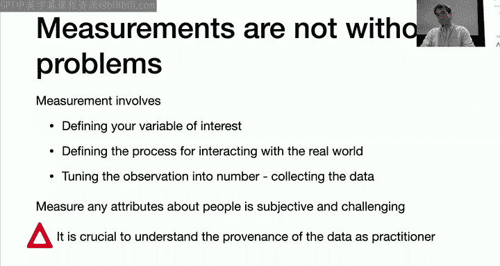

And so then let's talk about， you know， from the data to the models。

So you have your data set and you will train your model。 This is what we have learned so far。

Can I give you a train set。You want to do some classificationification。

 you will use some neural network。Maybebe。And so's a question。Is really what you want to see is that。

As in， will your model reflect。So despite is you add in your heading set。😊，印毒。Will it amplify。

 will it decrease what will happen with this societyty？After you have train your model。

And so what you have to be。Aware of。is that。In your training data， you know。

 you really have like kind of two kind of patterns。Some patterns。Will he present knowledge？

So by knowledge， I' really say what you want to learn， okay？So for example。

 smoking is associated with consent that's something that's a knowledge and that's something you want to use when you are taking your decision。

But your data， you know， there are also some patterns which represent stereotypes。

So what could be stereoized， for example， is like girls tend to prefer pink and boys tend to prefer blue。

Okay， that's a silly stereotype you don't want to learn。 Okay， so you will prefer to avoid learning。

But what you have to be aware of。Is that yourre machine learning algorithm any or any algorithm。

 you know？😊，It will not distinguish between these two。

They will not know what is an knowledge and what is a stereotype。Okay。

 if you are just applying your algorithm， it will use everything。

In order to get the best prediction possible。ok。So if you are not doing any specific intervention。

Your algorithm will really extract both knowledge and stereotype。😊，So this is a simple example。😊。

So this is also from the book。😊，I tried yesterday， I mean， and no Google has been updated。

 so it's not any other case。Which is kind of funny。 So what we will do， I mean。

 what they we doing is they are translating from English to Turkish and then back from Turkish to English。

 okay。And so first it translates， she's a doctor and he's a nurse。

Okay so you get some result in Turkish and then you translate this back in English。

And first so some years ago when you were doing this， when you were translating this back in English。

 you were obtaining， he's a doctor and she nurse。Okay so you see。

 I start from she's a doctor and he's a nurse。And when I translate it back。

 I get he's a doctor and she's a nurse。Just kind of shocking if you think about it。

And so in some sense， not so surprising because Turkey is a gender on a all pronouns。

And so when you are translating such pronouns in Turkish。You will get the agenda on the pronoun。

And when you are translating back。This gender and pronounced back in English。

The system will pick the sentence。That you know best match the stat of the training set。

So if you're training set。Is more likely that a doctor。Is a man and that a nurse is a woman。

 is a female。 Then if you are just， you know， using your machine learning algorithm blindly at the anywhere。

Get this kind of shocking result。Okay。So that's why you have to really see， you know。

 that's a good example without specific intervention。😊。

Your machine learning will extract both knowledge layer and stereotypes。

And this will lead to terrible resultss。So then you could think that， okay， why we are not removing。

This kind of sensitive。😊，You know。Attributes from all that and that was a question。

I feel her good egg beef。Now， for example， I don't want to have。Some his but。Gends， I just， you know。

 remove the gender from my。For my features。And I hope that it will be the solution。

And so that will not be the solution because first。In fact。The gender of your， you know。

If your person will also be I mean will also be included in other features。

 So even if you remove the gender。Still， the gender is ining a lot of different features in your model。

So removing it。Will not really him move。The fact that the person is a male or that the person is a female from your be。

ok。And in addition。You know， you could say， okay， but let's try to remove all these ho and cuttings。

 but in fact， these are helping you to make your prediction。😊。

So you cannot remove everything otherwise， we just， you know。We just learn like a nice。So on this。

 I gave a very nice example。😊，Which is， if you look at， you know。

The age at which someone start to poke up。Okay。You have a data set with some individuals and you ask them at which ads have you start to program？

What you can see is that nowadays is very correlated with agenda。😊，Pason， who。

I've started to program very， I mean， when they are very young tend to be male and female tends to start。

 you know， learning to program or to be interested in programming later。

So that that's something that's effect fact。So you could remove the gender from your data set。

 but if you keep。These features of age at which you have start to program。

 it's really easy to induce from these features your gender。And then you can say， okay。

 let's just remove these features from mytaes。😊，But now imagine that your goal was。

To decide is someone was suitable for a programming job。Okay。

 you want to hire yourself software engineer。So you see that if you want to hire a software engineer。

It's really important， you know， it's a very， it's a， I mean， it's a key factor。😊，To know when。

The individual has start overcome。Okay， so you see that it's not so easy。

To remove some of the features from your problem。O。

So really that you see that when you are going from the data to the models， in fact， the disparities。

Can be preserved。If you have some disparities in your training set， then if you are doing nursing。

 they will still be present。In your mode。But then previously， one of you asked me， okay。

 this is present at all， you know， disparities can be introduced。That was the other question。

So what I want that you understand is that in fact。

 the learning step can also introduce some demographic disparities。But I'm not in yourti that。ok。

So even if you have a nice training data， you know。

 you have really like tried to collect the training data with care having in mind is a fairness problem。

Stillill。When you are learning your model， you can introduce them disparities if you are doing nothing。

And so why？It's really because of the sample size of spty。So imagine that， you know。

 when you are doing your training set。You are doing any from sampling from a population。Okay。

 by definition， since you are doing any forms of sampling。😊，You know。

 you will have fewer data for your minorities。Theres a minorityity。

 so you will have fewer data for them。😊，Okay， that's kind of obvious。And what is even worse。

 and that's often the case。If your minority groups are in addition， and they represented。

That you未来 even需不要 that。So for example， if you think about you know。

 like the tech industry in the Silicon Valley， that's known that Min op will be underrepresented。So。

 if you are creating。Your're train by any forms of sampling over employee at Google， for example。

At the end， you will have a train set where the minority group will be underpresent。O。

But then you all know that machine learning。Wks the best when you have a lot of data。

Okay you know that typically the generalization error will decrease that1 over square root of n。

 so the more data you have， so the best your decision is。😊，So what we is， you know， so is that。

Machine learning， this model， they may work less well for the Min richches。😊。

Because I have been trained on less that has the spins。Okay。

And you know what you have also to have in mind is that when you are developing an application。😊。

And also， if you think about like the course。What was the criteriaI we were using？

In order to test if our model was good or not。We are using the tool也好 remember the generalization也好。

Which was the average rate of our all population。😊，But then， you see。

If you say that I have in rate a very low owned my population。😊，For example， let's say 5% error。

Maybe in fact， this error will be very low。On my majorities of people。But for my minorities。

 this a can be very large。😊，But since it is a minors， it will not affect my train error。

 my test sorry。So you could have a very low tester and you can very happy with your results。😊。

And you can say， okay， let's develop this project。But as end， if you test。Your algorithm。

 specifically on some minorities， so error can be really larger。😊。

Then your test error and all your population。And that's something you really to have in mind。Okay。

And that's even worse。So the anomaly detection。So thats this example of the。ナイマスコ。

But let's do a quick break。 And that after the break， we will talk about this controversy。 Okay。

 so let's do a 15 minute break。So let's start again。So before the break。

 we start seeing that even the learning step could introduce some demographic disparities， okay。

Which we not in your tiny data。And we stopped I。Before talking about what was a Nemo controversy。

So what was this controversy so at some point。Google and Facebook and other tech industries。

They start to try to block users with uncommon name， okay？

And so why did they want to block this kind of fus Because I were thinking that uncommon name。

Was meaning fake name。 Okay， and I want to block all the user with possibly fake name。

And so what you should have in mind is that in some culture， you will have a few different names。

So that will be true that uncommon name will be pre fake。But in other cultures。Then， you know。

The distribution of name will be more diverse。And that it would be very high It will be very high。

Un to have a close name。So when they start doing this， you know。

 it was really like a lot of people from some minorities。

Startve to be blocked just because they had some uncommon name。Okay， so this is really to see that。

When you try to do like a minority detection。The sample say this it can be even more problematicmatic。

Okay， and that's kind of interesting because。It shows you that for this example of in notification some fake name。

 some features。Can lead to very different results。For different culture， okay。For in my culture。

 it's very unlike， I mean we have very few different name and in other culture of people we have very diverse names。

 so I can't use this in order to detect if a name will be fake or not。ok。So in conclusion。

 we need learning algorithm。😊，Will generalize based on the majority culture。

And so this can lead to highate amino groupss。And this is because our goal。

 when we are doing machine learning classically， it just to avoid overfi because our goal is really to minimize the true error。

😊，ok。So most machine learning objective function will create models which will be accurate for the majority class。

At the expense of the protected class。Okay， even if you have a well training set。

If you are doing nothing。So I'm not offering any solution。

 It's just something that you have to be aware when。You do an application。

So let's look at this example。😊，So let's imagine that we are a high hand committee and what we want。

 okay we want to decide if we will hire someone or not。

 and so we will make our decision based on two different features。

 the first one which will be the applicant's college GPA okay and the second one which will be the interview score。

I have access to this two information。Okay。So this is my training data from the past。

 from the past candidatess。I have all this information， the GPA and the invisco。Okay。

 I have two variables and I want to predict the quality of an applicant。😊。

What do I mean by quality of an applicant， for example。

 I want to predict a quality after some years in the company。😊。

Will this applicant perform well after two years after five years in my company？

Should I hire these applicant？And what you see that in fact， in my train data I have two group。😊。

Of people， I have the group A， and I have the group B， the square and the triangleangle。So who。

 you know， how can I train a model。To make my decision。So first， you know。

 I will train a model which will not take into account which group the candidate belongs to， okay？

That says that I don't know the scope of the candidate data。

 I'm just looking at the GPA and at the interview scale。So what I can do is that I can first。

Use some risk square regression in order to predict the average job performance。

So then we have the average job performance for all mys。

And I will just use a quitoff based on the number of candidates I want to hire。

If I want to hire 10 candidates， I would just take the 10 best candidates。Okay。So I just， you know。

 use this getoff。To keep some percent of the co date。

 which correspond to the number of candidate I want to hire。ok。And so what do we observe？

So my class share does not take into account which group the candidate belongs to。But at the end。

 you see that。The triangular are more likely to be selected than the square。

If you look at the number。Of candidate I have， I will hire。I have more younger than squares。ok。

So why is because like the gun roofs we predict。Like the true value of the performance after last two years。

Will systematic be lower for the squares than the tri？And so why？You know， we don't。 really know why。

 baby we had some bias in our training set， maybe， you know。Some we have some post iron bias。

 like maybe in my companies， there are some bias and some candidate from the group B。

When they have their interview after some years， they will get a lower grade。Because iner。

 we have some bias against this group， that's a possibility。Maybe we have。Some explanation。

Maybe people from the group be。Have access。To less prestigious college， you know。

 less prestigious university， they didn't have the same access in the education。

 maybe we have a lot of different factor， I mean， I don't know。

But what you see is that we like the data is a me of the society， so at the end。😊，If you look。At。

 you know， the height of being higher。Given the fact that you belong to some group。

 it would be really different。And。You know， some of you， it can be。

Can I as a problem and so we can try to say， what can we do in order to improve this？No。

So what can we do in order to decrease the disparity in our selection procedure？😊，In an informal way。

So the first one is maybe to say that， okay， maybe GPA is correlated with the demographic attributes。

 you know it's kind of apoxy。😊，For your attribute， So maybe we can just omit the G。

And only make prediction using the interview performance。That's an option。But then of course。

 if you're omitting one of your features。😊，Then you will decrease the accuracy of your model。

So that's the first trade of， maybe you will be more fairre。

 but you will have a model which will be less accurate。Okay。

 another option is maybe you can use a different cutoff for different cultivate class。

So that you will be able to have the same。Sucs rate for every group。Okay。But then as the results。😊。

2 candidatess with exactly the same A attributee。May I receive a different decision。

 depending on their group。And this。😊，Can sound unfair for some of you。

And another option you can also in mind。😊，Is that maybe what we can see is that also the fact at the end to hire diverse as a group of people。

Can also be。A nice feature for the company， because often diverse steam。As supposed to work。

 you know， be than non deviceest team。 And so we can also try to change our model。

In order to weight less， the GPA features。And try to impose some diversity。You know， here there yeah。

 some diversity regularization inside our objective。😊。

In order they have to increase the diversity between the state that committees。

So this has different possibility to solve this problem。Okay。

 so now what I want to talk to you about in the last part of the course is to see what you know what I've done statistician and machine learning research to try to address these fairness issues and so what we will do is that we will talk about this fairness criteria。

So in some sense， how to measure the discrimination in our machine learning application。

 and we will focus on the classification。😊。

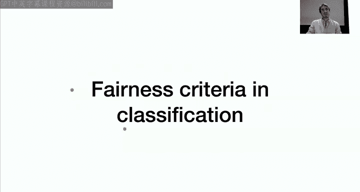

So what is the formal setting the formal setting of the classification。

 we already talk about it in the course， but let me remind you。😊。

Your data will be described by some co 8 x。And then you will have an outcome variable。

 your label Y which will be between 0 and1， okay， classical。😊，And what is your goal。

 your goal is when I give you a new X， you want to be able to make a decision。

 you want to say you want to predict its label， okay， I give you x and you decide。😊。

Is it associated y a0 or a 1？That's个。And how you will do this。😊。

Today we will use one particular formulation。😊，Which is first， you will learn the scar function。

 Okay， you will learn the scar。For your X。Which will be a hill， maybe between 0 and 1。

 I will just be a hero。And then you will use this number in order to take a decision。

 so you will make a binary decision according to some threshold。😊，If r is larger than t。

 I would say that it is a1 and if r is smaller than t， I would say that it is a zero， okay。

And so how can you learn your scar， You could imagine that you know everything and that you will learn the base optimal scar。

 which is that， you know the。Conditional expectation of y given x that can give you one score。

 then depending on。This conditional expectation， you can decide0 or one。

Or you can learn this car using your data， for example。

 I don't know if you remember for logistic regression， this is exactly what we did。😊。

With logistic regression， we first learned a score and then depending on the value of this score。

 we were predicting01 or plus minus1 or1。😊，Okay， plus minus1 or minus1。

 depending on your threshold and on your scale。Okay。And so today， we really assume that， you know。

 I is given to you。I'm giving you a score。And I don't really care how you have， you know。

Where does this score came， come is it the base of T11， who is that being trained on data？

And also everything will be at the population level， so we are not talking about generalization。

 we are not talking about you know， this is not a question we are looking after today。

You have access to a score and you will use this score in order to make your prediction。

What were interested in is this prediction process， this decision process。

Which decision you would take using your score。ok。就在这 city情。

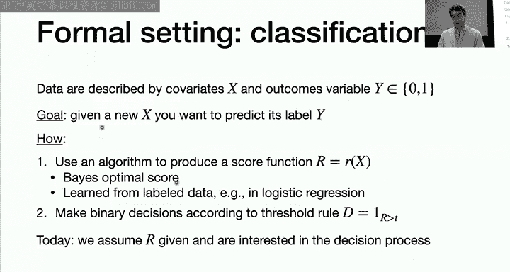

But now this is something new we haven't talked about。So doing all the course。We previously， I mean。

 you know， when we talk about classification， we are talking about the classification error。

We always wanted to minimize the probability of making a effort。But you have to think that。

This is one way。You know， to characterize this is one way to measure the performance of your s。😊。

But it can miss a lot of important aspects。And there are other formal classification criteria。😊。

Which can highlight different aspects of a classifier。

So you have to think about this confusion diagram。While you have like the decision decision D you are taking。

And here， like it took class。And so， if。Your two y was a0 and you are querying a zero。

 this is what is called a two negative。ok。You are predicting negative。

 And that's a really negative one this is a tool negative。😊，If you took class。

Is 0 and you are predicting one。 You are taking the decision one。This is a false positive。

You are predicting a positive one， but in fact， it was a negative one。Okay， so first2 negative。

 second false positive。Now let's assume that the true class was one， but you are predicting zero。

 this is a false negative。You are predicting in the Getty， but in fact。It was a positive one。

 it is a false negative and finally the true class is one and you are predicting one。

 this is a true positive。😊，Okay， so you have these fast different examples。And to this。

 you can associate different height。You have the two positive right。Okay。

 so what is the true positive rate， it really correspond to the frequency with which the classifier correctly assign a positive labels to a positive instance。

😊，Okay， so the true positive height is a probability that d is equal to one when y the2 label is equal to one。

ok。It release is a frequency with which the classifier will correctly assign a positive label。😊。

You sign one。To label。To a positive instance， y is equal to1。

 and you have the same definition for the false positive rate。

 the probability that d is equal to1 when y is equal to zero， the true negative rate。

 which is a probability that d is equal to zero when y is equal to zero。And the false negative rate。

 which is a probability that d is equal to zero when y is equal to1。😊，ok。

And so Israeli machine learning。We are considering utility function only with two number。

We are only considering the cu for accepting the negative instance。

And the cus for rejecting a positive instance， okay？

And my classification inhow is only the cost of making a mistake。😊。

But I'm not differentiating between。You know， when I'm doing a mistake。

 it can be a false negative and it can be。Eff force positive。And I'm just like saying both similarly。

But what you have to see is that in fact， the choice of the threshold T in your decision rule。

 so where you put your threshold， where you decide to assign some label to one and some is are label to minus to0。

Will deep a lot。Of the classification criteria you want to pick。So for example， in your problem。

 if you face a high cast for false positive。Then what you would like to do is that you would like to choose a higher threshold。

Okay， and in the opposite。衣服。The fourth negative are very costly。

 Then you want to have a lower threshold。 That's something you have to think about。

But that's something we haven't talked about during the lecture previously。O。

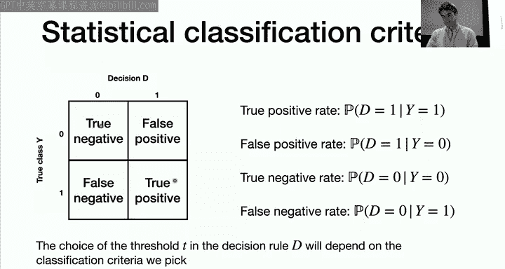

And so then how we will anchor。sensitive attributes。

We have seen in the first part that in many tasks。Your features X can anchor some sensitive attributes of an individual。

For example， you know correspond to some different group of population， it can be genders or has。

 some disability statuss， some sexual orientation， so what we will assume is that we have an additional ho variable a。

😊，Which will anchor the membership statute， okay， the protector class。

So you have an additional honda variable a， which will encode if you belong to some protected test or not。

And as we already。See， in the first part。It's very important to see that even if you remove from x。

The fact to belong to this。Protected glass。 Okay， so removing ignoring sensitive attributes will not solve the problem。

 Okay， we have seen that。Because first menu featuress slightly correlated with the sensitive attributes。

And so they can be used in order to recover the attributes。And if you remove them。Then at the end。

 the classifier will still find some encoding。And so we'll still take into account。You send the。

So example example one example given in the book。😊，Is， for example， the fact to visit pinnedter。

 So in the US， if you are visiting pin， it means that it's more likely that you are females than a male and using these kind of features at the end will able to recover your gender。

 even if in your training set， the gender is not in okay。

So I just wanted to talk again about this because this is very important。

You will not attain fairness only by being unaware。 Okay， you have to be more careful。很早。Okay。

 so what we will do is that we will define three fundamental fairness criteria。😊，Okay， in order to。

Kind of to formalize this idea of fairness。There are some criteriathereia， which has been introduced。

And they all rely on the same ID， that we try to equalize different statistical quantities。😊。

Involving the good membership。Okay， you will see and this IDV dates back from the 60s for some seminal work of an clearly。

😊，So most of the fairness criteria area will be properties of the joint distribution of your membership status A。

You too label。 Why you're going to。And your score。Okay。

 the three criteria we will consider will be the independence， the separation and the s。

So independence， it will be that your scar is independent of you。Meship statue。Okay。

The separation will be that your sky is independent of a conditional of your two at puty。

And the last one sufficiently will be that y is independent of a conditional on R。

Okay let's talk about them。

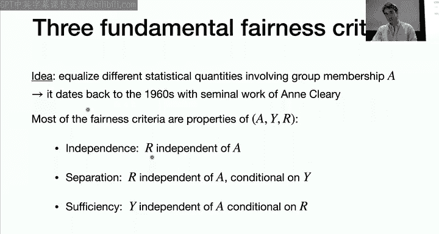

So the first one is independence。So we will see what we are doing when we are causing independence。

 we are really equalizing the acceptance rate。😊，Okay。

 so what does it mean what is the definition Inence requires that the honda variables a。

And R are independent。O if。Your sensitive attribute A is independent from R。

Then we say that this is independent。 Okay， we did this by a A perpen to。

So where does it imply independence？It implies that。

The probability of success is the same in the two group。 Okay。

 so acceptance rate is the same in all group for two members A and B。Of a。

 then you will have the same probability。ok。So for example， if one group has a 80% acceptance chance。

 then all the other groups will have the same acceptance rate。

YouSee that was not the case in the previous example whistle。

So you could say that this is something you want to achieve， okay？

You want that individuals from one group will have the same。

Percentage of success than individuals in your other group。You want to have the same。

Exccitence rate for the tri younger and for the square。When you are hiring。Okay。So first， you could。

 you know， you can think that this independent criteria area make a lot of sense。

 but something you want。To satisfy， that' something you want to check that your application satisfies this criteria。

Yes。You see one possible problem with this cr cr。

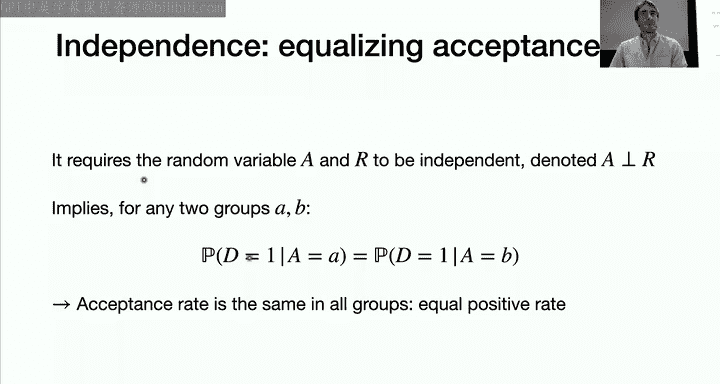

寻门。撑得起。😔，So the limitation of independence is really that in fact。😊。

Satisfying is criteria you will not rule out unfair practice。O。

A process can still be really unfair while satisfying the independence criteria。So let's in那种。

So we still take the same company。And what we will do is that。We will hire you。With a lot of care。

What we mean by a lot of care， we are making some very， very good decision。In my group a。Okay。

 with some hate。So let's say that I am hiring all the trional with a lot of decision using all my reliableing information。

 reliable information with some Hp。😊，Thats my first step。And then。You know。

 I don't really care about the second group， but I still won't。To satisfy my independence criteria。

For some reason。So what should I do， what I will do is that I will hire without any care in the second group。

 Okay， well make very poor decision， even can imagine even a hondadom decision。 Okay。

 my second group， I would just try to satisfy the same acceptance height。😊。

So a DNA of two population。😊，I will have higher in one population。

 a lot of individuals with a lot of care。And in the second population。

 I will just have made some hondam decision。And I will satisfy my independence criteria， you see。But。

So we get that the acceptance in both group are identical。

But what you obtain is that unqualify applicants。Are really more likely to be selected in the group B。

Because I'm doing some poor decision。So what will happen。In the company after a while。

 the member of the group B will appear to perform less well than those of A。

Because I have been selected with Le gear。And you see that it will perpetuate。Thisequalities。

Because in the next training data you will use then。The tos of the。

AP in the population B will be even lower because I have been higher with less。Okay。

So this should show you， you know， in some sense， the limitation of this criteria。

And what you have to also be aware of is that， you know， it's not necessarily something， you know。

 ill intention from the employer， you know， it's not that you really want to make poor decision on the code B。

 but maybe just the fact that he has less data about the code B。

There's less variable information about the could be。ok。

And so what is the moral nutrition behind why？The limitation of independence主。

We should distinguish a positive output。Okay， when you are looking for a positive output。

 we have to distinguish between the false positive ti。And the two positive。ok。

The question is not only accepting someone， the question is， should I accept someone？

With true label is that person will be a good candidate。And in some sense， you know， I mean。

 if you follow your mobile inition， you should not be able to trade some false positive and too positive。

ok。Because if you think about it， at then。In that case， you are not accepting who you should。

You know， what you really want is to accept people who deserve to be accepted。So you see that only。

Trarying to satisfy this independence criteria to get the same acceptance height in the two group is not what you really want to do。

ok。But still， it's interesting because in fact， this criteria is still very popular and you have a lot of work on it。

😊，And I just wanted to talk briefly about， you know。

Or is it possible to achieve this criteria is it possible to find a classifier？

Which will achieve independence。And so you have three different way to do it。

You have some purse processing step。 So I give you a score R and you will modify R in order。

To get it independent。 so what you will do that you will adjust the learn class here so as it become uncorrelated with the sensitivity A A。

😊，ok。So for example， you can take different threshold for the different。Cl。

You can have also some planning time procedure。Well， when you know why you are training your method。

You will add the constraint in your optimization process that you want to be independent。

And you have also this nice work pre processing is that now you will try to adjust your features。

So that they become totally uncorrelated with the sensitive attribute a。

So you have this one from ZL in 2015， where you are trying you know。

 to go from x to learn a representation Z。😊，So that z still represents all the valuable information about x。

😊，But so that Z is independent of a。Okay， so that's a no。

But you have to to keep in mind that even if you have some fancy way to achieve this independence criteria area。

 yeah。Still， we have seen that it is not really what you would like to achieve in practice， you know。

That independence still enables some unfair process。So let's see a second criteria。

 which is called separation。Yes。😊，有。So example of what。You mean this example？😊，那 this one页。我几时一 p。

No P is that sorry， So your question is about P。You fix me。Okay， you say that I want to hire。

You know，80%。呃。The candidate in my A。O， so you just fix me。And then you take。

 you know your threshold shirt， you take your threshold shirt so that。You are h at the end。

Some percent have candidate in the group A。And then you use the same P for the second。Okay。

 so you fix B。Does it reply to your question。我 cool清。Okay， so now let's talk about separation。😊，So。

 you know， we have seen that independence was not like was problematic in the sense that it was possible to trade like your false positive with your true positive。

And so then people try to propose a different criteria。hich is not。Allnoing this， you know。

 to try this false positive with is true positive。 So what you are doing is that you are trying to equalize。

You ever hate。So what is the definition of separation？😊，Okay。

 to requires that you hold variable a and your score are are independent。But I'm not independent。

not simply independent， but independent conditional on the target variable Y。Okay。

 so you are assuming that A and R are independent given y。

So you can show that this will imply for every group A and B。

That you will have the same false positive rate。That， given the fact that。You to a your。Of。

D is equal to1 when y is equal to0 will be the same。

As a probability that d is equal to 1 and y is equal to 0 when a is equal to B Okay。

 so your two groups will have the same false positive rate。😊，And similarly。

 the two group will have the same false negative rate。So you see。

 you are already equalizing the error height。😊，ok。You want that you have the same chance to be the false positive in the two group。

And you have the same chance to be a false negative in the two。So you see that with this criteriait。

 it will not be possible。To try this false positive with this。W is too positive。Okay。

 so in some sense， it could make more sense， it could appear as more fair。

But then what you have to realize is that notice this criteria is a first criteria。 you know。

 when you are doing your decision。You do not know who is a positive or a negative instance。

So that's not something that you can measure when you are doing your decision。

But you can still compute it in this respect。After some time， you can look， you know。

 at your training data， you can look at a collection of people and you can collect some positive and some negative instance。

 and then you can compute。😊，this呃可以这样样。ok。So in some sense， you see really what you want。

Is at the disadvantage of the music classification to be the same for all group。

 you really want to equalize your error rate。😊，Yes。😊，嗯哼。😊，Yeah， so that's a very good point。

 So what you are telling me is that。How can I you know impose this criteria area because this is a post dark criteria area。

 I won't be able to compute it on the fly and if I'm not accessed。

To y is equal to 0 to y is equal to1。嗯，哼。ok。So that's a very good point。

 your point is that for the people which you have not hired。

 how can you know if it was a good one or a bad one？Okay， that's a good point。

You can imagine in some， you know， imagine that you can have。

Some data from other company where this person has work。 I mean， you can some way to extrapolate。

But yeah， of course， it won't be necessarily easy。That's a very good point。

But you can imagine a lot of way to， you know， to get this。I don't know。

 You can just send some cha to user the people you have not employee。 You can look at their Linkedin。

 you know know。Can imagine a lot of different ways to celebrate。But that's a very good point。Okay。

 and the last one。And also here I'm not talking about it， but there is a way to impose a。

If I give you a score， you have some way in order to transform this car into a score which will satisfy evaluation。

So the last criteriaion is a criteriaia is a sufficiency criteriaion。

And so that one really require that the Honda variable a and the output y to be independent。

コンディションのアンゼスカ。Okay， so what you want is that a is independent from Y conditional。Un这か啊。ok。😔。

And so what you will see that in fact。😊，This is in exactly equivalent， too。That for every group。

 A and B。是 proability。That。Y is equal to one， given。

The fact that the score is equal to R and the group。

Is equal to a is the same as a probability that y is equal to1。

 given the fact that the score is r and that the group is B。ok。

And so what is the meaning of this criteria， in fact。

 is really that when you are doing your prediction， when you are predicting the output y。

You do not need to know。The sensitive activity A。If you have this girl。Okay， if I give you the score。

 it give you all the information in order to predict why。

Given your prediction will be totally independent。 I mean。

 your tool label will be totally independent of。Your gender。

 sorry a your representative sensitive attributes。 Okay， if you know your scar， then you don't know。

 you don't need to know your membership。

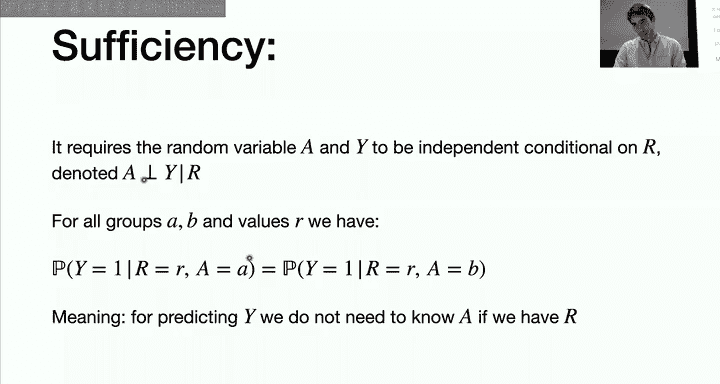

O。And so in fact， this crerion is very related to something which is called calibration。😊。

Which is something very important in statistics。So what is the definition of calibration？😊。

We say that a score。Will be calibrated。衣服。这破bil。Of y is equal to1。

 given that your score is equal to R， if this probability is exactly equal to R。ok。

And so that means that in some sense， you can interpret your score as a probability。😊，ok。

If your scar， for example， is 0。9。现在是明在9月份。90% change of positive income on average。

 among all the people who get a score of 0。9。ok。If your score is R， then you have。

A percent of trends to have a positive outcome。Among the people who get the same scar than you。

So that's something important to have in mind is that this guarantee does not hold at the individual level。

ok。If your score is other， that does not mean that you have。For example， if your score is a 0。9。

 that does not mean that you have 90% chance of positive income。

This means that you have 90% chance of positive income on average age over other people among the people who get the same skills that is different。

Okay。So it does not mean that at the level of a single individual at a scar of F of air correspond to a probability error of positive income。

😊，That's very important。ok。And that's also important to see that it is the app here guarantee。😊。

That' really mean that， you know。The score value are really correspond to the positive outcome rate。

 So that's something you have a here。So then you can do exactly the same by hope you can look at。

 you know， to be calibrated by hope， No you want that the probability of having a positive。At。

When your score value is R and when you belong to the group A， you want it to be equal to R。ok。

And so what you can see， which is very obvious is that calibration by group will imply si。😊。

Because for every group， this will be equal to r， so consequently for two groups this probability will be the same and so you will achieve efficiencyi。

Okay， and it's also possible to go from sufficiency to calibration by changing a bit your scar。ok。

So why this is kind of important and why I mean， I'm saying that it is a clear guarantee is that in each group。

😊，The probability of positive outcome is the same。I don't have to， for example。

 to change my threshold。 you know， and kind if I'm happy for all the group I have。

 I will have the same probability。😊，To have a positive outcome， so in some sense。

 my decision you can think of is as fair。No， the probability of success given。

Yourscar is the same for all the defense group。ok。

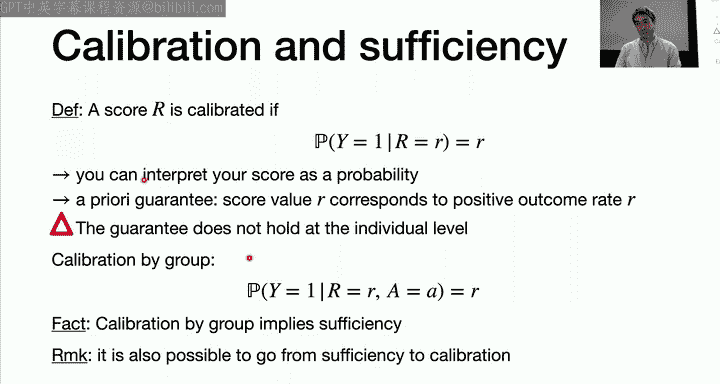

And if I give you a scar， then it's possible， you know。To in some sense。

 do some logistic transformation of this car to get a new scar， which would be calibrated。

So we will not talk too much about it， but it is called the Pla Scs in some sense。

 you know you can train a new model on your score R in order to get a new scar and this car will be carated。

So if you have a score which is not calibrated， you can transform this car in a new。

Klib items score and use this new score in order to make your decision。

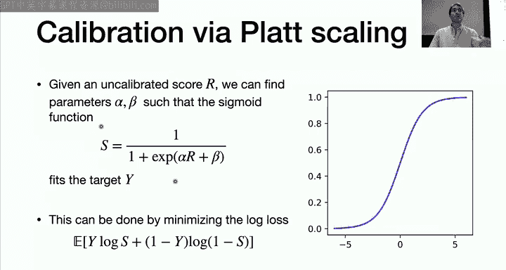

这 not挺 important的。And what is important also to have in mind is that in fact group calibration。😊。

Of sufficiency is something which is often satisfy by default in maomic。

It's not really like a cons imposing。It's kind of what is doing machine learning by default。

And so you have this result by LDLU and MaximovviD and more it up in 2019。

 which kind of say you that the better you are at doing machine learning。

 which means that the closer you are to your base。😊，Optti all。 Okay。

 so close on you off to the best possible classification level。😊。

The more your groupliberation will be satisfied。OK。And so， you see this。

In this kind of in this experiment。You see that if you are looking at the female and the male。

 it's kind of。Well copper anybody it。Okay， so the nice point is that just by doing standarddown machine learning。

 without trying to impose these criteria， then you will get efficiency。

But the negative point is that， in fact， you see。Impoing， trying to impose this is not needed。

 So in some sense， maybe。It is meaning that this criteria will also have some issue。

And so some issue with this Kataya is that you can imagine that， you know if we are doing the same。😊。

We still want to detect if we want to predict。If we want to hire someone。

 imagine that we want to predict the utility in your workplace。Okay， so for example。

 imagine that if we want to predict the number of time it will work in the next 10 years。

And then I give you the base optimal score。 okay I give you everything you have the best way to predict this。

Then you can see that someone。With disability of someone who may become pregnant。

We'd never know Oscar， okay。So you see that this group calibration does not really serve this problem of moral relevance。

Even if you're calibated。Zen。😔，You can still do some。More highly questionable decision。

So what we have seen， and maybe we will conclude on this because we will be so over time we have seen that。

We have three G fair here there yeah。

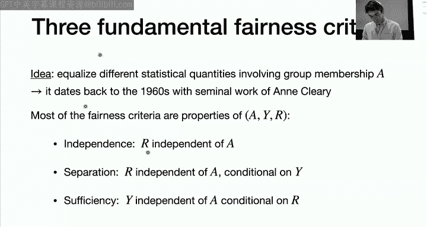

Okay。Independence separation and sufficiency。We have seen that independence is imping equal acceptance rate。

 separation is imping equal a or rate and sufficiently is employing calibration by group。😊。

And you see that all these criteria I have some limitation。😊，So maybe the question。

 the next question you want to ask is that is it possible to satisfy simultaneously this criteria？

Is it possible to be both independent and sparable， I it possible to be sufficient and independent？

And in fact， what you can see is that except in some degen cases， so in all generality。

 any of these criteria are mutually exclusive。😊，O。So realize the answer is no。

 it's not possible to be at the same time independent and reliable。

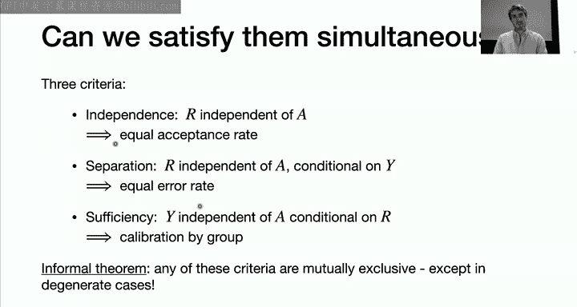

So we have these four results。And you have the proof in the lecture or not。

So it will be not possible， for example， to be sufficiency and independent。

It's not possible that both independence and separation old and so and so。

 again you have the proof if you are interested。

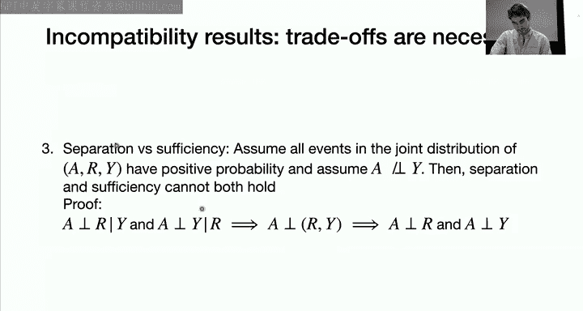

So in conclusion， you know what other question you can ask yourself？

The first one could be what is the purpose of this fairness criteria？

And then what you have to be cautious about is that， you know， as I told you， this fairness criteria。

😊，Are still subject to fundamental limitation， you know it's not possible to sat all of them。

And also you saw that this fairness hittaya do not rule out unfair practice。

 and if this is something you're interested about， I really encourage you to look at this comp debate for something very important in the United States and it's very。

 very interesting。Okay， and so one of the main conclusions is that like this fairness criteriataya。😊。

The the poor of families。Okay， it's not because you are satisfying some of these great ideas that you operate。

ok。And so kind of like the last conclusion of this kind of as criteria is that in some sense。

 you have to go beyond， you know， information on the joint distribution of X， Y， R and A。😊。

In order to be really be fair， and this is what is about causalella reasoning。 So that's an old。

A lot of different methods you can use。 and if you' are interested。

 you can read about them in the in the family's book。

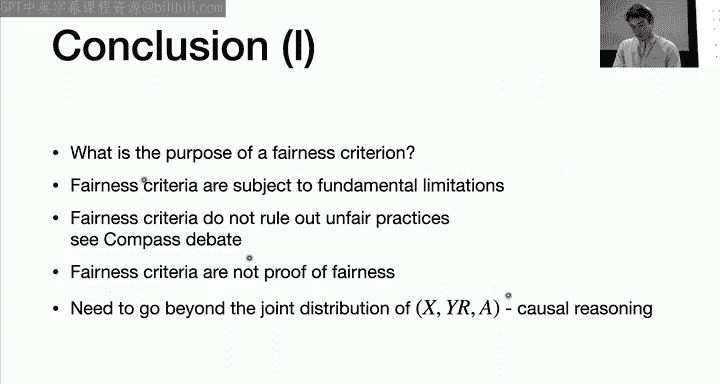

And just to conclude on this lecture。What I want you to think about is that even if you know。

All this example hiring， lending， you know， justice are some in some sense， controversial。

And you can say that maybe you you will not end up working discipline in this field。

It's important that you have in mind that black box machine learning。

Has no guarantee of being aligned with your social values。Okay， if you are doing nothing。

 your machine learning algorithm will not be fair。Okay。

 it will not be aligned with what you think is right， Arhmed。And so really try to think about this。

 you know， when you are doing machine learning， when you are doing samification。😊。

How can I try to design some project which will never a machine learning power。

 but we are still aligned with your human values。 Okay， thank you。 Let， that's all for today。

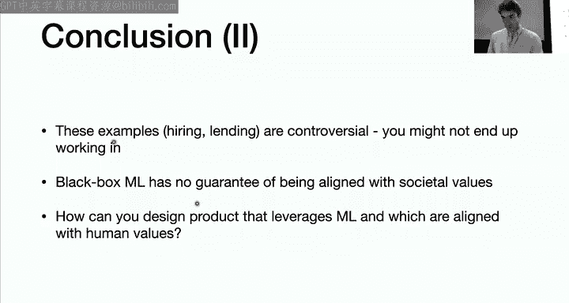