# EPFL《机器学习｜Machine Learning Course CS-433 fall 2020-2021》中英字幕（deepseek - P29：[29]EPFL Machine Learning Course 2021 - Week 10 part 2.zh_en - GPT中英字幕课程资源 - BV14SwyeNEvW

W is learning。Just a few maybe logistic remarks， so hopefully everything is going well with project too hopefully you'll found a group and also a topic。

😊，呃， maybe。Don't hesitate to ask questions on the forum right so also if you have technical questions about your specific project and ask us in the forum so we can really help you that if you have machine learning questions which are not on the domain but general then ask them in the forum and also for the domain specific questions for with your advisoror and also if you do any of the other challenges like the reproducibility or。

😊，Or the standard challenges。Okay， and I just upload this slide right now on the GiHub， it's there。

 sorry for the delay。So slides today will cover a small inch or two unsupervised learning。

And then in the second part， also to talk about the clustering。And yeah。

 are there any questions on the logistics or。Exercies and so on。A you good。Then let's get started。

 So what we what we've done so far was often the very standard kind of learning that。😊。

You already gave all the true answers to the， to the system。 So in every learning step。

 you were telling the system it predicted something。 but then you told it， hey， no。

 you need to predict this auto value that that you。The shoe label。So。

 but maybe it's fair to say that's not really。How realistic human learning would work or how how a child learns。

 It's not really like that， right， It's， it's maybe。Fair to say that the vast majority。

 what we learn as a human is， is not because someone gives us the true answer。

 but it's by observing things ourselves， right， We just observe what happens。 We don't。

We don't always get the thing that we are supposed to do as an answer， right。

 We sometimes we just observe things happening in the world。 and we're trying to。To learn from that。

 So we just， like if you just watch a video， nobody is gonna tell you annotate every frame of it。

 this is a bird， This is a ball。 This is a table。 But you're just watching the video。

 You have to figure it out yourself， so。So is that also possible？For， for machine learning。

 that what to do if you don't have。All the labels available， these two answers。

So this is unsurprised learning and it's quite difficult in general it's also there's a million ways to do it。

😊，So there's not like one right way。呃。To do so。 But it's also has also huge potential because it also allows us to tap into like vastly more data compared to what we have gotten annotated from someone。

 I mean， if you supervised data， it's so。😊，Tedious and so much work for because a human has to look at every data example and give us the true answer for it。

 So that is extremely work intensive。 and it's human work intensive。Very often。

Here if you get rid of that， if you don't need these labels anymore， there's such an opportunity to。

 to work with， I don't know，1 hundred thousand times more data， which we。Which is maybe available。

 I mean， it's surely available the question is， can we learn from it so。And yeah， it's。

 it's not so useful to formalize much。 but we what you can say is you just have the access。

 You don't have any， any whys。 So no why today。Only all the axis which our observations。So yeah。

 that's the goal。 and why。Why would you do that or what are different ways to do it？你哋。

So this is not a precise categorization， but surely two very important aspects to do it is to learn a representation。

So this means to learn features， so。Learn meaningful features for the things the data points that you encounter or so。

 which are。Yeah， teachers which are useful for something。

 so for maybe theyre useful for for machine learning you might do later on。

 maybe for supervised learning for for anything。Something which is more useful than the raw pixels of a of the image。

 something which has the the。The meaning and logic of the， of this data point。

Represented in a better way than if you just use the raw data， that would be to learn good features。

Or to do representation learning and question is， can we do it unsupervised？And。

TheThat's one approach and the auto approach， I would say， is to。To ask， can we generate data。

 So can you。We surely have data， right， but we don't have any Y labels。

 but what you can also ask is can you just teach a black box to to generate more data。

 which looks like real， so that that's the idea， generate fake data。

That that looks as good as the the real data。That that data set that you， you work even。

So these are generative models， right？So train a system， which from。From some， some random numbers。

 some very small noise value can generate any data point， which looks like real。And again。

 can you do that in a nonsvised way and it sounds， it sounds possible because it's certainly not something which depends much on the labels。

And then there is a variant of this， which maybe。You can also mention it is density estimation。

 which is maybe just to。Better understand this， this manifold of real data。

 When someone gives you real data， then。You're trying to understand if you think of this as a probability distribution。

 so among all the things can happen， which ones are actually real images？

And you're trying to understand the。How does this， How is this。Distribution， how is it shaped。

 like in some parts of the space， there is certainly no real images in other parts。 this a lot of。

A lot of real images， so can we describe the space of real images？Or any other data， of course。

 there's nothing。Nothing here specific to to images。 It can really be for any。诶，你这个没得理解。

So that's the high level idea and。Yeah， we need to make this more concrete。But yeah。

 I would say that's the key part today is that we have no outputs available and that will also keep us busy。

The next week and after to see a few methods which。

Which can can do data analysis without any outputs。

And to also succeed them in a hopefully a bit unified way so。Okay， let's see some examples。

 so I will not go very。Formal precise with these examples。 So actually some of them。

 we will come back later。 for example， recommend systems we。We will come back so。呃。This。

 you have actually also seen this at the at the very end of the ethics lecture on Tuesday that recommend systems can。

Can also have very interesting implications and。What it is is just to， to。

 to learn an assignment between people and items or products。

To learn who which one of the people my look， which one of the my like。Which one of the items？

And that's， that's something that we will surely。Look more into and for example。Yeah， this。

 this matrix you see here is movies， every movies like a column and the the。So what you have。

Shown vertically these features。which I learned such then when you ask like this particular movie。

I have this， this column here is the features which I learned from this movie。I can take that。

That's like what you call this kind of movie vector。I can take that。That movie vector。

Which is part of this matrix and multiplied with the userO matrix。So this is the user。

 and this is the movie。So this， this dark。Line should be the， the feature vector。 And you wanted the。

 the inner product of these two。Stets of features， you want that to be how many stars did you give to that movie？

So， that's idea idea。呃。Let's see。 So yeah， this feature， let's say the feature vectors are green。

 Then you wanted the， the feature vectors explain how many stars you get to that movie and。

This is also where related to all kind of matrix factorizations。

Which we will also discuss in two weeks， for example。Mathematically。

 the very same model is also used to learn representation of。Of text， so。Of where， for example。

Which words appear together。 So are the features which can explain that every for every word。

 you will learn a vector， So can you do that？Such that the the vector feature with the word will explain how it appears together with another word。

 I mean， how often it appears。 So， so then if you can do that。

 then you hope that this vector captures the meaning of of these words which you actually does。

 which is called this word to work method T， we will discuss in two weeks。

 when we discuss N LP and mathematically， It's exactly the same thing as a recommendo system。

And if you do， it is for the words。 And it's also very nice because it's。

 it's clear that it's completely unsupervised because you， the words。You found these two vectors。

You found them just to produce how often the words appear together right and that information is just there。

 it's not that somebody has annotated it for you。 It's just that in all the text in the world these two words appear together。

Very often in those other two， they don't。And that's the information you learn from。

 so it's a pedal which is already there。You don't need manual supervision。

So that's to introduce representation learning。

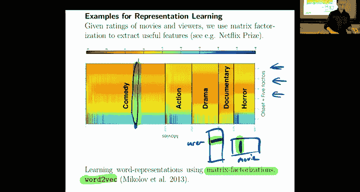

And it's a bit debatable if the recommend system is also unsupervised or not because people at least gave his star ratings so。

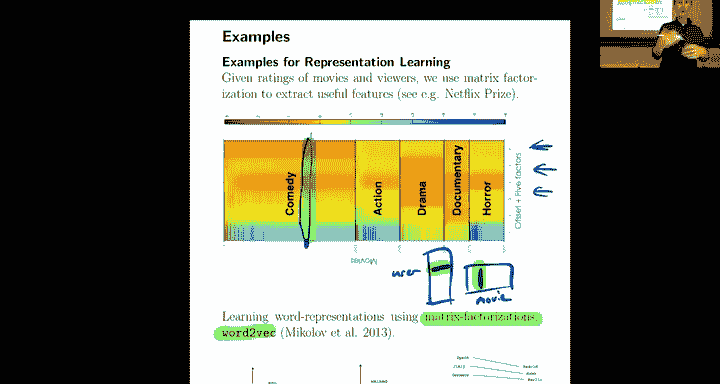

But we will get more to that later。呃。

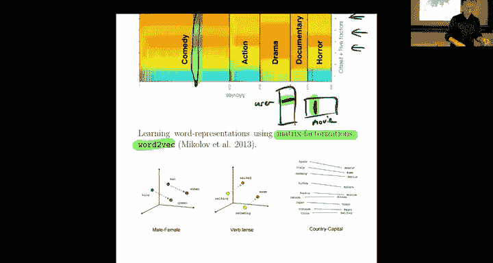

And here is another。Type of data。Which you it's just trying to understand data from from。

From all individual villages and towns in Switzerland。So， these are。I don't know how many。

Maybe some thousand or so villages， I know the in the US， there are 3000 counties。In Switzerland。

 maybe less， but you can try to analyze them and。Here。

 what we look at is the the voting pattern of each of each county so or each town。This this every。

few months， this a referendum people vote on something。

 and then this village will vote a bit differently from that other village。😊，But what does it mean。

 right， We don't， we don't have a， we don't want to use annotated data here。

 We don't know the meaning of these votes， or this。Even that。

I think maybe it's 200 votes which have been done by every city here。And can we still understand if。

 if these， these different villages vote completely differently from others without understanding what the。

 the， the votes actually mean。And so for every village， we have a 200 dimensional vector。

 which always says like yes or no which is set for each vote。😊。

But we cannot easily visualize 200 dimensional data。

So what is on here is a principal component analysis， which is also something that we will discuss。

Next week， because it's really similar to。Other representation learning techniques like work to work and。

And all those things。 So now， now people are more familiar with work toten Dar with PC A than used to be the other way around。

 but。They are almost the same， so。Anyway， what was done here I said， yeah， this。

 so number of villages times 200， which is the number of votes that matrix was taken。

And then the two first principal components were are computed。And then。

We only have two features per village。 and that's the colors that you see here， so。

And these two features， they are trying to explain the。

The biggest directions or the biggest variations。That are present in this 200 dimension data set。

 and you can see that。If you do it， then you actually see。A bit more clearly that， yes。

 there is systematic differences here， for example。

 between the German speaking and the French speaking。Regions and maybe to some degree。

 the Italian speaking one。As well。So this is a principal components analysis and we。

We will get further， more formal into this later。Just a teaser， so to say then。But the cool thing。

 again， completely unsupervised， we don't need to understand。Anything about these votes。

 we can just take the matrix which is there in nature。And basically factorize it and we are done。

No labels needed。Here is the same thing， again， principal component analysis， which you'll get to。

 it's applied on a very different data set， you can do this in biology。

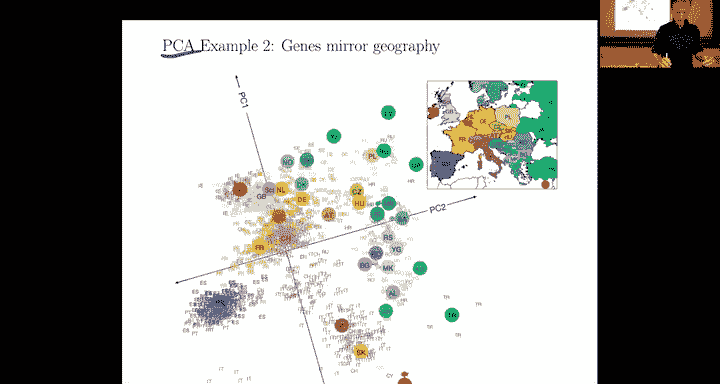

For any kind of organism， you can take the。The， the genome sequence。Of each individual。

And without knowing anything about these individuals， you can just take this genome sequence。

And then do a PCA on all these people， which are all。In the same database。

 you have no idea about the identity or any any side information about these people。

 just the genome sequence， and then you do PCA on it。Again， the first two principal components。

And then you see， you look， you， you。Every data point is， is represented by the two。First principle。

Features and they interestingly seem to。To also mimic some some reasonable balance is there was zero geographic information used in this data set。

 but using PC， you can discover that there are。Paeds in in the data。 And you can。

 it's easier to understand two dimension data than these to understand the。

A million dimensional data。 or it's， well， a genome is even much longer than a million features it can be。

Many， many。More of that， so。

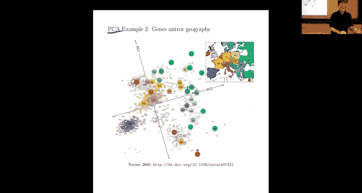

But it's just an example， so we don't want to get into it。Into the。

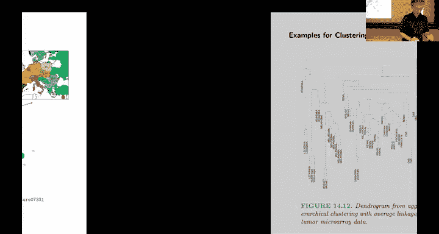

The domain specific aspects here。So that was basically dimensionality reduction。

 The two things I showed you or three few。Even the the recommended system and text as well。

Here is one which is a bit different， which is clustering。

 I'm sure all of you have heard a little bit about clustering。It just means to group data together。

And this example here is a hierarchical clustering。Which means。

Some groups are then again grouped into bigger groups， so for example。Here and then。Yeah and so on。嗯。

So this is anarchaical clustering of。Again， biological dataset sets with human micro radiator。

 which is also related to。Not the whole genome， but just a few， very few。Specific positions。

And then from that data， it's also not so clear what is the precise meaning of each feature。

But what we can still do is we can say who is similar to whom， right？Here it's about cancer。呃。

Probes from biological tissue， and then the closest ones you group them together。

 and then you can also have a more grouping the grouping is justified。By by a similarity function。

 which is usually just a Euclidean distance。Like you can use all those similarity functions。

 and then you can form a grouping or a clustering。Of what is。And that's。

 that's what we're gonna discuss in the second part of the。Of today， not the hierarchical case。

 but the standard clustering methods and the algorithms here。Yes， just a few examples。

Clasroom is really wildly。Used for all kinds of applications。 So here it's about。Scientific text。

 you can use it too。Text is also very， very high dimensional data， which is very。Difficult to。

 to understand every particular aspect of it right and you。

Very often you have text without clear labels。For what you are interested in。

 So text is high dimension。 and there's a lot of it。 So it's a。

 it's a perfect application domain for unsurerprivised learning。

And maybe the very easiest example for super learning is just to do this clustering。

You can and you can see that he does。These are some all the papers right。

 but it really can can help you to get a better overview if you have a very， very large data set。

 You cannot look at every data point manually。Then then clustering can help you。To。

 to get an overview and then maybe maybe once you have these groups。

 then then it's easier for you to do something further on， maybe two。

To decide what you want to do or to do some supervised learning afterwards or or to use this cluster。

Names as a as a feature for other purposes。 So there's many。

Many options what to do with it and also for data exploration。So yeah， that's clustering of course。

我你。This is only text， but there's many， many auto data modalities you can do it。

Then maybe I'd like to spend just maybe 10 minutes or so on some more advanced applications of fund super learning。

 which are a bit more。Related to a deep learning as well。

 And there's really a lot that has happened in。In this area in the last 10 years or so。

 so it's quite。It's quite amazing， right， because clustering is much， much older。

 it's always existed and the same。😊，For linear dimensionality reduction， we all kind of know that。

 But there's a few very instinct techniques， which are。

Which have become much more impactful and more common now now that VFD plumbing。

And it's not so much about this architectures and so on it's really the key the key ideas here is always like what do you learn from right。

 what do you want to predict from what such that it helps you learning something。

So it's not about how many layers you need。What is the signal you can learn from？And。1， of course。

 very。Very kind of obvious idea is to， to do。Compression and reconstruction。Which just means that。

 okay， I， maybe I try to squeeze my original data into a。Into a smaller representation， for example。

 you have image with this one image going in the left。

 it goes to a bunch of layers and then you have a smaller a more narrow layer in the middle。So。ok。

And then。You from there， you can again go back to something which is look the image space。

 so you can get again from this smaller number of features。 see， is there a network which can。

Take these intermediate features here and expand them and generate an image again。

 right which looks like a real image。And。I mean， this is just an architecture。

 it nothing special but。The， the key idea is， again， the learning signal， How do we train this， How。

 how would you change this。If you don't have labels sorry。And。TheThe really smart idea here is to。

 yeah， to just say that I want the the output image to be as close as possible too。

What was the original input， right， So that that's the reconstruction。 So you should say， okay。

 here is a reconstruction error。 It's quite natural。

And let me try to train my deep net now to refine weights such that these reconstruction error is as small as it can be。

Where theary， you can just define it on every pixel。 So how， how Euclidean distance or。

That's actually the most common。Los of the US just use a least square loss。

Or L1 loss is also used sometimes。Okay， so you just train this network。

To yeah reproduce all the data again， which sounds a be pointless。

But the cool thing is that once you have it， then。Because this inner part is so much smaller and。

You will only have like maybe 100 features here。Indeed the image might have 100，000 features。

So now you have found 100 teachers from which。You can all of the information of the image in is in these 100 features。

Because， well， here's the proof rate， right？It's able to reconstruct the image again， so。

It's it's really just， it's nothing especially， it's really just learning。Two functions。

 the compression is sometimes people call this the encoder。

It's the left part and then you learn the reconstruction， which takes the features。

And reconstruct something。As close as possible to the original image， that sort。

So that's what people call the deco or so。Encor。So if we writing。

And the right one will be the decoder。But again， the the important thing here is the the loss function。

 So what， what's the signal we learn from。 So this is an auto encoder and some this can work quite well in some。

 in some cases， really depends a bit how you train it and。If it learn something meaningful or not。

There is even even better。Representation learning techniques now。

Which are more related to something like contrastive learning。

 So I'll explain in a second it's quite。It's also quite a simple idea。But just to， yeah。

 to say again the。The main goal is to。To learn features， right？

So this is for representation learning。At the moment。

 so does there exist a small number of features which capture？

All the meaningful information from one data point so and here here I found my 100 features which do this job。

 which is very nice。😊，So we will have the same goal。Also， also here， when we do contrastive learning。

 it's just a there we use a be the different。A different learning signal。Actually， this is kind of a。

In contrast learning， you will only use。An encoder。 There no。There's no decoder。

 So there's only the left part of the。Over the neural network server。So here's the image。

It goes into a unit， and then。There is a few neural networks layer。Out， outcome is maybe the。

 the handle features。as many as you want。But so this is called the encoder only architecture。So yeah。

 how could you train this？There is no reconstruction loss here。

 so there' is no image which is generated。Is there， do you see a way to？

To train this nature here with， with some。Some， some meaningful loss function。

 We don't have any labels， right。 we only we need to define a loss function only from the data we have。

 so。So。Sometimes what we do here is we。We try to， we try to define in a natural way that some images。

 they should have similar features because they are， we know that they're similar。 So， for example。呃。

Here are two images which we， we have。 We can just be sure that they're similar because they actually。

 it's not because someone has told us it's a dog。 It's not that It's。

 it's just because the the lower part。Is a part of the image of the original one， so you can see。

When you have a big image in。Of course， also all the small parts of that image。

 they should have the same meaning， right， They still have。

They still have the same meaning it's still a dog， right， It's just cut the middle a bit in a video。

 iss a question。

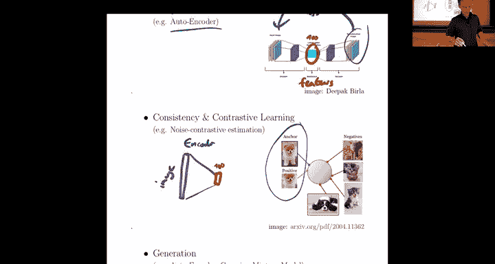

がてで。Yeah， you're saying I could， I could just use the distance。

Between two images and and try to keep it small when。Well。

 also also when when they are when they' are actually similar images right。

 But the question is in which space do we compute this distance。

 right if you do it in the image space here， it's very difficult to say maybe maybe one other image is just shifted by one pixel。

 So it's not obvious to someone if if two images here are similar。

But what we are doing is that actually we， that's what we train the right features to be。

 We train that the right features have this property。 We train that。

Those features have the property that similar images should have similar features right and then hopefully hopefully the network here will will learn to do this job right to understand that yeah when images just shifted a bit or something is cut off that then the features should still be similar and that's actually what you use as the loss function right the loss function is exactly defined here that。

Images two of them which are similar so these are the two here。They must have close features in the。

 in this feature space。 The feature space is just just very small， only 100 features。

So in that space， Euc clide in distance between two positive images， that's how we call them。

 right the ones we know are the same， they should be close。

It's a bit similar you could do this for words as well。

 if you know that two words have the same meaning， then they should be close in their features so but we don't know if two words have the same meaning。

 so it should be harder or there so yeah。Even just a single announcement。I you。그 bedroom 있었。Yeah。

 that's a great point。 Like how do we know that two images are similar And you're right。

 we usually don't。 But what people do here is that they just do some smart tricks to。

 to circum is they just from one image， it just generate some meaningful transformations。

 which are still saying if I rotate my image， for example。

 then you would agree that it should still be similar， right， has the same meaning， if I shift。 if I。

 if I remove half of my image and it should still have the similar meaning， right， So that's the。

So there is kind of transformations that people， this is a bit of。

This needs a bit of domain knowledge， right So for words， I have no idea how to do it。

 So but for images， people do this and it works really well。

 there's quite some natural transformations you can do and say that yeah。

 then the image you still have the same same kind of meaning and also it's very robust right It's not it doesn't need to be perfect right。

 It will get many of them will。It be wrong， but it doesn't matter right。

 You will still learn a very meaningful representation that the features often will will carry the meaning。

So the yeah， how to get this positive。 So this is some。Transformations of。

 of real images of this one。Anchor images which which we have fixed。And。Transformations。

And then the auto part is the negatives。 right。 So here， that's easier， right。

 Which images do we want to not be close， right， And here it's， it's super easy。

 So if they just take。Take any image of the world， which is just。Not the one you had， right。

 there's billions of images and。The， the John， you'll just take a random one， right。

The chance the random image here is exactly the same meaning as the image you had in your hands here is almost zero right so you can you just use these negative samples which how we call them。

Yeah， images which you're pretty sure that they have nothing to do with， with your。

Your current image and those you want to be far。 So， so those in Euclidean distance have。

A red feature vectorctor， which is far away and the ones which you think have the same meaning they should have a feature vector close。

And that's a。That's how this encoder only neural network can be can be trained。 But still。

 there's a lot of research work going on here and trying to find variations of such techniques to find better transformations and do。

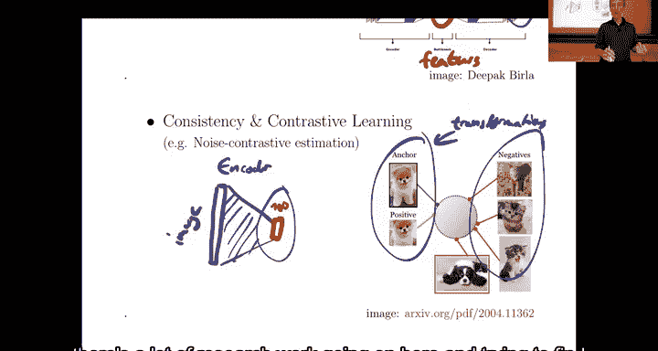

Different ways to do this sample， the negatives and the positives。So， this is not a。

It's not out of the box。

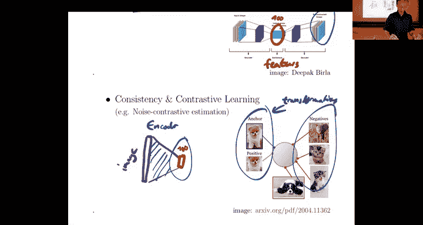

Finish thing， but it's really nice and kind of powerful because certainly we have not used labels here。

 but it need some domain knowledge to understand。Yeah， can I at least have some similar data。

And then， yeah， actually。You know， the a lot of the deep learning work。

It started a bit in in 2012 when there was this imagenet。Kind of they call the imagenet moment。

 right when when deep nets were first time really getting much by the performance and the traditional methods。

😊，I mean， there's many。It was kind of a gradual thing。

 but still happened within one or two years quite quickly。

But then everything was completely supervised。 So there was nothing like that， right， There was only。

Okay， that's， it's not completely true。 but so most of the。

Most of the methods were supervised by this， the image that data has been labeled。 This is a cat。

 This is a dog。 This is， I don't know。 there are actually 600 types of dogs or something in that data set。

But there's a thousand classes。There will be a lot of talk， I don't know。

There's lots of what I want to say is that everything was just based on these human labels。

And here this is different， so what we can do now is so this whole part here is trained completely unsupervised。

And then we use those features， the red ones and then。From those features。

 hopefully you will have a much easier job to solve。A supervised classification tasks。

 such as imagenet。 So you just take this unsupervised task。

 you take those those unsupervised features。And then， on those。You maybe。

 you might be seeing need a few labels for， for whatever you want to do。

 but you might need much fewer labels， right， you you can。

 you can just use a very simple model on top of these features。

 maybe just a linear classifier on top of this。That's actually what。What is done nowadays too。

 you can get almost the state of the art performance on image classification。

By a very smart technique like this。 And then after the red features。

 you only attach a linear classifier。 And that's all。

 So it's kind of restricting yourself that you want to use。As little supervision as possible and see。

 can you still learn， right？So it's actually this is much more interesting right。

 can you what you're asking here is。😊，Can we learn from fewer labelers。

 that's a more interesting question then。Can we learn from a bigger data set， right。

 So it's actually。If you get the same accuracy on the same data set。

But you have used much fewer labels。 that's actually it's a very cool result。

 right that's very impressive if you。😊，If you get， yeah， the state of the art。

 the image that accuracy， but you have only used 10th of the of the labels。That' where they， right。

 they'll be nice。Because then you need less specialized manual supervision。是吧。Okay。

 this is just the idea and this is contrastive learning。You can also do this in videos， for example。

 in a video， it's also quite clear that。The frame at at this moment and the next frame and one step in the future。

 they should be similar， right， And then。A completely different frame。

From an hour away in the same video is maybe not gonna to be similar。 So those uses your negatives。

And actually， also in words， the。Okay， I can correct myself now I know there is a way to do this for words。

 so you can say that the words which are next to you they are related to you and the words which are very far from away from you in in a text。

 I mean， when they're like on two pages further in the book。😊。

Then those this is a word which is not related to you right。

 so so there it's actually the same technique which is used。

To learn feature vectorctors for words in work to work， it's the same thing， you just say。

The ones just next to you， they count。To they must have seen our representation to define you and the ones which are far away in the text。

In。Three pages later， they don't count， so they are the negative so so this idea。

Also can be used for text in some times， so we will actually get to this。InIn two weeks。Okay。

 so this was representation learning just to give a。Some。So my dear， right。

 the dimensionality reduction was also a case of that。But then。

Let's not forget that this is one auto technique， we mentioned it， which is generation。

 which is completely different。诶。From us here。So you can， you can just ask。

 can I learn a neural to generate data， which looks like Ri， So that's。

 that's a bit a different idea。So。So this has nothing to do with the parts here。

 so here we certainly don't generate any data。呃。Although here we kind of do， right。Here。

 the second part is actually able to generate data。You have gone to the features。

 and then you can use the construction network so that from any features you give it。

 it's able to produce a image， right， So that that again， is a bit like a。A generative model， so。

So this。And we will discuss a few more of these as well so。Okay。

 generation and representation learning。To summarize it the。The examples we have seen。

We have seen the auto encoder， right？There's a few more variants on it。

And what I want to do here is I just want to emphasize some of them can be used to generate data and the orders they are just here as representation learning。

 it just means that they give you very good features but。

Maybe the theseses do not generate fake data。We discussed representation learning， right？呃。On images。

Video and so on， so。Text and also time series is also very nice。

 I think it's an interesting field can you can you if you don't know anything about the time series so much time series data is around right anything that that happens is often happening。

😊，In a modality where there's a time component。Sometimes this is you have data at the regularly space time interval while。

 sometimes not， sometimes they're irregular， so I find times here also quite interesting if you can do some kind of representation learning on that。

Again， usually you don't generate something there。And then。Language models。

 this means this is a particular type of。This is a model whether the neuralnet or any kind of model。

 which generates text word by word。Youll give it a few words， and then you can continue the text。

 so that that's a language model。 So those are also generative models。And auto models。

 which take sequences of words and maybe translated to another sequence of words in a different language。

Which are also kind of generative modelss， because they can。Generate the language。So， and finally。

We cannot finish this。First hour without mentioning guns。 So generative adversarial network。

 So this is really。Maybe nowadays， one of the most common ways to generate data。

 And it's pretty cool because it's such a。😊，Sple idea。 So again。

 can you teach a network to generate data if if you don't have any labels， So how would you do that。

 How would you， How can the network clear on。What is real data and what is fake。And this is。

You might like， why do I even care about real or fake， right？ But this， if you look at。This。

 there's so much。Structure， which is a。The， the images we have natural images are so different from。

 from just random points in that space。 right， it's， it's vastly different。 I mean， the。

 if you look at an image， it has a million pixels。And if you look at the same million pixels。

 but they're just random， randomly filleded。It's not the， it's not the image makes any sense， right。

 So there's so much。Heidden structure about the world， which is。

Which is there when we talk about images， photographs， right of something。And but how do you。

 how do you teach network that。That it can do that。 It can understand。

To generate some realistic looking images and not just random noise，And the way you teach it， I mean。

It's a bit， it's a bit similar to this。 It's a， this is also a bit like。呃。

TheThe closed ones versus the arbitrary ones， so here we will do something similar to train a network。

For real against fake。And so。

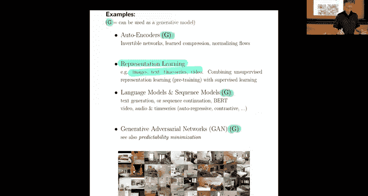

Yeah， I don't have much space to draw here。😔，But it， but it's really simple。 You yes。

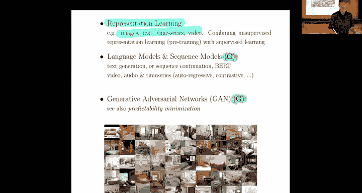

A generator。Network。Which outputs the image。And then you also have the real images。

Someone gave you a data set， a bunch of real images。So you have two kinds of images， ones from。

From the real and one。One type of image is these fake ones， which generated by this guy by this。

Generate a network。 But how do you train。To generate the network。So the trick here is to。

To use a node network So that to kind of have this game situation that2，2 learners interact。

 That's also a really beautiful idea that so some learning can be done by providing additional interaction。

 right， interaction a bit。😊，A bit more nontrivial than just。Give me a label， is this a cat or a dog。

 right， so， but something a bit more interactive here。 And the game is simple。

 It's just a generator generates the image。Disriminator has to tell。Is it fake or real？

And if you do a bad job as a generator， then it's very easy for the discriminator network。

To do this correctly， right？So and if you and the point here is that these two networks are trained together。

 so the generator tries to。To fool the discriminator。 So there's a low。

Performance and the discriminator tries to have a high performance in detecting the fake。

And this is just added up are these two objectives are competing so this is the game right the generator tries to find the best weight for his job and the discriminator tries to find the best ways for their job and it' strange just gradient descent。

And as usual， and it's just here， the nice thing is that the。

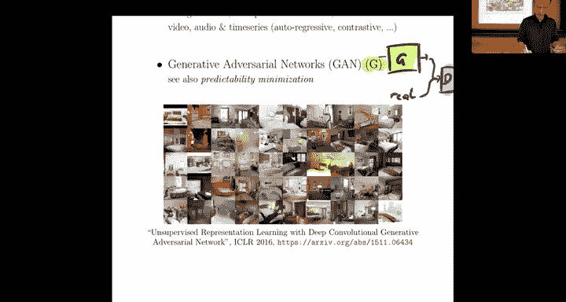

two they go together right it's like one function applied after the other one so you can still compute gradients for the joint thing so to train both of them。

Not， they cannot be trained separately， right， They have to be trained together when they。呃。

When they不。Here random noise goes in and here a real data point goes in and then in the end the game the loss is if the discriminator was able to to figure out if it was real or fake。

And they generate super photorealistic images。 So this is a。I should replace this by newer。

New a paper， but the。

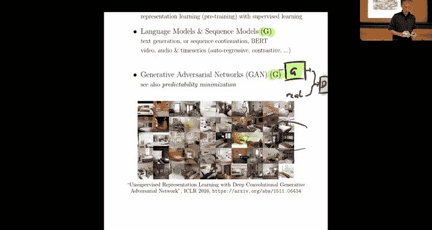

Yeah， so a few years ago， this was only like some kind of smaller resolution。

Projector is kind of not so good anyway。 So you won't see。 But nowadays in the in the last few years。

 this can be like meggaixel or even more like photoreistic images。And there's many variants of each。

 which also。呃。Try try to combine this other and maybe site information you have for。

It can also be sometimes combined to better representations。

But typically it's about learning to generate learning。learningear to generate data。Okay。

 there was the overview of unsupervised。 And after the break， we look at clustering。

 which is a bit more mathematical。 Sorry if this was a bit fuzzy。

 but it was to give some ideas about。

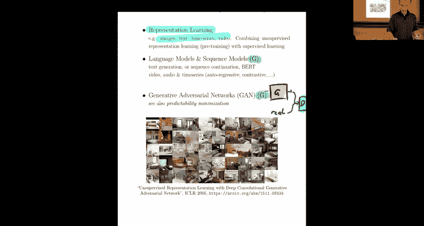

Unsupered。See you in 50 minutes。Let's get started again。So in the in the second part today。

 well make it a bit more concrete about how we can do unsupervised learning and to be a bit more mathematically precise。

 So we will discuss the precise formulation of clustering and more specifically the K means clustering which is a very simple diagram I think actually maybe most of you have。

😊，How many of you have heard about clustering in general？

I guess all of you and how many about camemeons。Oh， agree。 That's about half of you。 So I。

 I go a bit quickly on the。The definition of the algorithm because it's quite。Standard。 but。

 but then we will take a bit of time to discuss the properties and also。

Understand aably better what it's motivated by and。And I mentioned a few applications as well。

So clustering is very， the idea is super simple， it's just we do a grouping of our data points。

 that's the easy part。The tricky part is to say what is a good clustering and what is a bad clustering so what are the quality measures。

 that's where it gets more tricky。And。For for came meansians。

 this is really the most commonly used clustering algorithm and it's quite nice because。

It it allow us to discuss this a bit。More clearly on what these properties are and。And。

How does he work？So what it tries to do is to find a prototype for each group。

AProto is is meant that so there many data points in a group， but you want。You want to designate。

 like one representative。Of few the students or。Or of any any group here。

 the representative should be one data point， or it can also be a。

Maybe an artificial data point derived from the other ones here。

That doesn't need to be a real data point， we just use the mid point， the mean of the group。

 that's what we use as the representative。So that。That's natural。 and then the other thing is to。

To have this assignment， so every data point N is assigned to a group， okay？

And we have from one to capitalK， many groups。So these are the means。

 the muse and the assignments to zs。So that's all the objects we have and of course Theresa。

The original data set， we have n data points， we want to put them into K groups。

We assume we already know we have decided it should be K。Of the groups。

 we just need to figure out who should belong。To which one？Of of them so。So， there is also。

We actually prefer to write as the assignment set as a。

So here set N is kind of the one hot vectorctor。Which means it has a one where you are assigned and everything else is zero。

So said N is asking， where are we assigned， are we are data point N。Which cluster？K。

 are we assigned to so that you can say that is a。You just put a one where youre assigned and you have a。

A K vector where you're not assigned is0 where you are assigned it one。And and then。And then you。

 the same thing say this is just saying the same thing as already said。 So if。If you do that。

 then you basically have made an assignment matrix and that assignment matrix is just。

 it's one if you as data point n are assigned to k。So。Did and。Assigned to Class K。And。

And it's zero otherwise。2 k and0， otherwise。So I need to work a bit on my writing。😔，Okay。

 so this matrix has just a lot of zeros and a few ones， so this is the assignment matrix。

So we don't know the perfect assignment， right， our job is to do now find this assignment。

 so but we just that that's how we really parameterize it。And then， the。

Here is the entire definition of the algorithm。It's actually an optimization problem it's trying to find a good assignment and here。

 what do they mean by good？So。嗯。It's， it's quite simple。 It tries to give you the intuition first。

 it just tries that。Everyone's distance to their representative should become small。And that's it。

 so。So you're trying to minimize the distance of everyone。To their representative right。

 and what what does he mean they representative that's。That's this， this mean vector Okay。

 we'll see in a minute。How we define I mean， you just start to find。

Some representative such that everyone belonging to that one is。Is close to the representative。

And that's it。 And now you just try to find。Optimize this right。

 minimize this that the whole data set with these K groups has the smallest systems of everyone to representative。

Here' is the assignmentmatics， here is the representatives。You can。Both can be learned by you， so。

So that's the， the key means。Optimization problem。But you need to respect this bunch of constraints。

 you need to respect it。Everyone should be only assigned to one group。

And everyone should be assigned to。Exactly one group。 so that's that's this thing on the。

The assignment matrix。Has has this constraint right that。Your data point N。

 when you sum up all potential groups， you could be your assignment can only be one right so all the else you have to be zero so you're only allowed to have001。

In these assignment variables and the muse it can be anything。 so mu is just a continuous。

Vectctor one representative per group， and that's it。So。Okay。

 the optimization problem looks kind of easy。 If you just look at it。 I mean， this is super easy。

 It's。It's just a quadratic right， so this is the nicest functions we can have。

 they're perfectly smooth and nice and easy to differentiate。😊，So that's the easy part。

 the tricky part is the constrain。This is nothing， right， They can be。 They are unconstrained。

 but the green。Assignment variables they are constrained。

 so this is actually a discrete optimization problem。😊，So that， that makes it a bit tricky， so。

And another question is， well， is this joint thing。

 is this going to be still a convex function here or not？We might also come back to that。

But it's the the task is clear that we need to find this。Mean vectors mu and the assignment Z。

Does that make sense？I haven't told you how to find them， right。

 I just I just told you this is your goal。We want to minimize everyone's needs to theirpresentive。オ。

Then。So how to do it。Actually， bad news。 you cannot so。Where you can， but this is an NP hard problem。

The the problem to find this assignment set and the mean such a places is all minimized。

 this can be super hard， right so。呃。I mean， this is a。

It doesn't mean that every real world instance you encounter is going be very difficult to do。

 but it means that there are instances where if you can solve that came in from then you can solve every other problem in complexity theory of the MP class which we know is quite a hard hot task So this is bad news so it's definitely not the easy problem。

And。The good news is that there's still very simple algorithms which do extremely well。😊，And。

 and yeah， so the。Why it's NPR is because this is discrete。Very goes。这么都。です。

These create variables are hard to optimize because it becomes an in teacher programming problem for those of you who have。

Heard about it。So it can be hard， but in reality it's often really easy also maybe they don't care so much that we get the very。

 very best clustering， maybe be're okay to get a good one because anyway it's a bit unclear。😊。

What is a good quality measure if if someone gives you a clustering and grouping。

 how are you going to be sure that this is a good clustering or a bad one so thats it's not an easy thing in practice anyway to decide on quality measures of clusterings so maybe maybe you can get good ones even if you cannot get the best on always。

And yeah， the。Even if this is hard， there's very simple algorithms to at least get good clusterings。

诶。Yes， I should have explained this double sum a little bit。But we， we will get back to this later。

 right， this， this part here is just。Why is it sum both over n and over k right so the sum over k is a bit strange right because for every data point n。

 which is one account once how far is it from its center so but this this is taken care of here because the assignment is always here except when you are assigned So what's in the blue part here is exactly the distance。

Is only one of these distances of U XN。To your assigned center。

And the assign center is the mu K right， so only that K which you are assigned to。

So this is going it's just this fancy way to write the the one distance of one point to the center and we will come back to this。

When， when we discuss this actually， this is。Very nice problem structure it's actually the same as a matrix factorization problem as well as we we're going to see in a minute so。

😊。

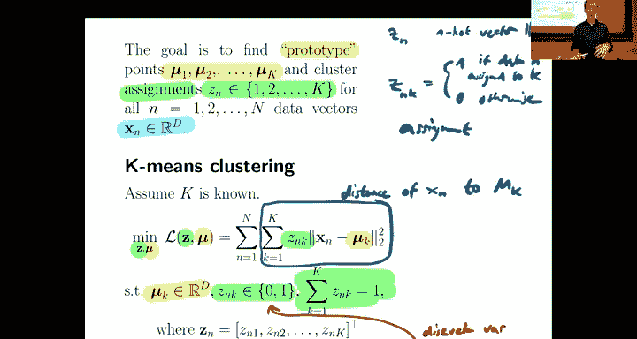

Okay， but first we want to talk a bit about simple algorithms to solve this。

 and maybe most of you know。The simplest algorithm already， which is the K means algorithm。呃。

And that's it's really nice。 You just randomly initialized。The centers new， so。Means algorithm。So。

And the assignments。How do you， how do you do assignments， So there's a very。

Once you have some candidate sentence then the assignment is super simple。

 you just assign everyone to that representative which is currently closest。

And then maybe the representatives are not the final ones。 So it's just the ones we have now。

 we can assign everyone to。That that representative mu， which is closest。Given all your absenttive。

 find the data assignment which brings 0 into closest and then step2。

Can we find better means and we will see in a second。How this is done。

So the assignment step is step one is the assignment step so we can see here。

So what we have on the left here is the data points are not assigned yet。

 that's why they agree and we like to assign them that's that's why。On the right。

 they become red or green or sorry， red or blue， which means they have been assigned to。

One of the two cluster。Groups， so。So the， the means here are。

Here is they are just randomly positioned， right， The means have just been。Given to you。

 you need to deal with them， they're not the best ones yet。 So mean vector1。

 mean vector 2 of the two groups。Everyone who's closer to mean vector  one will be assigned to blue and the other one will be assigned to red。

 so that's the assignment step。Step one。That's very simple。

 you just need to compute everyone's distance to both candidate centers and then go take the one。

 which is。Cloer。So and that's if you want a fancy way of writing is this is which of the two ks do you pick the one which is closer to your accent。

 right？So that's the assignment step。Any question on this。Then， we have。

The second step is just the mean of this step。And step two， that's again， very simple。

 So the second step is the。Update the cluster to send us step or I don't know what。How you encode it？

Upd the。The representatives。So it's a new update step and the first step is kind of the Z step updating the assignments Z。

Okay， how do we update the muse so now we have the blue group and the red group and obviously you can see that the centers we have before are bad representatives of what we have。

So you change them， hopefully the you， as we said very initially。

 you want the representative should be in the middle of the current group。 and that's， that's it。

 That's how you update the centers。So， that's。Everyone from group K， that's what they have fund。

On the top here， everyone gets averaged， so everyone's vector xn， who is assigned to k。

They get summed up， and averaged。And the denominator is just。

Counting a number of people or number of data points assigned to。2 plus2 k。嗯。Oh yeah。

 if there's any question on Zoom， I'll try to take it， sorry。

People on Zoom don't please ask questions， I'll try to answer them。Okay。

Just a fancy way to say that everyone compute the image of their group and that's the new。

The new means。Okay， and then we just so if you just do this one。

 so then now these are the new centers。It seems already better。

 but then the trick is to do this not only once， but repeat these two steps many times。So。

 here is what I said。Now， the blue mean and the red mean。Has been。

Adjusted to be the center of their groups。So that's all。

We will maybe study a bit more how this really works。

On an example and you also can do this on the lab。But you will only get this one next week。

 so you have time to。But then if we also get the same data set as we have here。

 that's also for you to play with the lab。Any question？On this one。Then。

What I want to just briefly discuss is how much， yeah， how expensive is this argument。

 So also is a question。Can we get stuck， excellent question， so yes， we can get stuck。😊，This says。呃。

Yes， it depends what we mean by stock， right？ but actually I will get back to this。 Yes。

 so at some point， the the assignment will not change anymore。

 but's that's usually when you would stop the algorithm。

 And then the question is where you stopped was it this the best cluster you can get or did you just stop in in a local minimum so to say。

 So we will get to that， Yes， you can。😊，You can get stuck but okay。

 so that means I cannot tell you how many steps of this do you need right until it stops or until you're stuck or until you find the best optimum we don't know but what we surely do know is how much do we pay for one step so。

Maybe this is a question for you。 So order。Of how many operations do we need to do one step here。

 so here this is the Z step to find the assignment。Here is the definition of the set step。

Find everyone's closest representative。Any suggestions， how many operations？So in this K groups。

 this and data points， there is D dimensions。说嗯。So these are two vectors in D dimensions。

And there's a bunch of candidates。How would you do this nicelyly。系。I hear k v。

And that's per data points。 so also。Okay， so for one point in。嗯。How do we find the closest center。

 right you just computed distance to all centers， we actually said this。

And then you take the one which is shortest。 So here this is K candidates you need to compute the distance to。

So this is a K times D， as you said。But then you have to do this for every end so it's n。Times， KMD。

Do people on Zoom agree？Does is walking through a high dimension。Does he work in high dimensions。

 Yeah， he works perfectly fine， but。😊，The same caveat appears。

 I cannot give any guarantees that this is going to go to the true optimum， right。But but yeah。

 having， having higher dimensions is usually not a bad thing。 It means you have more freedom。 So it。

 yeah， it should， it should work fine。 How do we initialize the centre points。

 That's also a really good question。 There， There are a lot of research papers on that。 It's quite。😊。

It's also tricky。 I cannot。Cannot give a good answer。

 because if you already imagine you initialized the sentence already close to what would be the。

 the the best assignment。 then then you were lucky， right。

 and then you would even go to the true opt。😊，But it's， it's hard， right， I mean。

 whichever algorithm you have， which you think is your favorite clustering algorithm。

 you can actually use that。To， to， to find good starting points for， for this one for K means。

 So if already someone gives you a grouping， then those means you could use them here as a starting point and then see if the k means are wood。

Would improve the clustering even more， or maybe it's， maybe not。 maybe it's stock or， but there。

 of course， many clustering algorithms and and every clustering algorithmilla produce an assignment Yeah。

 So here we just talk about。The easiest kind of or this type of easy algorithm。ok。诶。Yeah。

 these were two side questions because you guys don't like to compute this。Complexity numbers。 so。

 but we have one more to compute。 We need to compute how expense we to update that means the second kind of step。

😊，Any， any ideas about that。 So I have K of this mean vectors need to compute them， yes。Yes。

 you said noms km D， actually the same。As we had before， and that's correct。呃。Because， yeah。

 you have to。To。Every data point has to be summed up。Right， I mean。

 depends this is how many people are in this in each cluster。

 but overall every data point has to be summed。For every cluster。

Maybe there's some small optimizations that can be done， but naively it's。It's this。 So this is。

It's okay right it's linear in every parameter linear in number of points， linear in dimension。

 linear number of clusters。Not too bad。 but if all these numbers are big， then。It's not going to be。

Okay， and。Then we come a little bit to your question if you get stuck or not。

What's interesting is if you do this， then。At least every iteration。

 you actually make this loss function a bit better， so that's nice。By loss function， I mean。

 the thing we defined here， right， that we said。This superior deal。

 we want to minimize this function， but it's very hard。But in every step。

 you bring this a little bit lower。In every step you make small progress at least。

It decreases the cost， the L of。Depending on the assignment and the means。

So you make progress in every step， so you go down， down， down。And then you stop。

But it doesn't mean that you， you might be at the true optim yet。 so we， we don't know， right，You。

 you， you might stop here。呃。So I'm not able to give any proof if this goes to a local minimum or to a global。

Mimum， so this already suggests that maybe this function is not con and actually it is it is not。呃O。

And what is happening here， actually， there's a。One although nice way to see it。To again。

 connect be better to what do we want to minimize， So what's happening。

We said we want to minimize the L and what we are actually doing is that we first we update the z and then the mu。

This two types of variables， and you can see this as a。Coordinate descent vessel。

 which what does it mean， It just means that。One group you fix。

 you don't touch and the other group you minimize。That's what coordinate S does。

And here it's over the whole block of coordinates。So we said it's a bunch of variables。

 but the point is that we only optimize over that。And the mu， we keep it fixed at the。

That's the current step。And then in the， in the next step， so。And the next step I do the opposite。

 I'll do it for。

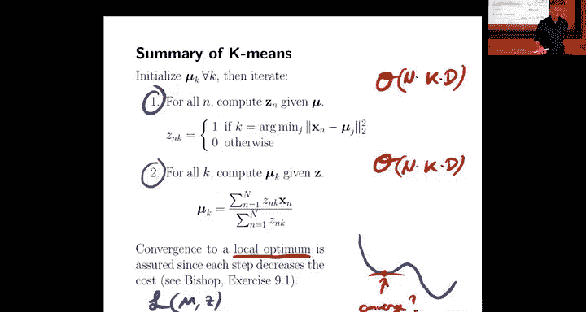

For the the means， so。

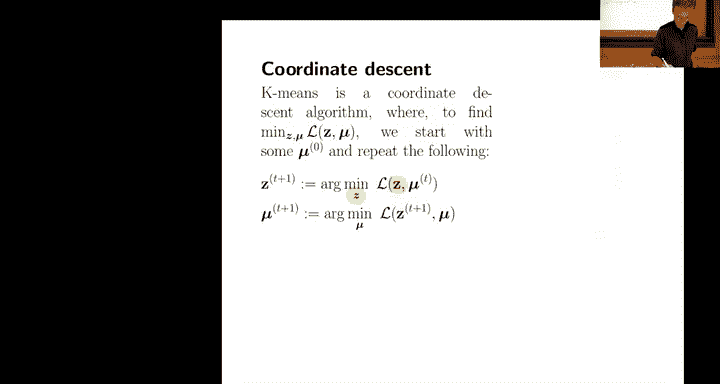

So in the second step， I ever do it for the means。And the means are green， and the assignments are。

Yeah， yeah。 something in these colors， so。So the the idea is。

You you only optimized the assignment in one step right so and that that can be seen as completely minimizing this function or it can be seen as doing a few gradient steps maybe。

Maybe only on this set variable and then。And then when you update the means。

 you only touch the the mu。Vararius。And those actually， you， you completely optimize， so。

 if you want to think about this。Then you can see that。So if you do this perfectly。

Perfect minimization of mu then you have the means updated， the mu update of K means。

Because it's really， it's the best you can do so。There is no better thing to place your means if the assignment is fixed than to。

 to make them actually be the the average of， of each group。 There is no other。

It's just a geometric property。 The， the point which you minimize this distance。

From everyone is actually the point which is in the middle。Its we have seen this， right。

 We have seen this in the one dimensional case as well。 Then we are which point。

Is closest to everyone。 That's when we did the。L1 loss function。呃 then。Sorry， L2 actually。

It doesn't matter it's the solution to both of it。Who is closest to the whole data set？In L 2。

 that's the mean。 If you're in one dimension。 And also， if the dimension。

 if the distance is summed up， then it's the mean of this。Group of points， which is this point cloud。

 which represents one。One group of your clustering。So that's for the mean update。

 the assignment update is a bit more unclear like how much progress do you get when you change the assignment this is harder to say。

So we're not making any claims there， also it's discrete， right， just not。

 we can't just do a gradient step。But here， things are nice and we perfectly optimized the new。Okay。

 so I mean it's nothing here right， it's just saying this argument we have seen it can be interpreted equivalently as as coordinate decent。

 which is kind of natural。So。真。What we should also not forget is how。

How do we find the number of groups K， Is there a good a good way to choose K。

 how many groups that's actually also quite a difficult。Quion so。呃。How to said gay。And。There， yeah。

 there is not。There's not much rigorous theory that I'm aware of how。How to set a perfect K。

 which we can justify that it's a good choice， right？Because。

 because it's not so clear what the quality measures are anyway， what what are good clusterings。

 what are bad clusterings， so。If you just look at the lost， the one we defined， right。

 this is just everyone's distance to the representative。Then。Yeah， what do you think。

 then if you just say which K will give me the smallest loss。

What which kid do you think would be best。可不さ。The second key。Yeah， yeah。 you say K equal N as many。

 as many groups as you can as that's correct。 Yes， yes， the more groups is always better。

 it's kind of intuitive， right， you have a grouping。

 And then I can just make make these distance is smaller by taking one of your groups cutting it in two。

 or make one of the points in the group be its own cluster。

 then that point has zero distance to its its representative。

 So more groups is always better in terms of loss， right。

 but it doesn't mean that it's a good clustering。 Of course。

 everyone being their own group is not a good clustering， so。😊，呃。

But it's hard to automaticallyly say why and what you mean by good？

So what you will observe is usually something like this that。

The loss surely goes down with increasing K。And at some point， as you said correctly。

 maybe here you have a。So。Okay。So we hear something crazy happens。

 that's what you said if k equals n， then the loss is actually zero。

 because nobody has any distant from meat center。So yes。

 launch okay is always better in terms of loss， but it doesn't mean that it's， it's a good for。

For anything。Anything real。So。You want to be somewhere in the middle， but not clear where。

So it depends on your application， maybe。Maybe really depends yeah， what you use these clusters for。

 right， So maybe maybe you develop this clustering。For a certain application in a company or so。

 and they they have capacity to manually look at。11 groups， because otherwise。

 it costs too much money。 So， so that's why you would choose K equal 11 for that or so maybe costs can be an issue or or maybe what you want to do afterwards。

 So that clustering might be better or worse with these number of groups， so。Yeah， in the end。

 it's just a hyperparmeter we cannot see much。呃，一。Your choice how to choose it。

There is one small thing I can maybe mention is that。Often。

 you do observe some kind of elbow phenomenon。Which means。If you look at this plot here。

 a loss versus number of clusters。Sometimes you see something a bit like this that it goes down very quickly at the beginning and then at some point。

It starts to go down slower。So that that's actually a。An interesting。

choicehoice of a number of groups。That's not the only way， right it really depends on your use case。

 but sometimes there is a phenomena like this and sometimes then this could make sense that to say that this is a bit more natural。

grouprouping then， then others， right。If if your data is is naturally。Clustered。Like this。

 so if all the data points are really in this there's no point outside， then。

Then it will be very kind of strange to have like one more cluster this。Sorry。

 that that's not the correct image so it would be strange to。

To have a point inside this group to be its own cluster because it there is kind of a natural grouping。

 And then if you， if you make this guy its own cluster。

 then the the loss will go down only more slowly。 that's the intuition。

What would happen if you're here？But it's not always so clear， right in reality。

 the group will look a bit maybe more chaotic than。Thenhan this picture here， so。对。ok 嗯。

So that's about K means。 And maybe we go to。Yeah this this I let I let you do yourself so this is the data set you also have in the exercise next week and you can see what happens when I do an assignment step。

Gup colors change。When I do a new step I update the means。Then you can see this means change。

 of course。And then again， so you just alternate between。Assignment steps。Mean steps。

Assignment steps。And so on。 and you can see the clustering becomes more and more natural。

 like here you are surely not the natural。😊，Assignment to colors。 And here the further down。

 we go the。The more natural the。The clustering looks actually so。And then when do we stop。

 So that that's something we need to discuss to come back to your。Your question on when， when do we。

Do we get stuck。 Yeah， we do get stuck。 That's what you see here。 So in in this situation here， you。

 you change， you found a new means。Now you're trying to find a new assignment。And。

Turns out nobody has changed color， so none of the points。Change from blue to to red。So。So。

 here we have a。No change anymore， no change in the set。In in that。So if there's no change in the z。

 then。Then the means I had before are going to be the same as I will have now。

 right the means will also not change anymore。If nobody has changed the group。

 then the mean of each group remains the same。So that means there is also no change in the means in the next step。

So we have stopped the process。Whenever this happens then you stop so whenever your assignment stops changing also the means you stop changing and then your yeah stops forever。

 usually it stops in a good clustering that what we see here is it looks good right but it's not so easy。

To give a mathematical definition to say that this is the best one。

 and in the sense of the the mathematical。Way to say if this is the best or not is the one we saw on the first slide。

 right， does it minimize？The optimization problem。And this we don't know， right。

 We only know that these particular camee means algorithm stops。 And this a really good argument。

 and usually。It， it， it most cases， it really gets you to to a loss function。

 super close to the best you can have。 And， and furthermore， the clustering it finds。

Are are very useful， so。So that's came means a try out。In the exercise。I you。

Just give two more small things。One is a bit on to say what is it useful for？Just one。

1 natural use case。 And then we finish by。Teling you that K means also a probabilistic interpretation and motivation。

 It makes sense to use this object objective function。

 But why did we use this objective function at the very beginning， It was unclear， but this。

 this would be answered that。At the end so。But first， a small application。

And it's data compressioning。Its for images， but you can do similar things for any type of data。呃。

第 you that。Every feature can have many possible values， right for images， the value is the color。

There are 10 thousands of colors， actually 16 millions， right。

 people usually use how many colors can can each pixel can have these many colors。

So if if you store each pixel less this 16 million。

A lot of bits and bys and that's very expensive right that's why images are so big on。

On the hard drive。 So can we use clustering to， to represent images more efficiently。

 So this is a very。Very easy way to do a。A future compression。And and the way。

 the way it does it iss just a。To throw all the the pixels into a bin， every pixel has a。诶X。

Has three numbers。 So let me write what the x， what the pixels is。

So Xn is consisting in these three values。Which is red， green and blue。

And this takes a lot of space right， so I don't want。

I don't want to store all these individual values。 So so can I make groups of pixels。

 that's that's what we're doing here。 So lots of。Lo of pixels， so， for example。hundred thousand的。

Data points， that's what you will get if your image is 200 by 500。Pixs。Okay， so。

Maybe it's a bit confusing here that the， there is only one image， right。

 but this one image gives gives us 100000 data points because there are pixel laser data point。

And now the pixels will be put into groups and。What views is the distance here that the distance in color right from each pixel to the others in the group should be small。

 So just to came inside everyone in the group。Will have their representative color。

 so that's what you will get when you do this。Because。Every Google of pixel。The。

 the mu of that group will be。The average of these， everyone's， everyone's three vector， right， so。X。

 N， everything is in in our three， right。Every data points in our three， many。

 many pixels have similar colors， they end up in the same group and then I just replaced all these pixels I just replaced them by their mu so。

So the accents will be assigned to the。M and UK， of course， is also real。Thing。

 but the the good thing。About UK case is the only K of them so it's much fewer colors to store so and yeah it just can take this quite to the extreme if you only take two colors so if you。

Then the image is still kind of recognizable， not perfectly， but still。It could be worse。

If you take a k， equal call 10， these many groups， these many colors。Then it looks pretty realistic。

So you can say that instead of having 60 million。Values per per pixel。

 Now you only have 10 values per pixel。 So you have made a huge compression and。

It's it's not the best image compression， right， but it's probably the simplest one you can do。

 it's also really fast to to implement it。And。And to， to use it， right。 So， and actually G images。

 they use some variance of this as well， but some， some smarter additions as well。So this。

 when you do clustering on this pixels that's called。Back to quantization。Any question on this？

Just是 simple了。Use case。Okay， then。There is a。A small thing I want to tell you that is also a makes sense that we use these loss function。

 So the there is actually the the loss function we defined as a very。Re meaning。 And actually。

 the meaning that it has is to。To have the maximum likelihood of the data。For four hour。

Probabilistic model， What's the model here， It's just that there are K groups。 and we will see that。

If you generate data from these groups and the groups， each group is a Gaussian distribution。

Then you will actually get。That the likelihood is the Ka means objective。

 so that that's what I want to。To prove for you。But this is only true if the data comes from a normal distribution。

 so every data point。It's normally distribution around its own group， right， around the mean。Okay。

 where we assigned to？And the Gautians are spherical。 So there's not no ellipses， right。

 just spherical。Gs。Every group is a Gaussian and you X come from groupop。K so。

Then that's the likely regret probability of x， given that you come from cluster to K。So。

But which cluster。So I can rewrite this。呃。Nothing happens here。

 I just rewrite that the class we are assigned to that is actually described by the assignment。

 so I just used the assignment notation to make clear。Which K I'm not talking about？

And this might be a bit scary。 So I write this in the exponent。 I write the probability of x。

Take to that set and K exponent， that's a bit strange。Well。

 it's actually easy because these assignments are zero1， So it just means。

There where you're not assigned， it's canceled anyway， nothing is here。

Only the assignment where you are assigned， which is a one。

 only that term will count so that just to convince you that。I've done nothing。

 I've really just written the same thing， the likelihood of point x。ItComing from class to K。Then。

 I will。Plug in the definition of what is， what is a normal distribution。So。It's so。

Cones sometimes E to the distance from the center， right？So here it's simply。

 it's just going to be the Euclidean distance。X minus mu。Because this is a spherical Gaussian。

 there is no covariance matrix， so life is much easier。And then it's， it's， it's taken to the set。

And K exponent， right？But that just becomes a。A product here because this is already the normal distribution already isn't an exponential。

So that's the assignment。And the muse are here。Okay， and now okay， this looks scary。

 but we we basically finished。😊，It only looks a little bit like the the K means objective。

 except there we don't have products。 We have sums。And also。

 I don't want to just talk about one point， I want to talk about the whole dataset。So， that's。

P of the whole dataset X。Given all the means and all the assignments。And of course。

 when having one point is this likelihood， having all these data points be what they are。呃等。

You have this N random things happening together， which then means every data point， of course。

Is sampled uniformly。Independently， sorry， independently。

From the auto so that's why we have a product when you ask about the whole data。1 to end。

P it to end put it to end。Still looks very nasty， but then if I take the lock。Of this。

Actually take a minus the look。Then the products disappear and become sums and then we are done。

 and then we really have to K in objective。And that brings us。To the end。

Just the two products have become sums。When I take the log。And what do you see now？Hes really the。

They came mean objectiveive to everyone。From their center， new。He's kind of close。And。

There is a plus constant here， which you don't need。

 So this thing here is exactly the the loss function we had。In at the very beginning。

 when we said K means means to minimize。呃。Last function we originally have about the means and the assignments。

Okay， this is to motivate why this loss function， right？😊。

Because if your data is coming from normal dispute for each group。

 then this means to maximize the likelihood。So you find those centers， mu and those assignments that。

Which maximize the likelihood， which making more most likely that the data we observed has come from this this particular muse and sets。

 So that's why the K means loss function is。Uses a nice loss function。

And I think that brings us to the end， I'll take two minutes next week to tell you that Ka means is a matrix factorization。

 but it's very easy and that's it and then we see a generalization of Kmins also next week about Gaussian Mihimons。

 so see you next week。😊。

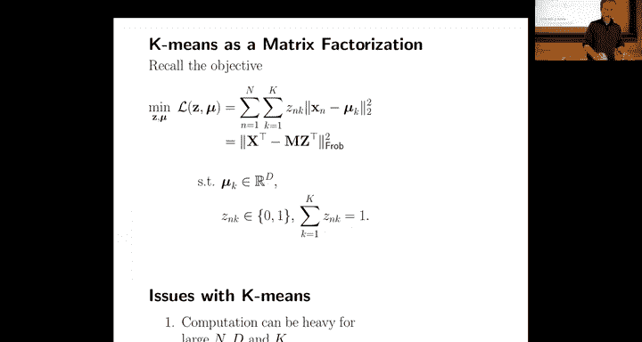