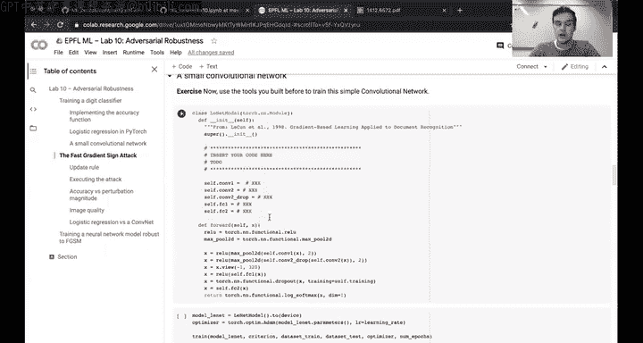
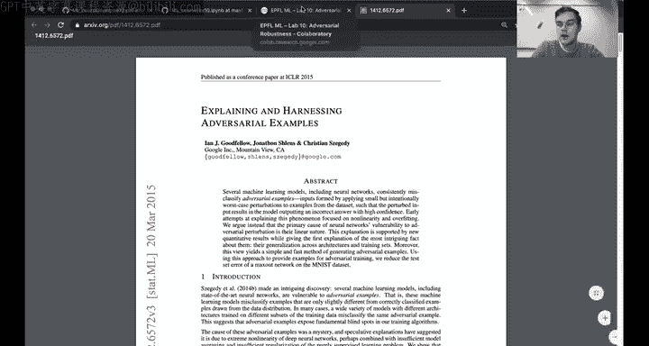
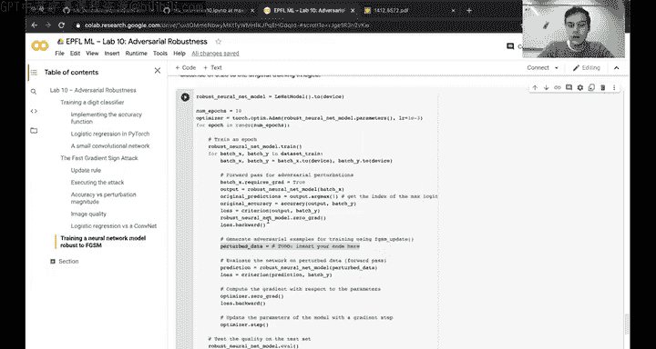

# EPFL《机器学习｜Machine Learning Course CS-433 fall 2020-2021》中英字幕（deepseek - P30：[30]Exercises 10 - getting started video.zh_en - GPT中英字幕课程资源 - BV14SwyeNEvW

Hello everyone， my name is Maxim and I'm going to be the LT of this week。And basically this week。

 we are going to have an exercise about and and robustness。

And you can find this access sheet in the repository of the course。And there are two tasks。

 the first one is about asale training on MIS， so the first one is practical and the second one is a small theoretical exercise about asale training for linearR models。

So for the practical one， this problem you will implement a training for two models。

 the first one is simple logistic regression and the second one is commvolutional neural network trained on MT。

And since it's already ammunist， so it's quite it's relatively large data set compared to the previous ones that were used。

 so we recommend to use Google Cloud for this， which provides free GPU。So if you follow this link。

 then you will go to the Collab service and essentially here you have same kind of template as in the previous weeks。

And essentially， the goal is to familiarize yourself with and resale training， how it works。

 how to implement it， and also like to visualize the resulting and resale examples and see how it works。

So basically you will start from training classifier right so we will just first train a standard model。

 there are some functions to fill in essentially as always。

 so basically there most of the code is already written right you just need to fill in a few lines here and there。

And first， you will implement logistic regression， right。

 so this should be pretty simple and we also rely completely on PytharR so theres no need to implement that propagation。

Taking the gradient yourself so you can completely rely on the autograd function of byytch。

So the first one is logistic regression and here's a train script where you have to fill in some details。

And then you implement small conal neural network， and again you'll have to fill in a few details。

 namely about the definition of the architecture。

And then we move on to what is known as the fast gradient sign attack。

 the basic equation was introduced in this paper， which is。

By good fellow and co and if you're curious you can essentially check in detail what they suggest to do。

 but there is also a short summary provided directly in the notebook in principle there's no need to actually read that paper。

So it's kind of summarized nicely in this picture， like the overall working of the FGM method right which you take the input。

 so let's say it's panda with some confidence of the classifiers。

 it was great to classify it and then you add some very small perturbation。

For which you used the gradient， the gradient of the loss， changing knows the loss。

With respect to the input and suddenly this image， which looks for human exactly the same as before。

 it has the classifier outputs， very high continents in a wrong class。Basically。

 you would need to implement this， but not on INe as in this example， but rather your own emist。😊。

So essentially， this is the update that is given for in order to find the example。

 it resembles the update that you have seen in the lecture。

 but this update is taken respect to the Lfininin norm instead of the L to norm that appeared in the lecture。

And you explore more about the distinction in the second part of this exercise in the theoretical part。

So essentially here you have to implement this update rule right so basically again we just find address examples in one step right so just one duration of essentially gradient ascent。

And then we just execute the attack and we will ask you to visualize some of the resulting a examples and essentially to build some plots based on the robustness of the model of both logistic regression model and commercial neural network under different perturbation budgets Eil。

 which are specified here。Then you also hear you will plot the aver examples so you can inspect them and essentially see whether these changes make sense for human right or whether they are just too small to actually change the class with respect to human vision。

嗯。Yeah， okay， here it's about Connet and then we'll explore how to train an neural network which is robust to FGSM perturbations。

Essentially， it will boil down to adversial training。

 which uses FGSM in order to solve the inner maximization problem so this exactly so you would need essentially to plug in here just one line so basically the function FGSM update and it would be nice if you can can step by step understand the main steps。

Ofll sale training and see essentially how it works。

Then you would again plot this robustness curve differents over different participation budgets and you draw a couple of questions related to how much robustness has improved about the trade of between robustness and accuracy and so on this is the first part of the exercise and the second one is a theoretical one so it's about exploring aial training for linear models。

And here the goal is。To understand what is the close form solution for the inner maximization problem for linear model。

So for an arbitrary loss function L， which is margin based and which is monotonly decreasing Okay。

 so this includes。Very familiar loss functions， some eclinggsistic loss or hinge loss。

And well also ask you to draw maybe on connections to something that you've seen before in the lecture namely softmar SVM and to discuss the differences between L2 avers training for your models and softmar SVM。

 and there's one more question about the relation between the L2 avers training and Elfinin aversale training。

 so namely how the update essentially how the inner optimizationimization problem will look for Elfininci training and how much it will resemble the fast gradient sign method that you have seen in the previous exercise。

So feel free to ask questions on the forum or on Disc card。

 we'll be happy to answer and see you on Thursday。