# EPFL《机器学习｜Machine Learning Course CS-433 fall 2020-2021》中英字幕（deepseek - P31：[31]EPFL Machine Learning Course 2021 - Week 11 part 1.zh_en - GPT中英字幕课程资源 - BV14SwyeNEvW

Cleian distance。 So today。

We're gonna allow more general clusters， so。Which can also be， for example， ellipses or order。呃。

Kind of shapes， so。This is the what you gonna do。And what that means mathematically， is， again。呃。

Coming from the shape of， of this distribution that we， we just discussed at the a minute ago。

 right here we said， that's why。

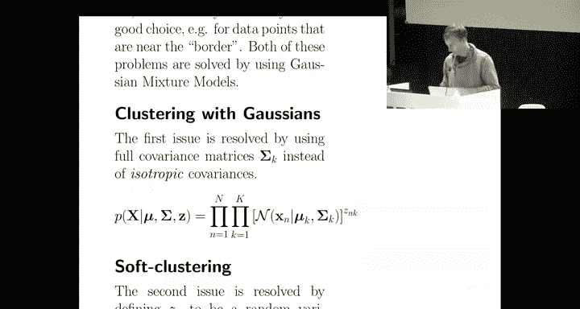

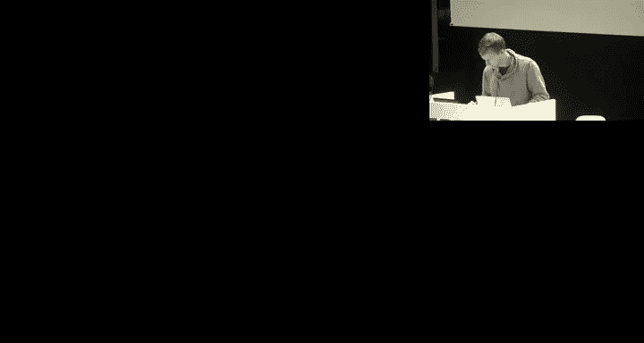

The whole model here was theoreticalpherical for every cluster because every clusters distribution was a normal distribution。

 but with a。Identity covariance， right， So there was just a spherical Gaussian。

 So that's that's what you wanna wan to do now instead of the identity have a more general covariance matrix。

 so。

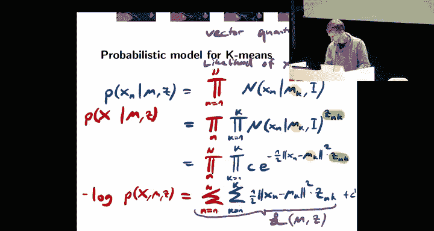

So that's， that's what we're going to do is So just plug in this more generic。呃。

Pro distribution here， which is a a real Gaussian， not a spherical one， So a general one having。

Having these covariance parameter here as well。 And the other thing is kind of the same， right。

 So the， the means， of course， they are， as usual， we have this before already。

 So it's really the same expression as， as before， basically。Also。There is the assignment。

 And that's really， again， the。The same thing as before。 So we。

 we again have a an assignment random the variable of how much。

Or how likely is your one data point assigned to each of the K clusters？

So the Z n is which cluster are you assigned， but that's a random variable as well。So。So if。

 if you think this motivation here again， then on the。On the on the left side here。

 we have that this sigma matrix， right。Is the identity So。

 so then we actually recover the K means case。On the left side， but on the right side， we have to。

Schema matrix is a。Is general。By the then， just mean the an matrix。

 And then then we have what we will have today， which is the， the more general Gasian。Mix your model。

 So that's that's what they're going to do now。So if you look at the， the expression again， then。呃。

We see呃的。The same model as before， except the the the。The covariance has become more general。

 and and now we， we want on understand this fully in a， in a probabilistic model。So， actually。

What we're gonna do is we， we're gonna also assume that the。

 the assignment is kind of a a soft assignment。 So before we were always like。

 there was a hard assignment。 So every data point。In the end。

 was assigned in a discrete way for sure to the same cluster。

 There was no randomness to which cluster you are assigned。

 So now there will actually be randomness to which cluster you are assigned。And that's。

 that's what you have on the last line on this slide so。呃， herere you see the。The sad end。

 which was just a fixed before in， in， in Ka means。 So here it's gonna be a random variable。

 So with some probability， it's gonna you gonna be with that cluster and with some probability。

 youll behave it a bit an auto cluster。 So that's。That's a big difference here。 And what the。

 what this means here is that we have。We have some kind of importance for each cluster。 So not。

 not each cluster is equally important。 is also， they also might have different。

Sizes in number points assigned to them or different importance， so。So if you。

 if you think about this one number。Which is like for all data points together， like。What's。

 what's the probability your。Assigned to a cluster then this importance here is called PK it's a number of probability。

Of of the class O。And that number also is， is a parameter which we gonna optimize。 And we， we as。

 we want that these importance sum up to one。 That's just the。technicalecical condition here。Okay。

 so what is， what is happening here。 So we have a random variable z。 And then we have this。

 of course， this normal。Distribution。 And then so there was first change。

 And and then the second changes that set is also random variable now。

 So these two changes are all that we did。 And otherwise， it just came means。So if we do this， then。

呃 what what what you。It's actually going to happen。That you。嗯。

We don't know what these parameters are， right？ We don't know what is the mu。

 We don't know what is the sigma。 And we also don't know these pi importances right at the beginning。

 So thiss like three kind of parameters。 So。The， the parameters are。

I'm just making some statistics here， so。The how， how many of each kind we have so new we have for every cluster and。

What's the dimension of， of mu so。Mu is in the same space as the data points。 their space D。

 but there are K， many of them。 So D times K。嗯，等。How many of these sigma parameters do we have so Sigma is a？

It's a covariance matrix， so it's a square matrix。So， that's in the。第八支。Which is。D squared。

And then also， there is one for each cluster so d d square times k。And finally。

 we have the pi parameteroli this cluster importances， which are。

Only one number per cluster so that's just。Okay， so these are the three kinds of parameters we have。

And we want to learn them。 We don't know them a priori so。

This is a little bit different from Kmedes and Cammedes basically we only have this。

But now we also have these kind of two new kinds of parameters， so。The the pies and the。

The sigmas and the muse we always had them。Okay， so how do we learn them So to， to， to do that。

We first need to。Fully understand how this， this model now generates the data。 So what's。

 what's happening is that。For each。If you generate， you just need to ask like， how can you generate1。

1 data point， So I wan to generate the point。X1。 So that's。Ive， I have many points， right I have x。

2 up to X n data points， which generated。Which are generated。 And for each point。

 I there's a few things I need to。Generate before。 So first。

 I actually need to generate this random variable， Z。呃。这。In。收。And this， this is done very simply。

 So the how we generate the z is， is super simple。 This just comes from this pi parameter here。

 And as you can see， that's this， it's a very simplifying assumption we did， right。

 So the the probability that you are assigned to。Cl O K， it， it doesn't depend on anything， right。

 it， it just is pie K， like 20% for the first cluster end。30% for the other cluster， for example。So。

So it's a very simplified model。 so how how you get this cluster assignment。呃。

So each n is independently。 each data point N is is getting this assignment completely independently from everyone else。

 So now you got your assignment。ItSo this is the random web which came from this pie random process。

And then you generate the x。 But for that， you also need to。To know a few more things， right。

 So now that you know which， which cluster you are。呃。Now you。

 you also need to use the muse and sigmas for for that cluster so。So， these also influence。Your。

 your data point， right， first， yeah， which， which kind of cluster are you from Once you know that。

 then you， you take the， the， the mu from that cluster and the sigma from that cluster。And then you。

You generate your data。 So this is the full generative model that it's just this error notation。

Is used in in generative models。 And what it actually means is nothing special It just means that every arrow kinda means that。

呃。Some random variable has been generated。When， when you see the error。From the thing before， right。

And this can also be interpreted。 You can say that the the thing， which。

 which comes out of the error is conditioned on the， the thing at the beginning of the error。

 So this， we will see in a second that。You can actually see this as conditioning。And what we。

 what we want to do here is we just want to understand how is our data generated from。

From these gene processs。And as we will see， the， the kind of cool thing is that。

You will kind of have a soft assignment。 So at some point。

 you'll be very clear which cluster they belong to。 So this point here is only green。

But there is also some points here， which are a bit in a mixed territory。 So this。

 this point here is kind of 50% with one cluster and 50% with another cluster。And that's the。

 the kind of new thing as well。 Why that's possible now。

 that's not possible in K means there you just either or。 But here。

 this is possible because where you assigned， that's the Z random variable。

That can be 50% there or 50% there。 So that's what the， the pi is allowing you to do。Okay。

 any question on this。So that's just the illustration。 And then if you want this inform us。

 this is also。Quite simple， actually， what we just want to understand is yeah how does this model generate data and that's that's exactly。

Right in here。So。As always， we want to， to understand。呃，gene data X。How does that happen。

From from our parameters， the mu， the sigma。And the point。And。

That's basically what we have done here， right？So。So how does this work， This is really simple。

 So again， like basically， as we explained on the picture。 So here you have the formula for this。

 You have the first。Does that assignment is is generated。So this， this is called the the prior。

 But we， we will get to this。 No， actually， that's。Let's look at this for one second。 So this。

 this thing here is， is called the the prior。Because he will tell you the probability。

That US one data point gets gets as this falling assignment as that end。There is another thing here。

 And this youre also familiar with。 So this。Is the probability of the data given the model so。

And that is called the likelihood， as we， as we know。 And then the， the whole expression on， on top。

So that's the joint joint probability distribution。Of X and and Z， so。Because the。

 the tricky thing here is that the X， of course， we have observed。 It's here， right， But the。

 the interesting thing is that the zs we don't observe， right， These are kind of mystery variables。

 which are， which are hidden。 So that's what they actually called hidden variables or latent。

Laightnt variables。 So that's that's what's a bit confusing here， because。The， the zs are。

 are not observed the。The X are observed。 Maybe uses a different color。X is observed， as usual， you。

 you see it。 You got the data set。But then the， the funny thing is that the z。

They are latent or unobserved variables。And we will see how we deal with that。

 But it's a bit funny that we， we don't observe them， right， so。Okay， and what。

 what you have done here。 So how did this come to be。后。Why。

 why was this equal that this got this product here， And that is， is really simple。 This is just。

 it's just pay rule， so。嗯。Because。呃，Because。We talk about probability of x and Z。

 So these are two things， probability of these two things。呃，意思。P A and B。 So that's a joint。

And of course， with with space， you know that this is the same as P of a conditional B。And then。P有B。

So。And what's， yeah， that's， that's really what's happened here。 But you， you might be asking。

 so what about this additional。Conditioning stuff here。 that does not matter at all。

 because this just means that there is a conditioning here on a few things。

 And that's that's actually， you're just gonna keep this everywhere。 So base rule still applies。

 If everything is conditioned on another random variable。 That's fine， right。

 then you're just talking about。All the probabilistic things that can happen in in that sub space kind of when in the space where well we are conditioning on。

 we know what is the blue stuff。So， so that's these guys here， right， sorry。呃 that new andigma。

And fine， so that's what we are condition conditioning on。Okay， so this is to explain the equation。

 And then here， of course， we just have it plugged in the definition of a normal distribution。

 nothing special。And we have also plugged in the definition of of。of， of yeah， what， what is。

 how would these latent zs be being generated。 That's just what we have the last line here， right。

 that we define that。 We define that these latent guys， they come from this super simple。

Uiform probability probability p K。Okay， that's the whole model。

 so that's what we have plugged in here and then again we have used these assignment variables。Which。

 you know， is just a notation trick， basically。呃，有。YouWe have done the same in Kimins。

They are either does 001， depending where you assign。So we， we use that to。

To describe where you assigned。And now the whole problem here becomes to maxise this likelihood。

 So that would be a good idea again， we we guess， and we， we have to find all the parameters， right。

 these three kind of parameters， new sigma and and pi。And okay， actually。

 I wanna use a blue for my parameters so。Okay， any questions on on this or。So far， so good。So。

Three kinds of parameters。All right， yes。Yeah， why is this maximising likelihood。 Yeah， that's right。

 I haven't explained this yet。 So I we will get back to this。 Like we will get to how。

 how also didn't tell you which algorithm gonna we wantan to use it。 Yeah， I just told you， okay。

 if this is my generative model for the data。 then this mathematically is the likelihood。

 But I have not told you how to maximizeim it or why to， or why to maximizeimise it。 So we。

 well get to that。Thank you。Any other pointss？OK呃 yeah。

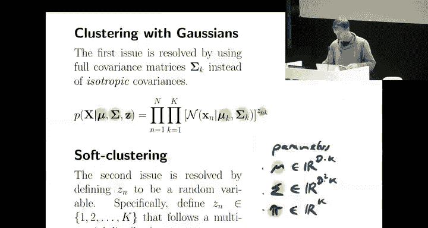

Yeah， you're talking about the the sets ands and you write I abuse notation a little bit here。

 you write the set here。 it's from one to k， right。But then on the next slide， you right， I used。

 I used set N K either。

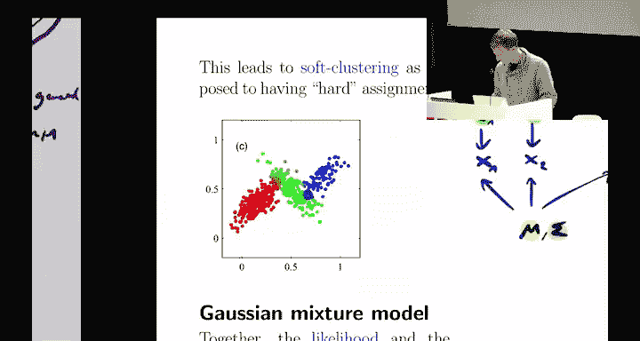

Either 0 or1。 That's， that's right， so。Yeah， shoot。Let's make a little note。

 So this is just when I use both。In the system， and then I mean that set N K is the the expansion of that。

 right So 01。Z and K。Or whatever。Or set N here is written as T 0，0，0，1。So this one hot vector。

Which has the one at position K。Position K。 So， but it's the same thing。 Yeah， So it's just。

 it's always representing this number from one to K。 where you assigned to and， and that's。

So Z and K is this， yeah， it does 01。O。Hope this is okay。Okay， so we define the probabilistic model。

 but we have not talked about yet how to maximize likelihood on how to find the best parameters。

 So now we need to talk a bit about that and。

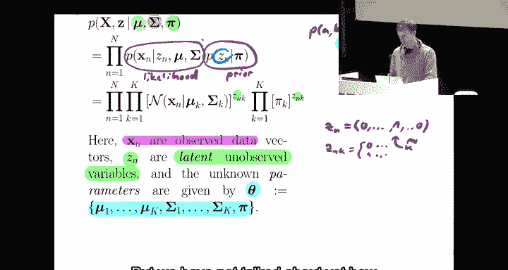

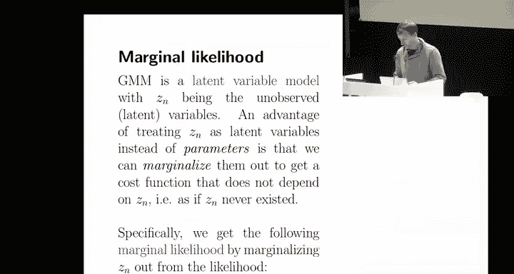

To do that， we need to get rid of these latent variables， because the。

 the big problem we have here is that the z， we have no idea what they are except that we are。

 they are 0 ones， right， But we don't know which cluster you are。

 and we don't know with which probability。 So we， we don't observe this Z ends。 This is really。

 this is a problem。So we， we want to to get rid of them。And and this is not so obvious， but what you。

 what you can do is the nice thing is about having probabilities is that so this is what we。

 what we looked at before， right， the probability of both together or the joint。So， x N z so。呃。

I would like to end as well。X end as that。And again， here， I， I mean， the set the full expansion。

 So this is the joint。 But the problem was that we don't observe the。The that so。

But what you can do is to get rid of it with kitchen chest。呃。Integrate out the z。

 or that's what's called marginalization， so。The that means that you just kind of ignore that。

 no matter what set is， it's from a random process， right， So you can see。

I will just ignore the the outcome of Z and consider the probability only of x， so。

And that's called a marginal， right。So that's， that's what。We just p of xs， right。And of course。

 you can always consider these terms， right， the question is how are they related right so。And。

And it's not， it's not hard to。To see how they are related， right， Because you can just。

If you know that this， whatever X is， right， it could be coming from many possibilities the set。

 and it's very easy to， to compute this， right， It just， it just need to sum up whatever。

Whatever the whatever cases can happen， right， so。So it's just the probability。Of thanks。

For all possible cases offset set， so。Said n equal to k。

 and then I'm summing up of all possibilities of k， right？

So this is just a definition of this probability。 Whatever can happen， I will just sum it up。And。

 and that。You can again， apply a base ruless if you want here， so。

So that you have the condition probability of x and z。Times the probability of Z。And now， this looks。

A bit more convenient。 So this actually is。By K， we defined this this way， right？

 So we defined the random process to generate these that in this way。 And this， again。

 was just by base rules。Okay。So， so the， the idea is， if I don't notice these that。

 I will just ignore them。 I will pretend that they， they never existed。And。That's。

 that's what we have done here， right？ So instead of considering the joint。

 just consider the the marginal with only looking at x， so。All right。So。

You can do this for the probability and of course， you can also do it for the likelihood。😊。

So we had the original likelihood as we are， we had on previous slide， so。The。

Original likelihood or just whatever likelihood is。If we go back， then we had that， well。

I don't need to specific form I I just。Say that was， it was the x and z， right。

X said depending on the parametersid。 So braid。This theta includes all parameters。 right all。

 all three kinds， so。呃。Here are the the three kinds of parameters， right， so。

So this is the likelihood of getting x and Z， given the parameters。呃，This is this is。

What it what it truly is， right？ But now can we do the same thing here。

 Can we just ignore does that and talk about only the x and that's and that's， yes， you can do that。

 And that's what's called the marginal likelihooditude。 So you just。

 you just take the same thing but you have ignored as that and how do you obtain it， Of course。

 again， it just sum up all possible cases so。So this thing here is。As we。

 as we have done on the top right， we've just summed up。Whatever。Whatever this set can be。

 we have summed it up。And， and then what remains here is the pie。K for a cluster K so。So this is the。

 the machine likelihood of every。in a Gausian mixture model。

 where everyone comes from a Gaussian around this cluster cent mu and this covariant sigma。

 it's exactly what we had defined here。Well this is the model to generate our data。

Wish this unknown that。 And here is the same model。If we have marginalized out thes， if you don't。

 if you don't know them， we have just。呃。Summed up all possible outcomes and get the overall probability if。

If you don't know what it would really particularly happen to each exc。And why is this good， so。That。

 that is a bit。Unclear here， right， But it's really because you don't observe the set。

 So we can also not optise them and find them。 That's， that's why we， we did this。 So， and also。

 there is another small issue about the number of parameters we have， right。

 because if you look at this model here， so。This one looks kind of nice， right， we only。

When we want to maximize the likelihood。 So let assume that's what you wantan to do。 So we have。

 we have convinced ourselves this is the likelihood。 Let's assume we want to maximize it。

So what do we need to do need to to optimize this thing for all the three parameters。

This looks doable， right， There is only。The there's only these variables here， right。

 But in the original one on the previous slide， this was horrible。

 right there was so many unknown things。 There were all these parameters。

 And there were also these unknowns that which you cannot deal with。

 So now we have solved that problem by just looking at the marginal likelihood。

 So this one is easier to optimize。 because in。It only has is only based on observed things。And also。

 it has fewer。Prameters so。So in the old models， if you also include the zs。

Then then in the old model， you had a growing number of parameters， right。

 because for each data point N， there was its its set assignment。

 And if you also want to optimize those。 So you， if you say my sets are also parameters。

 then this is really hard。 So then there's lots of them。 and the problem is more complicated。

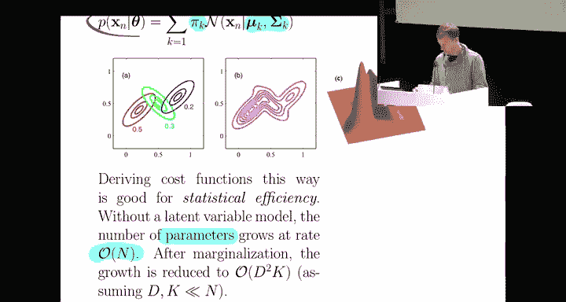

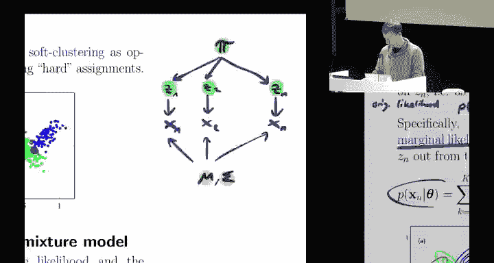

Specifically， if huge data sets， then the number of parameters in the old model here depends on on N。

And in a new model here， the， the number of parameters I have is not depending on n。 So that's。

 that's kind of nice。走。Set how many of these are。 So this is order of N。呃，没异议。Yeah。

 I ignore the the K here。And then the sigma guys is much fewer of those， right。

 So the there was the mu， the sigma。And the pie。And this none of these depends on animals。

 which this was K times D， K times D squared K。So none of this depends on N， which is nice so。

So we have after the marginalization， we seem to have a problem which is a bit more tractable。

 That's the takeaway here。And how should we think of this intuitively， what does this marginal。

 what does this change。The only thing is changes is like going from here to here。 So on the left。

 you see。If you know for each point where it's assigned to， right， So that's why the the colour。

 So for each point， you also have it set Its assignment。 So that's why， you know。

 the colorss on the left。 If you do the， the marginal here is no set anymore。

 So you don't know anymore more。Which specific data point belongs to which cluster you just want to fit this。

 this blue parameters such as the。Such that they， they maximize this， this likelihood here。

 which is not depending on the sets anymore。 So which is trying to fuck kind of。Find the。

 the best problem with moviesies。Okay， specifically important when you have lots and lots of data points。

呃。Any question on this。Okay。If not， we， we can briefly talk about。How we would now do this so I mean。

How would you find these parameters。These three type of parameterss now， such they。

 they best explain the data that we observed， which means so that's。That's these three types of data。

 sorry， the three types of parameters， right？呃谬。Sigma and pi。嗯。So how do we find those such that you。

 you optimize the。The I cute。So。So this thing here， the whole expression here is the。E the。

The marginal likelihood。 and I'll， yeah， I'll explain you again so。So because before we。

 we only talked about like one data point here。 so I， I need to。

Be a bit more careful what really happens when you have several data points in this。

And that's what we。We're gonna have a quick look now。 So what forget about this crazy formula now。

 So I will， I will derive it first。 So what we want is we only wantan understand the。

The probability of all the data points together happening， right so。

You can just write capital X for this， or I write。Or the small XN。Given the parameters， right。

 this is this， this is the marginal likelihood。And what it is， of course。

 every data point has been drawn independently from the same process。So therefore。

 it's a product of over in the data points。Of the probability of one of the points happening。

So the likelihood of one data point。嗯。And what is the probability of this one data point？

This we have seen on the previous slide， actually。呃。So if you go back here。

 then that that's exactly the expression we have here。 One data point， given our core parameters。

What is it， It's the。The sum of these normal distribution， what they get mixed together。

 That's why it's called a mixture model。 And the mixing weights are the these fixed numbers pi。

 right， so。So pi is is just this importance for each cluster。

 and that's the way to give to each of those。Cs or normal distributions for each cluster。

 And so let's plug in。租。Sorry， so I wantna， I want to take this P of x。And plug it in here， so。

Some or pie。K offer。The normal distribution of x。Around the case， cluster mean。M k s k。

And thess are okay。That's， that's nice。 But nowadays looks a bit nasty。

 So we have a product and we have a sum。So。Maybe what we can do is we can take the log of everything。

Then， then things will simplify。So the log of everything is。The sum。Or were the data points now。

1 to end。So what I've done here is just the log of the product。East the sum of the locks。

 So that's what's happening。 That's what hass happened so far。So now I just need to copy paste again。

This P of x， which is， again， the sum over k。Of these。Noble distributions。

And this formula here is exactly what what we have here。 So that's why。

That's why the margin likelihood has this strange structure with the two sums。And the。

The extreme thing here is that there's， yeah， this is special structure that the log。

 there's actually a log between the sums， which is quite quite nasty in a way， right。

 It means that the sums don't really have the same effect， right， It's not that。呃。

They can be treated the same way because they influence things very differently。But now this。

 I think， finalises our discussion what we want to optimize here。

 So now we know that we really want to find this parameters theta， which maximize this。And。

This seems a。Not an easy problem， so。We， we will discuss a little bit why this is not an easy problem。

 But is it clear that this is the Ma marginal likelihood now， if。

 if you have this model where with a mixture of cake optionss， so。So。If that's okay。

 then maybe we we'll take a short break。 And then after the break。

 I will explain a bit more why this is a difficult problem and how we can solve it and find the solution。

 So see you again in 15 minutes。

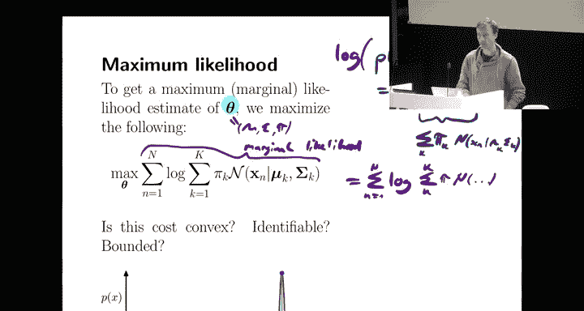

Yeah， here。 So， so the question was on these three guys， right。

 we were conditioning everything on the same thing。 So that's this additional conditioning。

 And that was。That's， that's these pis and muse and sigma。 So why is it not the same in the。

 in left and right， right， So， so here there's only mu and sigma here， there only pi。 So。

 but the point is actually to be precisely。 all three of them are present in both。 So。

 so actually also here on the left， you would have mu sigma and pi。 And also on the right you has。没。

And sigma and pi。 So these are all three on both sides。

 But the thing here just does not depend on mu and sigma at all。 And also here does not depend on pi。

 That's why it disappeared again。 but all three are present。You know。termserms， actually， so。对。

That I should have maybe clarified。呃，オ케。Then。So now， now we had the margin likelihood for the。

 the whole model when all the points are generated， right， So not only one extent but all of them。

 and， and that was the expression we got。It looks a bit， a bit nasty， and it actually is。So。

To to actually maximize this cost function here。It's not good to maximize cost。

 That's not not a smart idea， so， but。You would say this is like minus your cost function， whatever。

That's maximizing the likelihood or minimizing the cost。

So that's what they're doing here trying to find these parameters theta。嗯。Okay。

 what are the problems here， so。A bit similar in Kamins。 So in Kamins。

 we also said that some things are not so easy。 So actually some。

Some parts where trickying Kamin because it's also a non convex formulation here。

 so that is one problem。Actually， maybe I'll show you one second here， so。

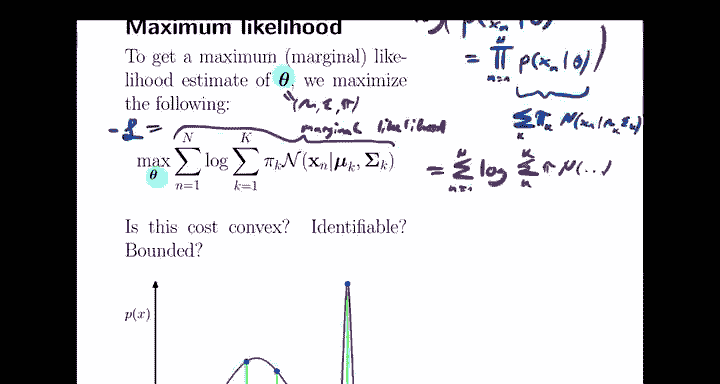

Why is the K means also a non comics problem so we can。Actually， this。

 maybe let's take it from here when we look at Cammins and we had a very similar expression here。

 but there was no latent variables here。

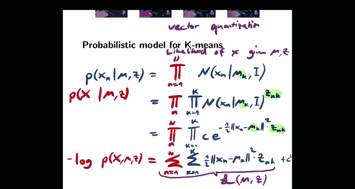

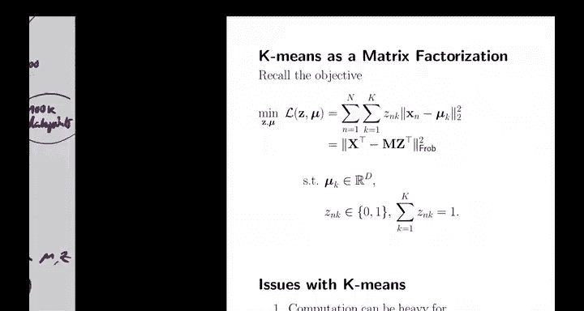

And then we said maximising the likelihood in Kmins was just solving， solving this thing here。

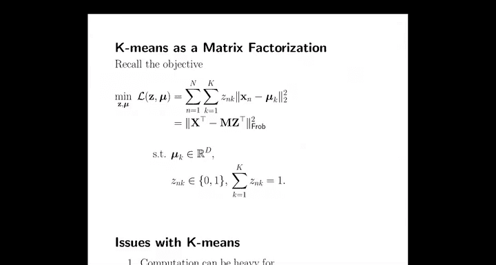

And that， so that's the L I was just talking about。 And we said in。

 in communities it's a bit easier to understand， and the。What the optimization function looks like。

 And what it actually is is， I forgot to say this last time。 this is actually a matrix factorization。

 It has a very a nice， easy expression for， for k meanss。 So there。We were。

 we were optimizing something a bit different， right， We were optimizing muse and and sets。

 which had the different gazess at a very different role there。And they were in teacher variables。

 which we optimized， right， And today， it's different today， we。

 we make them probabilistic and we made them latent variables， and we made them disappear。

 So it's very different from。From。From the Kaymin case。But the Ka means objective function is what I。

 why I bring out this slide again here is because this is actually。I made to expectationization。

 because we said we， we will just。呃。That is the the likelihood。 and we are maximizing it。

 which is the same as minimizing the， the cost function here。Remember here。

So this is minus the like minus the log likelihood。 That's， that's the L。So that's what we are。

 we are minimizing here。And what is it， It's actually the datamatic。Mineus the。

 the matrix switch collects all the。The means。And， and then the， the said Mag is assignment Magix。

 which is01 in this case， which is a bit harder。To， to optimize your。

 The nice what I want to say here is that it's a。A product of two matrices， so。

And when we have a product of tooricists and。Then that's already kind of an indication that things are a bit。

Difficult to optimize because it means it's a bit like a saddle function right。

 when you have two variables， you multiply the two variables， then。

Then that's a bit like a a saddle function， which means it's not a convex function。 We。

 we discussed this。In week 3， when we talked about optimization， then so this is actually know。

 a difficult objective function on， on one hand， because it's a non convex function。

 because it has this saddler shape。If you just look at the inner function here。well， I mean。

 X is constant， right， And these guys are behaving。 The landscape of that part is like a saddle。

 And then outside， we have just a square norm， which。嗯。Does nothing bad。

 but the promise that the thing in the inner loop inner side is already difficult objective， so。So。

 and let's compare this to what we have now。 So now today， we have the Gausshi mixture model。

The objective function looks a bit more complicated。 But I want。

 what I wanna say here is that it's actually also。A non convex problem， so。So it's not convex。

 so let's list a bit about the problems we have so。First， it it's an noncoms problem。呃， second。

So I'm not gonna prove that it's， it's non comicx， but you have to。Believe me at this stage。

 and maybe you can convince yourself if you would plug in the definition of the normal distribution。

 then you would have a very similar expression which I said before， for the came means case， so。So。

 second problem。That it's not identifiable。 So and by identifiable， I mean that。呃，There is。

There's some optimum， but then there's might be all completely different optim。

 So it's not that this one unique。呃， optimism。So no unique。Optim， so why， why is that， So assume。

Assume someone gives you one optimum solution to this problem。

 which means it gives you all the blue stuff。W whichhich is the pis， the muse and the sigmas。

Do you have some。Some suggestion on could you take that that solution？ So it's one point。没有。

pi and sigma could you take that and generate another solution， which is a different point。

 But is a equal， equally good value in this problem。 Would you。

 do you see some kind of symmetry like this that there's many solutions if you are given just one solution。

 so。Any， any ideas。有的。Yes， you switch between the first and the second tall first and the second cluster。

 you switch the mus in the sigmas。 What about the pies。Yeah， yeah， you're right。

 That's one way to get a symmetry。 But if you have a general p and you would also switch them。

 youd just switch everything。 But you're， you're right。 So you have a solution and then。

You will just switch which group you switch， right？

 So you were suggesting we switch the first two groups。That's right。And in general。

I will just switch。呃。Everything from from these two groups。 Yes， so the， the three。

Thes three variables， so。So you switch from U at whatever was scope K is now gonna be。

Switch is group K prime。So the the pies switched。The sigmas are switched。And also， the。

What's the last one， the The means， Sorry， I'm， I'm mixing up the order of this。

 The means the signals and the price。 everything is switched。Between two groups。So。So then your。

 this is the way to find another optimum， which is， is good。 And you can do this much more。

 You can have all kinds of perations of the group。 right you can。😊。

You can completely reshuffle which group you switch。 So you take a permutation。

Of all groups want to K。So this anglenglo bracket K here means all the numbers from one to k。You。

 you take a preation of that。 And then that's how you， you reassign your variables。

 So it just means you have changed a few coordinates of your variables。 And， but the point is。The。

 of course， switching the names of the groups。Does not change the， the value here， right， whatever。

AndWhatever objective value you had in the the current group K now will be switched to the group K prime。

 So it sums up to the same thing。 So any permutation。We have the same。

 we lead to the same value Yeah， question。呃， what condition do you mean。Yeah。

 if if you have additional information。About what， what some of the groups are。

 then they might be more or less of these sym。 Yeah or two， maybe two groups have the same。

Same parameters anyway。 then， then this would change nothing。 So yeah， this assumes that。呃。

Every group is a bit different。 And then you， you have at least。At least n factorial， sorry。

 at least K factorial， many other points with the same value。 There might be more。

 There might be less。 That's not so important。 The， the point is。There is more than one solution。

 So this， So that's what you wantan to say here that it's not。In statistics。

 you would usually like to have。 That's what we call by identifiable， right。

 that there is one model which explains to data。 So that's not the case here。 There's at least two。

Maybe these k factorial ones， which explain the。The data。 So that's also。

So it's not so I think this is of these three problems here this is the least your problem。呃。

ItIt's quite common that you have symmetries in your problem， also in neural networks。

 it's very common to have。呃， if you if you change the。Some neurons change them with each other。

 They take each other's role。 Then you also have sries like this。 So it's， it's very common to have。

Several optimal solution in in machine learning problems So machine learning optimization problems。

So that's not so uncommon。What is a bit more problematic here is the third problem that it's actually not bounded。

 And we， with that， I mean that。This objectiveive function we trying to maximize。

 It can become unbounded。 It can become extremely high。And that is a。That is a problem， so。So。

 the loss。Well， okay， so。对。At least the， the likelihood can go to infini。 Sorry。

 at least minus is the likelihood。So minus L can go to infinity， so。嗯嗯。And why is this。So。The。

 the problem here is that when discussions become。So here you have one group which is on the right。

 So you have a mu2。 and then you have another， another group which mean mu one。

 So kind of two groups。 so this these two Gas which are added to each other。And the question is。

 how wide are discussions， And that's， that's taken care of by the。呃， the sigma so。

So the with discussion is kind of。Sigma used to with。And。So yeah， if， if， in the general case。

 this is the capital sigma。Right。So。The question is， when， when a。

One group becomes so small that it only cls one point。 Then the point is that then you can make this。

 the Gaussian of that group can become extremely small。 It's still perfectly fine。

To explain your data point。But it can become extremely narrow and when that happens。的。The value of。

 of this， of this cost function will explode。 So， so that's it will become like a a D rack in this probability distribution。

 So what you have in the plot here is not the， is not the cost function。 It's the probability。

Distribution over your space X， right？ So where is， where is the most mobility mass。

 Where are the most points happening， So the data points are the， the blue points。

So where are they happening， Right and how， how likely。 So that's， that's all shown here。 And。

 of course， that's defined by。The sum of discussion， it's the same picture as we we had here。

 So that's the picture。So。So in this picture， if， if a group just becomes only containing one point。

 I mean， containing is to be the soft term here， right。

 So the there was always might be a small chance you assigned to some cluster。

 some some other some other probability。With another cluster， but if you become。

 if a cluster really becomes only。Consisting of one point。 And that point is with。

Becomes with probability almost one to that， to that cluster， then。

Then the cost P here goes to infinity because the the， the lockarum will， will make this explode。

 actually。 So this is a problem。That。That can happen here。 And you can see this when you。

 when you plug in the definition of the of the Gausian。Here。

 right when it becomes the width is encoded in the sigma。So you will see if you。When you plug in the。

 the definition of the of the natural。Gussian distribution。

 Then you see that it's kind of normalized。 Its one over a sigma。 right。

 If this width becomes super small， then the， the value can become arbitrary high。 So。

 so that's the problem here， so。If。呃。If the， the， the covariance matrix is the shape doesn't matter。

 right， You already get this when you have identity covariance。But then you have the sigma。

 the scale of variable， which which tells you how big is this s cluster if that becomes small。

So here's the width。Then then the cost function will explode。You you go to in Triity， so。So the。

It's just parameterized but some really and this waste becomes very small， so waste goes to zero。

 then you have that this happens。

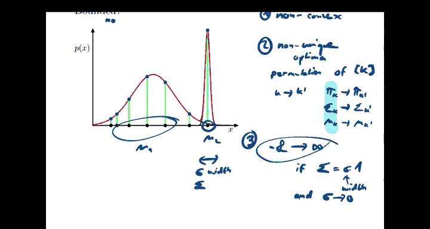

Okay。This is。All I wanted to say here。 So this is kind of three reasons why maximizing this cycle is not so easy。

 but we will actually see very natural algorithm now。 and then a more on Thursday。

How to solve problem like like this。 And by solve， I don't mean to。

 to perfectly find the true optimizer。 But these are very good and established learning algorithms to。

 yeah， to find good solutions here。 And they're very natural in they also have this alter fashion。

 So like in K means you， you first try to get a good assignment。

 And then you try to get a good expectation here。 So we will get to that。Yeah， one more question。

 was there。Yeah， so I mean， that the likelihood goes to infinity。 So you're asking why is the minus。

 right， so。The， the likelihood will go to infinity。 That's， that's the problem， I mean， so。

But when we say we say maximizing likelihood is like minimizing some cost。

 or it doesn't really matter。 Actually， you can skip the minuss if you want。

 you can say at least the likelihood because we don't care what the cost this year。

 we only talk about the the the likelihood and that we maximise， of course。

 So maximizing the likelihood and that thing will go to infinity。

 So thats if you have a maximization problem and the objective can become arbitrarybitrarily large。

 then you have a problem， right， then So then it's not clear if the solution even exists， or if。

If it might just grow。I completely unbounded。O。All questions， yes。Yes。

The same same value of this function， right？嗯。Yeah， So your question is just。

About the permutation of white from from1 to to k。嗯，对。You're right， that。When when I。

 when I switch to。When I switch the I Ds or the， the names of these groups。

 That's what I'm doing here。 then you're write that the the function value。

 it does not change at all。 So the， the value of this thing remains the same， right， So that's。

 so that's the same optimum value。 But the the points where we obtain it the。The。

 the blue parameters they， they change， right， that， that's what I mean。 So， and the， the optimum。

When when we talk about an optimum， that's that's the blue point right and the optimum value that would be the the function。

 which which I agree with you is unchanged right， but the the the parameter itself。

 where the optimum is attained that has changed。 So thanks。Yeah。Yeah。

 how can we maximise the the likelihood？ Yes， I， I will get， I will get to this。 That's。

 that's exactly what we're gonna do here with the with very generic algorithms。 So， so this。

 this algorithm here can be used for many problems， not only。😊，Not only for this mixture model。

 for many more things， this would be a very as I， So I can imagine it would be a very generic algorithm to。

 to have this alternating kind of steps between。Two types of steps a bit like in Kmin means。

 And it will this one would allow you to solve any problems like the one which has had yeah。

 maybe not solve probably but to get to very good approximate solution， so。So that's。

 I will just start this。 and then we will finish it on on Thursday。 what's。

 what's really happening here with the expectation， minimization。

 expectation and maximization algorithm。 So these are the two kinds of steps。So。

 and the motivation is really what we just had， which is exactly this， this expression here。

 we said it's， it's kinda hard to。To， to directly optimize this thing。

 So we would like to actually optimize somethinging a bit simpler， right， so。This was very easy。呃。

Very non trivial。 So is there， is there a way to， to simplify this objective function。

And kind of step by step， approach it。Try to。To solve a simpler function in each step。

 that's kind of what you would like to do， so。So the。The full objective function would be。

Would be something like this。So。It's a， it's an non comic function， right， So I。

 I draw something like this。 So this is my。My entire objective， L。I want to maximize this thing。

And okay， maybe I shouldn't。 Maybe there should be some。So maximum point here somewhere。And。

What I'm trying to do is to， to find surrogate models wherever we are。 So to simplify this job。

So let's assume we start somewhere。some， some guess， right， so。So this is a Eer algorithm。

 which is start with a starting point Tita。I call it the tita T for time7 T。So， now I'm here。

And the green function is much too complex to， to optimize。

 So I'm trying to find something simpler to， to maximize a bit similar。

 The simplest thing you could do is。It may be a linear approximation of this model。

 but here we will take something a little bit more advanced so we will get to this。

But you can imagine it's， it's a much simpler model， like。Maybe some kind of problem or。呃。

A simple thing which hopefully is a bit related to the green objective。

 And then we maximize that surrogate model， so。So let's say here's the highest point of that surrogate model。

 and that's our new。It。 So that's。That's the point。D达第8算是呃对。So， that's my next。呃，Po。

So I will go here and now I build a new surrogate model。 So now， now I I look at my actual objective。

 the， the blue 1。 So it's， it's different from where I are， where I am。 So then I。

 I will again build the a surrogate model there。Which brings me。Somewhere else， so。呃。

Maybe brings me here。And that's my my next time step， right？And so on， and then again。嗯。You。

 you continue this forever。 You always try to find。The highest point of this surrogate model。

 And then there build a new surrogate model and do it again。 So this is the idea。

And what you'd like to go is to this two maximizer sigma。 Sorry， Tita star。So we cannot do that。

 so we just try to go somewhere。So my close and this is an iterative process trying to improve this step by step。

And these， so the， the green functions is called L and the surrogate models。

 we also give them some names。So the， the surrogate thing will be。I will call it the。Whatever also L。

 but it's this special L。It's defined， it's also a function of theta。

 but it's defined at theta times t。And that I will call it L with a small bar under it to say that this is actually a lower bound to the green function。

 So that is the the surrogate， so。And the， the definition。We'll come in a second。

 So it's important that there is a difference here， depending on where you are， right。

 This is the one when we are at。这得。T， right， So that's why there's a little T here。

 So that's where you define your surrogate， so。They will have the property there below the function。

 so that property is written here。And they will also have the property that they do coincide with your function if you ask at the current point where you built it。

 So that's that means here the they are touching， right。

 So they are they identical in in the objective value， so。收。These are two properties。

 and I will tell you a in a second how to build this。These surrogates cause many ways to do it。

But then first， we want to understand the algorithm。 And that， I think is。Is clear now， right？

 So we have to surrogate。 So you define your， your L bar， so。So this is a bar。And。

 and then once you have it， you maximize it。 So that's。

 that's kind of taking this agon max of the L bar。And then that's your that's your new point right once you have done that。

You， you move to your next。Next eat to it， so。Does this make sense。

 to be confusing that the L has like two parameters， right the。

The one on the right side is where it is defined。 So the， the yellow thing is fixed here。

And then the parameter here is just， it's all because it's also a function， right。

 So wherever you ask this function to evaluate it， you have to ask somewhere， so。So L bar has this。

 this kind of two arguments。 But only the first one is the real function argument。

 The second one is just where， where is defined， so。All right。So， to。

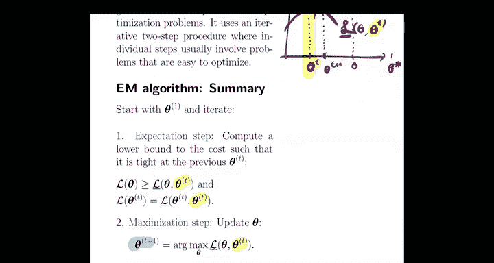

Define this， actually。We will there's a small competition to do， but this will be a very natural。

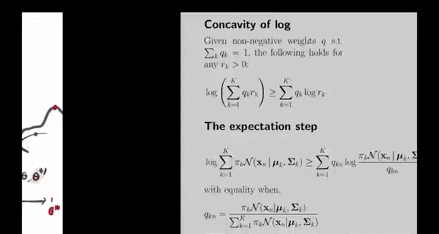

Joice， when we release some， the property of the logarithm of being concafe。

 So that's how we're gonna what we're kind of doing is we we。

 the problem is this logarithm in the middle， right， It's a very non linear function。

 If this logarm would not be there， then every life will be completely easy。

But this logarithm makes us。Make， it very difficult to treat these two sums， right， It's very。

It's very tricky。 So if you can replace the logarithm by somethinging linear。

 then life will be much easier。 And that's what actually， that's what we're gonna do。

 So we are we we gonna say， okay， the logarithm is。It's a nice function， concait function。

 But that we will be able to replace it by a linear thing。And the linear thing。

 if you have a concave function， which means curved to the bottom。

 you have that the linear is always below the original function。 That's what it means to be concave。

She's the opposite of convex。So there you always below。 And that's actually。

 that's what you have here。 That's， that's why were gonna。

 how we're gonna prove this that we can show that。Our surrogate， because we have used that。

 it's going to be below the green。Original function， right， So that's。

 that's what you're going to do。And then this will be easy to show that they are equal at where you define it。

 And once we have that， then we will also see that actually， the surrogate L bar is much。

 much easier to optimize。And then we will have the， the algorithm for， for this。And this。

 I will do on Thursday。 We can finish a bit earlier today， so。If just no question。等。Okay。

 then see you on Tuesday，啊。

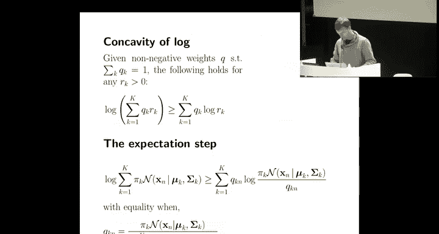