# EPFL《机器学习｜Machine Learning Course CS-433 fall 2020-2021》中英字幕（deepseek - P32：[32]EPFL Machine Learning Course 2021 - Week 11 part 2.zh_en - GPT中英字幕课程资源 - BV14SwyeNEvW

We were talking about the Gaussian mixture models last week， sorry on Tuesday。

 and we were talking about K means clustering before that， which is a simplified version。

So the reason why we introduced Gaussian mixture models was too。Do have a probabilistic model。

 which is more？More powerful in the sense that you will have a soft assignment and also more powerful in terms of the shapes that you can use to match your data。

 So these are some some important unsupervised learning methods you want to discuss。

 and then we moved to to this。😊，Chapter， the E algorithm。

 which which is just the algorithm to solve all this。 So what is the algorithm to， to solve。

This fitting problem of of finding the best generative model， which explains the data。

 So which maximizes the likelihood of your data， if you assume that。

You you have a Gausian mixture model， for example， but we will see today that is actually much more general can also be used to。

Do we solve more generic problems？That was where we kind of saw last time that we asked them。

 how can we maximize the likelihood of fi Gaciia mixture model？

We said we want to do it incrementally。We want to do it so step by step by starting somewhere。Sigma。

 sorry， Tita again is， is。Consists of all these parameters of of our generative model which you want to learn。

 So there are three kinds of them， the most obvious one are these mules， which have one per cluster。

The other one is the sigma， which you also have one per cluster。

 but sigma is actually a matrix for each cluster。Wwhich is the covariance matrix and then there was the last parameter which was the pis。

 which is just one number per cluster。So these are the parameters we're going to learn。

 So this Tita vector here。Okay。And how do we do this So we want to find the best data。

 but that's too that's too hard。 So we will just start somewhere and take take an approximation there。

Where we were trying to motivate this iterative procedure to find the parameters for our model。

 we said we start somewhere we want to optimize the green in function。Which is too hard。 Therefore。

 we just build a small surrogate model， which is a much easier model to optimize。 So that's this one。

We maximize that one so which brings us here。And that's our next iterate of parameters。

 It's not the perfect one， right， but it's hopefully a better one because the。

 the surrogate model brought us a little bit higher。 So then were here。 And again。

 we do the same thing。 We will repeat by。Building a surrogate model that's so called expectation step。

 as you' can see。 and then we will going to maximize that surrogate model。

 which brings us here to the next step。That's the so called maximization step。Yeah。

 don't hesitate to ask questions anytime also on Zoom。

I think the algorithm generically is quite simple。😊。

But what it's not so simply is how exactly is this surrogate model defined right and and also how are we going to do the maximization that might depend a bit so it's gonna it's going to all depend on what's the surrogate with with the bar。

Below it。 And that's what we're gonna discuss today。 I hope that's。it's clear。 So that's our goal。

And。Let's see what we can do here。Okay， so the first thing we want to。

Discuses how to define the surrogate。And that will go a bit together with showing that it's actually below our function。

So， and it's okay。Let's do this step by step。 So what we have on the on the left here is actually。

That's our original function， that's why you was always screen， right？

But this is only the L for one data point， so that's that's our original function。

 if you go back here， then you see。There was the L， but L was some over everybody， but。So， the L N。

He's just a。How good is our fit for the one data point， right， so this is Ellen。

And the L is the sum of all that ends， of course， all data。Okay。

 so what you're going to do is we build a sugarro to lower than LN。

And touches it at the current point， that's our goal。Okay， so here is Ellen。

What's going to be the surrogate， It's going to be this thing here。And why is it a surrogate。

 because we say that we are claiming that。Here， so。So this is a lower bound。On L N， right。And。嗯。😊，So。

And this thing will be our surrogate function。So we define this to be the the L with the bar under it。

 so。This is the lower bound so that we that's the name we give it。And that depends on a few things。

 it depends on where you define it。And。Yes， that's it。Okay。

 so now this is completely out of the blue， I didn't explain you like。

I didn't explain you why it's a lower bound and why this is a good choice。So。

So why is this the lower bound？And to， to do this。We we just。

 that's actually what we said at the very end on Tuesday， we said that actually if。

If the problem is that there's this log item between the two sums。

 which makes things extremely strange how they interact with each other。

 if we said that if this would not be there， if there was a linear structure that would be much easier than we could actually decouple everything。

And so if the log will be linear， then things would be fine。And that's what actually happens here。

 we actually use a trick。😊，To， to make to treat this logarithm a bit as if it were a linear thing。

 But what do I mean by that， What we will actually use is。What is called welcome vexity。

And maybe those of you。Some of you are my head of Yanen's inequality， so I will explain。

What that means， but the point is that the log function。is a nonlinear function。

So it's a bit a tricky function。and what I want to do is I want to use convexity。Of。

 of this function， actually， complexity of minus the log， which is a。Which is the same thing as。

Conone cavity of the lock。 So that's what you're going to use。

It looks a bit scary in terms of formalability， it's very simple。😊，So well see in a second。

I will just use the complexityvexity of the。マイナスオケ。So maybe it's best explained in the picture。

呃 so ok。Green is the function here。Sorry。嗯。So以 to对。Slightdes are a bit frozen on Zoom。

 but we will be back soon。So。😊，But the lockerithm looks a bit like this。呃，一次。

Concave function right and what concave means is I would just plug in the definition。Sorry。我的。Yeah。

 and there's a backup for people on Zoom。 we always have them。

Slides behind me just need to move away。Okay， so con concvity here。 What does it mean。

 It means that the function。Between any two points is like above the linearization。

 so the dotted line here is the linearization between two points right and these two points we call R1。

And are two。And。And then we we ask that the function is above the lineararization。So that's here。呃。嗯。

So you go somewhere in the middle right and you ask that。

The true function is above the linearization。When taken at the complex combination of two points。

So this here is a convex combination of the R points。

And just I'm just doing this so you get the right notation that we also use。In the。

In our special case， right， so？The con combination would be some weights of these R's and the weights we actually call Q。

Okay， so that's that's what is happening here。 That's what this what this inequality。Means and。Also。

 some of you know this this is also just a。Equivalent to Yans's inequality。

Right if you just do this for two points and it's complexity and if you do it for K points。

 then it's Y's inequality so but we know that Ys's inequality is always true for convex functions。Or。

Here it's it's true for minus the log， which is a complexve function。

 So so we can always use this property。 This is true for any。

Any points are it doesnt really they can be anywhere you wants the R values。And the queuees as well。

 but the queuees need to sum up to one。Those two ss。So for any weight cube Comx combination， right。

 for any such con combination this is true the are two functions above。So we can use that and okay。

 what are we going to do in our case？I want to convince you that this is our lower bound。

 it's our surrogate function。So， so I will， I have Qs and I have R， but I haven't specified them。

 So I will say that this will be my Q and this will be my R。 that's that's what we're going to do。So。

嗯。And。Yeah， that was a bit faster， let's try to verify that。The Qs in the earth。

What they really are in this case， but again， we can set them anything as long as the queues sum up to one。

So。诶。Yeah， first， this one。That's going to be my R thing。ok。

And then what you have here on the left side， right？This must be the sum of the convex combination。

 So this must be。Q k times R K。Hopefully we will verify this。And then， here is your。Here is yourQ。呃。

I hope this makes sense。嗯。And let me know if journey。Questions on this。So this is a。The you here for。

Sorry。Yeah， question，What is the data T in our case。你 did解 have case手。一然的不玩推。我 is。大好哋。Yeah， yeah。

 that's， that's a very good point。 And I will get right to this。 So so far we。

 we only have these parameters right， But you're right， I need to， if I define this。

 this lower bound， I need to be very precise。 I want to define it at tta T。

 So at the one parameter that is fixed。 And then the the the surrogate thing， of course。

 is a function。 So， So yeah， very valid question。 What is， what is this second thing here， Cta T。

 And I will do this right now。 so。😊，So。Thats the T the T is in red so。So it's here， right。

 so this is Kusher。So let's try to end again this will have like three components。

 So we need to be if I whenever I write a mu or whatever， I need to be clear。

 if I mean the mu from here or the mu from there right thats that's what I'm missing and you are completely right。

 So I want to to have the cues the these of explanation weights。

 Those are the ones where you have defined your model。 So those are from T to T so。So， this queue。

Will be from the parameter at time T and the orders are free， so the orders are the blue stuff so。

Which， which we optimize， right So so that's that's the stuff。Yes。Does that make sense？O。

 so it's yeah。Q请啊q启。What is Q， K， N， Yes， this， I also need to。To Toer。More precisely。

 we will get to this。😊，And yeah， actually in reality， there's only this QKN。

 right so for we do this for every point n separately。😊，So there is only Q K N。

 So what was here is just the illustration。 The decision is for complexityvexity。Yeah， if you want。

 you can call these guys here also。Here you can also call it QK this is just for illustration right。

 what have used， we have used complexity of lock。But then in reality， here is how we do it we use。

Q K N and very important what you said that yes， those queuees are defined at parameters time T。

 so these come from the red stuff。So， yes。 So what are these cues， so。诶q。Okay in。Here is the。

Here's what they are。They are just some kind of average of the probability。

Of your current data point， sorry， the probability of your current data point when it's assigned to cluster K。

So， yeah， because it depends on both your N and also whatever K you ask for。

 So they depend on many things。 And yeah， sorry， this is not so clear。Why， why it shows like this。

 and I will get back to this。呃 why the。Why the Q KNs are are what， what they are here。

 But if you plug it in， then you will see that this is， this is correct。 So just plug in this。

 this choice of the。Of these complex combination weights。Put it here and here。

And then you will see that， yes， I mean， of course。

 this is a valid choice because the queues sum up to one。

 so this inequality is going to hold and things are fine， right？

And I could choose all those things for a QK as long as it's sum up to one， everything is fine。

So why why this is a particular interesting choice is actually we're going to see that later。

 it's particularly interesting that if you choose this one， then you will get an equality。😊，At the。

 the current parameter T to T。 So， but that's the second property we， we were cleaning here， right。

 we were saying， yeah， it's a low bound。 And the second property that， yeah， it's actually equal at。

 if you ask here at the current point。 So that's， I'm gonna。

 that's what I'm trying to show you next that yeah， they I actually equal at。

That's where you currently are。So yeah， property one is or。Property A is discount lower bound。

 and B is showing that it's equal at the current point so the。Property A， I think we have shown。

And now。Okay， so a， we have convinced ourselves that a is true， rather it's lower bound。

 we have just used convexity， nothing special。😊，And and now B is this a。Equality， right， So why。

Why is this a equality when when。When we ask about particular parameters。And。嗯。Okay。

 so let me try to write this down。 What'm what I'm claiming here is that。呃。

So I take my surrogate model， LN。I plug in。I actually at the current point and of course。

 the surrogate model is built at the current point as well。

 but I'm evaluating it at the current point。And what I'm asking is this。Or not， is this equal to。

The original function， which is。Green， usually。So。The end of。tea， right。So that's my question。

And let's see we can easily compute that。So。What I will do is I will just plug in this surrogate model here。

 I will see and I will plug in the special choice here of the current point。See what happens。

 So it's a sum of this Q case。And then there's a log of stuff。 So let's write that。So it's a sum。

Of case。And yeah， these other。Q K ends of of T。Times the log。嗯。Of， of this， this big theme here。

 I don't want to write it。So what I want to do now is I want to plug in my definition of the QK。

And see what happens。So definition of the cus was that it's normal distribution。Way did we serve pke。

嗯。😊，So Pique normal distribution， I'm just plugging in this formula into here so。

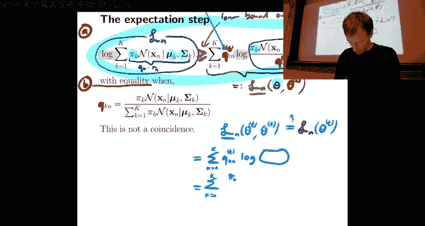

呃。Of my point being normal distributed around class O。All right。

And then divided by just summing by just normalizing， normalization constant is always important。

 right？And maybe here， I will call this K prime2。I need a different K because here I want to sum up again over oil classes。

呃。Kay Brian and。Again， the the normalized stuff。 Okay， that's the queue。

 and now I need to write the log of this stuff。Big logarithm， so this stuff here I will just copy。

 it doesn't depend on the queue。So。嗯。嗯。Normal distribution。Okay。

 now it gets interesting now I divide， but is Q。So I plug in what is Q KN？And。

This is K prime normalizing。Okay， sorry， this is a little bit ugly， but。What's okay。

 What I want you to observe is just that。

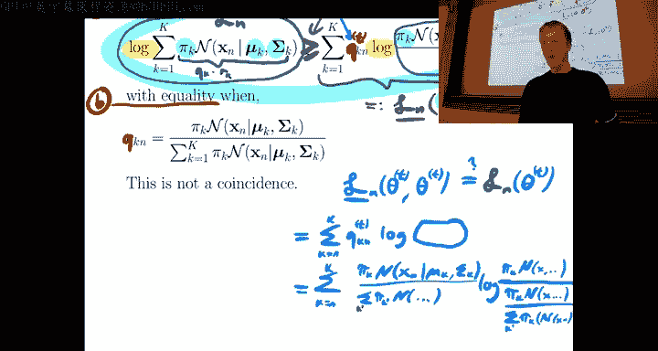

The。The term。The terms are actually the same。 This is the same as this， so。

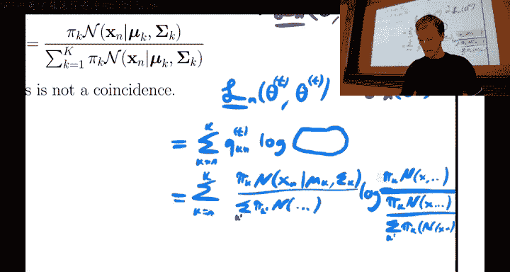

嗯。😊，So I just plugged in into this particular queue， right， and I obtained。

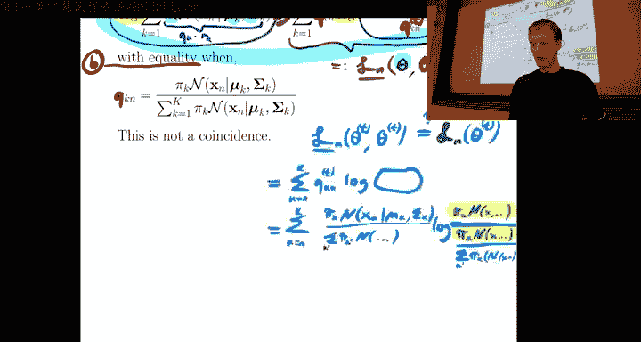

I saw that the numerator is the same as the denominator。But there is the additional organization。

 though that does not disappear but。But the two terms here， they cancel。

 So this one cancels this one。 That's one thing。 and this one remains。And。What's happening here。我意思。

诶。嗯。😊，可企。

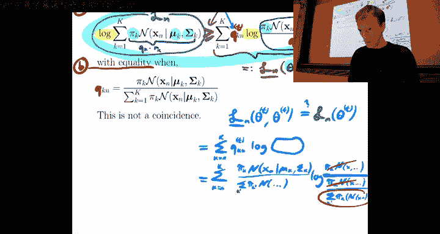

Yes。Yes， we are good。So just we need to be a little bit careful with the K primes and so on so the stuff of course so here we we talk about the K outside right and then inside we have the K primes which are the when I have these additional sum here。

So what we cancel here， that has depended on K。 So。

 and that' that's actually very nice because now that the term here does not depend on K anymore， so。

To agree with that， because this is only the additional sum of all classes。

 where this is the K prime sum。 So the whatever is in this log is remaining。

 it does not depend on K anymore。That's not， yeah， so that's really nice。

Because it does not depend on K。This thing is actually a constant， so。

I can can take it out of the sum。So I me take this。And。Move it all the way in front of the sum。And。

What I then have is actually just the stuff which is in red at the very bottom。

So that's what's remaining here。The actually， the log。Of the pie。Sorry。

 the log of the sum of the p key。呃我不。Sorry。Need to work on the handwriting。嗯。

Some over O prime of these weights。K， normal distribution。X UK k。使 k。

And these are all key primes here， sorry。We are almost there。

 don't stay with me for one second and it will clean up in a second。Okay， so this stuff here。

 this is the this is the red term which has remained， it comes from here。

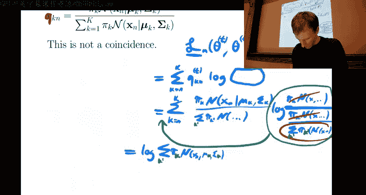

And then this stuff here is interesting yeah， what about this。Anyone tell me。Yes， you are saying the。

You are just telling me that this thing is is one， which is true。 Yeah。

 because this thing here is exactly the same。It's just some on the bottom。 So yes。

This green term is just one。Times1， so we're good。And okay， so what is the remaining here？

this looks a bit familiar。 I just wrote it very ugly， but。You have seen this term before this one。

And you have seen it。See is actually at end。Okay。Okay， and that's what we claim。

 So we have shown that this thing is equal。To what it should be。

 we have shown that the surrogate at this same point taken。At the point where it's taken。

 it coincides with the original function LM， so that's what they have shown here。

And this is because we have chosen this particularly smart comic combination weights。

 You can choose any other ones， right， maybe there's other ways to。Make that equal。 Of course。

 you can define auto surrogates。 I'm just telling you that this particular surrogate。😊。

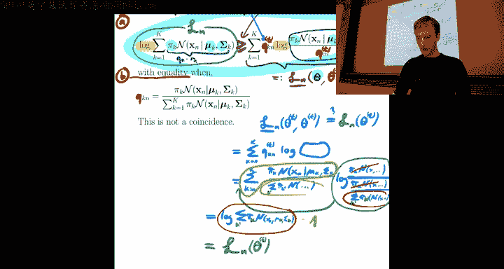

Has his property？And yeah， that's all we need。 So we have shown that it， it's equal without。

 And we have also shown that it's always a lower bound to the true function。😊。

So that's good enough for us now， of course you could do other surs。

 maybe you're interested to build linear surgars or anything。But this one is is not a linear one。

 right， It's a bit more complex function， but it's a nice one。 as we're gonna see。

 It will be quite easy actually， to maximize this thing， so。😊，So， but so far。

 this is just half the work， so to define the surrogate。

 then the other half of the work will be to maximize the surrogate， the so called。😊。

Maxxiimization step。Okay， but would you agree with me that it coincides and that it's a lower bound or any question on any of these two aspectss？

The question about the since you writing red， why the Q which have a little P。You mean this。

And you mean the Q here， Q Q T， so why does this have the T， the time index？And。

And this is because this is the queue which comes from here。

 it becomes from where the surrogate is defined。So and this thing has three parts。

You can see here what the three parts are。So。So the three parts of what seal the mu。

 the sigma and the pi。 So they all of those are present in in in this parameter T to T。

 So they are present there。So， I mean， you could， you could use a queue defined on。

On the other guys here。 But that's not what we do。 So it's quite important that we have chosen the queue。

Deeffined a Q T。 So also， when we did this argument here， right， So we have actually。

 when you plugged in the queues。I have plugged in。What I。

 what I mean is always that these guys are from the Q。 sorry from parameter T attend T。So。So yeah。

 those are all taken at primad T。嗯。Yeah。嗯。So that that's important maybe write in red， right。

 so Q is always defined。呃转体。Okay， I'll try to rewrite this a bit in。Nicer writing later， but。那你。

Any other question on me？Alright， so this is building the circuitrogate。Then。Let's see。

 what else can we do。 So now let's see if you can actually maximize it。 So， so remember。

 so now you can forget the， the proof， of course， the only thing need to remember what the zerorogate is。

😊，So it's this these queuees and。And the log。 So okay， so here is this again。

I'm claiming that this is。So now it already looks confusing。

What I'm claiming is this was the surrogate。 So this was a L N。F。Take a teeta。And define that t to T。

And again， you see that the queue is taken is the one from。From the parameterine T。

 so that's crucial。Okay。Yeah， why is this the same function it looks a bit different than oneV had before？

But it is the same。Because the， I mean， the the queuees so far looks good。 The lock we also have。

 but this looks a bit strange， so。So what we have done here is that just the log of the two things。

There was a log of equationtient right， and the log of equation has been replaced by the difference of the logs。

So what we have here。Is actually equal to the。Log of the quotient。Okay。

And then it's divided by these Q guys， Q K N。屁股。Again， taking 13。Yeah， so just to verify， yes。

 this is the same term so。嗯。So so far nothing has happened。

 so what I've done here is just I have written all the surats and I've sum them up and I have written that now I want to maximize it。

 so I want to maximize the parameters。Of this stuff。

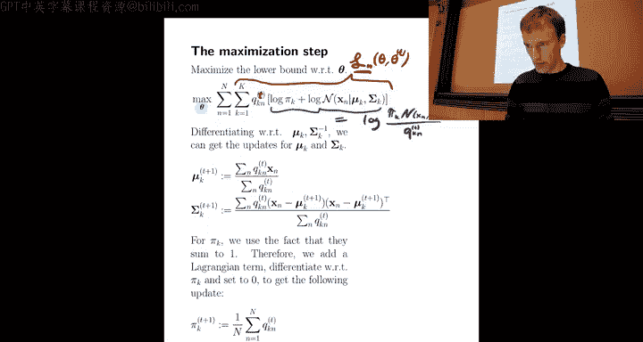

One second so。

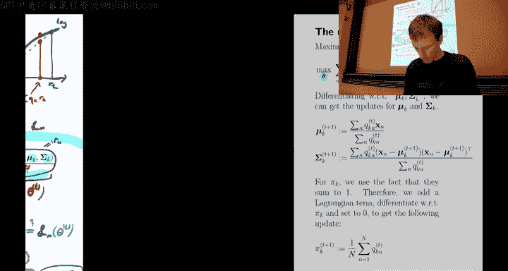

Yeah， now I'm getting。I con。 I'm missing the dividing by queue here。

 right thats and maybe you're also missing that。 So we got this guy and we got this one。

 But where is the queue here in the denominator that has disappeared。

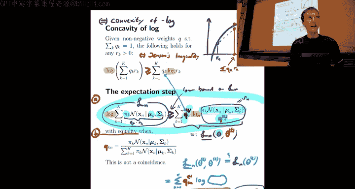

And that， indeed， is puzzling and。But the trick is， maybe that's what you're gonna say。

 because these said。

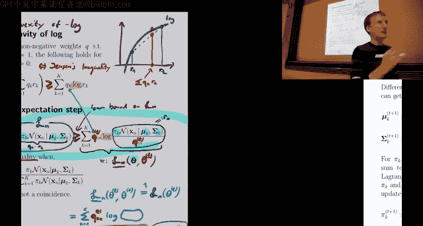

This cu here in the denominator it does not depend on the parameter。 So that's why we can remove it。

 But it's actually， it's actually there。 So there is a log。AQ K N T here。

Which also belongs to this term。And then all this together is the correct one。

Was there your question？That was a remark。 Ash， I just think it's too constant。 So can remove。

Exactly， you're saying it's constant or you can remove it from the maximization。

 and that's exactly why why I was confused。 And that's exactly why。Why this guy is。

 is disappearing man。 So you can see， yeah， Q T。It depends on the QT stuff right that's also relating to your question right where is it defined。

 the surrogate is defined， so that's coming from the second part。So。

 and that does not depend on the blue parameters at all。 So， so that's why it's。Constant。

It's constant in， in a。In the theta parameters and Teta， I mean， the blue ones， right？

So does this make sense， so I have removed this third term。

 which is the guy on the bottom here because it's constant and then this one and this one we have kept so this is the first log and the second look。

呃。And yeah， you can see this one is a plus because it was multiplied and this one is a minus because it was in denominator。

Yeah， this is correct。Why don't you improve the first。

Why don't you remove this Q here good question So you're right that this one does not depend on sigma on the parameters that's correct。

 but the problem is the orders do right this stuff does so so it's a constant and it's multiplied with。

With stuff which depends on the blue parameter。And it's just that， yeah， the， this。

 this thing is a bit different for every K you ask。 right and here it sum up for every end every K。

 So this is a constant we we need to keep。 It's not a。Yeah， it is independent of the blue stuff。

 but it is getting multiied the different blue stuff， so we need to keep it。

 I cannot remove this one。

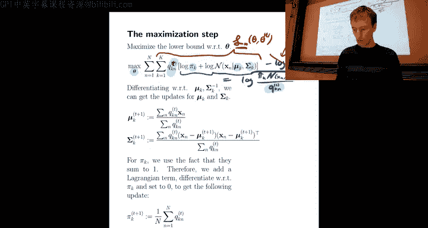

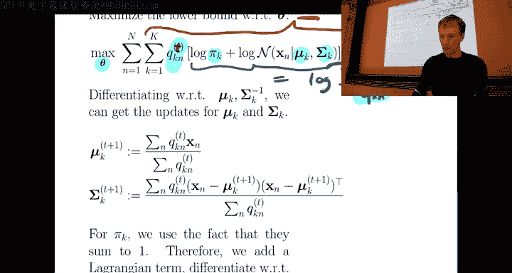

But the。But this the last one， yeah， the last one which we raised。 So I mean that one。

 that guy was also multiplied with this， but then it's two guys which are independent of parameters then then I don't need it right。

 But here it's one which is independent and one which is dependent on on the blue。

 That's why we need to keep it so。系。Sorry for the ugly writing and thanks for the question。Okay。

 so this looks a bit nasty， but again， it's going to clear up。 It's not so bad。😊。

WellWhy am I doing this anyway， I'm just trying I want to maximize this surrogate and I'm decomosing it a little bit to show you that it's easier。

And because we have got rid of this term， it's a bit easier。So now our goal is just to。

Find the blue parameters stta， which maximize this part。And that is actually doable， so。

So there's three things which you need to optimize the pi sigma and mu。Let's do it step by step。So。

For optimizing the muse， it's actually。So is this kind of a nice optimization problem。

 it looks unconstrained。😊，So far， so。I will just do the standard trick and say， okay。

 I at the optimum the derivative we suspect to my variable is probably going be zero。 Yeah。

 it must be zero。 so so that's what I'm going to claim so。Are going to see。

Gradient of my function here。We suspect to the mu part of my ver mu。Yeah。

 all all the mu or the current mu K， whatever。For any new variable。

The srogate will have a derivative of zero。嗯。😊，呃。Is is0。Okay， and then we can compute it。

 that's not so hard。 so where is mu， it only appears here。😊，So， that's a。That seems okay。And then。

I need to。To use a bit what is a normal variable right。

 so I will just plug in the definition of the normal distribution。And then from that。

 it's okay to take derivative derivative。Normal distribution of x。given me a signaligma。嗯。

What is that， so we know this well， right？It's E to the minus。嗯，嗯。Xma is mu。

 and then the covariance comes。 it's actually the inverse of the covariance。And then comes。

It comes again x minus mu。So it's center the mu， right？So this is the normal distribution。😊，And yeah。

 from this thing， you can take the derivative。 It's not too hard。 So， I mean。

 it's a bit annoying because we are， we are asking for a vector， derivative here So all the muse。

 So if the， if the sigma is not there， then it's super easy because then this this thing here is just becoming x minus mu。

Square the distance， so that's the spher case。Actually。

 you will see later that if you do this then you will recover K means。😊。

IfIf the probability distribution of one cluster is spherical back here。

You will see that the the E M are gonna actually will will give you k meanss。

 That's a spoiler spoiler a lot for later。 but， but that's， that's just because this term， you know。

 right， you， you remember it from， from Ks。And taking the derivative of this， we。

 we also know how to do。And now it's a bit nasier because nowadays a sigma covariance here as well。

So， here you。You need to believe me that I'm also able to take the derivative of that。

That object here， which is a bit more annoying， but the one of with respect to mu is nice， right？

Okay， so what I'm claiming here is that if you do the derivative， is mu。😊，So that's coming from here。

 this you can ignore if you just ask about mu。Then my claim is that this is the solution。

 the mean actually becomes weighted combination of the data。And the weights， interestingly。

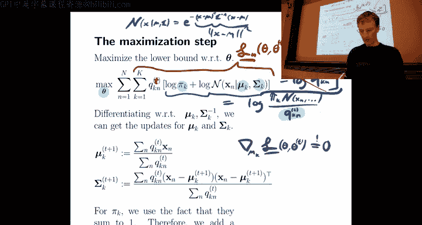

happened to be the queuees， which depend on the current time step。

Where we have defined the surrogate。So I'm not going to do the full variation of this gradient。

 you can do it。😊，If you have a spare minute， I highly recommend。If you said it is0。

For which new is it is is going to be zero。 then this is what you get。 So it's a nice update。

 And again， this reminds you very much of came meanss。

Because it came we would just take the meaning of everybody。

 so there we actually had the assignments right here。😊，The hard assignment。

Every x was assigned to one cluster。 so now here we have something a bit more strange。

 we have numbers Q KN， which we don't know yet what really they what they mean right but these is the ones which you' used。

To define our surrogate and they appear here again。So they。

 they give us an update how we should change our mean。To， yeah， to。

 to become better on maximizing this surrogate， right， Well that's all we want to do。

 We just want to get to the。So now we have defined the surrogate。

 Now I just want to get to the top point of the surrogate。 That's what we're doing now。

 And I've shown you now。What is this top point in terms of mu and then we lost it for sigma and4。诶P。

嗯。Okay， so that was from you。For sigma， we're going to do the same thing。

Just set the sigma derivative to zero。So。Gradient of the same function again。

 of our surrogate function we suspect to know。The s variable。 And here I need to be。

Completely honest that I take the derivative rate too。The inverse covariance。

 because that's the matrix I C appearing here。So， it's about the universeverse。And again。

 of the same surrogate。嗯。And I again set it to zero。And this is bit。A computation。 But again。

 so here you have to believe me that the result of this computation is going to be that the sigma will update as as this。

And yeah， what is this？Sigized covariance matrix right so there's no inverse anymore here。

This is about a true sigma。And what is it， so this is is an interesting matrix here。

 it's kind of a rank one matrix。Which。It's then for every data point you have this rank1 matrix。

And with that， I mean， almost stunning。30 seconds， so this matrix here is a Raan matrix。呃。

A column vector multi by by row vector。V， and so， yeah。V is x minus mu。Okay， that's interesting， so。

So this' this matrix which happens here every data the point gives you an update here。

 it's a bit unclear why this is the correct update。😊，But it's， it's certainly easy to compute， right。

 just yeah， for every data point， you compute this how far is you from card center and then you build the auto product gives you rank mind matrix。

And then you just sum up these upper world data points and that we claim that this is now a better。

Covariance matrix actually we claim that this is the best covariance matrix you can get。😊。

If if this is your objective function， so that's a claim and after the break。

 there's a very small computation， which is actually a bit easier。

To do to also figure out what are the best pies for this， right？So we have done the muse。

 we have done the sigmas。And after the break， I'm going to show you。

How to maximize the best pies and then we have maximized our surrogate。

 so we have solved the surrogate step。So see you in 15 minutes。continue a little bit。Hello。

So welcome back。 We， we have。Discuss the two steps。The first step build the surrogate。Second step。

 Max the surrogate。诶。About a small question came up yeah during the break when I'm building the surrogate。

 so the expectation step。I just want to be fully precise that。TheYes。

 the queuees are always at time T and they always depend on it。Prameter time T。

 so just to be very clear。Always every single year is of time。登记。Which kind of makes sense right。

 because the surrogate should depend on。Where you build it， right。

 so that's the stuff depending on T。So that's all encoded in the queue things。Which we saw that。

 okay， this my motivation for this was just that it's actually an equality。呃。

And a lower bound anyway。 So， so that it's inequality。 And we will see in a second on why。

Why this makes sense to build this on the current time step？Okay。So now maximizing this stuff。

 we almost done how to maximize the surrogate。呃。Yeah， somehow this was a bit a nicer function。

And it's mainly because all the variables now are on kind of one side of the log。

 right that's a trick， right。The， the log。Stuff outside the log only depends on the red things。

 which are constant。And stuff inside the lock only depends on the the actual parameters。

 the blue theta parameters， so that's why this is the easier thing to do basically if you want an intuition for this。

So then we try to maximize it in a mu sigma and pi。We did it in Mu and Sigma。

 and we still have to ask。Yeah， which pie is the one which maximizes this surrogate？O。

Any question on this otherwise yeah。这我。对不对。都是可。对。Yes， so you are， you're asking。

What if I build this surrogate？At at the point， which is already very good。

So I actually need to redo this picture at the end？This。Okay。

The rear picture looks a bit like this right the surrogate actually goes up right where we currently are the surrogate is this。

 but when we maximize surrogate we go higher right so that's the idea usually right？😊。

But then your question is， if。What if we already somewhere where the surrogate is kind of flat and。

And where we are， so that I think that was your question。What if a surrogate looks like this。

 then there's nothing I can maximize because I am already at the maximum of the surrogate。呃。

So I build it here and the maximizer of the circuitrogate is also here， right that was your question。

Yes， this could happen then then we don't move anymore， so we're stuck。So this can happen。

 and that's a bit similar as if Kmeines can also be be stuck。So。😊，This is a very rare situation。

 So in， in reality， the circuit will always go a bit upward so that we can improve a little bit。

 right， but I'm not claiming that this argument brings you to the to the global maximum， right。

 I'm just saying that in every step， it improves a little bit。 So you go。😊，You go here。And then I'm。

 I'm claiming that the the green function is always above the， the surrogate。 That's for sure。

 always。So that what that means is that you actually always improve a little bit before you were here now you go here so you have slightly improved so that's all I'm claiming and slightly improved as you say it can include tiny tiny improvements or even no improvement yes this can be stuck。

😊，So but usually it will work well。Same， same situation as K means， yeah， one more question。どのま。

Yeah there is no proof that we reach a global maximum the only proof we have here is that we always slightly improve per step it's exactly like the situation in Kame in there there you can also prove that the distances always become slightly better or equal。

😊，But you don't prove that you go to the best distances like distance or your cluster center you are there you want to minimize it it's really the same thing and I'll show you in a second that。

Yeah， this is equivalent to k means in a， in special case。 I mean。

 special case of this becomes k means。So we will see that in one second。呃，Yes。Okay。

 but then I just want to finish this small thing that the three things we had to maximize on the surrogate。

 I think mule was okay， the covariance was okay。 let's see about sigma。

 this looks like the easiest thing right because it's just it's just there alone on its own as a weight super easy。

😊，So NDSED is easy。But theres a small but。 and the problem is that the pie needs to add up to one。

 So thiss kind of a。A small constraint here， right？ I mean， we could optimize this naively。

But then maybe if you get some pi weights， which you not sum up to one， and that will be。illlegal呃。

Because we we have impose this in our design， right the generative model。

 which assume was that you must be a mixture of these K classes and these mixture weights must sum up to one there was our design choice。

 I mean， at the beginning， you always have to design your probabilistic model。

 how you model nature and there we already have made this choice that we have made the constraint pi must sum up to one。

 So let's see if you can respect that here as well。 So yeah， I mean， you could think of things like。

Yeah， maybe project the gradient descent or so that's。Whether I would do。

 but here it's actually simple here， there is a closed form solution still even with the constraints so and I'll show you in a second yeah。

😊，seeThere is one。very。Thank you will project。喂。I was wondering how you decide when you do。Yeah。

 I think you're asking a projectequ descent， right when I use that？

Or when do I try to get a close solution？With Larantian。 Yeah， I have no clear answer to it。 But。

 I mean， the big difference is that here we will be very lucky here， well get a closed form solution。

 And if you can get that， then you always prefer it， right。

 Then you don't need a iterative procedure。 It's a close form thing。😊。

If you cannot then you just use gradient descent and yes。

 then you reduce projected gradient descent so so that's kind of more a more general weapon right you can always do project gradient descent。

 but then we don't know how many steps and so on so。Yeah， thanks。

 You were asking about the adversial examples， right， which is also using this kind of eyebrow， yeah。

Somebody what do you think that the relative with respect to s sigma minus1 and not sigma Yeah。

 the question on Zoom why did it take derivativeative with respect to the inverse of the covariance。

 not the covariance itself？Because it's easier。Because I。

 I cannot take it to the original sigma I don't。Cannot take derivative of an inverse。But I can。

 but the thing that appearing here， this thing that that is sigma universeverse， right。

 So I take the derivative to the to the thing which define defines the Gaussian。

normalormal distribution。 So it's， that's the only thing I can do。 Maybe you。

 maybe there are other ways to see the optimizer， but。But it this。

 it's kind of easy to take it to the inverse， right。

Then you will just get some equation of the inverse will be 0。

And it's very easy to solve that equation。 right， You don't even care if。

 if you have an equation on the inverse or you have an equation of the。Orig matrix。

 it doesn't matter。 You can just solve if the equation。But I cannot differentiate with respect to a。

A matrix is not appearing， but its inverse is appearing。呃，Yes。Okay， yeah。

 taking the derivative relatives is all these things。That's actually what I wanted to do。

 I wanted to take。The derivative of pi。 So let's just do。It is naively right。Just just do as usual。

But then we will have the problem with the constraint。So let's take a pi the to zero。That's tricky。

So。What I will actually do。This will kind of violate the constraint。

 so what I will do is I will replace this thing。呃。Okay， notation is getting me crazy。

But I will define this to just be the。The， the surrogate I had before， but I will modify it。

 I will add， actually。I mean that's。That's what this lagangian thing means。

 it just means that I kind of want to add my constraint。To my objective。

And I do this together with a slack variable， so I have introduced this variable。

And here is sum of pi minus1。呃。Any more space。So the cons is sum of time must be one。And the。

 the way I'm gonna do this is， is by adding。The La Grian term tweet。

 so I introduced the slack variable。呃。Plus， this slack variable time。

 the constraint constraint is some。Pi pi k minus1。ok。嗯。So。

 and if you do with that one and be careful with the， with the beta， then you can get a。

An explicit solution for this again， I will not do the world competition。😊，But yeah。

 so what's happening is that you just maximize this thing instead of the original one。And。Well， yeah。

 if you do this and you find that dissisfies the constrain and you're lucky。

Then you actually have that you are also optimizing what you wanted to optimize。

And we see that this is the case here， the pies we find they do sum up to one。So。And yeah。

So don't forget that they always must run up to one。And。That's how we get the update of the pies。

So okay， was that was a bit of a heck so to be honest to come back to your question I find projected creating much more generic and easy to program right but so here you have to go quite deep and do formulas by hand to figure it out and I mean gradient de would be much more natural you just throw on Pythor and。

😊，Let it run and see if it。If you go somewhere useful， so。

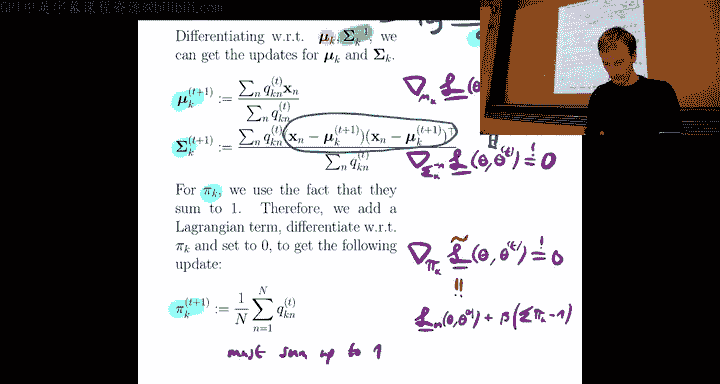

But still kind nice to have a closed form solution。O。So I think we have the whole argument now。

 we have designed the surrogate， we have maximized it。

What's not so clear yet is why are these crazy Q weights appearing here？And so on。

 and we will get to this。And is there any question on the de here？And yeah。

 today was a lot of notation， but it's getting better。We are over the。The hard parts。

And also computationally， I just want to emphasize again now that we have these updates。

 performingform them computer is super efficient。 I mean， you need to compute a bunch of vectors。

 It's really。😊，Really cheap。 You need to average your， your data。

Need to compute to few rank one matrices， it's all super easy here， even easier。So this trip is very。

 very cheap。And the building is surrogate step。As well。

 so just need to compute the Gaussian so this is quite efficient。Okay， in summary。

What is happening here so there's nothing new on this slide this is just summarizing what we have done I saw I showed you the expectation step。

 I showed you the maximization step。So again， the cues were defined and that's what it means to build the surrogate。

 that's all。And they are defined on the。Current time point， so this Ti。T恤。Right。And yeah。

 then that's it。And then you。You maximize it。 so， and maximizing means you obtain the new。

The new parameters。So， this new thing is。ter。T plus one， right？And yeah， that's all。40 so0。嗯。嗯。

You can also， if you want， you can track your objective。See if you made progress。

 that's kind of what I what I claim here， right， So this the the L。

I was claiming that every step you do is slightly improve or at least you don't get worse。

 that was the only claim made here and that follows directly because the surrogate is logo bound and it's identical to you at the current point so that's all about the em algorithm。

But what I also want to do in this slide， I want to convince you that this recovers K means as a special case。

😊，And that's actually also very easy to see， to see here。So when do we get chs？

We get it when we ignore this covariance business when everything is sical。And。

So let's try to do this。So which is all covariances will be deleted。And。Replaced by identity。

 so they become spherical。And。This vehicle means。I also need to decide on a width of a cluster。

 so theres a sigma here， which is we'll discussed a little bit。So sigma is a scalar。

 which tells you how wide is your sphere？The the waste of each each cluster So they're all the same waste。

 right， all the classes have the same size in in Kmins。So the claim is if。

If you do this until you let this width to become tiny， tiny so the width goes to zero。😊。

So that's happening here。 Then then the claim is we， we get， we get K means。 So。

 so what is this waste， right， it's。You can have a Gaussian like this。

So then this is your sigma squared。Or you can have a Gaussian like this。That's no negotiation so。

So here you have a much smaller whis。And。The claim is that when the sigma2 goes to zero。

 then we get the Kine lag， but why？So let's see what really happens， right？So now let's。

 let's look at the。The the equations。 So first of all， in in K means。

 there's no probability distribution and stuff。 So we。We just wanted to see what happens here。

So when you plug in the sigma stuff， then you get。That the normal distribution now becomes the sphere。

 and that's。That's what we just wrote before right we said that energy becomes the exponential of the distance from the center。

Minus how far away is your XN？From。From where from from the mean， of course。And what else。 Yeah。

 it was divided by the width sigma square。 So this expression， this is just a normal distribution。

 right， for spherical covariance。And I've just practicing。Okay， so。Interesting。And。Same here。

 so here then you have the sum overall case。Of of the same term。So which is just this stuff from。

Maybe I'll write it again。 So x minus the mean K。Over Sigma square。But yeah， which which key。

 So and now this this is where it's get interesting so。😊，So you can think a bit about like yeah。

 which K is going to be the best one here。So here we is some overall the mean candidates， right？

But then then here it's about the particular K， which is here。 so that's a different one。

Maybe I use different sorry。So on the numerator is the K。Which we have asked。

 right which so with the Q K N。So。

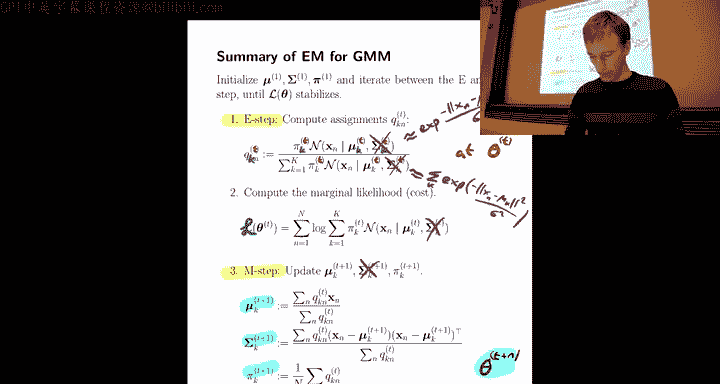

And the nominator is just summing up all the cases。

And what's going to happen here is that if this sigma becomes really small。

 then this is something a bit extreme happening here。Then I mean， these exponentials。Will become。

Super big， right。诶。Yes。Yes， all of them。Will sorry。

 so this term may be super big and then and then the minus in front it makes X super small。

 so everybody is actually going to be tiny tiny if this sigma goes to zero。So then what happens。

 right， so then everyone this is summed up here。And every， everything is tiny。

 So the only thing that they really survive is actually the。The one which is not so tiny。

And that's the。

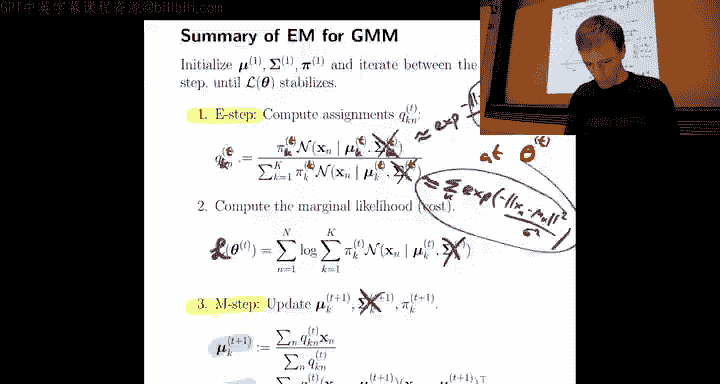

Oh no， I deleted it。Okay， we're back。

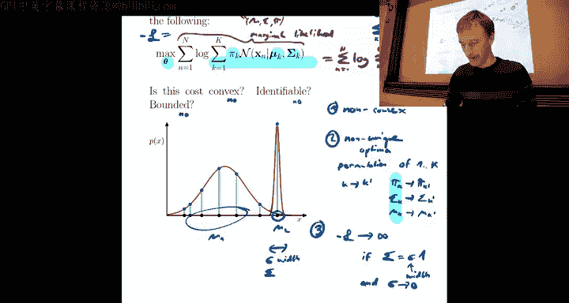

Okay， so which okay， everybody summed up。😊，And this magnitudes of these terms are very different。

 So the only one which is going to survive is the one which is which is largest。

 which is still the a little bit of contribution because everyone else is much， much smaller。😊。

So what I'm saying is that。The the class of the mu， which is closest to you。

That one will be the one which has the distance which is smallest here。

 so well be the only one which has the reasonable contribution Everyone else is further away from the cluster。

😊，So all the other cluster centers are further away from your ex。So all those other guys。

 they have a much smaller contribution these some here。So。

So what this means is that this quotient here going to go to is going to be e to0 or1。And。嗯。Yeah。

 let me delete this。So when is the quo zero， when is the quo one， that's the question。So。

The so question will go to。20， so as sigma becomes small。

What happens if either is going to be one or it's going to be zero so？

And it's going to be one if you ask about the closest k。

 so if the green K here is closest to the your x， then it's going to be1。嗯。If K is closest。

Two weeks in。And it's zero otherwise。嗯。So why is that again。

 right So so if you're closest then you contribute the biggest term in in the I mean。

 the whole thing is going to be the term which has most contribution so。

And then all the terms get summed up， right， but all the ones which are smaller than the。Then。

 then this particular k， they they have much smaller contribution。 actually， they goes。

 they go to zero relatively too。To the to the main one。So then if you're not the closest ones。

 so if you're one， if you're maybe the second closest center if you ask， okay。

 what's QKN and so for my data point XN？Which I'm asking about the K。

 which is the the second closest to me， but that one will be completely negligible here。

 It will just be。呃。It will not be determined well have a tiny， tiny contribution。To this sum here。

So then this one will be so much smaller than the， the sum， which also includes the biggest one。

 right。 So I'm just saying this will be the sum here is dominated by the。

By the K which is closest to your x， so with that mu。

 so that's why the Q can becomes one for the closest center and0 otherwise。

 and that is what Q means to us so that was the hard assignment。So if Q is 0 or1。

 then it becomes what we had called Z in。In cames。 So that。佢念期三。

So there was this01 assignment so in EM this can be different from0 than one。

 but if you do the sigma to0 then you get the hard assignment01 so you have the questionnaire。对我开。

并不认。嗯。Yeah， what happens if you have two cluster center mu which are equally close to your x？😊。

Good point I haven't thought about it。Yeah， I'm not sure， actually， I think there's a tie breaking。

Seeing here， the argument will still be true， but then you will be like only half of the magnitude discovered by you。

Yeah I'm not sure maybe then you need to be more precise to say that you give half to this and half to that。

 maybe then it's not clear how to do the hard assignment yet。

But we here assume that everyone has a slightly different distance and then it's clear then you will get assigned to one cluster and yes。

 for Cammes you must be assigned to one cluster actually also in Cammins you have this problem right if you're equally close two you need to decide you can only assign to one and that's the same here so。

😊，Thanks for the question。Any other question？Yeah， what if the sick。

When the sigma is not closest to your。 then then I cannot say anything。 So then。

 then we basically in general E M case， but we have made the shapespherical， right。

 So you can do that。 It's， I mean， yeah E M， then you just solve a general a Gaussian mixture model。

 So you have decided to solve Gaussian mixture model， which has spherical， which， which is fine。

 It's a good。😊，Good thing to do。So。So in summary， yeah， if sigma goes to zero。

 then you get this assignment here。The K means assignment。So yeah， the accusedes have become the zs。

So I write approximately equal。O。And so thats that's for the so the zs we have recorded。

 So what about the other step？😊，And。So that's much easier there。 there it's obvious。 So now。

 now we have the same process and we ask， okay， so now how we have the。The。

 the parameters to they get。 So now I know that what my queuees are， right。

 I know that the queuees have become the hard assignments。 So then this is directly becoming the。

The the mean。Of the cluster。So that's only in the Kmin case， right only if sigma goes to zero。

 that's a crucial。So if， yeah， if the queue is become this hard assignment， then again， you。

 you are fine because you。You， you get， I mean， you get the same as it came means the sigma。

There is no such thing。And then the pis， well yeah。

 they do sum up to one because also the hard assignment sum up to one。

 you can only be assigned to one cluster， it's a one for the z variable， all the others are zero。

 so yes。Again。They do sell up to one， so things。Are fine， and。So sorry。

 this actually is counting the number of points assigned to cluster K， right。

 we're just asking who is assigned to cluster K then might be。Number of points。Assigned to to class2。

Okay， so all that to say that if。Covariance goes to very， very small and thepherical Uurt came means。

 so that was the purpose of this slide。

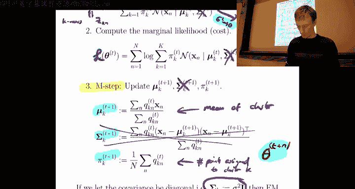

And if there's no question on it。😔，We have one or two more slides to discuss。

 there is a slightly more general version of the EMI as well。So。Almost done。

But it's kind of nice study's a generalization。So also to get a bit of intuition， what's happening。

 So the picture is really almost the same as as we have seen in Ka meanss。

 So let's run it for a real。😊，And I think this you can also do in the lab next week。So。There' again。

 this kind of two kinds of steps。 So maximization。 So of course， I'm mean first。

The expectation step to build a surrogate， so here is the E step， which you do first。

So the E step means to build the cus， which you can think of as the queues are the soft assignment variables right because they correspond to the Kimmins hard assignment and Ill explain you afterwards why this is a soft assignment。

 why this makes it。Sinceense。But the queue is all like the assignments right so so what I'm plotting here is actually the for every point there is a Q telling you that you are 30% red and 70% blue so that's what the Q is because it's Q K and right so that's what these colors here mean right the points in the middle are bit 5050 they are purple。

And the one here is a red point， which is like 99% red and 1%。呃。Q N for blue。

 So so that was the E step。 And then we have the M step to max the surrogate and maximizing means we change the parameter so。

So we changed the the shapes and positions of the of the two centers。 So this is how we update our。

Our GM， right， Gausian mixture model。 So we have two。

 we here be doing a mixture of just two Gausians， so very simple。You need to， of course。

 initialize it somehow， so usually you initialize some spherical。And somewhere。So。

And when here is the first time we changed them， so now they have become a bit eipse so this is from the Sigma update。

So now it's actually present， this is not K means here we do the real thing with the real sigma matrix。

So that's why they have to changed your shape。Then they also have changed position。

 so that means that the mean has changed。And that's it。So finally， we do another E step。

So we recall all the points， so that means you're new。The queue guys have been computed， right？

And then another M step。Okay， and。Yeah， the results seems a bit similar in Kmins。

The only difference seems that the shapes of the cluster now can be real ellipses。

 which is nice because you can see maybe this cluster is not so well approximated by a circle。

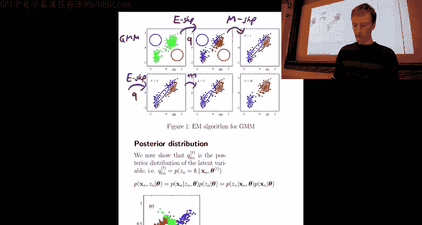

But it is well approximated by eipps， and the algorithm has found it。

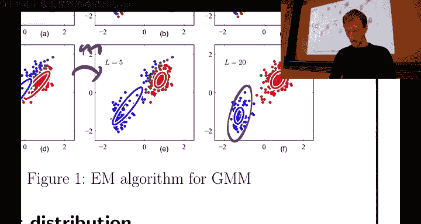

And yeah， you just perform as many durationerations as you have patience to do。

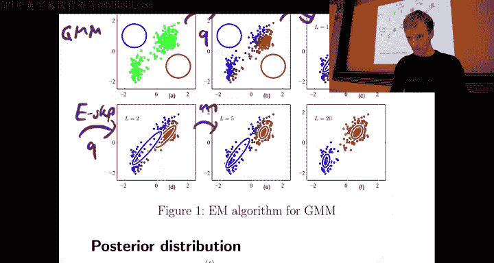

And that's it。Yeah。

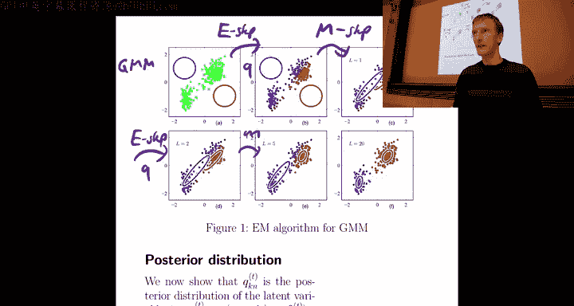

Other arrow would just be mean to perform the step， right。

 So here is before the step here is after the step， so。It just， it's just time。 I've done a。

Two rounds， so EM is one round。And then here I have stopped。The air the。主关。Oh， sorry。

 you're asking what is the L in the graph？Good question， so。你。没了卖。Yes， but yeah。

 ignore the as so because I fear was just one this is iteration one， iteration2， iteration3。

 so just think of that so。😊，And。Yeah， in EM it's not so clear when to stop it's in Kimin it's more clear because eventually your clustering will not change anymore here it will probably keep changing a little bit forever。

 so so yeah， maybe they stop this after 20 steps I don't know。

 but it doesn't matter this is for illustration。How how this would look in practice and play with it try it out in the in the lab。

There is a very nice spike notebook。ok。Okay， so and now finally， you， I guess you and also。

 I still feel a bit uncomfortable about theseque things on why the hell we resetting them。

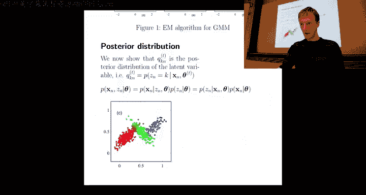

To these strange values and so on。 And what are they actually。And so， finally， I can。

Give a little bit more insight on this because they have a very nice interpretation they are very clear they have a very clear probabilistic meaning and it's a bit what we have what is feeling we had here when we said that youre 70% red 3% blue that has a formal definition and that's here so it's here the cues exactly mean that they mean that so here is。

😊，The hidden variable that that you assigned you're either red or blue。

So and they're exactly given this probability for that happening so。😊。

Probability that the point is red or so K is red or blue。

Given that you have the data point and the current parameters。So what is this。

 is like a hidden variable condition on the data and parameters。😊，That is a bit strange。

 What we are more familiar with is actually。So mean like this year， the probability of the data。

Given the parameters。 So that's something that we know。 So， and this is a。

Likelihood we know this stuff on the left。 You also know this is the。The joint， of course。

The joint distribution。X and Z， given the model。So。This we also know。

 this is the prior we have on this ceiling variable。But okay。

 none of this stuff is what we have here in blue， so what is the blue thing？And。This。

We can understand also this equation here is just base rules， so nothing。

AndNothing has happened here。HereHere is the quantity we're interested in。

 so it's on the right of the equation and that thing is called posterior。And。

And then on the right we also have the probability of x given the model。

 so here the zs have disappeared and that quantity we have also seen before already。

 so I'm just giving you the name。So this was what we call the marginal。Likelihood。So， I mean。

 all the companies， all the quantities we already know。

 except the blue one is the first time you see it。But the good thing here is that yeah。

 the other ones are nice too。To understand and so on。

And so just to make a bit more clear why this equation， so this is really simple。This is just a。

Probability of A given B。Probability of B。So this is just talking about。The sets and the X。

 basically。So that's this。 And then on the right， we have probability of B。Given sorry。

Maybe I'll wait to hear。B given a。And probability of eight。So just by days is rule。

So forget about the parameter that's not what this equation is about， so not about the Tita。

Because that's conditioned everywhere so we can ignore it， this equation here is about x and z。

So it's using base rule on X and Z。And it's just telling you。呃。Yeah， that that， so。Yeah。

 it's not telling you much actually， it's just that。It's just telling you how they're related。

 It doesn't tell you yet that the queue is actually equal to this。😊。

But that's going to be our next step， so I will try to convince you。So。

So let's let's use this knowledge。 I mean， this is just giving names to stuff and nothing happens。

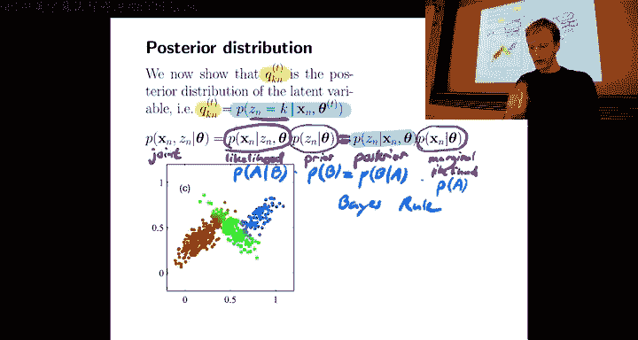

So the only thing I'm suggesting here is to apply base rules， hopefully to understand this guy。

 to understand this term。呃。So， let's see。The soil distribution equation now for。For the posterior。

 that's what I want to study， right， so I want to have this on the left side。Bsteriio。

Xn and the parameters。So it's just going to be this thing divided by that。呃。Okay。

Prioritize likelihood。

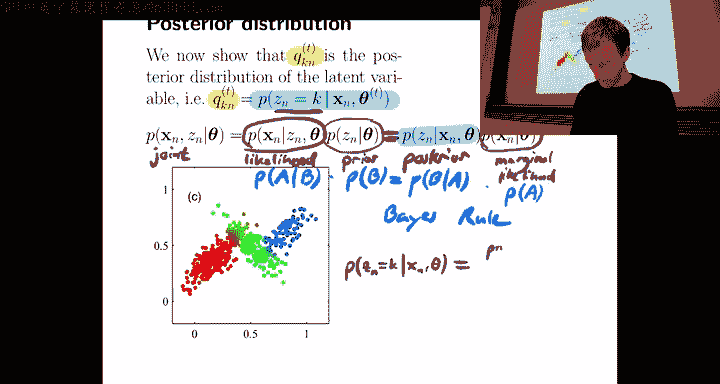

Do youide by the marginal？likelihoodlihood。And。Yeah。

 that's the last formula we have to go through today and then。

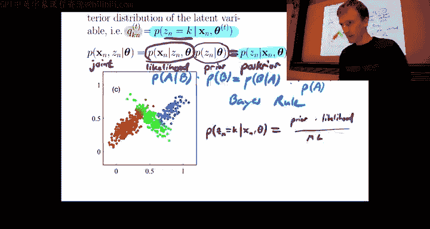

Things are good。 So the prior we are very clear what it is， so。That's actually P K。Pi K。

 because that's exactly how we define the prior。对。Okay， I write it in two steps。 so probability that。

Sa n is equal to k。Given the parameters。And that we know we have defined this。

 so there was our very first design choice。When we did gohi mixed model， we designed。

This was designed to be P key。Okay， what's the likelihood we also familiar with that？😊，呃。X。

 given that。Sigma， S sorry， Tita。And then again， it's summed up or pi k， which is。

So now I'm dividing by the marginal likelihood。And， and there again， the。

 the point of the margin likelihood is that the。The hidden variables disappear。

 so I actually taking an expectation here of whatever these sets are I don't know what they are。

 so I just average them out。So。Said n equal to k。timess。The， the likelihood。And again。

 this thing is just a pie key。Okay。And then about these guys。Well， they are just a。

These are the easiest ones。 So these are the。Normal distributions of x。Normal distribution of x。

Given the promise。啊。Okay， so all this is just to say that， yes， this is Q and K。嗯。😊。

So just by how we have designed our publicistic model， it's very clear that this， I mean。

 before we did not， we were not clear to us why。We chose the Q and K to be this， but now。

Now we know what they mean right， so they mean to give you the probability that you are assigned to class2。

If you are data point X and the parameters are like this。Does this make sense？嗯。Good， so this。

 this is seems to be a nice recipe， right， so。What you have done here is。

Just computed these twos to be kind of。Averaging out what we don't know， so we don't know the zs。

And then this helps us to define surrogate。So there is exactly the same thing。

 You can do much more generally。 So that's， that's exactly what's written on this。😊。

Very last slide promised so that's what's written here。😊，So here。

This is a very general probabilistic model。We I don't know what it is。

 It has It has data and it has hidden variables X as Z。 I don't know the Z right they're hidden。

So of course， what you' had done so far was an example of that。

But now now what I'm saying is that here I should just take。The， the expectation。

Over over these hidden variable set， whatever they are， I don't know what they are。

 I would just take the expectation over them。And that's what we did when we computed the marginal likelihood。

 right？呃。So。Because you can see this thing here Easter。Is the likelihood P of X and set together。

 given a parameters。 So what is happening here is that you just average out。What you don't know。

So and that this expectation here together。This is the surrogate， so。诶。Of。

 of your current parameters stta。So this is a generic way to build surrogate whenever you have a probabilistic model。

 you have hidden variable set， it's just you just do like this。

 you compute this expectation and you can see the expectation is computed。😊，At's the current time T。

So you don't know what the sets are， but the best guess you have is that they will influence the model like on average。

 right？They will。Things would just be like， on average， or all that。

So I will just average them because I don't know them。 So then I have this thing here。

 which is my surrogate。And then I maximize it。😊，And that we familiar with right that's what we always do and that's our next itererate。

So this is the much more general form of this same algorithm。

 and this is really the same thing as we have done the whole hour now。

 So you can see we have average。😊，And this expectation， this averaging weights， these were the Qs。

We've average this simplified function。And then we have maximized it。

So it's a very nice thing to do to deal with uncertainty。 You don't know what the sets are。

 So one way to think about it is just just think that。😊，These sets。

 you can think of them as being part of the data， but you don't observe it。

 so it's kind of a hidden part of the data。And then it can also be reasonable to just average over it。

And。Yeah， that' that's maybe the simplest interpretation。

Or you can think of them as the the latent variables right， as we did where we introduced the。

The Gaussian mixture models， so。Don't worry， either way is fine， right， You don't need to。

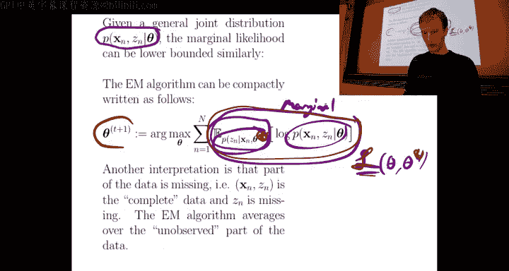

It's not the one way it's correct or it's wrong， like either you can the zs can be hidden parts of the data。

Or there can be hidden parameters， which you would like to optimize but you cannot。

And then the natural thing to do is to just average them out。

And that's what it means to build this surrogate， so it's actually probabilistically motivated。

Allright， this is all about E。

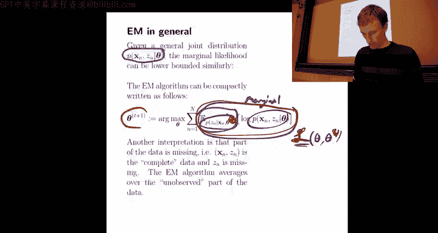

Next week we change to general gener adversarial network also known as GNs， so see you next week。

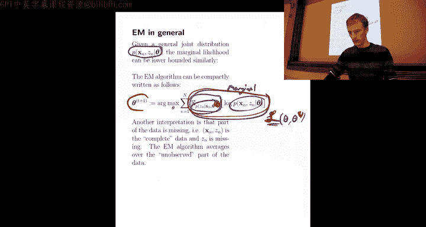

啊。Yeah。