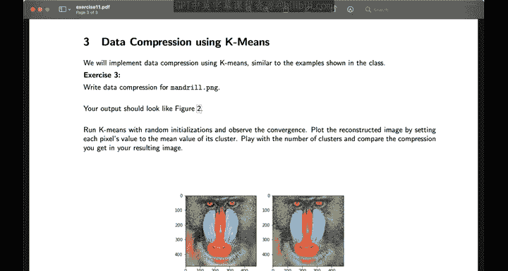

# EPFL《机器学习｜Machine Learning Course CS-433 fall 2020-2021》中英字幕（deepseek - P33：[33]Exercises 11 - getting started video.zh_en - GPT中英字幕课程资源 - BV14SwyeNEvW

Hello， everyone。 My name is Matthewti Hajibai， and I will be presenting the 11 problem set to you in the first question。

 you have to determine the gradient and Hasian of F with respect to X。

 I encourage you to write down F as a function of each element in X and find out the solution in this way。

In the first part of the second question， you have to write down the joint probability distribution of your data。

 Since the data is independent and identically distributed。

 you can write down joint distribution as a product of each probability distribution and get a simpler form for your answer。

 In the second part， you have to find out hyper parametera。

 Miu and sigma that maximize the likelihood of your data。

 Since logatatic function is monotonically increasing。

 you may also maximize the luck likelihood of your data In the third and fourth part of this question。

 you have to compare your empirical estimate to the true parameter values to see whether your estimate is bias or unbiased。

 Keep in mind that your empirical estimate depends on all random variables。

In the implementation part of this exercise， you first have to implement Kins algorithm and then apply to the two dimensional phase for data and three dimensionmenal RGB values of an image。

 so first you initialize your cluster center either from your data by subampling some points of data or just some random point in the scale of data。

 then make sure to try different values  for k to see which one gives you better cost function。

And but keep in mind that the highest value4 k does not represent the best fit to your data。

 you may check out base information crion to know more about choosing the model complexity for your data。

In the final part of this exercise， you have to compress an image using the Canmens algorithm that you just developed。

 So first， to transform your image into a vector of RGB values in three dimension。

 and then apply the canymen's algorithm。 Keep in mind that you can early terminate your algorithm if you are not improving your cost functions。

I hope you can enjoy this exercise session and thanks for your attention。

