# EPFL《机器学习｜Machine Learning Course CS-433 fall 2020-2021》中英字幕（deepseek - P34：[34]EPFL Machine Learning Course 2021 - Week 12 part 1.zh_en - GPT中英字幕课程资源 - BV14SwyeNEvW

Okay， so we talked about generative models last time。😊，And this time as well， we。

 we want to take this step further。 So we finished the expectation maximization algorithm。

 And today will be about about guns， right， so。Generative adversarial networks。

 which is a way to generate data or to learn a generative model。

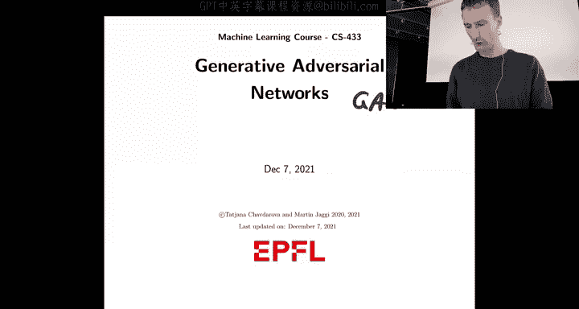

So。

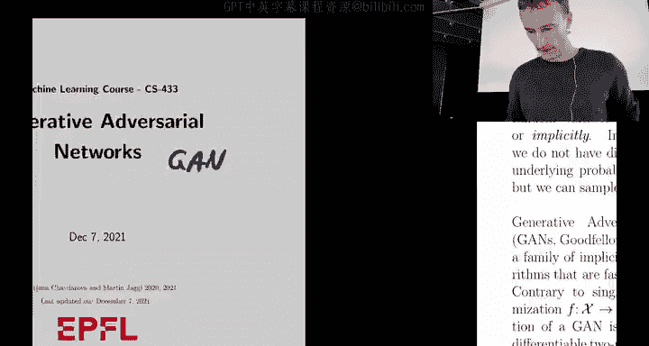

The motivation here is that generative models are quite different from。

 from the standard supervised model that we already familiar with， right。So。So， we。

We have seen this many times that we。We can just fill the classification problem。

 We like supervised data when we have labels， right， But this is different。

 So now we don't have any labels。 We just have a。A bunch of， of X data points， which we。

 we are given。 and we， we try to ask。Can we learn some things on black box which can generate data。

 which is similar to those？Real data points， right。

 But to learn the model can produce as many as you want， right， it's really to。

 to generate like fake data， which， which really looks， looks like real。

So these are generative models。And we， we have already used the idea a little bit when we talked about like Gausher mixture models in there。

In the previous week， right， but。Today， we。We will take this a bit， a bit further。 And so the。

 the idea here is that it's formulated not only as learning one model。

 but kind of learning two models at once， so。You learn two parts of it。 And these two models。

 they are interacting with each other。 They are， theyre in a competing objective against each other。

 So in a kind of a game， as we will see。So。The way we will formulaize this learning here will be a two player game。

 so。And the two participants in this game are。The the generator。

Which has some parameters stta which you want to learn， so the generator is a neural network。Which I。

 this is the one which will produce sake data， for example， images， but it can be anything。

 It can be any data modality。So this network will produce a data point or something that looks like a data point。

But then there is an another network。Which is called the discriminator。

And that network takes image as its input。And it outputs a decision。 Yes， no， it。

 if it believes you as the generator， if it believes you that this is a real image or a fake image。

 So that's his job is to discriminate between real and fake。And that discrimator also has parameters。

And this here we call phi。And。So that's nice。But we have to of course。

 now talk about how we how we formulate the learning so we need to decide。

What is the optimization problem， right to learn these parameters？So， here is the。The one for。

 for the discriminator， you just minimize the discriminator loss function。

 but we don't know yet what the loss function is。 And the。

 the key point in this loss function is that it will depend on both。 So it depends。

On from if you are the the generator and you have these theta parameters。

 But there is also your opponent， which also has parameters。 And depending what they are they。

 they play。Different with each other to， to produce a loss， right。

 a value on who is going to win the game。 That's， that's what this loss value now here is。

 It's like if you're seeing a bit of a game theory then you see that there is the the payoff， right。

 a player a win。 So if， if you played Cta。And I play。So I， then who is going to win， right？

 That's that payoff if it's negative， it's for me， if it's positive it for you。That's the value L。

 And me， as a minimum player here， I want to。Let's say minimize and you。呃。My have a different goal。

 You might。1ant to maximize， for example， if we have the same loss function， so。

So these are the two problems。Of the two players in general， they can have different loss functions。

But the， the most the。呃。Simple setting is really when。

 when the this lost function of one player is minus to one of the other player， right， So that's the。

 that's what's called a zero sum game， right what。What you gain， I lose and the other way around， so。

So if the loss function。Is the same for both players or actually with the opposite sign。

 then we have a zero or sum game。And then we say we have a mini max problem， right。

 because you can see that。The yellow player， the the generator here， wants to minimize L and the。

 and the red player， the discriminator wants to maximize。The red L Phi， right。

 He wants to minimize minus of it。 So he wants to maximize the red function。So， that's why。We。

We call this minim problem， which is a very。Useful and very important class of optimization problems or so that's how we formalize to play games。

 right in。In this formal definition。This is the minimum player here， the generator。

 so and then we have the max player which tries to maximize。Over the five。

Varis and the loss function， let's say it's just L， but the key thing is it depends， of course。

 on both players。Tta and fight。Okay， and for us， yeah。Maybe。Maybe the。

 the minimizer will be the generator and the maximizer will be the discriminator。

 But it really doesn't matter， right This is general。General formulation of its zero zone。

0 something。Any， any question on this？Okay， so these games， of course， have a lot of use cases。

 but what is also。A bit special here is that we do this with neural networks。 And， I mean。

 why is this nice。It doesn't really make a difference because， of course， general functions are。

Even more general than neural networks。 But what， what's convenient if you have neural net is that they are differentiable。

So。If the。The the， the generators the network， the disc screenriators the network then and。

 and the loss system some function on defined on top of them。

 then probably you can differentiate this loss function。 So we have a。

 what we call a differentiable game， right？ So that's。

 so that's what it makes it kind of a bit special and makes it a bit more。Convenient to。

To handle such games here， when the loss function is differentiable。Then we have a better chance of。

Optimizing these games meaning to find a good solution for both players。

And good means that so we will define it， right， There will be some kind of equilibrium notion here that both players are happy。

 cannot improve。 So that's the kind of。Quality we hope for。And so that's。

 that's what they're going to do。就对。And don't worry， I will define what the loss functions are。

 There's many different possibilities to define them， but they are actually quite simple。

And then of course， you have to decide what kind of neural networks do you want your generator to be and what you want network do you want the discriminator to be。

But the idea is here is how we will then train them。呃，Indian是。Okay， these are games。

 differentiable games。😊，And what does this have to do with。Generative models。 is's no。

Obous connectional。So。Genrative models is just。As we said at the beginning， you try to。呃，就。Not to。

 to decide on a data point if if it has a property or not。

 but to really produce data points and produce them in a way that your your artificial data is。

In has the same distribution as the real data。 So that's。That's what generative models are。呃。

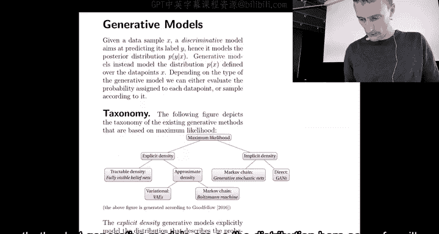

The distribution here， So P of x would be the the true distribution。Of， of all these data points。

 right they。If nature would give you the data points from this P of x， but we， we don't know that。

 that P of X， of course， this is the problem。So we're trying to find something else。呃，为。

Which is hopefully producing data points which have a similar distribution as the as the real ones。

 So that's what what generative models are。 And we already talked about it a bit when。

In the Gaussian mixture model case here it's just to say that， yeah。

 this is very different from a discriminative model， which just wants to predict a label， right。

 just to to put this。Into contrast， but today we will focus， of course， on。On the generative models。

 so。Okay， and。

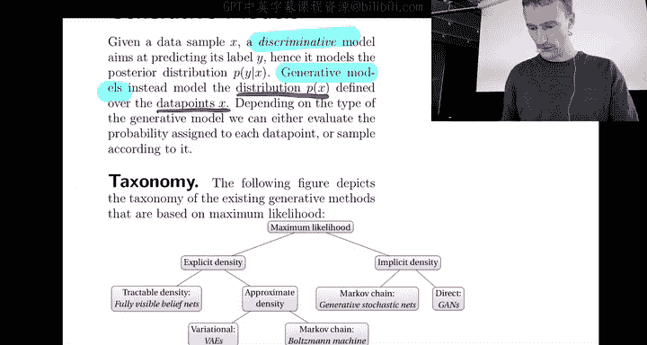

How， how could you。Tra a geneative model to find good parameters to make this happen。

We have also seen that。 So it's usually。Usually by， by maximum likelihood。And。So that's。

 that's quite。A generic idea as well， right， So you。You have now。Real data points。 And you have。

Many potential model parameters you could condition on。 So now you're trying to find the best model。

To， to maximize this。 So this is the likelihood。Of data， given。Given the model， so。And yeah。

 maybe I should write a capital X here because I， I want the。The full data sets。呃 they said。

And I need to find my parameters， right so trying to find。呃。T the star will be maybe the。

 the maximizer of this， right。The Archrcmax。我知得。Of this likelihood。 So this is how we always did it。

 right， We always said that whenever we had models which have a probabilistic interpretation。

 then we said the best model is the one which maximize the likelihood。

 That's a like likelihood principle。

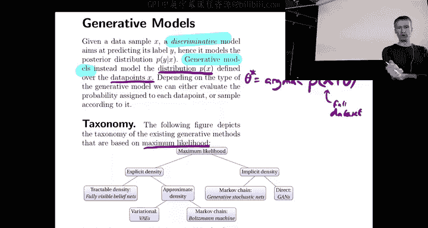

And that's also what we're going to do today。 And the nice thing is this works very nicely also for。

Generative models， right to learn such a density。So this P here is like the P of the model， right？

And we。We like to， we want。 So these are the model parameters。 We want this to be。

We want this P the distribution to be as similar as possible。To the， to the real data， so。

So this is kind of the goal。That yeah。But this is approximately equal。To the real， so。Real of x。

 hopefully we find us a tita， which which makes this thing almost the same as the real distribution that's our goal。

So basically all geneative models are。Are following this principle or the， I mean， not all of them。

 but the most most common ones。And。This is just a little overview。

 so I'm not going give you all of them， but I'm just telling you that there is many models as some of them we have seen some we have not seen。

And。The one。One key difference is that some of them assume that we have the the true density。

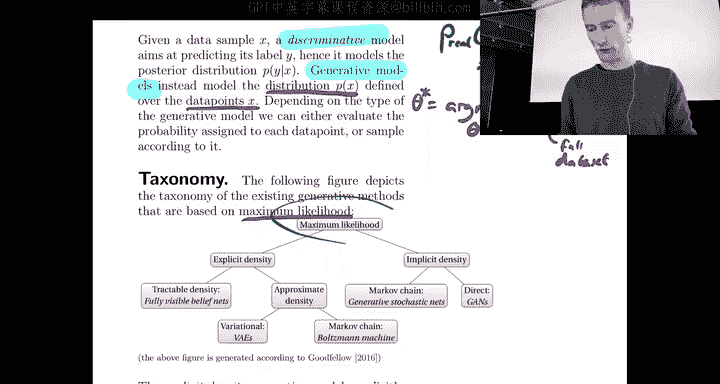

And some assume we don't so。So that's the， that's the different here。 So if you know the。

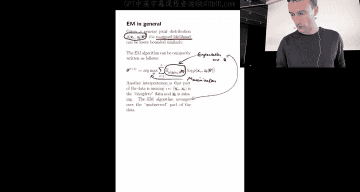

呃，的P。The redistribution of all data。If you have that。

 then that's what we call a explicit density model， Right， So if it's already given to you。

 But this is very rare， It's not， not so realistic。 So it's much more likely that we don't have the。

的。We don't have P of x， but we can。 We can just sample from。嗯。Sorry。

 so this this is about P of x we which we learn。 So either we explicitly model it or we we have something that that is simpler we can say。

 okay， maybe it's enough for us to train the model when we just sample one data to one at a time So then we on this branch of models。

And and that's actually where guns are located。 So for them， it's just enough to。Just sample a few。

A few data points from your model here and and also a few from the real data and from that it will be enough to train train the model here so that's why it's called the implicit density model because it's enough to just sample from each then。

D，And again， so this， this was the。What makes him likelihood means that you already。

A familiarmili with And the。The other things we will not discuss， so。嗯有。😊，Yeah。

 if you already have P of X。Yeah， good question。 What does he mean by half， right？ So it means here。

 half means maybe you have a mathematical formula。 You could try it to write it close form。 So。

 and also。Some models， also the model will allow you to write this one， the。

 the one from from generating your data。 that one could also be maybe it's。

 you can write it explicitly。 You， it's like if you' on Cta。

 maybe you can tell me exactly what the the P of X distribution that you will generate from this seatta。

But that's， that's still a relatively strong assumption。 And surely。

 it's a very strong assumption to say。That you know that the what nature gives you that you have the perfect formula for or P of X。

 So I would say these are not。Not so realistic for this and I mean。

 we will only dive into guns today which for which is' enough to just sample a data point and compare it to a real data point and from that we'll be able to learn the Tita。

Bramed Sir。Actually， what we learned there will be parameters of both the generator and the discriminator。

 but here here we talk about the generator， but it doesn't matter for this discussion。嗯嗯。

But thanks for the comment another question。Okay， this was just a very high level overview right。

 so we will make much more precise how it works for the specific case of guns。In a second。So。呃。Yes。

 so。And。嗯。Just to explain a bit more about how it's different to just learn one model。

 It's very different from learning two models， which， which compete against each other。 So this is a。

Is a very different kind of game。It's like a single player game against a two player game。

And so for so far， we have always just learned the one player case。 right。

 we had one model which you chain so。The job we wanted to do was to minimize the loss function of just。

One set of parameters， maybe we can also call it Tita。And it was just to fit the model， right？To。

 for example， in supervised learning， so。嗯。So this is kind of the one player case。

Maybe the landscape looked a bit like this， so on the vertical you have maybe loss function。

 we were just minimizing it， right。 So whatever all the amount we've seen so far， they go like this。

So。Order minimizing likelihood or anything， or some loss function。Yeah， maximizing likelihood anyway。

 So there was only one loss function which we optd。 And maybe it looked to be like this。

 And we found here a minir。 It can be a complexvex one。

 So you can see that this will be a nice landscape。We discussed this many times。

 right if it's complexx， it's nice， but it could also be non convex。

No matter if it's comic or now the the thing is， there is only one variable involved。

 we only have one thing to optimize。playinglaying this minimization game alone， so to say。

And then what we know just said previously is slightly different。 So now now we have two。

Two players which have their own parameters and we which have opposing objectives。

 I just want to give you a。A feeling for this。So that now the landscape looks a bit different。一个是。

The five player， which is the discriminator here。And and the。

 so that guy is time to maximize and the generator。Is trying， is trying to minimize。I mean。

 they don't need to be called screenriator generator this this is true for any games right any differentiable game will will look a bit like this that。

Maybe。Maybe the generator tries to go as low as possible on on this on this thing， right？

So that's the generator， if this is the green function wants to go down。

And then we have to discriminate， which might be the。The one controlling the red coordinate。

And that one。W to go up， right。So the landscape maybe looks a bit like a saddle that one is trying to go as high as possible。

 the other as low as possible。 Maybe they find a point where they。Each cannot improve anymore。 and。

 and that's we're going to define it a second。That's that's what what will be just the equilibrium of the game。

 So maybe you have heard of a。What an national equilibrium is。嗯。And for us。

 it will be even easier because these two。Fctions with respect to the two parameters。

 So I mean it's only one function， which depends on both parameters， it's differentiable。So for us。

 it will be convenient to， to design， to say when， when do we have an opt moment also to have easy algorithms。

To hopefully go somewhere like this， to find a point where none of them can improve。So。When。Yeah。

 when none of them can improve that that's called the na equilibriumum。And。Yeah。

 maybe you heard about this already。So。And if it's differentiable。Then。Then things are even easier。

 so。Don't be too scared here yet。 So， so this is a。A bit of formulas。

 but it's just a definition to say that this is the the optimum。 What does it mean。So。嗯。The。

 the thing here is this is what a， what a classical national equilibrium means， as you。

 as you already know， right， it just means what that you said no， none of the players can improve。

 so。嗯。couldib边。And so what I what do I mean by not improve。 So it's very simple。 So the。

Here is the generator， so。The generator is a theta star。It tries。 this is the， the mean player。

 the one。Remember from here， the that one wants to go down， right， trying to minimize。Okay。

 can keep this。And。So you can see that So the。This player， the yellow player， cannot improve。

Because whatever he or she does， it's going to get worse， so which means because it's a mean player。

 the value will be worse if if you go somewhere else， right？It。

 it cannot be better than where you are， which is a Ti the star anywhere else you go。

It it's worse or at least as bad。So that's what means here for all different choices and that's exactly how national equilibriums are defined。

And the same for the auto player， the。Max player， which is what we call the discriminator Ross。

Also for that one， whatever that does， it's never going to be higher。And then what it is here。

 so again， it's already optimal。呃。For， for the discriminator as well。 So this is the classic case。

 But this is very hard， right， It's just very abstract。 We cannot from this， we cannot say how。

 how do we find such a equilibrium。 We just say that， okay， obviously， it would be nice to。😊。

To go to some， some point。 So or a pair of points where well this is true， how。

How could we ever hope to find something like that？And。For us now。

 now we're gonna do it easy if we can use our， our knowledge it from。

 from a differentialiable optimization。 we， we know that there things are much easier。

 we can use gradients and so on。 We also had a much better understanding what it means to be optimal。

If you， if you actually do have gradients， and that's what we're gonna do now to。To say， okay， if。

 you have a gradient， can we， can we understand this a bit more easily。And。The answer is， yes。

 it is is much more convenient。 I give you a very easy。Condition。To say that， okay， if you're， if。

 if your gradients are like this， then I I will， I will know that。Yes， you will be actually at the。

The N equilibrium。Yeah。Okay， Im not saying that these conditions are super easy to， to verify。

 But if， if you have them， if they're true， then it's very clear that。You have found an equilibrium。

 so。And。The condition is like two parts， so this means。

The first one is just that the gradients of both players are zero。So。嗯嗯。And， I mean， the。

 the norms is， is 0， right which means the same the as if the。The whole gradienting is here。

 That's the same thing。 you can actually。Can skip the norms see I you prefer。So。

 so what this is is a stationary point just I found a point。We are great in so， suppose。

So and the point is both parameters together， right？So we found a solutionary point。

 but that's just one part of the story。 So there is a。There is two。Two additional conditions。Namely。

 that the this point where we are is actually a local optimum。And， and that， you may also remember。

From from the when we talked about convex and so on。 So I will explain a bit。

 But what this means is that。That we have found a strict。六 club中。And this so okay， what。

 what this means is just that the hessian， so the matrixs of second derivatives。意思。

Is curve of the upwards for the。

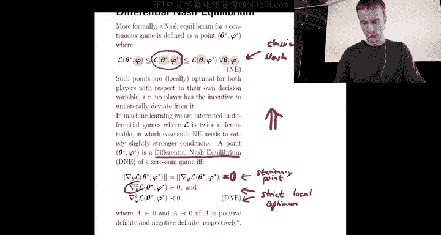

The mean player， so。Soda。What color did we have， Yeah， the the mini player was the generator， right。

J is purple。呃。Loss function。So we mean that the the mean player， the hesian。

 we suspect to the mean player， is curved upward。So here is his he， and that's what he means。

And then。We also had it for the max player， which is the red kind of curve。

 which one to wants the opposite。For that player， we want that the Hes is curved the other way。

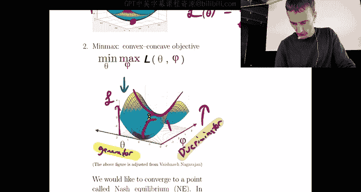

So that it， it can also not improve so。So， that's for the。For the max player， too。And yeah。

 maybe those you have seen， right， this， it just means。That。A matrix is is positive， Step， right， if。

 if it's。Whatever you put right and left， it's going to be strictly positive value so this session will be curved upward。

And the same and this one would be curved downward。So嗯。对。Okay， is there a question on this one？Okay。

 so thiss not super easy to， to compute a hash。 right。

 if you have a huge neural network then this will be too hard to compute。But for the condition。

 it's still。This is just about the mathematical thinking here。 Like if this were true。

 then then it would be clear that。We， we cannot improve。哼呃。Around our point， right。

 Because so currently you。Let's say from the from the mean player object perspective。

 the the generator。So the the gradient is 0， right。

 And where this one here means that wherever you go， when you vary a little bit， the value。

 it's curved upward。 So the value will get a little bit worse。

 So which is actually the very same thing as。As as this inequality here。

 right that whenever you go slightly away， it's going to get a bit worse。 So here。

Equ worse is allowed。And here， because we have strict。

Positive definitelyness is even a bit stronger condition， right。

 We will say that this is actually a strict。呃。Local optimum， so。Things cannot be improved。

 So it would be， yeah。What have I done， right？ I， I didn't tell you very clearly how you can find such a one。

 such condition。also not for this one， But I told you， if you find this one。

 then it's clear that you have found a。What we was our goal。So this thing is called a different。

 differentiable。男士 equilibriumib。Or differential equilibrium。So。Well。

 you can also define define this for。Smallller or equal then some people call this a strict or not strict。

Differently。Okay， and。

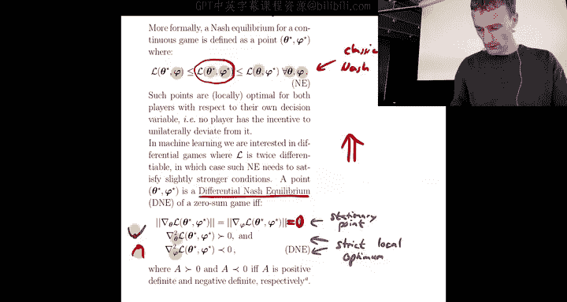

So， now to。To optimize such games， what we will do is we。We will use our standard algorithms。

 we will basically just do gradient steps。And they will not bring us precisely to a point where this is exactly true。

 but hopefully they will bring us somewhere close。So if you're lucky。

 you might even get somewhere rights。Exactly true。 but as as we know from optimization， usually。

 we only get close to the to a optimum。But maybe not the。Exactly there， but that's okay。So。That's。

That's gonna prepare the way。To then optimize these things。 So actually。

 all algorithms that you have seen。Which， which can optimize something differentiable。

 They can also be applied here， basically。 So we will see this at the end today。

That just that the generator will do a step， will do a gradient step to optimize theta。

 and then the discriminator will do a step to optimize Psi。Or phi， so they will just alternate。

Between between each other。 So that's gonna be the algorithm。

 And thiss nice because you can use it for any games and also。Also， you can use it for guns。So。

This is about the theory， more or less。And now we， we still haven't defined the actual loss function when we want to use if we generate data。

 So we， we need to do that。

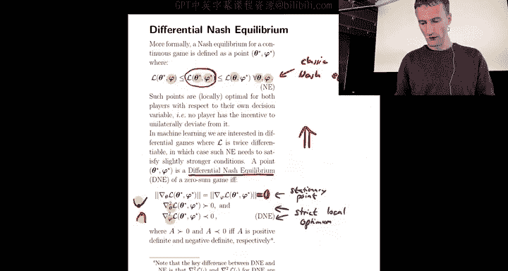

And。Now， this， this defined here。 And actually， we， we talked a little bit about it when。

When we talked about the introduction to unsupervised less I think two weeks ago。So。The principle is。

 is really simple that you the。The here is two parts， right， which we are already familiar with。

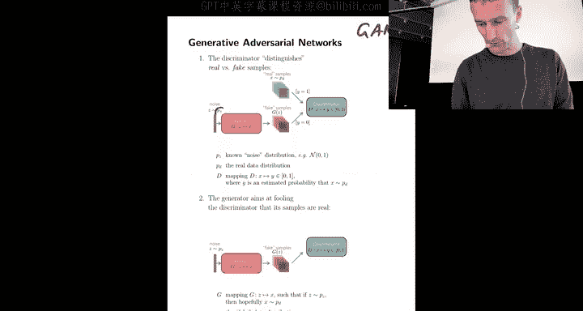

，The generator。And the discriminator。And。Their job is just， as we said。

 right discriminator tries to see if what what we call is real or fake。And the generator。

Tries to fool the discriminator， so generate something。So here is what we generated。

And the discriminator then has to tell if that generated sample， which is called G of Z。

So that is just some noise value。 So you。It just use a。Uniform。Or Gaussian noise， for example。To。

 to have a little bit of you want some diversity， right， you just。

 you don't want your generator to just produce a single image。

 right you want it to be able to produce many images。Or whatever your data mod is。

 So that's why people use a noise variable here。So which is is set here。 So you just。Have this small。

 random noise。 And then it's just a few numbers or。

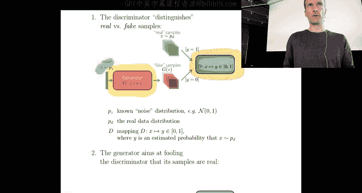

It could be one numbers you want。And。Then this this gets into the generator and the generator produces something very big。

 right， this can be what comes out of your G of set。Yes思。Its a big image， right。

 It can be millions of pixels。 It can be a very complex。Data point we generate。

It just needs to have the same dimension as your real images also have。And then。

You give a real one to the discriminator or you give a fake one。

The other way around and the discriminator has to say yes or no or to distinguish。Real or fake。收。

That's it， basically and。Just for the notation， we will say that the noise comes sample from this set distribution P of set。

And then P of D is the real data distribution， which of course we we don't know， right， so this。

This comes back to your question， right， What if。Would I know the the real data distribution and of course。

 in reality。Almost never。 we don't know P of D， which is the real data， so。O。

So and generator will be a new on， and discriminator will also be a new on。So。Andute。

It should give it should give So D should give answer one。If it's real。And 0， if it's fake。

 So that's。呃。And if it's a fake image。Then we hope the discriminator will output with0。

And but also maybe I'll put something in between。And this will do a bit similar too。就我。呃。What we is。

 what we saw in classification， right， This is kind of this part here is a bit like a standard supervised part。

 You， we have a data set。 halflf of it is is fake。 halflf of it is real。 It's just。

 it's just like supervised learning。 So this would just be。A very standard classifier。Like， like。

 you know it。So yeah， this is the discriminator and then the generator。We already discussed as well。

So you want a generator tool。

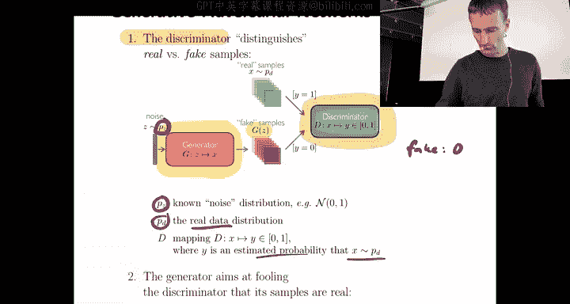

To be able to fool the discriminator。

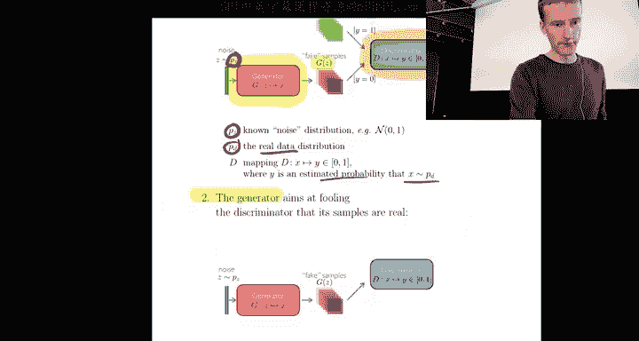

Yeah， a question。Yeah， yeah。 you， you're， you're asking why。

Could we give access of the generator here to， to actually also real data， But then it's hard， right。

 then that's kind of what we want to avoid。 We， we want to build a machine which can generate images without ever。

 ever。Using the real images at。When we use this generate， right when we train it。

 it's not a question， but when we use it。We， when we do inference with this thing， we， we use it。

 We want it to be able to produce images like without having already real ones， right。

 If we want to produce images from nothing， basically。 But if I have from nothing， then there is。

 it's deterministic。 So I will only get one image。 So this noisier is just to。

Make it do the job almost from nothing so。And。Yeah， if you would give real images here， then it。

 it would be too easy then you could just copy the real images， for example。

 So we try to make a harder problem。 But youre， I mean， youre。

 you're right sometimes it can be a bit too hard to solve this problem。

 Maybe there is a middle ground。呃，是的。So。嗯。Okay。Here， yes。Exactly， yes。

 that that's exactly the intuition。 So you， you asked here how do the images looked like at the beginning of training。

 right， when it's not trained yet and indeed， they at the beginning， random noise。

 And if it's just random noise， it's very easy job for the discriminator。And then we will。

 we will design， define the loss function very。Very soon。 So that we。We coned when the discriminator。

Can do it。 and you， you will get a， you will get punished， right， but you will get a a gradient。

 the generator will get a gradient here that it needs to improve。

 because if it remains like random here， it's very easy to detect。 So。

 and then it will do this update， right， And then， but then the discriminator will find another way to detect。

The images maybe， and then again it will be adjusted to avoid the detection。That's the intuition。

 but we we will get to this。So。ケ嗯。So just a notation， let's make sure。

We need these three kind of distributions。PD is the real data， and PG is the fake data。

So the the one， which is what you mentioned， right you you said let's look at what is here。

 This is exactly P G， the the fake data distribution and the beginning will be very bad。

 but hopefully when it's rain， it will look very similar。To the。To the the actual real data。 So the。

 the kind of the goal is that。He said to generate the data， the fake data。Hes iss going look。

Almost a bit like the， the real one。D is the the real data， so。So that's what we'd like to have。

 but for now it's unclear if this can be achieved。So。Okay， so that brings us to the objective。

And this is maybe the simplest way to。To design the objectiveism， you can do other ways。

 So for the discriminator， you just use a binary classifier。Because it is a binary classifier， right。

 But here we use the simplest thing you can have almost， almost a bit like。I， like a。

A bit like logistic regression。So let's see what happens here。So。

What comes here is so this is the fake data， right？And then then this goes through the discriminator。

 so this Gen one goes to the discriminator。And we want this。做 b。To be 0， such it。

The fake data will almost answer。1， right， that will be on our goal， right。

 We want to fool the thing。 So we want to think， we wanted to think it's real。 So we want。呃，对对。

The disc， So that's what the discriminator。sorryrry， what the generator wants to do。

 And this is the discriminator。Once， once to do the correct job， he wants to answer 0。W to detect。

 right， because it's a， it's a fake data point， right， It's from it's from generator。 So。

 so it's fake， so。So he wants to detect。So， so wants these to be zero。So he wants this term is zero。

So that's the goal。 And it also wants to。You still need to do answer。

The correct thing for the real data as well。 So here he needs to answer。呃。诶 one sorry。

Because x is real。And G of that， of course， is fake by by definition。 So that's that's what。

What the discriminator wants to do。嗯。And that's。Yeah。

 that's why same thing it's just written here again。And then now that's， I mean。

 that's not so special that that's， that's pretty standard， really。

 just using the simplest linear classifier you can have。 sorry。

 not the simplest classifier loss on top of the。Of this。D neural network， to disc network。

And now for the generator， it's a bit more interesting so。Generator takes random noise。And that。

 and he wants it to be looking like real data distribution。 So he kind of wants the opposite。

It wants to。So first we wanted to maximize this stuff， right。

 maximize it from a discriminator perspective。And。The generator kind wants to the opposite。

 It wants to minimize。Being detected。And this term here is the same as we adhere here， right？Then。

So this is the probability of being detected。Being detected。So so。The。The whole thing together。

 So we want to， to minimize this。 And then there is a practical approximation that we will just ignore the。

They're one minus。In the log and we we instead， we will just directly try to maximize G。

 So so we max the same thing。 we kind of maximizing this thing， which the discriminator add， Yeah。

 once it'll the opposite thing， so。So this is just kind of an approximation but this term here is clear。

 right， that's exactly what we what we designed。To say that we evade the detection， right， so。

So that the fake point will give the same answer as the real point you do。So。Which。

Which we have designed here。So this is the now we have the objective function。

 now we are kind of done。 we define we define the loss function， right。So。And now。

 now we can train this。And yeah。 so， so D， again， is a function outputting。A number。

 So it should be 001 or something in between。 and the G functions outputting a whole image。

Or a data point， any question on this？Yeah。Do we need to lock in the expectation？呃。Yeah。

 maybe you could also do it to without downed。 Yeah， this is kind of a。choiceice you you have， right。

 you could design auto loss function that that's perfectly fine。 So this is just one particular。

 so maybe one of the earliest guns。 And we will actually use this one because it has a nice probabilistic interpretation。

 a bit like the relation to logistic regression。 So that's what we gonna see after the break。 So yes。

 you could do it without the log。 then you get another kind of gun and maybe you will get something bit similar to the for example。

 Ostein gun， which you also mention at the end today， which is a different loss function。 Yeah。

 you can design any loss function you like here。 it just needs to follow the same principle that it should。

The generator should be rewarded if it fools the discriminator。

And the discriminator is rewarded when he or she avoids detection， right sorry， detects。

 detects real fake sorry。So。So that's the the principle。

 and that's why it's it's it's a mean Max formulation for sure。 that's a crucial aspect。

But then what what what loss year you use here， this is a bit of your design choice inside this min Max game。

Okay， and after the break， I'll try to explain why this can make sense to find the correct probability probabilistic model for this at the equilibrium。

 what would be the solution to this so？See you in a few minutes。

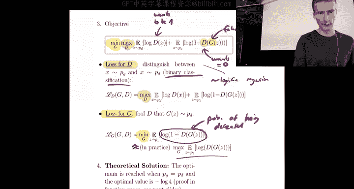

OK。So actually， now we're going into to the interesting part when when we talk about gunwns。

 So we have designed the。Maybe the， the simplest possible。

Way to define this loss function of the two players。And now for why this particular one， I mean。

 this question came up a bit。 and I agree that you， you could design different。Lost functions。

 of course， which are an also similar spirit and allow both players to optimize their stuff。

In a mean and max session。But there is， there is particular reason why we have looked at this。

This one。 And this is actually also the， the loss function which was proposed in the。In this paper。

 which is called guns。Which originally。Proposed this loss function for a particular reason。

 namely the reason that the equilibrium at at that loss function has a very particular property。

 And that's what we're gonna。See， now， so。And the。The property， I mean， is that actually， yeah。

 if you find an equilibrium of this thing， then we exactly achieved what we said was our goal， so。

Namely， that G and D are the same probability distributions。Again， so。PD。

Is the real data distribution， right？And PG。Was the distribution of fake data generated data？So。

 and the， the whole point is that， yeah， if we train those and if we find。A mean Max optimum。

 like the same way as we have designed this。D find it before， before the break。

 If you find such a equilibrium， then。The nice thing is that， yes， this will be equal。

So then we will find that the， the generator will generate data from exactly the same distribution as the real data。

 right， And that's a very nice property to have， so。呃。So yeah， this what's saying。

 what he said here is this is a small kind of TRM or so if you like。Saying that， yeah。

 if if you optimize this。Both for mini Max， right if you find an optimum。

In the sense of an equilibrium。Then， then the fake distribution will be identical to the real data distributions。

Very nice。 And actually， the value of this thing will be。Low greater of four。

That's a bit more obscure， so we'll see this in a second。

But the important thing is that the distributions are the same。

Any other questions on this or is this statement clear？Okay， so before we prove this， we need。

One or two definitions。 And this is the point here is just how to measure if two probability distributions are similar or not。

So。So it looks a bit technical， but it's really nothing。呃，fancy so。

We want what we want to have here is kind of a magic or a distance so that we can see。Okay。

 maybe these two distributions are not entirely equally yet。

 but they're kind of close or they are very far from each other。So we need an ocean like that。

So that maybe。Maybe the reality is similar like this so that。This is one of the distributions。

And I want to compare this with another distribution， which maybe has。This shape or or anything。

So this is a probability distribution。呃。Yeah， it doesn't matter which one is which。Of the data X。

And then on the x axis is the data itself。So how we can say this distribution is similar to this one。

 maybe or not， and how similar is it really？再出这个密码。嗯。O。Sorry。😔，We。

 we lost the tooo people for a second。I know we're good。 Okay， we need a similarity function for。

 for two probability distributions。And this will be what's called the KL divergence。

It's a bit like a distance， but the， the funny thing is that it's， it's not。

 it's not a symmetric one。 So if you ask about distance from D to G， you get one answer。

 if you ask from G to D， you get a different answer。 So it's a asymmetric notion of distance。

 And here is what the， what the notion is。So the dirgence of PD and PG to compare them。It's。

 it's just a relative entropy。 That's， that's the other。name for it。So maybe entropy， you are seeing。

 it's kind of this。X log x thing。And here it's， that's what it is。 right， Here is the thing。

 and here is the lock amount thing。 So the only difference here is that。

It's also normalized relative to。To a kind of a reference distribution， which is the， the G。

 in this case。 That's why it's called the。Reelatives entro be。So this is kind of the relative。

The reference distribution and and D is。The thing we want to ask about how close is to the other one。

 so。And okay， what， what is this crazy In here。 So don't， don't worry， this is really just。

It's just the expectation，Intergo is the same as expectation。So。So。This is， actually。呃。

So here is expectation。 You can see It's expectation over。The data distribution。

Because for each data point， how likely these， it's multiplied with the value so。So this。

 you can say this is the same thing as。Expectation。我 were data。嗯。嗯。So maybe expectation will。

The probability of the data， so。呃。People cannot hear well on Zoom。

 Can you hear me in the back also not so well。Maybe the microphone is getting。Be tired。 That's good。

Okay。O， I just want to say what this integral least， right， It's， it's。We sample。

 according to the the。呃，第一。The， the real data distribution。

 And we ask about some value and the value we ask about is logar。P of D over P of G。

So that's just what this notation means。 If you don't like intecourse。

 you can always write expectations so。O嗯。真。嗯。What about the equilibrium。 So actually we。

This is a small variant of this， which you also need。

 which is another distance between two distributions， so。

So now calledback Library you' have already seen。 There is one more， which is called。

 It's almost the same thing。 It's actually built from， from the one which I saw。

And that's this all the way， Johnson and Shen。On how we can compare two distributions。

 it looks a bit scary， but it's not， it's。Really just taking to the the definition we had here。And。

 and then adding them together to make it symmetric。

Because that was kind of the downside of the first one we defined。 It was not symmetric。

And now the simplest way to make it symmetric is just to ask， ask both directions， right。

 how close is P to this reference。And then also ask how， how close is Q。To the same reference。

 And there's a neutral reference point。 you have actually taken the the average of the two。

Distribution， So， so this is an other nice。Whereay you can define a distance function between two distributions。

It's not clear why we will do this， right， It's just a definition for now。

 we will see that this is actually something。Very related to to what we are optimizing here when we train the gun。

 So， so this will come on the next slide if the definition makes sense to you， so。

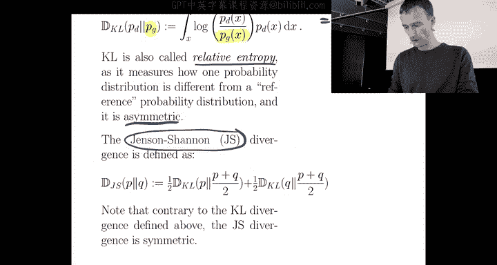

Okay， so now we would like to talk about what happens if， if we get to optimum， so。呃。So when。

 when the discriminator is optimal and the generator is optimal， what does that mean in。

 in this sense， Does， does this have anything to do with。When， when the two distributions are equal。

And。So。Yeah， let's， let's dive writing in。 Let's look at the formula。 So again。

 let's just write down the objective function of the， of the game。So it has two parts。

 That's really what we， what we add here。There was。 So that's the objective here。 I might。

 I will just copy paste it， so。I have the two parts log freedom discriminator。

W whichch is the one for this is the term for real data X。 And then I have the term for fake data X。

Which here is over the random noise。 And， and you know that you want the fake data。

To be detected from。From that discriminator perspective。 So that's what we have here。

So that's the same term here。And。Again。This is this integral here is religious expectation。Over the。

The real data。And， and this one is expectation。Over P that。

 So this is just expectation over the noise， so。嗯。And they get at together on。D and。第出完了。嗯。O， and。No。

There is one。One trick， I'm going to do so。I'm going to look a bit more closely about this generated thing。

And。I will。I hope you to replace this one。By。呃， by x so。So that's what。What happens here。

 So this is a bit strange。So what I have have some here is that now I' have assumed that the generator actually has is having enough capacity。

 Its a powerful model enough。 What do you mean by that。 So I mean that。Either， either。

 I can just do this expectation over the noise， right。So whatever noise is， G will also be something。

 So G of the noise is something。So， and here we were just integrating over that。But now I have。

 you can see that now I have replaced this integral over the noise。I've replaced this by integral。

Over over x， right， which is a bit strange。So， why are we allowed to do that， Are we。Are we allow。

 are we really allowed to。To to say that we can just generate any X we want， right？

 So that's why we need to generate it to be powerful that at least theoretically， the generator。

For any point X， it， it does have the possibility that。Yes， it can generate that particular x。

 So that's why what I'm doing here is just a variable replacement， right， so。

The in the first integral here was over the noise。And。I'm actually replacing this by integral over。

G of Z， right， so。So the stuff generated from the noise。 What I'm saying is that， yeah。

 this is the same as just。I'm saying that G of Z is the whole x space anyway。

 so I can actually make this integral also being over the x space。And。And then what。

 what I had here which just the probability of the noise。That actually has to be replaced by。

What's the probability that the generator。Will generate this particular x。 So， so that's。

 that's why you need to generator to have this capability to produce any x。

 And then now what you have here is， yeah， probability of generating this particular x。手手第40比得。

Confusing at first， maybe。But again， the first inequality was just a definition。And then。

This equation here was a bit。呃， surprisingpri。So what we have done here is that。

 so the first one was over the noise， right。And then here we have replace this by integral over the data。

嗯。Again， this is gonna possible。Because we， we just use this P of G。

 which means that the generator can generate any X with some probability。走。This is。

 is kind of useful because anyway， we will be interested in what， what is going happen with this P G。

The probability that the generator this gives this image。And that's。

 we want this to be the same as actually the real images， right， That's our final goal。So。

 and let's see。If that's actually the case。When if we would find such an equilibrium here。Okay。

 so at least this expression here is nicer。嗯， whyhy， because there is only。X。

 there's only one integral right。 It's over x。So， and you can see that the two quantities were interesting。

All the ones appearing here。 So the。The real data。And then the the fake data from the generator。15。

So we want， we want those to be the same， right so。Let's see how this comes from from this。

 So for now， we don't know anything yet， but we say that the discriminator will actually try to maximize this function。

呃，收。Maximum of D of this thing。And this is not so hard。 So now。

Its will actually be quite easy to say what。What is the probability distribution P G。

Which maximizes this this expression。And to do that， we。嗯。We are looking at this expression。And we。

Yeah， we realize。We have this logarithm。Here and also here。

 And we can we can actually see that when it is maximized。So。What要 see the。

This is the same thing when D of x is here and D of x is also here。

 So that's why it's also becoming much simpler。So D of X is just saying。That's a yes， no answer。

 If a given image is， is fake or real。 the nice thing here is we ask him about the same image on the left and on the right。

So here is one minus D and heres D。 So that's why the whole expression is， is this here， right。Where。

D of x is what equal y。And you ask。For which y。 So which， which G of X is maximized。收嗯。Yeah。

 so this why thing here， that's just notation， right， so。So I just said that this。

 this thing will be my why。And你说 what。Which， which way maximizes this。呃。

This is not just a very function， which depend， which is a functions from numbers to numbers。

 So I will actually take the derivative of this to tell you which y maximize this expression。

 depending on A and B， so。只要你一块性嗯。Can you say again Y P D of x is。

So I have not assumed that the the the green and blue are equal。 I don't assume that this。

 this this is got be going to prove。 So we actually prove that。Green and blue will be similar。

 It will come out later。 But for now， the PG and PD can be different。

 So I'm not sure that's your question。What is A and what is B， Yes， so， so here。I mean。

 I think we said what is why。 So then， so then A and B are just these guys。 So this is a。嗯。

嗯B is this is B是。Oh， that's right。 That's right。 They're not， They're not constant。 Yeah， yeah， yeah。

 that's， that's a very good question， so。Yes， this depends on X。 But what I'm。

What I'm doing here is I'm just telling you that if the X is fixed。

 then I'm telling you which is the best why。 So sorry， I should have said that。 Yeah， so we。

 we assume X is fixed for a moment。 We don't， we don't do the ho integral。

 Just what is inside the integral。 X is fixed。 and we asking。What's a D X。

 which would be best for that。And for that， I hope you agree that we we will minimize this thing。

 which is。Very simple function from numbers to numbers，呃，有 the question。Yeah。

 so your your question is。I am， I'm just optimizing the。

 I'm just maximizing what is inside the integral for given x， which as relates to your question。

 I'm not maximizing the whole integral。 And that's， that's true， yes。So。But we will see in a second。

 so。I mean， because the every。The integral is just an expectation， right， So。

 and for any X can actually happen， right， some happen with。More sometimes it's less probability。

 So any X can happen。 So it is actually， this is actually the correct way to do it。

 So if for every X， you find the， you maximize the whole thing inside。嗯。You will be fine。

 But you're right， the thing that maximizes it will be different。 So it will be a different y。

 which I find at every different X I ask， right？ So， so that's also what。

 I guess what your question was that so yeah， for every X， I will get a different answer Y。

 which is optimal for the red stuff。So， yeah， that's true。But that does not。Make this， this wrong。

 right？ So if you have an explanation of something and something is maximized at every point that can happen。

 then you will also maximize the expectation， which here is the the whole integral。 So still correct。

 I think。Or。嗯，你。Any other opinion。So。Okay， so we maximize this。 and this is very simple。

 The gradient of we suspect to y Oh sorry， the derivatives back to y is 0。What you get is。

Y equal to a or a plus B。That's for， for， for a given。ANB玩 she panelel next。That's the solution， so。

Nice。 And also， yeah， by the way， this is actually a streak。Local minimum or。

Maybe that's even economic function。 So this is the global。Optimum of this， of this thing。

 of just this number， depending on。On D of X。1。So what I'm claiming is that whatever is your x。

 the optimal discriminator。Disriminator parameters would be。

 So what should the discriminator do on this particular x。It which answer should it give， right。

 has to give a number between 0 and1。The the number the discriminator should tell you。

For the given image is just a or a plus B。Where， as we said， a is PD D and B is。B G， the fake。

 fake probability of this of this image。So this is the the fake image。Sorry， if x is a fake image。

 how likely is it。MPD is as a real image。 How likely is this image， so。So yeah。

 this is the the real data。And andBG is是 fake data。O。So， I mean， know， from the generator。

 that's why it's called G。So this is this is just solving half the problem。 right。

 just saying that whatever if you have some generator， then this is the discriminator。

 which is the best response to that， right It is the optimal。

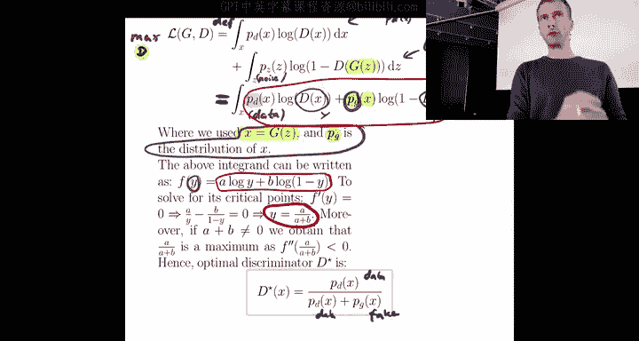

Discmininated for a given generator。I haven't。 I haven't told you how to find G， right。

 I've only told you how to find the best discriminator for a given G。So it's usually as in games。

 right， So now we have to see， okay， this so far so good。 But what you the generator do。

 And then can we then say that they both cannot improve， Are they both optimal。

 But I hope you always me that the screenator now is optimal。呃 if G is fixed。Geneistic， so。So。

 that's this part。

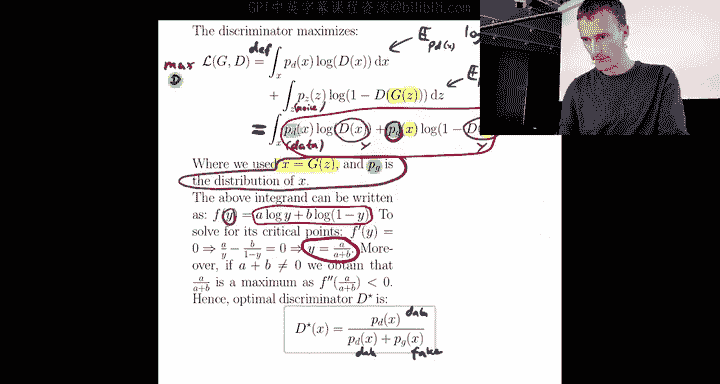

And so how， how do we argue that the generate is also optimal。

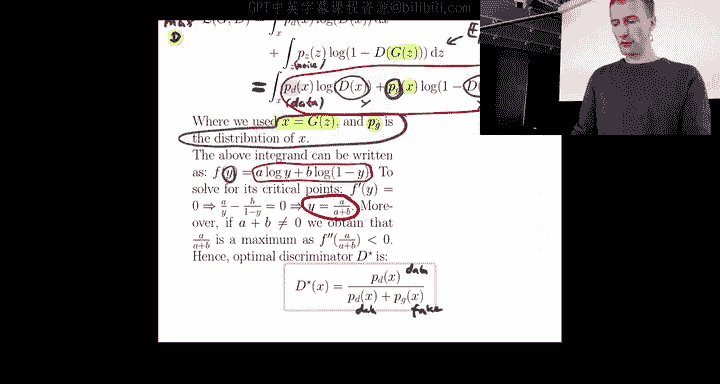

So what I will do is I have now found a discriminator。

And I will just plug it back into the loss function。So I have found this D， and I bucket it back in。

And that's， that's what the。What happens， right， so。So， just plugging in。

This from from what it just arrived， so。What was it A U A plus B。So I plugged this back in。呃，也是。

And what do I get， So here is， here is it。诶白天。And。嗯。Yeah， so， so what has happened here。

 Why is it So if you plug in， you have the D on on top of the fraction right， But here its G。

 that's just because it's one minus this thing。So you can， you can see this is plus。呃，第一。

minus G and so on。 You will see that。 yeah， this is the same thing as one minus D。Okay， so。

 so nothing happened here。 I just， just plugged in the definition， so。This is just the opt D star。

From previous slide。As we have derived。Okay， so now we have this。

And this looks a little bit like what we have defined。With our divergenceies， right， So it's。

It's a log of something。And this logo of another thing。And。It's a bit。Still a bit annoying。but you。

 you can actually see that it's the。The K L of， of the， the data， we suspect to the。

 the mid point here。And it's also。 And that's， And then the second term is the same thing。But。

 reversed。Which， by definition， happens to be the the Jensen Chanon。Definition of J S， this。

 this east。The Jenensenen。呃Deors。So， okay， the， the only thing which was a bit confusing is why did this log 4 appear here。

 So that was really a bit。It be scary。So for the rat equality， what we have done here is a。意思。为。

Here we， we have stuff divided by two。 right， We want the reference point to be the distribution。

 which is the average。But here we don't have divided by two。 So that's。

 that's what you want to do here， so。What we have in the first line here is， is this。嗯。

We want to transform it into， into something like this。 the， the K L dirgs。

 with respect to the average。 So we want to get a one half in distraction。

And how do you get one half is。Yeah， you just write a two in front of it。 and then。

And then you put it， you put it here in the end。呃In the denominator so。Okay。

 I just divided everything by two。 So that's I divide stuff in the logger in by two。

 So if you go from the bottom。You want this。You cannot have it。 So what you do is， O。

Just do it anyway。 But then you， you need to say， I have added lock 2。

So that's why you have to subtract it again， if you。If you want to， to maintain the equality here。

But anyway， this is a constant。 It doesn't。 It really doesn't matter。For the optimization problem。So。

 but we get an additional log two from， from the first term because of the division by two and the same for the second term。

 division by  two。That's why。Look to。Gets at it twice。Which。Happens to be lo for。 So this is。

Lo in base 2。O。So， okay， what， what is happening here。 So now I plug in the。

 the what I said is the optimal discriminator。 and then I can ask。What is the。Now。

 what does it mean that the generator also optimizes this thing。 So the generator is the。

 is the mean player。Minimizes stuff。It's， it's always the same loss function。 right。

 We have never changed the loss function。We're just trying to understand what happens。周。

What we have now is we said the discriminator is always what it was。 D star， whatever G is。And if。

 if that's the case， then we ask， so what's the best generator。And。

And the best generator happens to be the one which minimizes this chance channel divergence。So。

 and it minimize the the distance of these two probability distributions。

 right the real one and the fake one。 So that's， that's the final result， so。

We saw that What happens here is that。的。The game， what it does， is， it's going to minimize。

Real and fake distribution to be as close together as possible， right。And that's， and that's exactly。

Why， why this is a nice。A nice way to formulate the game， right， because obviously。

So what what we now have obtained is that， okay， what happens is minimizing this thing。

 which we have shown to be basically。The distance between P D and B， G。

 the real and the fake data institutions。And we saw that the generator is minimizing this。

 is is perfect。 And we also saw that the discriminator is also doing。呃， iss also optimal。呃 in the。

Which we have seen on previous slide for any particularology。O。So， yeah。

 that's the reason why it's this strange distance between probability distribution because here has this very natural interpretation。

 and in summary。We have， yeah。 we've seen the the game is to minimize this distance。 So。

 and obviously。The distances minimize when， when the two are equal。

 when the the real and fake distribution are equal。 and then， of course， the distances。

He's as good as he can be。And then， well， it's zero， actually。And then。

The value of the game is is longer than more4。 I mean， I don't think we care much about the value。

 but we do really care a lot that that the two parameters are optimal to each other， so。对意。呃。So。

We have。 we have seen that the generate the data。DC needs the same as to the other one。Okay。

 is there any question on this this。Kind of makes sense。嗯。OK等。

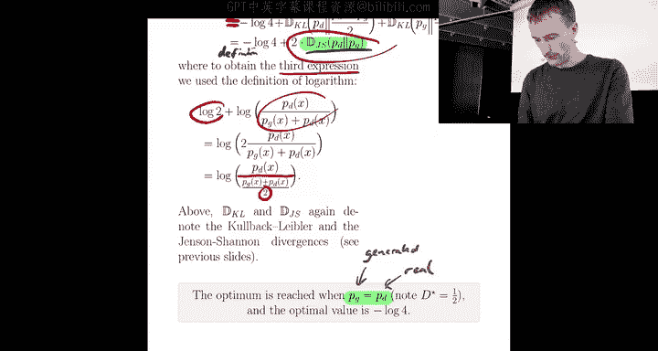

This for this particular gun formation， there is a downside of doing this。

And it's at this distance as we have here。 They are not so well defined， sometimes。So。呃。

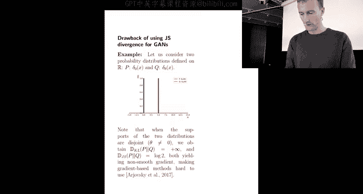

But we， we have worked with this， with this distance function， which we。It was a bit out of the blue。

 right， It was be it's if you use entropy， it's kind of。Most natural way to， to define a distance。

But it has a downside。 and the downside is， again。呃，的。When。When the two。

 when you ask about comparing two distributions， which have no overlap。Ins a sense of no。

 no common support， so。So， maybe。Wai when， when it's like Gaoian stuff， then then it's okay， right。

 because the。They have support everywhere。 So support means。TheEverywhere， the value is non0。 So any。

 any point x can happen。熟嗯。So in this case， it was fine， right we， we can。We can。

 We can compare them。呃，P1。P real D of X。And here is the the fake one or the other way around from the generator。

So this is fine。 Do you have a， They have a well defined distance between each other。But however， if。

 if you have the the discriminator and generatortor， they just have a discrete distribution。

It it could happen， right。 We， we don't know what these distribution are。 It could be anything。呃。

 also。的X灯。Also， the real data distribution is。We don't really know if it has。If。

 if it has support everywhere， or maybe you， you're just given a finiter data set， right。

 you're given 10 images。 So you， it's a bit of a philosophical question， but you don't even know if。

 if there are infinitely many images in the world， right， or if these， these five images you see。

If they are all that can happen， right， we don't， we don't really know。 So。

 so if there's a continuous distribution， every X can happen。By the way。

 that's also what you assumed in the proof， right。But if the distributions would be discrete。

 and so this is kind of a D rack function。One of them is only having。呃。Yeah， probability  one。

 if x is 0 and 0 or everywhere else。 And then yeah， the other one。And here is the other one。

TheIf you compare two with this two such distributions。The problem is that the。

 the distance is not defined， so。So the K L distance。不是。G and D。It doesn't matter which way around。

 It could be the other way around， still。Problem is its plus infinity。So。So， and the。有。

This also means that our， our loss function。Is is plus infinity。Because the last function was。

 was the chance same distance， which was。我我是。Yeah， it's just the K L。

 And then both of these termss are infinity。 So that's not good。So the last function is infinity。

 which is never a good thing also。It's kind of not defined。

 so we cannot take gradients at such points。So。So this means its becomes a very。呃。

Difficult to optimize。Because it's not not differentiable。嗯。So， it not even defined。呃呃 the。

At such distribution。Distribution， yeah， here， it's called P and Q。 But yeah， we。

 we don't know what the distribution is， right， So whenever， whenever we have such distributions。

we cannot use this kind of distance。 So we would actually prefer to have a distance which allows us to compare any two dis any two probability distributions。

Not just some of them which you have overlap or share our support。So she scroll here are this x here。

 this is non zero。And this one here is also known0。It will be smaller。So。

 is there outdoor natural distance， And of course， there is。There is many ways to do it， so。呃Yeah。

 distributions there。

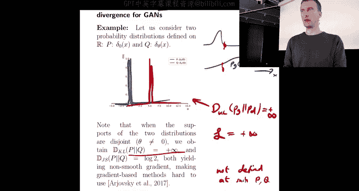

extremelyre rich。Class of function。 So there's also many， many ways to， to define distances on them。

And， and one very natural one is the is the vshan distance。 So， so here we will not。

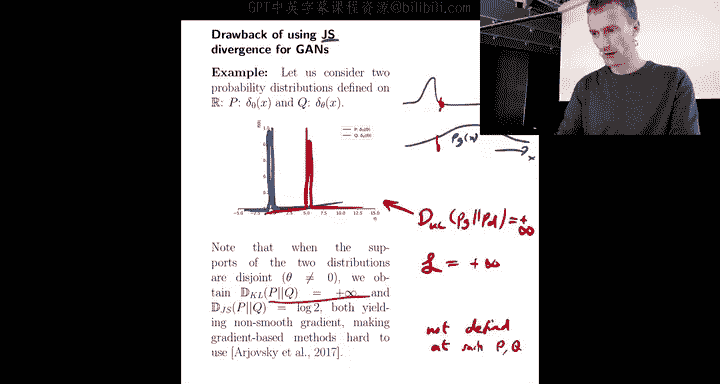

Will not get much into into detail， because。L of time。

 But I'm just selling you and giving you maybe the definition and the intuition。

And the point here is that it's an alternative。Distance to the， to the one we just seen before。

 right。嗯。The intuition is it's like moving around dirt or earth Earth mover distance。你周收。

And the image。Comme又str。So if you have these two distributions， the point is to。

You want to move the dirt from this flat hill on top。You want to move it to the。

To the spiky heel on the， on the bottom。嗯。So， so you interpret this as as like mass。

 So that's the mass in this probability distribution。By the way， the total mass， of course， is。

 of course， one for both distributions right there。呃。有。The， the area on both curves is， of course。

 one。 So there is one is kind of the amount。Of earth， which is lying around。You want to move this。

And then you will， for every element of， of dirt， you move from one to the other。 you。

 you have to pay the distance。 how much you。You carry that。

That piece of dirt earth with a shovel or so。To， to really bring this。From the top pile。

To do the more。Spyy on the bottom， right， so。It's nice， because。It really。

 really allows you to optimize which。Yeah， which， which part do you w to bring where， right， so。走眉笔呃。

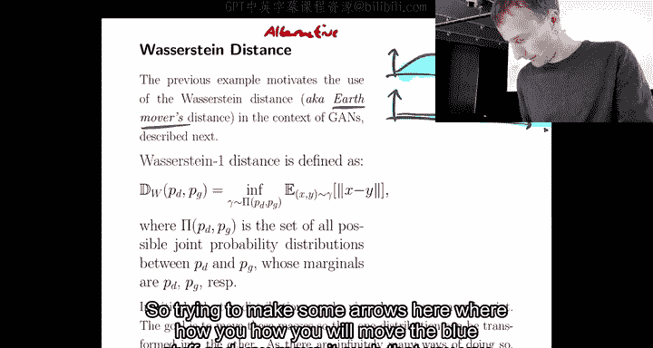

有。Trying to make some errors here where how you。How you will move the， the blue stuff such that。

And you move it such that you， you have the least amount you need to carry around， right。

 stuff which is already closed near here。 You will not move it far， right， but still。

 you have to move everything in the end because you， you want the shape in the end to be。

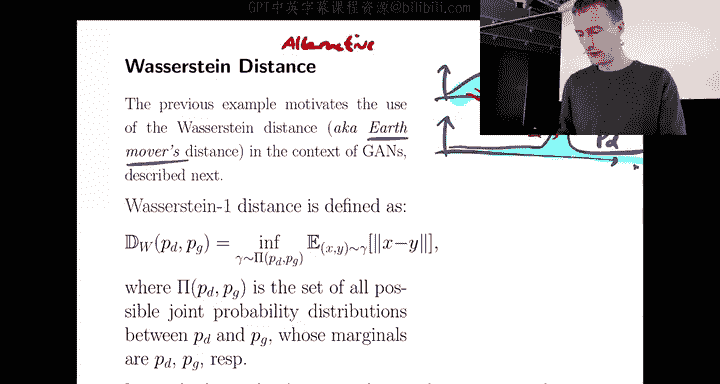

What的意思。And。就 to move this stuff呃。呃。How to to move one piece here from x。To hear， which is why。

So for that， we just use Euclidean distance， or you could also use other distances。Here and。

 and so that， that's called how it's defined， right。So。But we， we will not go into the。

 into the formal definition too much。But what's nice about this is。

 is clear that it solves the problem we had before。So now， even if these。

 these two distributions are very spiky。It's not a problem， right。

 because the stuff can still be moved。 the efficient， the distance is well defined。 It's finite。

 It's not gonna be infinity。So that's why this is a nicer。Way to define distances。呃。

On the other hand is the whole thing。

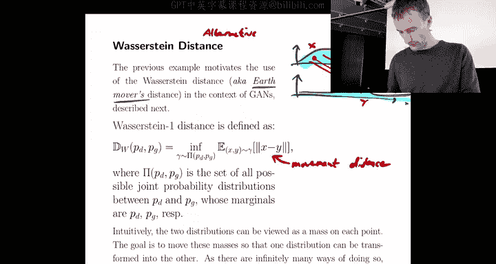

It's not so easy to compute， so。But this， these arguments to to approximate it。So， and。Okay。

 now you could just say maybe I can define a gun from this alternative distance。 And that's。

 that's what is called a vhan gun。 but we're not gonna。Go to detail here。

 So this is optional material。Not gonna ask screen the exam。But， still。Yeah。

 so kind of nice because you see that whatever distance you have between two possibilitiesbabil。

 you can then use it to build a gun。Okay， so that was it about the proof and so on。呃，第四呃。

I will finish by giving some nice pictures as well。 So by the way， it's not only for pictures。

 right it's also。For any data modality， you any data distribution。Any set of real data you get。

 you can train a gun to produce more data like that。How do you train your gunwn。呃。So， so that's。

 that's what you said at the beginning。 Very simple。You just do a gradient step on。

On the discriminator， so。And then you do a gradientd on on the generator， so。Scminator。

And the generator， as usual。So you can see the argument is just alternating gradient descent， so。

To be very precise， it's actually SGD。呃， if you want。And so let's see what happens。

 So what the argument suggests is to。Sampble a real data point。

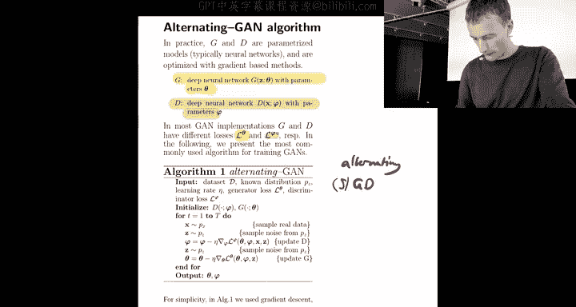

Then sample fake data a simple noise。So once you have the real data point。

 you can already update the。Disriminator， so。呃。So the discriminator is the red。Partar， right， and。

 and you can see it's updated。From using the real data against the。The Z， right So Z also then。

 then generates the the fake data， right， so。G of that is gonna be the， the fake image。And then。

 and then you update。The the generator。The parameters of the generator are updated in the same way。

 but just doing one gradient step。 So yeah。You're saying in in practice you， you first。

He is the generator。Yeah， yeah。 that's right。 Well， it's something thing here。

 it's it's already using the generator。 It's kind of implicit， right， So I mean， from that。

 I need to produce G， a fake image。 And then I have a real and fake image。

 And based on those two that this commator will do a gradient update。

And then the generate adopted as well， because you can use the same。呃， value。So， but yeah， it。

 it doesn't matter because the two steps alternate anyway， right， So whatever you do first。

 then you will do the out step。 And this， this will go on forever。 you go， you go back and forth。

So gradienting of the discriminator， gradientding of the generator。

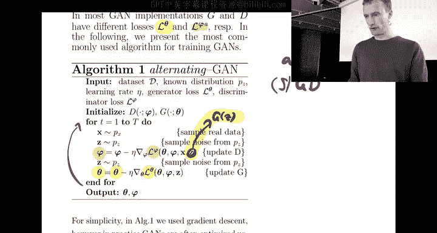

Just run your usual algorithms。And that's it。嗯。嗯。Sounds good。 This。

 you can also sometimes condition your gun on some additional information you have。

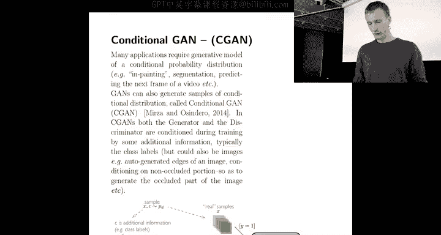

And for that。

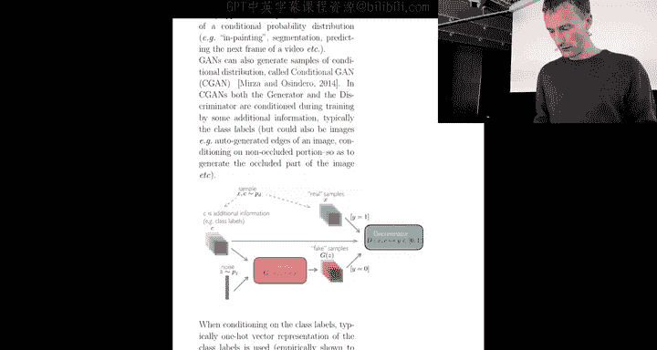

I have an image here。So this is just very recently， some。

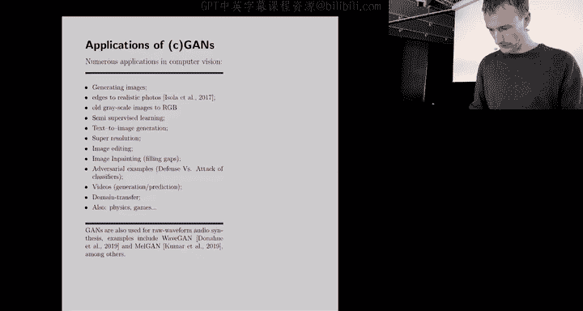

Applied work to。 yeah， this is an image that generated。

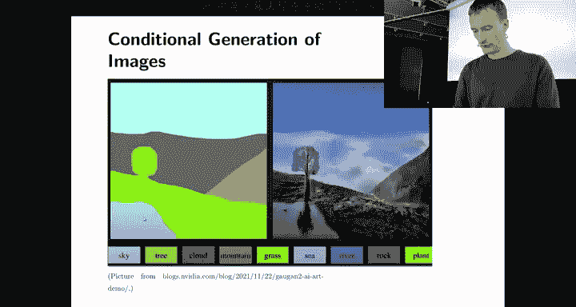

And generating images we have had a long time。 And also。

 but the conditional thing is kind of nice here because you say， okay， I don't only want the image。

 but I also want to have pixels which have this class。

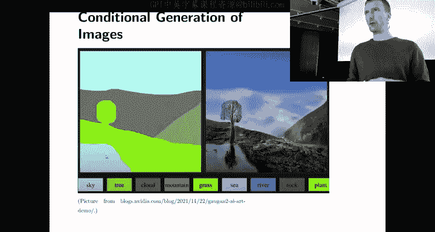

So here I want sky in this part。 I want。I want grass here。

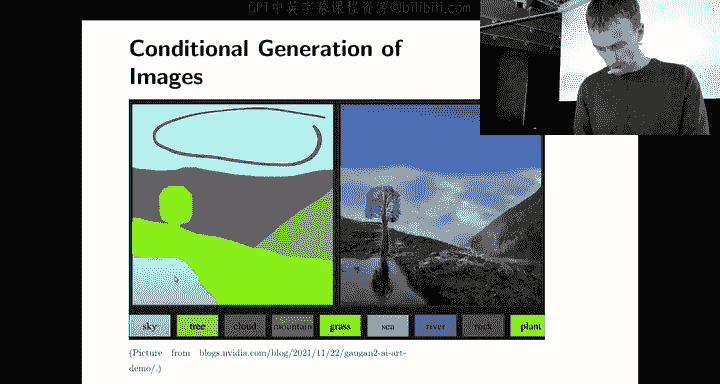

I want clouds here。So that's， that's what you give us an aside information。

 That's like some additional。Side information， which is like this latent variables we had。

 the set variables。So yeah， we， we will not discuss。All the math about conditional guns。

 But sometimes you say I want an X， which has this additional latent parameters， which means yeah。

 sky here and grass there。 And then you can generate to an image exactly like that。

 which respects this， this side information。 So that's what it means to be a conditional。呃。

 imageage generation。嗯。There's a few variants。 Of course， there's different architectures。

How to generate images。

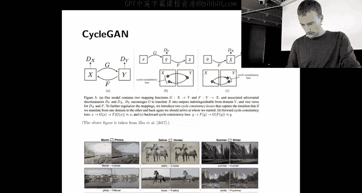

So usually， you just use convolutional networks。 And basically very often。

 the discrimminator just looks the the opposite of the generator。

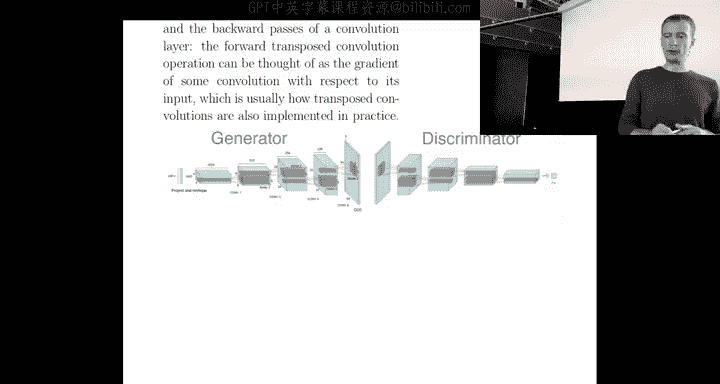

In turn from input to output， right， the， the generator takes just very small numbers。The said。And。

 and produces a。呃 full scale image。So the， the layers are very small and become wider and wider as you go more deep into the generator architecture。

You you have the full image。And the full image is， of course。

 what the discriminator takes as the input。So then you hear。

 and then kind the opposite happens with this criminal。

 the more you get from input to the more D layers。You务 eventually理。Get。

 get the the real number at the end。 So one number as the output0 between 01。

 So that's the answer to disc cminator。 There's many architectures you can do here to play with them。

 But the key thing is what we saw today， right what is the loss function you put on top of this architectures to。

 to train them。And to train them。

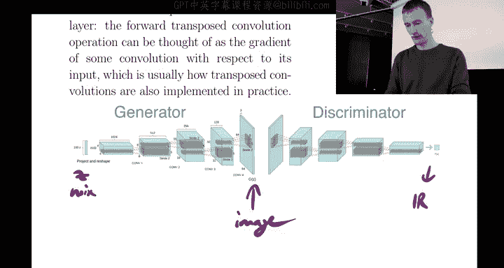

Just use an alternating gradientia。Okay， that's。Yeah， convolution net。 and then。That's it for today。

 See you on Thursday。没有。

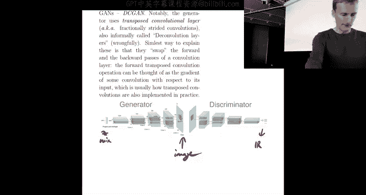