# EPFL《机器学习｜Machine Learning Course CS-433 fall 2020-2021》中英字幕（deepseek - P35：[35]EPFL Machine Learning Course 2021 - Week 12 part 2.zh_en - GPT中英字幕课程资源 - BV14SwyeNEvW

Yeah， back to the basics PCA， principal component analysis。So， the。

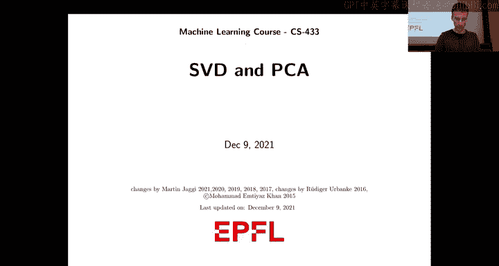

Whyhy we're doing this is this is also part of the unsupervised learning chapter and why this is actually cool。

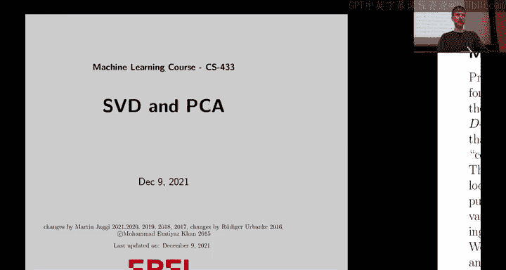

Is， is not， not so much because it's。Standal linear algebra， I mean。

 the technical aspect we we kind of already know， but what is kind of cool that we can use it to have an unsvised unsupurprivised way of。

Summarizing data or or projecting data into a more manageable space。

 So it really can be a lot a lot helpful for for dealing with large data that to do extra。

Extrapoetatory analysis， sorry。So so that's why。Why PCA is still really often used method， right。

 So to， the motivation on one hand， is to， to use it to the dimensionality reduction。 As we said。

 So when we have a lot of features。 So the， the space of the original features might be super high。

 So the original features。😊，Here is D， which can be very large right so every data point as Steve features。

So we want to go and take those points， map them into a smaller dimensional space。

Of just K and we hope that that's possible。For。K usually much larger。

 sorry much smaller than the original dimension。Of course， you can do that。 But the， the point is。

Can you also do it in a meaningful way。 Can you， can you do it。While you。

 you preserve most of the information， which was in the original features。 So that's。

 that's kind of the non part。 Otherwise， you could just map everybody to one point。

 That's not the point of this exercise。 But the point is that。

This is possible while preserving most of the information of each data point。And we will。

 we will see more precisely what we mean by。Most information。

Being preserved in the in this projection。 So which is the dimensionality reduction。And finally。

 then we also have a small probabilistic interpretation of the same thing when。

When you think of data coming from an underlying distribution。

 then what's the meaning of PCA in that case？So。Okay， and。Yeah， as you。You all know this。 So we。

We usually just have the data matrix is usually。So D by n， what what do you use in this case Yes。

 so the data points are the columns of this matrix。So here's one data point。X I or。Maybe x small n。

And what we are trying to do。Is to。To approximate it。诶。By， by kind of a。A smaller。

Rannk matrix as we're going to see。 so I will I will get more to this。

 but will you will actually factorize it into a smaller dimension。Ma factorization。

 so that's also something that。We will come back to so you can think of it something like this so that。

That's what you would like to do it's just the intuition for now。You would like to。

Transform it to somewhere where this matrix is now。呃。Only has has K。呃。K as the inner dimension。

 right， so very small， very low rank matrix。And then so with that is n columns。

 and then the other one is D。So I will get back to this on what's interpretation of this so kind of this one will be kind of the the projection of the original one right so every data point is still here but it's kind of shorter。

And then this one will be kind of the decom so if you think of that being the compression and the other one being there。

Decompression， so we we will get back to this， right， so but the correspond is the。Data points。

 which had D features originally， we now have K features。Okay， so how we're going to do this is by。

Using single value composition， which I'm sure you have heard so。😊，Any rectangle matrixs X。

We know that it can be written as as this kind of factorization。

 so here it's three different solutions can multiply。So， yeah， you。You have seen this， and。

Just to be really precise about。About the dimensions of these things that we will come back to again。

Original matrix X D by N。And。So now this is exact， right It's not an approximation。So。

 this is exactly。U times S。Times V transpose。So here， the dimensions are very important。

So the U is square matrix D by D。The S is actually a。A kind of dimatics， but it's rectangular。

So here's S。It's diagonal。And everything else is zero。So yeah。

 that's also D by D by D is this diagonal part then。But the whole thing might have n columns。

And then finally， this V transpose matrixes also。Very important that's actually a end by end matrix。

Okay，I guess you。You have seen this and of course， there is so many ways to do this。😊。

So we need to have some additional properties。 All right， So I mean， otherwise。

 I could just set you to be X。 And then I also Ive factorised everything。

 And here I put the identity and here I put nothing。Also identity。But that's not the point。

 The point here is to。To say that this factor can be done。While。

 while the the matrix is U and V are actually。Makes sense that they are actually like a basis。

They are an not talkal basis， so they are ortho to normal。matrixrices。And the orthonomal， you know。

 what means is two things， right， it just means。Every column of row is sort talkingal。

And also that these rows are normalized。So， and so these are the the U V guys。

 and then the other one is。Dagonの so。So that's the singular value composition and that at this point you。

😊，You just have to believe me that this exists。But not it's not so hard to prove that this is possible。

 but we will assume it because you also had it in there。Inal linear algebra course and。So。

 so here just， yeah， this auto normal business I just want。Cated。

Auttonal means the same as a unitary here。So autonal means。2 things。嗯。呃。

So we're talking about columns。So that means if you multiply two different columns。

 the result will be zero， except it's one if it's the same column or except if it's the same column。

And the length one， so it's normalized。So that's what autotonomic means。

And unitary is the same thing， but unitary is for complex valued matrices。

So then then you would use the。Here are the complex conjugate instead of the transpose。

 but we don't need that for us， everything is real， so in machine learning。

These are matrices from the data， so these are all just real numbers。So we just require。

 it's the same as saying that， yeah， these mees U and V are autonmal。 and yeah， that's the SD。嗯你。

Any questions on this sir？Too worry so。嗯。So。嗯。呃。Yes， by the way， if。

 if a square matrix has this property， I， I was a bit fussy when I said columns or rows are terminalal。

 right。 So you maybe you were a bit scared。 What do I mean， But this is actually fine because for。

 for square matrices， if the。😊，Is the if the。Rose。Or talking on it。Then， then also the。

 the columns have this property。 So this just for square matrices， which are auto。

Then it doesn't matter if you talk about。Rsal column。 And that is easy to see。By， I mean。

 that's that we just have the definition。Of being autonal。 But then we we can also。

EMultiply another time on the left with U transpose。Which， we know。

Its actually a magic switch is the universeverse。Of the original one。

 And then we also what what that。Thus to us is that we see that。 okay， also the。

 also the rows have the properties that let me just assume that the columns have the property。

 the nose of the rows are also。EOr normalmal， so。So this is just a side remark。About square merices。

 if you don't。And yeah， these two guys are squared， usually。Okay。Yeah。Then you。

 why do we care about auton normalmal matrices， So because what what's gonna happen here is that this U matrix is gonna be how our data X is gonna be transformed。

 So I， I'll explain that in a minute。 So， but then what does it mean， is it。

 you could just have any linear matrix， which is applied。In front of your data matrix。

 that that's fine。 So why is it special to have a。An autonal matrix。

 which is being applied in front of a data point。And that。As you。

 as you probably already know is that's another。Just tiny side remark that autonoral emergericies are like rotations so what I mean by that is just I mean that whatever vector you apply it to so you put some X and when you apply it in front of it it preserves the norm so it does nothing。

To the length of the vector。 So， so that's what this equation here saying that the the linear transform of the vector is the same length as the original vector。

 Why is that？ It's super easy you just plug in。The you write the square norm as the inner product and you see you here the。

The matrix with itself， which we know start the entity。So that's why the length is preserved。

 why this so also。No has certification matrices， so。Okay， and。That was also more a bit of a remark。

 but。I think that finishes the discussion on U and V。

 But what is really important is to also briefly discuss the S。

 So this is this diagonal product in the， in the middle， right。So that one， yeah。

 it has to be diagonal， that's what we require and also what entries are here on the diagonal。

We want them to be sorted in increasing order。

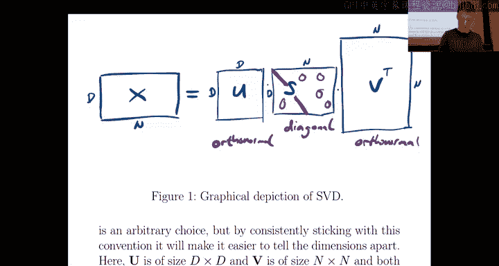

And those values in this cycle。😊。

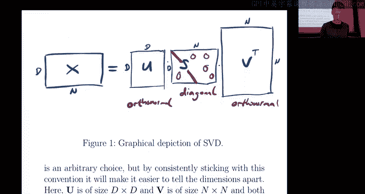

They are called a single values。 I think you。You are familiar with that。

So that's the S matrix and that's it so the U and V imagesrices also have the they are called the single of vectors。

 these are called the single values right so U is the left single of vectors and V the right single vectors。

Okay， that's what the very basic stuff but。The interesting question will come now on how is this useful to。

 to project data and in， in which sense is it gonna。

Project the data in a meaningful way and the data is the original X matrix。

So that's what we want to study now。

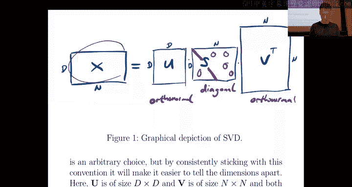

So。嗯。😊，So that's。That's to， to understand what the SVD has to do with。

We see some dimension reduction。And。The intuition is， is really simple。

 It's really what we said at the beginning that we。We kind of want to apply a linear map。 put just I。

 I learned a matrix。 I put it in front of my data matrix。So that's the C matrix here。I'm given X。

 I will transform it to C times x。 that， that's the。Compression， as we， as we will call it。

And then I have the R matrix issues is the kind of reconstruction。So let's， so the trying to。

 to go back so that the compression。 And then after， after I did followed by reconstruction。

 hopefully that's almost what I originally had。 So the the X is the original one。 So I'm。

 I'm hoping that I find the。Such compression matrices and reconstruction matrices， which are。呃。

Almost preserving the entries。 And here we。We use the standard matrix norm。

 just all entries are squared and so on， so。So C is what we call the compression matrix。

So that C of x would be this compressed version of x。And then R is the reconstruction。So， didn then。

Well， if you take the compressed stuff and the。And then you do the， the reconstruction after it。

 again， which is a linear matrix， a linear mapping。 So a linear transformation。That's R。

 because it's a matrix。 So then you hope the result is gonna be close to what you originally had。嗯。😊。

So what are R and C？So this only makes sense kind of when， when we get a reduction of dimensionality。

 if， if R and C are super big and and square makes system， this does not make sense。

But it does make sense when， when the compression matrix is kind of a。A small matrixs。

 There's only few rows， right， so。So here is this compressionmatic C。And。That it has only K rows。

 like much fewer than we originally had。 The original matrix source N by D。

 then the compressed matrix is only。诶。So the original matrix was n by D yes。Compress matrix is only。

诶K。K rows， so we will get to that so。So， the intuition is that。So， yeah。

Here is the big original matrix and you want to transform it。

Into a matrix which is only k for every data point， so for every feature。

You only want to have K features where originally， you had a D features。

 So it's there some kind of compressed version of。

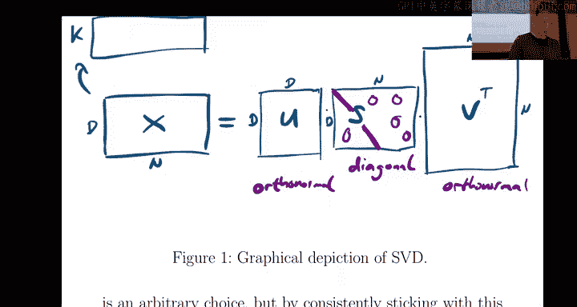

Of x， we don't indicate features。Which has similar properties。

 so that's what we're asking here and we haven't defined yet what it is， but。

I want to make this compression here， so this will be the matrix c times x right and and that's why the C matrix。

Which呃。So yeah， this x matrix should be C times x， right？呃。And we said， yeah。

 when the C matrix is small like this so。K rows D columns。

 then this works so then the result would be small will be of the dimension we have here。

 so that's the idea of the compression。And we have not related it to the SVD yet。

 but that's only what you're going to do next。

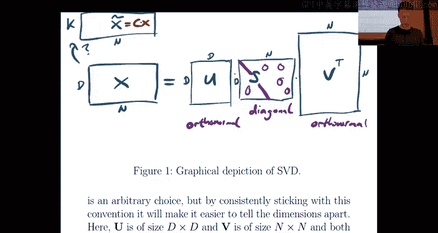

So but the is the idea clear。 So here it's just kind of a learning problem。

 So let's ask what is the best matrix C。😊，Of this imagine。

 what is the best reconstruction metrics are， such a district as close together as possible。And yeah。

 I only want to as K features in the middle in the intermediate representation。So。So that's。

That's what they're trying to do。And you could also discuss a bit like how well do we preserve the data right so so is this norm here the right thing you could。

 of course you can use auto norms。So。But yeah， for that's a discussion on the quality of their。

Representation or quality of reconstruction。

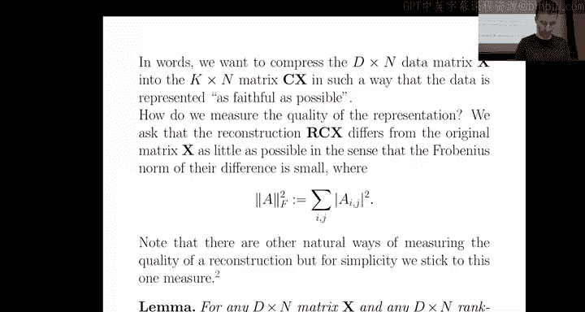

So what no one do even knew is to say how much is this compressed and decompressed。

 how much is it different from the original one？And again， as I said， we just used。

That's the easiest matrix norm you can have you could also use the spectral norm here as you want。

 you would get the same result， I think。But there are automatic norms of course。

 but here we really just go for the simplest one， every entry is squared and summed up。走吧。

Does this make sense？So。So。Yeah， so the goal is clear and。

Now we just need to find out how can we find such？Marices R and C。So， I mean。

 one good way to do this is actually。To run gradient in descent you could do this both on R and C and that's actually a reasonable method and we will see actually next week that this is something that you can always do when you have some more complex matrix factorizations which you're looking for so you can optimize these。

But today we will actually see a much easier solution。

 so in this case we will actually see that there is a closed form solution。😊。

On what's the best C and what's the best R for reconstruction。So yeah， what's the solution to this？

So。😊，And that's in this。In thislemma here。So thislemma is about what is the best rank K approximation over？

So that's the。

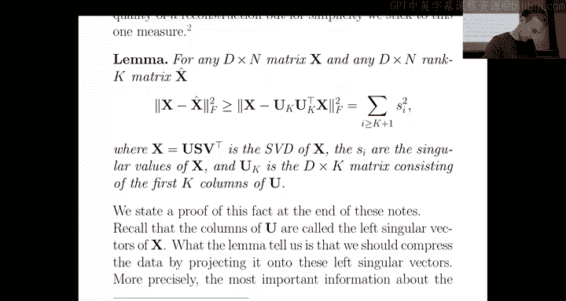

Yes。So。What thislemma is talking about is about approximations like， like we discussed。诶。Oh Frank Ka。

 so exactly what we had when we had a C matrix here。So here we gave you a different name。

And then also a reconstruction。Here。And it's talking about which one of this is is the best。

 So what it's saying is that。Yeah。Actually， so here is X hat。And。

So this is talking about any rank K approximation。Exhead， you can pick anything you want。

 but it needs to be rank K。 So， and what he's saying is that any such。Rannk casing。

Is worse than this particular compression de compression that you get very naturally from the SVD。

So it the error is bigger than the error you get。From when you do SVD。 So I'll。

 I'll explain how exactly this one。Makes sense， but it tells you that。There。

 there is a solution that so then this one this。This is the approximation quality of this solution。

 is saying that this one is better than any other rank K approximation to the original X。

 So we have found the best one。 And it closed form。 So it means that C is。😊。

The first columns of U and then transpose and the reconstruction is the same thing。

 but there's no transpose。So again， so， so this is kind of the。

Reconstruction and the red matrix is the UK transpose。So that's kind of the C matrix。 And you。

 you can agree。With me at the R andCR also they have the correct dimensions， they they have only K。

K rose。And and the Korean construction has only K columns， which is exactly what we required。 So。

 so UK is really just taking the。The first k columns of the original U matrix。So here's you。

 it's a big matrix。And what UK is doing。Is。He's just taking just taking the first。First K columns。

 right？So。嗯。So this is u。Okay， and this dilemma， we claim that this is true for any K。Basically， so。

Well yeah， you need to least take at least one column。

 but you can take as many as you want so up to up to the rank of of the of the original matrix so depend whatever is smaller D or N。

 whichever is small is okay。K can be anything from one to that number。

So this is the best rank K approximation that's for the Lamor proofs。

And so this is kind of one statement he gifts。And then it it has actually a second statement。

 which you see here， so。So this is actually what their construction error is。

 it also tells you what's the value， like how how far away is it from the original X。

 so that's also interesting right？And， and what that is， is that。So。

So here is this kind of reconstruction error。So how much you lose when you do rank Ki K？

And the nice thing is you really don't lose so much and so。😊，What you lose。

 what you miss when you do this is actually all the the single values， which are like after the K1。

 right， So this sum here， you can see it only count to single values after K。So the ones from1 to K。

 they are not in this sum， so and this is actually the largest one。So the largest ones are not。

In the air。Only the ones from K up to the last ones。So usually they are much smaller， right。

 and if you have。That's one thing and also if you take a largercade and of course this sum here becomes smaller。

 there's less values left after the K one。So the reconstruction error goes down with K。

 which is nice。And the reconstruction is the sum of the single values squared。So， okay。

 so there are two statements in thislemma。 The second one was the reconstruction error。

 and the first statement was。To say that it's the best， right？嗯。😊，Best drink key。

So I will not give the full proof。But。But you have it actually provided if you interested。

 it's on the end of these slides。And the。Yeah， what's what's important for you to。

 to apply this is that， yeah， how do you now do this compression。

 And that's also what we're gonna discuss next。 So now I told you the C matrix is the first ca in lower vectors from the left。

So now you can use that compression matrix and see what happens when you。😊。

When you apply to the data。Is there any question on these or comments？嗯。正。Okay。

 so the the intuition is that the signal values are older， right， so they are very important。

 they're telling you like how important is each。Each of those directions。 So when。

 when you choose any what we're doing here anyway is to， to project onto。The the single electron。

 So let's， let's just U equal one， right， We just project。 So then this matrix U is just one column。

What he means is that。It gets multiplied with every data point because that those are the columns of x right。

So every columns of x gets multi with this single column you have from UK。

So what that means is every data point x gets projected onto this column UK， the first single vector。

So。And。And so that's what it is and how good。That is。

 if you do it is so the energy you kind of capture when you reduce is exactly how much value is in this first single value。

So that's， that's how much energy you get or how much。

Of this thing is going to be equal to the original one， right？

And that's what's going to be not captured yet， that's the stuff which is in the further values。

Which gets summed up。 So the what he's saying is that。The most important direction。

Is the one given by the first single vector how important this is it' carried by this value So I mean the S square as the S1 squared for the first one and then if you say I do more than rank one then you also project onto the second。

A columnn， the second single vector and then and so on。

 so there you will be more and more accurate if you if you use all of the if you use the full basis of U。

That means K is equal to D。Minimum of D and then。So then you would capture everything。

 so then then this thing here is zero， there's nothing there's no error anymore。

 you have perfect drug construction。So， and we will see this in a second， because。

That's actually what the SVD will。It will give us so。Any questions？嗯。Okay， so。What I。

 what I just said is basically this that the yes the。

The ordering of this basis vector is by their importance and the importance is carried。

Inter single value， so。And this because we have this order。

That's why the whole scheme is called this principal component analysis because you capture the most important。

Components first， right， so。So that's why you have this name。Because they are ordered by importance。

Okay， so now。We know that we get the best approximation， but this thing still looks a bit strange。

We are not so sure what。What that means and what it has to do with the SVD。So。

So how would you and what also what does C have to do with actually compressing a data point？

In a real application。So。😊，To understand better this expression。

 we can actually write this one directly like like the SVD。 and then you will， then you will see。

Something which makes a bit more sense that you will see that it's actually just taking the first。呃。

K non zero entries of of the SVD of the S matrix。 So and everything else is set to 0。So why is that？

Let me first write the claim so we claim that the stuff on the right is equal to our expression。

And why is it， so I'm using this strange notation here。So， so Sk is just。It's just the dimatics。

 but only the first K。Entries and then0，0。So the full S matrix cycle is all the way with non zero。

But here， SK is only taking the first。First case， single values and the auto are ignored。

 they set to zero。So， and this thing you， you have seen this actually， so I mean， probably。

When you saw SBD， then you also saw this。This thing， which is called a trunc K to the3D， right。

 It's just that I， I don't even care about all the single values。

 I only care about the first K of them。 So， so it's also faster to compute this one because you don't need to。

 to do all the the values。 It's， it's enough to do the first K。Of the single values。Okay。

 well I'm still claiming that this is the same as what I'm doing here， but why？😊，And to do that。

 it's also very easy。You what you do is you just plug in that。

The single value decomposition of them of x， the full the full decomposition。

 so that's U and full S and full V。😊，So that's the entire x， nothing is approximated， this is exact。

 right？But now this gets multi with our compression and decompression， so what happens？And。

So this is quite simple because。We would just use orthogonality right so this is the first few columns of U they get multiplied by all the columns of u。

😊，And we know what that does， right？It basically does nothing。Because。

So now I'm talking about this combination here at u times U。So。So this。Yeah， this is always zero。

 except if you multiply the same column with itself。So what that means is it's the identity matrix。诶。

And then followed by a lot of seas and the identities K by K。

So it's basically always zero except if you ask about。AtWhatever entry number seven times。

And2 number seven in the row then。Then you would get one。Okay， so this thing。

 you can basically remove。 it's just your identity and。Also the zero part what it does it's actually。

 that's exactly what it will do to。It's going to be applying to S。 What it does， it will delete。

Will'll delete all the entries of this。Which which are fertile down in the in the roast and k。

 So because if you take this this purple matrix and multi by S， only the first cable will survive。

 So and that's that's why we have to。The last equation that we don't need S， right。

 we only need the first K entries system。Is that。Making sense or。Too fast， too slow。是。嗯。

So both the original S and the new S。They are still D by， by N matrices。But。

But they are much simpler， right， the the new SK。Has everything is deleted in。

In the rose photo down so。Okay， so what is this about， this is just to say。

The what we have done here with this strange compression has a much natural form here。

 which is just the the truncet of the SVD， so。So that's what this thing is called。嗯。😊。

And there are very efficient libraries to computers。 So we'll come back a little bit to。

To the question on how to compute SVD， or specifically for PCA， we will see there is one small trick。

But otherwise， nothing， nothing has happened here。 So this is just trying to convince you that thislemma。

 which we had， which is saying that this is the best rank K approximation。Actually。

 that's the same as saying that the truncated SVD is the best rank K approximation to the original matrix。

Okay。Then。I also want to spend a little bit of time to。To explain this in a real data example。

 because that's actually where it's most useful when we apply this to data。

 what it would mean in that case， so when X is。😊，is the data matrix which every data point is a column。

And let's have a look if you can do that soon。So here is a whole data set of a lot of thesis。You can。

Can ignore the rows and columns that don't have any meaning for now。

 So just every small image is a face image of a person。

And so here I have five data points which choice circled。Each of them is a is some X N， right and。

So what is XN。That's one of the columns of our big original data matrix。6。So。Yeah。

 we're given this matrix。😊，And now we will see what， what is gonna happen， How is。

 how is now if you apply PC A， how is。How is they going to do at dimensionality reduction and what's。

What's going on？So what I。What I'm trying to。Convinnce you is that， actually。

What this will do is it will take every original image。

 which had D pixels originally and will convert it to a。😊，To an image you shows much fewer pixels。

诶 so。So the dimensionality reduction will go。For example， from from。256 original。No。

 what's the reasonable size here？😔，Yeah， the images are 50 by 50 pixels。

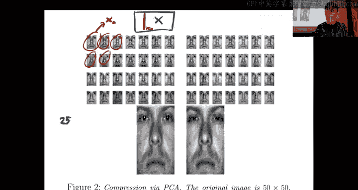

Which is， maybe。2，500 pixels， so that's your D。And。So every image has that many features。

 so that's originally， and now I do a dimension marginal reduction。😊。

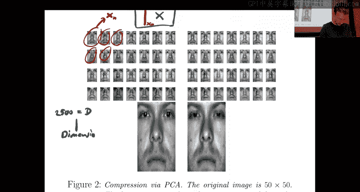

。And this will be exactly the direction that we define with this linear projection。

And what will happen is this will go to a much smaller dimension， actually， just 10 dimensions and。

So that's that's K。 if you go from D。So D was here， right to and a half thousand0。

And then it goes down to k which can be as small as 10， for example。

 actually in in the example here it's 10， so every image will just be 10 features。And， and then。

I can see is that enough to actually reconstruct the original image？

So and then once we have projected it。Soudden。Okay。

 let me actually write the projection that we are fully precise here。

So projection takes the first k column by K is 10。Applies it to the data。This is one data point。

So maybe let's have this。Anyway， XN is a data point。

 so this is the compressed data point so and you agree with me that this only has K features right？😊。

And there is a mistake here， anyone。Anyone see to mistake。是我。So x is a D vector， right？

UK has K columns。嗯。So yeah， exactly。 I need trans。 so I cannot， I cannot multiply。

The K columns with the D vector that would not make sense。But I can do it if I transpose it。

 then that's how the compression was defined。So this is a compressed version of。Of our image。

And then。AndThen there is the reconstructed version， which is if I try to undo this thing and。

So U has this kind of shape。And。UK transport is this shape and then。

Acess this shape just a one column。Okay， so what what is happening here is that。诶。I'm showing。

I'm showing this。 I'm showing the the bright green stuff， which is。

The the reconstructed version of these of these x， right Okay， so its it's just the first one， right。

 So this is the reconstructed image。Which means the green UK has been applied applied to reconstruct the compressed version。

So that's what we have here。And then of course， you could do this for any。Any follow data points？

Okay， and and if you look a bit more closely then then so。Here is the zoom in。And yeah。

 it looks and here's the original image。😊，It's it's not perfect， but。It's， it's quite similar。

 right the。The the person is maybe still recognizable， which I mean， yeah， why。

 why is it the why is this noteworth， right， it's what。

 what's surprising is that this was was possible for very small K， right。

 So the compression is quite drastic， right， you only use 10 real numbers。To describe this person。

 right， So because the compressed version， which is this。It has only 10 entries right。

 so it's a really small vector because K is 10。So and these 10 tiny numbers are enough to describe the。

Yeah， a good part of this shape， not face， not exactly。Not exactly for perfect reconstruction。

 but not bad， right？So this is what PCA does。With K with the first 10， for example。Well， of course。

 you can choose a different key。And then we can have， again， this whole discussion。

How do we choose K。To yeah， depends on the purpose on why we are doing dimensional de reduction。

 what is our goal？So。😊，So here it' just illustrated， yeah。

 this can be quite drastic from two and a half thousand0 to 10。😊，It was a linear projection。

 It's very naive， right， But even this linear projection can keep a lot of information because the 10 directions you have decided to。

Project on these little really good direction。 So these are the principal directions， right。

 you have chosen the the kind of the best directions you can have to do a linear projection on so that the maximum of information is。

 is preserved。 And after the break， I'll briefly come back to。

To that to again understand a bit more what this meant to be。To preserve information。In the sense。

 but I hope the intuition is clear what happens to this image data set for for the moment。

 Let's take a short break and then see you in 50 minutes。😊，Yeah。All right， let's get started again。

 so maybe we can finish a little bit earlier。😊，呃， we。We are almost a。

Have a complete picture now on what the principal component analysis does。

 so this was to show you on a real data set what happens。And。Yeah， so one。

A few comments I got in break were maybe also much worth worth mention here so so that yeah。

 this UK here， right？We still， so first of all， they always need to be stored， right， We need to。

 to remember them。So， so this， whenever somebody gives an image to you and you ask you to compress it。

 they need a UK。 So， so they need the first columns of。Of this。 And right。So these， these have。

 these are actually images， right， So because every， every UK has。

 has as many features as you originally had。 So they have the same。Same every column of UK is。

 of course。A D vector。So so it's like an image so also two and a half thousand pixels that's one of the UK。

 so what are these UKs are they like images， so I mean they are not like the original data。

They are kind of a a strange direction， which has been produced。To reflect all the images， right。

 that's what the first U， the U1， right， is the principle， the first principle interaction。 It。

 is's trying to reflect all images。With a single kind of fake image as good as possible。

 So that's the U1。 So， so this you， these use are actually called the。The eigenfaces there。 I mean。

 they are the eigenvectors， of course， UK are the first K eigen。Again。

 vectors or actually single vectors。 But forget about rectangular。 So let's just see。

It's like an eigenvector so。So that that's， of course。

 what these first k vectors are and what then people。People say that to。

 to say these two things that， first of all， these are like pictures。

It means that they're like a thesis。And saying that they are actually the first K of you means that they are the eigenvector so so if take this together then。

What name， what name people give to these things are the are the eigen faces if you want， so。

So these are the UKs。 We don't have them visualized here。 They， they look a bit strange， right。

 The the first one looks like a face。 But then the second one looks a bit like then what's the。

It's like a difference of， of a standard face to all， all other faces also so。 So， but they， yeah。

 they look some kind of ghosty。Ghosty faces。 So this and they are K of them。

 And I need to remember them because whenever I need to compress。

 I need them and whenever I need to decompress， I ownt it。So those is just another a name for my。

Compression de compression matrix。So yeah that' and that takes memory right so but memory is not too bad because K is small and D is reasonable right at least I have maybe millions of pictures before and now I only have 10 pictures so this is a big big improvement so。

Okay。诶。That's， that's one thing。 And the other thing is that， again， So which， which 10 directions。

 So it's the first 10 directions。 So what does first mean。

 So this is a recap that it's extremely important that。They are ordered by size， right， So， I mean。

It's， that's just， it's nothing to do with PC or anything。 It's just the。

 whenever someone gives you a SVD， then they are already sorted， so。The SVD is defined， too。

To give you the diagon matrixs S in a sorted order。 So the diagonal here is sortd from big to small。

Bigest entries first and then smallest last and by the way， all these entries are not negative。

So don't forget that they are in descending order。 And that's why when you do K called1。

 you get the first。Okay， principle  one or the first 10 important， the 10 most important。

InIn this sense。So。That's the definition of the SD is like this。 So， so there's not。

 it's not that there's an algorithm or anything。 It's just the definition of SD is。

Is saying that they are diagonal and sorted， so。Maybe I add here。Sorted by descending order。Okay。

Yeah， that's。That's SVD。 We discussed the approximation error is best among all the rank hair approximation you can do。

 We saw what will happen on， on a real image data set。😊，So actually。

 we didn't see so much that why it's useful yet。 We just said， okay。

 maybe it's surprising enough for you。To know that 10 numbers are okay to preserve almost what looks like a face。

But what else is useful for it's not so useful if you do it for one image， right？Of course。

 we needed all the images to define this， this projection。 So to obtain the projection。

 you need all images。 right， It's not something you can do for one image alone。

So then why do I use all images if you only care about one that doesn't make much sense。

 So let's see a bit more what what happens when we。

 when we take all the images together and let's see if this dimension reduction now can also be useful for us to understand the whole data set。

 right， not not only one data point， but the whole data。And that's what we have here。So the。

The these dots here， you can forget about the colors at first， It just。This is your entire data。

 and it's in a two dimension space。But it's strange， right， because the yeah。

 the original image image each had two and a half thousand features， not two features。

So what are these two features which you have now after the projection？And。诶。Of course， this。

These are the。This is the projection onto the first two principal directions。So， here is a。You one。

Transpo times x， and here's the second principle direction。You too。Transpo is times times x。😔，So。

 so I'm showing you the projection onto the first two principal actions。 So when as a recap， maybe。

Maybe Xn was the original data point。So then it gets projected。做。Maybe this one soon。

And the projection is， well。That's that's what we see matrix， right， the protection matrix。

And and what is it？We know what the projection matrix is， so the C is just UK。

Transpose so this is UK transpose times the origin data， so that's this point here。

The projected point。 and this only two dimensions that's nice， so because K here is two。

So just to say that， yes， so PCA can be used to now get an overview of not only one point。

 but all the data points。So。The。The picture has all the n data points， right here here。

 so everywhere there are data points and now now what I can do is I can try to find patterns so Ill now look at these points。

And that we see that eye， it seems seem that they seem to appear in some kind of groups。So， I mean。

 some are very close together to each other。 So maybe that means they're similar。Similar photographs。

 right， maybe if you just see these two photographs。

 then you don't know if if they're similar or not， because the the pixels are still slightly different and there's so many pixels。

 it can be millions。

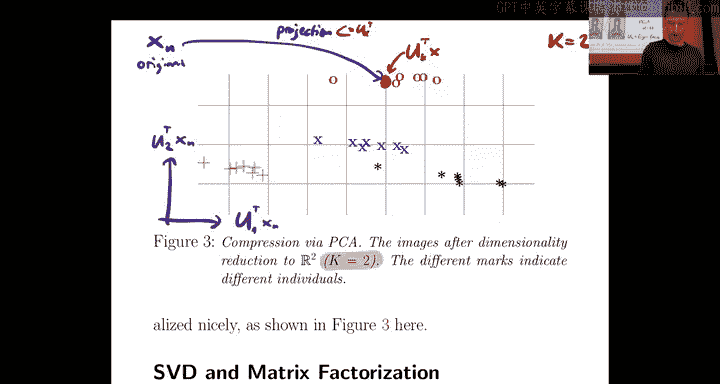

So it's hard to say if they're really similar， but。But after the PCA， you say that， okay。

 these two points are。Very close together in in the two dimension space。 And， and yeah。

 you can look at the two dimension space and get a。

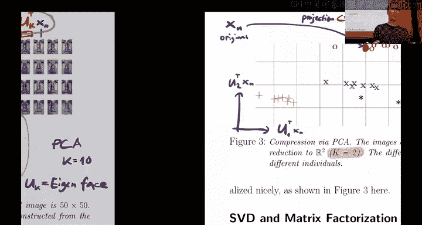

An overview much more easily。So yeah， then we observed that some groupings happening and actually。

 yeah， this is just a special example here， but。😊，You can see that。

These four kind of groups of people。They happen to be grouped together after the PCA。I mean。

 these groups of photos， so what is up with this what is special with those photos。

 the ones who happen to be in the same cluster。So， and what turns out。

What special is that those all happen to have been folder of the same person。

 but taken from a different angle。 So or more or less light。So， but actually， I。

 I was lying to you that I said the row here mean nothing。 The。

 the row here in this data set do mean something that every row is from the same person。 So some。

 some different folder， so。But anyway， the PCA doesn't know right for the PCA。

 we just throw everything into one bag。But then after we do PCA， we say， okay， it interesting they。

 they do appear in groups in。😊，In the the energy reduction。So into projection。And to see， okay。

 we actually found some meaningful groups in this particular example。 Of course。

 this is very synthetic， right， And of course， this is。I mean。

 this is far away from state of the art， face recognition or something， but it's really simple。

 It's really basic， it just uses the most basically in neuro algebra bra which you。

 you already know since a long time。 And you see that even with this simple tool， you。

 you actually get a meaningful。Pas on some kind of real data， almost real。So， it can be very useful。

And。This is just one example of what you can see when you explore your data set。

 so for exploratory data analysis can be very nice。

 you will also see maybe you will observe some outliers。After the PC8。

 then you could go look at them and see what is， what is wrong with that data point。

 Maybe you find something。 Maybe it helps you to better clean your data。

 Maybe it helps you to understand。呃。Your data set， right。

 do you have more data from this type or the other types so you can look at the。The PCAE。So yeah。

 you， it can be two dimensional。 It can be3 or anything you， you want。

 What can you choose depends on the， on the use case here。

 the use case was kind of interpretability to。呃。To observe a pattern by I。

 So then two or three is a very reasonable K。If you do it for a different purpose for compression when you say your client is okay to get 10 features for whatever reason。

 then you might choose a different K for that particular use case。

But what's really cool is that it's a completely unsupervised method。

We don't have used any labels anywhere so。That's kind of what's nice about it that do。

This is something you can do to better understand your data set to compress it without using any additional information。

So。So this is this compression aspect。When you do dimensionmental direction？你实。

Does this make sense or was I bit unclear on， on the access and stuff And one image is one data point and so on so。

Any questions， now is a good time。All right， so but remember to find the UK。

 you need the entire data set， you cannot do this on one image though。So。😔，Okay。

 then we have like two more things one is to connect these two matrix factorizations。

 which we started a bit in the intuition at the very beginning and then also next week we also get deeper into matrix factorizations。

And then the very last thing will be to， to talk a bit about the probabilistic view that this has an interpretation one。

In terms of things being correlated in your data or to find correlations。

 actually remove correlations in the end。So that will be the last two parts of today。And。

So why is the sosymmetric factorization？嗯。So。So what we have done is widely used the SVD and。Yeah。

 of course， this is a product of three matrices。So whenever you do this， you can say。Okay。

 it's kind of a mate specization it's also。It's also a product of two matrices。

 you could group it this way or the other way。So， you could say。Whenever someone does SVD。

 the same thing is。That person also has done。A matrix factorization into two matrices。

But that's not very。Very useful。 And also， there's nothing learned here。 this form。

 everything is exact。But what we did before， if you remember。

 was actually that we did a low rank approximation so。

So that's there is a bit more to the story here that just to say。

 a matrix expectationization is not meaningful， but。So let's see。

 what is does it mean to actually find a。A low rank made exization。

So and how should we do it and what would you mean for these two factors we're trying to search for？

Which we name here W and Z， but you could give them all the names， of course。So。So。

 this is a perfect。Mative factorization。 But yeah， it's not， it's not so interesting。

 Another way you could do is you could just set， you could set W to。This always is naive case。

 you could just say。W is x。That that's another one， right， and， and that equal identity。

That would also give you perfect reconstruction， but it's kind of kind of boring， not。

Not giving you a meaningful factorization like we have had before。So what do we need？

To make this meaningful， so。So we would like to kind of control the rank。

 right as before we have said， we did tranck plus D only rank K。

 So can we do something similar here to say that。W and Z should be a bit special such that in a meaningful space such that their product is low rank。

And。So， that's what we are。What are you gonna to do。嗯。嗯。So yeah。

ll I'll directly show it to you here so so if you do the low rank， as we said。

So here is a truncet the S withD。If you want。So that's remember when we just ignored all the the S single values which had had a。

After the case one， then this was the truncated SD。And what I'm trying to tell you here is nothing。

Very deep， I'm just telling you that the truncated SVD is actually a rank K matrix switch。

It's kind of obvious。But then。What does that give you for for the factorization it also gives you something something quite simple。

 So again we only take the first k values in this dio matrix everything else is zero so so what that means is that。

呃。ThisThis thing here is actually just having K。Rose。

 because everything is everything else is deleted。And of course， UK only has K columns。

And this one only has k columns。So this we know already， of course。

So all I'm saying here is that what's actually happening is that。

The matrix is K column gets multiplied with the matrixes K rows。Because S has zeros。

 you know the rows filter down。So that， yeah， this particular choice， if you choose a。

W to be the first part and the other one to be the second part。

 then what that is is to multiply a DbaK matrix to the K by n matrix。And that's。

That's what we call a interesting matrix specization。 And obviously it's1 K， right， because if you。😊。

Yeah， if you take k columns and might better miss K row， then of course。

 that's something which is at most rank K。So。So now when we do it this way。

 then we have that this kind of approximation is is a rank K。

 and that's the one we we used in the SVD we know actually that this is the best rank K。

So all'm I'm telling you here is that the best rank key。

He's actually also a matrix factorization of a nice form。' a it's a very compact one， right， because。

We only need two matrices， which have。This small number of columns each。Actually。

 the W matrix are the。So these are the eigenfaces we had before right I told you you just have to store 10 images right so that's that's the。

The UK， so it's very efficient to store it。And also。

 the Sa here is also kind of a fusion to store because remember， like， yeah， D can be here。

 it's 2 and a half thousand。 and N can be millions， or both can be extremely large。

 but K is very small。 So， so this。These guys here the Z andW。

They have very few parameters compared to the original matrix X， which is huge， right， N by D。

 can be gigantic， but we have managed to describe it with a。With a very small number of parameters。

 which are just scaling with K。 so that's a very efficient model too。To represent。A data set， so。

It's a bit similar what would happen in a neural network if you have a linear layer of size， just k。

 a very small linear layer in the middle some kind of bottleneck layer so so I mean this thing is just like。

Maybe a linear layer。Which is small from K。Which is connected to a very big input layer。

Which is size n。And then呢。Kind of a big output layer again of size D。嗯。

So that's be the same thing that would happen and the nice thing is that those have quite few parameters right because the K is very small and there's not so many connections here in these two layers。

But if you would keep the original layer。The original one would be fully connected here everything。

 which is like a million squared。But now the， the small one with is small intermediate layer is only。

It's very small， but it's only K times something so。So this is small K。

Is good in terms of parameter efficiency。嗯。Okay。So you can also optimize directly this W and set and that's。

That's what I try to mention in the beginning。 So now we are kind of getting to more generic algorithm。

 So even if if you have much different losses and different kind of factorizations and whatnot。

 you could try to optimize these Ws and set。 And that's what we're gonna do next week。

 But what we have seen today is kind of a special case of that right today， we had a close form。

 but maybe it's not always gonna be so so easy to find this best Ws and set in one step So then we can do it by gradient descent。

So that's about more general matrix accusations。The SVD being a special case of that， so。Yeah。

 by the way， here， no activation functions just。Just the one million layer， so。Any question on this？

Yeah。I this tru as we is the same as the one you do with compacting and then reconstructing because like this one has the use of script with pay but the last。

In the previous one， doesn。Yeah， so you asking if this is the the same。Tncated SD as we had before。

And the answer is， yes。 So， so， yes， it is the full。 the， the thing always has the full size。

 is's the same size as the original data matrix， right， So， so， yes the。

So the S thing here is truncated， right？But the resulting thing is always of size n by D， right？

And then now you said you find it confusing that in the last one I didn't have the UK and that I agree is a bit confusing。

 but but it's the same as here because it's actually the same so。

Because you here its everything after K gets deleted anyway when you multiply with s。

 so it's actually the same if you write here UK or not。

 it's just the question iss just do you also include these zero columns here。呃，in in the s。

So they are all zero， but I just made purple So so if you take the whole U and multiply it with this。

Actually， what happens is just all the use get deleted except the first K ones。

 So that's why this expression here。Without the key is equivalent to the expression at the end when when you have the。

With you UK here or actually， well， yeah here it's again， here it's the same thing。And here I had UK。

 right， But it's really the same。 So there's no difference。 And yeah， here， maybe。

 maybe I shouldn't write X here。 maybe this was just X hat， right， It's just the approximated。

My best a estimationation I can do to my data so compressed and then reconstruction so that that's what we call x hat in dilemma and yeah same here so。

So don't worry about the name of the exit， thanks。Any other comments？Great。

 then a small part about the。Dcorrelation and what does this have to do with features being correlated and data points being correlated and so on。

There is a。There is so far we didn't use anything about the the data set。 So。

 so here we will actually。Start to think again a bit that these are actually data points。

 So they come from a distribution and every data point comes from the same distribution。So。

 we haven't used that yet so far so。So let's， let's see if what we did with with PCA also has a。

An interpretation here when we when we talk about。Yeah。

 all our data points and how they' are correlated so whatever。

What are the means and correlations of a dataset set if if you get a data set that's kind of the first thing you would do。

Look at what other means， look at what what correlates with what So what that means is we want to。

Compute the empirical comms and the covariance。And what do I mean by that sort？So this is the。

 this is the definition of the just the mean。 And it's， it's kind of taking。It's like。

So it's average to all data points， of course， but it's a it's a vector， right What it means is that。

It's the same thing as if if for one feature individually， I ask。

 what is the average of this particular feature in my whole dataset set。

 so that would be the first entry of the meeting， right？And then so Xpar collects。

All these is the whole vector。For so there's one mean per feature that's all I'm saying。

 so this is the mean so。Then so for every feature now we know what the mean。

 but now the next question you ask is this feature some of the features might be correlated with some other features。

😊，And that's。And that's captured in the correlation matrix or covariance matrix。Of these features。

So it's always of the features， right， so then？呃。But then it's always taken in average over the whole data set。

So， what did。What it means is that？Yeah， maybe let's look at it for one specific feature I。

 I want to know how it's called with feature J。Whether than ask is Sir。The eyes empty of the。呃。

Of each data point how and I'm multiplied with the Js entry of each data point and what I also have here is that the every feature is normalized so so every every data point。

😊，Has been subtracted the mean has been subtracted from it。So， so that every， every data pointers。

Is she written like this right that each feature has been the mean of the feature has been subtracted from it？

And then when I write to your Xi， the I subscript just means that。呃。

What I'm just looking at the I feature now。Of data point N。

And it's it's taken relative to the to the the mean value of that feature。 So well。

 forget about the means for a second。 we just assume that your original data set already has every feature was mean zero。

 So forget about this。 So then you can see that what the correlation matrix does is just。

Every feature I of a point with feature J of the same point。Do are they。

 They multiplied and then it' average over the home data set。 So that is the correlation of。

Of feature I with feature J。 And then here， when you do the the mean subtraction。

 then this is the normalized version of this。So this is when you do it separately for each feature and what I actually wrote here is more efficient in。

In vector form， right because this is the entire vector collecting all the features。

And that's multiplied wisdom。Which actually the very same vector is here， right， but here it's just。

The vector is transposeded。So if you multiply the two you get a big matrix so any I is anyj right that's this product so and then their n of these matrices and error matrix is giganttically big every matrix here is d square and their n of them they get averaged so this is done。

😊，This is the feature covariance matrix。Okay， but why would we。Care about this。

So just this is a D by D matrix。 and here we ask about the。I Jay's entry。Okay。

 so the connection actually be that this， this thing will be having a lot to do with。We the SVD。

 and we will see that in a second， so。小。Still， is it clear what the mean and the covariance is？嗯。真。

So yeah， actually， the， the mean disc normalmanizing。 you can forget about it。

 You can just do it as a pre processing of your data and then， and then do， that's what I said。

 right， if， if it's already pre processsed， if every feature already has zero mean。

Then what we have up there is pretty much more simply。Like this。So this is already normalized。

So what I wrote you is the exact same thing as here。

 but let's just assumed that the data already is normalized。

And then something else that's happened is that， yeah， so far we said it's the average of everybody。

 but now I just took the end to the other side。We will see in a second why。

 this is just for notation purpose。Because when I do it。

 then I see that the covariance matrix now is actually very simple form。

 it's just the data matrix multiplied it itself。😊，And this， I hope you agree is a nice expression。

 right， so this is very natural expression。😊，You the customer gave you the data matrix。

 What you do is。You multiply the data matrixs with itself with its transferpose more precisely。So。

So this is one thing here is the covariance matrix is this matrix。Up to scaling of n。And now yeah。

 we can see what this actually is， so I have the exact SVD of any matrix I want。

For just theoretical purposes， I will just plug in。The true SVD of x。So which is a USB。So right this。

 yeah， this is X and so on。And now then I。I used that， yeah， if you multiply it with itself。

 then this becomes the identity。呃。It's actually n by N matrix split。Doesn't matter much。So。

 so this gets lited。This is what remains。And the S is the diagon matrix， right by definition of DSvD。

😊，So what you have is you have something which looks like this。

 which is just it looks like an SVD but every single value is squared so this square here means yeah the diagonmatics。

 every entry squared is the same thing as multiplying the diagonmatics with itself。😊。

So that's what we see here。So it's a diagon of the SI。quaquit。All right。

But now we still don't know what how this is useful。So。So this was the original data X。

And we saw that the original data had this。Had these covariance matrix。Right。

 that's that's kind of the spirit here。 So the the covariance is capturing， first of all。

 it captures how much variance of each feature have and then how much variance do they have。

 how much alignment do they have with each other。 So these are the two things which are captured in the covariance matrix。

In well， the diagonal entries and the off diagonal ones。

So the intuitionist now we understand this covariance of the data。A bit better。

 and we understand that it's related to the singular values so that the variance of the data is determined by the singular values。

Okay， or this was the original data。Now， let's look at the compressed data。

So here is the compressed data set。As we did before。So。Exeler。I think we called it Xhead last time。

 but anyway。So this is the compressed data set。And it's still a data set， right。

 the only difference is now its now it's only a K by N matrix and before it was a much bigger。😊。

D by in。So that's the difference。And。So now for this for this matrix now we have different features right by same number of data points so we can ask the same question again what what's the covariance how like this is the statistical properties of this data。

 what how much does it vary right， how much magnitude is you need in terms of variation and covari。😊。

So let's ask you something covariance of the transform data， of course。So yeah。

 same covariance thing， this is the definition of the conveyvariance as you just did before。呃。

We plug in the definition。And we see that。 it's actually。

A bit related to the dynamics matrix we had before。

 but now what's different is that there is also this compression and decom sorry。

 only the compression which appears in both sides。Additionally。

 right the x section suppose we had already。That's what we add for being the covariance of the original data。

 but the covariance of the compressed data is not the same thing。But with the， the you。

Left and right。So。Okay， and again， we know from before what this is。So。

This is actually the original covariance。Oh。So it's the original one。

 but is a U multiplied left and right。So。The result is much nicer actually。

So the compressed data has a very much simpler。Covariance structure。

 and most seems to me that's a diagonal matrix。So what that means is that after PCA。

 you get this new data right， there's only two features。😊，Interestingly， these new features there。

They are deco。 They have no correlation with each other， right？Because it's a diagon matrix。

 So any two features， any two different features， the covariance of the two features is 0。

 So any two same features。😊，The covariance is what it is on the diagonal。

But the point is about the different features。 there two different features are。

Not correlated anymore right so before the original features were very correlated because this is a。

This is not a diagonmatics。 The whole thing is a。Is a dance matrix。Which is non zero everywhere。

 right？But now the， the new compressor has a diagonal covariance。 And this is nice。 This。

 this means that。😊，The new features are completely uncorrelated， which is。Nice property to have。

 right， We， I think we saw this also bit when we discuss classification education， right， it's。

 or if you discuss interpretability， it's， it's very important if， if， if you have some features and。

If they are college， it can be tricky， right， you don't know anymore。

When you want to interpret things， do you know if your classifier picks up one feature or the other。

 it could be either way because they are very correlated。

 You don't know which feature is the one causing the。

The the output or the the classification just as an example。 So correlated features can be a problem。

So it's interesting if you can have of uncorrelated features。

So here we found a nice property that the PCA actually does give you。Uncorrelated features。

No me HK use you can use small or big K， this is always going to be the case so actually here we use the largest k possible。

等。Okay。So the covariance is diagonal and also if you now look at how big is the covariance。

 actually that's what you can see on the diagonal。So let me look at the values now。

 So this is what we have in this small remark here。That。NowNow we look at these values， right。

 we say of course the first one is the biggest one because as always， theyre in descending order。

So what that means is the the first new feature is the one which has highest variance， so。

Because its variance on the first entry of the diagonal is S1 squared， so it's largest entry。So。

 so this means that。The first， the first principal component carries the most of the variance， right。

Because。Yeah， the variance of each feature， that's what is on the diagonal of this matrix。So。

So that's why what it means that some of these components carry more or less variance。

 so if you know the single values， we could also quantify this。so。So large variance means that。

 yeah the feature is is varying a lot， right， It can be very high， very low。 It's really a lot of。

A lot of variance， a lot of diversity in that feature。

So that's what the variance on the dagonal entry is。And， and that's， that's important to know， right。

 If there's a big difference in that feature in your data set， So it。

 it is the intuition is that the first principle component carries。It is that direction。

 which in which your data set has the biggest variant， the， the biggest。Variability。 So that's。

Most of where stuff is placed around is captured in this direction。

 if you need to pick one direction， then this is the one which carries the highest variance so。

and yeah， of course。When you then。When you build standard machine learning。

On on data sets and where your data has the highest variance。

 is's also something which is most quickly picked up by by your machine learning model。

 So it's it's important to know that this is the case and which direction has the highest variance。

So this is not a， not a T or M too。To tell you， but it's just， okay。

 if you want to simplify your data just be one direction。

 then this is the direction which would explain it best。

And it's also the one which has highest variances。嗯。Okay嗯。Then if you want， you， you have a smaller。

Thought experiment here。At least it。诶。For you at home。

 so the idea here is that what if your data is actually gaing comes from？

This is look at the simplest data you can have what what is from a Gaussian。

 and then there is also some case which we ask about here is when。When these single values are equal。

 then this is an interesting case。 Thus， does this happen， right？

 So then sometimes this ordering of the single values is is not unique because they can be the same。

 right， So then。Then it's not so clear， which is the principal component because there might be several。

 right， but。Any of them is a is the correct ordering right So any descending order is fine。

 This is just to think about it a bit like what does it mean for the direction when all the directions have to have the same variance。

 that's also something can happen if all directions actually have the same variance and it's not so interesting to do PCA because that means the original directions are already。

All equal in a sense， so there's no point anymore in summarizing them into into a new direction。

So that it's just a small。Brenice is here。So I want to finish today by saying that。

This is a very small trick how to efficiently compute an SVD for PCA。And。Basically， the idea is that。

嗯。😊，You can compute single values。By computing ionvalue。So。嗯。

eigenvalue what the eigenvalues was just whenever everything seen square for square matrices。

And maybe someone gives you eigenvalue solver and what I'm telling you here is that you can use these to compute single values as well。

So。And。And that's actually what I'm saying here is what square matrix should you use。

To compute diigenvaluedies。What I'm telling you is that you should use the one we saw here。

 actually the data with itself。 So this is a very important matrix。

Because it can also be used here for a computational benefit， so。

You could just take the data matrix itself。And。Computs the I canvalue the composition of that。

 And you will see that。This will be the。The single value is squared。Saying that。Yeah。

 eigenvalue of x times x are the same as a single value squared of the original x yeah talking about the normalized。

You asking if you talk about the normalized vectors， yes， yes， everything。

 every vector here needs to be normalized。 Egonvalue are also normalized。 So where are single values。

 yes。So。And this is just， yeah， this is the proof here， why why is this the case。

 because if you have a single value， whatever， then you can see that it is the eigenvalue of the square matrix so。

So what this line here is saying single value is。A single vectorctor is a eigenvector。Off。Expo。嗯。

Okay， so the trick here。

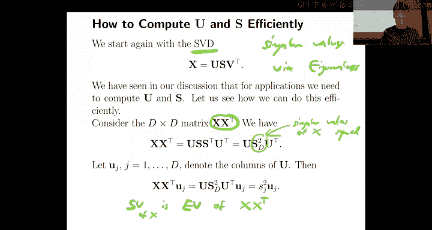

Easa， you can do this actually。In both directions。Because depending if your data set is shaped like this。

Or like this。Either way， the one of these two ways would be much smaller matrix。

 So that's a choice you can make。You pick actually the smaller of the two matrices。

Smaller is the one which is the best choice。To then compute eigenvalue on it and if if it's very x is very rectangular originally。

 then one of these two will be much smaller。 one of these two square me will be much smaller。

 and that's the one I'm telling you is much more efficient to then use it to get your single vectors because that's what you need to get to get to PCA。

So this is just a small computational remark and you can play with this in the exercise this week。

 we have a nice notebook for you。And I think that's it for today， see you next week。😊。

