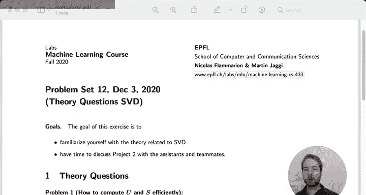
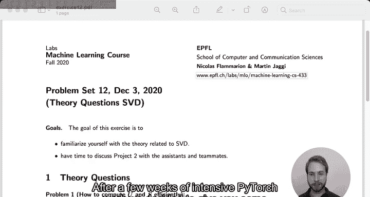
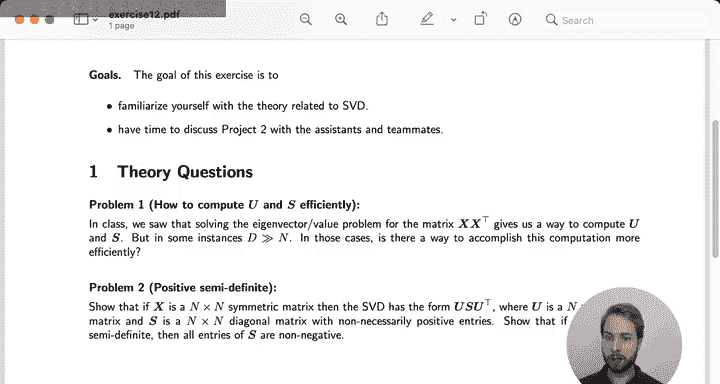
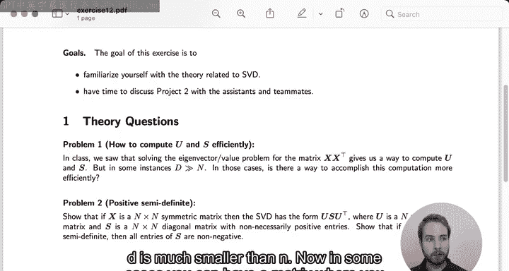
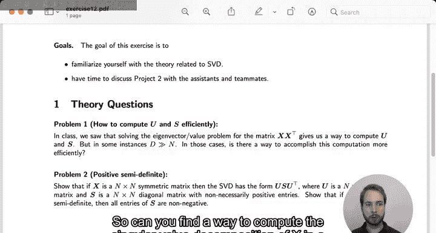
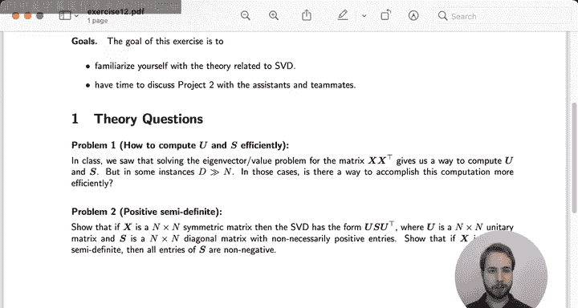

# EPFL《机器学习｜Machine Learning Course CS-433 fall 2020-2021》中英字幕（deepseek - P36：[36]Exercises 12 - getting started video.zh_en - GPT中英字幕课程资源 - BV14SwyeNEvW

Hello， As。 and in this video， I will guide you through the exercises on singular validity compositionposition。

This week， we only have two theoretical exercises after a few weeks of them intensive。

By torch work， we decided to give you some time to focus on the project。 and so。

The exercise said this week is quite light。嗯。

There are two questions。 So one discusses how to compute singular validity composition efficiently。

So imagine having a data matrix x of size D by n， where D is dimensionality could be small。

 let's say 10 and n is the number of data points which could be large， like a million。In that case。

 we saw that you can compute the singular validity composition of the matrix x。

By doing an eigenvalue decomposition of x times x transposed。

The dimensionality of this matrix is D times D。So that's really good。 If indeed， as we said。

 D is much smaller than N。

Now， in some cases， you can have a matrix where you have many more features than data points。

And in the first question， you are task to find a solution for this。

 So can you find a way to compute。

诶。The singular validity decomposition of x in a way that doesn't require you。To use a D by D matrix。

 but maybe a smaller one。

In the second exercise。嗯。We look at singular validity compositionposition for a particular type of matrix。

 So we look at the case where x is a symmetric matrix， which is also square， of course。So， normally。

Any matrix has a singular validity composition。 USV transpose where U and V are different。

But what you ask to prove here。Is that if the matrix is symmetric， then U and V are the same。

And particularly the second part of the question， you should show that if x is also positive semi deffinite。

 then。All the diagonal entries in S are positive， as well。So。Little hint here， as you should know。

The properties of a symmetric matrix， in terms of。Trans post。 so maybe you can start with that。

Good luck and see you next week to discuss the solutions。

