# EPFL《机器学习｜Machine Learning Course CS-433 fall 2020-2021》中英字幕（deepseek - P37：[37]EPFL Machine Learning Course 2021 - Week 13 part 1.zh_en - GPT中英字幕课程资源 - BV14SwyeNEvW

So we have already seen a few examples of matrix accusation in a few of the past lectures， right。

 for example。

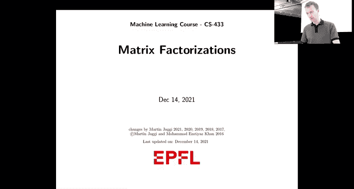

The one of Ks， we saw that the Ks was special case of a matrix factorization。

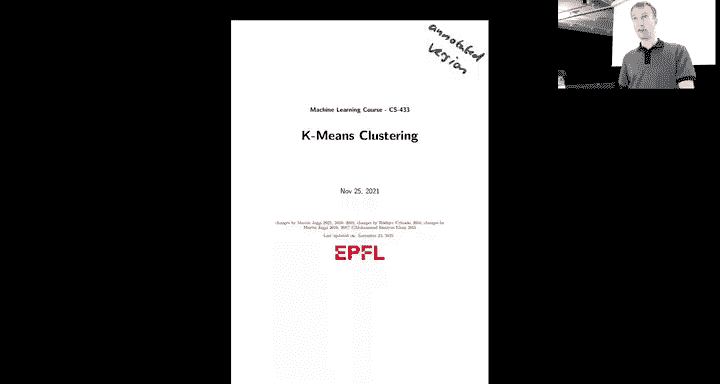

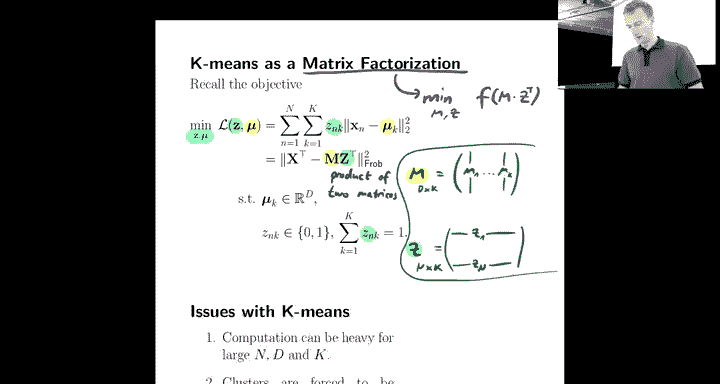

So which， which are like problems of this form that you can。

You can formulate your problem as finding two matrices or learning these two。

 these two matrices such that they minimize some function。

 So it's this kind of optimization problem that's。That's a matrix accusation。

 and we also saw that Kmins is one of them。

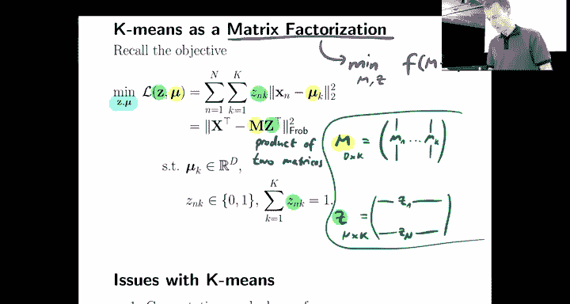

呃Then we also saw that。Not the guns， but actually the principal component analysis。

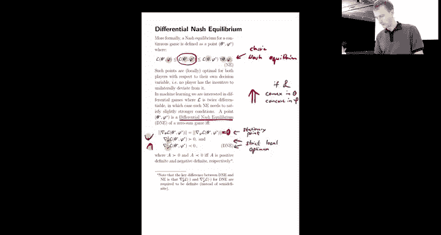

Was another example of。

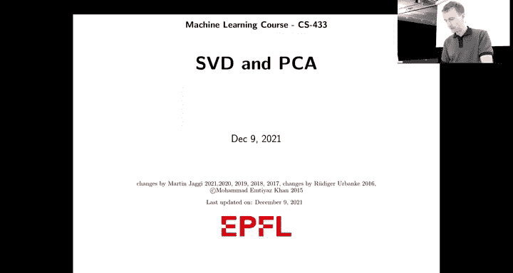

Of these， so we also saw that that can be seen as a matrix factorization。

That was at the very end last week。嗯。Nots go into details。

 but today we want to have a bit general view on this and。

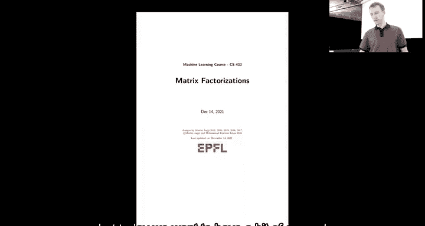

And also discuss the case of recommend systems， which are maybe the， the most prominent case of。

 of matrix factors。 And then on Thursday about text。 So learning embeddings for text。

 text representation learning， so。

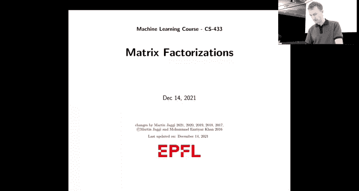

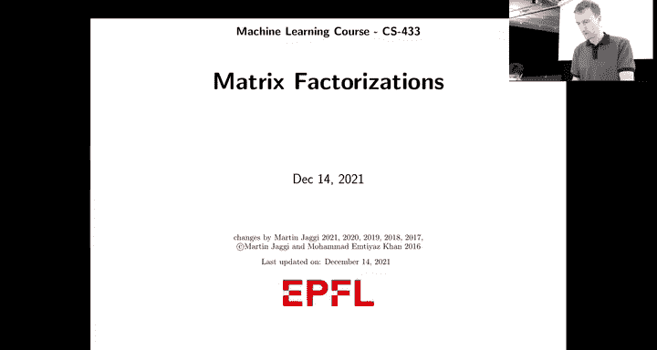

So。The motivation is from recommendo systems for today。

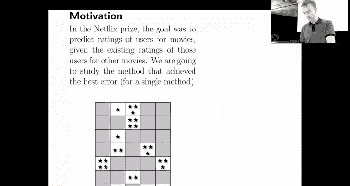

And。There， I guess you， you might have heard of it already。 It's a very natural setup。 for example。

 you have a。

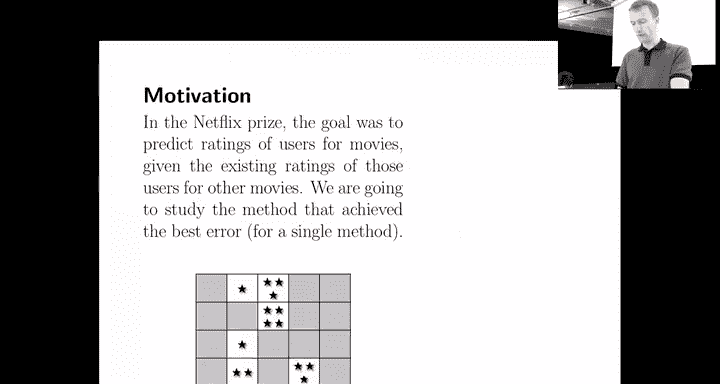

For example， you have D movies。And you have end users。And you， you want to ask。

Or you want to study their preferences if they like some of these items or movies。

Can also be products or anything and。What you want to learn from。

 So the data your trying leverage is going to be some。

 some preference data that users have given already。 So。

 so this entry here means that this user small deep。Has given four stars to the。To the movie sorry。

 this movie D has received four stars from user small end， for example， so。Yeah。

 movie two use or three。At that position， I have a rating of four。

So you can say that this is kind of the three， three top of like movies。Useer。And the rating。So。

 so this is the type of data you have and what you also。

Is interesting is that most of the data is actually not available。 So this is unobserved。

 All the gray areas are unknown。 So there's a lot of。A lot of unknown。

And just in in our problem and and the task here is to actually predict this unknown data。

 So that's that's what we're going to do today。 And we will see that。

Maybe one of the most natural ways to do it is going to be via matrix accusationizations。

So I hope the setup kind of makes sense。And。Also， again， about the data availability。

 you would say that maybe most， most of these。Most of the gray entities are really unknown。

You want to predict it， right？So， maybe 99 points。So the vast majority of all entitiess are。

Orre unobserved， they're just not there。And those who want to predict， so。

So to train a model that can fill in these meetingss。Predict。That's the goal。

 and there are many ways to do it。And for example， the the easiest thing you would do as a baseline is to just take like make。

 maybe the average。Rating that users give to that movie， and you could fill in there those entries。

That is one。One very easy baseline， and there， of course many auto baselines。

And so just be sure that these em are not zero or something theyre really they unobserved， right。

 we have no idea about the value those emses。And in some。

 theres also some nice data sets around actually， the one you have in in the project 2。

 if you want to， to work with this， we， we actually have some。

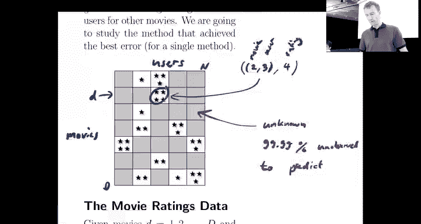

Some kind of related data to this Netflix。

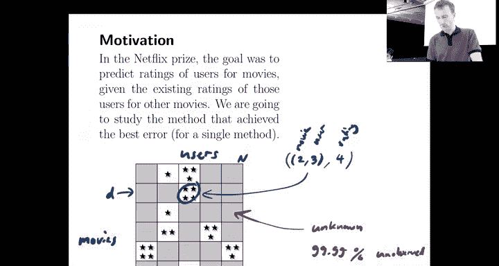

Price data set， which was was a very popular competition about。

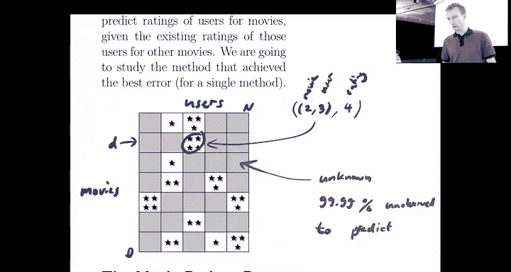

10 years ago， where like thousands of participants tried to， to really do all the tweaks。 And。

 and it was kind of the first。

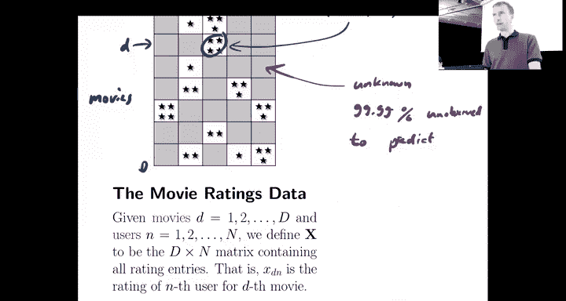

Famous state science competition when， when people really tried all tricks to fill in this。

 this data as accurately as possible and really try all the engineering methods you can。

 And in that case， they had a。

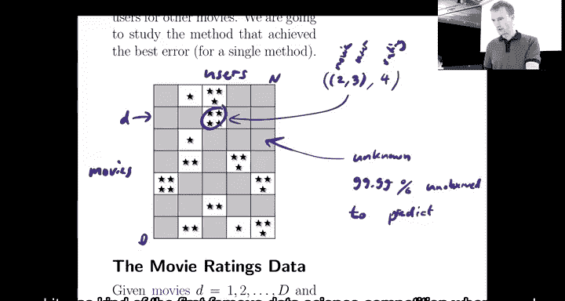

Like 20000 movies。其次。By now， there may be more movies on Netflix and also more users。

 I think back then it was like half a million users。And in that case， really。

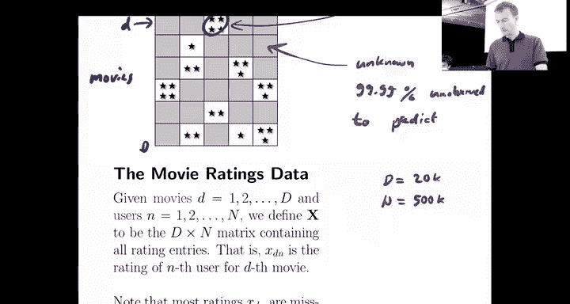

喂无理。Almost nothing of the matrix is is is observed。 And also。

 this matrix would be extremely hard to store。 You don't want to store this matrix as a dense matrix。

 It way too big。 So you want to store this matrix as a sparse matrix with is entries that you know。😊。

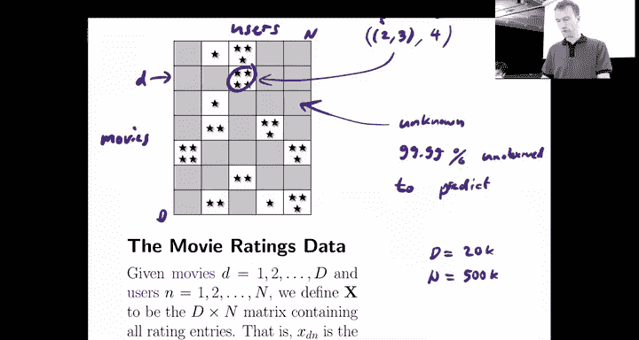

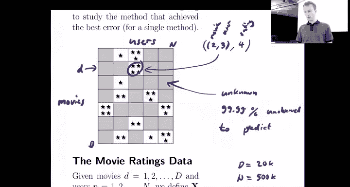

And not do anything about the ones you， you don't know， so。Okay， this is Remento system。

And we explained already the the data that we have。 So what I explained here was the the entry x。

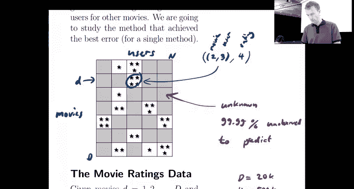

D N is what， what gives。The rating even from this user end to the movie T。

 and maybe it goes from one to five here it was like four stars。Okay， what can we do with this？

 Let's try to formulate a loss function so that we can train。

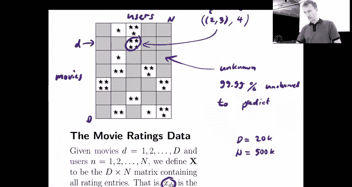

A model and also formte a model。So what we want to do is。We will try to， again。Use this。

 this idea of using two small matrices and trying to use their product。

And that's going to be our model， so。Just try to find the。Matries， W and Z， which are。Quite small。

 I mean。By small that has to mean that they are narrow。嗯。Same for that。

 So when you when you lie down that it's transpo here。Then。

Maybe you want to find these medicinetices which have only k columns or so a very small number of columns。

呃。Maybe 20 or 30 columns or so。And then this is is， is D。 and this is N。

 So N was half a million and D20000。 So these are very large dimensions。

 And but the inner dimension is very small。 So that's the idea。And。嗯嗯。😊，And then what it does。

 of course， yeah， you you know what happens when， when you multiply two matrices。

So to get the entry X， the N， which we were talking about， which just multiplied the the n's row。

 sorry， the D's row。With the end column of set transpose。So that's the end row that actually。

And that' that's going to be。That's going to be our approximation of our rating。 So we hope that。

The rating that the this movie got from user end， we hope that this is roughly。The inner product， so。

W that transposed。The DNs and3， right， So you just try to approximate the whole x。

With this product of the two magrices。Does doesn' make sense。Okay， so we have a model。

 so if you ask for a prediction。You， you just take this， this in a product， right of the。

The D row of W with this column of Z， don't suppose。Right， so that's this prediction。

And this is very easy to evaluate。 So these are just these are K vectors， right。

 so they're very small。And seems to be quite efficient to make a prediction。

 So if you have a an unknown movie and unknown user， I mean， you haven't seen these two together。

Then， then this is how you're gonna make the prediction Just， yeah， just multiply these two。

Greener rows of these matches。Okay， we have the model and we what we still need is a loss function。

And that's gonna be your choice。 Of course， you can use any loss function you like。

 So what you're gonna to do here is we will just define the loss entry bias。

So over this whole matrix here， so everywhere we will define a loss rather than we sum it up over over all entries。

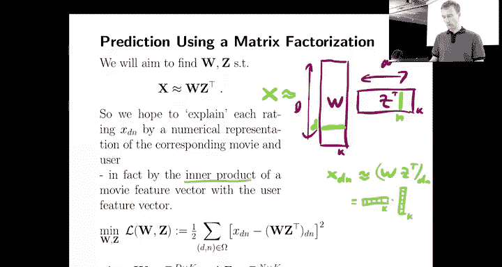

And so the training also just be the loss of the observed entries。

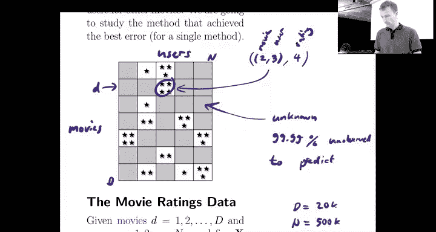

And so this last year takes our model， compares it with a true value。So。So this is the true value。

 right， x。嗯。So this， you can think of the label also。呃。Or through rating。

 like it's from one to five stars， so。So。This is this  one to 5。

 And then this is what your model predicts， which can be three and a half， or it can be any number。

 And here， the simplest thing we did is we just took squared loss， so。But you could also do a。

Absolute value。 maybe actually just a few recent works， which try to do this with absolute value。

 which is actually a bit， a bit nice。 so because it more robust。

 So that's also something you can try。But the， the general principle to keep in mind here is that what。

 what do I mean by matrix seization， right， it's， as we said already， I just mean that。

We minimize some， some function。So the loss function depends on both matrices， right？

But the property we have here is that。呃 our。Our last function。

 what we train is is really depends only on the product of the two。So W time set。

 So anything for any F。Of these form forms。 so so that's。

So that's what we say is a is a matrix factor， right， when you， when you train a model like this by。

By minimizing W and Z these two matrices。Of a loss function of this form。

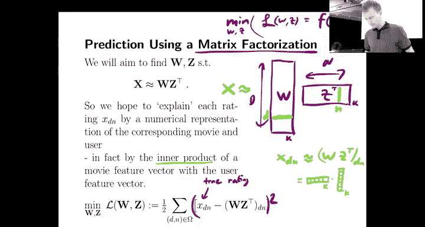

And of course， that's the case here。So here what's F is。

It takes these predicted entries and compares them to the true rating。

 and it only does sum these up over the observed entries， observed pairs N& D。嗯嗯。

So these are the observed。Obsserved entries。 And that's it。 So we have a loss function。

 We have a model。

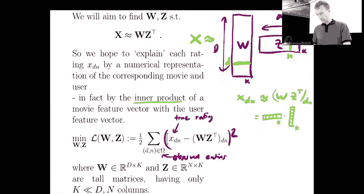

Now you would just run gradient in descent and that's basically the story where we will discuss a bit more now on yeah。

 I'll go quickly how to do this and。How how efficient it is。

But make sure you got the model and the loss function from this structure。

So model is just W times set。And Oomega is the set of observed entries。That's here。

Is there any question on this？So the loss function looks quite simple。

 right it's just squared and this product here is also simple。So looks not so bad。Now。

 one thing you can ask is， is this a easy problem to solve。

 you could ask if it's a complexve problem。And。Maybe some of you already。

Have a suspicion or so will we mention it， yes。Your question is。

 if I also optimize different cases or just a fixed K， no K is fixed here。 Yes， so， yes。

 so K is fixed。 So that's the the waste of this。

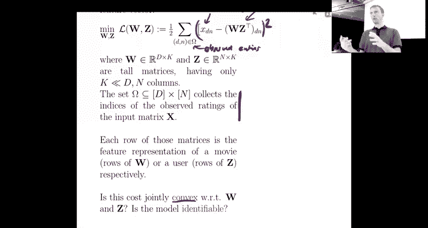

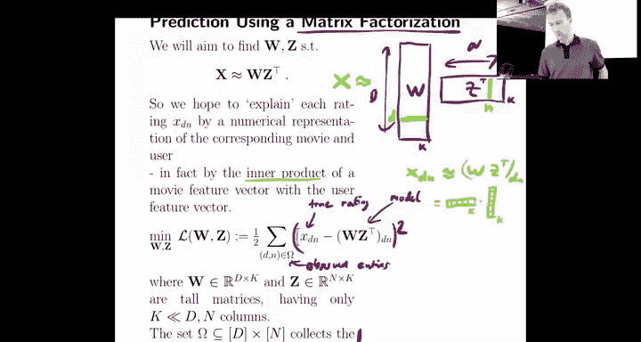

This you have to choose。 that's that's how you define your model。It's。

 it's a bit like having two linear layers in a in a neural network， right。

 And you also have to choose how many neurons。 So it's the same thing here。

 Well like in K means you also have to fix to K。 Yes， K is fixed。 and I will come back to it。

In a minute。 So if case too large， it can also be a problem and so on， yes。Yeah。

 the last function here is only defined over the observed entries。

 I think that that was your question。 So by， by observed， I mean the。

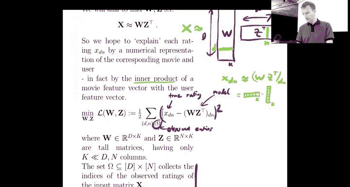

Yes， the ones where we have the， the stars， right， So this is kind of our training data。

 So this is why this is the training loss and。And then you would also maybe have to。

 to organize a test set for， for you to maybe you have a separate set of ratings which you actually have。

 but you don't use them for training。 So maybe this one， this one and， and this one。

 I removed them before training。 And that's my test set。

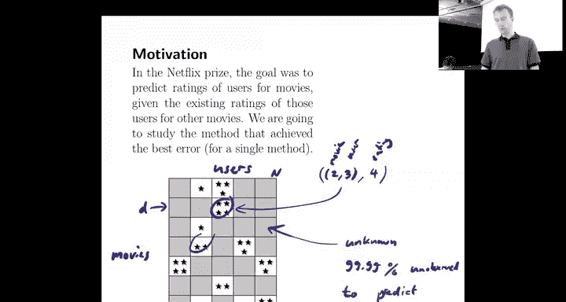

And then you can also use a as a different omega to be， to be your test set if you。

 if you want to do that， right， But here， I only give you the training loss and。

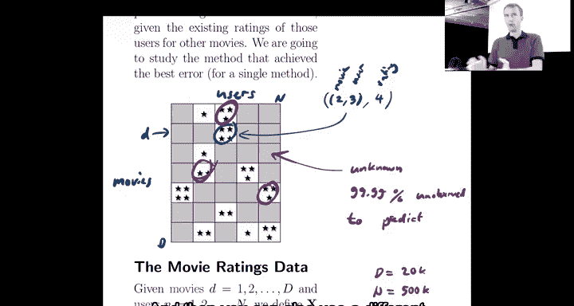

And that's， that's enough to。Well， yeah， to define the training。

 So evaluation is not a question of such models。Cool， And then， okay， this was maybe a bit abstract。

 So also， this is a very intuitive。Thinking about what is happening here。

 right what happens when you multiply this vector of movie D with one of user or n so it really means that for each user we learn a vector right that's the movie vector and this is the user vector。

Which we learn。So actually， when they are learned， right， then you would think this and caps this。

 this will actually these values which are in here， which can be。Any number， positive， negative。

 anything。But they should express the。The， the preference of you as a user， right？

 So maybe this aspect， you， you have a a preference。

 So if it's positive and means that you like this aspect of movies。 So you have a large number here。

 and the movie maybe has。Also， positive number there。 And it means that you like this type of movie。

 And also for the for the movies， they also they're just features， right。

 they these numbers we learn。 So they are learned features describing the movie such that when。

 when we pair this movie with a user， which is used in a product and we get a we get a match score。

 right， how， how how well our model thinks。

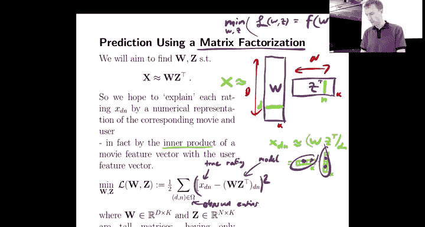

They， they work together。 and that's just in a product。 So it's very。Simple， beautiful model。嗯这。Yeah。

 so this， this you could be called the user matrix。的。

Movie vectors are the rows of W and the use of vectors are the rows of set。Okay。

 which is naming nothing especially so。So far， so good。 but now。

There's a few bomb which come up and there's name two。Two main problems， like problem 1。 It's。

 it's not， it's not the complexx problem。So。嗯。呃。And why is this not convex so？So it's not complex。

 we have seen this a few times。There's several ways to convince you that this is not a。

Economics function， and。We have seen a。A few similar functions， which， which were also。Not。

 not convex。 So， so one， one easy example is if you just。Imine。W and that。So if you're F of W and Z。

Let's define it just， just to be。W time set。And in。

In the simplest case is when this matcheses are so small。That they're just numbers， right， so。

Does that matrix has one number。 It's a one by one matrix。 The w matrix is a one by one matrix。

 So then what I have here is。This is a special example of。Of a function F。

 it's not exactly the one we we have here because we subtract something， but it's this function。

 which is quite similar。So when we just take the product of two numbers and。I'm sure you have seen。

How a plot looks like when you do this， it's really this simple subtle function。WN set。

 which happens to be positive here， positive fear， of course， but negative here。And。So far so good。

 why is this not convex can anyone。Tell me。There's different ways to show that it's not comics you just have to。

Find， maybe you can find a counter example， any definition of complexityity， you can use it。

 and then you can see that maybe you can show that it does not satisfy this definition。So。Yeah，1。

1 easy case， for example， when you look at。Poiner。And here。You can see that the value。

Here in the middle is much higher than the value at the two end points。 So this is a proof that。

That this is a。It's a non conx function。 So along this red line right the function looks a bit like like this。

 so it's a non conx function。So you found a account example， it's known comics。And yeah， I mean。

 the function X y actually looks quite nice。 You could type X sum y into Google。

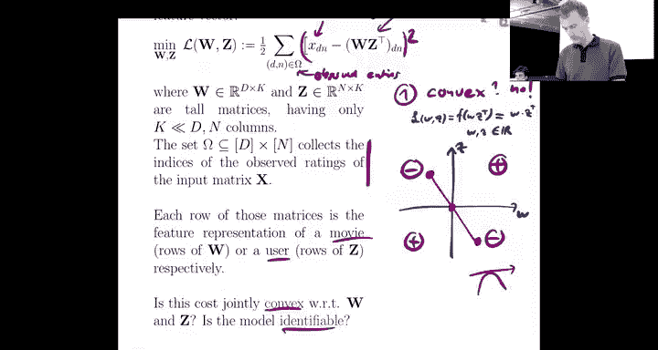

So。真。等于思。You see how this looks like。 And of course， we have a bit。😊，More high dimension problem。

 but already in the one dimensional case， so each of the two variables is one dimension。

It looks like this， so it's this kind of saddle。呃， function弃。Okay。

 but we don't really have this function。 We， we have actually a different function。

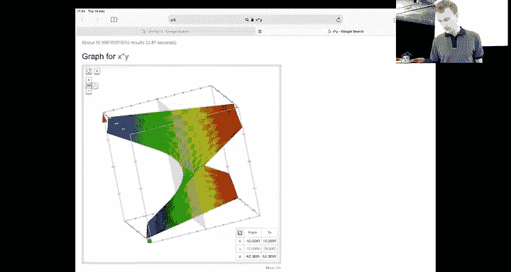

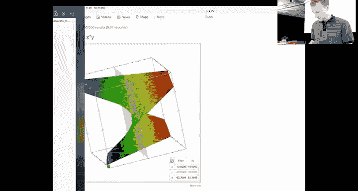

So。I'm not sure I'm not sure you're convinced yet， right， because。

Because what what we have here is I just showed this example if the loss would be。W time set。

 but it's not right。 It's a， it's a constant minus W time set and then squared。 So I， I ignore this。

So so that's why I was just showing you the this very simplified model here。

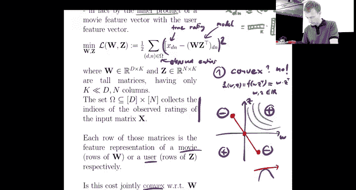

So。So， maybe。Maybe you would ask also if the。If the order function， if you multiply， sorry。

 if you subtract from a true rating， So three stars minus the model and then you square it。Now， now。

 what about this function， Is this still going to be conx or not。And it's， it's not right。

 So basically， when， when you already have an element here， which is non comic， then the。

 the war is already lost because then it's quite unlikely that by simple。

Additional stuff by adding the value to it or by squaring it。

 you're not going to solving the problem， not going to solve the problem。

Let's see here' is the example if I take just a one dimensional example with。One minus， sorry。

3 minus x trans y。 So this will be， you have a ranking。Three stars。 your model says x times y。

 and then it's squared， right， So here you can you can see what happens if we also do the square。

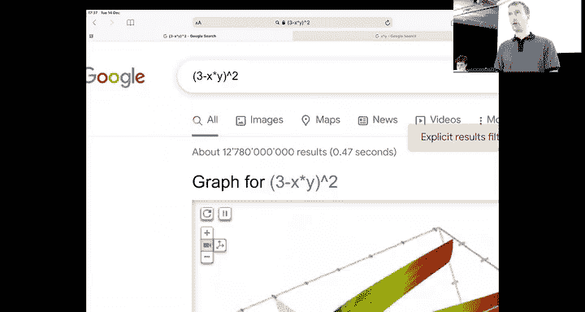

And then this this is how this would look like。

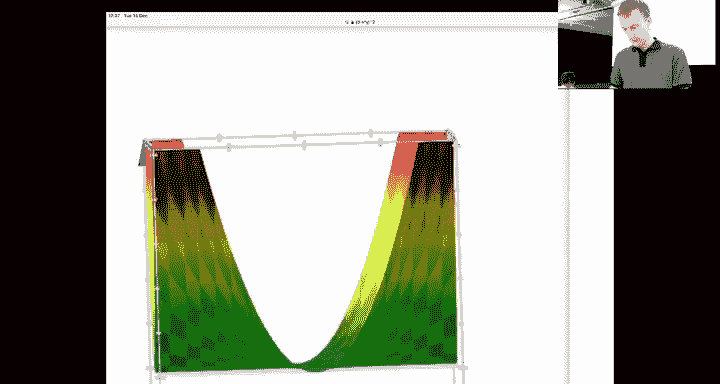

So。Very nice function。 And it's all curved to the， to the top。 So it looks kind of nice。😊，呃。

It almost looks a bit like a conx function， but。Again， I would ask you， do you see。

Do you see somewhere where you could show that this is maybe not。

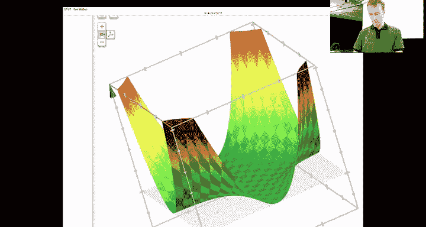

Not convicx or which kind of which kind of two points would。

Would show you a problem here or would you say that this is a complex function？So any。Any thoughts？

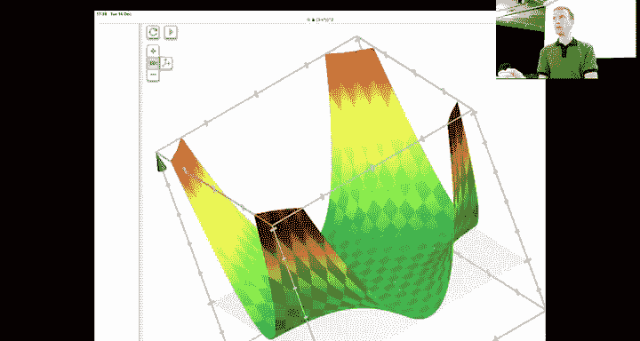

So the the gray plane on the bottom is x times x and y， right and the。

Vertical axis is the value of this function。

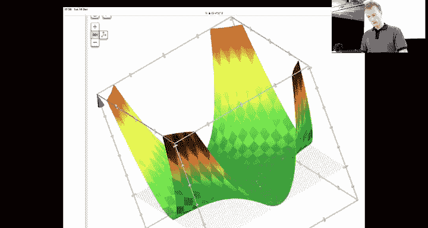

So yeah， it's also。

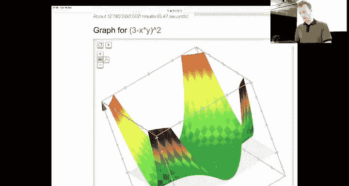

Also， non connectx because。For example， if you take take two points which are on the side in one of these sides。

 so for example here you would see that between here and here。

 you can put a line and the function actually happens to be still。Above the line。

 when you are in the middle， So that contradicts the the line definition of convex D。

 So this is also not the convex function。 and then。When you do this with much larger matrices。

X and y or we call them W and Z， actually then then。The problem remains。

 So this is still a non convex function。 But it's actually a nice， nice function。 It's almost。

 it's similar to a conx one。 And there were some recent research works。

 Some of it even got to the best paper award at New Europes， I think to。

To show that the problems like this， matrix exercises like this， they don't have local minima。

 They don't have strict local minima。 So， for example， this function here is。

I think it's a star convex， which means if you go to the optimum and you only take lines from there。

To somewhere else。 then on any such line， it's， it's kind of okay， right。But the line which I took。

 which was between two bad points。 that was not okay。

 I think it has the property that if you look from 0，0。

 any line from there should along that it should be convex。 that's。

 that's not enough to make sure a gradient descent finds the true optimum。

 but but this with some additional theory， you can actually show that。

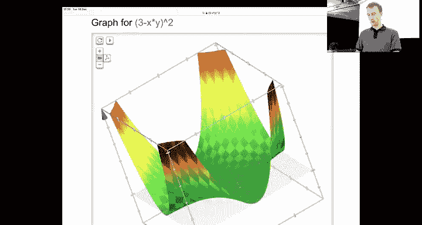

On such functions， sometimes the the algorithms work fine。 And and also in particular。

 you can show that there's no bad local minima。 So from any。

Any local minimum here is connected to the to the global one。 This may be many global ones。

 but they are all connected and。Things are nice if you find one of them， you're good。呃。

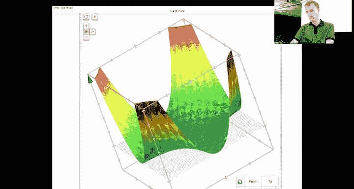

So this is a very interesting class of problems。 It's it's surprisingly complex， right。

 for such a simple function， it has quite a rich structure and still a topic of open research。

 actually。

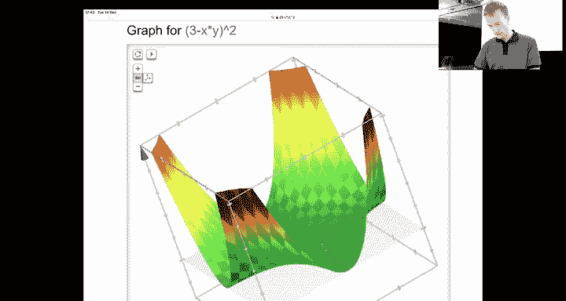

Alright， so it's not complex， But again， that does not scare us so much because we。

 we will anyway still apply our slant diagrams you're gonna see in a middle in a minute before。

To use steel gradient based methods to each ofly optimize this W andZ。

So that's what we're going to do next， just a very small remark is the second aspect of identifiability。

So。So， it's also。Also， not， not unique， so。It means。

What I mean by not identifiable means to my view several optimum。Not a unique opt。Why is that？

So what if I give you one optimum， W and Z？Can you give me。

A different point a different pair of matrices which are still still optimal Any ideas。嗯。行。

We could swap their places only if they're of the same dimension。 then then you're right， yes。

 So if n is equal E then yes， there is another thing you can do also if n and D are different so。

 but we are we are on the right track。Yeah， you're saying I would multiply one and the other I would multiply with the inverse。

 or did you mean to change the sign of change the sign of one of them and change the sign of the other one？

Yes， yes。 Both， both is， is true and， and works well， right， yeah if。

If someone gives you this solution， then also minus minus is also a solution。

That that's one trick you can very easily do。 It's not very useful， right， But but it tells you that。

 yes， there's no unique optimum。And a bit more generally。

 you can take any scale or write any beta times W。

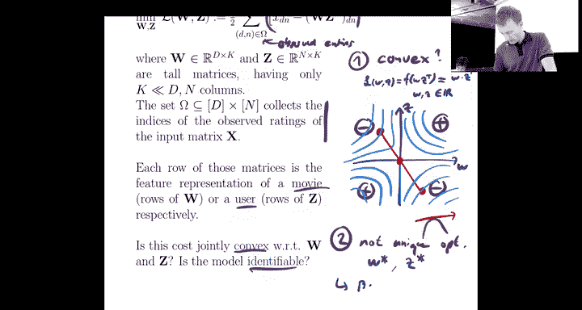

And then you just multiply the Z by， by the the inverse of scale or number one or beta。

So this is also optimal。Okay， so there are many optimum。 And again， it's interesting。

 but not necessarily a big problem， but it's good to be aware that this can happen。Okay。

 so that was about the main math part about。

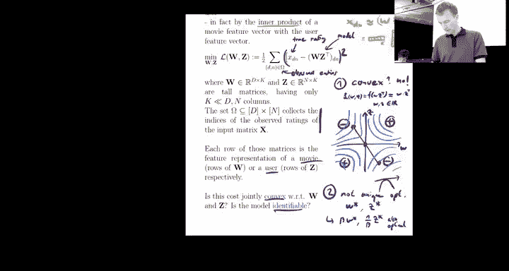

The matrix expectations。

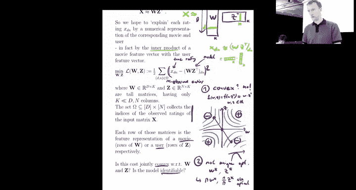

嗯。Yeah， it's quite an important concept， right， Because what we did here is， is more general right。

 It's not only for recommend system， because what we did is kind of applying to any。

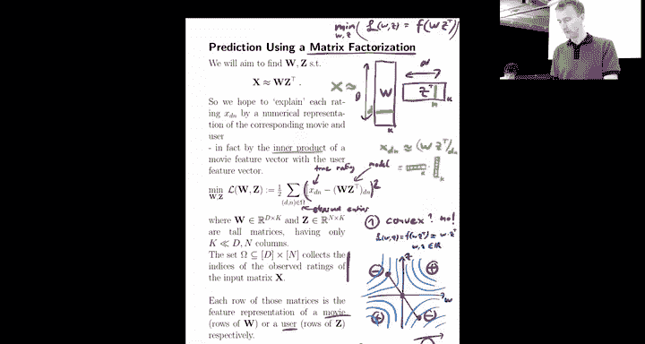

Structure like this。 Any function， F。Of a product of matrices。 So that's nice， so。

So this you can also use what we discussed here， you can also use it for， for example。

 what we saw for K meanss or PCA or the word embeddings which you're going to see on Thursday。

 so many applications。

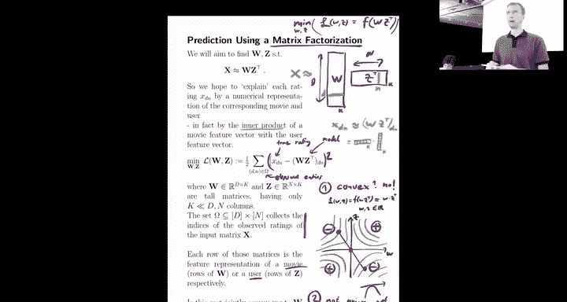

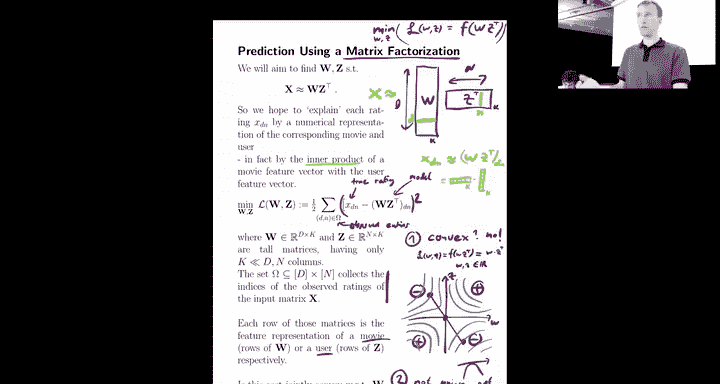

But then for recommended systems。

Again， again， the question will come up how to choose K。 I think one of you already asked me。 So。

 and again， it's， it's unfortunate that I don't have a perfect answer。 It's a。

It's tricky。 It depends。

Depends if you， it's again gonna be a trade off。 So if you， if you said K， extremely large。Then。

 then it can be very easy to overfi right， So if。Large K。 I mean， if you said K bigger than N and D。

Well， which one maybe both of them。So if， if K is sufficiently picked， then。呃。嗯。

Then you can just set W to one。Identity and。And set set to to X。And I mean。

 one times x is a perfectly fine factorization and this is perfect so the product is perfectly equal to x。

 you have zero error。

A perfecter training error。But it's maybe a bit meaningless and of course you can also do the opposite。

So。So if the case is too large and you will easily have zero training error。

 which means perfect prediction on all these entries。

But that's not only useful thing， right， So you will， you will overfi。

 You will actually not not be meaningful anymore， right， because the point is。

 the point is not only to fit the observed entry。 So at the the point is to have a model which which can。

 on one hand feed， but on the other hand， also predict the the ones we don't know， right， for that。

 you maybe have a small test set on the side that you can check disability ability on on a test set。

So， so we can have this strain this trade off， as usual， between。

Training hour and and then generalization。Are we also doing well on the test set。

 So are we overfitting on the train or are we doing a good job？And so if k is too large or of it。

 if K is too small。

We underfi。

🤧呃。So， I mean， yeah， if you choose just k equal one。You will under it。嗯，嗯。So。

 so here is actually an example which k equal2。 So that's still。It's not too bad。

What is what he's doing here is showing the。It's throwing actually this movie matrix。

 So the the matrix W。And so this is the matrix。And， and then。嗯。😊。

What I'm showing here is just just this one entry， whatever Bravehar is one movie。And。

That has now two entries， right， It's a。So K equal2。 So this w matrix says only。

Only two two columns and then row D happens to be my movie vector。

 and I'm showing you the position of this movie vector it's here。And， and then you can。

 you can position all the movies you have after you've done the training and see what happened。

 So our。Is this going to be an interesting embedding of movies？

And。Actually。It works quite well。呃。So。So yeah， I don't know。 I don't know if you。

 if you know these movies， but the idea is that you， you get the similar movies are grouped together。

 So they have similar features。 So again， these features are not handcraft they are they are learned features so。

Which is kind of the， the nice thing。 and the same。On the right， you。You again， get。

 get kind of interesting。嗯呃。

Interesting。Features from this movie。 So it's not so clear what is the interpretation of these two features。

 right， we， we can't say that the the first movie at the first feature is means this and that， right。

 It's it really。

Is， is a feature we learned， right， Its it doesn't have fully interpretability。

 which is now that we have learned two numbers。 And if you take these two numbers for movie。

 take it with the two numbers of you as a user， then the inner product。

Pretty well explains if you like that movie or not。

And what has been done on the right figure is actually。

A slightly different factorization because they have just used a PCA， I think。呃。

PC A of dimension 2 of the of the original matrix。 That's also something you can do。 But no。

 actually， I think they have done the same thing as we， as we just described。 So they。

 they learned the factorization here with the squared loss。

And then， and then obtain the embedding of these movies。 And you can say that， yeah。

 many movies which are a bit similar do actually get grouped together。

 What's also interesting is this method knows nothing about the movies， right。

 The only thing you know is how many stars you gave it。 It's really。

 there's no side information here。 No side information about the user。

No inside information about the。The movie。So， for example。

 the gender of the user would also maybe influence。What movies you like， but that is not used here。

 right， the system is only directly learning from the stars which were given to this year。Okay。

 and then， yeah， how to choose K。 It's a bit like in K means。 We need to， to do a compromise Here。

 it's actually nicer we can， we can say here， there is the best K and the， the best K is the one。

Which gives you the best test error， right。And so if you separate your test set。

 then that's what you're going to use to choose the K or even whether you have a separate validation set just to find a K。

And once you get the best quality predictions， then you go with that K。That's your here。

Okay， so we discussed a bit。Under thefitting and the overfitting。So okay， small will be underfitting。

And， and I guess the the other case is clear so。So if you have overfitting。

Either you can reduce the key。Or， or if you don't want to。

Then there's another thing you could do to just use regularizations。

And。If you again， look at this。Then we have these two parts here， so。So we have F。Of W and Z。And。

 and now what we did here is。We added the regularizer。So again， for being norm。

 it's just enter yourI square norm。So we put we put the norm square norm of the two matrices we said。

We also want this norm to be not too large。And then， we also。

Need to actually talk about this trade of parameters。

 So we need to choose how important is that for us。 So if you recognize。

 you always have this straight of parameter。 And that's also the case here。 So if you of it。

 this is another。Opportun you can do to to actually limit the。The。

How reaches your model class to limit it not worth it too much？

So then you just modify your loss function to be the sum of your original life。Plus。

 the regularizer so。嗯。ok。Any question here。

All right， then we should talk a bit how to optimize it and so。

As usual， it will be stochastic gradient in descent。 and so this will be pretty standard as snow。

No big surprise here。 It's maybe， it's maybe quite interesting。

How expensive it is so because we were saying I mean these matrices are gigantic right so it's really it can be a million by a million so it's very important that if if you talk about algorithms here then hopefully we can do steps which are cheaper than than doing something with the full matrix so。

So that's that's one goal we have。 So let's see if that's the case when we do SGD。 and for that。

 if you want to run SGD。We always need a some structured objective。And so， yes， we do have that。

So maybe you would even normalize by one over number of observed entries。

To to show that your objective function is average， but it's just cosmetic。

 so you do have the freedom to。Normalize or not normalizing in training because the solution is the same。

 So we ask solution W that yes。Oh， yes。

Oh， sorry， so。Regization is positive。 So I that I just draw the circle a bit in a。Peculiar fashion。

 the the， the organization is positive here。 It always should add an additional penalty。

 So these are both pluses， yes。Ts study improved。呃。

Just idea， any other comment？Okay， so let's see if we can。

 if we can optimize this loss function with。With stochastic gradient descent。嗯。So， so yeah。

 we do have this nice sum structure， so。So this actually， let's just give this the name F D N， right。

 So that's that's the contribution。From movie D and user in。And and they。

 they are in the training set， so。Just the name， right。 So， so then what， what we have is that。

 of course。呃。We have a lot of these functions， right， F。At least this entire sum of all of them。

The average of all these functions F DN。And each of these functions depends on both matrices。So。

 it's a bit。It's interesting， right。 So， I mean， what this says is it only ask like if this one user who gave three star to that one movie。

If how， how well is this set， right？ But yeah， it depends on the user of matrix and the and the movie matrix。

And。They are in the set， of course。And summed up。Nothing special here and of course。

 if you do a stochastic gradientd step。Then， then we will just take one of these。F Ns and sorry。

 So F， this， it's kind of a joint index here。 right， D and N is a pair。 So over all these pairs。

 and each of these is a， is a function， so。Goes from， from these two matrices it takes。

And it outputs the loss function， which is how far away。 So yeah。

 here is the loss function you pay the square error to the true rating。All right， so to run。

Stochasticically in descent。 What we do is。We uniformly sample one of the observed entries。

 so random sampling。 So it's kind of important to sample from this thing， right。嗯。

And then so now we have a。User and movie D。 now， now we need to to say， what's the gradient of that。

 that small part。So I need to compute the gradient， we suspect to the whole。Prameter W and set。

 so the gradient for W is something。The gradient for that is also something。Offer。5 small element。

And。So。Yeah， and of course，The W gradient is is as big as W is， which is。诶 d by k。And then this one。

 the Z one was N by K。Okay， so let's see if you can compute them and。That is。It's not so hard。

 right you have to square， so you will do a chain rule and so on。

 and we will see that we were able to。

Take the gradient of this。This product here right of theno product。 So we will do that。

After the break， compute is two gradients。 So we see this is a kind of a big matrix。

 And this is also a big matrix， which is。😊，Sounds a bit scary because we said we would rather have something very cheap。

 which does not depend on entire matrices。So after the break。

 youll see what information do we require to compute this one gradient， which is just for one entry。

 right just a gradient of this thing， four stars minus your prediction。

What is the gradient of this。And what the information is needed to do it and how complex is it to compute it。

 and we will see it's not so bad and then I'll show you the formula。

After the break。Okay， to come back a bit on， on this approach that we learn these two matrices， I。

 I'm sorry。 maybe I created a little bit of confusion here that there's this two。

These two approaches to actually learn the W matrix， right？That's that's what I advocated。

 right that's that's how we formulated the optimization problem。 We want to minimize some loss。

 finding the best possible W movie matrix and user matrix。 So we wanted to find the best。

Features and learn them completely from scratch without any site information。 So that's the mini。

 That's the optimization approach。呃， but then。There is also the approach actually in the left picture is is that these these features were simply hard coded right。

 so that's I should have been more clear about that so。So if。

 if you hard code the the movie features。 So， for example， if the lead actor is male or female。

 then you just put a one or minus-1 then。And then that's why that's someone approach you can do as well too。

一些 use呃。Yeah， expert information about users or movies。 Then you can do this by hand。

 But the cool thing is really to， to learn it， right， And that's， And that's what we what we do here。

 And we we also see that the learned approaches have a much better generalization， right。

 Because if you just handcraft something then you will always forget some， some dimension。

 some aspects， which are not straight straightforward， not completely obvious。

 So so this is kind of the on the left， it's kind of not M L。😊。

And on the right is kind of the the MLL approach， right so。So， we are。

On this site。 So when we， when we define it as an optimization problem and we solve reducing using the tools we have gradient based methods。

And that's， that's going be。Our next job to discuss a bit what algorithms are available to find the best W to find the best Z。

 and it's quite straightforward。 The only not trivial thing is to actually compute this gradient right to to compute the gradient of of this。

One part of the sum or。Of the use or matrix， respectively。So how are we doing this？

So I first want to do it for the gradient， we suspect to the movie matrix W。And then later。

 I will show you for the usermatic set。So for the W。We want to。So we have just one function。

Of which we have observed the rating。Now of this one function。We want to。

To compute the gradient of this DN， right？You， you are fixed。One particular user movie。

 But now you ask about the entire of of W of this thing right So it's a bit confusing with the indices here。

 So that's why I want to be a bit careful that。So D N is fixed now， because we have。It was。

 it was here， actually。 So we have。We have decided what D and then we want to compute。

The gradient off。 and for now， it's forever fixed。So why I'm making such a big fuss about this is。

Because the gradient itself is actually still an entire matrix right even if DN is just one entry。

 the whole gradient with respect to W is a matrix。So even if you just ask about the fixed FTN。

So we need to ask about all entries of thisW matrix。And。That's the work we have to do。

So all entries of w。 So again， I have to give them some names， right， So so W is a D by K matrix。

So I， what I can do is I can ask about the。There's something D case entry， but D is already used。

 right， we said D is fixed。 So that's why I need to say here， I introduce。

This other variable de prime just to give names to the entries of W。So。

Once I've given them some names， I can ask so now just for one parameter。

 the D prime K for this one parameter， how quickly is my loss function changing in this one1 parameter。

 And that's and that's really what what we going to compute now。 So now it's very simplified， right。

The loss function， which of course， is a number。The gradient you be asking about。

 which is a D prime K。And then yeah， of this， of this green loss function。Of one sample observation。

Alright。 does this make sense to have so be careful these the green D is fixed and the yellow D prime is kind of variable with asking about all possible ones。

O那我。What is it， The result is already here， which is bit。呃， givingiv it away。

But what we have to do now is to see。So now we ask about the D prime case entry of W and that's you can imagine whether it is right it's somewhere in in this matrix。

 there' is a row。The row is de prime， right， And we asking， how is that row influencing this loss。

And the answer is it does not influence it at all。Except if you hit。

The row here being actually the one we ask about D so。So， I mean。

 any other row of W has no influence on the prediction for， for D N， right。

 we D N wasnt whatever four stars。 We ask about this particular prediction and that prediction the you know what the model is。

 right， It's the model means tells you。The D row of w is of the user is gonna be movie。 sorry。

 it's gonna be multiplied with the end row of the user。

But any other row of the movies has certainly no influence。 So， so that's why if， it's。

 that's why I'm kind of。Explaining the， the outside stuff of this if。Yet。

 that I'm just telling you that if the rows are different。

 the one you ask about and the one we we pre selected， then there is no influence。

But if you ask about D prime equal D， So for that， for the role of W of that。Particular movie。

 the green movie， if they are the same， then there is a gradient。

And then it's actually easy to see what the gradient is。

 right So the row here gets multiplied and then it gets squared。

 so it's not rocket science to compute it。And that， for our purposes is fixed。

 So what happens is just that。This row of w gets multiplied to the one of set。And。

And what is the gradient of this thing。It's actually。The well。

I'm not asking of the gradient of the whole row。 Basically。

 I'm just asking about the gradient of T prime and the particular fixed K。

Just is one particular parameter。So that that parameter is， is somewhere。呃。

So this is R D prime and this is the entry K。And this， so if you I'm expanding what happens here。

So what is happening is that。Of course， this is this row of W and gets multiplied with a part of Z。呃。

And what he tells you is that the。The crucial parties is the。The key。

 because this gets multiplied with the K entry of that。So and that's what we have here。

 so here is the case entry of set。So there was in order derivative， that derivative of W and said。

 that is。That N K。So that's what you have here。And what is the out of derivative relative， sorry。

 then it's squared。 So you the。Square disappears with the one half。And this year remains， right。So。

 that's why you have to。This kind of prediction error remains。It's just not squared anymore。 This is。

 this is how how much you're off， right， so。So this kind of prediction error。Well。

Not really error because it's not squared anymore right。

 It's just the true value minus the predicted value so。Tworu minus prediction。So this is a number。

 and then it gets multiplied with。Withhich is red entry that so this is the gradient。And。What's nice。

 This is very cheap to compute。So for example， so again。

 let's look a bit closer what's really happening。X is the number of stars， so it's a discrete one。

 two， three， four， five， so maybe this was the three stars。And then。This here is the model。

That's just a。The movie row multiplied with the user row。Which is very cheap in a product， right。

 This is extremely cheap。 It's just。Because we ask only about the particular D and the particular N。

 right？So I just take the user row。Times the movie row。Cast me K to compute this。

And then I have to multi with this number in the end。So this looks like a very cheap operation。

The movie R D。And the user rule in。Okay， this was one entry of the matrix。And well yeah。

 the other ones are all zero， right， if you ask about the wrong row。

And if you do this for all entries here， we have basically computed it。Already， we are， we are done。

 right。 So actually， what this is telling you is that this gradient here。It's actually。

 it's just one row。 So the gradient test。So this is the gradient， it's zero everywhere， right？

Its area zero except this particular row。呃。Which rule was this。The rule D。And then， of course， it's。

For any K you want。 Okay， so this gradient matrix is very nice。

 We don't even need to store the whole thing。 We only need to store the the one row， which it is。

And to compute it takes。Very cheap， so。The cost to compute is I need to compute the prediction。

 which is costs k， so in a product of2 k vectors。And then so then this prediction is always the same。

 And then this one I have to do with for every k， right， for every k。

 the use of vector has a different entry that will multiply it with the with the true minus prediction。

So， the cost is。Is really， it's like two times k or or。Yeah， one multiplication。

 K multiplications and K additions。So really cheap， so。

I would just eat right order of K。So that's cheap to compute the gradient because， again。

And and D are huge。 So it can be millions。 But K is like 20 or 30 in the in the Netflix price， they。

 they got best results is like K equal 30。 So quite a small number compared to the half a million users。

So at a very cheap cost， you can compute。A stochastic gradient。 And that's all we need。

 when we have the gradient， we can perform a step。 So then you would。

Perform this step to to change your W。 And by changing it， of course。

 you would add small value times the negative gradient， so。As usual， when you do a gradient step。

So that was gradient of W and gradient of 3 is exactly the same story。 Again， it will only be non0。

For the， the particular row that corresponds to US as user N。

 So every other users have zero contribution。To the prediction of this n， right。

 therefore they don't appear in the gradient so they we don't need to store it。呃。

So same for the user of matrix。So that is user matrix W is the movie matrix or item matrix， because。

 of course， this is not restricted to movies。 This is recommended systems are used for any。

Any applications whether they'， for example， also in ad placements。

 if they want to place advertisements in your browser then they would also be。

 you could also use this approach to。Learn a feature vector for each gen learn a feature vector for each user。

And then sometimes it's also combined with side information。

 but here there is no information about user or movies which has learned the factorization。So。

呃。If you， if you want site information that's also interesting。

 So what you could do then or maybe I'll come back later to this is that so here everything is learned。

 right， W and Z。

But if you also have。Some additional knowledge that you， you want to， to use that。About these uses。

 I have some additional info then I could just。Concatenate is hard coded stuff about each user。

 So whatever knowledge you have already uses， you could add it。

On the bottom and then you could and here you would then learn additional parts which go together with this hard coded information when when the product of the two matrices is built。

And then you would also add a bit of hard coded information about the movies if you have。

And that could be together with a learned part of the user。

So I'm just saying this would be a nice way to combine。Existing。

 this is called site information about users or movies。

Can you also use that together with Wi learned features？So， and yes， this is， this is also possible。

Okay。But yeah， we are happy we can on s gasastic gradient descent， it's very cheap per step。

We have to run a lot of step of this。 So you， you just go through your data set。

 So that's you will actually have in the exercise。You will。I mean。

 here we said we randomly sampled one entry， right， use a movie pair， re sample it。

 and then the next one。In practice。People just take a random permutation of this whole observed training set。

And then goes through， through it the same as you do with S GD in in the classifier or regression。

 So you just do， you go through all training examples once。 So that's one epoch。And then again。

 you continue。As much as you like， until。Until you are happy with your test accuracyy， for example。

Okay， the cool thing about this is that it's so cheap and that this is quite exceptional that we can do a step which is way cheaper than any matrix operation right because this is a matrix problem。

 but to perform a step we only need the vector operation， so it's extremely cheap。

So that's not。 it was not the case for， for other。Approachs we discussed so far so。

Even even in K means， right， one iteration is everybody needs to do something。 everything changes。

 But here we， we perform a step which is so cheap that it only affects one user and it only affects one。

1 movie， right， because only。

Only the this thing is going to change of my parameters， as only this row has a non0 gradient。So。

The the movie matrix is kind of unchanged， except the particular row that I currently look at from my movie D。

 which I've assembled。And same for the user， only， only the。The U of vector currently active。

 which is n。 Only that one is is actually。

I's actually changing。In， in that particular step。 And then you go to the next T and N。

So yeah， you should run this because this is really two lines of code and it's a beautiful algorithm。

She's actually invented by。Not by academia， but one of these hackers when there was this Netflix Pri competition and they。

 they discovered this algorithm。Because it was so efficient to run。 But back then。

 people didn't know how this， what， what function this algorithm is actually optimizing。

 But now we see that actually， this is optimizing the average of this function。

 So it can be seen as a。As a case of stochastic gradient descent。 so。

 but these methods were among the best performing in this in this Netflix price and are still used today whenever you have a this kind of matrixcyclization problem。

周。Yeah， SGD and。Or there's also some variances of it。 maybe you could also try this Adamom or so on。

 and maybe you can try this regularization if you want to get a battle score in the。In the challenge。

Or different case。Or maybe different loss functions， like you could also use the absolute error。

 not the square error。 So these are all design choices that can be made。

To， to maybe try to empirically improve this。

This predictions。

So any questions on this？There was a lot of math on this slide。

Good， so this was the iterative approach。

Then there is a a slightly different approach。 So this approach is much more costly。Per iteration。

 And it also has a downside that。This only works if you have like。No missing entries。So well。

 at least only then it's like really justified。And this is just kind of an alternative approach。

 So to opt。 And it's kind of a bit less used， I would say。

And what the idea is here is that you would say you fixed the entire W movie matrix and then you ask what is the best set matrix so you kind of try to fully optimize for one of the two when the other is fixed。

And that's something that we have also seen already。

 right we scale means that was also what was happening even in a way。

 even with Gaussio mixeder models to E， there was a bit the idea that one of the two parts is fixed and the other you can completely optimize。

And yeah， so I this notation here。 So it just means that this means all the numbers from one to D。

 this means all the numbers from one to n。 and this is like cross product is like。Everything， so。

So it means now if Omega are all the entries， then there will be actually a closed form solution。呃。

To， to actually solve。So if the thing， when one of the parameters is fixed， so L。Of that And W。When。

Yeah， I just fix W and only optimize over that。And yeah， what is this， it's just actually。

It's just a Forbiia norm squared， right？That's if everything is observed。

 that means the sum goes over all entries。And then it means that every entry is summed up of the。

redic sorry， the true entry minus the prediction。Everything is summed up。

 so that means it's just a forenous norm， just a matrix squared norm。Of the， they observed at the。

 yeah， the， the two star entries。And the predicted entry so。So this is the special case。

 right when when you're。

When you， you observe everything， then， then the problem looks like this。 And it looks really simple。

 right It's just asking which W and set bring this。Smallest， So index X are the true ratings。

And if you approach it this way where you just alternate。

 then this is kind of a coordinate descent kind of approach。

So you just minimize the Z part and lift the W unaffected。So。

So here you would just minimize that and keep value fixed。 So that is a。

That is a case of coordinate descent or to be completely honest。

 we call this a block coordinate descent， right because that is one of the two blocks or one of the two groups。

Of variables that we have there millions of variables。I just alternate between。

Perfectly optimizing that。 And then。Perfectly optimizing the orders。

So this has a closed form solution。I mean， not the whole problem。

 but the problem of finding Z as a closed form solution。And how do you get it， You just said。

said degree。To zero。So。And。If you do this。It's not to。So hard to check that the。

Well here it's already a solution， but if you if you do this and then you get this equation。

 which means so this matrix inversely which look scary right so this year would take to the other side。

 then you would kind of have the equation。Something equals0。 So that was this gradient in。

You need to believe me。For a second that this is what you get。

So there will be an inverse of this matrix here。And。呃。To be honest here， we only。

We only do this when when we have a regularisizer， because this is exactly it's the same thing as in a rich regression。

 So we will actually。We will only solve the regular problem， because then the。

We will always have a unique。A solutionlution for set W。 So I will solve to。The regularized one。

 there is regularizer。W。And regular of that。So I modified my objective。

Sorry for。

Not telling said that earlier and if I modify my objective the same as in rich regression when we did simple regression from from somethingming to a target。

 this is kind of the same thing， right because。

If， if W is fixed， it's like a regression problem， right， It's just asking。

What are the best set variables。And so what happens if， why is this regression， right。

 Because you see。That is your variable。So it's， it's。

 you can think of it as a vector or whatever you like。 it gets multiplied。呃。

With some features which are fixed， the W set is fixed。Sorry。W is fixed。

 so these are the kind of features which get multiply with your variables。

And then you hope that the the features with with your parameters together will approximate the truth here。

 So that's exactly like in regression。 So， so if one of them is fixed。

 you kind of have a regression problem and it actually happens to be a very easy regression problem if you regularize it then you can solve be the same way as reach regression。

So you have。Lnda Time to。Square norm， you add as regularizer。

 and then then you set the gradient into 0。So this includes the regularizer。

And then you get this kind of same formula as in rich regression。

So you get this kind of pseudo inverse。And then， times the。

The the features and the features here are depending on W， but also on the the two ratings x。

So I didn't give the full derivation， but if you have a minute that's easy to do it can be a good exercise to play with a matrix derivativee so what is the matrix derivative of this simple expression two matrices multiplied and then square norm so。

Okay， so this looks fine。 So the good thing is to gives you the best solution for for that for W fixed。

 And then either the opposite， you go， you go to the best W solution with that fixed。

 So it's kind of this alternating algorithm。It's a bit expensive。So because inverse， of course。

 is expensive so。呃。This is in in no way as cheap as as before。

 right before we be paid the K to perform a step， but here we have to take a inverse of a matrix which is already and not of a one K by K sized one。

 but of a D by D sized one or n by N。

呃。Oh wait a second， no it is actually a k by K sized matrix so。So， that's a。

Then I will leave us a little exercise for you to figure out。

That this really is the gradient of0 and the gradient of this part。Equal to 0 that this。

 this is how you get this formula。 That's one thing for the exercise。 And the other thing is to。

 to be clear about the sizes of these matrices。Because yeah。

 actually it turns out this whole thing is K by K matrixs， is quite small。

But then to compute W with itself， that's quite expensive。 So the result is K K， yes。

But still to compute it， you need to spend a lot of work。 So actually。What is。What is W， It's a。

 it's D by K。 So computing these takes。Takes at least order D。

呃Toky。So it's much， much more work than than a SGD step， so。

Okay， this is alternately squares and the auto downside only works if we have all the entries observed。

 which is not really realistic。

But the nice thing is we have a close form solution， at least to alternate。Between the two steps。

 And then you still have to alternate many times， right。

 You cannot just do this once for Z and once for W。 But you need to alternate。Lots of times。

Yes， so that's this。 And yeah， if you want to actually make this useful。

Then you need to do the same thing with missing entries。

So that's the last thing I want to discuss today and I' will not。

I'll not give you the full derivations because it's a bit annoying to do。 And again， it's also。

 it's actually performing less good than than S GD in practice。 So this is more for you as a。

 as a conceptual。

Learning that， yes， you can still。Ask the question if you can still set take this loss function。

 so here it's for the real case when when some of the entries are observed and some are not。

And then again， the loss function is always the same， right？But what we ask here is if。

 can we actually。Compute the gradient of w。So this， of course we can， we did that already。

So we compute a gradient that it's the same gradient as here， right？Just for the entire W。

 so that was the entire W gradient。

But now not not only of one function now I'm asking about all the functions together。

 so it's it's the sum of all these guys together。 So actually now I'm asking about gradient of F not of just one entry。

So now I'm asking of a full gradient， not a stochastic gradient。So， this is a。

But we have already done the harder work， right we have computed the stochastic gradientd。

 And if I sum them all up， then I will get the full gradient。So。Because L was the sum of all these。

These guys。 so yeah， of course， I can compute it。 But the question is。

 then can I set it to zero and solve for。呃。4 W。And the same thing， same thing with。

With the other one， the gradient usess back to the desiredmatics the user mes。Computed， set it to 0。

And then solve for that。And so yes， this can be done。But。And yeah， how do you compute them as。

 as we said， you use。You used the nice thing that air is just a sum。Overall。

 the observed entries right T and N。Are in omega， they observed， so the training set。Of this。

I think we called an F And D， right， so。Yes， F the N， right。

 you can see the the whole alley is some of all of them。

SoAnd we have already compute the gradient of each element。So， we actually。

So here we already know de gradientding into。Grad is normal。So this is another thing that。You can。

Think a bit more if you want。If you， if you want to know if you。

If you can solve it in close form for Z and then solve it in closed form for W。

And alternate again and again。O。And still。Cost is not super trivial， though。

It's gonna be more than a SGD。Okay， so we have seen a few algorithms。The。

The good one and then two a bit more mathematically principled ones， which are more expensive。

 but also hopefully gives you more progress per step。Like the alternating。

 like in coordinate descent。 So， which is very much in the spirit of what we have seen with auto S。

 So even with the Gaussian mixture models or the k meanss and so on。 So these items are more of。

 of this type， it alternating。

And then， the SGD is。

Is more like the the standard approach， as you would also do in in deep learning。And so on。

 And the nice thing here is the like even memory requirement and and compute cost per step are extremely low。

 So I don't need to store these gradient at all。 It's they are just objects of size K basically。

 because everything else is0， So very cheap per step。And two lines to code。

 So this is something you can try in the exercise this week。And then why am also。

Taking so much time on this one is because it's also gonna be useful for word vectors Word to we gonna actually discuss。

On on Thursday， this week， which is we can actually use the same algorithm there when so here we what we did here is we learned representations of。

 of users and movies so。的。This green vector here， right this。

 this is kind of the representation we learned for that particular movie。

And this is the reputation learned for the for the user， right。The vector we learned。And so it's。

 you can also think about this as a representation learning task。 So。

 and we will see that this same thing can also lead to how you can learn a representation of a vector。

 So a world vector， you can also do a similar thing to learn。Learn a word vector for each。

 for each word。 And again， there we have to think about what。

What is going to be the the loss function so on。 And is going to be a nice。

 unsupervised loss function。Whereas here here it's a bit questionable if this is an unsupervised problem or not。

 because we still did use the。The ratings， so。But automatically， a nice approach。

 which goes a bit beyond the standard of regression。

Models。 but then also here， you saw that it actually recovers。

Kind of regression is kind of special casualties， right， So if one of them is fixed。

 fitting the other is kind of like a regression problem。

Alright， I guess that's it for today。 I'll leave you a bit more time for the project。

 See you on Thursday。😊。

