# EPFL《机器学习｜Machine Learning Course CS-433 fall 2020-2021》中英字幕（deepseek - P38：[38]EPFL Machine Learning Course 2021 - Week 13 part 2.zh_en - GPT中英字幕课程资源 - BV14SwyeNEvW

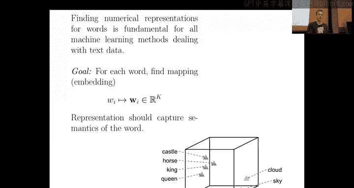

Into numerical features。 So that's what we like to do。 So so here like I will be a word。This maybe。

A million possible words in English or I don't know， maybe only like 10 or 20。

000 of them are used frequently or so I don't know。And then for every word。

 we want to have a real number， representation or many of those。

 so here we have be looking for like K features just for that word。So。呃。

So that's the goal and there's of course several ways to do it。

 so how to translate a word into features。And。I guess， the。So here， yeah， what。

 how many features to get a reasonable representation？And I would say the， the very easiest way to。

To do it probably is to， is to use this kind of one hot encoding， which just means to。To。

 to set the vector of the ice word， so。Sorry the WI is the word and I map it to a vector。

She's also called WI。Chas the one here where the word appears and it's zero everywhere else。So。

 this is maybe the。The easiest thing you can do and so this is the position of I， right？

And I can be which word it is from whatever is your vocabulary size。

 let's say maybe 200 is a reasonable vocabulary size so that's key。嗯。And， and this， this is this。

 yeah， standard。1 hot encoding。 And， and when you do it this way。

this is also known as the bag of Word representation。嗯。

And that's because you could also do this when you have more than a word like a small sentence。

 three， four words together， then all the words that appear。

 you put ones right then the ones who don't appear。

 you put zero and why is this called back words is because the the order of words doesn't matter at all right so if you have these two。

 three words， then then you will have a。Some two or three non zero positions。

 but everythingveraging has is zero and we forgot about the ordering of words and if you just do it for one word then here is the mapping。

And of course， this is a vector in。In K dimensions and K is really big。 So， so this is a。

Already brings us a bit to the discussion of this kind of feature representation。

 so one quite obvious downside is that it's very expensive to deal with such vectors because they are so large。

I mean， if you deal with individual words， it's fine they're spa as the vector side。

 but as soon as you start to learn a classifier around this。On these features。

 then the classifier would be a dense vector taking such vectors as input as data vectors。

And then this is going to be problematic to have so many features。Okay。So yeah。

 finding good features， that's the topic here。And。And then also。Yeah， what do we really want。

 So okay， we said it's problematic。 We have too many features， but also。😊，Okay。

 if I have fewer features， then what are good features？So。Because here you can also see that it just。

It doesn't capture much it doesn't capture anything smart right every word has going to be a completely different vector here。

 So for example， a word。In singular and then the same word in the plural form。

 they will have completely different feature vectors here no there's no way that these two feature vectors tell you anything that these words are related so。

😊，So that' that's what it's a desirable thing that we would like to have to also capture the meaning of the word a bit to get features which are kind of reasonable。

 right which capture。What is actually。The the hidden， the true。

Meaning of the word or or the the the useful information in that word。

 So what would be much better is to get something where similar words have similar feature vectors that。

That would be the goal， right， so that would be much nicer。So that。

 that is also that's always when you， when you do representation learning， then that's what you。

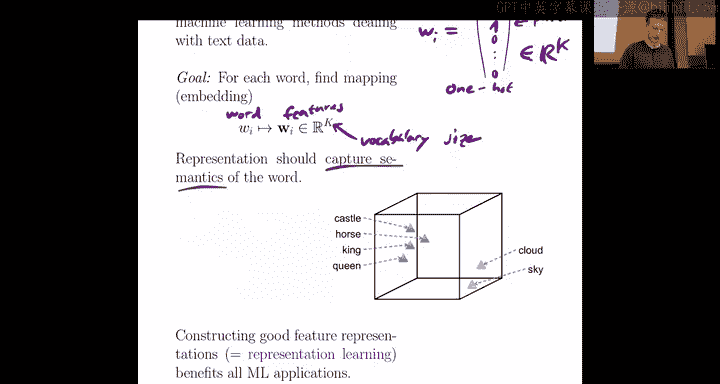

What you would kind of like to have you， you would like to get features which reflect the true meaning of of your input right for image also the pixels are not that。

 right。So for images， the best methods。Or to， to take the image and and let it。

Be processed by a neural network and then maybe after a few layers you get the representation。

So that's the activations that this image gives。To the network。 And these are much better features。

 So because those。At， at a very deep layer of for neural network。

 then maybe the last layer is gonna be a very good classifier。 And， for example， the。

 the imagenet data， which can classify thousands of different。Types of images， right。

 So it understands the semantic of that image。 So the features at the end。

 they understand the semantics and the features at the beginning of a network at the input。

They don't so and this is a similar thing here， right。Yeah。

 maybe those lectures are good as a raw input。But they're maybe not the device features you can have for words。

To do some smarter analysis later to capture their meaning。

So this is only a starting point and this is called the。The bag of word representation。

So the obvious question now is can we get better features than this？And of course。

 you can use neural metrics。 but before we do that。

 we actually see a simpler and much kind of more elegant way。To learn feature vectors。

 And it's very similar to what we have seen on Tuesday， so。

So the goal now is to learn a feature vector for each word， a word vector。

 so thats this what we're going to discuss now is also called work to work and some variants of these type of methods。

And。So to， to learn this。These vectors， we just we have very nice。Unsupervised data available。So。

What you're going to use is a matrix here which looks very similar to what you have seen on Tuesday。

😊，And this matrix is super trivial it's just counting how many times does each word appear with each other word。

呃。Here is the row for word I and what that's written here one。Means that。With this word J。

 which will represent the column。Those two words appear together in the text， maybe once。

Or twice if you ask about these other words， so these are the counts。How many times did word I coac？

We care together with word G。And yeah， what text am I talking about So this。This method。

 you can change this on any。Any text， so all the text in the world。

 usually the more the more the better you would just throw entire Wikipedia and all the text you can get。

You throw that together and then you compute these cocurreence matrix。

Wwhichch just counts like these words occur together and occur together is usually like like're just next to each other right or in a small。

In a small window。And。Yeah， that's it。 so。Okay， by the way， how would you compute these matrix？

So this is actually a really gigantic matrix because。Again。

 this100 thousands of words its a vocabulary size and it's that vocabulary size squared so so which is a。

A large。A very large number。 any。Any ideas from your side， how would you？

How would you officially compute this matrix on a huge text corpus that you cannot load into Ram。

What do you think？Yes。と对て。Yes， you're right。 You're saying the result is a sparsmatic。 That's true。

 but computationally， it's still challenging because even the input is super big and。😊，You're right。

 the result far here。 Well how could we parallelize the competition of this。

And to make sure we don't need to store all the text in。In the main memory。

 or how would you parallelze computing this？ So yeah。

 we just make a bunch of them on separate date separate data engines。What this思。H。Yes。

 so you're saying you would separate the data into several parts。That's true。 So yeah。

 you do the English Wikipedia， I do the French Wikipedia， or whatever。

 and then compute these matrix individually。And then add it together， that's correct。

That's exactly how you parallelize this。 And what is this paradigm called you maybe have seen this before so。

Yeah， may produce exactly， so may produce would be the nicest way too。To。

 to compute this gigantic matrix on a huge corpus。 So yes。Okay， should the matrix be symmetric。😊，Yes。

 the way I presented it， yes， but。There's a small technicality that we you can have a more rows and or columns。

 So usually it'ssymmetric， yes。 but it if you want， you could also。

 so here are the words you care about。 And then the ones in the column， those are called the context。

 So， so the the ones that you care about how， how you occur with another word。 So and theoretically。

 you could have a different vocabulary for the context So you could have a bit different number of columns than rows。

 But， but in reality。Yes， so。T equal N in reality， so。But just in case， if you。

 if you want to say that， okay， this is a different set of words I wantna。

Compelleed future vectors on。 And then's a different set， which I take us my context。

 That's also something that you can do。 So， so here， the rows are the the words， right， We， we。

 we compute a word vector for each。😊，And then the columns here are the context。They are also words。

 right。 So WJ， but they could come from a different vocabulary。 But yeah， you're right。 in reality。

 this is usually the same。 And then， and then， yes， it's probably p ssymmetric。

 you can define what you mean by co occur cure。 Actually， what you would usually do is to。To。

 to appear together in the same window， right， just， just next to each other。

 Maybe that's that that's what it means to occur together or actually in in。

In work to Microsoft they use like a window size5。Five words apart。

So that means that the two words still appear a bit together in the same sentence or same context。

 so maybe they are a bit related。Okay， this is just very naive。

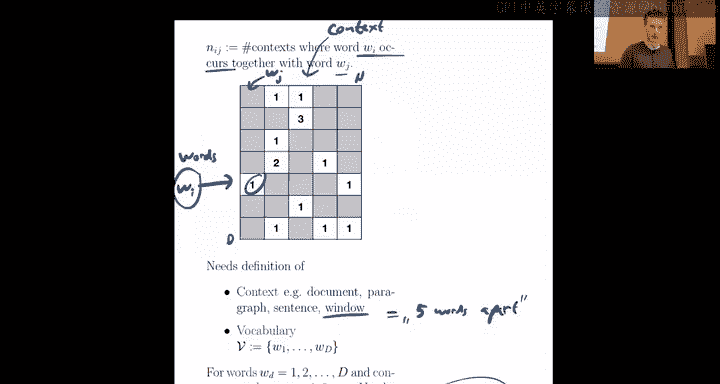

Computation of frequencies。 We didn't gain any additional information doing that， right， It's just。

 this is just the most basic statistics of a tax corpus。It's basically just the text itself。

And you counted it， so。So。Not much has happened yet。呃。But yes。

 what's interesting also is that this is a sparse matrix as you mentioned。

 So that's let's keep that in mind as well。 And then if you look at the figure。诶。

So now the whole story here， it reminds us a bit of the recommend system example that we saw on Tuesday。

 right， so it looks very similar the story。

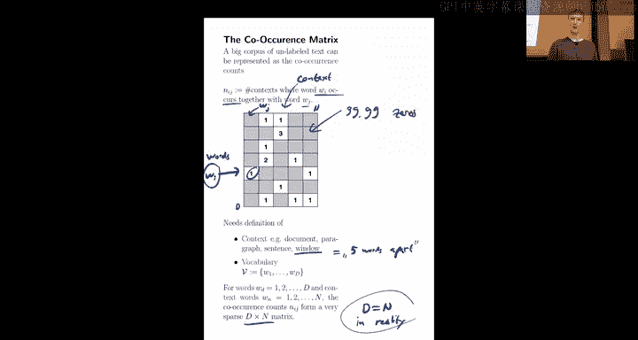

So the data look similar。 So there we had star ratings，1 to5 stars for， for people items and。

People together here we have these counts for two words together。

 so can we maybe use a similar approach？

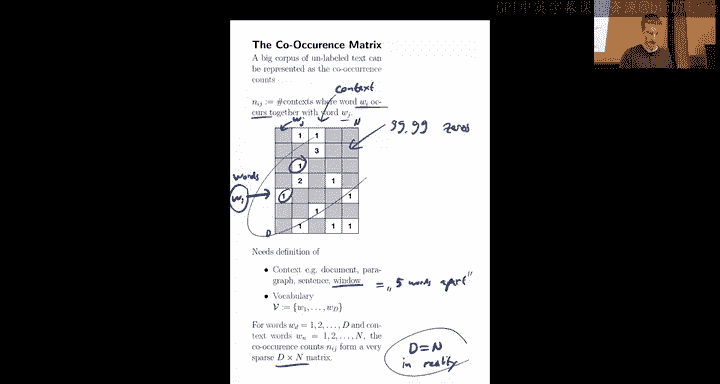

As a senior recommended system and。The answer， of course， is yes。

 we can also try to make a matrix factorization of this。

And that's basically then so now something interesting happens right now。

If we do this then something will be learned。So。And。And so now this is I scale， this is Ik。And sorry。

 that's said transpose。As usual I will just factorize these gigantic metics。😊。

InInto two small emergerices。This was T times N， right？And。

So what's the point is exactly the same as in a recommend system， you just asked that， okay， do this。

 hopefully if I do it the vector of word I times the vector of word J。So here is I， here's J。

They get multiplied and hopefully the score you get so when you take the inner product of these two。

 so that's the entry IG right that's this entry we have here。😊。

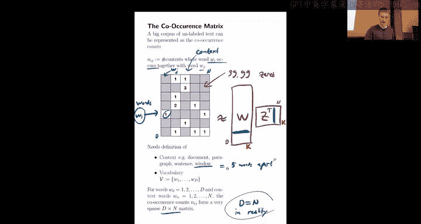

Hopefully that entry will be similar to the score from this matrix optimization。

So now we have a learning problem，So this is given and this is learned W and Z are learned。

 so we we will optimize them so we will throw exactly the same machinery as you had in the recommended system we can apply it here and then every every row of your W matrix。

😊。

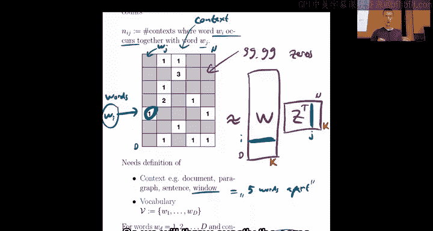

Will be your feature vectors。 So now you learned feature vectors， and you learned。

Such a vector for each word。 So these are the rows of W out of word vectors。So。

That we we learn here so。And。Yes， so that's basically。That's the idea so。

So for everywhere now you have learned the word vector。 and now this is， this， of course。

 you can do for any much more reasonable and much smaller k， right。

 so you can choose k to be whatever 10 or 50 is maybe a reasonable number。So you learn 50 features。

 even if your vocabulary is 100，000。And hopefully these features here。

These 50 features will be very good to also carry the semantic of each word。Because if。

 if this is true that the inner product of the two。Explains the score。

 and then it means that those features here， they kind of reflect the meaning of the two words。

 right they can explain that yes， these two words often occur together or no。

 they they don't occur together much。 So if， if this works so。Super simple approach。 And it's。

It's kind of nice because it's， it's really unsupervised， right， This， this is now。

 I think we agree that this is like fully unsupervised。 as no， no human labeling has has。😊。

As been necessary， a text is just there and from that we can learn features。

 so that's why it's representation learning。So， this is。呃。This is learning word vectors。

So this is really the idea between behind a work and glove。Maybe you've heard of her to work。

 so I'll come back to you in a second。And the other one is called。Glove。

 which comes from a global vector。Learning something so。So so both these methods are very similar。

 So the one we we talked about now which takess this matrix in factorizing， that's the one。

Call it Gv， which is from 2014， I think and then where to across a bit earlier 2013 but。呃。

Is's a little bit different。 So we will come back to that one and they have really。

Had a huge impact on。On anything which has to do with with text。

 right so to a kind of it's kind of a big step right from these nineive factors which we had in NLP traditionally。

The few decades before。Before these word embedding methods came up。

So here we had like a vector in 10000 dimension， very far as not carrying any。

Semantics now we have a vector in just 50 dimensions。

And mathematically it's super simple right it's again just a matrix acquisition。

Now every word has selector 50 features and we can do machine learning with those using those as a feature。

 so that's glove。And。The cool thing is it's again。a very。

A straightforward application of this matrix factorization， right that we always。

We encountered on now already a few times。So here is the data axis is the core occurrence。

He's this giving core currentmatics and de factor to？Into the two factors。Okay。

 maybe I should maybe now it's time to be a little bit more precise on what exactly is the the last function in this case。

 So it really looks the same as as we had in。In Netflix。So。So this part is really the same right。

 so x is kind of discount counts， I'll get to that。And then the factorization， as we said。

 and you just put a squared。Squad loss， so。So this was the same as in the recommendo system。

Which we discussed on Tuesday for these Netflix star ratings。

Then there is a very small modification here is this F which is in front， this is a very small。

I think sorry， not Sweden in smartphone because it's just a weighting factor。

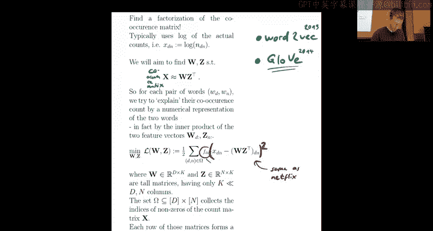

So I'll come back to that。 So there is this。A scalealar here which we use to give a bit more weight to some kind of important co occurrenceencies or not so important ones。

And then Oomega as well， is just a。The， the entries which are observed， right， because， of course。

 there is。Well， okay， that's not obvious， but。The point is we dont。

 we don't do anything for the entries which are not observed together。

 So those will not be included in the loss。 So that's so Oomega again， is the。Easter said。Of the。

 of the nonzes。Of these counts， right， So yeah， we treat it as a sparse matrix， as you said。

I would say mainly for computational reasons， so it's more efficient to ignore the。😊，对。

It's more efficient to ignore the zeros， right？This is actually a bit different than in the。

In the recommend system case， because here， the fact that the stuff here is zero。😊，It。

 it means something， right， It's actually， it's actually interesting that these two words never occur together。

 It's， it's actually useful information。 So you could try to use it。But in the Netflix case。

 this was different because here， this was missing because because there was really no information there。

 we we have never observed movie I with U or J。 therefore there was it was a missing field right。

 but here it means that the words do not appear together still。I use the same approach。 I ignore it。

 I only used the information from there。From the non zero core occurrence counts。

You could play if you， if you also want to use all the entries， you could do that。

 What you can also do is you could just take this matrix and perform。A PCA on this matrix。

 So single value composition。 there will be another very easy way to get effect factorization。

Actually， it also works quite well， but it turns out that the method here。

 which ignore the yours here。Even performs a bit better。

 it seems to give vectors which are a little bit more meaningful。

I don't think there is a theoretical understanding for this because it's also a bit hard to evaluate these lectures to。

That we can actually prove that they are good in。In my sense。

 we can just empirically evaluate them are they good features for other NLP tasks， right， And yeah。

 you can also get just do the SVD of Frankcade and you also get features usually those from from this。

Or from work to I perform a bit better， but you can maybe。Play around with that if you want。

 So this week， we also have a nice lab where we give you such a matrix。

And you can you can run the factorization。 You can use the same code as you had。For the Netflix case。

 basically。So， yes， so that's glove。 The objective function is identical to the Netflix commander case。

 except a small weighting。And also， the other thing is the what is x？So， so this is actually。

The counts together， but I need to be honest with you that this is actually the logarithm of the count。

呃。The lock of the。Number of cool occurrence。Because some words are just extremely frequent together。

 like the word there together with， I don't know， they have like a huge frequency in text。

 you always have this kind of long tail phenomena that some things are extremely frequent and some things are extremely rare。

😊，So it turns out it's better to use。Lo scale input here， so。

The x data which correspond to these ratings。These are， yeah， the log of the cocurances。Okay。

 so we take those。So those are actually all logs。And then we factorize it， lock three and so on。

And then we compute vectorization， and then we have our word vectors。

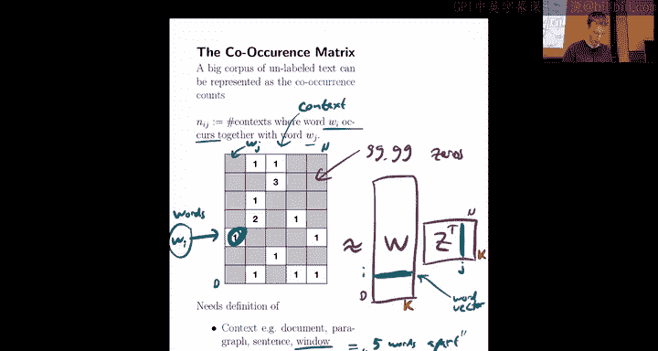

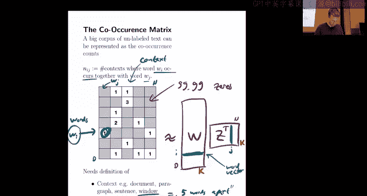

So。Is there any question on this？I have a very small。Add on what these weights actually are。

 so again， this is not。

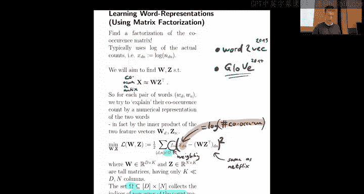

Hard science， but a bit more empirical too。How to， yeah。

 what weights could you use so so what they found nice is。What they found to work well is to。

To use weights， which。Grow with the with the。The frequency of the word， so here is the。

The frequency of a core occurrence。And， I mean， we， we already have it kind of in the log， right。

 The log already means that this thing grows kind of slowly with。With with the original account。

 right， so that that's already in the X。But what they did here is that they add this auto weighting as well。

😊，Which also has to be the same spirited。When they're very rare， they should not be counterm。

And when they are。Exme frequent together than they should。They should be counted。

 but also there should be some kind of cutoff that you don't you should not put like too much weight and this one is outside the square loss so that's why it's a bit different than just reweighting the x which of course is also something you could do so and what they did for the weight is something like this so that it grows kind of almost linearly but this is a a bit curved。

Until a cut of value soon。Well， this means is， it just means that after it has occurred together  a thousand times。

 so I don't know what。The actual value was used after it's like a thousand times so you don't care anymore then you would just set the weight to one。

 so it's constant when it's higher than that。And the， the。

 the curve curveiness here is that they chose some kind of exponent here to。

 to make this growth a little bit curved， not， not linear so， but。

So alpha here is this kind of growth rate。And this is very， very empirical。

 It's not that this is a true。Theoretically justified thing。

 but this is something that turned out to perform really well for。For yeah。

 the resulting more vector you get。But if you want something simple。

 then you you can just ignore this。These weights and just set to one， it still works， right。Also。

 if you， of course， if you just decide to compute the SVD on X instead。

 then there's nothing like that。 There's no waiting。And。So， so this is actually another reason why。

Maybe this message could also perform maybe bit better because it has some kind of smaller weighting。

 which the SVD cannot。 the SVD will just。Go for the big entries。

And make sure they fit because it has to explain all the variantsX。

 but here we a little bit more fine grain， we can say that our laws should focus a bit on the words are together which appear together a bit more like in the reasonably of the case。

So this is not the idea here is not to be dominated by。

By those things which appear a million times together。

 but to be a kind of in the interesting regime here。And also the rare core occurrences， of course。

 also appear nicely in this loss。But the main contributions， I think， are from like the middle。

 the ones which are like。Usually frequent and not super frequent。Okay。

 so a very small modification to the loss function from。From the recommender system。

So and this is if you all put this。Theses heuristic together or so and so on。Then you have cloth。

And so then then you get these vectors。They also offer them print train， you can download them。

 and it's also for Word to work， usually when you would like to use such a method and you don't。

 you don't train this yourself usually because other people have already done it for you they have。

They have run mapduce on Wikipedia or web crawl to compute the cocurs matrix。

And then someone has run。It's because the gradient is to compute W。The z we don't even care about。

 this is the embeddings of these complex words， so we throw them away after training。

 but we keep the word vectors in W， of course， these other they。

The representations of the words that we are interested in。

So you can basically just download such W matrices。Sometimes even for， for。

Several languages and so on， so that's also something。

We at some point tried to work on to get these word vector such that they are similar when the word is a similar meaning in different languages。

Because these matrix， you could just throw all the languages together。 it's fine。

Just the the web is very multilingual。 you， you just compute all the languages together。

 you get embeddings of words of all languages。 but then maybe you can do some trick to encourage words of the same meaning。

To have similar vectorin， even when they're from a different language that there will be an addition to。

To the basic method we have seen here， but no worries。

We're not going to discuss the multilingual case much so。

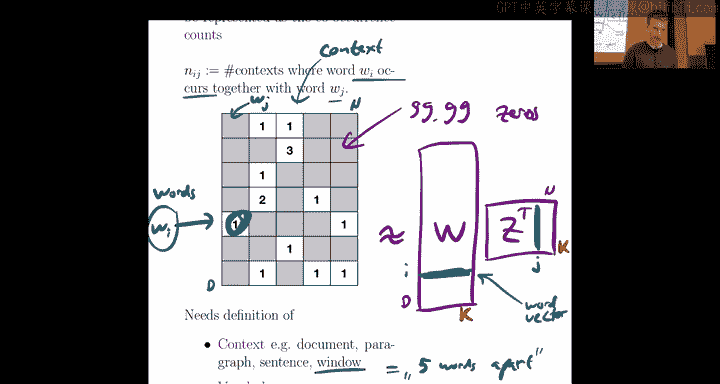

呃。

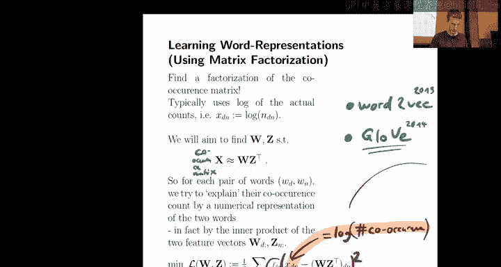

Yes， this was this heck about the weights and then。The usual discussion we always have。

 so how to choose K。 it was a discussion when we had camemeons。😊，Where it was normal of class。

 was the discussion then。T we stay when we had the recommended system there。

There it's a similar thing as now it's the features， number of features we want。

And for text applications。What you find is usually。Smaller values around G so work quite well。

 but then there is more。More advanced water representation since then， for example。

 from transformer neural network models。One of them is， for example， B where， where they go up to。

700。What's the number here？Not zero， so they have up to 700 a day。

As which I uses the dimension or how many features they produce， so。Is some power of two。呃。ok。Yeah。

 which one so。呃。Well， because you also need to store this whole matrix。

 which is quite big when you have100 thousand0 words times。OkayAnd this， of course。

 is a dense matrix side even if this was a sparse one。So说的。The world actually saw dance。

But they are quite short， so K of course， is much， much smaller than the vocabulary size。

So depending on your storage requirements， maybe if you want to run this on a phone or so then you might have to choose a bit small okay to fit memory constraints。

呃。But yeah， on computers， you can have several hundreds of k， I would say it's not a problem so。

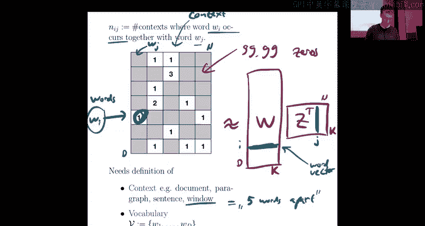

Oh。Okay。

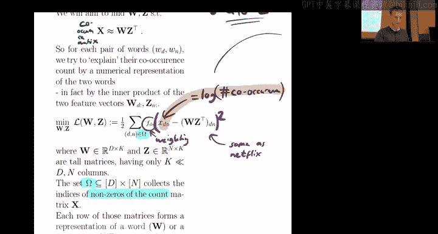

Okay， now why is this cool， So I again。Mainly， just gave you the。

The math and how the algorithm works and。

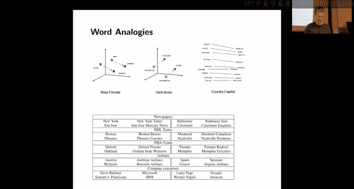

Iput and output and so on， so now we have this word vector， so why are they useful？😊。

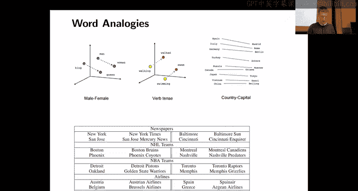

W are they better than what we had before when we just had bag of words？So， so some things that。

You probably have seen of some of these analogies， so who of you has heard of this king and queen example？

So。So of you。So the idea is that interestingly， when we now look at these word vectors。

 we see some interesting correspondences and we see that similar stuff is scooped in similar places that's nice。

 but not only that we also see that this interesting relationship so for example。😊，诶。Yeah， so。

 so the the words king and。And queen they're embedded somewhere， so here are these two vectors。

And they seem to have a similar direction than men and women， so that's kind of interesting。

Why is that instinct because then。You can do this kind of algebra。 You can say。呃。Yeah， you can。

 you can say the the vector。You， you start here with a。Man， for example， so。The word for。Man。

 then you。So。You subject。呃。嗯。😊，Sorry。Word for woman。呃 plus。So以。I'm messing this episode。真。😔。

What do you see？Is that these vectors， man， minus woman？It's approximately the same as。

Ping my screen， so。And this pen is messed up。是。So if you take it to the other side。

 you can do this kind of algebrasso。Men minus woman plus queen。So， now。Now。

 this has gone to the other side。And then you see that。YouYou are somewhere。

And and that that word happens to be。Something very close to to King。 So I mean， okay。

 what's the point here， The the system has no idea what these words mean。

But the directions in space are meaningful。The directions， there is a direction in the space which。

Which reflects the， the difference between。I don't know regular people and royalties and there's also an another direction for gender and so on so you can do some kind of algebra and you see that this is reflected in the geometry so that's kind of nice。

😊，Also， also you can go from a country。To its capital。 So it's just， it's just a vector， right， So。

 and the idea here is that this， this vector transforms the county to the capital。 So。

 so now if you take， if you take this vector and attach it to another county。Like Russia。

You go in the same direction， the direction towards capital。You you end up somewhere in space。

And you ask what's there right， So you ended up at the point and you see， okay。

 there's nothing there， but close to， there is another word which had the closest word happened to be Moscow。

 right so that's the idea。So there is a direction in space which reflects country to capital。

You can do it the other way around， you can take it's always this analogy， right？

Germany is to Berlin， like something is to Tokyo， right， and that' something happens to be Japan。 So。

 so that's， that's what you can do in in these spaces that you can ask is。

 you can do these translations and then ask what's there。

 So because it's a correspondence to a a translation in the other。嗯。In in those concepts。

 also is reflected in the。In the other side。So or yeah， you could ask about airlines and so on。

So it's， it's not， it's not just doing some naive grammar or something。 It's， it's really。

 really smart enough to。To， to relate this。These airlines to。Yeah， if you ask Belgian Brus's Airline。

 then you attach it to Greece， you really， it's not going to tell you Greece Airlines。

 but it's really smart enough to。To give you the， the correct airline， because those happen to。

It's the space。 So why is this。 So okay， there's a lot of。

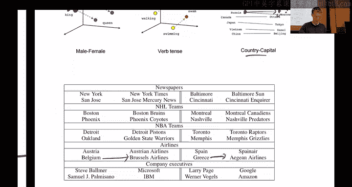

A lot of work trying to explain this I would say is not no hard theory for it。

 but the idea is that the space is kind of small right its only Ka dimension so。就。To reflect。

 to explain all the things appearing together。To appear So here you need to explain every coherence of words so and to do that it's quite a difficult job。

 So so doing this is just in a product。It really puts those vector into。

Into places such it makes most sense， so。Which then turns out to be nice that the places where it's put actually become become kind of meaningful。

Of course there's also many， many failure examples and I mean， this is not。😊。

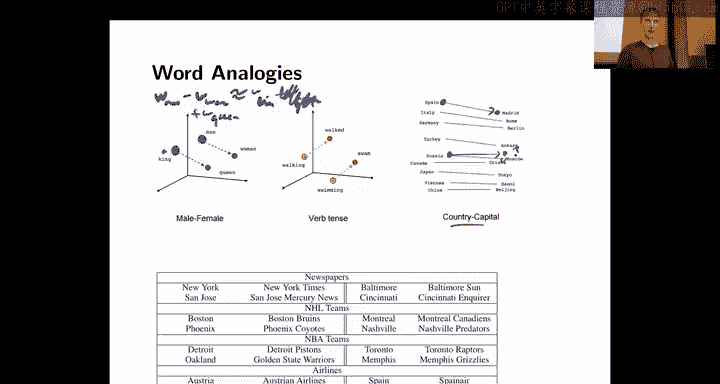

This is not how you would really productionize a system to。To do， for example， question answering。

 right， but， but it's still it's， it's encouraging， right it。

It shows you that the meaning of the words is reflected。So and there's much more you can do， right。

 so theres。There is also this kind of information retrieval you can do you。If you， of course。

 its the similarity， right？呃。So。So even before you do this analogy。

 the much simpler thing to do is similarities。So。So there you， you just ask a query word and。

W Pw and Daniel Oscar。What what is the world closest to this？So， or。So I mean。

 a query vector right so any vector you have and you can ask what is the word closest to it that's actually what we did here as as a small building block for the analogy。

 but then these things like this can be used in web search as well right so okay the user is searching for this word。

 but maybe we should also offer the user results for similar words which means the ones that are nearby in in this vector em bedding space。

And I think just this week， Google actually launched a new product。

 which is called like vector search。 I don't want to I haven't tried it but its the same idea that yeah。

 words and lots of other data modalities are embedded in in a space so that then you can search from that space to ask what items are actually close to to the item you're looking for。

 So I mean， there even for images， of course， you can ask for similar images and so on。

But here it's nice to do the same thing with word representations。That's what Sue。Okay。

 we have retrieval S applications， information retrieval， and then this analogy or more。😊。

Fun thing to play with。 You can also try this out。 There some demos on the Internet， and。

Maybe in the lab， if you train the word ems， you can also see which words happen to be closest together。

It you surely do a great job on like things which are really almost synonyms or like the plural and singular。

 they will be embedded very close。😊，To the space。 And also， this is example we have here。

 So for verbs， you will also understand。That being in past tense。

So swimming and s is some is the past tense of swimming。 So there will be a。A direction in space。

 So first of all， they will be rather close and second of all。

 the direction here will be kind of meaningful that if it's past tense。

 it's always shifted into one of these particular direction。Nopostance。Okay， that's the idea。

Of word representations。And。You would also ask how to train this。

And there the answer is exactly the same as as we had on Tuesday。

So there's nothing new here in terms of algorithms basicallys it's again。

 just SGD and the nice white white's so good and so preferred is the efficiency per step。Okay。

Is is only or okay， right， So we only need to spend。奇。Operations to multiply the two green vectors。

 right？So we sample one entry random。And。We do the inner product which gives us the prediction。

 prediction is 1。5， we compute the loss， so the loss is 0。5。

And then we update our W vector and only the green one we affected and the only the one which is currently active。

 everything only costs k， which is very nice。So yeah。

 it were just a uniform sampling of these entries。And then。😊，Yeah， later we when we talk about work。

 we will see if there's maybe maybe there's even smart way to do this to actually stream through the text to just see the words which appear together right now。

But that's not what you're doing here。 right here。 We already know that， yeah， the。

 the word appeared three times together。 So it's not， it's not a streaming algorithm。 First。

 you need to have this matrix。 And then you do a sastic gradient update for every entry of the matrix。

And the entry has to be chosen。At random usually。Or you could also。

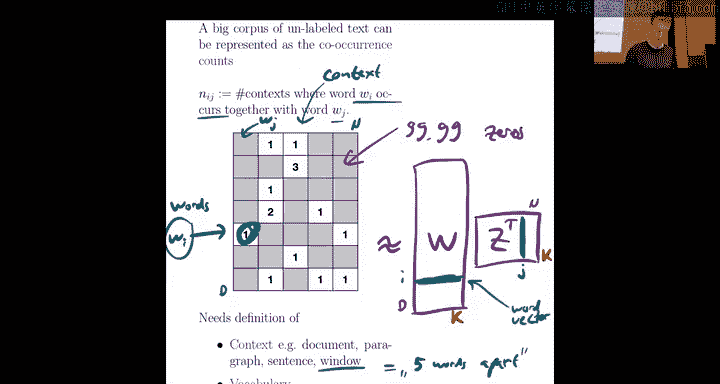

呃。Yeah， maybe I have a permutation for this ordering。

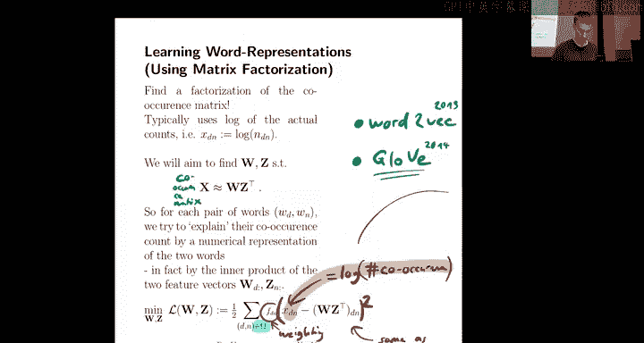

In practice。 Okay， so SD。Is the answer。 And that's also。See the lab of this week。

 we have a nice code template for you， very easy to do。If， well。

 this is also possible to do with alterly square， same as in the recommended system。

 but I would not recommend this and we don't do it。Interlect， so。Okay， interesting。

Relate to questions。 if you want to go further， would be to。How to parallelize this？

And we already talked about how to parallellyize the first step to compute the core currents matrix that's easy with mapduce。

😊，But then then there's a bit more to do if you really want to to run SGD in parallel。

This can also be done， so then the question is maybe can you partition these matrix？

Into several workers and， and still have good。SGD that yeah。

 the worker one works on these entries and worker2 on these。 So that is a bit more tricky to。

 because SGD， again， would use the random sampling of。Of these elements， which are this is a sum。

 the loss function is a sum over the losses over each element。So that's another。

Interesting question and then also you could regular a bit， but that's actually rarely used。

For word vectors， I haven't seen it。And a downside is to to need the need to precompute the bigger。

The big X matrix in the beginning， so。So。嗯。We know how to do it right with mapreduce。

 but its it's still a big matrix。 even if it's partss。

 this is a gigantic matrix and its not it's not so nice that once we have computed this big matrix。

 we need to have a good memory to basically run SD on it。

 which is not entirely trivial if it's if it becomes like really big。

 So that's why after the break we will talk about the original work to。

 which is almost at the same time as this。😊，Wwhichch then solves this problem that you does not need to pre computeute this core occurrencence matrix。

 it's actually a streaming algorithm where I mean streaming through the text。

So that's for after the break。See you done in 15 minutes。

We are back and we will wrap up on text repition only。

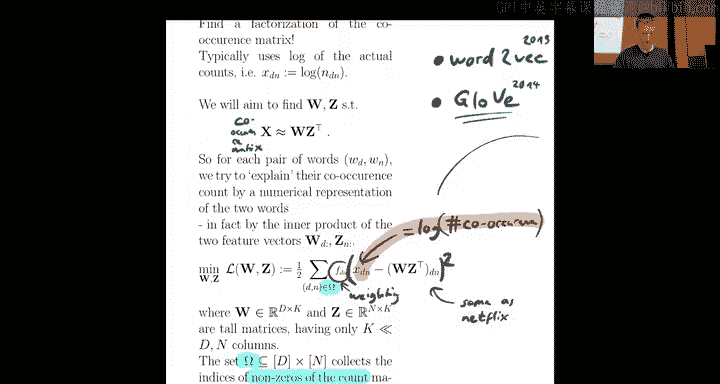

So this was maybe a bit the technical part about cloth。 And now I want to switch to the。

To the one which is a bit slightly more used in practice。Whi is the work to E1。

 which came up around almost same time， so 2013。

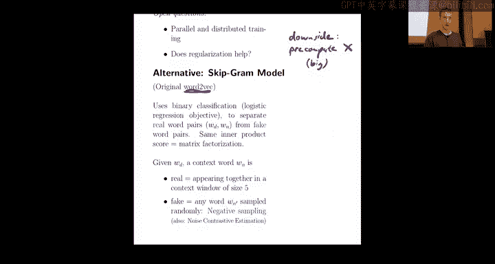

And。So which again， is very related to what we discussed。

Very similar method to find good word representation vectors。

So what's the difference between Wordwick？And G， what we've seen here， right， so this was G。

 just find the matrix factorization。

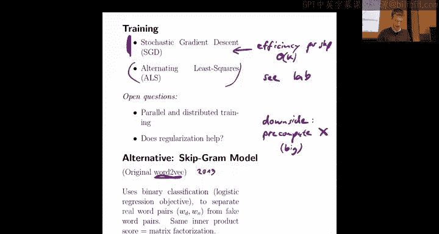

And now we want to ask a bit about this one， what's the difference here？And the difference is。

 basically。Mainly that we get rid of this downside of the。Preprocessing this huge x matrix。

 which is vocabulary size squared。But then it's kind of a sparse matrix， but this is a big effort。

And at least the the nice thing is。Yeah， why is this big， right。

 Because we can really use X can reflect all text in the world， right， It's， that's the nice thing。

 It's， you can really use as much as a text corpus as as you can get because it's unsupervised。

 So so that also means that。😊，It really benefits from having a large text。As possible。

But maybe maybe we cannot store the whole X magic in memory。

 so is there is there an approach to overcome this？😊，This problem。

And then so what Work does is basically it's exactly the same idea right。

 so the goal is completely the same right we just try to learn。😊，呃。Learn word vectors W。呃 to。

To reflect our scores and。The way we do it this is exactly same， so we just build the inner products。

Of the word vector。With its context vector， so。So this has a few entries， right？And of course。

 same for the word vector。So here's the word。And here is the context word。呃。So。

 so that that's the same as before。 These were the two green vectors we had already in glove。 So。

 so what is different now。对。The difference now is that we don't care that this is giving it a total count。

呃，of。Of these， these two words。D and N right appearing together sorry， we called it I in J last time。

 but it's the same thing does do we what you want predict right So the product of these two guys is a number so what should this number B。

Before it it was， our goal was to be the total count of these words together。

 But now we we actually do something a bit simpler。

 So what we ask is we just ask to classify yes or no， we just classify that。😊，呃。Yes。

 these two words are from a real co。 So they I stream to my text and I see that yeah。

 word D and word N， they really are next to each other。 So they appear together， So I。

I kind of have a binary classifier to answer。The classifier should answer yes， so。So positive score。

And then。But then， okay， if you do this， then why don't you just always answer yes and。

You wouldn't learn much doing that， so so。When we do this class approach， we should also。

Sometimes also no， and so that we can actually learn from what's the difference between。Yes。

 for current currents or a no。And the difference is that。What could you use for the no？Examples， so。

Any， any suggestions？In which case would you say that okay， the classifier。

 So the classifier is just a product of these two red。 So just the inner product。

 So of course it's some value， maybe it's positive， maybe it's negative。So if it's positive。

 means yes， if it's negative， it means no。 So， so which word pairs should the classifier answer no。

 what what do you think。嗯。I mean， we said we want to answer yes。

 if they really appear next to each other。When I go through my text。And。

And when could we have no answers， so we want to have a bit of a mixed training set， right。

 we want to have both kinds of situations， not only yes answers。So for the no answers， you。

 you would just put fake pairs， which do not appear together really， right so。So you just， I mean。

 maybe you just keep the same D， but you put a fake word。N， right， which will not appear together。So。

诶。Then。So so the ones which are the So these are called the negative samples。 So so here is D and N。

嗯。Not。

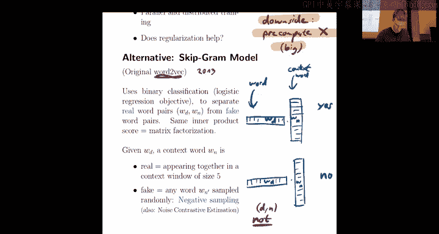

This means that they're not an expert each other in the text and then the classifier should answer no。

So。呃。That that's it and。Well， how do you get those which are not appearing together。

 It's actually we do even in something even simpler here， which just sample a random word。 So。

 I mean， maybe D is given an N， you just sample any other word， right。

 the chance is super small that it's actually the。The one word， which is appears together。

 So just sample， fake， fake words or do any。Take any random pair D and N。 So those are the ones。

 you should call the negative samples。So those are the ones shall not appear together。

And those are the。Those are the real ones， which are actually next to each other in the text so so you do this while you stream while you read through your text so you have the real cohernce。

😊，And then here you have a fake。A fake pair， so this is a real D and the N pair and then here is a fake one which is not appearing together and that's it。

什么。So yeah， this is maybe so again， the word D is maybe fixed so that that we are currently seeing this word。

 we see it truly next to the other word n。And then we， we。We do not see it next please order。

Fake word， which is a negative sample。So maybe I should call this。

Maybe I will call this N prime right to make clear that this is a。A different one， a fake word。

 right？N and D are together and prime and D are not。So。This is。The fake word， okay。

So now what we have done here is we basically took a big corpus of text。And we have。

We have interpreted this text as training data for classifiers。So which is kind of cool。So。Yeah。

 what's the classifier here， right Every word has its own classifier。

 So the yellow vector is the classifier。 So every word has has its word vector。

 and that same word vector act as a classifier。 So if you。

 if you take the word vector and you pair it with a one。

 which really appears together you get a positive score。 So because they are。😊。

Because they are close in meaning， so。They will also be embedded in a similar place。 Therefore， if。

 if you're close together in space， then you have a positive inner product。So。

And then the ones were are not together have a different meaning。

 So those who say I want those who have a negative inner a product。The classifier， which again。

 is the， the yellow word， if you want to say， should have a negative inner product。 It's a fake word。

 So that that word should be embedded far away。 So this is our training objective。

 I want to have a high score for co occurring。 So then。😊。

Score should be high and then if I have not coering。

 I want the low score and you really can use the same kind of scores as for example in logistic regression or some loss function like least it's a classification loss function yes。

Bebit for a word。And for the same word as a context work。In a very。Yeah。

 your question is every word has has here a word embedding。

 but then the same word might have a a different context embedding。 That's true。 It's。

 it's a similar situation as we discussed before we cloth。 So， yes， if you want， you could。

 you could make them the same， it doesn't really matter。 So actually here。

Actually they use different ones in work to work， but it doesn't matter much so the context embeticddings you will throw them away anyway。

 we don't care about them we just they are just there to to train these guys and that's that's exactly same situation as when we did the matrix accusation so these guys we interested in those are just。

For， for。For the game of training， so to help us。Context embedding and word embedding。

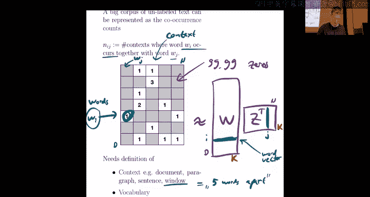

And。Yeah， both is fine。

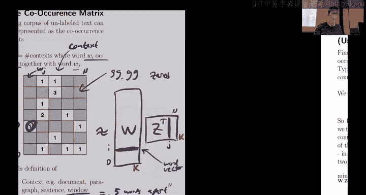

Okay， so。Yeah binary classification， it's kind of a cool interpretation that you can go from text to binary classification。

 it's also very cool to have a different classifier way of word。😊，But then。

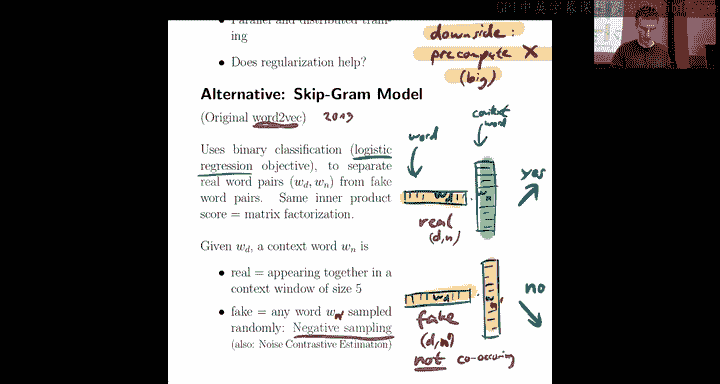

The thing which is really the best about this， is that。呃。Now。

 this can be trained while just streaming through the text。

 So you don't need to precompute any cocurrence matrix or anything。 Nothing。 you， you just read text。

 you start with the Wikipedia letter A， you see the the first article， the first two words are there。

 And once the first two words are there， then。You already have your first step for this。

So that's the first example for your classifier， the first training point。

And it's to run stochastic gradientcent which is first training point。

 which which is to say that this data point needs to be classified yes。

 and then the next step is to use the same word with a random sample one and and there that's your first。

Data point with a no answer， and then you shift in the Wikipedia text to the second pair of words and you just read through the text and do an SD update。

On each of those retirement， that's the work towick。I agree him so。So嗯。So yeah。

 and the crucial thing is really the streaming。Through the through the text。The， the input text。

 right。So， so this is your。This is your entire input text。的。The first word， second and third word。

 right， So and you immediately start， so。You start。The first word forms the first pair， right， W。DW。

N。So this is your first pair， and then。And then you just continue。So， so then you， you keep reading。

Okay， streaming item it very nice， you don't need to memorize any text just stream Street。And。

 and the。Again， it's based on STGD on this logistic regression。呃 loss function。Okay。So this is again。

 an illustration that。Maybe the important thing is not so much which neural architecture also you have。

 but the important thing is to。To identify the opportunity。Of what signal to train from， right， So。

 and the signal to train from here is is really smart， right， I think it's a really cool idea， too。😊。

To say the fact that two words appear together right now that the two things appear together that that can already give me a stochastic rating update that that's a learning signal。

 These two appearing together is yes。 and these two not appearing together is a no。

 So I will immediately use this information。😊，While I encounter information in the world， right？

So this can be used more generally。 This can use be used for any things appearing together， right。

 So people also use this。For maybe recommend systems on the web right so then you have。

People like you browsing the web， you appear together with this item they want to sell。So。

 that happening is also。Such a signal， right， So you and this item that you looked at it。

 That's a positive signal。 So you， you will update your embedding and the item embedding based on this yes answer。

😊，And then you will use a negative example of an item you have not looked at to do the SD update of the negative。

Simple。😊，So then you learn embeddings of people browsing and you learn embeddings of。Of things。

 products on sale。 This is another example of this。

And the whole field of this is so this idea to use real against fake occurrences to learn is called contrastive learning。

Contrasive learning。And and that's it's cool because it's unsupervised。

 you don't need manual labels and that's also getting quite a revival at the moment for even for for。

 for example， for images that can you use tricks like this。😊，To。

 to use no human labels anymore or much less human labels， right。 So again， the。

 the tricky thing is to identify the learning opportunity， not so much a which， which kind of。

AModel machine only you use， but what to learn from。So。That's this contrastive learning。

 there will be much more to say about it， unfortunately。We don't have so much time。

So I think that was mostly it for representation learning on text。

 but what I also want to do is to tell you a bit more。

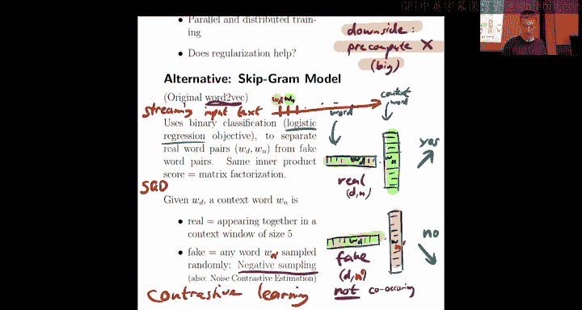

About one auto thing， which is in a way， also representation learning， but it's more。

 it's a bit more。

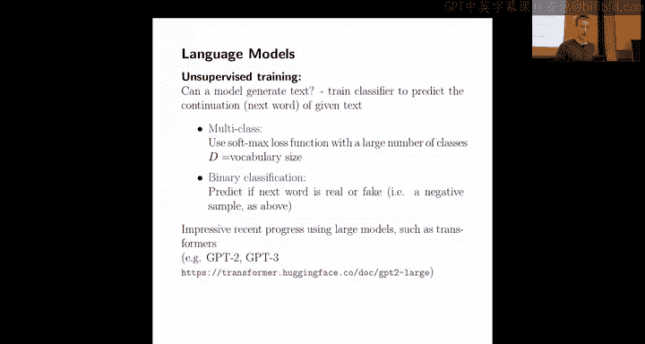

I don't know。 It's it's just another very natural thing you can do with sequences。

 which is to predict the sequence。 And this， the idea here is to。😊，To just。

So it's actually a bit of continuation of what we have seen here， right so here you've got two words。

😊，You had to tell me is this a real or fake。Instance of two words appear in a real text。

 or is it just a random pair of words？So the the next。Smalller。Anyway。

 extension you could do is to take a sequence of words。Word 123。呃。Sees of words。 and then you ask。

Well this next one so how does it continue？To giving you a。A text which is not finished yet。

 can you complete the text？😊，Do you know which word？What would come next。

 That's this word WM plus one。And， and that's another。That's another kind of learning opportunity。

 that that's something you could could train a system from， right？ So here it was just a real thing。

 But the idea here is that we could also train a system from。

Maybe we can train an em mode which takes those so far and then。Predics。The next word。

So that's the task of doing this。Is called language modeling so。

So here you have an ML black box where I really don't care if this is a neural network or anything。

But the point is it takes the word so far as inputent and it learns to predict the next word。

And there is， yeah， there's like this is a bit harder task than the one before， which is just yes no。

 so you can see there like 20，000 possibilities when your vocabulary size。😊，Is 20，000， so。And。Okay。

 this is a very nice learning task。 and that's actually how the the most modern。😊。

NLP models are trained， usually。They're trained exactly on this task so or a slight variation of the task that you actually try to predict a word in the middle。

From， from the others。 And， And here I'm trying to predict the last word from the previous one。 But。

 of course， it's a very minor variation。 So， for example， Bt tries to predict some word。

 random word in the middle from the other surrounding ones。So again。

 it's very important to design these tasks to have a task to learn from。

And that's that's one aspect and the other aspect that is that once you have it。

 this is also cool for another reason， because now we can actually use it to generate text。

 So now if you have trained this M， it can。😊，Generate any text you want。

 So you give it a few starling words and just let it continue。Word by word。

 you generate one more word， then you give it this thing again and tell it to again complete one more word。

And。That's that's language models。 and that's that's you probably heard of this thing like G3。

 which is one of the recent。Very big language mode。

 which I would actually really encourage you to try out。😊，The three is not really public。

 but this actually open source ones like similar size and similar performance。And then the G2。

 which is maybe a year before， is also public that you can download these models。

And they give you the next word， and it's really a lot of fun because you。

It can continue about anything。 It can take a conversation。 people。

 two people are talking to each other。 and then it can continue the conversation。

 which means if you can do that， then it can also act in the conversation right。Complete like a。

Chatbo， for example， is you actually get a very reasonable chatbo from just this super naive training task。

 right， it's， it's kind of。It's quite extreme， at least to me。

 like how simple this task is how and how we， we， we don't use any hard coded knowledge about language。

 but we， we don't do anything smart， right， we just train a。

A very naive neural network on this simple task。 But if you do it， it it。

It can can do pretty amazing answers and continuations of text。

 These models are also the best models we have。😊，In the world to summarize text。

 it's almost like human quality。The on many machine learning or NP tasks to usually。

 you can actually。To tell you what， it's a bit strange， right， Because in reality， nobody。

Nobody really cares about this task。 We just care about this task for training。 In reality。

 you wanted to do a particular auto thing。 You wanted to， to maybe summarize text also and。

It's not clear how to tell the model to do that， so。What you actually do is。

You will just give it the original text you have and then a little bit at the end you will say please summarize this。

 you will say this in words and then it will continue for you and it will answer something like here is a summary and it will do the summary so。

So， it's， it's a。It's find it quite fascinating how mathematically it's such a trivial task。

 but then what the thing learns when you train it。😊，Again， by naive， stochastic and is actually。

Can be quite smart， Yeah。 So this is kind of a。Typical brute force， not so much。

Smartness has gone into the model design， but then because it has been trained on so much data has been trained unsupervised。

😊，Through the vast amount of data， it can do quite smart things。Yeah。

 what else what else can be done these malls so。Maybe you've seen some cases。It even works for code。

 right you can give it code。 You can in in Github， there is a model， same thing again to。To。

 to continue code， right， if you write code， this can continue， give you excellent suggestions smart。

 complete to continue your code。 You actually write only the comment of what you want。

To have in in procedure。 And then it will。Basically， right。The code， which does what you wanted to。

To have which you first wrote as a comment also， so this this can also。Can also work quite nicely。

But it takes a lot of computer source to train it， for example。

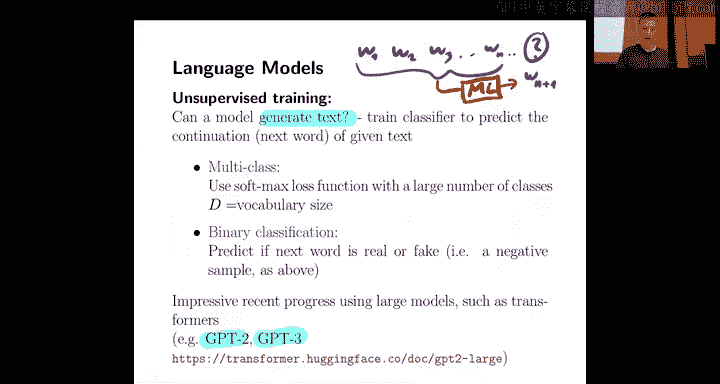

I think this this one only in electricity already costs like4 million francs just in burned electricity。

 so it's not so CO2。

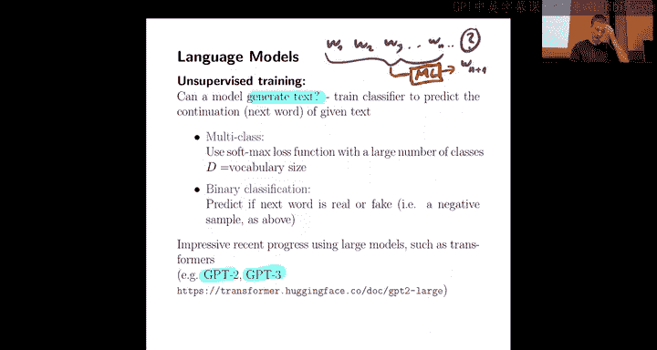

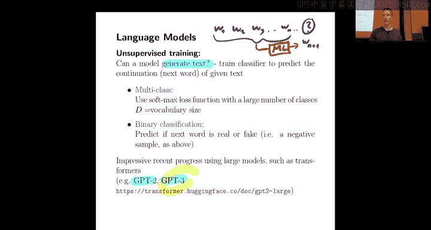

Efficient also depending where the electricity is from and。Also。A lot of parameters are required。

 so then you would use large neural networks。So for example， this one is 11 billion。

parametersrameters。Which is yeah， many gigabytes， just only to restore these weights。

 And then everything it memorizes is， is， is， of course， numerically encoded in these weights， right。

 There's no， there's nothing else， right， It doesn't。It doesn't memorize。

 it cannot memorize the whole text because the text is like everything written on the internet ever。

So but he has kind of encoded this or compressed it into this numerical merit workstation。

 which is just the weight。Of your neural network。And yeah。

 I guess the architecture of the network is not so important。So。Okay， once you have such a model。

 then you can generate text， which is cool。 And the other thing is you can also get features from it。

😊，呃。So yeah， one is tax generation。We talked about it and two is the thing we actually mentioned first。

You can also get features from that。And。Yeah， how would you do that？ Any ideas so。I mean。

 you would just give it the text。And then you would look at the， the activations in the last layer。

 Some this。 So this， this will be the， the kind of features you get。From from such a train network。

 if you want to use it as a text features， you can also do that。So。So yeah。

 it's kind of both representation learning because it's features and also generation at the same time。

😊，Yeah， very similar to。To， for example， guns where we also we have possible if we can also generate the end as well。

 use the activations as features so。Yeah， there's language models and so then other ones。Bt also so。

Is also an example of that where the only changes you predict a few words in the middle and not at the end。

 but other than that， it's completely the same idea。Okay， that was it for language models。

AnAnother thing， this is a bit older。 What you could also do is。We talked a lot about words， right。

 But then here was kind of cool that we can get a whole sentence and the whole sentence。

Then gets features。By。Yeah， using the activations after the network has seen all the words so far。

Another way you could do this to get features for a whole sentence and not a single word。Is to use。

 for example， a CNN convolutionnet。So what you would usually do is， for example you。

You feel word vectors。As the rows here， so。Here's a sentence for every word you feel the row vectorctor。

With the word vector。And then then maybe if you convolutional filter which here is a filter which goes over three words。

And and then just as。Applies this linear filter on those words。Gets a number。

 So that's what the convolution would do， right， It's the same as what a。What we had for images so。

Convolution here is， I don't know。50 times 3。And that's a filter。

 and then you can have this anywhere on your text。So here is another one。

You just slide it over the whole text。And then again， you get these numbers。

 and then maybe here you have a pooling。Because。Because the text has has variable length。

 It has some text so long。Some are short， but you would like to get a reputation station， which is。

Fixed length， no matter should feature short in low text。So， so maybe here you have to。

You just take things like max pooling or something which which you already know from images as well or you could also use average so now now we have a fixed length representationation actually just one number。

But of course， we can do this again with different filters。 Then we get another feature and so on。

 So So now， now this is was a different way too。To learn a fixed language representation so。

When even when the text was was variable linked， right？So。So this is just a neural architecture。

 this doesn't tell you how it's trained。This， it's not so interesting， I would say。 And also these。

 these were mostly trained just are supervised。 So， so here is。So it's just supervised training。

Which is a bit less interesting because we have much， much less data， which， which has this， right。

 which has labels。 So for， for example， in， in the project， if you want do these stories。

There data on Sies so some text have a actually that's kind of an interesting idea because some some text comes into a positive smiley。

 some text comes into a negative smilemiy， it's already there。

 can you use that as a training signal and's that's also an option and the data set to you if you want to use this as a project。

😊，Our texts， which had sies positive ones and negative ones。

 this you could also use as a training signal。To train a network。 and one。

Kind of natural network to trains is a convolutional net if you want。

 although nowadays nowadays people have rather moved on to more like transformer based architecture so。

Which can can be similarly。 And again， I the takeaway kind of history study it doesn't matter so much what the architecture is。

 what really matters this is what it's trained on。 So there is the interesting things you can do and also do it to improve it for your。

For your use case， for example， in the project also。Okay， and。There is not。There's not much left。

 So I want to finish with fast text， which is another。Actually， really， really nice thing。

 which can be both supervised and unsupervised。And。Why we， we put it here is because it's a。

It's kind of a nice way。To both go beyond words， so this can do sentences。

And it's also nice because it's super。Easy to train and it really uses the exact same tools as we had。

So it's actually also kind of a matrix factorization。😊，But it's going beyond just World vector to so。

It's， it's it's allowing you to embed also sentences to get features for sentences or maybe documents。

 which is important， right？ So， of course， you can just take a if you want to get features for your sentences。

The naive thing to do is just to get the word vectors and then maybe average dose that their works actually pretty well。

 right，A word is the sum of all the sorry I sentence is sum of all the word which are present in it。

That works okay。But there is something which is a bit better。And I'll been explaining here for。

For sentence classification， so this is actually going to be for supervised。呃。嗯。

Supervised sentence classification or document classification。I'm not so。

I don't distinguish between sentences or documents， it doesn't really matter。Or can be paragraphs？

Though， it's kind of interesting if you ask， of course， we， we represent a word as a point。

 So now we have a word oft。 Then we ask， can we represent a sentence as a point， So all good。

 Can we have a paragraph or an entire document as a point， But then when you ask about。

 can you represent an entire book。As one point， then then it gets a bit tricky。 So then。

It's a bit unclear if， if that's still meaningful or or can you。

 can the whole Wikipedia be one point。 I don't think that would make sense。 So the， the。

 the role of of length here is kind of nice because or kind of interesting。

 So because it's really a bit unclear what what is the granularity that we want to represent， right？

 So is， are we interested in in doing something with。Words of these entire books or so on。

But it depends on the use case， Right， So， so， but I think in real use cases often it makes sense that you。

 you ask to do something with。With like a sentence or so。

 maybe that that's even more practically relevant than。Then just words alone， so。Okay。

 so here is assume we're given a bunch of sentences and we have labels for them。

 so maybe they're labeled into。😊，Being emotion positive or emotion negative or or whatever is relevant for your business or not relevant。

 So you have manual labels。These labels are。The label is white so。

Plus minus-1 is a label I have for every sentence n then。And。Again。

 I'm trying to learn a magic relaxation。And I also have a。

I also have the text of the sentence and actually here I will use the bag of words。呃，收。B of words。

So that's Xn is my sentence representationitation。And that's just gonna be a one at the words which appear in my sentence。

And zero otherwise。Pressent words。Okay， so this this sounds a bit naive right because we said back of words this kind of。

The naive way it's not going to lead to such good representations。But let's see。

 because maybe it can be combined with。With with some， some embedding ideas， so。And again。

 here it's actually clear a white's bag of words or because it's not just one word。

 but here my sentence has three words。So there is three， theres just there's ones here。

For those who are each appear in my sentence。Okay。That's it。

 so then how can I convert this representation that I find into a really useful one of the sentence？

And that's here。 So I just multiplied with an embedding matrix of the。Of the words。

 so this is the sentence representation。So what is his set matrix， that's the question now。

So does that matrix。As a。Has a column for for every。Every word。So。And then then it， it's quite big。

 It has a。Because there are lots of words， so I just again， the vocabulary size， maybe 20。

000 or 10000。So okay， I just decided I want to learn such as Z matrix， why not？

That' that's the word embedding matrix， right， because。It's convenient for for every。For every word。

 there will be an entry here in this in this side matrix。 Yeah， and， and again， how。

How many dimensions do I want to have， how many features does each word vector to have ass K。

 So you choose it to something。Okay， that's a sad matrix。

 so now now the idea is that if you might be set with the bag of word。

 you just get the average of these three vectors so and that average is your center surfacetation。😊。

And。Yes， that's that's it， so that's how you can get from bag of words to an embedding of a sentence。

Here our sentence had three words。So now we have a sentence vector。

And now we still need a classifier on that resulting sentence features， and that is the W。

W is a 1 by K matrix。Which sounds a bit stupid， so it's actually a vector。So that。So， W。

It's really just a K vector。So it takes the sentence to its right。

 you left multiply the sentence with W， and that means you have now a number when you multiply W with the sentence representation。

So we have a number and and then with the label。What this says is just it says that yeah。

 the positive sentence should have a positive score and the other class of sentences should have a negative score。

 so F here is really standal linear a classifier loss function。And the label is already here， right。

 so it's just。It's just gonna where you could even use the identity here。

 So you just want this to be positive。 So but it's you can also think it as logistic regression。

 You just have a。A data point here， which is the whole sentence。Times a linear classifier。

 so w is a vector。Multipied with these nice matrix here。Okay。

 so now we have a sentence supervised classifier。

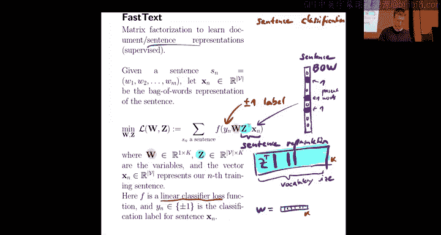

And why is this good？So what's interesting here is that。ItD。It again， is a matrix factorization。

 It looks， we are very familiar with this kind of thing， right？With there two types of parameters。

 the， the W， which is got a small number parameters and the Z， which is a big。Set of parameters。

Anyway， we learn this tour。We learn them by again， stochastic gradient descent to an update on W。

 to an update on Z。ItIt's really efficient here because。You can convince yourself that again。

 you can train this。Streaming through the text， well， streaming through the data set。

 so you have a bunch of sentences with labels。For every sentence。

Only the word of exercise are present in a sentence， only those will be active here。

 only those will be added up， so only those will contribute to the loss。

So then on only those will be in the gradient。 so only。These guys will have an update。

So the update is very cheap again。 So for every word in your sentence you get， you spend again。

 cost K to compute the inner product of the word with the classifier。And that's it So extremely。

Efficient classifier， which can be quickly updated with HD。And why it's also interesting is because。

It's still going a bit beyond linear， right， So because the。If you just learn W， then it's boring。

 then it's what we had before static data， learn classifier。

 but this is more cool because it's nonlinear because two things are learned that is learned and W is learned such that they play well together on。

😊，So that's why it's kind a two layer thing。 It's getting a non linearity。

Because W time set is not linear， and we learn both those two。To do the job。

 So it's not only finding good W， right， It's finding emdding set and W， which do work nice together。

So that' that's like it's two layers and it seems this is already a big step。

 so you don't need neural networks of depth。100 or so for some simple to task。

 Sometimes it's enough to have。Rather simple models and the simple non nonlinearities here。

Which can also be very efficient。So， so this。This is nice if you need a supervised learning for sentences can be。

 can be quite fast。 There is also a kind of an unsupervised version of this。

 but we're not gonna discuss it。呃。When you use a similar loss function as here。

 you could also use it to predict。诶。If the next world is real or fake so。

 but we're not going to do that。 So here just think of it， this is a supervised method。

But it's a non nonlinear one， which is a。Which makes it a bit more powerful than just linear。

Classifiers。And still comes at the price， which is almost as cheap as as any mess we have seen。 Yes。

 sure。So the model we get from here is Z and W， but maybe you're most interested in the set to get sentence representations。

And your question is， if that said I get here is also going to be able to represent any new sentence so that there was your question。

 And yes， actually， pretty much yeah， Sir。Because。Yeah。

 if you have a kind of large enough training set， then these embeddings here will be very reasonable for for all the words。

 they will always be meaningful。And then any sentence in the future will be consisting of the same words。

 So， so yes， and this。Well this does it kind of trains the word vectors to be added up in a meaningful way。

 or it trains the word vectors to be。Such that they can be either added up over the sentence and still have a meaning which makes sense。

 So it's a bit smarter than to just take fixed word vectors from word to work and add them up afterwards。

 But here they are trained to be added up so because they're already doing training this happens So this gives a bit better embedding stone if you just take static embedding sent。

And add them over your sentence。And I would say that's it for today and also there's a few links in the end。

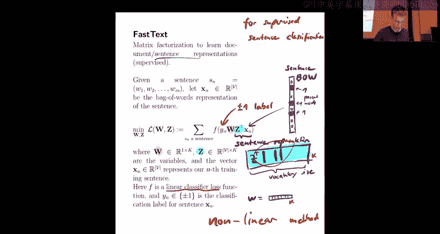

And next week we take some time off so you can work on a project and it was a pleasure having you guys。

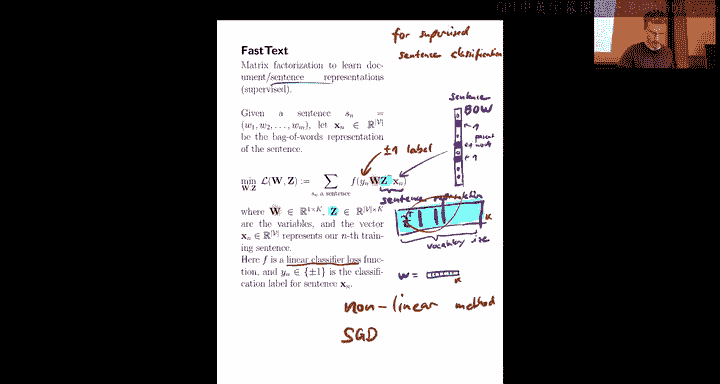

And goes here on Zoom， and on。The real room and anything。 And have a nice Christmas break。

And here saw that soon， thanks。

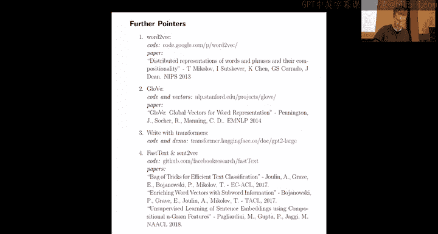