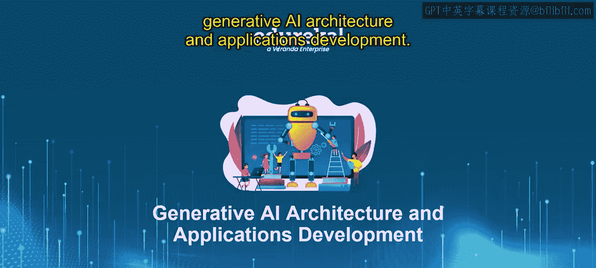
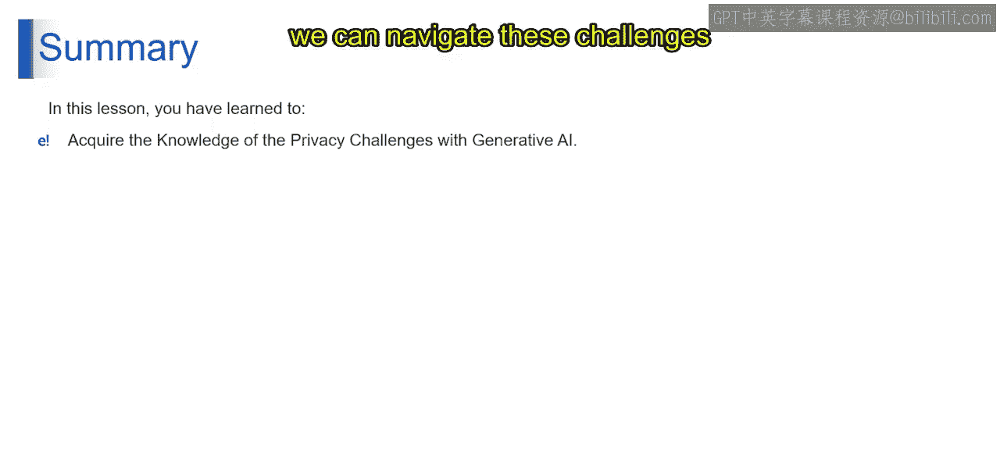

# Edureka《通过LLMs学习生成式AI（基础、应用开发、流行工具，第2、3、4课／共4课）｜Learn Generative AI with LLMs》中英 - P100：63_生成式AI的隐私挑战.zh_en - GPT中英字幕课程资源 - BV1ym421V7gx

Hello everyone， welcome to Generative AI Architectural and applications development in this video we will deep dive into privacy challenges with Geneative AI。

😊。

As generative AI propels us into an era of unprecedented data expansion。

 it's crucial to understand the complexities and risks that come along with it。

 So the first complexity or risk is data expansion in the phase of the rapid expansion of data primarily fueled by the internet of things social media and cloud computing。

 the central challenge lies in effectively scaling data management systems。

 this involves not only accommodating the sheer volume of data but also ensuring its security and accessibility as data grows exponentially organizations must invest in scalable storage solutions like cloud storage and data lakes which allow for the efficient handling of large data sets concurrently it's crucial to implement advanced data management tools for organizing。

 processing and retrieving data swiftly。 however， the scalability of these systems。

Must be balanced with robust security measures This includes employing state of the art encryption。

 stringent access controls and continuous monitoring to detect and preempt potential security breaches so the next challenge is sophisticated cyber attacks with the increasing sophistication of cyber threats such as ransomware attacks and data breaches the need for advanced threat detection and responsive mechanisms has never been more critical the evolution of cyber threats requires an equally dynamic and proactive approach to cyber security。

Leveraging artificial intelligence and machine learning technologies is crucial in this regard as they enable the analysis of data patterns and behaviors to preemptively identify potential threats。

 so this proactive detection is vital for preventing attacks before they escalate into major breaches。

 However， the challenge doesn't end with detection the ability to respond quickly and effectively to incidences paramount This necessitates the development of automated systems capable of immediate action in isolating and mitigating threats coupled with the expertise or cybersecur professionals who can make informed decisions to comprehensively address these breaches。

 So the third challenges regulatory frameworks and compliance navigating the complex terrain of regulatory frameworks and compliance especially in the wake of privacy laws like the general data protection regulation。

😊，And the California Consumer Privacy Act represents a significant challenge for organizations。

 The crux of this challenge lies in understanding and othering to a multifaceted set of regulations that vary across different regions and sectors organizations must not only be aware of these legal requirements。

 but also implement comprehensive strategies to ensure compliance。

 This involves regular audits updating privacy policies and ensuring that data handling practices aligned with the stipulated regulations Additionallyly。

 it requires educating employees about compliance standards and integrating these requirements into the organizational culture so the fifth challenges。

 data localization and sovereignty， the concept of data localization wherein governments mandate that data bestowed with the national borders at a significant layer of complexity to data manage。

Especially for global organizations， this requirement stems from concerns over data sovereignty and security。

 but poses logistical and operational challenges for multinational companies。

 it means navigating a patchwork of local laws and setting up data storage facilities in multiple countries which can be costly and operationally complex The key challenge is to balance the need for compliance with these data localization mandates against maintaining efficiency in global operations This often involves strategic decisions about where to stall and process data and investments in localized data centers or cloud services that comply with these requirements The implications of data localization extend beyond mere storage。

 they impact cross borderorder data flows and the overall architecture of an organization's I infrastructure。

Human error and data breaches amst technological advancement and stringent regulatory environments。

 human error remains a persistent and significant risk factor in data breaches。

 so the challenge here revolves around mitigating the risk posed by simple yet potentially catastrophic mistakes such as clicking on a phishing link or using weak passwords this requires a multifaceted approach。

 emphasizing the importance of regular and comprehensive training for employees such training should focus on raising awareness about common cybersecur threats instilling best practices for data handling and fostering a culture of vigilance and responsibility。

 Moreover， implementing strict policies and technological safeguards like two factor authentication and automatic logout features can reduce the likelihood of human error leading to security incidents。

 ultimately creating a security。conscious work environment where employees are both well informed in actively involved in maintaining data security is key to minimizing the risk of data breaches due to human error as we delve deeper into the age of generative AI understanding and addressing these privacy challenges is vital it's a complex maze but by staying informed and vigilant。

 we can navigate these challenges and secure our digital future Thank you for joining me in this crucial discussion We will continue this lesson in the next video。

