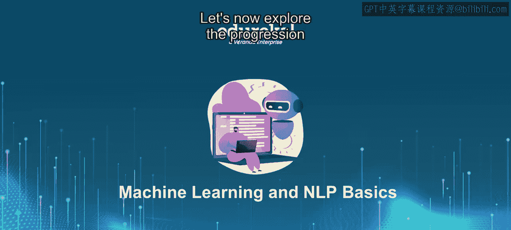
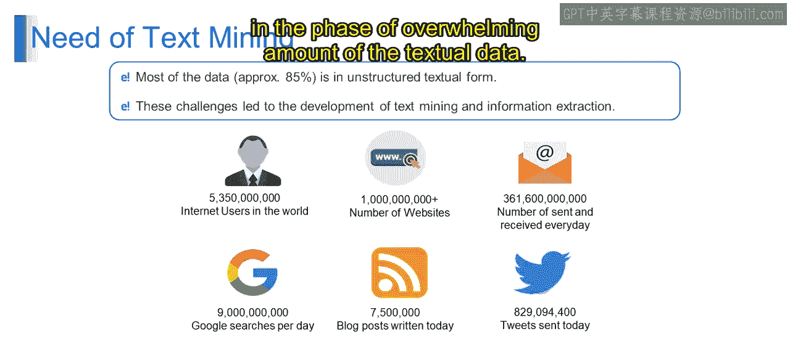
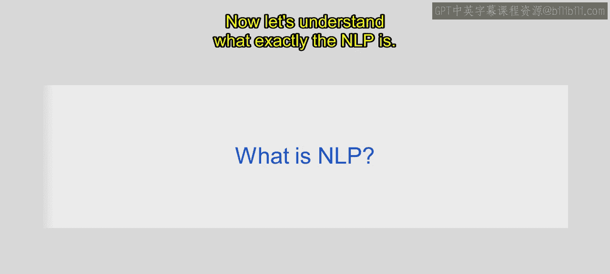
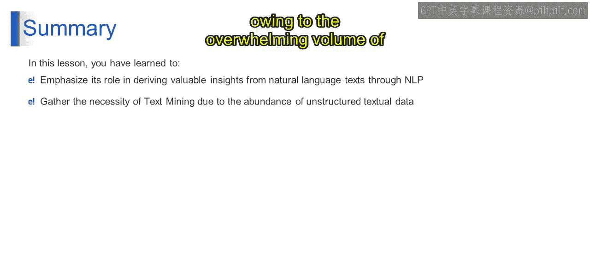

# Edureka《通过LLMs学习生成式人工智能（机器学习和NLP基础，第1课／共4课）｜Learn Generative AI with LLMs》中英字幕 - P100：99_文本挖掘的需求.zh_en - GPT中英字幕课程资源 - BV1q4421Q7qh

So let's now explore the progression from our previous discussion。

 So now let's understand need of text mining。 So here they provided most of data like approximately 8 85% is in unstructured textable form。

 So what exactly it mean。 So this statistic highlights that a vast majority of the data available today is in the form of unstructured text unstructured text includes things like emails social media posts。

 articles， blogs and many more。 This type of data does not fit neatly into words and columns like structured data。

 For example， databases。 it poses a challenge for traditional data analysis methods。

 then the next one is of these challenges led to the development of text mining and information extraction。

 So absolutely due to the。😊。

Overwhelming amount of the unstructured text data traditional methods of analysis struggle to extract meaningful insights efficiently text to mining techniques were developed to address these challenges by automating the process of extracting valuable information from the text data for example now you can see this。

The first one is of 5330 million internet users in the world， so let's understand this festival。

 so with billions of people accessing the internet and generating content daily。

 there is a massive amount of textual data being created continuously this includes everything from social media posts to online articles and even emails。

 then the next one is of 1 billion plus number of websites。😊。

The internet is flooded with websites containing vast amount of textual content。

 Each website can contain articles， blogs， forums， product descriptions and many more。

 adding to the abundance of unstructured text data。

 The next to one ease of30061 billion600 million number of sent and received everyday emails means emails are a significant source of textual data in both personal and professional context。

 Analy emails can provide valuable insights into customer feedback market trends and communication patterns。

 So now the next one ease of。😊，9 billion Google searches per day each Google search generates textual data in the form of search queries。

 search results and user interactions analyzing this data can reveal trends in the user behavior popular topics and emerging internet you may have seen this in your suggestions most popularly search things like you know in the analysis conducted last year it was determined that the most search person in the cricket was without Goly likewise it will provide the information based on the Google analysis also and then the next an ease of 757500000 blog post written today。

😊，Means blogs are a common platform for individuals and organizations to share opinions。

 expertise and information analyzing blog posts can help identify influences monitor industry trends and understand consumer preferences then the last one 8299440 tweaks sent today means Twitter generates a massive volume of short textual messages。

 nothing but tweets every day analyzing tweets can provide real time insights into public opinion sentiment trends and emerging topics on discussion so the exponential growth of unstructured textual data across various online platforms undergoes the need for text mining based on these examples we can understand that right。

😊，textual mining techniques enable the organizations to extract valuable insights， detect patterns。

 and make informed decisions in the face of overwhelming amount of the textual data。😊。

So now let's understand what exactly the NLP is。😊。

NLPE is nothing but natural language processing， so let's first understand with a practical example。

😊，So imagine you have a computer program that can understand and work with human language。

 like English or Spanish or even Hindi。 you can consider your own language thats exactly what NLP is about means NLP which stands for the natural language processing is like giving computers the ability to understand and communicate with us in our own language It's a part of artificial intelligence that focuses on teaching computers to understand。

 interpret and generate human language in a way that makes sense to us， for example。

 think about when you type a question into the search engine like Google NLP helps the search engine understand what you are asking and find relevant results means in simple terms NLP is all about teaching computers to。

😊，Understand and interact with human language， just like we do。 That is all about NLP。

Based on the understanding of the definition， natural language processing enables the analysis of text data to uncover the valuable insights from this kind of data。

 whatever we have seen here means here what exactly is happening by employing computational techniques。

 NLP extracts meaningful information from the written language this includes tasks such as either sentiment analysis named in recognition or text summarization whatever it is ultimately NLP aids in understanding and interpreting human language for various applications like machine translation and chatbos now the summary。

😊，In this lesson， we have grasped how natural language processing facilitates the extraction of meaningful insights from the text data。

 and we have recognized the imperative need for text mining owing to the overwhelming volume of unstructured textual data available。

😊。

Thank you。