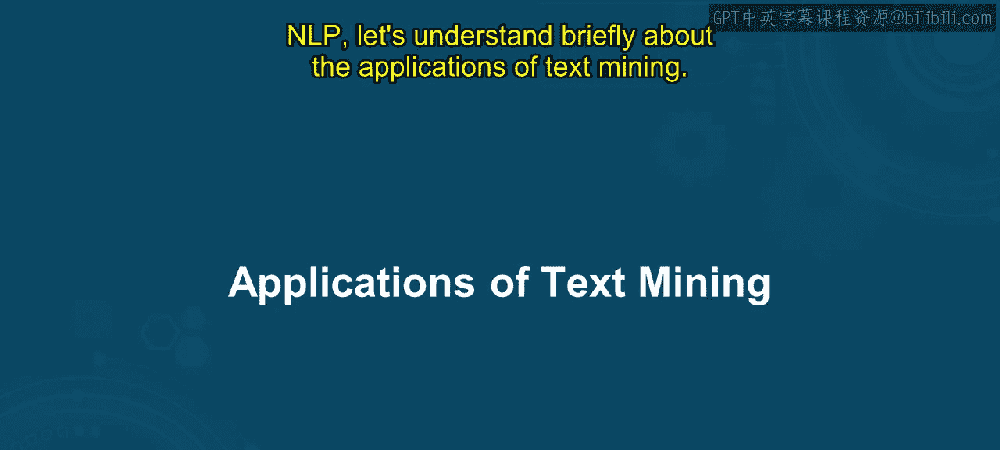
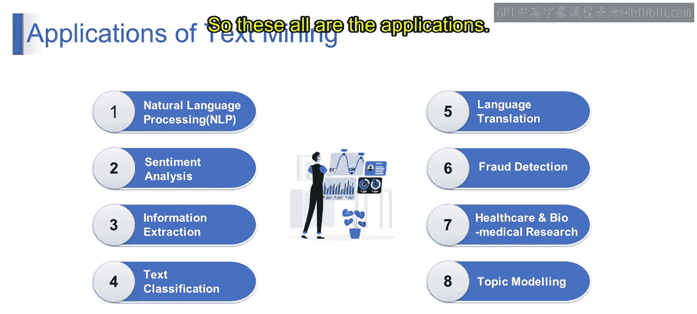
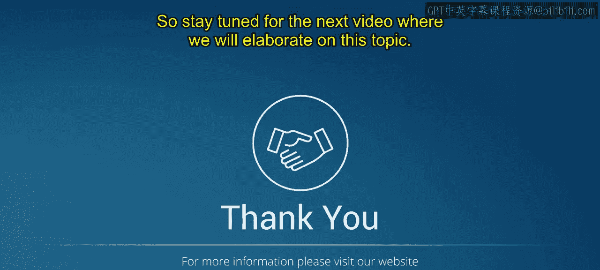

# Edureka《通过LLMs学习生成式人工智能（机器学习和NLP基础，第1课／共4课）｜Learn Generative AI with LLMs》中英字幕 - P101：100_文本挖掘的应用.zh_en - GPT中英字幕课程资源 - BV1q4421Q7qh

Hello everyone welcome back to machine learning and NLP basics so now let's understand the applications of text mining so based on the understanding of the previous module about the text mining and NLP let's understand briefly about the applications of text mining in this we are going to cover the applications of text mining and comparison of applications by the end of the session you will be able to explore the diverse applications of text mining across various fields and you are able to acquire knowledge on text mining techniques such as sentiment analysis and NLP so let's get started the applications of text mining so let's break down the applications one by one starting with is example followed by the definition the very first thing is of NLP natural language processinging so imagine you have a virtual assistant。

😊。

like Siri or Alexa that can understand and respond to your voice commands that's NLP in action where the computer understands human language means technically NLP is a field of artificial intelligence that focuses on reaching the computers to understand interpret and generate human language in a way that it makes sense to us it involves tasks like text passing part of speech tagging and named entity recognition so that's about NLP the second one is of sentiment analysis when you see a movie review saying I love the film sentiment analysis identified that as a positive sentiment Similarlyly I hated the service would be identified as negative sentiment means how exactly it is happening so。

Sentiment analysis is a text mining technique used to determine the sentiment expressed in a piece of text。

 whether it is positive， negative or neutral it involves analyzing the language and context to understand the emotion tone of the text then the next one is of information extraction If you receive an email conforming your flight booking。

 let's say for example， information extraction helps identify key details like departure time destination and flight number means information extraction is the process of automatically extracting structured information from unstructured or semistructured text source。

 It involves identifying and extracting specific pieces of information such as names， dates and。😊。

So now let's understand text classification， for example。

 email spam filters classify incoming emails as either spam or not spam based on their content helping keep your inbox organized means technically text classification is the task of categorizing text documents into predefined classes or categories。

 it involves training a model to recognize patterns in the text and assign appropriate labels or categories。

 that's about text classification。 Then language translation。

 So let's say online translation services like Google translate help translate text from one language to another enabling communication between people who speak different languages means language translation involves automated。

😊，Converting text from one language to another while preserving its meaning and context it relies on NLP techniques to understand the input text and generate accurate translations in the target language then the next one is of fraud detection for example。

 banks use text mining banks use text mining to analyze customer transactions and detect fraudulent activities By identifying suspicious patterns or anomalies means fraud detection involves using text to mining techniques to analyze textual data such as financial transactions。

 emails or customer interactions to identify fraud behavior or suspicious activities then healthcare and biomedical risk。

So。For example， text mining is used in healthcare to analyze medical records and research papers to identify patterns。

 trend and potential treatment for diseases means in health and biomedical research text mining is applied to analyze large volumes of textual data such as medical literature patient records and clinical trial reports to extract valuable insights for improving patient care and advancing medical knowledge then the next one is of topic modeling imagine you have a collection of news articles topic modeling helps identify the main themes or topics discussed across all the articles such as politics sports or entertainment means topic modeling in text mining techniques used to。

😊，iscover abstract topics or themes present in the collection of documents It identifies clusters of words that frequently cooc together gather and assign them to distinct topics means by understanding all these text mining finds。

 diverse applications across the various fields from understanding human language and sentimental extracting valuable information。

 classifying text， enabling language translation， detecting fraud。

 advancing health research and identifying topics in large document collections。😊。

So these all are the applications。😊。

So stay tuned for the next video where we will elaborate on this topic。😊。

