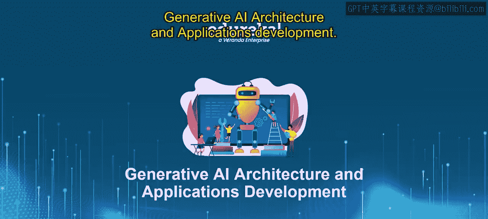
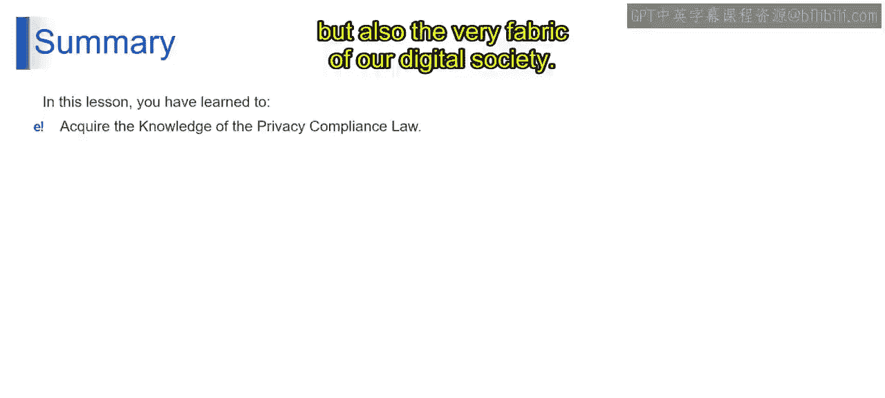

# Edureka《通过LLMs学习生成式AI（基础、应用开发、流行工具，第2、3、4课／共4课）｜Learn Generative AI with LLMs》中英 - P101：64_深入探讨隐私合规法.zh_en - GPT中英字幕课程资源 - BV1ym421V7gx

Hello， everyone。 Welcome to Generative AI Archural and applications development Today。

 we delve into a pressing issue at the intersection of advanced technology and privacy laws。

 La language models while groundbreaking faces significant challenge in the realm of data privacy。

 particularly concerning the right to be forgotten。

 Let's explore this complex landscape and understand the implications for businesses and individuals alike。

 The inability of large language models to selectively forget specific data points poses a significant risk of inadent data exposure in the process of training on extensive data sets。

 these models can absorb and integrate sensitive personal information such as name and date of birth。

 Once this data becomes part of the models， knowledge base。

 it cannot be individually removed or unlearned for businesses employing these models。😊。

Liimitation is a major privacy concern If an LLM inadently reproduces personal information。

 it could result in privacy breaches。 This risk especially pronounced in sectors like healthcare care and finance where such breaches can have serious legal and reputational consequences to mitigate this risk businesses must be vigilant in preprocessing data to remove sensitive details before training models in continuously monitoring the outputs to prevent unauthorized data disclosures Additionally。

 the current constraints of LLMs pose challenges in ahering to data protection regulations such as the GDPr's right to be forgotten。

 These laws grant individuals the authority to request the dele of their personal data from a company's records Next。

 let's explore the right to be forgotten in various jurisdictions in regions like the European Union Argentina and the Philippines。

Privacy regulations uphold an individuals' right to be forgotten。

 This right allows individuals to request the removal or erasure of their personal information from systems。

 However， without a delayed function in LLm。 businesses are at crossroads complying with these requests means potentially retraining their LLms from scratch。

 a task both time consuming and costly。 Now let's take a closer look at the European Union's general data protection regulation。

 One of the most stringent privacy laws globally。 GDPR not only grants the individuals the right to access。

 rectify and erase their data， but it allows them to object to automated decision making。

 This adds another layer of complexity for companies using LLms。 The challenge here is twofold。

 ensuring that LLms comply with these rights and navigating the intricate process of balancing advanced AI technology with stringent。

Privacy norms as we advance technologically the dialogue between AI development and privacy regulation becomes increasingly important How will businesses adapt can LLMs evolve to meet these privacy standards。

 The future of LLMs hinges on finding solutions to these pressing questions in conclusion the journey of LLMs in the landscape of privacy laws is fraught with challenges but also brimming with opportunities for innovation as tech enthusiasts It's crucial for us to stay informed and engaged in this evolving dialogue the balance between technological advancement and individual privacy rights will shape not only the future of AI but also the very fabric of our digital society。

 Thank you for joining me in this insightful exploration we will cover the other lesson in the next video。

😊。

