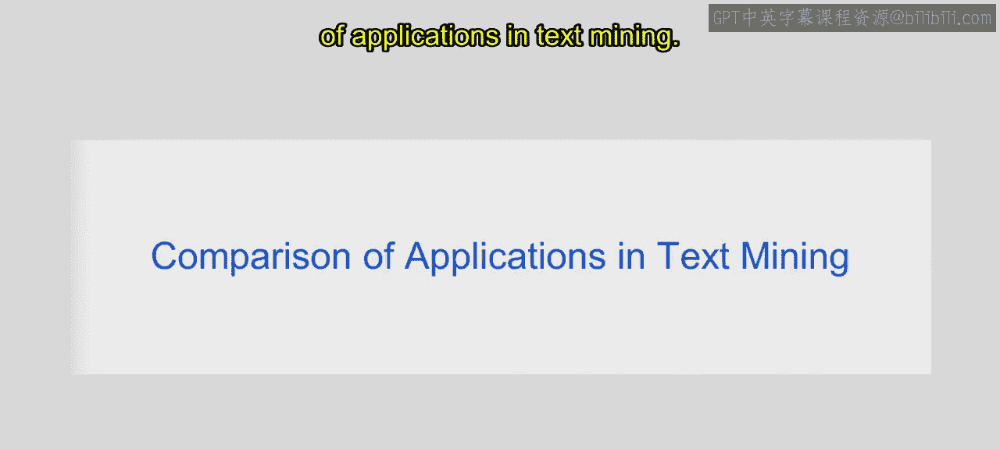
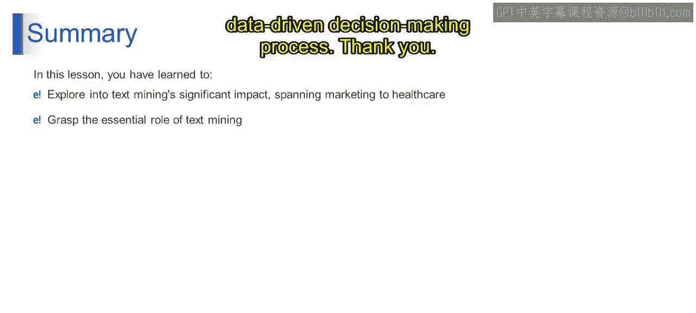

# Edureka《通过LLMs学习生成式人工智能（机器学习和NLP基础，第1课／共4课）｜Learn Generative AI with LLMs》中英字幕 - P102：101_文本挖掘应用的比较.zh_en - GPT中英字幕课程资源 - BV1q4421Q7qh

So let's now explore the progression from our previous discussion。😊。

So now let's perform the comparison of applications in text mining。

Here is we are having aspect sentiment analysis， natural language processing。

 so let's understand all this the first aspect is objective and sentiment analysis like this the objective of sentiment analysis is to determine the sentiment expressed in a piece of text whether it positive or negative or neutral in the nLP。

😊，NLP aims to understand and process human language by computers。

 enabling them to comprehend and interact with the text data， then the next aspect is main technique。

 in the sentiment analysis， the main technique used in sentiment analysis involves analyzing the emotional tone of text to determine the sentiment and NLP relies on analyzing linguistic structure。

 sentiments and the meaning of the text to understand and process human language then the use cases。

Sentiment analysis， common use cases for sentiment analysis include customer feedback。

 analysis and social media monitoring， where understanding the sentiment of text data is crucial and NLP used in various applications such as mission translation text summarization and named entity recognition。

 enabling tasks like translating text from one language to another and identifying important entities of the text data。

 then output the output of sentiment analysis typically includes sentiment polarity indicating whether the sentiment is positive。

 negative or neutral means NLP outputs processed and structured text data that can be further unized or utilized for various purposes。

Then finally， the example， an example of sentiment analysis would be analyzing the product reviews to gauge customer satisfaction where the focus is on determining the overall sentiment expressed towards a product or service a common example of NLP application is machine translation。

 where text translation from one language to another。

 demonstrating the understanding and processing of human language by computers means by understanding all these things。

 we identifying that while sentiment analysis focuses on determining sentiment in the text data。

 NLP encompasses a broader range of tasks aimed at understanding and processing human language leading to a various applications such。

😊，T machine translation， take summarization and named entity recognition。😊。

Now the summary in this lesson you have delvet into the substantial impact of text mining across diverse domains from marketing strategies to healthcare advancements showcasing its wide ranging significance additional you have gained an understanding of the pivotboal role text mining plays in extracting valuable insights from unstructured textable data highlighting its importance in data driven decision making process Thank you。

