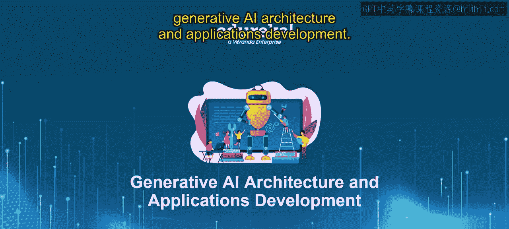
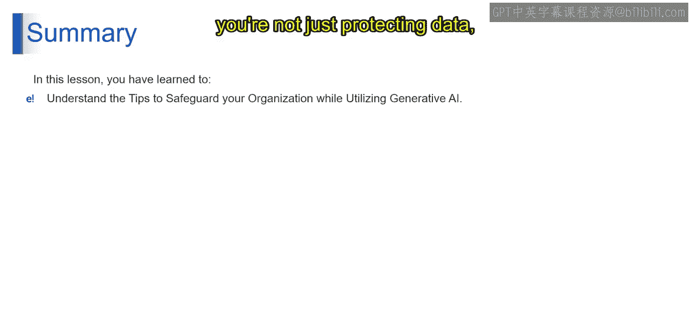

# Edureka《通过LLMs学习生成式AI（基础、应用开发、流行工具，第2、3、4课／共4课）｜Learn Generative AI with LLMs》中英 - P102：65_保护组织的技巧.zh_en - GPT中英字幕课程资源 - BV1ym421V7gx

Hello， everyone。 Welcome to generative AI Archural and applications development。 In this video。

 we embrace these powerful tools。 It's crucial to understand the best practices for safeguarding a data and systems。

 Let's dive into the key strategies to ensure your organizations safety while leveraging the incredible potential of generative AI。

 complying with guidelines and share wisely。 So the first step in protecting your organization is adhereherance to internal guidelines and policies related to generative AI usage。

 It's not just about compliance。 It's about smart disclosure。

 Sha only what's necessary and steer clear of sensitive or confidential information。

 This balance of adhereance and discretion is not just a regulatory requirement。

 It's a commitment to your organization's values and shield against data vulnerabilities。

 This approach not only。😊。

Mes regulatory requirements， but also reflects a commitment to the organization's values and serves as a safeguard against data vulnerabilities。

 In essence， it's about being informed Ca and responsible in the use of advanced technology within a professional setting。

 So the second tip is Ex the privacy policy carefully delving into the privacy policies of generator AI tools involves a comprehensive approach that encompasses several key aspects。

 Firstly， it's about assessing how these tools safeguard the data you input。

 including whether they employ strong encryption and access controls and if their security measures aligned with current standards。

 The clarity and transparency of the policy are also critical。

 it should lucidly explain what data is collected。 how it' used and its retention period Additionally。

 verifying the tools compliance with data protection。

Ls like GDPR or HIPAA is essential to ensure legal standards for data privacy and user rights are met。

This detailed examination empowers organizations and individuals to choose tools that not only meet functional needs。

 but also align with stringent data security and privacy requirements。 So moving on to the third tip。

 Keep your generative AI tool updated。 Each update acts like a reinforceenment to its walls。

 making it more robust against the siege of security， vulnerabilities and bugs。

 These threats are like clever invaders， constantly devising new ways to breach defenses by regularly updating your not just adding exciting new features。

 Think of these as advanced gadgets， enhancing your fortress capabilities。 But more importantly。

 your patching up any weak spots discovered in your defenses。

 This proactive approach is vital in the fast paced digital world where threats evolved rapidly。

 Stay updated is essentially keeping your。😊，Well armed and prepared ensuring the safety and efficiency of your data。

 That is your digital treasure。 This is why treating updates as your first line of defense is not just wise it's crucial for the longevity and security of your AI tool。

 So the next tip is log out and detect anomalous activity in shared environments always logging out after using your generative AI tool is a simple yet effective security step。

 but let's not stop there regularly monitoring the tools's activity logs for any unusual patterns is key。

 If something looks out of place， immediate action is needed。

 This vigilance is a proactive approach to security。 So moving on to the last tip。

 use strong and unique passwords。 Think of passwords as special case to your online information。

 It's really important to make these case strong and different for each log。 That means using。

Wors that are a mix of letters， numbers and symbols and not using the same one everywhere。

 Imagine your passwords a secret codes that only you know。

 changing them often is like changing the locks on your doors regularly。

 so it's harder for someone to break it。 This might sound like a simple thing。 but having strong。

 unique passwords for each account is like building a big wall that keeps your online stuff safe from as and anyone who shouldn't get it。

 It's one of the best things you can do to protect your information online。 In summary。

 navigating the world of generative AI with safety and security is about combining smart practices with vigilance。

 But following these tips you're not just protecting data。

 you're upholding the integrity and trust of your organization。

 Thank you for joining me in this video。 And let's commit it to a secure and innovative future。

 We will cover other topics in the next videos。

