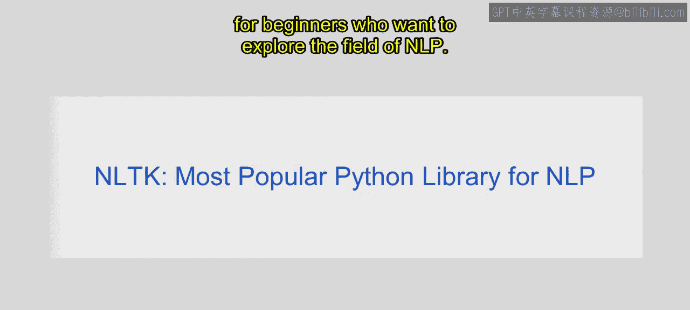
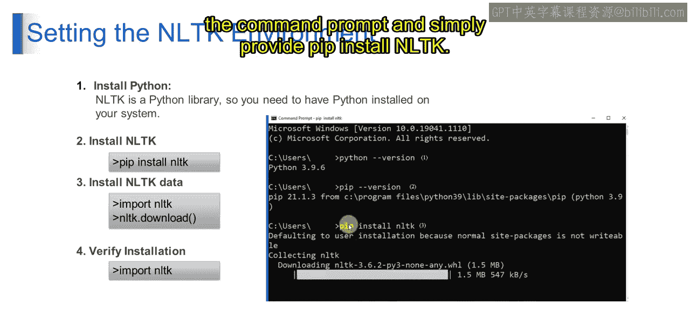

# Edureka《通过LLMs学习生成式人工智能（机器学习和NLP基础，第1课／共4课）｜Learn Generative AI with LLMs》中英字幕 - P103：102_设置NLTK.zh_en - GPT中英字幕课程资源 - BV1q4421Q7qh

Hello， everyone， welcome back to machine learninging and NLP basicsics。😊。

So now let's understand setting up NLTK in this we are going to cover setting the NLTK environment and downloading the packages。

By the end of the session， you will be able to set up the NLTK environment and able to download the packages using the NLTK downloader。

So let's get started NLTK the most Python library for NLP so first of all before understanding all this what is NLTK so NLTK stands for natural language toolkit it is powerful Python library specifically designed for working with human language data which is often referred to as natural language processing that is nothing but NLP so NLTK provides easy to use interfaces and tools for tasks such as tokenization STEMming parts of speech tagging passing and much more it is widely used by researchers students and professionals in various fields such as linguistic data science。

 machine learning and artificial intelligence so that is all about the NLTK but why it is required so NLTK is required because。

😊，Working with the human language data is inherently complex， unlike structured data， For example。

 the numerical data in tables， so natural language text is unstructured and often ambiguous。

 so NLTK provides a comprehensive set of tools and resources to process。

 analyze and understand the natural language text， It simplifies tasks like text preprocessing。

 feature extraction and modeling， making it easier for developers and researchers to build NLP applications and perform experiments。

Additionally， NLTK serves as。😊，Educational resource for learning about NLP concepts and techniques。

 it offers extensive documentation tutorials and examples example data sets making it an。😊。

Ideal starting points for beginners who want to explore the field of NLP。

As mentioned， NK NLTK is widely used Python Library for natural language processing。

 offering a range of tools and resources to work with human language data effectively and efficiently efficiently it simplifies complex NLP task and serves as a valuable educational resource for both beginners and experienced practitioners so now let's understand setting the NLTK environment so the very first step is to install the Python in order to set up the NLTK environment you need to install Python first so NLTK is a Python library so you need to have Python installed on your system first since you already have anconda installed that we discussed in the last list Python should already be included in your Anaconda distribution if not you can download and install。

😊，separately from official website here I have provided the website link Fun if it is done so then we will have to install NlTK so NlTK is not included in the standard Python installation so you need to install it separately you can do this using the Pip the Python package manager by running the following command like Pip install NlTK if you are using the Ananaconda or if Anaconda is already there in your machine you can simply say this Conda install NlTK you can use anything either Pip install NlTK or Conda install NlTK so NlTK comes with variety of datasets and resources so let's do this first of all I am using the Ananaconda Pro because I' am already having annaconda install on my mission in case if you are not having it。

😊，You can open your logo by using the command prompt and simply provide Pip install N LTK。

So stay tuned for the next video where we will elaborate on this topic。😊。

