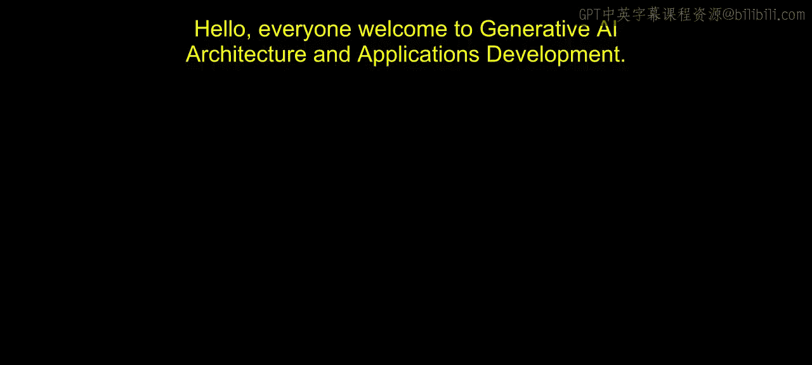
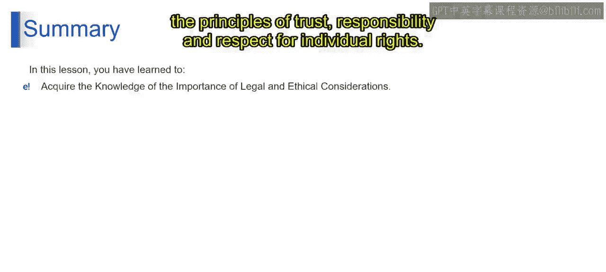

# Edureka《通过LLMs学习生成式AI（基础、应用开发、流行工具，第2、3、4课／共4课）｜Learn Generative AI with LLMs》中英 - P103：66_伦理和法律考虑的重要性.zh_en - GPT中英字幕课程资源 - BV1ym421V7gx

Hello， everyone。 Welcome to Generative AI Archectural and applications development。

 As we step into an era where AI is not just a tool but a collaborator。

 it's imperative to address the legal and ethical considerations that comes with it。

 In this video we delve into the intricacies of personal data handling and compliance with the evergrow web of regulations like GDPR CPR and the E U AI Act。

 Let's understand the surge of generative AI and its implications。

 Generative AI is revolutionizing the way we interact with technology。

 creating a world where machines can think， learn and create this unprecedented advancement。

 However brings forth a spectrum of ethical and legal challenges。 It's not just about what AI can do。

 It's about ensuring that it does so responsibly and within the confines of law。

 Let's start with the GDPR in detail。😊。

The general data protection regulation represents a significant evolution in data privacy law。

 setting a new global standard for the treatment of personal information for entities u generative AI adhereance to GDPR is not just advisable。

 It's a legal requirement。 This regulation pis around several key principles。

 each designed to safeguard individual privacy。 Firstly。

 it mandates that personal data be processed lawfully， transparently and fairly。

 ensuring that any data handling is justifiable and clear to those it concerns。

 The GDPR also places a strong emphasis on the integrity and confidentiality of data。

 necessitating robust protection against unauthorized access， loss or damage。

 Perhaps most critically， it introduces the principle of accountability。 requiring data controllers。

To demonstrate their compliance with all these aspects proactively for generative AI applications。

 this translates into a need for transparent data processing methods。

 ensuring individuals right to access， correct or delete their data are upheld。

 crossing over to the United States。 The California Privacy Rights Act。 a Coim sentiments。

 It's a step forward and giving customers more control over their personal information for businesses leveraging generative AI。

 This translates into a heightened responsibility to safeguard user data and respect their privacy choices。

 CPRA compliance。 is not just about avoiding penalties。

 It's about building trust and maintaining E standards and data handling。

 complying with CPR is not just about avoiding legalg repercussions。

 It's about fostering a culture of trust and respect between businesses and consumers。

By othering to CPRA， companies demonstrate their commitment to ethical data practices。

 which can significantly enhance their reputation and consumer trust。

In the age of data drivenn technologies such as generative AI。

 this commitment to ethical data handling and consumer privacy becomes a cornerstone of sustainable and responsible business practice。

 The EUu artificial intelligence Act represents a groundbreaking stride in AI regulation directly addressing the complexities and challenges posed by AI technologies。

 This act stands out for its nuanced approach to AI governance recognizing that not all AI systems pose the same level of risk。

 It categorizes AI applications into different risk levels and establishes corresponding regulatory requirements emphasing a balance between fostering innovation and ensuring safety and ethical standards so the key aspects of the EU AI Act include riskbased categorization AI systems are classified into four risk categories that is unacceptable risk high risk limited risk。

And minimal risk， each category has specific regulatory requirements with the strictest controls placed on high risk and unacceptable risk categories。

 Second， prohibitions for unacceptable risk， AI practices considered to pose and unacceptable risk are prohibited。

 So these include AI systems that manipulate human behavior to circumvent users free will example。

 subliminal techniques and social scoring systems by governments。 Third。

 strict requirements for high risk AI。 So high risk AI systems such as those used in critical infrastructures。

 employment， essential private and public services， law enforcement。

 migration and asylum are subject to strict compliance requirements。

 These requirements include ensuring data quality， transparency， human oversight， robustness。

 accuracy and security 4。ency obligations for certain AI systems AI systems that interact with humans like chatbots or those used to generate or manipulate image。

 audio or video content must be designed in a way that makes it clear that users are interacting with an AI for those developing or deploying generative AI comp with the EUu AI Act is crucial This means ensuring that AI systems。

 especially those classified as high risk are designed and operated in a way that respects fundamental rights。

 safety and ethical standards The Act emphasizes that AI innovation cannot be pursued in isolation from its societal impact by othering to these regulations developers and users of AI are not only complying with legal requirements but also contributing to the responsible development and deployment of AI technologies So in summary。

 as we embrace the remarkable capabilities of generative AI。

Let's also commit to the ethical and legal frameworks that guide its use by doing so not just complying with laws we are upholding the principles of trust。

 responsibility and respect for individual rights Thank you for joining me in this video through the legal and ethical dimensions of generative AI we will continue this lesson in the next videos。

