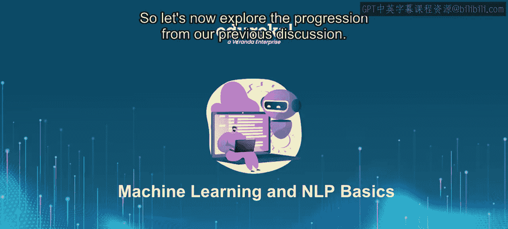
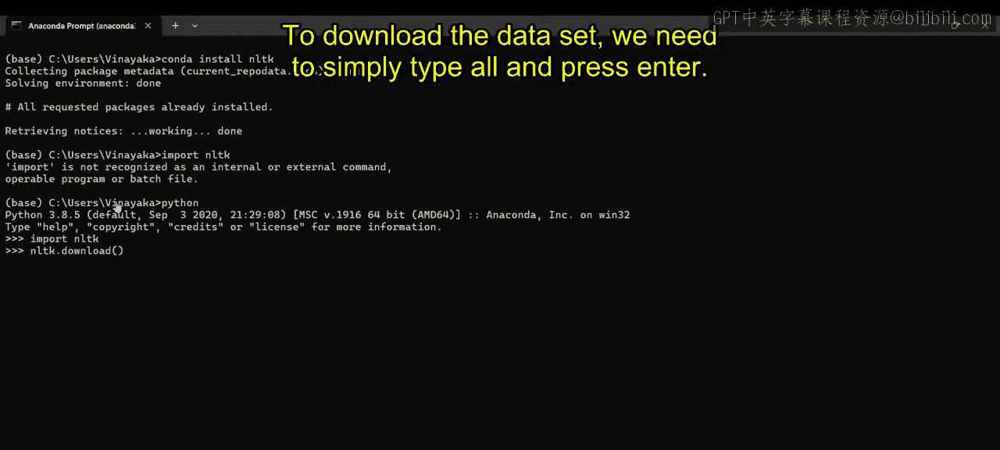
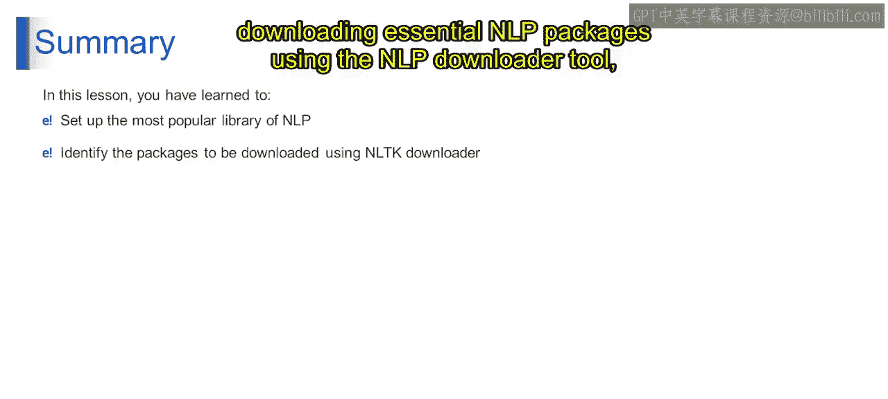

# Edureka《通过LLMs学习生成式人工智能（机器学习和NLP基础，第1课／共4课）｜Learn Generative AI with LLMs》中英字幕 - P104：103_设置NLTK演示.zh_en - GPT中英字幕课程资源 - BV1q4421Q7qh

So let's now explore the progression from our previous discussion。 So this is my Ananaconda prompt。

 I'm just giving Conda install Nltk as because I'm already having annaconda install on my mission I am simply performing Conda install Nltk。

 let's click on enterom。 if in case if you are doing it for the first time it may take some time to get it done。

 but if it is already there， it may execute little bit faster。 So now the installation is done。

 now I want to check whether if it is working fine or not。 So after installing Nltk。

 you can download the necessary data set using the Nltk downloader in the Ananaconda prompt we need to type Python Why to type Python to start the Python interpreter。

 If I am going and telling import Nltk， it will not work rather it will through an error。😊。

So in order to initiate the Python interpreter you need to start typing Python Now if I am telling that import nltk。

 it will allow me to write the code it will take some time and can give you now it is there now I am performing Nltk dot download and open and close parenthesesis。

 let's click on enter this will open Nltk downloader interface within the Python interpreter from there you can choose which dataset to download and use it to download the dataset we need to simply type all and press enter Now you can see the output as mentioned it open the NltK downloader interface within the Python interpreter from here you can choose which dataset you want to download and to download all the data you can simply type all that。

See， for example， if I'm choosing this。And you can simply click on download。

Otherwise you can simply click on all and if you click on the download it will start executing it right now I' am not going to do this because I'm already having it in my local。

 so if you can see NLTKs offering variety of packages covering different languages corporatepora models and resources for tasks such as stchkenization parts of speech tagging and named entity recognition and sentiment analysis for the beginners。

 if you are doing it for the first time it's often recommended to download all select all and click on the download for all the popularular packages which include commonly used data and resources for NLP tasks however you can also select specific package as I mentioned just click on it and also click on the download。

Based on your requirements and the task you intended to perform once you have selected the package you want to download。

 simply click on the download as I mentioned and then press enter NlTK will then proceed to download the selected packages from the NLTK servers the download progress will be displayed in the NLTK download interface So okay for。

For example， I will show you one here Can you all see this here means the download progress will be displayed in the NLTK downloader interface showing the status of each package being downloaded after the download is complete NlTK will confirm the successful download of the packages you can then exit the NLTK downloader and proceed with your NLKLTK task using the downloaded data and resources means here downloading a packages in NLTK straightforward process facilitated by NlTK downloader allowing using it to obtain the necessary datas and resources for various NLP task so this is what we have already seen and now the summary。

In this lesson you have successfully configured NLTK the foremost NLP library on your system through anconda prompt and you have gained provisions in selecting and downloading essential NLP packages using the NLP downloader tool。

 paving the Wafer effective NLP tasks。😊。

Thank you。

