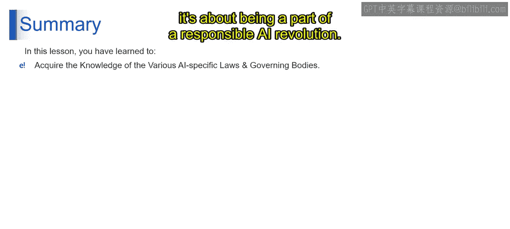
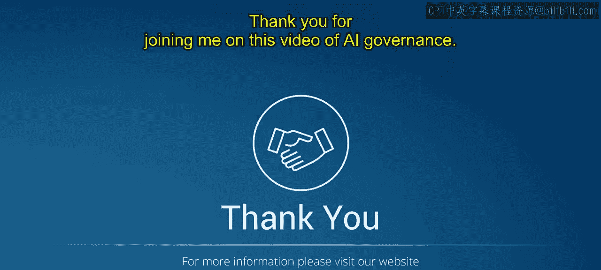

# Edureka《通过LLMs学习生成式AI（基础、应用开发、流行工具，第2、3、4课／共4课）｜Learn Generative AI with LLMs》中英 - P104：67_AI特定法律和监管机构.zh_en - GPT中英字幕课程资源 - BV1ym421V7gx

Hello everyone， welcome to Generative AI Architectural and applications development。😊。

As AI continues to integrate into every facet of our lives。

 understanding these laws is not just a necessity for compliance。

 but a step towards responsible innovation。 Let's dive into the complex tapestry of AI regulations and what they mean for the future of AI development。

 Shanghai AI regulation。 Shanghai's AI regulation marks a progressive step in China's AI governance。

 This regulation underscore the need for ethical AI development。

 focusing on principles like transparency， fairness and accountability by prioritizing these values。

 Shanghai is not just leveraging AI for technological advancement。

 but is also ensuring that this advancement is aligned with ethical standards for businesses。

 this means integrating these principles into every stage of AI development and deployment。

 It involves transparently communicating how AI systems operate。

Ensuring that AI driven decisions are fair and unbiased and being accountable for the outcomes of these systems。

Shhanhai's approach encourages a balanced growth of AI。

 one that harnesses its potential while safeguarding against ethical pitfalls。 Second。

 Canada Bills C 27， Bill C 27 in Canada represents a significant stride in shaping a responsible AI ecosystem。

 This legislation focusing on digital charter implementation puts a strong emphasis on user consent。

 transparency and control over personal data。 It acknowledges the intricate relationship between AI and personal data。

 advocating for a framework where this relationship is handled responsibly for entities using AI within Canada。

 This means ensuring that AI systems are developed and used in a manner that respects user privacy and autonomy。

 It requires clear consent protocols for data usage。

 transparency in how AI systems utilize data and giving users。

Control over their personal information Bill C 27 thus not only guides AI use。

 but also aims to build a trustbased relationship between AI systems and the public。

 So the third law is European Union AI regulation。 The European Union's AI regulation is a comprehensive legislative framework aimed at governing AI across the Eu。

 This regulation categorizes AI systems based on risk imposing stringent requirements。

 particularly for highris AI application。 It's a forward thinking regulation that seeks to minimize the risks associated with AI technologies。

 while promoting this safe and trustworthy use。 So AI developers and users in the Eu。

 This means a thorough evolution of AI systems against these regulation。

 Highris AI systems such as those used in healthcare transportation or law enforcement must adhere to rigorous compliance。

This includes ensuring the accuracy， transparency and robustness of AI systems and implementing measures to protect user rights and prevent harm。

 This regulation positions the E as a leader in advocating for ethical AI setting a benchmark for AI governance globally so coming to the fourth governing bodies UK data protection and digital information so the UK's data protection and digital information bill is tailored to meet the challenges of data protection in the digital age with a particular focus on AI this legislation stresses the importance of securing data upholding individual' rights over their data and the responsible deployment of AI technologies so for UK based businesses this translates into a need for stringent data security measure ensuring that personal data is handled with the utmost care and respect it also means that AI systems must be developed and use。

In a way that respects individual data rights and privacy， the Bill encourages innovation in AI。

 but under a framework that is secure， respectful of privacy and compliant with data protection standards。

5 regulatory body is Brazil draft AI regulatory framework。

 This is a fineoneering effort in South America to establish ethical guidelines for AI development。

 this framework emphasizes transparency， accountability and respect for human rights in AI applications and it reflects a growing recognition of the need for ethical guidelines to steer AI development in the right direction。

 for companies and AI practitioners in Brazil， aligning with this framework means embedding these ethical principles into their AI projects。

 It involves being transparent about how AI systems work ensuring that these systems are accountable for their actions and decisions and respecting human rights in all AI。

Applications this framework aims to create an AI ecosystem that is not only advanced but also ethically grounded coming to the sixth AI specific law。

 New York local law number 144 New York City's local law number 144 is a groundbreaking regulation at the municipal level addressing AI's role in hiring processes。

This law mandates that AI systems used for hiring be audited for bias。

 reflecting a commitment to eliminating discrimination in AI driven decisions for businesses in New York using AI for hiring。

 This means implementing rigorous checks to ensure the AI systems are free from biases。

 the law aims to foster fair and equitable hiring practices by ensuring that AI tools used in these processes are unbiased and fair。

 it's a significant move towards making AI a tool for inclusive opportunities。

 setting an example for other cities and regions to follow in AI regulation。

So each of these regulations highlights a growing global awareness of the need for ethical and legal frameworks governing AI。

 they represent a collective effort to ensure that as AI technologies advance。

 they do so in a manner that is responsible， ethical and responsible of individual rights and societal values。

 As we are seen AIspec laws and regulations vary greatly across the globe。

 but they share common goal to ensure AI develops in a way that is ethical。

 transparent and beneficial to society， staying informed about these laws is not just about compliance。

 it's about being a part of responsible AI revolution。😊。

Thank you for joining me on this video of AI governancenance。

 we will continue this lesson in the next video。

