# Edureka《通过LLMs学习生成式人工智能（机器学习和NLP基础，第1课／共4课）｜Learn Generative AI with LLMs》中英字幕 - P105：104_访问NLTK语料库.zh_en - GPT中英字幕课程资源 - BV1q4421Q7qh

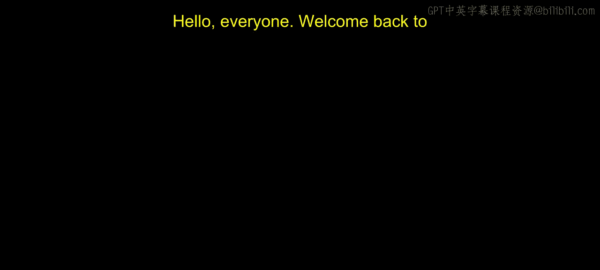

Hello， everyone。 welcome back to machine learning and NLP basics。😊。

Now let us understand how to access NLTK corpora in this。

 we are going to cover how to access the NLTK corpora。

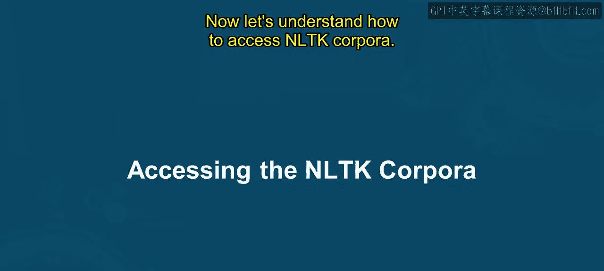

By the end of the session， you will be able to execute the code to access NLTK corpora。

 So first let's understand accessing the NlTK corpo。 first of all。

 before getting into the accessing N all what exactly the NLTK corpora is all about and why do we need it。

 let's understand So NlTK corra or corpora in general refers to large collection of text that are gathered and organized for linguistic research analysis and training of natural language processing models So if we addressed that NlTK orpora is a collection of text right which is organized for research analysis and all So why do we actually need the NLTK corpora the first thing is of training and testing NLP models So NlTK corpora serves as a valuable resource for training and。

ing NLP models and algorithms， these corporatepora contain divistic samples andnotated data and linguistic resources that are essential for building and evaluating the NLP systems such as part of speech tagers and named N organizers and sentiment analyzers many more then the next one is of research and experimentation so as we know researchers and practitioners in the field of NLP often use NLTK corpora for conducting experiments and evaluating the new algorithms and also exploring linguistic phenomena by accessing corporatepora with unnotated data and linguistic annotations researchers can investigate various aspects of language processinging and development innovative NLP solutions and then education and learning when coming to the education and learning NLTK。

Corpora are valuable educational resources for students and learners interested in NLP and computational linguistic they provide real examples of text data allowing learners to practice and apply NLP techniques such as tokenization stemming and syntactic passing is a hands on manner and then benchmarking and comparison NLTK Corpora are used as benchmarks for evaluation the performance of NLP systems and algorithms by using the standardized corporatepora and evaluation metric researchers and developers can compare the effectiveness and different approaches and measure progress in the field of NLP then language resource sharing so NLTK corporatepora facilitates the sharing and distribution of。

😊，Language resources within the NLP community by providing the access annotated texttum。

 lexiconons and language models， NLTK corpora enable collaboration and knowledge sharing among the researchers developers and practitioners worldwide based on the understanding of all these NLTK corpora are essential resources for training testing and learning about natural language processing they provide access to diverse texttum and linguistic resources enabling the development of robust NLP models advancements of research in computational linguistic and education in the field of NLP so now let's understand how to access this NLTK corpo。

So to access the NLTK corporatepo， after you have downloaded them you can use NlTK dot corpus module。

 so let's see how to do that The first thing is of Wordnet Wordnet is exical database of English It can be accessed by using this so let's see it with practical example here I am having the code ready with me。

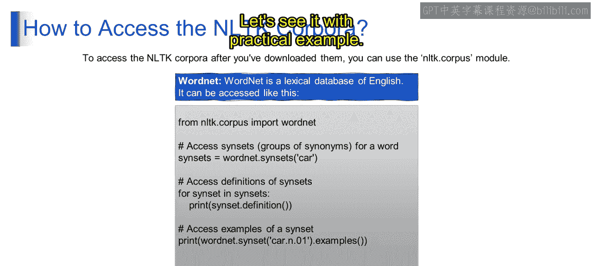

So， this code segment demonstrates。So now let's explore how to access the movie reviews。

So now lets understand how to work with Wordnet access。

 so this code segment demonstrates how to access Wordnet。😔。

So Wordnet in NLTK is electricalical database that organizes words into synonyms synonym sets and provides relationship between them addingiding in natural language processing task first of all。

 import NlTK it imports the NLTK library then this line will import wordnet module from NlTK corpus that we are doing NlTK or download of Wordnet this will download the wordnet data if it is not already available in your system and then sinceets is equal to wordnet dot synets of car so what exactly we are doing here we are trying to retrieve synets nothing but sets of synonymous words associated with the car from the wordnet and then we are iterating over each sense。

😊，Retrievd and prints its definition using the S dot definition。

 and then finally we are printing the S dot car dot n dot 01 dot examples。

 What does it mean it prints the examples associated with specific sensor of the word car。

 So let's see how we are going to get it let's execute this code first of all。

 it is downloading the package word net and now you can see the output a motor vehicle with four wheels that is related to a car right and usually propelled by an internal commercial engine a wheel vehicle adapted to the rails of railroad。

 And you can see here this entire data is all about the car。

 Let's say for example we are changing it to moon。😊，And now let's see what we are going to get。

 now you can see it is telling the natural satellite of the earth any object resembling a moon。

 the period between the successivenes， so something like you know as I mentioned as we mentioned the moon word it started showing the relevant information nothing but sets of synonymous words now we can change one more thing we can say apple and now you can see it is telling he needs a car oh see how it is taking it actually。

 so first of all it is telling root with red or yellow or green skin and sweet tooth start crisp whish flesh and native treat widely cultivator means it started explaining about the fruit first of all then it started printing about the car because we provided the print statement about the car so that's the reason。

😊，In this particular list， it is printing about the car。 Otherwise。

 if I am telling that Apple dot n dot01 dot example， it can even consider about only Apple。

 So that is how the wordnet works。 So now let's understand the next one brown corpus。

 the brown corpus is a comprehensive text corpus developed by brown university and is widely used for linguistic research and natural language processing tasks。

 So let's now understand how it is going to work So first of all。

 we need to download this from the NltK dot download once if it is done you will be able to see the output as true and then from NltK dot corpus import brown it will import the brown corpus from the module it will import the brown corpus module from the NlTK corpus and then we are providing。

😊，Aategories is equal to brown dot categories。 It will retrieves a list of categories。

 nothing but whatever the information available in the brown corpus and then words is equal to brown dot words categories is equal to news but exactly its meaning it retrieves words from a special category that is news in this case we have provided category as news of the brown corpus and then we are printing the words colon 50 means print the first 50 words from the news category of brown corpus。

 So let's execute this and we see what we are going to get So now you can see the output Conre grand jury is said Friday an investigation of Atlanta's recent means you can see the similarities like as because we are asking about this particular thing。

 it is providing the information about the news。😊，Let's see。😊，Were asking about the weather。

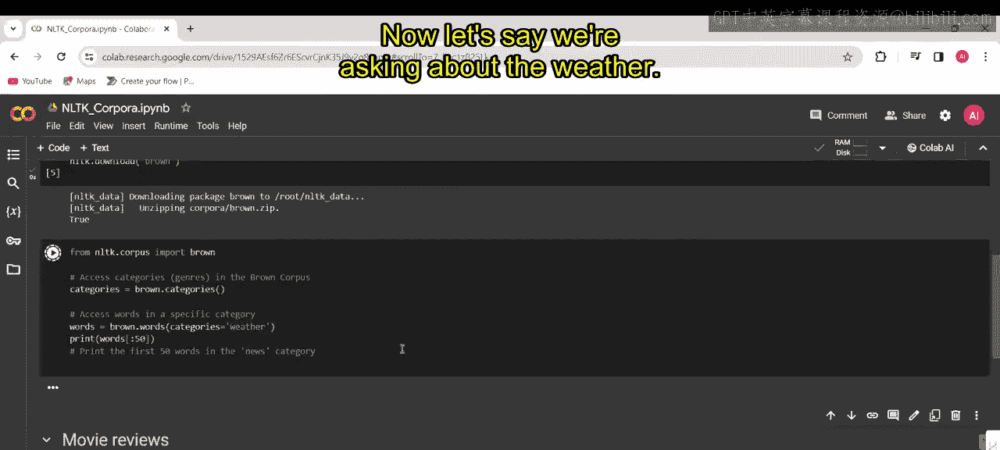

Okay， so let's try with the other thing。

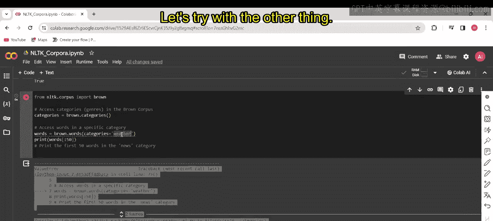

Let's strive with science and let's execute it or else fiction if it is present inside then only it will work。

😊。

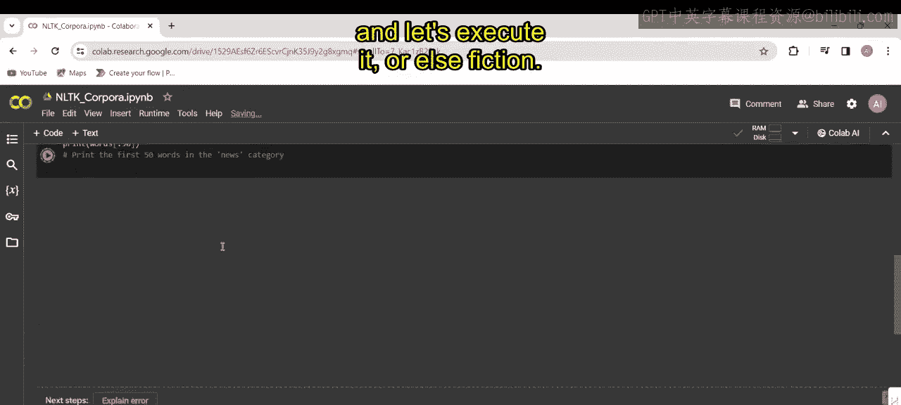

Now you can see we are having the output for category fiction。😊。

33 Scte did not go back to school and also his parents talked seriously and lengthy something it is providing。

 General， the brown corpus generally contains text samples from a diverse range of genres including news articles。

 editors， essays， fictions， reviews and academic articles， Con and more。

 The brown corpus does not typically contain specialized categories such as whether reports。

 sports data or scientific literature as its focus is on general language using across various genres。

 so that is all about the brown corpus。 So now let's understand about the movie reviews。 Similarlyly。

 however， we downloaded brown corpus and also wordnare。

 we will have to download the movie reviews first of all。 so let's execute this and now。

 so this line imports the movie review corpus more。

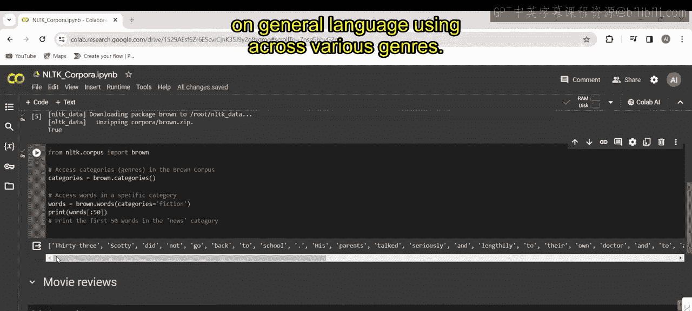

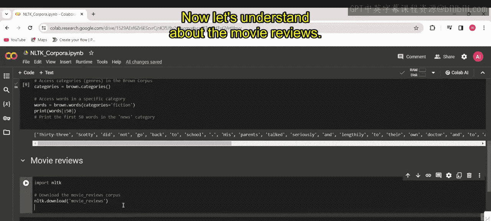

From NLTKs corpus collection allowing us to access the movie review data and then once we import this we are providing categories is equal to movie reviews categories This line receives a list of categories or sentiments available in the movie reviews corpus In this case the sentiments are positive and negative so this line retrieves a list of fields nothing but identifiers for individual movie reviews categorized as positive and the next line this one this line retrieves a list of fields of movie reviews categorized as negative then accessing the words。

😊，This line retrieves the words from a specific movie review categorized as positive using the field of the first review in the positive category。

 then in a similar way the next line retrieves the words from a specific movie review categorized as negative using the field of the first review in the negative category means this code snippet demonstrates how to access and explore the movie reviews corpus using the NLTK in Python enabling researchers and NLP practitioners to analyze sentiment expressed in movie reviews for various applications such as sentiment analysis and opinion mining so let's execute this Now let's see the output first of all words positive as I said it contains only positive words if we can execute it we are not going to have any negative。

😊。

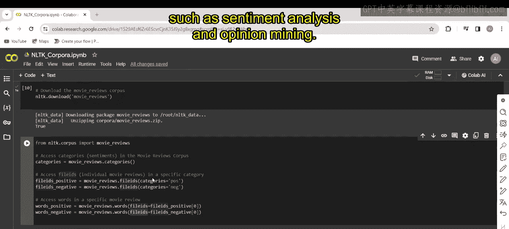

K of statements and then if we can execute word underscore negative we are getting plot so means here if we can execute this words underscore positive。

 we are getting some words and from words underscore negative we are getting some other words underscore positive contains the words from the positive movie review and words underscore negative contains the words from a negative movie review the words are tokenized and sorted as listed allowing you to analyze and process them further for tasks like sentiment analysis or text classification and many more so this is all about the movie reviews so here we can see the same code that is wordnet and brown corpus and movie review corpus so now the summary。

😊。

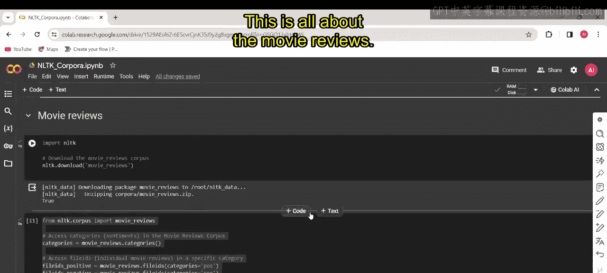

In this lesson you have gained proficiency in categorizing and accessing diverse NLTK corpora such as the Brown corpus and Mo Review corpus。

 such as wordnet access brown corpus and movie reviews。

 enabling you to leverage a wide range of text data for various natural language processing tasks。😊。

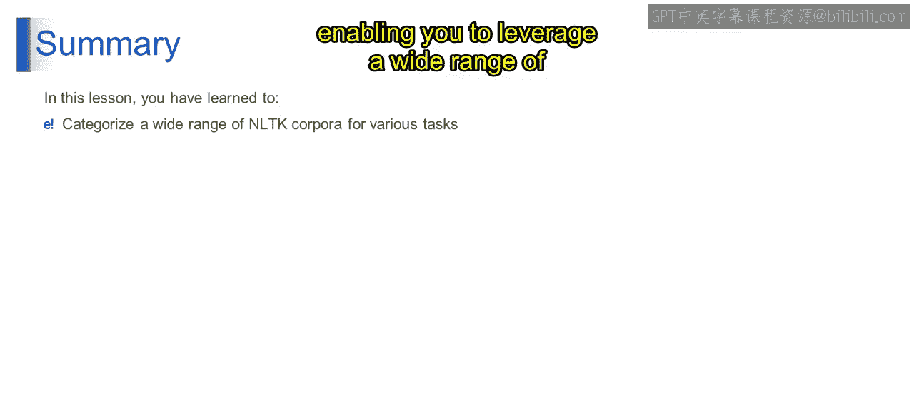

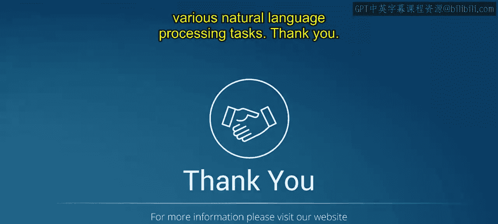

Thank you。