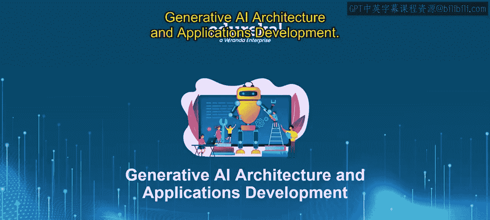
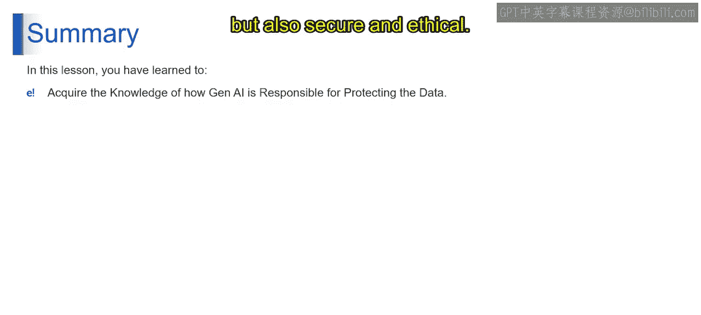

# Edureka《通过LLMs学习生成式AI（基础、应用开发、流行工具，第2、3、4课／共4课）｜Learn Generative AI with LLMs》中英 - P105：68_生成式AI保护数据的责任.zh_en - GPT中英字幕课程资源 - BV1ym421V7gx

Hello everyone， welcomee to Generative AI Architectural and applications development joinin me as we delve into how being alert informed and vigilant can enable us to reap the benefits of Gen AI while uploading a safe and ethical data environment。

😊。

Let's start with the power and responsibility of Gen AI generative AI。

 a transformative force in modern organizational landscapes。

 holds a dual mantle that goes beyond mere efficiency enhancement。

 as these AI systems become increasingly integrated into various workflows。

 they not only revolutionize productivity and foster creativity。

 but also assume a critical role in data security and privacy protection。

 The power of generative AI lies in its advanced capabilities to analyze。

 predict and automate complex tasks， thereby streamlining operations and unlocking new creative potentials。

 However， with this power comes the substantial responsibility of safeguarding the data it process。

 as these tools interact with worst and diverse data sets。

 they are interested with sensitive and personal information。

 making their role in data protection paramount the effective。😊。

Uses of generative AI therefore necessitates a profound understanding of its implications for data privacy and security。

 Organs must ensure that while leveraging the benefits of generative AI for increased efficiency and innovation。

 they do not overlook the importance of implementing robust data governance frameworks。

 This involves adhereherance to regulatory standards。

 ensuring transparency in AI processes and embedding strong data protection measures。

Acknowledging and addressing these dual aspects of generator AI as both the facilitator of business advancement and a guardian of data integrity is crucial。

 Next， ensuring data privacy and protection with Gen AI。

 So how do we ensure that Gen AI aids in data protection。

 It starts with the thorough knowledge of the AI systems capabilities and limitations。

 knowing how Gen AI processes， stores and utilizes data is the first step in safeguard information。

 Next， implementing robust data governance policies is essential。

 These policies should dictate how Gen AI is to handle sensitive information。

 ensuring compliance with data protection laws like GDPR or CCP。 Additionally。

 employing encryption and other security measures within AI systems further fortifies data against potential breaches。

 The importance of being alert informed and viillate。 The integration of generator。

To AI into various sectors demands a heightened sense of alertness， Inness and vigilance。

 forming a triad of principles essential for safe and ethical AI utilization。

 being alert in the context of gen AI continuous and meist monitoring of AI systems。

 This involves watching for any unusual or potentially harmful activities such as unexpected outputs。

 biases and decision making or signs of data breaches。

 It's about having systems in place that can quickly identify and respond to these anomalies。

 being informed goes beyond the basic understanding of AI functionalities。

 It encompasses in deep and ongoing engagement with the evolving landscape of AI technology and data protection laws。

 This means staying updated with the latest advancements in AI。

 understanding how new developments might affect existing systems and being aware of changing regulatory environments such as GDPR or。

California Privacy Rights Act， an informed approach enables organizations to participate and adapt to new challenges and opportunities in the field of AI vigilance in this context is the proactive stance towards updating and refining AI systems and their corresponding security protocols。

 It's not enough to set up AI systems and forget about them。

 vigilance requires regular audits of these systems to ensure they are functioning as intended and not deviating from ethical or legal standards。

 It also involves ongoing employee training and education ensuring that everyone in the organization understand their role in maintaining the integrity and security of AI systems。

Furthermore， fostering a culture of data privacy within the organization is essential。

 This means prioritizing the protection of personal and sensitive information in every aspect of AI deployment and usage In essence。

 the combination of being a informed and vigilant forms a comprehensive approach to managing Gen AI this drive not only protects organizations from potential risks associated with AI。

 but also builds trust with stakeholders reinforcing the reputation of the organization as a responsible and forward thinking entity in the age of digital transformation。

 So in conclusion as we harness the transformative power of geneative AI。

 let's also champion its role in protecting data by acquiring knowledge and cultivating an environment of awareness and vigilance we can ensure that our journey with Gen AI is not only productive but also secure and ethical。

 Thank you for joining this important。

Discussion on balancing innovation with responsibility in the age of AI。

 We will cover the next lessons in the upcoming videos。

