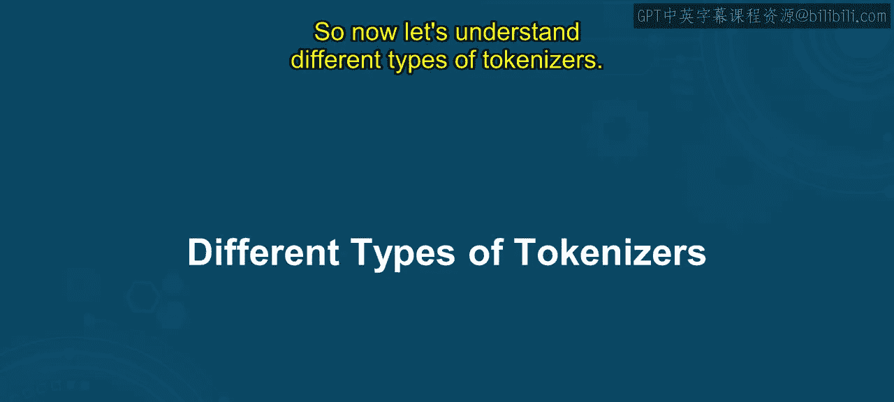
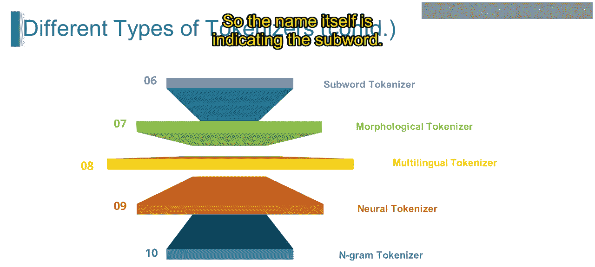
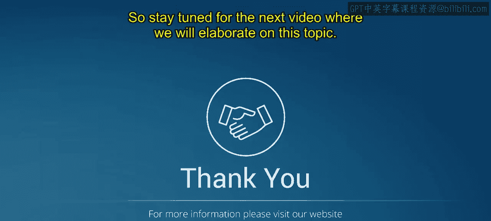

# Edureka《通过LLMs学习生成式人工智能（机器学习和NLP基础，第1课／共4课）｜Learn Generative AI with LLMs》中英字幕 - P106：105_分词.zh_en - GPT中英字幕课程资源 - BV1q4421Q7qh

Hello everyone， welcome back to machine learning and NLP basics。

 so now let's understand different types of tokens in this we are going to understand what exactly a tokenizer is and what are the different types of tokens。

😊。

And uses of the tokenizer by the end of the session you are able to identify tokenizers as tools for next segmentation in NLP and also able to recognize various tokenizer algorithms and their use cases and also able to comprehend the different uses of tokens so let's get started understanding tokenizers before getting into it let's understand what exactly a tokenization is all about so let me explain you with an example。

Let's say for example， imagine you have a sentence I love natural language processing。

 so now if we want to analyze this sentence in the natural language processing。

 we need to break it down into smaller units to understand its structure and meaning tokenization helps us achieve this by splitting the sentence into individual units such as subwards。

 so in our example the tokenizer would break down the sentence into these following tokens。😊。

Now let's link this example into the technical definition。

 so tokenization in NLPR algorithms or tools that segment text into smaller units are called tokens these tokens can be words subwords or even characters depending on the tokenizes configuration tokenization is an essential preprocessing step in NLP preparing text data for further analysis and machine learning tasks by breaking it down into meaningful insights or meaningful units means tokens play a crucial role in NLP by segmenting text into tokens allowing us to analyze and process text data efficiently they form the foundation for various linguistic analysis and machine learning tasks by providing the structured input data so now let's understand the different types of tokenizers here we are having wide space。

😊，ary based， rule based regular expression， statistical tokenizer。 So let's understand one by one。

Let's say for example， we are having a sentence， I love natural language processing in this when we are converting it into the tokens。

 it will split the entire sentence into words so that is where we are having I love natural language processing。

 a white space tokenizer splits the text based on the white space characters。

 whatever we are having the white space character that is nothing but spaces， tabs and new lines。😊。

A white space tokenizer splits the text based on the white space character such as spaces。

 tabs and new lines treating each sequence of non-white characters as tokens so then the next one ease of dictionary based tokenizer so let's understand with one more example we are having a sentence unbelievable in this we are converting the provided sentence into token that is U andun and then believable so this tokenizer uses a predefined dictionary of words or sub wordss to segment the text splitting it into tokens based on matches found in the dictionary so that is where the difference comes in between the white space as well as dictionary based tokenizer then the next one is of rulebased tokenizer in this for example let's say we are having a sentence I am happy exclamation。

😊，Colon and close bracket like this and now if we want to convert it into the individual tokens what we are doing first of all we are splitting I am happy commma exclamationma colon means this rule based tokenizers apply a set of predefined rules or patterns to a segment text into tokens often considering punctuation marks emototics and other linguistic patterns that is about the rule based tokenization。

😊，Then the next one is of regular expression tokenizer so in our sentence let's meet at 330 pm exclamation and then we are closing it in this it is now divided into let's meet at 330 pm and exclamation means this tokenizer uses the regular expressions to determine the patterns for tokenization allowing for more flexible and customizable token segmentation based on the specific patterns that is about the regular expression tokenization then the next one is of statistical tokenizer in statistical tokenizer here we are having a sentence I am reading a book so now it will convert into I am reading a book so statistical tokens utilize statistical models or machine learning algorithms to determine token。

😊，Boundaries based on the probability distribution of words or characters in the corpus。

 so that is about the statistical tokenizer then the next one is a sub tokenizer so the name itself is indicating the sub word for example。

 let's say。😊。

So stay tuned for the next video where we will elaborate on this topic。😊。

