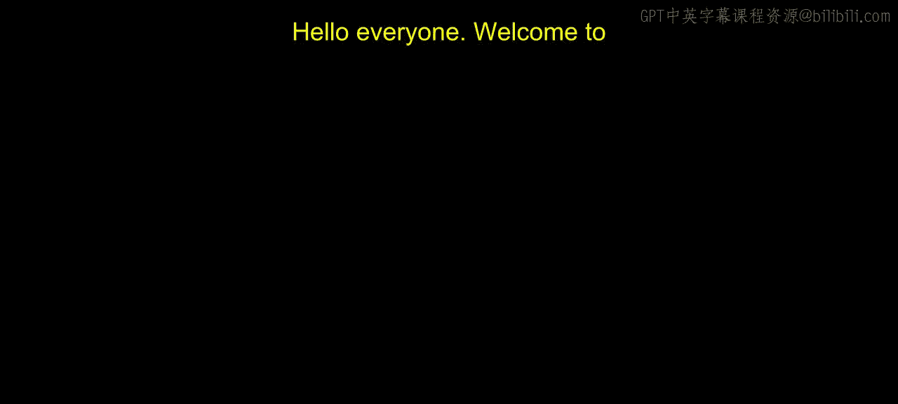
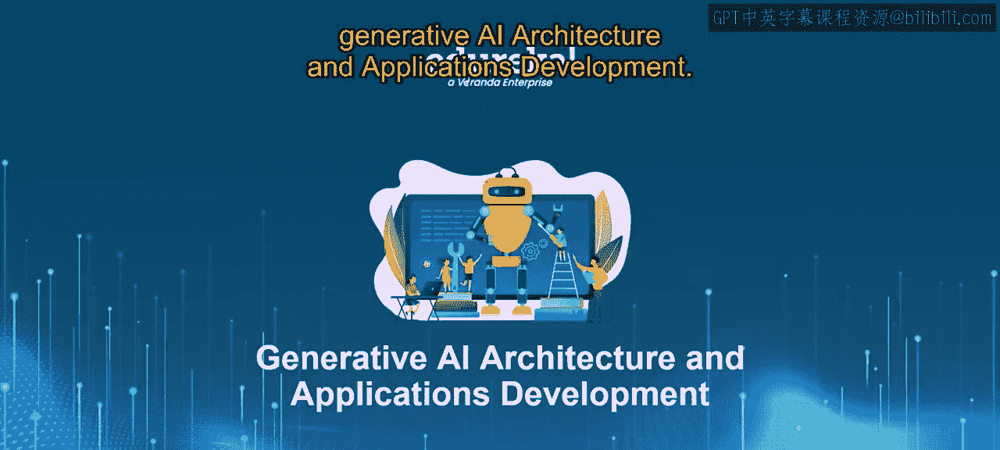
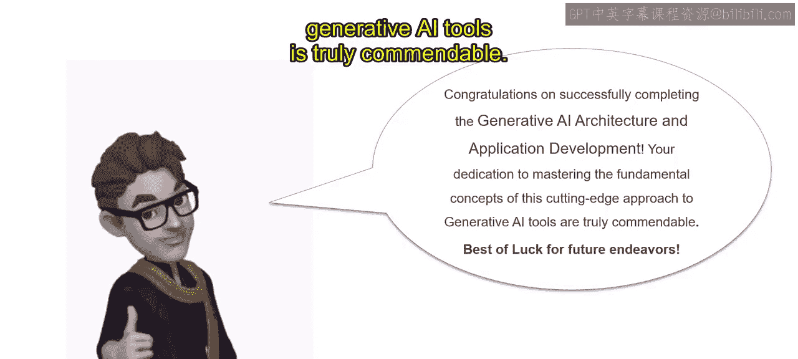

# Edureka《通过LLMs学习生成式AI（基础、应用开发、流行工具，第2、3、4课／共4课）｜Learn Generative AI with LLMs》中英 - P106：69_课程总结.zh_en - GPT中英字幕课程资源 - BV1ym421V7gx

Hello everyone， welcome to Generative AI Architectural and App development。😊。

Now， the course summary throughout this course， we delvet into the various aspects of generative AI。

 starting with an exploration of generative AI with LLMs followed by understanding of how the LLMs can be leveraged for search prediction and generation tasks within divd into the La for LM application development followed by handsson sessions on interacting with data using the languagecha and drag。

 we also covered the evaluation of LLM performance and explore the application of generative AI for data privacy and the production。

 when we say generative AI with LLMs， we explore foundational principles of generative AI and its applications focusing on pivotboal role of the LLMs in generating the text when we say LLMs search prediction and generation we delvet into how LLMs are leveraged for diverse tasks such。

search， prediction and text generation showcasing their versatility in natural language processing So coming to L for LLM application development。

 we introduced Laang as a comprehensive platform for developing the applications powered by the LLMs emphasizing its features for seamless application development as well as deployment。

 then coming to interacting with data using the lang and drag。

 we investigated advanced techniques for integrating with data using the La and retrieval augmented generation models focusing on data processing and utilization strategies。

 then evaluating the LLM performance so we explore various methodologies for evaluating the performance of the LLMs including metrics such as publicity。

 blue and human evaluation ensuring robust assessment practices and generatedative AI for data privacy and production we addressed。

😊，The critical aspects of data privacy and protection in generative AI applications。

 discussing strategies and techniques for safeguarding sensitive data in the context of LLM usage and finally the course wrap up and assessments summarize the key learnings from each module and provided assessments to gauge learners comprehension and proficiency in applying generative AI concepts with LLNMS by covering these topics comprehensively。

 learners have gained a holistic understanding of generative AI foundations and acquired practical skills to harness LLN efficiently in the real world scenarios。

😊，So by completing this course it unlocks the world possibilities for AI engineers， ML engineers。

 data scientists， freshers and the other roles， so the diverse opportunities ahead are incredibly promising offering a wealth of paths to explore and grow within the field of generative AI。

😊，So finally， congratulations on reaching the completion of Generative AI Architecture and application development course。

 your commitment and dedication to mastering the fundamental concepts and architecture and application development concepts of this cutting edge approach to generative AI tools is truly commendable。

😊。

Best of luck， everyone。 Thank you。

