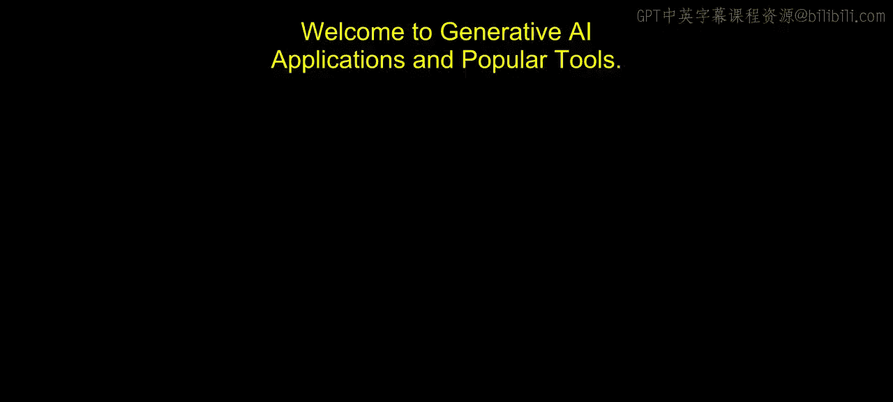
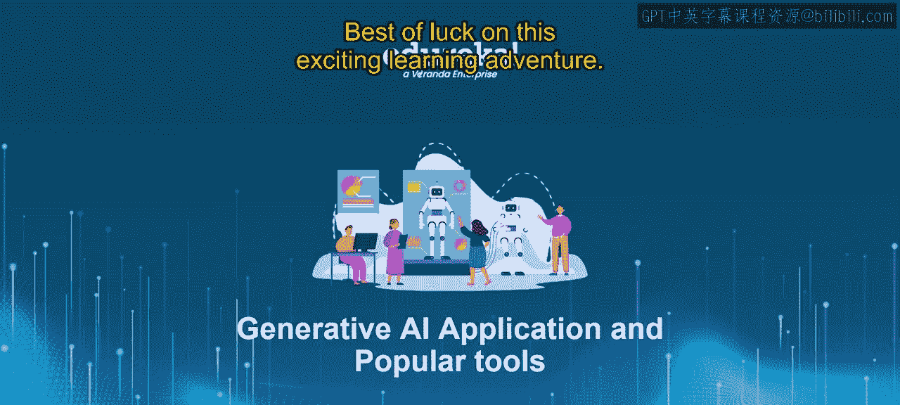
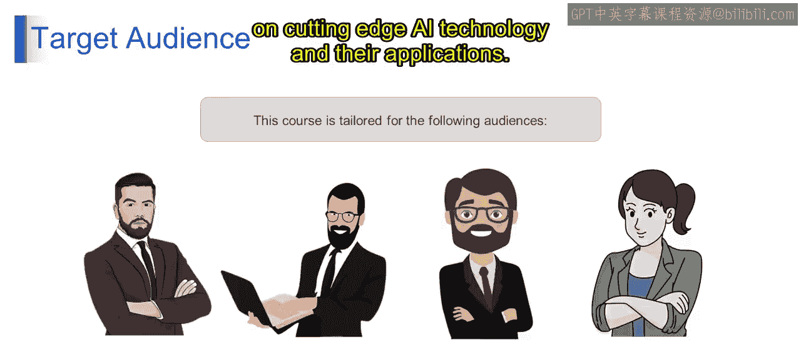
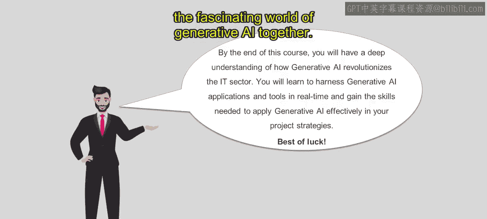

# Edureka《通过LLMs学习生成式AI（基础、应用开发、流行工具，第2、3、4课／共4课）｜Learn Generative AI with LLMs》中英 - P107：0_课程简介.zh_en - GPT中英字幕课程资源 - BV1ym421V7gx

Welcome to generative AI applications and popular tools。

 a comprehensive journey into the dynamic rim of generative AI。

 This course is meticulously crafted to provide Ml AI engineers data scientists。

 freshers and Cc students with a deep understanding of how generative AI is revolutionizing the I sector By the end of this course。

 you not only grasp the transformative power of generative AI but also gain the practical skills needed to effectively apply generative AI in your project strategies。

 Best of luck on this exciting learning adventure。 The course dives into building chatbots covering fundamental aspects of chatbot development and offering hands on exercises to create and deploy chatbots using various platforms and frameworks。

 Natural language processing techniques for chatbot interaction are explode in detail After that。

 the course delves into open CV for computer。😊。

Introdu the concept of computer vision and its applications。

 practical implementation of computer vision tasks using OpenC is demonstrated through projects and exercises focused on image processing object detection and more the midjoourney segment introduces text to image generation and after that Github cap and its role in AI driven development learners engage enhance on exploration of Github capitals。

 features and capabilities， including collaborative coding exercises to enhance productivity P generative AI tools are then discussed。

 providing an overview of G models， VAs and other tools in libraries for generative AI real world use cases are explore and practical demonstrations and projects are provided to showcase the capabilities of these tools。

Finally， the course concludes with a wrap up and assessments recapping key learnings and concepts covered throughout the course A exercises are included to evaluate learners understanding and proficiency in generative AI guidance on next steps and resources for continued learning and professional development is provided The course is tailored for MLL AI engineers seeking to deepen their understanding and practical skills in generative AI。

 freshers looking to explore the field and gain hands on experience data scientists interested in expanding their expertise into generative AI applications and computer science engineering students keen on cutting edge AI technology and their applications。

Congratulations on embarking on this journey to explore Generative AI by the end of this course you will be equipped with the knowledge。

 skills by the end of this course you will be equipped with the knowledge。

 skills and confidence to harness the transformative potential of generative AI in your projects and initiators。

 wishing you the best of luck and let's dive into the fascinating world of geneative AI together。

