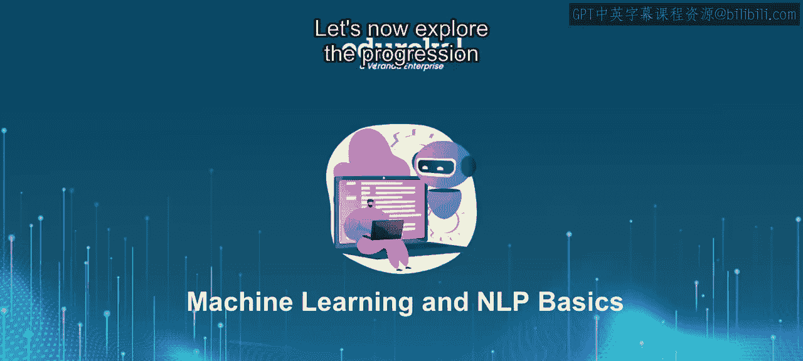
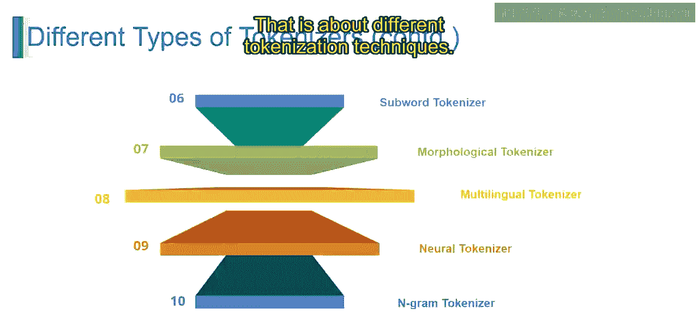
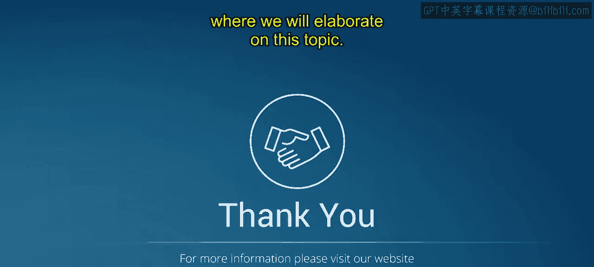

# Edureka《通过LLMs学习生成式人工智能（机器学习和NLP基础，第1课／共4课）｜Learn Generative AI with LLMs》中英字幕 - P107：106_分词的类型.zh_en - GPT中英字幕课程资源 - BV1q4421Q7qh

So let's now explore the progression from our previous discussion。

 We are having a sentence of unbelievable。 So in this we are converting it into the tokens like unbeable So how exactly we are doing in this case subver tokens split words into smaller units like subwords based on linguistic patterns allowing for better handling of unknown words and improved performance in morphologically rich language that is about the subword tokenizer。

 then what exactly this morphological tokenizer， So let's take the same example of sentence unbelievable again So let's understand with the same example here if you can see we are having the same sentence in both the cases。

 but now we are converting the tokens in a different way we are providing un believe kma me。😊。

Morological tokenizers segment the text into morphphes。

 which are the smallest meaning units of language helping to analyze the word structure and derive the meaning from morphological changes that is about morphological tokens then the next is of multilingual tokenizer so let's say for example we are having a sentence of how are you doing today for example。

 in this case we are converting it into how are you doing today and question mark the sentence is in English the tokens represents individual words in the sentence the multilingual tokenizer correctly segments the text into meaningful units accommodating the linguistic conventions of English。

😊，Basically this tokenizer is designed to process the text from multiple languages effectively segmenting it into individual tokens while accommodating the linguistic shades and orthographic conventions of each language it is capable of handling various writing systems character encodings and word boundaries enabling NLP tasks across diverse context then the next one is of neural tokenizer here we are having a sentence I am happy now we are converting it into the tokens by telling I am happy and exclamation symbol so neural tokens utilize the neural networks or deep learning models to learn tokenization patterns directly from the data offering improved performance and adaptability to various text types and languages。

😊，Then the next one is of ingram tokenizer。 Let's say， for example， let's say， for example。

 we are having a sentence。😊，Natural language processing in this。

 it is divided into natural language processing。 Kma， natural language， language processing。

 Why exactly like this。 So let's understand Ngram tokenizes segment the text into。😊。

contigious sequences of n tokens that is nothing but n is nothing but how many number of words or characters capturing local context and improving the sentence or representation of the text for tasks such as language modeling and machine translation so these all are the different types of tokenisizers offer various approaches to segmenting the text into tokens each with its strengths and suitability for specific tasks and languages。

 these tokenisizers play a very important role in preprocessing the text data for natural language processing tasks facilitating effective analysis and understanding of the text content so that is about different tokenization techniques so stay tuned for the next video where we will elaborate on this topic。

😊。

