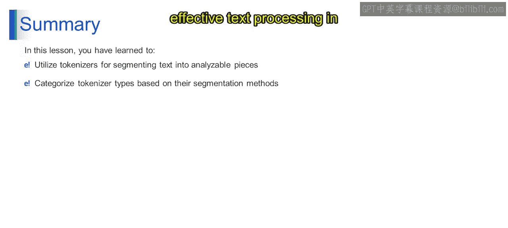
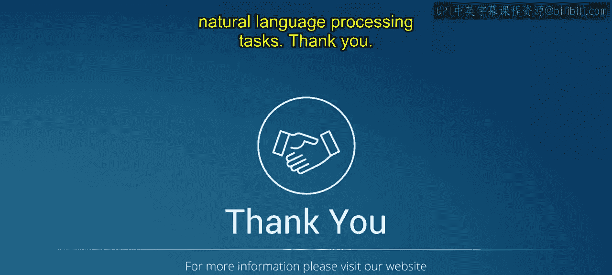

# Edureka《通过LLMs学习生成式人工智能（机器学习和NLP基础，第1课／共4课）｜Learn Generative AI with LLMs》中英字幕 - P108：107_分词的用途.zh_en - GPT中英字幕课程资源 - BV1q4421Q7qh

So let's now explore the progression from our previous discussion。

 so now let's understand the uses of tokens， so as we have understood how exactly it is performing the task the first one is going to be the text preprocessing so tokens are essential for text preprocessing tasks such as cleaning and structuring text data before analysis。

 they break down the raw text into smaller units like tokens enabling further preprocessing and analysis means text preprocessing involves transforming raw text data into a format suitable for natural language processing tasks such as tokenization。

 lower casing， removing punctuation and handling the special characteristics or characters that is about the text preprocessing。

 then information retrieval tokenization。😊。

Helps in building search indexes and retrieving relevant documents or information from language text collections tokens serves as the basis for indexing and matching query terms with the document content means information retrieval involves the process of retrieving the relevant documents or information from a large text corpus based on user queries or search terms often relying on tokenization to process and index text data efficiently Then the next two one is of machine translation So tokenization in machine translation tokenization assist in breaking down sentences or phrases into smaller units facilitating the translation process by providing the structured input data for machine translation models means。

😊，Machine translation is the task of automatically translating text from one language to another。

 often using statistical or neural machine translation models that require tokenized input text for processing then the next one is of sentiment analysis tokenization separates text into individual words or subwords enabling sentiment analysis models to analyze sentiment expressed in text by examining the polarity of the individual tokens。

 for example， in technical terms sentiment analysis is the process of automatically identifying the extracting sentiment or opinion。

Expressed in a text often using machine learning models that rely on tokenized input text for sentiment classification。

 then the next one is of text summarization tokenization breaks text into smaller units facilitating text summarization algorithms to identify important sentences or phrases by analyzing the tokens frequency and relevance means text summarization is the task of automatically generating concise and coherent summaries of longer text documents often using extractive or abstractive summarization techniques that rely on tokenized input text for analysis then the last one is of parts or speech tagging。

😊，Tokenization provides individual words or subwords as input for parts of speech tagging model to assign grammatical tags。

 for example， noun verb ajective and etc to each token。

 helping in syntactic analysis and understanding means parts of speech tagging is the process of assigning grammatical tags to words or tokens in a sentence。

 indicating their syntactic role and relationship within the sentence often achieved using the machine learning models trained on tokenized input text means tokens serves diverse purpose in natural language processing tasks。

 facilitating text preprocessing information retrieval， machine translation， sentiment analysis。

 text sumization and parts of speech tagging by breaking down into smaller。😊，Analyzable units。

 they form the foundation for various NLP applications。

 enabling effective analysis and understanding the text data。😊，So now the summary in this lesson。

 you have acquired skills in employing tokens to segment text into alyzable units and categorize them based on their segmentation methods。

 laying the groundwork for effective text processing in natural language processing tasks。😊。

Thank you。

