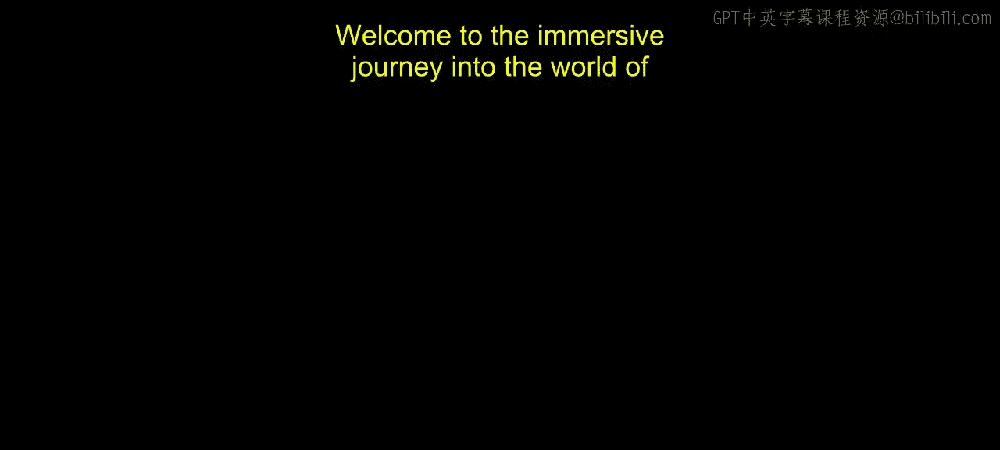
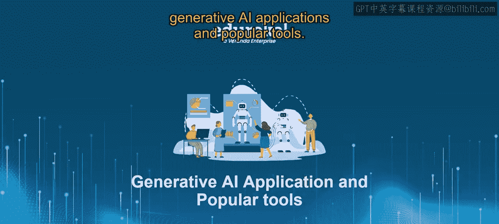
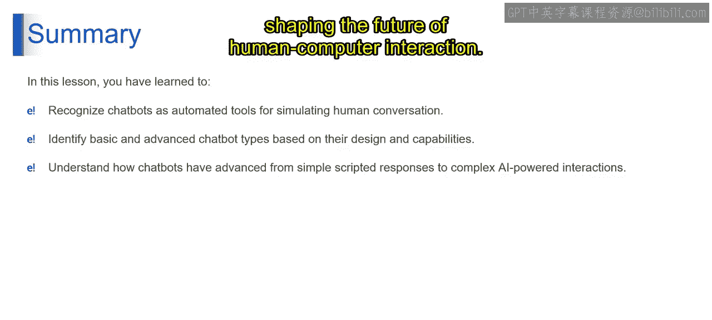
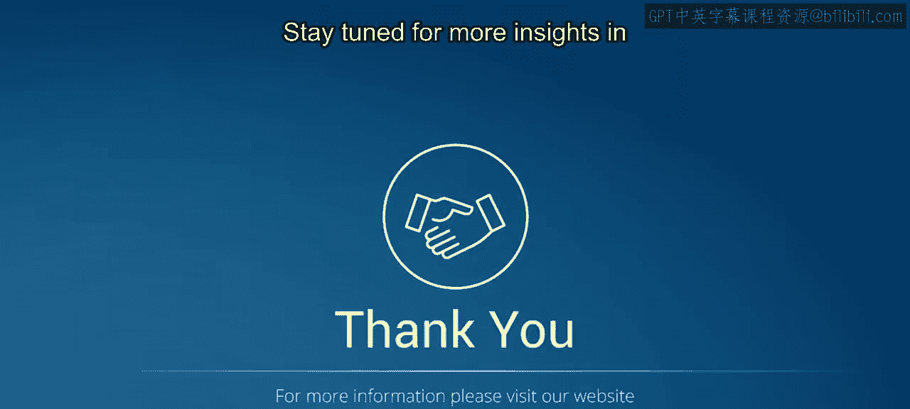

# Edureka《通过LLMs学习生成式AI（基础、应用开发、流行工具，第2、3、4课／共4课）｜Learn Generative AI with LLMs》中英 - P108：1_聊天机器人介绍.zh_en - GPT中英字幕课程资源 - BV1ym421V7gx

Welcome to the immersive journey into the world of generative AI applications and popular tools。😊。

In this session， well delve into the fascinating journey of chatbots from their humble beginnings to their modern day sophistication。

 By the end of this lesson， you have a comprehensive understanding of the various types of chatbots and the key milestones in their evaluation。

😊，So what are chatbots。At its core， a chatbot is a computer program designed to simulate conversation with human users typically over the internet。

 Chaborts are deployed across various platforms including websites。

 messaging apps and standalone applications with the goal of providing automated customer service or assisting users in finding information quickly and efficiently。

😊，So we'll explore different types of chatbots。 First one is rule based chatbots。

 These chatbots follow a predefined set of rules and decision trees to determine their responses to user inputs。

 They are typically used for simple tasks and interactions。

 such as answering frequently asked questions or providing basic customer support。

Second type is self learning chatbots， utilizingt artificial intelligence and machine learning algorithms。

 Se learning chatbots have the ability to understand user intent and context。

 enabling them to provide more tea load and relevant responses over time。

 These chatbots continuously learn from user interactions to improve their performance。😊。

Thirdty is task oriented chatbos。 task oriented chatbos are designed with specific tasks in mind。

 such as booking a flight， ordering food or scheduling appointments。

 They excel at guiding users through a structured interaction flow to accomplish a particular task efficiently。

😊，Type4 conversational chatbots designed to simulate humanlike conversation。

 conversational chatbots prioritize natural language， understanding and generation。

 aiming to engage users in fluid and intuitive interactions。

 They are commonly used for customer service purposes。

 providing personalized and engaging support experiences。 Now， moving on to the fifth type。

 hybrid chatbots， combining elements of rule based and self learning techniques。

 hybrid chatbots offer a more advanced and natural conversational experience。

 These chatbots leverage both predefined rules and machine learning algorithms to adapt to user inputs dynamically and provide contextually relevant responses。

😊，Next， let's move on to the evaluation of chatbots， starting from 1960。

 the birth of chatbots can be traced back to Joseph Wienbaum's creation of Eliza， the first chatbot。

 Eliliza utilized rudimentary and natural language processing techniques to mimic human conversation between 1980s and 1990s with the rise of personal computers and the Internet chatbots for customer service began to emerge early chatbots relied heavily on rule-based pattern matching for interpreting user inputs。

In 2010， advancements in artificial intelligence and machine learning revolutionized chatbots。

 virtual assistants like Siri and Alexa demonstrated the capabilities of AI powered chatbots。

 capable of understanding and executing complex tasks beyond simple text based interactions。In 2016。

 businesses began leveraging Facebook messenger chatbots for customer support and marketing purposes。

 making a significant milestone in chatbot adoption。

 The proliferation of chatbot design and deployment tools further fueled their growth and accessibility in 20180。

 Open AI introduced G1 the first version of its G language model renowned for its strong language generation capabilities。

 This marked the significant leap forward in chatbot technology enabling more sophisticated and contextually aware interactions。

 In conclusion， chatbots have come a long ways since their inception。

 evolving from simple scripted responses to intelligent and adaptive conversational agents As advancements in AI and machine learning continue to accelerate。

 we can expect chatbots to play an increasingly prominent role in enhancing customer experiences。

 streamlining business operations and shaping the future of human。😊。

interaction。 Thank you for joining us on this exploration of the evaluation of chatbots。

 We hope you have a deeper appreciation for the diverse types of chatbots and the key milestones in their journey As you continue to explore the world of chatbots。

 we encourage you to experiment with different technologies and techniques to unlock the full potential in your projects and endeavores。

 Stay tuned for more insights in the field of chatbots in upcoming videos。😊。

