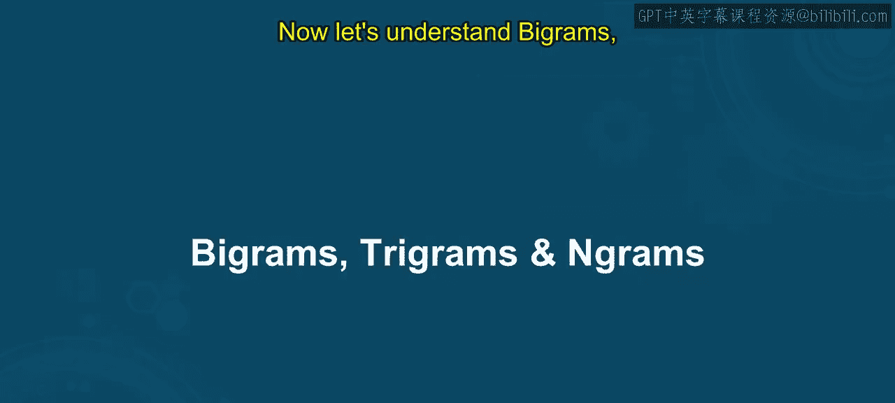
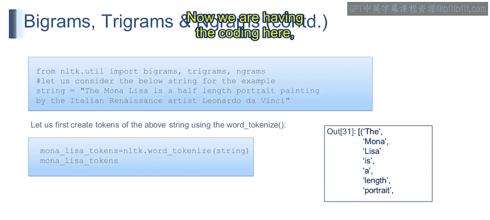
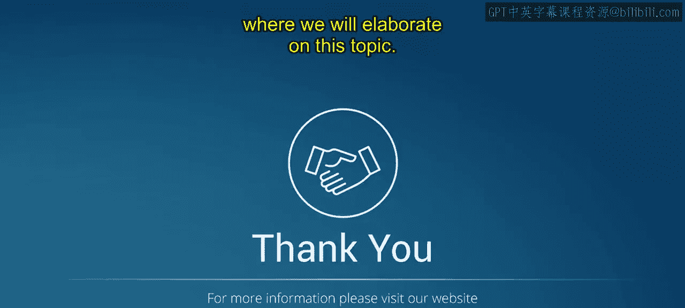

# Edureka《通过LLMs学习生成式人工智能（机器学习和NLP基础，第1课／共4课）｜Learn Generative AI with LLMs》中英字幕 - P109：108_二元组、三元组、n元组.zh_en - GPT中英字幕课程资源 - BV1q4421Q7qh

Hello everyone welcome back to machine learning and NLP basics so now let's understand bigrams。

 trigrams and Ngrams in this we are going to understand these bigrams。

 trigrams and Ngrams what exactly they are and how they are going to work and how do they help in NLP by the end of the session you will be able to generate and utilize the bigrams trigrams and Ngrams for text analysis and able to use NLPK library to create the bygrams trigrams and Ngrams so let's get started what exactly the bigram trigram and Ngram。

😊。

So let's start understanding these with simple example before understanding the technical definition okay suppose let's say you have a sentence I love natural language processing in this particular example the very first thing when we are having sentence is that we need to convert the provided entire sentence into individual tokens right so if I am converting them into individual tokens what I will get I love natural language processing so this is the basic tokenization process right so when we are having a sentence we need to convert them into the tokens first of all but when you are working with the bygrams the name itself is indicating the by bigram are pairs of adjacent words in a sequence of text they provide insights into the relationship between two consecutive words in a sentence or a document so that is reason。

😊，we are getting。Here we are having the trigram， try the three words the name itself is indicating means trigrams are triplet of adjacent words in a sequence of text the capture more context than bygram by considering three consecutive words at a time in the bygram we are considering only two words and in the trigram we are considering triplets of adjacent words so that is where the difference comes in between the bigram and trigram and now lets understand the ngram。

😊，So continuing with the sentence of the same I love natural language processing。

 so let's say for example， n is something where you can assign the values to it， in fact。

 you can either give n is equal to2 or you can give 4，5，6，7， whatever it is。😊。

So n is something that you can change the value of it and can assign the values to it。 So。

 for example， if in our case n is equal to4 what is going to be the output in the same scenario So what happens when n is equal to4 the provided sentence I love natural language processing will get convert into I love natural language love natural language processing it means ngram generalizes the concept of by gras and trigrams by considering sequence of n consecutive words they provide flexibility in capturing various levels of context depending on the chosen value of n whether if it is of4。

5，6 or7 so now this is what about the bigrams trigrams and ngrams so technically so here we are having one more example where n is equal to。

😊，1，2，3。 So this is a general representation。 Let's say， for example， we are having a sentence。

 This is a sentence， so。It is getting converted into based on the n parameter if we are telling that n is equal to1 it will convert the entire sentence into individual single words or if you are telling that n is equal to2 then it will take two adjacent words at a go and then provide then similarly if it is of three then it will take three characters at a time so that is how it will work means technically bygrams are sequence of adjacent words or tokens in a sequence of text in natural language processing bigrams are commonly used for tasks such as language modeling parts of speech tagging and sentiment analysis and coming to trigrams trigrams are sequence of three adjacent words or tokens in a sequence of text they offer more context than bigrams and are useful for tasks such as text generation。

😊，translation and named entity recognition and then coming to Ngrams Ngrams generalize the concept of bygrams and trigrams by considering the sequence of in consecutive words or tokens。

 they allow for flexible analysis of text data by capturing varying levels of context depending on the chosen value of N means Ngrams are widely used in natural language processing tasks including text classification information retrieval and text summarization means bygram trigrams and ngrams are essential concepts in natural language processing。

 enabling the analysis of the text data by considering sequences of adjacent words or tokens they provide valuable insights into structure and context text aiding in various NLP tasks and applications。

😊，That is all about bigram， trigram and Ngram。 So now we are having the coding here。

 I will explain you with practical understanding。😊。

So stay tuned for the next video where we will elaborate on this topic。😊。

