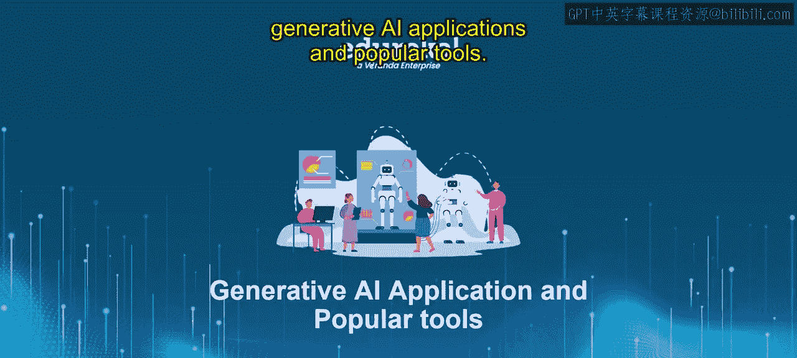
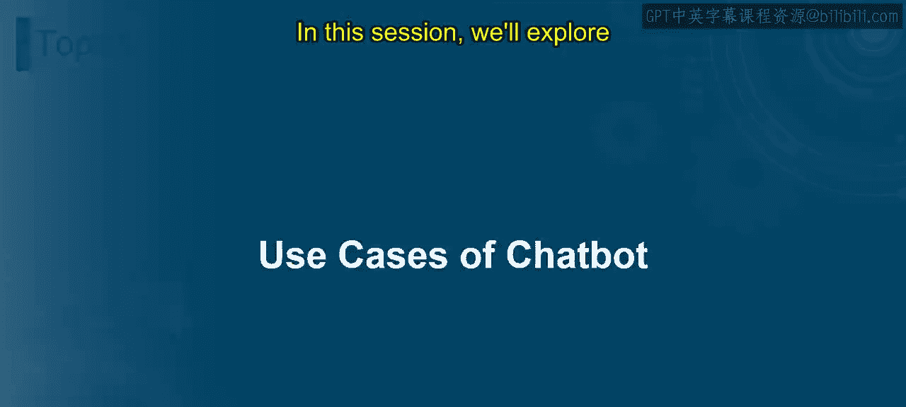
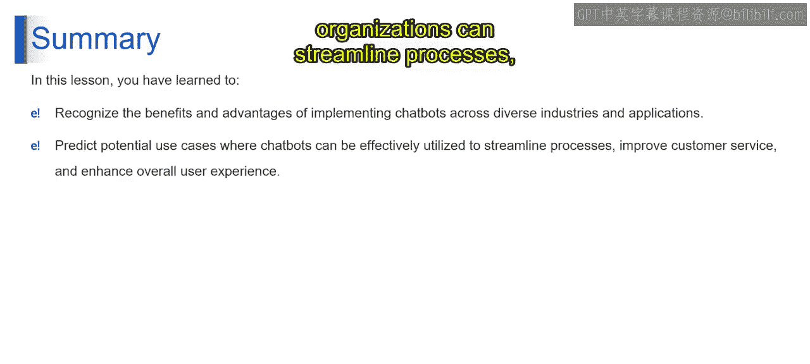
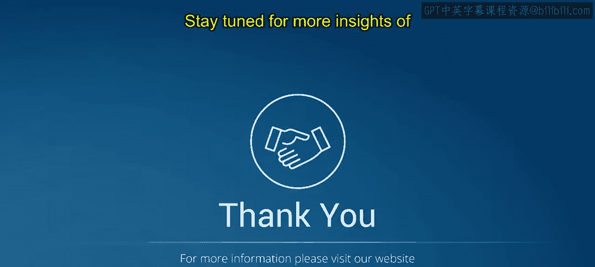

# Edureka《通过LLMs学习生成式AI（基础、应用开发、流行工具，第2、3、4课／共4课）｜Learn Generative AI with LLMs》中英 - P109：2_聊天机器人的使用案例.zh_en - GPT中英字幕课程资源 - BV1ym421V7gx

Welcome to the immersive journey into the world of generative AI applications and popular tools。😊。

The advantages and use cases of chatbots in this session。

 we'll explore the benefits of utilizing chatbots across various contexts and industries。

 as well as predict potential use cases with chatbots can offer significant value and efficiency By the end of this lesson。

 youll have a comprehensive understanding of the advantages of chatbot。

 and how they can be effectively applied to streamline processes and enhance user experience。

 So let's move on to the advantages of using a chatbot。 First one is 24 harsh support。

 chatbots offer round the clock assistance providing users with support and information at any time of day or night。

 Second one is quick answers to simple questions。 Use can receive immediate responses to straightforward inquiries eliminating the need to wait for human assistance。

😊。

Third one is instant response。 Chadbots deliver instantaneous replies。

 enhancing user satisfaction and efficiency in communication 4， convenience。

 Chabots provide a convenient communication channel for users。

 allowing them to interact effortlessly and access information seamlessly 5 ease of communication。

 Chabots facilitate smooth and straightforward communication。

 enabling users to engage in natural conversations and obtain desired informational assistance。😊，6。

 ability to register a complaint， users can conveniently register complaints or report issues through chatbots。

 ensuring prompt resolution and customer satisfaction。

Sth advantage is efficient complaint resolution。 Chabots Excelel in efficiently resolving customer complaints by providing prompt assistance and guiding users through the complaint resolution process by automating repetitive tasks and offering immediate responses Chabots ensure that customer issues are addressed in a timely manner leading to increased satisfaction and royalty。

8th advantage is a good customer experience。 Chadbots contribute to a positive customer experience by offering friendly and approachable interactions through natural language processing and tailored responses。

 Chabots create a personalized and engaging experience for users fostering a sense of satisfaction and trust in the brand。

😊，The ninth advantages quick answers to complex questions。

 chatbots are adept at providing quick answers to complex questions thanks to the ability to process large amounts of information rapidly by leveraging AI algorithms and data analytics。

 chatbots can analyze user inquiries and deliver accurate responses in real time reducing customer wait times and improving overall efficiency。

😊，Tent1 is getting detailed or expert answers。 Chadbots provide users with detailed and expert answers to their inquiries by assessing a vast repository of knowledge and resources。

 whether it's broad specifications， technical information or troubleshooting guidance。

 chatbots offer comprehensive and reliable information to users。

 enhancing their understanding and satisfaction。 Levin is friendliness and approachability。

 Chadbots are designed to be friendly and approachable。

 creating a welcoming environment for users to interact with。

 through conversational interfaces and empathetic responses。

 Chadbots establish or raportt with users， making them feel valued and appreciated。

 thus enhancing the overall customer experience。 Next。

 let's take a look at the predicted use cases of chatdbots。 First one， paying a bill。

 Chabots can assist users in paying bills by providing payment options。

 guiding them through the payment。😊，and addressing any queries or issues。

 Second one is buying an expensive item。 Use can seek advise and information from chatbots when considering purchasing expensive items such as electronics or appliances。

 helping them make informed decisions。Third， getting ideas and inspiration chatbots can also personalize recommendations。

 suggestions and inspiration based on user preferences and interests。

 facilitating decision making and exploration for oneners。

 making a reservation users can use chatbots to make reservations for various services including restaurants。

 hotels， flights and events， simplifying the booking process and ensuring availability。😊。

And many more predicted use cases of chatbots span a wide range of activities from paying bills and making reservations to seeking advice and inspiration by leveraging chatbots。

 organizations can streamline processes， improve customer service and enhance overall user experience。

 Thank you for joining us on this exploration of the advantages and use cases of chatbots。

 We hope you now have a clear understanding of the benefits of chatbots and their potential applications across different industries and context。

 As you continue to explore the world of chatbots， we encourage you to envision innovative ways to leverage this technology to meet the needs of users and organizations alike。

 Stay tuned for more insights of chatbots and upcoming videos。😊。

