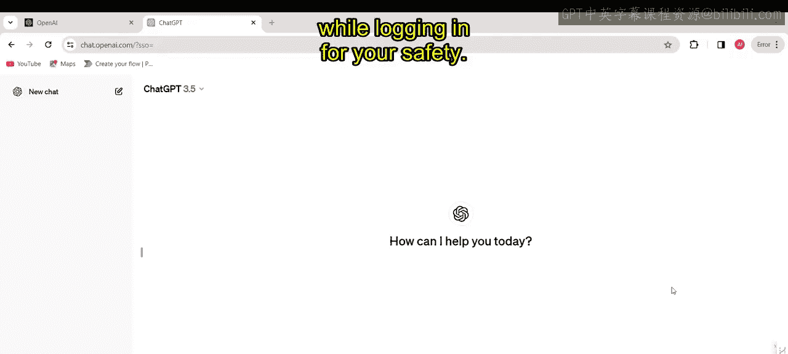
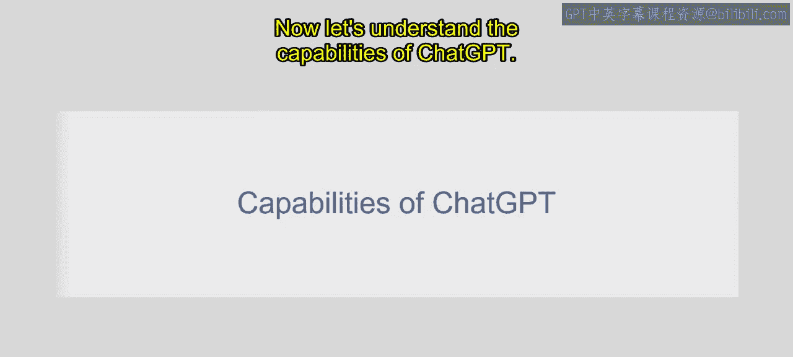
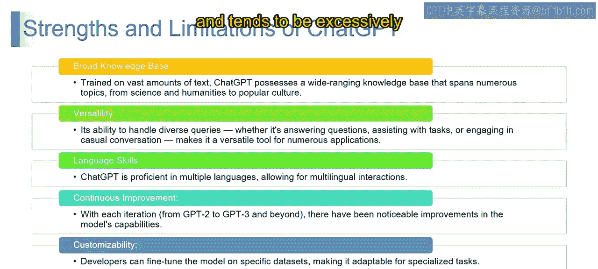
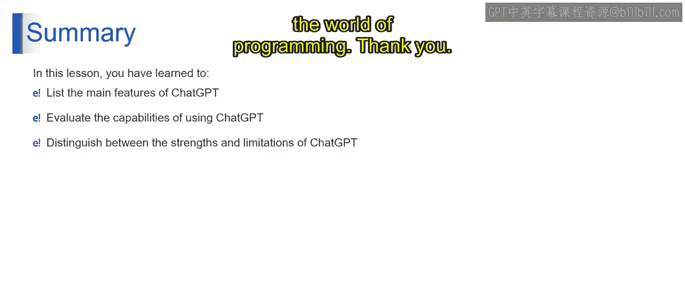

# Edureka《通过LLMs学习生成式AI（基础、应用开发、流行工具，第2、3、4课／共4课）｜Learn Generative AI with LLMs》中英 - P10：9_登录过程.zh_en - GPT中英字幕课程资源 - BV1ym421V7gx

So let's now explore the progression from our previous discussion so you will be able to see this window so look for the login button on the website so here it is it's usually on the top right or center。

😊，So you will see the options to log in。 It might be with the Google account， email or other methods。

 Pick the one that suits you the best。 So I'm clicking on the login。

 So if you're already having an account， you can provide the email and click on the continue and provide password and navigate to the website or if you are using it for the first time you have to click on the sign up it may ask you for multiple steps like your email address and also some verification step。

 This could be a code sent to your email or phone， you need to enter the code to conform。

 It's really you So that's how the signup process works or if you're already having the Google account you may click on continue with the Google So right now I'm clicking on continue with the Google as because I'm already having an account I'm already using it。

 So it will navigate you to platform dot openaiI dot com or apps in this you are able to see these two the chat Chipi and API。

So that's it。 Once you are in， you are all set。 you can explore the features。

 start a conversation and see what Chad Gput can do。 It's easy， right。 So for us。

 right at this moment， let's click on Chad Gpi and start working on it。😊。

You will be able to see this window you are in Chadjipiy super cool so always ensure you are using a secure and trusted connection while logging in fire safety so that is about the login process Now let's understand the capabilities of Chagiy。

😊。

The first one iszo broad knowledge base so picture chat GpT Aure virtual encyclopedia loaded with information from across the spectrum。

 science， humanities and pop culture。 It's like having a conversational genuine with a vast knowledge base at your fingertips So that's about broad knowledge base Then the next one iszo versatil Cha GpT easier Swiss army knife in the digital realm it effortlessly handles a multitude of tasks answering questions assisting with various queries all just engaging in a friendly chat。

😊，Its versatility makes it a goto tool for wide range of applications。

 Then the next one is of language skills so unlock the multilingual magic of Cha GPT It's not confined to a single language instead it's a polyglot conversationalist engageng in conversations in different languages making language barrier a thing of the past So then the next one is of continuous improvement。

 So this chatd GT as technology that evolves with the time。 So from G2 to GT3 and GT3。

5 and now4 and beyond each upgrade brings noticeable improvements。

 it's like witnessing a digital forix rising continuously enhancing its capabilities for a better user experience then the last one is of customizability So tailor Cha G to suit your needs developers can fine tune this model。

😊，spec data sets， transforming it into a specialized tool for unique tasks。

 It's like having a personalized assistant that adapts to the specific requirements of your project so that's about customizability so strengths and limitations are likedgiy trendss lie in vast knowledge base versatity and handling diverse queries proficient in multiple languages continuous improvement through iteration and the customizability that developers can leverage for specialized tasks so the limitations are like however。

 like any tooldgipiy has limitations it may sometimes provide incurate or nonsensical information struggles with ambbous queries and can be sensitive to slight changes in the input phrasing so additionally it might generate wvos or overly detaileded outputs and tends to be excessively cautious in certain situations。

Patients。Now the summary in the coding arena manual coding is like crafting a masterpiecees with time and precision while chat TriputT acts as a coding gen swiftly generating code upon the request choice between artisanal craftsmanship and the AI efficiency defines the coding tale each with its unique charm in the world of programming Thank you。

😊。

