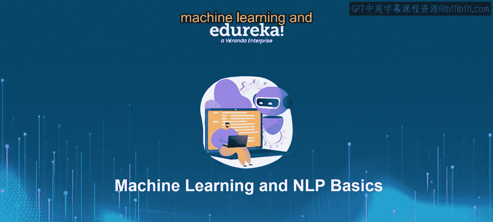
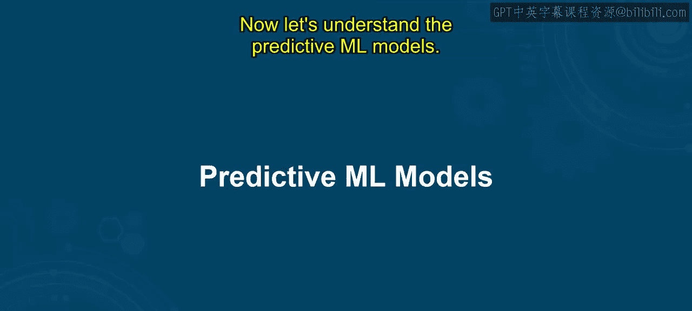
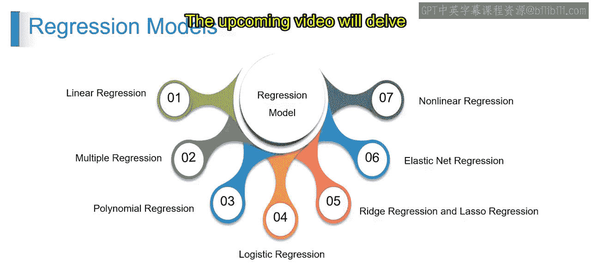

# Edureka《通过LLMs学习生成式人工智能（机器学习和NLP基础，第1课／共4课）｜Learn Generative AI with LLMs》中英字幕 - P10：9_预测性机器学习模型.zh_en - GPT中英字幕课程资源 - BV1q4421Q7qh

Hello everyone， let's dive into the captivating world of machine learning and the foundational concepts of NLP together。

 So now let's understand the predictive M models in this we are going to cover the different types of predictive ML models by the end of the session you are able to understand the various categories of predictive machine learning models So let's get started So types of predictive M models before understanding the types First what is a predictive M model Let's understand this first。

😊。

Predictive ML models use the past data to forecast the future outcomes means they analyze the patterns to predict the unseen instances。

 adding tasks like classification regression and anomaly detection these models are vital for decision making risk assessment and automation across the industries。

 helping organizations anticipate the change seize the opportunities and reduce the risks。

 Now let's understand the different types， regression classification time series and ensemble methods。

 So first， let's understand about the regression models。 Let's say， for example。

 you want to predict the price of a house。 So how do you do generally based on the size。

 bedrooms and locations using the past sales data， you will try to predict it means the regression models。

 predict continuous outcomes， using the input features， learning relation。😊。

s through the methods like linear regression or the polynomial regression then coming to the classification model。

 for example， let's say you want to sort the emails into a spam or not spam means the categories are based on the content and the send history means classification models predict the categories outcome using the input feature dividing data into predefined classes like binary。

 whether if it is of the spam or not spam or the multiclass that's about classification。

 then the next one is of time series， For example， forecasting a company's stock price based on its historical performance means time series models analyzed the data collected over the time predicting future values by considering temporal patterns using the methods like auto regression or moving average。

😊，That's about the time series then the next one is of ensemble models。 so， for example。

 predicting the customer churn by combining predictions from the various models enemble models improve prediction accuracy by combining outputs from multiple base models such as decision trees logistic regression using the techniques like random forest or gradient boosting missions so these all are the different predictive m models now let's understand all the different types of each and everything so here we are having the number of models listed so coming to the regression models among all these what are the regression models the linear regression multiple regression polynomial regression reach and laso regression elastic net regression nonline regression these all comes under。

😊，Regress model coming to the classification problem statement， the logistic regression。

 na biasas and SVM comes under the logistic regression coming to the enemble methods here we are having the list decision trees random forest will come under the ensemble methods。

 So now let's understand all these clearly The first one is of linear regression let's see for example。

 predicting used cars selling price based on its mileage linear regression draws a straight line through the data points with the mileage as the input data。

😊，That is independent， and the price as the output means it is dependent on the mileage means linear regression is a basic method modeling the connection between one or more inputs and a continuous target by fitting a straight line to observe the data coming to the nonlinear regression for example。

 predicting the planned growth using the factors like sunlight and temperature。

 No nonlinear regression， accommodate curved relationship between the input and the target by capturing more complex patterns means nonlinear regression expands linear regression to handle the complex relationships using the curved functions like polynomial exponential or logariths。

 then coming to the multiple regression， it extends linear regression to model how two or more inputs impact a continuous target by。

😊，an equation with multiple coefficients， then coming to the polynomial regression。

 polynomial regression models， the relationship between the input and the target variable as a curved polynomial allowing for more flexibility in capturing the non nonlinear data patterns then the next one is of rich regression and the Laso regression So in case of house price prediction with various features rich andso regression techniques prevent overfitting by penalizing the large coefficients leading to more stable models means rich and laso regression methods add pen terms to shrink the coefficients towards zero by reducing the model complexity and preventing from the overfitting then the next one is of elasticnet regression So elasticnet regression combines rich and laso regression techniques to balance feature selection and coefficient shrinkage。

😊，Overcoming their individual limitations then the next one is of the logistic regression in this also we are having logistic regression so the upcoming video will delve further into the ongoing discussion。

😊。

