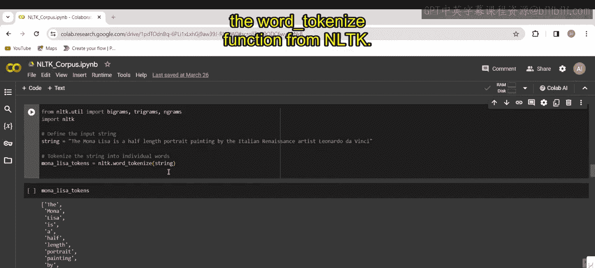
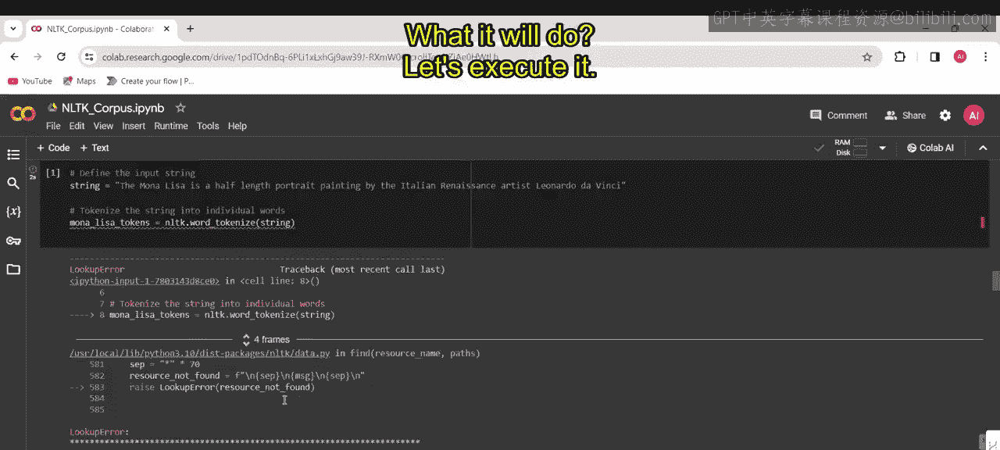
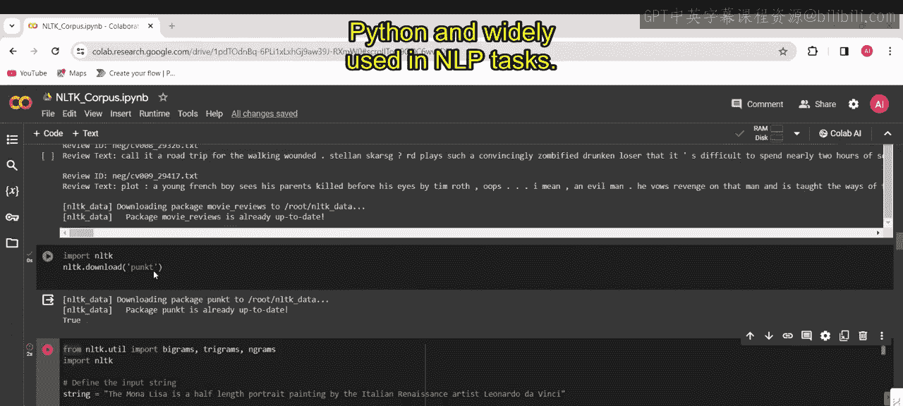
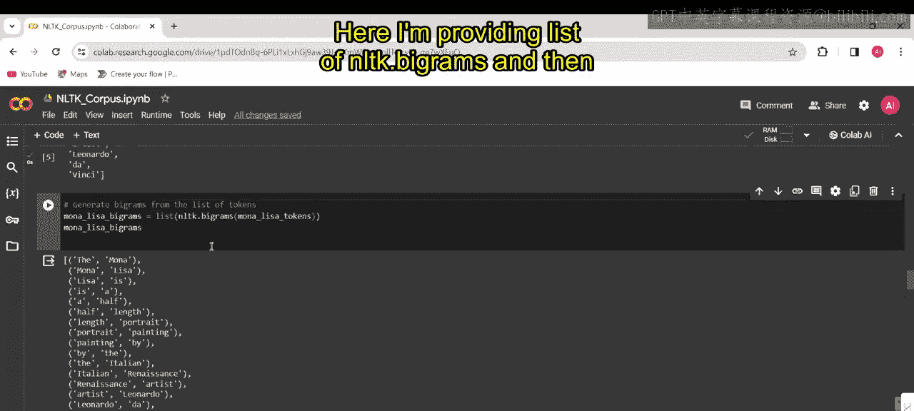
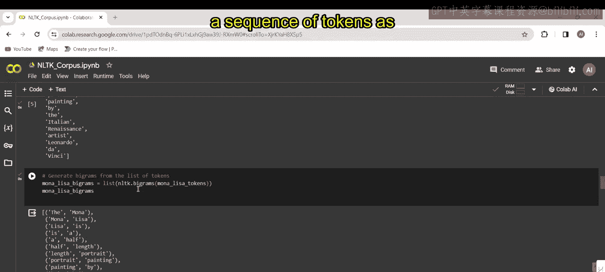
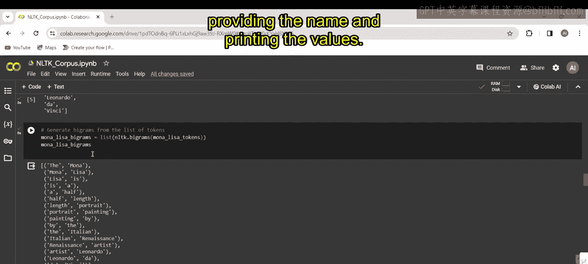
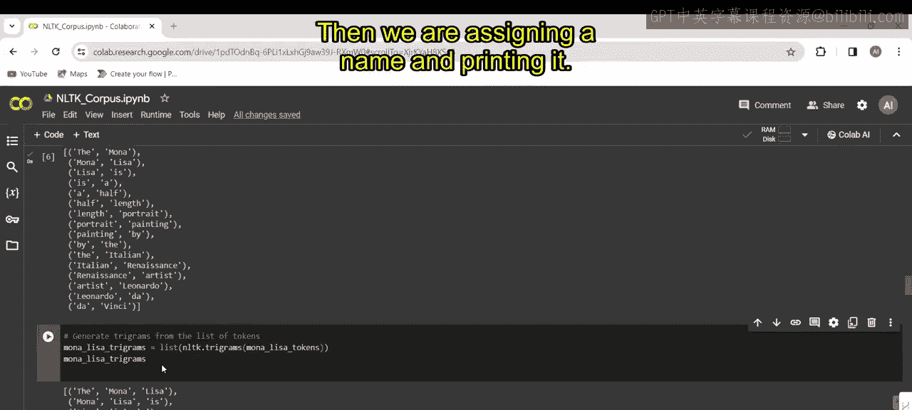
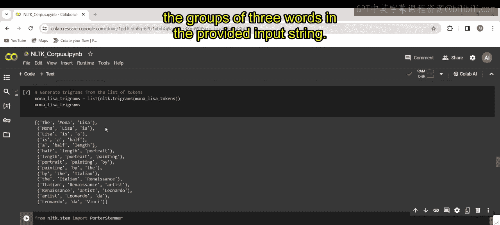
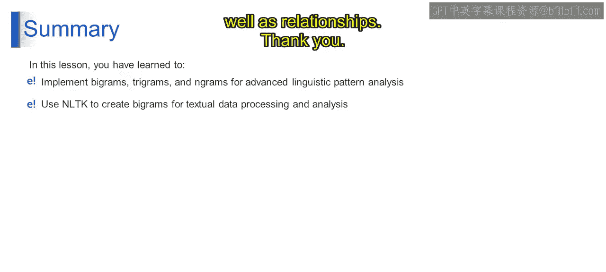

# Edureka《通过LLMs学习生成式人工智能（机器学习和NLP基础，第1课／共4课）｜Learn Generative AI with LLMs》中英字幕 - P110：109_二元组、三元组和n元组演示.zh_en - GPT中英字幕课程资源 - BV1q4421Q7qh

So let's now explore the progression from our previous discussion。 Let's say， for example。

 I am having this code。 first of all。 So my aim is to convert the provided sentence into pgram trigram and engrams。

 So let's understand how it is going to work。 The first thing is that from NltK dot us。

 u import pgram trigram Ngram。 So what it will do， This line imports the functions for generating bigram trigram and Ngrams from the Nltk library。

 These functions will be used to create different types of sequence from the tokenized text。

 Then we are importing the Nltk。 This line imports the Nltk library。

 which is necessary for the tokenization。 Then now we declared a string。

 The Mona lia is a half lengthth portrait painting by the Italian。😊。

Renaissance artist Leonardo davanci， so we separated the provided names into different words so let's understand how it is going to work in this this line defines the input string which contains a sentence about Monisa painting right so now let's tokenize this provided string by performing NlTK dot word tokenize and now here you are passing the string so let's understand how it is going to work this line tokenizes the input string into individual words using the word underscore tokenize function from NLTK so what it will do lets execute it。

😊。

Okay， so I am having an error first of all I need to download the punt This line will allow you to download punet tokenizer model for English and make them available for the tokenization So what is the use of it it is one of the tokenizer this punt tokenizer is an algorithmic tool used for tokenization specially designed to handle the splitting of the text into individual tokens like words or punctuation marks it's included in NLTK library for Python and widely used in NLP tasks so now let's execute then So now if we can execute mono li tokens can you all see this now it provided entire provided sentence into individual tokens means what it does it breaks down the sentence into list of words which will be used to generate bygrams trigrams and ngrams Now mono Lisaer tokens。

😊。

Contain a list of tokens nothing but words extracted from the input string。

 The mono Lisaa is halfland portrait and etc。 So these tokens will be used for generation of bygrams I said right so now let's see how it is going to work。

 So let's convert it into the bigrams first here I am providing list of NlTK dot bygrams and then I am passing these provided tokens as an input to the NlTK dot diagramgram and I am then now trying to print it。

 So let's execute it。 So what we are getting out of it。😊。

NLTK dot diagram， the name itself is indicating of monolier tokens。

 This line generates the bis of the list of tokens Mona tokenss are pairs of adjacent words in a sequence of text the NLTK diagram function takes a sequence of tokens as input and es as a generator Then we are having here。

 what about this list in this the list this part of the code converts the generated object es by NlTK into a list this conversation allows us to access and print the diagrams as a list of tus。

 Then the next one we are providing the name and printing the values。

 So now let's understand similarly the tri here we are providing NltK dot diagram similarly This line generates the tris from the list of tokens of。

😊。

are tokens trigrams are triplets。 That is what we understood from the previous module right so previous slide right means trigrams are triplets of adjacent words in a sequence of text the NTK dot tri。

 the function takes a sequence of tokens as inputs and e trigram as a generator and again。

 then it will be converted it into a list means the part of the code converts the generator object es by NltK dot tri into list This conversion allows us to access and print the tris as a list of tus。

 Then we are assigning a name and printing it。 Now you can see the output here Each tuple in the list represents a trigram where the first three letters are consecutive words in the input string。

 This list of tri provides insights into the sequential relationship better。😊。

The groups of three words in the provided input string。

 So thats all about the trigram Here we are having the same example， C bigram and trigram output。

Now the summary in this you have gained the proficiency in implementing bygrams。

 trigrams and ngrams for advanced linguistic pattern analysis。

 enhancing text processing and analysis capabilities， Additionally。

 you have utilized NlTK to effortlessly generate the bygrams。

 enabling the deeper insights into the textual data structures as well as relationships Thank you。😊。

