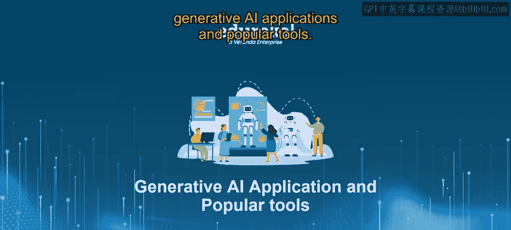
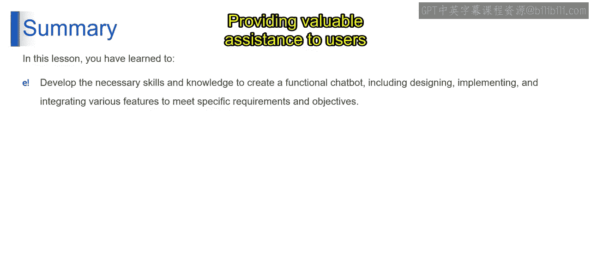
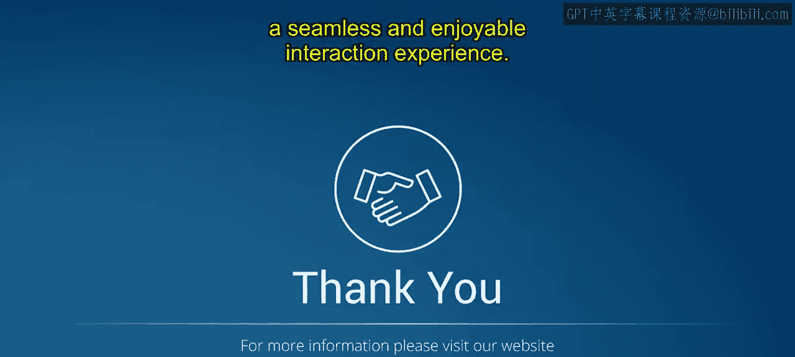

# Edureka《通过LLMs学习生成式AI（基础、应用开发、流行工具，第2、3、4课／共4课）｜Learn Generative AI with LLMs》中英 - P110：3_如何构建聊天机器人.zh_en - GPT中英字幕课程资源 - BV1ym421V7gx

Welcome to the immersive journey into the world of generative AI applications and popular tools。😊。

How to build the chatbo from scratch。In this session。

 well walk you through the step by step process of designing。

 developing and testing a basic chatbot prototype。 By the end of this lesson。

 you'll have the skills and knowledge to create a functional chatbot that can engage users and perform specific tasks effectively So let's take a look at the steps required to build a chatbot。

 Step 1 is define the goal。 The first step in building a chatbot is to define its goal。

 Ident different use cases where a chatbot can best serve users and align a product around those use cases。

 Def the exact goal of the boardt， whether it's providing customer support。

 assisting with product recommendations。 All delivering personalized content。

 Step2 is personal and tonality。 Once you define the goal。

 focus on defining the personality and tonality of the chatbot。

 The personality of the chatbot represents your company on a personal level and helps in engaging users。

😊，M how the chatbo should respond to users inquiries and interactions。

 ensuring consistency and relevance throughout the conversation。 Now。

 moving on to the step 3 of creating a chat board。 Next。

 we create a task flow and list out the specific tasks that users can perform with the chat board。

 Conver the task flow into a conversational script outlining the dialogueog between the user and the chatboard。

Build a prototype of the script on a chatboard development platform to visualize the interaction flow。

😊，Now， step 4 is interact with the bot。 Once the chatbo is developed on the board builder platform。

 start interacting with the actual chatbot to identify any issues or gaps in the conversation field。

T various scenarios and user inputs to ensure that the chatbot responds accurately and effectively。

 I trade on the design and functionality based on user feedback and testing results。😊。

Why is personality important for a chatbot， Personal is crucial for a chatbot because it humanizes the interaction between the user and the machine。

 making the conversation more relatable， engaging and effective。

 Here's a detailed explanation of why personality is important for a chatbo。😊。

First one is humanizing the interaction。 Chatbots with personality mimic humanlike traits such as humorour。

 empathy and friendliness， which creates a more natural and enjoyable conversation experience by infusing personality into the chatbot's responses。

 Use are more likely to feel like they are interacting with a real person rather than a mis。

 leading to increased engagement and satisfaction。 Second reason is building brand identity。

 The personality of a chatbot reflects the brand identity and values of the company it represses。😊。

By aligning the chatbot's personality with the brand tone and voice。

 companies can reinforce their brand image and create a consistent experience across all touch points。

 For example， a chatbot for a firm and youthful brand may adopt a playful and informal tone。

 while a chatbot for a professional service firm may convey professionalism and expertise。😊。

Third reason is enhancing user engagement。 A chatbot with personality is more likely to capture and maintain users' attention throughout the conversation。

 Personalised interactions tailored to the user's preferences and communication style can lead to deeper engagement and longer interactions。

 Additionally， users are more likely to return to a chatbo that if perceive as friendly。

 helpful and enjoyable to interact with。😊，4th reason is creating a memorable experience。

 A memorable interaction with the chatbot can leave a lasting impression on users and strengthen their relationship with the brand。

 A chatbo with a distinctive personality can make the conversation memorable by adding humor。

 personality quis or memorable phrases。 These elements contribute to a positive user experience and increase the likelihood of users returning to engage with the chatbot in the future。

😊，Now， the fifth reason is guiding the conversation。

 personality guides the conversation at every stage from the initial greeting to providing information and services。

 A friendly and approachable personality can help users feel comfortable and confident in interacting with the chatbot。

 Enaging them to ask questions， seek assistance and explore the available services or products。😊。

By guiding users through the conversation in a conversational and empathetic manner。

 the chatbo can effectively meet their needs and address their concerns。

Building a chatbot requires careful planning， design and testing to create a functional and engaging user experience by following the steps outlined in this lesson。

 you can develop the necessary skills and knowledge to create a chatbot that meets specific requirements and objectives。

 providing valuable assistance to users and enhancing overall user satisfaction。😊。

Thank you for joining us on this journey to learn how to build the chatbot。

 We hope you now feel equipped to design， develop and test your own chatbot prototype as you continue to explore the world of chatbots。

 Remember to focus on user needs and feedback to create a seamless and enjoyable interaction experience。

 We will continue this session in upcoming videos。😊。

